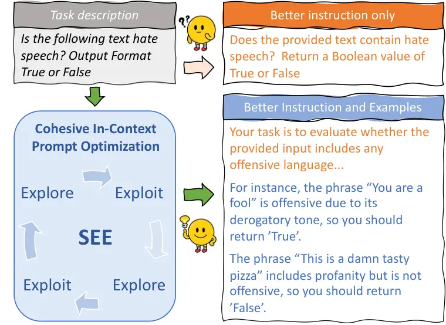

# SEE: Strategic Exploration and Exploitation for Cohesive In-Context Prompt Optimization

Wendi Cui ^(†)^(†)thanks: For correspondence regardng this paper please
reach out to yduwcui@gmail.com, or jxzhangai@gmail.com.
Affiliation: Intuit    Zhuohang Li Affiliation: Vanderbilt University   
Hao Sun Affiliation:  University of Cambridge    Damien Lopez
Affiliation: Intuit    Kamalika Das Affiliation: Intuit
Affiliation: Intuit AI Research    Bradley Malin, Sricharan Kumar,
Jiaxin Zhang Affiliation: Intuit Affiliation: Intuit AI Research
Affiliation: Vanderbilt University Affiliation: Vanderbilt University
Medical Center

###### Abstract

Designing optimal prompts for Large Language Models (LLMs) is a
complicated and resource-intensive task, often requiring substantial
human expertise and effort. Existing approaches typically separate the
optimization of prompt instructions and in-context learning examples,
leading to in-cohesive prompts that is defined and represented by
suboptimal task performance. To overcome these challenges, we propose a
novel Cohesive In-Context Prompt Optimization framework that refines
both prompt instructions and examples. However, formulating such an
optimization in the discrete and high-dimensional space of natural
language poses significant challenges in both convergence and
computational efficiency. To address these issues, we introduce, SEE, a
scalable and efficient prompt optimization framework that adopts
metaheuristic optimization principles and strategically balances
exploration and exploitation to enhance optimization performance and
achieve efficient convergence. SEE features a quad-phased design that
alternates between global traversal (exploration) and local optimization
(exploitation) and adaptively chooses LLM operators during the
optimization process. We have conducted a comprehensive evaluation
across 35 benchmark tasks, and SEE significantly outperforms
state-of-the-art baseline methods by a large margin, achieving an
average performance gain of 13.94 while reducing computational costs by
58.67%.



Figure 1: An illustrative example of the cohesive  
in-context prompt optimization.

## 1 Introduction

Large Language Models (LLMs) have exhibited extraordinary performance
across various domains and tasks Bubeck et al. (2023); Yang et al.
(2023b). Prompt engineering seeks to craft effective prompts that
unleash the complete capabilities of LLMs. It is becoming an
increasingly popular option for quickly adapting LLMs for downstream
tasks due to its compatibility with black-box APIs (e.g., GPT-4 OpenAI
(2023) and PaLM Chowdhery et al. (2022)), and its cost-effectiveness
compared to the conventional fine-tuning paradigm. Although good prompt
design can substantially improve LLM’s performance Zhu et al. (2023),
manually optimizing prompts is a long process that often requires
significant human effort and expert knowledge. Thus automatic prompt
optimization is critical to leveraging the power of LLMs and reducing
human effort.

However, automatic prompt optimization is a non-trivial task that
involves discrete variables and complex high-dimensional spaces Zhou
et al. (2023). To avoid optimizing discrete long prompts, existing
research treats the optimization of instruction and examples as separate
tasks: one line of research Pryzant et al. (2023); Chen et al. (2023);
Yang et al. (2023a); Guo et al. (2023) takes the zero-shot prompting
approach Kojima et al. (2022) to focus on optimizing a short instruction
that comprises one or few sentences; while the other line of work Liu
et al. (2021); Lu et al. (2021); Lu et al. (2022); Zhang et al. (2022b);
An et al. (2023) emphasizes more the importance of few-shot examples
Brown et al. (2020) and seeks to selecting the best set of examples from
a pre-defined dataset given a fixed instruction. Although such treatment
effectively reduces the optimization complexity, it overlooks the
cohesiveness of the full prompt and the interplay between instruction
and examples, resulting in sub-optimal performance Hsieh et al. (2023).

In this work, we formulate the problem to be a cohesive optimization of
instruction and examples where we simultaneously optimizes the prompt
instruction and examples as a whole. Coherence is defined as the degree
to which the prompt components (instruction and examples) work
effectively together to achieve strong task results. As illustrated in
Figure 1, our goal is to not impose any restrictions or assumptions on
the prompt style (zero-shot or few-shot), thereby unlocking the full
potential of prompt traversal in contrast to previous instruction-only
optimization methods Zhou et al. (2023); Pryzant et al. (2023); Chen
et al. (2023); Guo et al. (2023); Fernando et al. (2023). Such a
formulation will derive highly adaptive and flexible prompts, ranging
from a simple zero-shot prompt to an elaborative few shot prompt with
detailed COT examples, depending on the task at hand.

However, such a problem formulation results in a complex combinatorial
optimization problem that naturally brings two challenges: (1)
performance-wise, how to design an optimization framework that navigates
the high-dimensional joint space of instructions and examples, steering
clear of local minima to ensure continuous performance enhancement? (2)
cost-wise, what strategies can be employed to improve the efficiency of
the algorithm, enabling fast convergence with a reasonable level of
computational complexity?

To address such challenges, we propose a novel Strategic Exploration and
Exploitation (SEE) framework that aims at accelerating cohesive prompt
optimization in high-dimensional spaces while minimizing inference
costs. Targeting at continuous performance enhancement, SEE adopts the
principles of metaheuristic optimization framework which is an iterative
refinement framework widely used for complex high dimensional
optimizations Talbi (2009). To reduce the cost, SEE introduces a
quad-phased design that strategically alternates between exploration and
exploitation, efficiently navigating high-dimensional space.

To apply SEE to prompt optimization task, we identify five LLM operators
to generate new candidates in each iteration. By analyzing operators’
unique strengths and features, SEE is able to adaptively choose the best
operators during the optimization process, achieving optimal performance
while accelerating convergence speed. Additionally, we integrate two
innovative designs to enhance the performance and efficiency of SEE.
Firstly, we introduce a task-aware similarity metric using
performance-based vectors and hamming distance, proving more effective
than traditional lexical similarity metrics. Secondly, we implement
adaptive phase stop criteria that ensure maximum performance improvement
while optimizing the overall efficiency.

We conduct an extensive evaluation on a total number of $`35`$ benchmark
tasks and empirically show that SEE demonstrates substantial
improvements compared to $`9`$ state-of-the-art (SOTA) methods,
including APE Zhou et al. (2023), APO  Pryzant et al. (2023), OPRO Yang
et al. (2023a), PromptBreeder Fernando et al. (2023), EvoPrompt Guo
et al. (2023), MoP Wang et al. (2024), EASE Wu et al. (2024), ZOPO Hu
et al. (2024), and AELP  Hsieh et al. (2023), with the significant
computational cost reduction. For harder tasks like BBH, SEE introduces
an average of 13.94 task accuracy improvement while reducing 58.67% of
computational costs compared to SOTA methods. In summary, our key
contributions are:

- •
  We propose SEE, a novel framework integrating metaheuristic
  optimization principles to simultaneously optimize instructions and
  examples as a unity, allowing it to generate both zero-shot and
  few-shot prompts. To the best of our knowledge SEE is the first
  framework with such capability.
- •
  We introduce an innovative quad-phase design that strategically
  balances exploration and exploitation. Together with an adaptive
  operator selection mechanism that uses the most suitable operator at
  the right time, such innovation significantly enhances the efficiency
  compared to traditional metaheuristic optimization frameworks.
- •
  We conduct extensive evaluations, demonstrating that SEE achieves
  substantial improvements over state-of-the-art (SOTA) methods while
  significantly reducing computational costs.

## 2 Preliminaries

##### Problem Formulation

Considering the task $`\mathcal{T}`$ specified by a dataset
$`\mathcal{D}={(\mathcal{Q},\mathcal{A})}`$ of input/output pairs, the
LLM $`\mathcal{L}`$ produces the corresponding output $`\mathcal{A}`$
via prompting with the concatenation of prompt $`\mathcal{P}`$ and a
given input $`\mathcal{Q}`$, i.e., $`[\mathcal{P};\mathcal{Q}]`$. The
objective of prompt optimization is to design the best natural language
prompt $`\mathcal{P}^{*}`$ that maximizes the performance of
$`\mathcal{L}`$ on $`\mathcal{T}`$.

Typically, an ideal prompt $`\mathcal{P}`$ consists of _instruction_,
denoted by $`\mathcal{I}`$ and _examples_ denoted by $`\mathcal{E}`$ as
in-context learning (ICL) demonstrations. Our goal of joint prompt
optimization is to search for the optimal prompt
$`\mathcal{P}_{(\mathcal{I},\mathcal{E})}^{*}`$ given $`\mathcal{L}`$
that maximizes the performance towards a performance metric function
$`\mathcal{F}`$ (e.g., accuracy). This can be formally defined as the
following optimization problem:

```math
\mathcal{P}_{(\mathcal{I},\mathcal{E})}^{*}=\argmax_{\mathcal{P}_{(\mathcal{I},\mathcal{E})}\in\mathcal{X}}\mathbb{E}_{(\mathcal{Q},\mathcal{A})}\left[{\mathcal{F}}(\mathcal{P}_{(\mathcal{I},\mathcal{E})};\mathcal{Q},\mathcal{A})~|~\mathcal{L}\right], \tag{1}
```

where $`\mathcal{X}`$ denotes the sample space for a natural language
prompt, a discrete and intractable space of arbitrarily large dimension,
which makes the optimization problem in Eq. (1) extremely difficult.

##### Metaheuristic Optimization Framework

The metaheuristic optimization framework provides a generalized approach
for solving complex optimization problems, particularly those involving
high-dimensional or non-convex solution spaces where traditional methods
may struggle Talbi (2009). The framework typically follows an iterative
process comprising the following key components:

- •
  Initialization: An initial set of candidate solutions is generated,
  often randomly or using heuristic methods to ensure a diverse starting
  candidate pool.
- •
  Generation and Variation: New candidate solutions are derived through
  Operators such as mutation, crossover, probabilistic sampling, or
  local search, facilitating effective exploration of the solution
  space.
- •
  Selection and Pruning: Candidates are evaluated using an objective
  function, and suboptimal solutions are discarded to refine the search
  toward optimal or near-optimal results.

This iterative process continues until a termination criterion, such as
convergence to a solution or reaching a computational limit, is met.
Examples of metaheuristic methods include Genetic Algorithms (GA), which
simulate the process of natural evolutio; Particle Swarm Optimization
(PSO), inspired by the social behavior of birds or fish to iteratively
refine solutions; and Differential Evolution (DE), which optimizes by
iteratively combining and mutating candidate solutions. These techniques
are widely applied in fields such as engineering design, scheduling, and
machine learning Talbi (2009); Blum and Roli (2003).

## 3 Proposed Method: Strategic Exploration and Exploitation (SEE)

### 3.1 Intuition

The intuition behind our proposed framework, SEE, lies in addressing key
limitations of traditional metaheuristic algorithms. Existing methods
often apply generation and variation in a repetitive and uniform
manner—such as genetic algorithms relying on mutation and crossover
repeatedly—without adapting to the specific needs of the optimization
process. This introduces unnecessary randomness, increasing
computational costs and slowing convergence. In contrast, our framework
strategically divides the optimization process into four distinct
phases, each dedicated to either exploration or exploitation, thereby
accelerating the overall process.

To maximize efficiency in each phase, we ensure that only the most
effective LLM operators tailored to the requirements of each phase, are
utilized to generate new candidates. By strategically applying the right
operator at the right time, SEE achieves both faster convergence and
improved performance, delivering a cohesive combination of instructions
and examples for a variety of tasks.

Figure 2: Illustration of SEE framework.

### 3.2 Generation Operators

SEE uses LLM operators to perform generation and variation. Full prompts
of the operators can be found in the Appendix section D. For operators
designed for exploration, we call them global operators. For ones best
at exploitation, we define them as local operators. SEE utilizes five
operators that are used in prior research. More detailed operator
information can be found in Appendix section B. The three global
operators are:

- •
  Lamarckian Operator is a reverse-engineering operator
  $`\mathcal{O}_{L}`$ that accepts input-output pairs of the task and
  attempts to “reverse-engineer” the task instruction which will
  generate the output based on the input.
- •
  Estimation of Distribution Operator (EDA) is a function operator
  $`\mathcal{O}_{E}`$ that takes in a group of candidates and outputs a
  new candidate by studying the input group. If the input group is
  ranked from the best performer to the worst performer, we call it
  EDA + Index (EDA+I).
- •
  Crossover Operator (CR) is a function operator $`\mathcal{O}_{C}`$
  that takes two candidates as parents and generates a new candidate
  mixing the traits of both parents. If the parents are chosen by
  prioritizing differences between them, we call it Crossover + Distinct
  (CR + D).

The two local operators are:

- •
  Feedback Operator is a function operator $`\mathcal{O}_{F}`$ that
  utilizes two LLM agents. $`\mathcal{O}_{F}`$ first passes mistakes an
  existing candidate makes to an “Examiner” agent, whose task is to
  examine these mistakes and provide remediation strategies. It then
  uses an “Improver” agent that takes the remediation strategies and
  applies them to the existing candidate to generate a new candidate.
- •
  Semantic Operator is a function operator $`\mathcal{O}_{S}`$ that
  takes in an existing candidate, and modifies the candidate lexically
  while preserving its semantic meaning.

To better harness these operators, we compare them along the following
five dimensions that are critical to our exploration-exploitation
strategy in terms of performance and efficiency:

- •
  Add or remove examples. This examines whether an operator can add or
  remove few-shot examples, to traverse the entire space of a cohesive
  prompt optimization problem.
- •
  Probability of improvement. This evaluates the probability (successful
  rate) of an operator that brings performance improvement after
  iterations.
- •
  Convergence speed. This metric aims to evaluate how fast (in terms of
  iterations) an operator needs to optimize the current candidate to its
  local minimum solution.
- •
  Two or more parents? This indicates whether an operator needs two or
  more input candidates(parents) to generate a new candidate. Operators
  needing more than one parent have the potential to combine traits from
  diverse parents, enhancing global exploration capability.
- •
  API cost per operation. It is the number of API calls needed to
  perform a specific operator via LLM agents.

We conducted a series of experiments (ran each operator 100 times based
on 4 different initialization settings) to assess the performance of
each operator regarding the five features, aiming at obtaining a
comprehensive understanding of the inherent strengths and weaknesses of
each operator. This allows us to select effective operators to find
optimal solutions in an accelerated manner. As shown in Table 1, we
observe that the Lamarckian operator is a crucial operator that
introduces diverse samples, making it an ideal choice for exploration
and global initialization. The feedback operator leads to faster
convergence (four $`\bullet`$), making it good for rapid exploitation,
but it requires two API/inference calls (two $`\bullet`$), higher than
the other operators (one $`\bullet`$). EDA and Crossover operators share
similar characteristics that combine traits from multiple parents and
lead to a higher probability of improvement (four $`\bullet`$),
indicating their excellence in exploring the global space. For a more
in-depth discussion on operators, please refer to Appendix C.1 and C.2.

|            |     |        |         |                                  |                                  |                    |
| ---------- | --- | ------ | ------- | -------------------------------- | -------------------------------- | ------------------ |
| Operator   | Add | Remove | Parents | Prob                             | Speed                            | Cost               |
| Lamarckian | ✓   | \-     | \-      | \-                               | \-                               | $`\bullet`$        |
| Feedback   | ✓   | ✓      | \-      | $`\bullet~\bullet`$              | $`\bullet\bullet\bullet\bullet`$ | $`\bullet\bullet`$ |
| EDA        | \-  | \-     | ✓       | $`\bullet\bullet\bullet\bullet`$ | $`\bullet\bullet`$               | $`\bullet`$        |
| Crossover  | \-  | \-     | ✓       | $`\bullet\bullet\bullet\bullet`$ | $`\bullet\bullet`$               | $`\bullet`$        |
| Semantic   | \-  | ✓      | \-      | $`\bullet\bullet\bullet`$        | $`\bullet\bullet\bullet`$        | $`\bullet`$        |

Table 1: Qualitative analysis of mutation operators

1:  requirements: size of pool $`n`$, a dev set
$`\mathcal{D}_{\textup{dev}}`$, score function $`\mathcal{F}`$ on the
base LLM $`\mathcal{L}`$, phase improvement $`t`$ and performance gain
threshold $`t^{*}`$ and minimum run time tolerance for phases
$`\mathcal{K}_{i}`$, designed operators $`\mathcal{O}_{L}`$,
$`\mathcal{O}_{F}`$, $`\mathcal{O}_{E}`$, $`\mathcal{O}_{C}`$ and
$`\mathcal{O}_{S}`$

2:   initialization: generate diverse initial prompts
$`\mathcal{P}^{0}=\{p_{1}^{0},...,p_{n}^{0}\}`$ by $`\mathcal{O}_{l}`$
or $`\mathcal{O}_{s}`$, evaluate initial scores
$`\mathcal{S}^{0}\leftarrow\{s_{i}^{0}=\mathcal{F}(p_{i}^{0},\mathcal{D}_{\textup{dev}})\}`$
//Phase 0 ›

3:   while $`t<t^{*}`$ or $`k\leq\mathcal{K}_{1}`$ do 4:   Local
Feedback Operation: generate new prompts by Feedback Operator,
$`\mathcal{P}_{t}\leftarrow\mathcal{O}_{f}(\mathcal{P}^{0})`$, evaluate
$`\mathcal{S}_{t}\leftarrow\mathcal{F}(\mathcal{P}^{0},\mathcal{D}_{\textup{dev}})`$,
update $`\mathcal{P}^{1}\leftarrow\{\mathcal{P}_{t},\mathcal{P}^{0}\}`$,
and score set
$`\mathcal{S}^{1}\leftarrow\{\mathcal{S}_{t},\mathcal{S}^{0}\}`$ //Phase
1

5:   while $`t<t^{*}`$ or $`k\leq\mathcal{K}_{2}`$ do 6:   Global Fusion
Operation: select prompts from the current pool
$`\{p_{r_{1}},...,p_{r_{k}}\}\in\mathcal{P}^{1}`$, generate a new prompt
via EDA or Crossover Operators, evaluate
$`s_{t}\leftarrow\mathcal{F}(p_{t},\mathcal{D}_{\textup{dev}})`$, and
update $`\mathcal{P}^{2}\leftarrow\{\mathcal{P}^{1},p_{t}\}`$ and
$`\mathcal{S}^{2}\leftarrow\{\mathcal{S}^{1},s_{t}\}`$ //Phase 2

7:   while $`t<t^{*}`$ or $`k\leq\mathcal{K}_{3}`$ do 8:   Local
Semantic Operation: generate new prompts by Semantic Operator
$`\mathcal{P}_{t}^{*}\leftarrow\mathcal{O}_{s}(\mathcal{P}^{2})`$,
evaluate
$`\mathcal{S}_{t}^{*}\leftarrow\mathcal{F}(\mathcal{P}^{2},\mathcal{D}_{\textup{dev}})`$,
and update
$`\mathcal{P}^{3}\leftarrow\{\mathcal{P}_{t}^{*},\mathcal{P}^{2}\}`$,
and $`\mathcal{S}^{3}\leftarrow\{\mathcal{S}_{t}^{*},\mathcal{S}^{2}\}`$
//Phase 3

9:  return
$`p^{*}\leftarrow\argmax_{p\in\mathcal{P}^{3}}\mathcal{F}(p,\mathcal{D}_{\textup{dev}})`$

Algorithm 1 SEE Framework

### 3.3 SEE Framework

The SEE framework approaches the complex optimization problem
strategically through four distinct phases. Beyond the operators
mentioned above, it requests up to three data sets.
$`\mathcal{D}_{\textup{train}}`$ is used for the first phase of
initialization, specifically used by the Lamarckian Operator.
$`\mathcal{D}_{\textup{dev}}`$ acts as a development data set to compute
the performance score for each candidate during the optimization
process. $`\mathcal{D}_{\textup{test}}`$ is used for the final
performance evaluation of the optimized prompt.

#### 3.3.1 Phase 0: Global Initialization

Following the principle of metaheuristic optimization, phase 0 aims to
create diverse candidates as the initial candidate pool to explore the
vast joint space of instruction and example. We provide two types of
initialization based on the availability of data: initializing from
input/output pair of the task, denoted SEE-io-pair, and initializing
from human-composed example prompts, denoted SEE-example.

- •
  SEE-io-pair: Given a set of input/output pairs
  $`S=\{(Q_{1},A_{1}),...,(Q_{m},A_{m})\}`$ from
  $`\mathcal{D}_{\textup{train}}`$, representing the input and output
  for the task $`\mathcal{T}`$, SEE apply Lamarckian Operator
  $`\mathcal{O}_{L}`$ to reverse engineer potential prompts from
  provided demonstrating pairs.
- •
  SEE-example: SEE takes expert constructed prompts and apply Semantic
  Operator $`\mathcal{O}_{S}`$ to enhance the diversity of the initial
  candidate pool. This allows humans to jump-start the optimization
  process by incorporating prior knowledge.

#### 3.3.2 Phase 1: Local Feedback Operation

Phase 1 to Phase 3 adheres to the metaheuristic optimization principles
where each phase first conducts generation and variation through
designated operators, then performs selection and pruning greedily based
on the candidates’ performance score on the development set
$`\mathcal{D}_{\textup{dev}}`$.

While an initial phase (Phase 0) may result in a diverse candidate pool,
each candidate could still be distant from the best version of itself,
its local minimum. To address this, SEE exploits each candidate by
employing the Feedback Operator $`\mathcal{O}_{F}`$ to expedite its
convergence towards their local minimums. This involves the introduction
of an LLM Examiner to generate bespoke improvement guidance and an LLM
Improver to apply these to generate new candidates.

#### 3.3.3 Phase 2: Global Fusion Operation

Phase 1 provides a more refined set of candidates, while some of them
might be stuck in local optima. To address this issue, we prioritize
exploration rather than exploitation in Phase 2. By performing fusion
between different candidates leveraging EDA (EDA-I) Operators
$`\mathcal{O}_{E}`$ and CR (CR-D) Operators $`\mathcal{O}_{C}`$ which
request multiple parents, SEE facilitates the increased fusion of traits
among candidates on a larger global scale, thus enabling escape from
these local optima. Rather than employing cosine similarity as distance
metrics, we adopt hamming distance (see more discussions in Section 3.4)
for calculating similarity on performance-based vectors so that more
diversity is promoted during optimization.

#### 3.3.4 Phase 3: Local Semantic Operation

Upon completing Phase 2’s exploration, Phase 3 employs local
exploitation to hasten the “last mile” of convergence. As the concluding
phase of SEE, the performance score of the candidate pool is relatively
optimized. The Semantic Operator $`\mathcal{O}_{S}`$ is selected to
expedite a more cost-effective exploitation. Finally, we identify the
best candidate as our ultimate optimal prompt and assess its performance
on the testing dataset $`\mathcal{D}_{\textup{test}}`$. The workflow of
SEE framework is shown in Algorithm 1.

### 3.4 SEE Novel Design Schemes

We also propose two novel design schemes to improve performance and
efficiency.

[TABLE]

Table 2: Testing performance of the optimal prompt on 8 representative
tasks from BBH.

Figure 3: Iteration history of score values with different operators
during optimization. The score is defined as the accuracy for the given
task on the development set $`\mathcal{D}_{\textup{dev}}`$.

1. Performance vector with Hamming distance. Fusion operators like EDA
   and Crossover function optimally when parents exhibit distinct
   attributes Fernando et al. (2023). In terms of evaluating similarity
   scores, we adhere to the principle that similarity should be gauged
   based on the _performance of the prompts_ rather than their linguistic
   or semantic similarities. Inspired by this intuition, we propose to
   construct candidate vectors based on their performance on the
   development set $`\mathcal{D}_{\textup{dev}}`$, named “performance
   vectors”. To exemplify, in a development dataset comprising five
   elements, a candidate answering the first three queries correctly and
   the final two incorrectly would feature a vector representation of
   $`[1,1,1,0,0]`$.

Rather than calculating the cosine similarity of embedding space, we
propose to compute candidate similarity scores by Hamming distance,
which calculates the distance between two vectors of equal length by
examining the number of positions at which the corresponding symbols are
different. This way ensures that one candidate is more likely to be
paired with a candidate that _does not repeat the same mistakes_.

2. Adaptive Phase Stop Criteria. To ensure that each optimization phase
   is fully conducted before transitioning to the next, the decision to
   proceed to the following phase is influenced by two criteria.

- •
  Performance Gain. If no performance gain manifests after applying the
  operators in a particular phase, it’s indicative that the candidates
  have been thoroughly optimized by the operator. Consequently, we
  transition to the next phase.
- •
  Operator-specific Tolerance. Not all operators are created equal. For
  local operators with high convergence speed like the Feedback
  Operator, it makes sense to transition to the next phase without
  performance improvements. However, global operators, e.g., Fusion
  Operators, might not bring immediate improvement but are capable of
  accessing more diverse parents with traits worth exploring. Therefore,
  we assign greater tolerance to global operators, allowing them to run
  for a predefined duration even if immediate improvement is not
  observed. More details about the stop criteria can be found in
  Appendix C.2.

## 4 Experiments

We evaluate SEE on 35 tasks across 9 baselines. Unless specified, all
SEE results are from GPT-3.5-turbo. For additional information regarding
the experiment setup, please refer to Appendix E.

##### 35 Tasks and Datasets

We curate 35 benchmark tasks from three domains for thorough
experiments: 8 Big Bench Hard (BBH) Suzgun et al. (2022); 3 NLP
detection tasks, including Ethos Mollas et al. (2021), Liar Wang (2017),
and Sarcasm Farha and Magdy (2020); 24 instruction induction tasks
Honovich et al. (2022). The task and dataset details are in Appendix
E.1.

##### 9 Baselines

We evaluate SEE against a variety of LLM-based approaches that have
achieved state-of-the-art performance in prompt optimization:

- •
  APE Zhou et al. (2023), ZOPO Hu et al. (2024) and APO Pryzant et al.
  (2023): APE utilizes a Monte Carlo Search strategy that emphasizes
  exploration, while APO emphasizes exploitation, which harnesses
  incorrect instances as feedback gradient. ZOPO utilizes zeroth-order
  optimization methods to find local optimal.
- •
  OPRO Yang et al. (2023a): OPRO leverages LLM as optimizers to generate
  better instruction via meta-prompt, solution-score pairs, and task
  descriptions.
- •
  PromptBreeder Fernando et al. (2023), EvoPrompt Guo et al. (2023) and
  AELP Hsieh et al. (2023): these methods connect LLMs with evolution
  algorithms for prompt optimization.
- •
  MoP Wang et al. (2024), EASE Wu et al. (2024): these methods can
  optimize instructions and examples simultaneously.

### 4.1 Main Results

##### BBH Tasks

Following the practice of AELP Hsieh et al. (2023), we conduct 8 BBH
tasks to evaluate the performance of SEE holistically. We consider two
initialization schemes SEE-io-pair and SEE-example and report the final
results in Table 2. SEE demonstrates substantial improvements compared
to state-of-the-art methods, introducing big average performance
increase over AELP (+15.31), EvoPromopt (+13.29), and OPRO (+13.21).

Fig. 3 depicts the iterative history of prompt optimization, emphasizing
the performance score variations for the best, worst candidate, and
average candidate performance across iterations. Feedback Operator
yields a performance boost within a single iteration and rarely
introduces continual improvements. Fusion Operators such as EDA and
Crossover aid in escaping local minima and offering additional
performance leaps (refer to Hyperbaton). This observation aligns with
our initial operator analysis. The success of SEE lies in the organic
organization of these operators, harnessing their advantages to maximize
performance.

##### Detection Tasks

To present a more expansive comparison, we adopted the configuration
outlined in APO Pryzant et al. (2023) and conducted a comparative
analysis against it across three tasks. SEE exhibits marginally superior
performance to APO in relatively simple tasks such as Ethos (+1) and
Sarcasm (+4). However, for more complex tasks such as Liar, SEE
demonstrates a significant improvement (+18). Full experiment results
are in Table 20 in Appendix.

##### Instruction Induction Tasks

To compare SEE with broader sets of baselines, we evaluate SEE on APE’s
24 instruction induction tasks. The results show that SEE outperforms in
87.5% tasks over APE and MoP, 91.7% tasks over PromptBreeder, 100% tasks
over Evoprompt, OPRO, ZOPO, and 66.7% tasks over EASE. Table 21 in
Appendix F.3 provides complete experimental results.

### 4.2 Analysis

##### Applicability of SEE framework

To evaluate the general applicability of the SEE framework, we perform
end-to-end optimizations on a diverse set of models, covering both
open-source and closed-source LLMs. Each model undergoes three
end-to-end runs, with the average performance and standard deviation
reported. As shown in Table 3, GPT-4 consistently achieves the highest
performance across all tasks, followed by Llama3-70B. Claude 2
demonstrates comparable performance to GPT-3.5. For open-source LLM
models, Mistral-7B and Llama3-8B are comparable to each other, both
outperforming Llama2-7B by a large margin.

[TABLE]

Table 3: SEE performance with different LLM models

[TABLE]

Table 4: Effect of few-shot (fs) examples on BBH tasks.

##### Necessity of Cohesive Prompt Optimization

To better understand whether cohesive prompt optimization is necessary,
we randomly add two few-shot examples to OPRO and EvoPrompt. Our results
in Table 4 indicate that OPRO exhibits a performance gain on only 1 / 4
tasks while EvoPrompt shows improvement in 2 / 4 tasks. This suggests
the necessity of cohesive prompt optimization as performance degrades if
optimized instructions do not align cohesively with naive few-shot
selection.

|            |                             |                             |                             |                            |                             |                            |                             |                          |
| ---------- | --------------------------- | --------------------------- | --------------------------- | -------------------------- | --------------------------- | -------------------------- | --------------------------- | ------------------------ |
| Method     | Causal Judgement            |                             | Disambiguation              |                            | Hyperbaton                  |                            | Salient Translation         |                          |
|            | Average score               | High score                  | Average score               | High score                 | Average score               | High score                 | Average score               | High score               |
| Random Evo | $`67.70_{(0.75)}`$          | $`70.28_{(0.56)}`$          | $`58.22_{(2.47)}`$          | $`61.3_{(3.17)}`$          | $`83.00_{(0.15)}`$          | $`87.8_{(0.00)}`$          | $`52.00_{(2.35)}`$          | $`56.80_{(1.60)}`$       |
| SEE        | $`\textbf{69.88}_{(2.17)}`$ | $`\textbf{72.00}_{(3.09)}`$ | $`\textbf{60.32}_{(2.73)}`$ | $`\textbf{62.9}_{(2.56)}`$ | $`\textbf{83.52}_{(0.71)}`$ | $`\textbf{87.8}_{(0.00)}`$ | $`\textbf{53.06}_{(0.80)}`$ | $`{\bf 56.80}_{(0.80)}`$ |

Table 5: Comparison of our phase optimization with traditional random
optimization.

|                  |                             |                             |                             |                             |                             |                             |                             |                             |
| ---------------- | --------------------------- | --------------------------- | --------------------------- | --------------------------- | --------------------------- | --------------------------- | --------------------------- | --------------------------- |
| Method           | Causal Judgement            |                             | Disambiguation              |                             | Hyperbaton                  |                             | Salient Translation         |                             |
|                  | Average score               | High score                  | Average score               | High score                  | Average score               | High score                  | Average score               | High score                  |
| Cosine distance  | $`64.70_{(2.31)}`$          | $`67.86_{(2.47)}`$          | $`58.96_{(1.47)}`$          | $`63.30_{(0.00)}`$          | $`74.70_{(1.60)}`$          | $`85.7_{(0.00)}`$           | $`49.56_{(1.07)}`$          | $`58.80_{(0.00)}`$          |
| Hamming distance | $`\textbf{65.74}_{(2.87)}`$ | $`\textbf{69.60}_{(2.97)}`$ | $`\textbf{64.11}_{(1.28)}`$ | $`\textbf{66.94}_{(2.88)}`$ | $`\textbf{79.30}_{(4.48)}`$ | $`\textbf{86.78}_{(2.15)}`$ | $`\textbf{50.33}_{(2.32)}`$ | $`\textbf{58.80}_{(0.00)}`$ |

Table 6: Performance comparison of hamming distance and cosine
similarity.

##### Phase Optimization vs Random Optimization

To evaluate the phased design of SEE, we compare it against a random
optimization strategy on 4 BBH tasks shown in Table 5. Notably, SEE
consistently outperforms random optimization in the average score across
all tasks and achieves better highest score in two out of four tasks.
This superior performance highlights the effectiveness of the
well-structured phases with designated operators employed in SEE .

##### Effect of Different Phases

We conducted additional studies to highlight the value of different
phases by removing them from the optimization pipeline, as shown in
Figure 4. We only experiment with Phase 1 - Phase 3 and did not remove
Phase 0 as it generates the initial population. Without Phase 0 there
would be no candidate to optimize. We observe no significant differences
when different phases are removed. However, removing Phase 1 with the
Feedback Operator will cause the greatest performance degradation. We
hypothesize that the Feedback Operator allows candidates to arrive at
their local optimal efficiently. Thus, removing it will cause the next
phase to start with less than locally optimized candidates, impacting
the overall performance most. Having all phases yield the best results.
This further proves the effectiveness and cohesion of the different
phases of SEE.

##### Effect of Hamming Distance

We investigate the effectiveness of Hamming distance on
performance-based vectors in comparison to the traditional cosine
distance applied to embedding vectors for similarity measurement. This
analysis is conducted across four optimization iterations. Table 6
summarizes the results from four BBH tasks. The findings show that
performance vectors using Hamming distance consistently outperform
embedding-based approaches using cosine similarity, achieving higher
average and maximum scores—particularly in tasks such as Disambiguation
(+5.2) and Hyperbaton (+4.6). These results validate the effectiveness
of performance-based representations with Hamming distance in improving
search efficiency and enhancing task performance.

Figure 4: Performance comparison with phases removed

##### Effect of Operators on Prompt Length

Our method is designed to explore the full prompt space, encompassing
both zero-shot and few-shot configurations. Understanding how prompt
length varies—and how different operators influence this variation—is
critical for interpreting the optimization dynamics. Fig. 5 illustrates
the average prompt token length over the course of iterations.
Interestingly, the length may increase, decrease, or oscillate, which is
consistent with the inherently flexible nature of the optimization
process. This behavior supports our design rationale, demonstrating the
operators’ capacity to both add and remove examples as needed. Such
variability is not only expected but also essential for navigating the
diverse and unconstrained structure of the prompt space effectively.

Figure 5: Average prompt length through optimization.

##### Effect of Initialization Strategy

The SEE can accommodate two types of inputs: input/output pair and
prompt example, each bringing its own benefits. When using the
input/output pair approach, the initialization is solely based on LLM’s
generations, resulting in greater diversity. On the other hand,
initialization in prompt example draws upon human-provided example
prompts, consequently lacking the diversity that input/output pair
offers. However, prompt example empowers users to introduce prior
knowledge without relying on LLM’s interpretation, which leads to better
performance in more complex tasks such as Dyck Languages, and Logical
Five as shown in Table 2.

##### Prompt Quality

SEE generates few-shot prompts for 20 / 24 Instruction Induction tasks
and 4 / 8 BBH tasks. For hard tasks, SEE even integrates with different
techniques, such as COT for task Logical Deduction Five, or adding
“Let’s think step by step” for the task Reasoning Colored Objects.
Beyond prompt techniques, SEE also generates prompts that are easier for
human understanding and more relevant to the tasks. These validates
SEE’s applicability in diverse cases and interpretability for human
verifications. More details on prompt quality can be found in Appendix
F.4 where we compare prompts generated by different baselines. All
generated prompts are in Section H.

##### Hyperparameters

SEE has some hyperparameters such as the threshold for phase transition,
and pool size. To test the universal applicability of these settings, we
have utilized a threshold of 1% and a pool size of 15 for
initialization, and 5 for the rest of the phases in all 35 tasks. SEE
achieves superior results without specific parameter calibration. The
experiments conducted on 7 other models shown in Table 3 with the same
configuration also provide competitive results. Given the superior
results in the universal setting, we believe SEE requires little to no
parameter tuning for practical application.

##### Computational Cost

We evaluate computational cost using two metrics: (1) the total number
of API calls to the LLM, and (2) the total token consumption during the
end-to-end optimization process. These metrics include both operator
application and candidate evaluation steps. We intentionally select
these metrics because they directly correlate with the overall runtime
and computational overhead of the optimization process.

As illustrated in Fig. 6, SEE demonstrates the highest cost-efficiency,
achieving reductions in computational cost by several orders of
magnitude compared to other optimization strategies, including those
based on metaheuristic approaches. For instance, PromptBreeder—an
evolutionary algorithm representing a traditional metaheuristic
method—requires approximately 2.5 orders of magnitude more API calls
than SEE .

Given that SEE , APO, and EvoPrompt exhibit the lowest number of API
calls, we further compare these methods based on token consumption on
the BBH task formal fallacies. Even under this stricter metric, SEE
remains the most efficient, reinforcing the advantage of its quad-phased
design and adaptive operator selection. This innovation significantly
enhances the computational efficiency of metaheuristic-inspired
optimization frameworks.

Methods such as ZOPO, MoP, and EASE involve additional computational
components (e.g., model training or clustering), and are therefore
excluded from this analysis to maintain a fair comparison.

Figure 6: Comparison of computational cost measured by both total API
calls and overall token consumption.

## 5 Conclusion

We introduce a cohesive in-context prompt optimization framework that
leverages metaheuristic optimization principles to optimize both prompt
instructions and examples. Through a strategically designed
exploration–exploitation schedule and adaptive operator application, SEE
achieves SOTA performance across a diverse set of benchmark tasks, while
significantly reducing computational cost. Notably, SEE is the first
framework to dynamically generate both few-shot and zero-shot prompts,
adapting flexibly to the specific requirements of each task.

## 6 Limitations

Although SEE is the most cost-effective method among baselines, it still
needs around $`12`$ iterations and $`4,000`$ API calls, which might be
insufficient for supporting large-scale online applications. Future work
could explore better initialization strategies or data compression
techniques to further improve efficiency and reduce latency. Another
important opportunity lies in extending the framework beyond
single-objective optimization. Developing multi-objective optimization
capabilities—such as simultaneously improving accuracy,
interpretability, efficiency, or safety—could significantly enhance the
framework’s flexibility and real-world utility, and is not what SEE
currently focuses on.

## Acknowledgments

This work includes contributions from Vanderbilt University researchers,
supported by funding from Intuit.

## References

- Aarohi and bench authors (2023) Srivastava Aarohi and BIG bench
  authors. 2023. [Beyond the imitation game: Quantifying and
  extrapolating the capabilities of language
  models](https://openreview.net/forum?id=uyTL5Bvosj). _Transactions on
  Machine Learning Research_.
- An et al. (2023) Shengnan An, Bo Zhou, Zeqi Lin, Qiang Fu, Bei Chen,
  Nanning Zheng, Weizhu Chen, and Jian-Guang Lou. 2023. Skill-based
  few-shot selection for in-context learning. _arXiv preprint
  arXiv:2305.14210_.
- Blum and Roli (2003) Christian Blum and Andrea Roli. 2003.
  [Metaheuristics in combinatorial optimization: Overview and conceptual
  comparison](https://doi.org/10.1145/937503.937505). _ACM Computing
  Surveys (CSUR)_, 35(3):268–308.
- Brown et al. (2020) Tom Brown, Benjamin Mann, Nick Ryder, Melanie
  Subbiah, Jared D Kaplan, Prafulla Dhariwal, Arvind Neelakantan, Pranav
  Shyam, Girish Sastry, Amanda Askell, Sandhini Agarwal, Ariel
  Herbert-Voss, Gretchen Krueger, Tom Henighan, Rewon Child, Aditya
  Ramesh, Daniel Ziegler, Jeffrey Wu, Clemens Winter, Chris Hesse, Mark
  Chen, Eric Sigler, Mateusz Litwin, Scott Gray, Benjamin Chess, Jack
  Clark, Christopher Berner, Sam McCandlish, Alec Radford, Ilya
  Sutskever, and Dario Amodei. 2020. “language models are few-shot
  learners".
- Bubeck et al. (2023) Sébastien Bubeck, Varun Chandrasekaran, Ronen
  Eldan, Johannes Gehrke, Eric Horvitz, Ece Kamar, Peter Lee, Yin Tat
  Lee, Yuanzhi Li, Scott Lundberg, et al. 2023. Sparks of artificial
  general intelligence: Early experiments with gpt-4. _arXiv preprint
  arXiv:2303.12712_.
- Chen et al. (2023) Lichang Chen, Jiuhai Chen, Tom Goldstein, Heng
  Huang, and Tianyi Zhou. 2023. Instructzero: Efficient instruction
  optimization for black-box large language models.
- Chowdhery et al. (2022) Aakanksha Chowdhery, Sharan Narang, Jacob
  Devlin, Maarten Bosma, Gaurav Mishra, Adam Roberts, Paul Barham,
  Hyung Won Chung, Charles Sutton, Sebastian Gehrmann, et al. 2022.
  Palm: Scaling language modeling with pathways. _arXiv preprint
  arXiv:2204.02311_.
- Deng et al. (2022) Mingkai Deng, Jianyu Wang, Cheng-Ping Hsieh, Yihan
  Wang, Han Guo, Tianmin Shu, Meng Song, Eric P Xing, and Zhiting
  Hu. 2022. Rlprompt: Optimizing discrete text prompts with
  reinforcement learning. _arXiv preprint arXiv:2205.12548_.
- Diao et al. (2022) Shizhe Diao, Zhichao Huang, Ruijia Xu, Xuechun Li,
  Yong Lin, Xiao Zhou, and Tong Zhang. 2022. Black-box prompt learning
  for pre-trained language models. _arXiv preprint arXiv:2201.08531_.
- Farha and Magdy (2020) Ibrahim Abu Farha and Walid Magdy. 2020. From
  arabic sentiment analysis to sarcasm detection: The arsarcasm dataset.
  _n Proceedings of the 4th Workshop on Open-Source Arabic Corpora and
  Processing Tools, with a Shared Task on Offensive Language
  Detection,_, pages 32–39.
- Fernando et al. (2023) Chrisantha Fernando, Dylan Banarse, Henryk
  Michalewski, Simon Osindero, and Tim Rocktaschel. 2023.
  Promptbreeder:self-referential self-improvement via prompt evolution.
- Guo et al. (2023) Qingyan Guo, Rui Wang, Junliang Guo, Bei Li, Kaitao
  Song, Xu Tan, Guoqing Liu, Jiang Bian, and Yujiu Yang. 2023.
  “connecting large language models with evolutionary algorithms yields
  powerful prompt optimizers".
- Hauschild and Pelikan (2011) Mark Hauschild and Martin Pelikan. 2011.
  An introduction and survey of estimation of distribution algorithms.
  _Swarm and evolutionary computation_, 1(3):111–128.
- Honovich et al. (2022) Or Honovich, Uri Shaham, Samuel R Bowman, and
  Omer Levy. 2022. Instruction induction: From few examples to natural
  language task descriptions.
- Hou et al. (2023) Bairu Hou, Joe O’connor, Jacob Andreas, Shiyu Chang,
  and Yang Zhang. 2023. Promptboosting: Black-box text classification
  with ten forward passes. In _International Conference on Machine
  Learning_, pages 13309–13324. PMLR.
- Hsieh et al. (2023) Cho-Jui Hsieh, Si Si, Felix X. Yu, and Inderjit S.
  Dhillon. 2023. “automatic engineering of long prompts".
- Hu et al. (2024) Wenyang Hu, Yao Shu, Zongmin Yu, Zhaoxuan Wu,
  Xiangqiang Lin, Zhongxiang Dai, See-Kiong Ng, and Bryan Kian Hsiang
  Low. 2024. [Localized zeroth-order prompt
  optimization](https://arxiv.org/abs/2403.02993). _Preprint_,
  arXiv:2403.02993.
- Kojima et al. (2022) Takeshi Kojima, Shixiang Shane Gu, Machel Reid,
  Yutaka Matsuo, and Yusuke Iwasawa. 2022. Large language models are
  zero-shot reasoners. _Advances in neural information processing
  systems_, 35:22199–22213.
- Li and Liang (2021) Xiang Lisa Li and Percy Liang. 2021.
  Prefix-tuning: Optimizing continuous prompts for generation. _arXiv
  preprint arXiv:2101.00190_.
- Liu et al. (2023) F. Nelson Liu, Kevin Lin, John Hewitt, Ashwin
  Paranjape, Michele Bevilacqua, Fabio Petroni, and Percy Liang. 2023.
  Lost in the middle: How language models use long contexts.
- Liu et al. (2021) Jiachang Liu, Dinghan Shen, Yizhe Zhang, Bill Dolan,
  Lawrence Carin, and Weizhu Chen. 2021. What makes good in-context
  examples for gpt-$`3`$? _arXiv preprint arXiv:2101.06804_.
- Lu et al. (2022) Pan Lu, Liang Qiu, Kai-Wei Chang, Ying Nian Wu,
  Song-Chun Zhu, Tanmay Rajpurohit, Peter Clark, and Ashwin
  Kalyan. 2022. Dynamic prompt learning via policy gradient for
  semi-structured mathematical reasoning. _arXiv preprint
  arXiv:2209.14610_.
- Lu et al. (2021) Yao Lu, Max Bartolo, Alastair Moore, Sebastian
  Riedel, and Pontus Stenetorp. 2021. Fantastically ordered prompts and
  where to find them: Overcoming few-shot prompt order sensitivity.
  _arXiv preprint arXiv:2104.08786_.
- Mollas et al. (2021) Ioannis Mollas, Zoe Chrysopoulou, Stamatis
  Karlos, and Grigorios Tsoumakas. 2021. Ethos: An online hate speech
  detection dataset.
- OpenAI (2023) OpenAI. 2023. [Gpt-4 technical
  report](https://api.semanticscholar.org/CorpusID:257532815). _ArXiv_,
  abs/2303.08774.
- Pitis et al. (2023) Silviu Pitis, Michael R Zhang, Andrew Wang, and
  Jimmy Ba. 2023. Boosted prompt ensembles for large language models.
  _arXiv preprint arXiv:2304.05970_.
- Prasad et al. (2022) Archiki Prasad, Peter Hase, Xiang Zhou, and Mohit
  Bansal. 2022. Grips: Gradient-free, edit-based instruction search for
  prompting large language models. _arXiv preprint arXiv:2203.07281_.
- Pryzant et al. (2023) Reid Pryzant, Dan Iter, Jerry Li, Yin Tat Lee,
  Zhu Chenguang, and Michael Zeng. 2023. Automatic prompt optimization
  with “gradient descent” and beam search.
- Shin et al. (2020) Taylor Shin, Yasaman Razeghi, Robert L Logan IV,
  Eric Wallace, and Sameer Singh. 2020. Autoprompt: Eliciting knowledge
  from language models with automatically generated prompts. _arXiv
  preprint arXiv:2010.15980_.
- Sun et al. (2023) Hao Sun, Alihan Hüyük, and Mihaela van der
  Schaar. 2023. Query-dependent prompt evaluation and optimization with
  offline inverse rl. _arXiv e-prints_, pages arXiv–2309.
- Sun et al. (2022a) Tianxiang Sun, Zhengfu He, Hong Qian, Yunhua Zhou,
  Xuan-Jing Huang, and Xipeng Qiu. 2022a. Bbtv2: towards a gradient-free
  future with large language models. In _Proceedings of the 2022
  Conference on Empirical Methods in Natural Language Processing_, pages
  3916–3930.
- Sun et al. (2022b) Tianxiang Sun, Yunfan Shao, Hong Qian, Xuanjing
  Huang, and Xipeng Qiu. 2022b. Black-box tuning for
  language-model-as-a-service. In _International Conference on Machine
  Learning_, pages 20841–20855. PMLR.
- Suzgun et al. (2022) Mirac Suzgun, Nathan Scales, Nathanael Schärli,
  Sebastian Gehrmann, Yi Tay, Hyung Won Chung, Aakanksha Chowdhery,
  Quoc V Le, Ed H Chi, Denny Zhou, et al. 2022. Challenging big-bench
  tasks and whether chain-of-thought can solve them. _arXiv preprint
  arXiv:2210.09261_.
- Talbi (2009) El-Ghazali Talbi. 2009. [_Metaheuristics: From Design to
  Implementation_](https://doi.org/10.1002/9780470496916). John Wiley &
  Sons, Hoboken, NJ.
- Wang et al. (2024) Ruochen Wang, Sohyun An, Minhao Cheng, Tianyi Zhou,
  Sung Ju Hwang, and Cho-Jui Hsieh. 2024. [One prompt is not enough:
  Automated construction of a mixture-of-expert
  prompts](https://arxiv.org/abs/2407.00256). _Preprint_,
  arXiv:2407.00256.
- Wang (2017) William Yang Wang. 2017. “liar, liar pants on fire”: A new
  benchmark dataset for fake news detection.
- Wang et al. (2023) Xinyuan Wang, Chenxi Li, Zhen Wang, Fan Bai,
  Haotian Luo, Jiayou Zhang, Nebojsa Jojic, Eric P Xing, and Zhiting
  Hu. 2023. Promptagent: Strategic planning with language models enables
  expert-level prompt optimization. _arXiv preprint arXiv:2310.16427_.
- Wu et al. (2024) Zhaoxuan Wu, Xiaoqiang Lin, Zhongxiang Dai, Wenyang
  Hu, Yao Shu, See-Kiong Ng, Patrick Jaillet, and Bryan Kian Hsiang
  Low. 2024. [Prompt optimization with ease? efficient ordering-aware
  automated selection of exemplars](https://arxiv.org/abs/2405.16122).
  _Preprint_, arXiv:2405.16122.
- Xu et al. (2023) Weijia Xu, Andrzej Banburski-Fahey, and Nebojsa
  Jojic. 2023. Reprompting: Automated chain-of-thought prompt inference
  through gibbs sampling. _arXiv preprint arXiv:2305.09993_.
- Yang et al. (2023a) Chengrun Yang, Xuezhi Wang, Yifeng Lu, Hanxiao
  Liu, Quoc V. Le, Denny Zhou, and Xinyun Chen. 2023a. “challenging
  big-bench tasks and whether chain-of-thought can solve them".
- Yang et al. (2023b) Jingfeng Yang, Hongye Jin, Ruixiang Tang, Xiaotian
  Han, Qizhang Feng, Haoming Jiang, Bing Yin, and Xia Hu. 2023b.
  Harnessing the power of llms in practice: A survey on chatgpt and
  beyond. _arXiv preprint arXiv:2304.13712_.
- Zhang et al. (2021) Ningyu Zhang, Luoqiu Li, Xiang Chen, Shumin Deng,
  Zhen Bi, Chuanqi Tan, Fei Huang, and Huajun Chen. 2021. Differentiable
  prompt makes pre-trained language models better few-shot learners.
  _arXiv preprint arXiv:2108.13161_.
- Zhang et al. (2022a) Tianjun Zhang, Xuezhi Wang, Denny Zhou, Dale
  Schuurmans, and Joseph E Gonzalez. 2022a. Tempera: Test-time prompting
  via reinforcement learning. _arXiv preprint arXiv:2211.11890_.
- Zhang et al. (2022b) Yiming Zhang, Shi Feng, and Chenhao Tan. 2022b.
  Active example selection for in-context learning. _arXiv preprint
  arXiv:2211.04486_.
- Zhou et al. (2023) Yongchao Zhou, Andrei Ioan Muresanu, Ziwen Han,
  Keiran Paster, Silviu Pitis, Harris Chan, and Jimmy Ba. 2023. Large
  language models are human-level prompt engineers.
- Zhu et al. (2023) Kaijie Zhu, Jindong Wang, Jiaheng Zhou, Zichen Wang,
  Hao Chen, Yidong Wang, Linyi Yang, Wei Ye, Neil Zhenqiang Gong, Yue
  Zhang, et al. 2023. Promptbench: Towards evaluating the robustness of
  large language models on adversarial prompts. _arXiv preprint
  arXiv:2306.04528_.

Organization The Appendix is organized as follows:

- •
  Appendix A. Related Work  
  Related work in automatic prompt optimization.
- •
  Appendix B. Operator Definition  
  We formally define the operators used in our framework.
- •
  Appendix C. Operator Analysis  
  We analyze various properties and behaviors of the operators.
- •
  Appendix D. Operator Prompts  
  We discuss the prompt templates used for these operators.
- •
  Appendix E. Details of Experiments  
  We provide comprehensive details of our experimental setups and
  protocols.
- •
  Appendix F. Additional Experiment Results  
  We present extended results and further analysis beyond the main text.
- •
  Appendix G. Few-shot Add/ Removal Examples  
  We illustrate representative showcasing operators’ ability to add/
  removal examples.
- •
  Appendix H. Generated Prompts  
  We show all the final prompts automatically generated by our system.

## Appendix A Related Work

In-context prompting is an efficient approach for communicating LLMs but
the performance is strongly affected by the design of the prompt in
specifized tasks. Prompt optimization to find the optimal prompt has
thus obtained broader attention. One research direction is the
continuous prompt approaches that tune embeddings of input tokens to
generate better prompts Li and Liang (2021); Zhang et al. (2021); Sun
et al. (2022b); Sun et al. (2022a); Chen et al. (2023). However, the
optimized “soft” prompts from this paradigm often fall short of
interpretability and are inaccessible for blackbox APIs. Discrete prompt
approaches Diao et al. (2022); Prasad et al. (2022), operating discrete
tokens directly, offer an interactive interface to humans with better
interpretability and show promising performance. Various methods have
been proposed via gradient-based search Shin et al. (2020),
reinforcement learning Zhang et al. (2022a); Deng et al. (2022); Sun
et al. (2023) and ensemble methods Hou et al. (2023); Pitis et al.
(2023) while these methods encounter concerns in terms of scalability,
reliability and efficiency Wang et al. (2023).

More recent advancements rely on iterative sampling, scoring, and
selection of exceptionally promising prompts, generating diverse
possibilities for prompt optimization. Fernando et al. (2023); Guo
et al. (2023); Hsieh et al. (2023) proposed leveraging LLMs to implement
optimization strategies in prompt searches. Yang et al. (2023a)
demonstrates the capability of LLM as optimizers in prompt design.
Pryzant et al. (2023); Zhou et al. (2023) utilizes natural language
feedback to refine prompt instructions. However, these prompt
optimization/refinement strategies largely focus on prompt instructions,
typically short sentences or paragraphs. While previous search and
sampling algorithms have been investigated, such as Monte Carlo search
Zhou et al. (2023), Gibbs sampling Xu et al. (2023), or Beam search
Pryzant et al. (2023), we introduce a novel dual
exploration-exploitation strategy that leverages the in-depth traits of
each operator, implementing the metaheuristic optimization framework
with adaptive operator selection to enhance the interactive dynamics
during optimization.

## Appendix B Operator Definition

Operators are used to generate new candidates. Seven types of operators,
broadly categorized into five classes are used by SEE. The idea is to
provide a diverse set of operators so that a broad cognitive space of
linguistics is covered. Table 7 lists the operators that different kinds
of methods use.

### B.1 Lamarckian Operator

The Lamarckian operator follows the principles proposed in APE and
Prompt Breeder Zhou et al. (2023); Fernando et al. (2023). Given a set
of input-output pairs for the task, an LLM agent is used to
reverse-engineer the prompt from the provided demonstrating pairs. This
type of operator allows a diverse set of prompt candidates to be
generated with no prior knowledge of the task. Any prompt candidate will
have to be induced from the demonstrating pairs. The prompt used by the
LLM agent is in Table 12.

###### Definition 1.

(Lamarckian Operator) Given a set of input/output pairs
$`\mathcal{(Q,A)}=[(Q_{1},A_{1}),...,(Q_{m},A_{m})]`$ and a base LLM
$`\mathcal{L}`$, the Lamarckian operator is to reverse engineer the
instruction $`\mathcal{O}_{L}`$ so that
$`\mathcal{O}_{L}(Q_{i})=A_{i},i=1,...,m`$.

### B.2 Feedback Operator

Inspired by the concept of Gradient Descent in machine learning model
training, we introduce an LLM agent that works as an examiner which
examines the cases where the current task prompt fails and provides
improvement guidance. Such guidance will be treated as gradient and be
used by another LLM Agent as an improver to generate a new candidate.
Though similar to what is proposed in APO Pryzant et al. (2023), instead
of only using gradient descent repeatedly, which has a higher
probability of arriving at a local minimum, we take advantage of its
fast converge rate to local minimum and combine it with other operators
to target global minimum. When applying the Feedback operator, it will
be applied to every candidate in the current pool. The prompt can be
found in Table 13 - 14.

###### Definition 2.

(Feedback Operator) The Feedback operator generates a new prompt
$`p^{\prime}`$ based on the existing prompt $`p\in\mathcal{P}`$, and
where $`p`$ made mistakes for a task. The feedback operator
$`\mathcal{O}_{F}`$ first looks at the cases where the current $`p`$
failed to generate a list of advice $`G`$, and then asks LLM
$`\mathcal{L}`$ to apply such advice $`G`$ to existing prompt $`p`$ for
generating the new prompt $`p^{\prime}`$.

### B.3 ESTIMATION OF DISTRIBUTION Operator

The next class of operators takes a set of parents as input to generate
a modified candidate.

Estimation of Distribution Operator (EDA): Following the principles
proposed by Hauschild and Pelikan (2011) and work in Fernando et al.
(2023), we use a LLM agent that is fed with a subset of the current pool
to generate new candidate. To ensure the diversity and quality of the
subset, we first rank the candidates in the current pool by their
performance in descending order. Then starting from the first item in
the ordered candidates, we only add the candidate to the subset if it
does not have a similarity score over a threshold with any other
candidate that is already in the subset. This way candidates with higher
performance are more prone to be added to the subset and the diversity
of the subset is achieved. More details on how similarity is calculated
can be found in section 3.4. The subset will be randomized before
feeding into the LLM agent so the candidate’s performance does not
dictate its order. The prompt can be found in Table 15.

EDA and Index Operator: This is a variant of the EDA operator above.
Based on the observations that LLM is more prone to use examples that
appear late in the in-context learning Liu et al. (2023); Fernando
et al. (2023), after generating the subset following procedures of EDA,
the subset is ordered by their performance in ascending order. To
further balance exploitation and exploration and avoid being too biased
over the candidate with the highest performance Fernando et al. (2023),
we instructed LLM that the candidates are ranked by their performance in
descending order so that the low performance candidates are taken into
consideration. The prompt can be found in Table 16.

###### Definition 3.

(Estimation of Distribution Operator - EDA) EDA generates a new
candidate based on a list of parents. It is a function operator
$`\mathcal{O}_{E}`$ that performs
$`\mathcal{O}_{E}(\mathcal{P},`$$`\mathcal{L}`$$`)=p^{\prime}`$. Given a
list of prompts $`\mathcal{P}=[p_{1},...,p_{m}]`$ and an LLM
$`\mathcal{L}`$, EDA provides a new prompt $`p^{\prime}`$. Items in
$`\mathcal{P}`$ satisfy the restriction that $`d(p_{i},p_{j})<t`$, where
$`d`$ is a function that calculates similarity, and $`t`$ is a
predefined threshold. If the items in $`\mathcal{P}`$ are ordered based
on certain criteria, we call it EDA + Index (EDA+I).

### B.4 Crossover Operator

This class of operators takes two parents as input to generate a
crossover candidate. The prompt can be found in Table 17.

Crossover Operator(CR): Following the concept of crossover in the
optimization algorithm, we introduce an LLM agent to function as a
crossover operator that takes two parents and generates a crossover
candidate. It takes the best two candidates in the current pool, namely
the top two candidates with the highest performance, and performs
linguistic crossover.

Crossover with Diversity Operator(CR+D): This is a variance of the
Crossover Operator. To provoke exploration, we follow a similar process
in EDA where diversity in parents is considered. Thus it takes the best
candidate and the most distinct individual to it as two parents for
crossover operation. The distinctness between two candidates is measured
by a similarity score. More details on how the similarity score is
calculated can be found in section 3.4.

###### Definition 4.

(Crossover Operator - CR) Crossover generates a new candidate based on
two parents. It is a function operator $`\mathcal{O}_{C}`$ that performs
$`\mathcal{O}_{C}(p_{1},p_{2},\mathcal{L})=p^{\prime}`$ where
$`p_{1},p_{2}`$ are two prompts selected from a prompt pool
$`\mathcal{P}`$ where $`\mathcal{P}=[p_{1}...,p_{m}]`$, $`p^{\prime}`$
is the generated prompt that hold features from both $`p_{1}`$ and
$`p_{2}`$. If $`p_{2}=\argmin_{p\in\mathcal{P}}d(p_{1},p_{i})`$ is
applied for choosing $`p_{2}`$, we call it Crossover + Distinct (CR +
D).

### B.5 Semantic Operator

This class of operators takes a candidate and uses an LLM agent to
compose a new candidate that shares its semantic meaning. When applying
the Semantic operator, it will be applied to every candidate in the
current pool. The prompt can be found in Table 18.

###### Definition 5.

(Semantic Operator) The Semantic operator is a function operator
$`\mathcal{O}_{S}`$ that performs
$`\mathcal{O}_{S}(p,\mathcal{L})=p^{\prime}`$ where $`p{\prime}`$ is the
generated prompt that shares the same semantic meaning as $`p`$.

|                     |      |           |      |               |     |     |     |
| ------------------- | ---- | --------- | ---- | ------------- | --- | --- | --- |
| Operator            | OPRO | EvoPrompt | AELP | PromptBreeder | APE | APO | SEE |
| Lamarckian Operator | ✓    | ✓         | \-   | ✓             | ✓   | \-  | ✓   |
| Feedback Operator   | \-   | \-        | \-   | \-            | \-  | ✓   | ✓   |
| Crossover Operator  | \-   | ✓         | \-   | ✓             | \-  | \-  | ✓   |
| EDA Operator        | ✓    | \-        | \-   | ✓             | \-  | \-  | ✓   |
| Semantic Operator   | \-   | ✓         | ✓    | ✓             | ✓   | ✓   | ✓   |

Table 7: Comparison of operators across methods.

## Appendix C Operator Analysis

### C.1 Few-Shot Additional / Removal Analysis

The ability to add and remove few-shot examples is crucial in dictating
whether it is possible to traverse the full in-context prompt space.
Thus we conduct the few-shot addition/ removal analysis to gauge each
operator’s capabilities. Below are examples of how operators add or
remove few-shot examples.

[TABLE]

Table 8: Lamarckian Operator Add Few-shot Example

[TABLE]

Table 9: Feedback Operator Add Few-shot Example: In this operation,
few-shot examples are added based on the feedback. Individual feedback
and their corresponding changes are color-coded.

[TABLE]

Table 10: Feedback Operator Remove Few-shot Example: In this operation,
few-shot examples are removed based on the feedback. Individual feedback
and their corresponding changes are color-coded.

[TABLE]

Table 11: Semantic Operator Remove Few-shot Example

### C.2 Operator Feature Analysis

To study the features of each operator we conduct a preliminary
experiment where we study four operators: EDA Operator, Crossover,
Feedback Operator, and Semantic Operator.

##### Initialization:

As the initialized points have a tremendous impact on optimization
problems. We randomly use four different seeds to create four initial
pools for four different tasks: Causal Judgement, Salient Translation
Error Detection, Disambiguation QA, and Hyperbaton. The idea is to
provide various initialization points so that the performance of
operators can be averaged to rule out the influence of initialization.

##### Operator Applications:

For each initialization, we apply the following procedure for all four
operators.

- •
  For one round, starting with the initial pool, we consecutively apply
  the operator 5 times. This is to study the value of applying the
  operator consecutively.
  - –
    For EDA and CrossOver, as they require multiple parents, we keep a
    pool size of 5 for each iteration after applying the operator.
    Performance gain is defined as whether the average performance of
    the pool is improved.
  - –
    For Feedback Operator and Semantic Operator, as they only need one
    parent, we apply them to a random candidate from the initial pool
    and use the new candidate as the base for the next round.
    Performance gain is defined as whether the new candidate has a
    higher performance than its parent.

- •
  To reduce the impact of randomness, we run this process 5 rounds for
  each operator.

Thus for each operator, it will be run a total of 4 tasks \* 5 rounds \*
5 application = 100 times.

Figure 7: Operator Improvement Count

##### Analysis:

There are two aspects we are particularly interested in. The first is
what the likelihood of performance gain when applying an operator is
(Probability of Improvement), and the second is how fast each operator
can continuously bring improvement (Convergence Speed).

- •
  Probability Of Improvement: Figure 7 shows the number of times
  performance is improved by each operator. Crossover and EDA Operator
  introduces improvements in more steps with Semantic Operator ranking
  third. Feedback Operator introduces the least number of improvements.
  This result helps populate the Prob column in table 1.
- •
  Convergence Speed: Figure 8 shows that for each operator, as they are
  applied in 5 consecutive steps, the number of times improvement is
  introduced for each step. Figure 9 shows the average percentage of
  performance gain operators brought in each step.
  - –
    For EDA Operator and Crossover, each 5 step has a similar number of
    contributions for performance gains as shown in figure 8. From
    figure 9 we can also observe the first step brings the most
    improvement and the first 4 steps bring a similar improvement ratio.
  - –
    For Feedback Operator and Semantic Operator, the first step has a
    significantly higher chance of introducing improvement as shown in
    figure 8. This is especially true for Feedback Operator where step 1
    accounts for over 34% of the total improvement counts. As for the
    improvement ratio, the first step for both Feedback Operator and
    Semantic Operator introduces significantly more improvements than
    the rest of the steps shown in figure 9.

  Based on the tests, we learned that the value gained for applying
  Feedback Operator and Semantic Operator is significantly reduced after
  the 1st application. We interpret it as Feedback Operator and Semantic
  Operator can jump to the local minimum pretty fast, namely in 1 step,
  thus leading to less possibility of improvement for steps 2 - 5.
  Whereas for EDA Operator and Crossover, as they are merging genetic
  information between candidates, the likelihood of improvement is
  relatively randomized. So even if the first round of applying them
  renders no improvement, there is still a chance of performance gain in
  the following run. In other words, we should be more patient with EDA
  Operator and Crossover. Thus the operator tolerance (described in
  section 3.4-design 2) for EDA and Crossover is set to 4 and for
  Feedback Operator and Semantic Operator is 1. These learnings help
  populate the Speed column in table 1.

Figure 8: Operator Improvement Pattern: EDA Operator and Crossover have
similar improvement counts for each step whereas for Feedback Operator
and Semantic Operator, the first step introduced significantly more
times of improvement compared to the others.

Figure 9: Improvement Ratio: On the left, for EDA and Crossover, we
observe an almost equal improvement ratio for the first four steps.
Improvement Ratio is defined as the relative percentage of improvement
in the average performance for the entire pool. On the right, for
Feedback and Semantic Operator, we observe the first round contributes
significantly more improvement compared to the others. As Feedback and
Semantic Operators take one input candidate, Improvement Ratio is
defined as the relative performance improvement percentage for the
candidate after applying the operator.

## Appendix D Operator Prompts

##### Operator Implementation:

The state-of-art frameworks such as APO, EVOPROMPT, and AELP have
already implemented operators such as feedback operator, crossover
operator, and semantic operator with LLM. However, these implementations
inflict restrictions on LLM with prompts. For example, in APO when
implementing the feedback operator, the prompt specifically identified
the use case to be zero-shot. Pryzant et al. (2023) In EVOPROMPT-DE,
when applying crossover operators, the focus is to only change the parts
that two parents differentiate from each other. Guo et al. (2023) In
AELP, when applying semantic operators, it is restricted to a sentence
level, not the whole prompt. Hsieh et al. (2023). In SEE, we pay special
attention not to apply any restrictions in our operator prompt,
realizing the full potential of LLMs.

|                                                                                                                                                                  |
| ---------------------------------------------------------------------------------------------------------------------------------------------------------------- |
| I gave a friend an instruction and some input. The friend read the instruction and wrote an output for every one of the inputs. Here are the input-output pairs: |
|                                                                                                                                                                  |
| \## Example \##                                                                                                                                                  |
| {input output pairs}                                                                                                                                             |
| The instruction was:                                                                                                                                             |

Table 12: Lamarckian Operator Prompt

|                                                                                                                                                                                                                                                                     |
| ------------------------------------------------------------------------------------------------------------------------------------------------------------------------------------------------------------------------------------------------------------------- |
| You are a quick improver. Given an existing prompt and a series of cases where it made mistakes. Look through each case carefully and identify what is causing the mistakes. Based on these observations, output ways to improve the prompts based on the mistakes. |
|                                                                                                                                                                                                                                                                     |
| \## Existing Prompt \##                                                                                                                                                                                                                                             |
| {existing prompt}                                                                                                                                                                                                                                                   |
|                                                                                                                                                                                                                                                                     |
| \## Cases where it gets wrong:##                                                                                                                                                                                                                                    |
| {wrong cases}                                                                                                                                                                                                                                                       |
|                                                                                                                                                                                                                                                                     |
| ways to improve the existing prompt based on observations of the mistakes in the cases above are:                                                                                                                                                                   |

Table 13: Gradient Descent Generation Prompt: Unlike APO which is also
using gradient descent, we are NOT adding restrictions such as
"zero-shot classifier prompt.", nor providing any differentiation
between instructions and examples. Instead, we specifically ask LLM to
output multiple feedback in one go. Also as are passing in the existing
prompt as a whole, thus feedback should be on the paragraph/prompt level
instead of the sentence/instruction level. We highlight the design that
helps us achieve this below.

|                                                                                                                                             |
| ------------------------------------------------------------------------------------------------------------------------------------------- |
| You are a quick improver. Given an existing prompt and feedback on how it should improve. Create an improved version based on the feedback. |
|                                                                                                                                             |
| \## Existing Prompt \##                                                                                                                     |
| {existing prompt}                                                                                                                           |
|                                                                                                                                             |
| \## Feedback##                                                                                                                              |
| {feedback}                                                                                                                                  |
|                                                                                                                                             |
| \## Improved Prompt\##                                                                                                                      |

Table 14: Gradient Descent Application Prompt: Following the principle
of optimizing prompt as a whole, our operator prompts take input and
output on the entire prompt level

|                                                                                                                                      |
| ------------------------------------------------------------------------------------------------------------------------------------ |
| You are a mutator. Given a series of prompts, your task is to generate another prompt with the same semantic meaning and intentions. |
|                                                                                                                                      |
| \## Existing Prompts \##                                                                                                             |
| {existing prompt}                                                                                                                    |
|                                                                                                                                      |
| The newly mutated prompt is:                                                                                                         |

Table 15: EDA Prompt

|                                                                                                                                                                                                            |
| ---------------------------------------------------------------------------------------------------------------------------------------------------------------------------------------------------------- |
| You are a mutator. Given a series of prompts, your task is to generate another prompt with the same semantic meaning and intentions. The series of prompts are ranked by their quality from best to worst. |
| \## Existing Prompts \##                                                                                                                                                                                   |
| {existing prompt}                                                                                                                                                                                          |
|                                                                                                                                                                                                            |
| The newly mutated prompt is:                                                                                                                                                                               |

Table 16: EDA+Index Prompt: The difference between EDA + Index and EDA
is that EDA + Index takes advantage of the in-context learning technique
and informs the order of the passed-in prompts

[TABLE]

Table 17: Cross Over Prompt

|                                                                                                                                               |
| --------------------------------------------------------------------------------------------------------------------------------------------- |
| You are a mutator. Given a prompt, your task is to generate another prompt with the same semantic meaning and intentions.                     |
|                                                                                                                                               |
| \# Example:                                                                                                                                   |
| current prompt: Your mission is to ascertain the sentiment of the provided text and assign a sentiment label from \[’negative’, ’positive’\]. |
| mutated prompt: Determine the sentiment of the given sentence and assign a label from \[’negative’, ’positive’\].                             |
|                                                                                                                                               |
|                                                                                                                                               |
| Given:                                                                                                                                        |
| current prompt: {existing prompt}                                                                                                             |
| mutated prompt::                                                                                                                              |

Table 18: Semantic Operator Prompt: To provoke LLM’s creativity, we do
not restrict to the semantic level but expand that to intentions,
allowing LLM to not stick to a sentence-by-sentence modification.

## Appendix E Details of Experiments

##### Implementation Details.

We utilized GPT-3.5-turbo to develop LLM agents capable of performing
various operators in all tasks. The GPT-3.5-turbo access was through
internal hosting of Azure, where additional security guardrails
prevented some API calls from completing for security reasons. As such,
accuracy was computed only on successful responses. We conduct
comparisons between GPT 3.5 and GPT. 4 in 4 BBh tasks and all the other
tasks. We set up training, development, and testing datasets, select the
prompt with the highest score on the dev set, and report its score on
the testing set. For BBH and APO tasks, we conducted three end-to-end
runs, with the average performance and standard deviation reported in
Table 19 and Table 20. For additional parameter settings please refer to
Section E.3.

### E.1 Benchmark tasks

- •
  24 Instruction Induction Tasks: These 24 instruction tasks Honovich
  et al. (2022) span many facets of language understanding, from simple
  phrase structure to similarity and causality identification. Both
  training and testing data are provided for these tasks and we create
  our training and development data set from the available training data
  and use the provided testing data set as is. Depending on the task, we
  use up to 50 training data and up to 50 development data. We use
  input/output pair format for these tasks.
- •
  Ethos: Ethos Mollas et al. (2021) is an online English hate speech
  detection data set with 997 online comments and hate speech labels. We
  select 50 for training, 50 for development, and 150 for testing. We
  use prompt example format for this data set following the practice of
  APO Pryzant et al. (2023).
- •
  Liar: Liar Wang (2017) is an English fake news detection data set with
  4000 statements, context, and lie labels. We select 50 for training,
  50 for development, and 150 for testing. We use prompt example format
  for this data set following the practice of APO Pryzant et al. (2023).
- •
  Sarcasm: Sarcasm Farha and Magdy (2020) is an Arabic sarcasm detection
  data set with 10,000 online comments and sarcasm labels. We select 50
  for training, 50 for development, and 150 for testing. We use prompt
  example format for this data set following the practice of APO Pryzant
  et al. (2023).
- •
  BBH: BBH Aarohi and bench authors (2023) is a collaborative benchmark
  that aims to quantitatively measure the capabilities and limitations
  of language models. We followed the same practice in the AELP paper
  with the same tasks and randomly selected 125 for training/
  development, and up to 125 for testing. Hsieh et al. (2023)

### E.2 Baselines

##### 9 Baselines.

We evaluate SEE against a variety of LLM-based approaches that have
achieved state-of-the-art performance in prompt optimization:

- •
  APE Zhou et al. (2023), ZOPO Hu et al. (2024) and APO Pryzant et al.
  (2023): APE utilizes a Monte Carlo Search strategy that emphasizes
  exploration, while APO emphasizes exploitation, which harnesses
  incorrect instances as feedback gradient. ZOPO utilizes zeroth-order
  optimization methods to find local optimal.
- •
  OPRO Yang et al. (2023a): OPRO leverages LLM as optimizers to generate
  better instruction via meta-prompt, solution-score pairs, and task
  descriptions.
- •
  PromptBreeder Fernando et al. (2023), EvoPrompt Guo et al. (2023) and
  AELP Hsieh et al. (2023): these methods connect LLMs with evolution
  algorithms for prompt optimization.
- •
  MoP Wang et al. (2024), EASE Wu et al. (2024): these methods can
  optimize instructions and examples simultaneously.

### E.3 SEE Setting

- •
  Pool Size: In the experiments, for phase 0: Global initialization we
  set the pool size to be 15. For the rest phases, we set the pool to be 5.
- •
  Operator Tolerance: Based on operator analysis in section C.2, the
  tolerance for Feedback Operator and Semantic Operator is set to 1. The
  tolerance for EDA Operator and Crossover is set to 4. Thus the minimum
  number of times operators will be applied in phase 2: global
  optimization operation is 8.
- •
  Model Configuration: For operators, we set the temperature to 0.5 to
  tap into LLM’s creativity. For performance evaluations, we set the
  temperature to 0.
- •
  Performance Gain in Stop Criteria: To improve efficiency, when
  evaluating performance gain to decide whether we should move to the
  next phase, we are only looking at the best candidate in the current
  pool.
- •
  Candidate Selection: To improve efficiency, after getting new
  candidates, we combine them with the current pool and use a greedy
  algorithm to select the top performer to be the new pool.

## Appendix F Additional Experiment Results

### F.1 BBH Task Average & Standard Deviation

We run each method three times and report and average and standard
deviation in Table 19.

[TABLE]

Table 19: BBH Tasks Average and Standard Deviation

### F.2 3 Detect Task for APO

Below are the results of SEE on 3 detection task compared with APO.

|                           |                   |                   |                   |
| ------------------------- | ----------------- | ----------------- | ----------------- |
| Method                    | Ethos             | Liar              | Sarcasm           |
| APO Pryzant et al. (2023) | 0.95              | 0.51              | 0.85              |
| SEE (GPT-3.5)             | $`0.96_{(0.96)}`$ | $`0.61_{(3.85)}`$ | $`0.87_{(1.25)}`$ |
| SEE (GPT-4)               | 0.96              | 0.69              | 0.89              |

Table 20: Testing performance on 3 detect tasks from APO.

### F.3 24 Instruction Induction Tasks

Table 21 shows the comparison between APE, PromptBreeder, MoP,
EvoPrompt, OPRO, EASE, ZOPO and SEE evaluated by the best prompt on 24
instruction induction tasks. For EASE we use the results with
instruction for a fair comparison. For ZOPO, we use the better
performance between the two versions.

SEE outperforms 23 / 24 tasks over APE zero shot, 21 / 24 tasks over APE
few shot, 22 / 24 tasks over Prompt Breeder, 21 / 24 tasks over MoP, 14
/ 14 tasks over EvoPrompt, 14 / 14 tasks over OPRO, 10 / 15 tasks over
EASE and 14 / 14 tasks over ZOPO.

SEE generated few-shot prompts for 20 / 24 tasks and zero-shot examples
for 4 / 24 tasks. For the full set of generated prompts please refer to
Table 29.

|                     |                 |                |               |      |             |       |              |              |         |       |
| ------------------- | --------------- | -------------- | ------------- | ---- | ----------- | ----- | ------------ | ------------ | ------- | ----- |
| Task                | APE (zero-shot) | APE (few-shot) | PB (few-shot) | MoP  | Evo Pro-mpt | OP-RO | EA-SE (w/in) | ZO-PO (best) | SEE-3.5 | SEE-4 |
| Antonyms            | 0.83            | 0.86           | 0.87          | 0.88 | 0.84        | 0.79  | 0.85         | 0.85         | 0.89    | 0.91  |
| Cause Effect        | 0.84            | 1              | 1             | 0.93 | 0.84        | 0.83  | \_           | 0.95         | 0.96    | 1     |
| Common Concept      | 0.27            | 0.32           | 0             | 0.38 | 0.11        | 0.09  | \_           | 0.24         | 0.23    | 0.28  |
| Diff                | 1               | 1              | 1             | 1    | 0.27        | 1     | 1            | 1            | 1       | 1     |
| First Word Letter   | 1               | 1              | 1             | 1    | \_          | \_    | \_           | \_           | 1       | 1     |
| Informal Formal     | 0.65            | 0.70           | 0.07          | 0.63 | 0.52        | 0.48  | \_           | 0.62         | 0.6     | 0.67  |
| Large Animal        | 0.97            | 0.97           | 0.97          | 0.96 | \_          | \_    | 1            | \_           | 0.96    | 0.94  |
| Letters List        | 0.99            | 1              | 0.99          | 0.99 | 1           | 0.99  | \_           | 1            | 1       | 1     |
| Taxonomy Animal     | 0.66            | 0.79           | 1             | 0.72 | 0.83        | 0.30  | 1            | 0.90         | 0.96    | 1     |
| Negation            | 0.83            | 0.9            | 0.9           | 0.87 | 0.86        | 0.73  | 1            | 0.86         | 0.94    | 0.88  |
| Num Verb            | 1               | 1              | 1             | 1    | \_          | \_    | \_           | \_           | 1       | 1     |
| Active Passive      | 1               | 1              | 1             | 1    | \_          | \_    | \_           | \_           | 1       | 1     |
| Singular Plural     | 1               | 1              | 1             | 1    | \_          | \_    | \_           | \_           | 1       | 1     |
| Rhymes              | 1               | 0.61           | 1             | 0.94 | 0.60        | 0.23  | 1            | 1            | 1       | 1     |
| Second Word Letter  | 0.87            | 0.69           | 0.95          | 0.75 | 0.25        | 0.87  | 1            | 0.97         | 1       | 1     |
| Sentence Similarity | 0.36            | 0.43           | 0.56          | 0.68 | 0.02        | 0.03  | 0.58         | 0.37         | 0.38    | 0.55  |
| Sentiment           | 0.94            | 0.93           | 0.93          | 0.97 | \_          | \_    | 1            | \_           | 0.94    | 0.94  |
| Orthography Starts  | 0.68            | 0.69           | 0.71          | 0.72 | 0.15        | 0.34  | 0.82         | 0.71         | 0.72    | 0.94  |
| Sum                 | 1               | 1              | 1             | 1    | 1           | 1     | 1            | 1            | 1       | 1     |
| Synonym             | 0.22            | 0.14           | 0.43          | 0.26 | 0.40        | 0.40  | 0.32         | 0.45         | 0.46    | 0.38  |
| Trans En De         | 0.72            | 0.86           | 0.87          | 0.72 | \_          | \_    | 0.90         | \_           | 0.83    | 0.96  |
| Trans En Es         | 0.86            | 0.91           | 0.91          | 0.86 | \_          | \_    | 1            | \_           | 0.92    | 0.94  |
| Trans En Fr         | 0.78            | 0.9            | 0.91          | 0.79 | \_          | \_    | 0.85         | \_           | 0.88    | 0.93  |
| Word in Context     | 0.62            | 0.63           | 0.65          | 0.67 | \_          | \_    | \_           | \_           | 0.66    | 0.7   |

Table 21: 24 Instruction Induction Task in APE

### F.4 Generated Prompt Comparison

We notice that the prompts generated by SEE are easier to understand by
humans. Below is a comparison between prompts generated for task Rhymes.
The task description is: "Write a word that rhymes with the input
word.".,

The prompt generated by APE and ZOPO does not fit the task. The prompt
generated by Prompt Breeder is not easy to understand how it relates to
rhyme. The prompt generated by SEE is easy to understand with few shot
examples added.

[TABLE]

Table 22: Generated Prompt Comparison for task "Rhymes"

## Appendix G Few-shot Add/ Removal Examples

Below are cases listing examples where few-shot examples are added or
removed with SEE.

### G.1 Zero-shot to Few-shot

[TABLE]

Table 23: Add Few-shot Example: added examples are highlighted.

### G.2 Zero-shot to Zero-shot

|               |                                                                                                       |
| ------------- | ----------------------------------------------------------------------------------------------------- |
| Task          | Ethos                                                                                                 |
| Input Prompt  | Is the following text hate speech? \n \## Output Format \## True or False                             |
| Output Prompt | Classify the given text as hate speech or not and generate a binary output of 1 for Yes and 0 for No. |

Table 24: Zero-shot to Zero-shot

### G.3 Few-shot to Zero-shot

[TABLE]

Table 25: Few-shot to Zero-shot

[TABLE]

Table 26: Few-shot to Few-shot

### G.4 Synthetic Few-shot Examples.

We observe that in certain cases SEE would generate novel synthetic
few-shot examples instead of selecting from existing ones. To verify
their veracity, we conduct a manual evaluation of the accuracy of the
few-shot examples generated by SEE on a total of 24 instruction
deduction tasks. We find that 90 out of the 92 examples evaluated
(97.8%) are accurate. Among them, 24 out of the 92 (24.09%) are aligned
with samples present in the training set. There are two cases where the
synthetic example is inaccurate: the sentiment of "A non-mystery
mystery" is identified as "neutral" where the ground truth is
"negative", and "Little more than a well-mounted history lesson" is
identified as "neutral" where the ground truth is "negative". In both
cases, we empirically validate that such a level of inaccuracy does not
influence prompt performance (score remained $`94\%`$ regardless of the
labels).

## Appendix H Generated Prompts

In this section, we list the prompts generated by SEE with the best
performance for each task. All prompts are generated by gpt-3.5. We
observe a mix of few-shot prompts and zero-shot prompts for different
tasks. This indicates both LLM’s ability to perform in-context prompt
optimization and SEE’s ability to traverse the whole problem space to
find optimal solutions.

We also notice that the few-shot examples in the final prompts are
largely generated by LLM instead of copied from example instruction or
training sets. Thus it serves as further proof of LLM’s capability of
in-context prompt optimization and SEE’s credibility in this problem
space.

[TABLE]

Table 27: BBH Prompts

[TABLE]

Table 28: APO Prompts

[TABLE]

Table 29: APE Prompts
