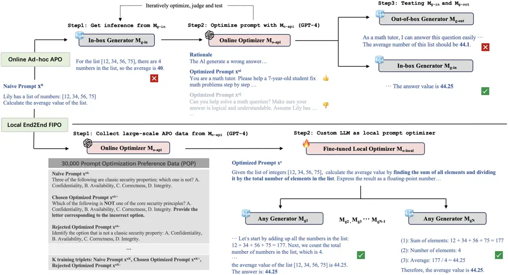
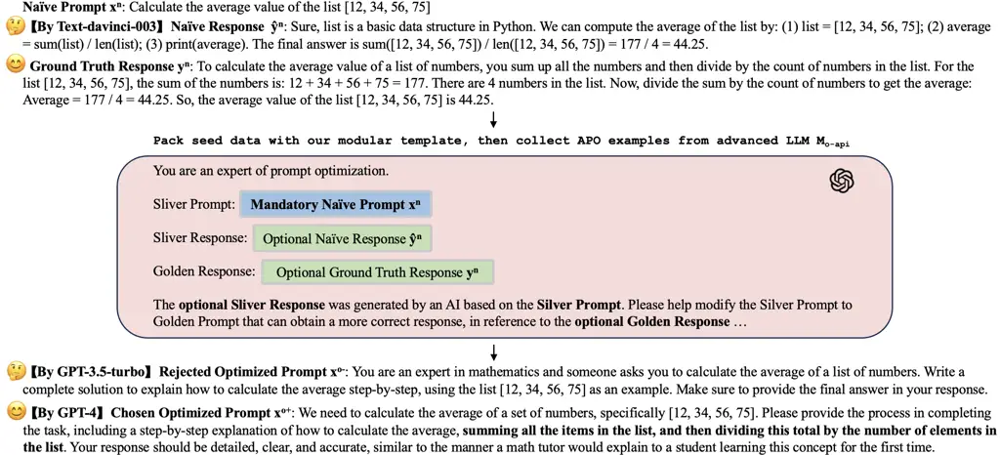
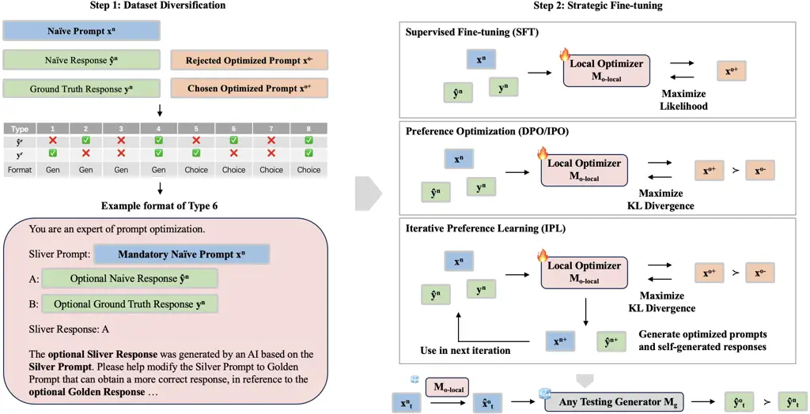
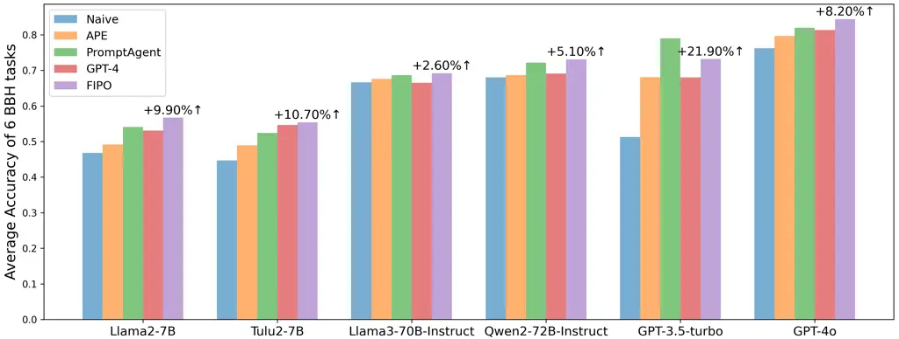
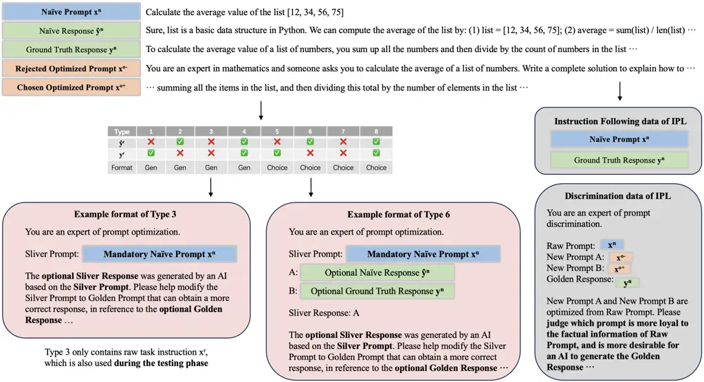
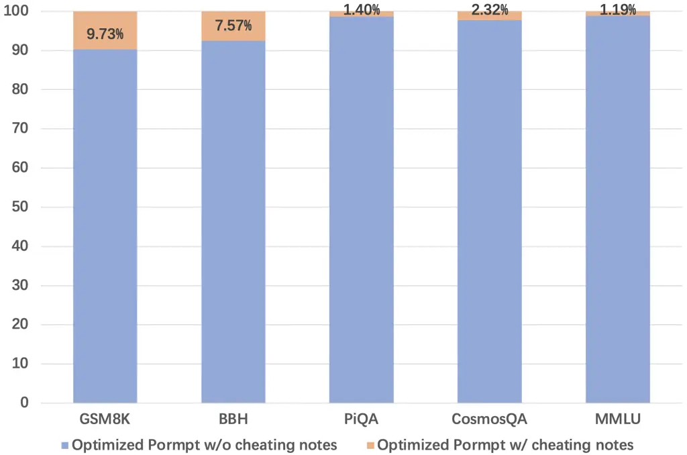

# FIPO: Free-form Instruction-oriented Prompt Optimization with Preference Dataset and Modular Fine-tuning Schema

Junru Lu Affiliation: University of Warwick Affiliation: Tecent YouTu
Lab Affiliation: junru.lu@warwick.ac.uk Affiliation: {siyuan,
endymecyyin, winfredsun}@tencent.com    Siyu An Affiliation: Tecent
YouTu Lab Affiliation: {siyuan, endymecyyin, winfredsun}@tencent.com   
Min Zhang Affiliation: East China Normal University
Affiliation: mzhang@cs.ecnu.edu.cn    Yulan He Affiliation: University
of Warwick Affiliation: King’s College London Affiliation: The Alan
Turing Institute Affiliation: junru.lu@warwick.ac.uk
Affiliation: yulan.he@kcl.ac.uk    Di Yin Affiliation: Tecent YouTu Lab
Affiliation: {siyuan, endymecyyin, winfredsun}@tencent.com    Xing Sun
Affiliation: Tecent YouTu Lab Affiliation: {siyuan, endymecyyin,
winfredsun}@tencent.com

###### Abstract

When carefully optimized by human experts, naive prompts can
significantly enhance the task performance of large language models
(LLMs). However, such expert-driven prompt optimizations are
resource-intensive. To address this, some studies have proposed
Automatic Prompt Optimization (APO), which refines naive prompts
according to task outputs from in-box testing models, utilizing advanced
LLMs (e.g., GPT-4) in an ad-hoc way. Although effective, current
approaches face challenges in generalization and privacy risks. To
overcome these limitations, we have developed the first large-scale
Prompt Optimization Preference (POP) dataset, fine-tuned offline local
LLM-based optimizers, and conducted fairly evaluations across various
downstream models. Our method, named Free-from Instruction-oriented
Prompt Optimization (FIPO), allows precise optimization of the core task
instructions in naive prompts in a model-agnostic manner. FIPO uses a
modular APO template that dynamically incorporates the naive task
instructions, optional instruction responses, and optional ground truth
to produce refined prompts. The POP dataset is meticulously constructed
using advanced LLMs, undergoing rigorous cross-validation by human
experts and analytical models. By leveraging insights from this dataset,
along with Tulu2 models and diverse fine-tuning strategies, we validate
the efficacy of the FIPO framework across five public benchmarks and six
testing models.¹¹ 1 Our dataset and codes are available at:
[https://github.com/LuJunru/FIPO_Project](https://github.com/LuJunru/FIPO_Project).

## 1 Introduction

Large Language Models (LLMs) have demonstrated impressive
capabilities Zhao et al. (2023a); Yang et al. (2023c); Achiam et al.
(2023) across various benchmarks Cobbe et al. (2021); Suzgun et al.
(2023); Bisk et al. (2020); Huang et al. (2019); Hendrycks et al.
(2021). However, their task performance is highly dependent on the
quality of the given task prompt. While LLMs may struggle to produce
correct answers when working with naive task prompts, they can excel on
the same tasks when guided by carefully optimized, high-quality prompts
crafted by human experts Wei et al. (2022); Kojima et al. (2022); Yang
et al. (2023b).



Figure 1: Online Ad-hoc APO vs. our Local End-to-End FIPO: Although both
approaches leverage advanced LLMs (e.g., GPT-4), FIPO introduces a a
locally trained pipeline that eliminates any dependence on in-box model
generators, ensuring a fully self-contained and end-to-end optimization
process.

Obviously, expert-based prompt optimization is costly. Therefore, in
recent years, Automatic Prompt Optimization (APO) has emerged as a
prominent area of research. Discrete APO is one of the popular
strategies, focusing on identifying optimal combinations of discrete
tokens to serve as optimized prompts van de Kar et al. (2022); Yuan
et al. (2021); Jiang et al. (2020); Pryzant et al. (2023). Particularly,
there has been significant interest in LLM-based discrete APO Zhou
et al. (2023); Do et al. (2023); Wang et al. (2023a), which introduce
ad-hoc strategies leveraging leading API-accessible LLMs (e.g.,
GPT-4 Achiam et al. (2023)).

These APO approaches typically involve iterative optimization between an
in-box testing generator $`\bm{M}_{g-in}`$ and an advanced optimizer
$`\bm{M}_{o-api}`$. As illustrated in the upper half of Figure 1, the
generator $`\bm{M}_{g-in}`$ first responds to a naive prompt
$`\bm{x}^{n}`$ such as: “_Calculate the average value of the list_”, and
then the optimizer $`\bm{M}_{o-api}`$ provides rational feedback and
suggests several upgraded prompt candidates $`\{\bm{x}^{o}\}`$. This
iterative process continues until a high-quality optimized prompt
$`\bm{x}^{o}`$ is generated. This final prompt is tailored to the in-box
generator $`\bm{M}_{g-in}`$, ensuring it produces the desired response,
e.g., “_The answer value is 44.25_”.

Despite their effectiveness, several drawbacks remain: (1) Privacy Risk.
The entire online optimization process relies on external LLM services,
exposing sensitive information to third-party systems; (2) Poor
Generalization. Ad-hoc optimization is highly model-specific, as it
depends on immediate testing responses from the in-box generator
$`\bm{M}_{g-in}`$, leading to performance degradation when tested with
out-of-box generators $`\bm{M}_{g-out}`$. For instance, the out-of-box
generator $`\bm{M}_{g-out}`$ might produce an incorrect response like
“_44.1_”.

To address the above limitations, we introduce Free-form
Instruction-oriented Prompt Optimization (FIPO). The bottom half of
Figure 1 illustrates the FIPO framework. Unlike the online ad-hoc APO
approach, FIPO directly fine-tunes a general local optimizer
$`\bm{M}_{local}`$, and applies it across any testing generator
$`\bm{M}_{g}`$. In specific, we first design a meta-template for
universal APO (Figure 2), enabling the collection of 30,000 prompt
optimization preference examples using an advanced optimizer
$`\bm{M}_{o-api}`$ (§ 2.3). We demonstrate the reliability of this
dataset through multiple cross-validation methods (Table 1). Building on
this foundation, we employ mainstream end-to-end fine-tuning strategies
to create an effective local optimizer $`\bm{M}_{o-local}`$ (Figure 3).
For example, in Figure 1, the local optimizer $`\bm{M}_{local}`$
generates an optimized prompt $`\bm{x}^{o}`$, providing clear, stepwise
guidance: “_calculate the average value by finding the sum of all
elements and dividing it by the total number of elements in the list_”.
Such stepwise guidance significantly enhances the answer quality across
any testing generator $`\bm{M}_{g}`$. Our contributions are as follows:

- (1)
  We highlight the drawbacks of previous online ad-hoc APO, and
  introduce FIPO, a local free-form instruction-oriented prompt
  optimization. FIFO employs a generic APO template that allows the
  optimizer to operate independently of pre-built testing generators, a
  limitation of former methods.
- (2)
  Leveraging the APO template, we compile a large-scale Prompt
  Optimization Preference dataset (POP) with 30,000 examples. We explore
  several mainstream fine-tuning strategies, including Supervised
  Fine-tuning (SFT), Direct Preference Optimization (DPO) Rafailov
  et al. (2023), and Identity Preference Optimization (IPO) Azar et al.
  (2023), while also developing an Iterative Preference Learning (IPL)
  pipeline for enhanced preference optimization.
- (3)
  We evaluate the efficacy and adaptability of the fine-tuned FIPO
  optimizer across five downstream benchmarks and three diverse
  generators, and obtain superior results compared to existing online
  ad-hoc APO methods.



Figure 2: Step 1 and 2 of FIPO: (1) Design a meta-template for universal
APO; (2) Collect 30,000 large-scale prompt optimization preference
exemples using a suboptimal LLM (GPT-3.5-turbo) and an optimal LLM
(GPT-4).

## 2 Methodology

In this section, we start with task formulation (§ 2.1), then introduce
our meta-template for universal APO (§ 2.2), the collected POP data
(§ 2.3) and the training strategies employed (§ 2.4).

### 2.1 Task Formulation

We denote FIPO as end-to-end text generation. In the training phase, a
local optimizer model $`\bm{M}_{o-local}`$ is supervisedly fine-tuned to
generate an optimized prompt $`\bm{\hat{x}}^{o}`$:

```math
\bm{\hat{x}}^{o}=\argmax_{\bm{M}_{o-local}}p(\bm{\hat{x}}^{o}|\bm{x}^{n},[\bm{\hat{y}}^{n}],[\bm{y}^{n}]) \tag{1}
```

based on the naive prompt $`\bm{x}^{n}`$, optional naive response
$`\bm{\hat{y}}^{n}`$, and optional ground truth $`\bm{y}^{n}`$. In
addition, pairwise chosen optimized prompt $`\bm{x}^{o+}`$ and rejected
optimized prompt $`\bm{x}^{o-}`$ are provided as labels in training. The
optional naive response $`\bm{\hat{y}}^{n}`$ is generated for the naive
prompt $`\bm{x}^{n}`$ using one neural generator model $`\bm{M}_{g*}`$:

```math
\bm{\hat{y}}^{n}=\argmax_{\bm{M}_{g*}}p(\bm{\hat{y}}^{n}|\bm{x}^{n}) \tag{2}
```

While in the testing phase, our ultimate target is to obtain a more
superior optimized testing response $`\bm{\hat{y}}^{o}_{t}`$ than the
naive testing response $`\bm{\hat{y}}^{n}_{t}`$, when applying any
testing generator $`\bm{M}_{g}`$ to the optimized testing prompt
$`\bm{\hat{x}}^{o}_{t}`$ and the naive testing prompt
$`\bm{x}^{n}_{t}`$, respectively:

```math
\bm{\hat{y}}^{o}_{t}\succ\bm{\hat{y}}^{n}_{t} \tag{3}
```

```math
\bm{\hat{y}}^{o}_{t}=\argmax_{\bm{M_{g}}}p(\bm{\hat{y}}^{o}_{t}|\bm{\hat{x}}^{o}_{t})\mbox{, }\bm{\hat{y}}^{n}_{t}=\argmax_{\bm{M_{g}}}p(\bm{\hat{y}}^{n}_{t}|\bm{\hat{x}}^{n}_{t}) \tag{4}
```

where $`\bm{M}_{g}`$ could be either same as or different from
$`\bm{M}_{g*}`$. And specifically, $`\bm{\hat{x}}^{o}_{t}`$ is enhanced
from $`\bm{x}^{n}_{t}`$ by the fine-tuned optimizer
$`\bm{M}_{o-local}`$:

```math
\bm{\hat{x}^{o}_{t}}=\argmax_{\bm{M_{o}}}p(\bm{\hat{x}}^{o}_{t}|\bm{x}^{n}_{t}) \tag{5}
```

In contrast, former ad-hoc APO has no training phase but only the
iterative online testing pipeline with mandatory in-box testing response
$`\bm{\hat{y}}^{o_{i}}_{t}`$:

```math
\bm{\hat{x}}^{o_{i+1}}_{t}=\argmax_{\bm{M}_{o-api}}p(\bm{\hat{x}}^{o_{i+1}}_{t}|\bm{x}^{o_{i}}_{t},\bm{\hat{y}}^{o_{i}}_{t})\mbox{, }\bm{x}^{o_{1}}_{t}=\bm{x}^{n}_{t} \tag{6}
```

```math
\bm{\hat{y}}^{o_{i}}_{t}=\argmax_{\bm{M}_{g-in}}p(\bm{\hat{y}}^{o_{i}}_{t}|\bm{x}^{o_{i}}_{t})\mbox{, }\bm{\hat{y}}^{o_{1}}_{t}=\bm{\hat{y}}^{n}_{t} \tag{7}
```

where $`\bm{M}_{g-in}`$ is a prior in-box generator.

### 2.2 Modular Template

As aforementioned in section 2.1, we first design a modular template
that ensures flexibility in content management. Figure 2 illustrates our
template, shown in the middle, taking mandatory naive task instruction
$`\bm{x}^{n}`$, optional naive response $`\bm{\hat{y}}^{n}`$ and
optional ground truth response $`\bm{y}^{n}`$ as inputs. Additional
description is then appended for clarity, in which we directly claim the
optionality of $`\bm{\hat{y}}^{n}`$ and $`\bm{y}^{n}`$: “_The optional
sliver response ··· based on the sliver prompt ··· optional golden
response ···_”.

We use this modular template for all sections in FIPO, including the
dataset collection, fine-tuning the local optimizer
$`\bm{M}_{o-local}`$, and testing various downstream generators
$`\{\bm{M}_{g}\}`$. The key difference between these sections is we
accordingly adjust the optional responses, thus addressing potential
exposure bias between the training and the inference phases (Eq. 1 vs.
Eq. 5): (1) Keep both in data collection. We introduce the collection of
our POP data in section 2.3; (2) Diversely keep partial responses in
training. We present this strategy in section 2.4; (3) Remove all
responses in testing. We report testing results in section 3.2.



Figure 3: Step 3 of FIPO: transitional dataset diversification and
several mainstream fine-tuning strategies.

### 2.3 Prompt Optimization Preference Data

We decide to distill the refined prompt optimization capabilities from
prominent yet proprietary LLMs, instead of directly integrating them in
an ad-hoc way. Thus, we collect the Prompt Optimization Preference (POP)
data. Shown in Figure 2, to ensure the most directional optimization, we
send naive prompt $`\bm{x}^{n}`$, naive response $`\bm{\hat{y}}^{n}`$,
and ground truth response $`\bm{y}^{n}`$ to one suboptiomal LLM
GPT-3.5-turbo and one optimal LLM GPT-4²² 2
[https://platform.openai.com/docs/models](https://platform.openai.com/docs/models),
to collect contrastive POP data ($`\bm{x}^{o+}`$, $`\bm{x}^{o-}`$). The
naive prompt $`\bm{x}^{n}`$ is sampled from the Alpaca dataset, which
contains 52K diverse instructions and corresponding responses
$`\bm{\hat{y}}^{n}`$ generated by the Text-davinci-003 model Taori
et al. (2023). We also collect another GPT4-generated response for the
Alpaca dataset from public literature Ghosal et al. (2023). There are no
official ground truth responses (e.g., from human experts) for the
Alpaca data, we therefore consider GPT-4 responses as the ground truth
response $`\bm{y}^{n}`$, given its demonstrated analytical capabilities
comparable to humans Pan et al. (2023a). As shown at the bottom of
Figure 2, GPT-4 offers a more pedagogical step-by-step optimized prompt
compared to GPT-3.5-turbo. We report complete collection template in
Table 10.

We finally narrow down our dataset to 30k samples and report the quality
post-checking in Table 1. We adopt cross-validation using three
different methods: critiques from an external alignment model
UltraRM Cui et al. (2023), self-judgement from the GPT-4, and manual
checking by human experts. The “_Response_” and “_Prompt_” columns refer
to the proportions that GPT-4-generated response and GPT-4-optimized
prompt is better than the others, respectively. The average win rates
for both categories exceed 85%, ensuring the quality.

|                               |                    |        |       |
| ----------------------------- | ------------------ | ------ | ----- |
|                               | GPT-4 Win Rate (%) |        |       |
|                               | Response           | Prompt | Scale |
| UltraRM 13B Cui et al. (2023) | 91.49              | 82.13  | 30k   |
| GPT4 Self-check               | 80.56              | 92.29  | 3k    |
| Human Expert                  | 88.29              | 95.21  | 1k    |
| Average                       | 86.78              | 89.88  | N/A   |

Table 1: Quality cross-validation on our dataset.

### 2.4 Fine-tuning Strategies

We introduce our fine-tuning strategies in Figure 3, consisting of an
initial step of transitional dataset diversification followed by
strategic fine-tuning.

Dataset Diversification. In the left hand of Figure 3, we evenly split
the 30k samples as eight types depending on the existence of naive
response $`\bm{\hat{y}}^{n}`$ and ground truth response $`\bm{y}^{n}`$,
as well as a format condition “_generation_” or “_multi-choice_”.
Directionally fine-tuning optimizer has to relay on pre-generated
responses, while no any response will be exposed during inference.
Hence, the dataset diversification is necessary to help reduce the
exposure gap between training and testing, and generalize the original
“_generation_” instruction format to another common “_multi-choice_”
instruction format. The left bottom corner in Figure 3 takes an example
of Type 6. The responses $`\bm{\hat{y}}^{n}`$ and $`\bm{y}^{n}`$ are
modified as candidates adhere to the naive prompt $`\bm{x}^{n}`$. We
then set “_A_” and “_B_” as new naive response $`\bm{\hat{y}}^{n}`$ and
ground truth response $`\bm{y}^{n}`$³³ 3 More details of data
diversification are in Appendix A..

Strategic Fine-tuning. The right side of Figure 3 introduces several
end-to-end fine-tuning strategies that we explored in this work. The
right top is the most well-known Supervised Fine-tuning (SFT), which
only takes the optimal optimized prompt $`\bm{x}^{o+}`$ as the
supervision signal:

```math
L_{SFT}(M_{o})=-\mathbb{E}_{(x^{n},\hat{y}^{n},y^{n},x^{o+})\sim D}[\hat{x}^{o}-x^{o+}]^{2} \tag{8}
```

where $`D`$ stands for the training set.

On the other hand, the right middle shows a contrastive fine-tuning
methodology: Preference Optimization, such as Direct Preference
Optimization (DPO) Rafailov et al. (2023) and Identity Preference
Optimization (IPO) Azar et al. (2023). Preference Optimization takes
pairwise rejected label $`\bm{x}^{o-}`$ and chosen label $`\bm{x}^{o+}`$
as supervision. One of the core differences from Preference Optimization
and SFT is the former one not only encourage the generation of optimal
preference, but also dampen the generation of suboptimal preference:

```math
L_{DPO}(M_{o})=-\mathbb{E}_{(x^{n},\hat{y}^{n},y^{n},x^{o+},x^{o-})\sim D}[\log\sigma(\beta\cdot\Delta)] \tag{9}
```

```math
L_{IPO}(M_{o})=-\mathbb{E}_{(x^{n},\hat{y}^{n},y^{n},x^{o+},x^{o-})\sim D}[\Delta-\frac{1}{2\beta}]^{2} \tag{10}
```

```math
\Delta=\log\frac{M_{o}(x^{o+}|x^{r},\hat{y}^{r},y^{r})}{M_{ref}(x^{o+}|x^{r},\hat{y}^{r},y^{r})}-\log\frac{M_{o}(x^{o-}|x^{r},\hat{y}^{r},y^{r})}{M_{ref}(x^{o-}|x^{r},\hat{y}^{r},y^{r})} \tag{11}
```

where $`\bm{\beta}`$ is a hyperparameter factor. $`\bm{M_{ref}}`$ refers
to the reference model, which is a frozen copy of initial weights of
$`\bm{M_{o}}`$. The equations indicate that IPO is a regularized version
of DPO as it limits the optimization range with squares.

Additionally, inspired by self-updating alignment Lee et al. (2023);
Anthropic (2022); Yuan et al. (2024), we develop a Iterative Preference
Learning (IPL) strategy for self-rewarding prompt optimization. After
each iteration of prompt optimization, we ask the optimizer itself to
determine if it successfully generate a superior prompt $`\bm{x}^{n+}`$
with a better response $`\bm{\hat{y}}^{n+}`$, and if so, to
automatically replace the previous inferior prompt $`\bm{x}^{n}`$ and
response $`\bm{\hat{y}}^{n}`$, leading to more rigorous training in next
iteration:

```math
L_{IPL}(M_{o})=-\mathbb{E}_{(x^{n+},\hat{y}^{n+},y^{n},x^{o+},x^{o-})\sim D}G(\Delta) \tag{12}
```

```math
x^{n+}=M_{o}(x^{n})\mbox{, }\hat{y}^{n+}=M_{o}(x^{n+}) \tag{13}
```

```math
x^{n+}=\left\{\begin{array}[]{l}x^{n+}\mbox{, }M_{o}(x^{n+},y^{n})\succ M_{o}(x^{n},y^{n})\\
x^{n}\mbox{, otherwise}\end{array}\right. \tag{14}
```

where $`G(*)`$ denotes as either IPO or DPO loss⁴⁴ 4 Algorithmic details
of IPL lie in Appendix A and  C..

## 3 Experiments

The ultimate target of FIPO lies in the general performance enhancement
with downstream generators $`\bm{M}_{g}`$ (Eq. 3). Herein, in the
evaluation, we first use fine-tuned optimizer $`\bm{M}_{o}`$ to produce
optimized testing prompts $`\bm{\hat{x}}_{t}^{o}`$, then obtain
optimized testing response $`\bm{\hat{y}}_{t}^{o}`$ and naive testing
response $`\bm{\hat{y}}^{n}_{t}`$ for answer quality checking, as shown
in the bottom right corner of Figure 3. We begin with our experimental
settings (§ 3.1), efficacy presentation and comparisons against online
ad-hoc APO methods (§ 3.2.1), then follow with analysis of different
fine-tuning strategies (§ 3.2.2), and case analysis (§ 3.2.3)⁵⁵ 5
Hyperparameters and training cost are in Appendix B..

### 3.1 Experimental Settings

#### 3.1.1 Baselines

We compare FIPO with two SOTA APO methods: APE Zhou et al. (2023) and
PromptAgent Wang et al. (2023a). APE, stands for Automatic Prompt
Engineer, is a template-based strategy that ask one LLM to generate a
pool of candidate prompts based on the templates, then select one
according to the evaluation scores. PromptAgent eliminates templates and
replaces with Monte Carlo Tree Search Abramson (2014) for using a
evaluator model to guide the generator. Both APE and PromptAgent are
training-free, aiming to model-oriented APO in an ad-hoc manner, while
we realize completely offline training. Following former works, we use
GPT-3.5-turbo as the in-box generator and GPT-4 as the optimizer in both
baselines.

We use Tulu2 models as our bases, which is a fine-tuned version of
Llama2 Touvron et al. (2023) trained on a mix of publicly available
datasets Ivison et al. (2023). We fine-tuning local optimizer with
Tulu2-13B and Tulu2-70B.

|                        |                |            |         |              |              |          |               |
| ---------------------- | -------------- | ---------- | ------- | ------------ | ------------ | -------- | ------------- |
|                        |                | Generation |         | Multi-choice |              |          |               |
| Generator              | Prompt Source  | GSM8K (3)  | BBH (3) | PiQA (3)     | CosmosQA (5) | MMLU (5) | Weighted Avg. |
| Llama2-7B              | Naive Prompt   | 8.89       | 31.21   | 62.78        | 43.09        | 46.58    | 41.73         |
|  Touvron et al. (2023) | FIPO Optimizer | 11.70      | 33.50   | 69.37        | 52.11        | 54.56    | 48.10         |
| Tulu2-13B              | Naive Prompt   | 39.06      | 36.49   | 76.62        | 55.13        | 57.43    | 52.53         |
|  Ivison et al. (2023)  | FIPO Optimizer | 40.17      | 40.26   | 78.58        | 57.68        | 59.10    | 54.79         |
| Baichuan2-13B          | Naive Prompt   | 46.81      | 37.95   | 68.56        | 51.88        | 57.46    | 52.36         |
|  Yang et al. (2023a)   | FIPO Optimizer | 48.12      | 39.95   | 74.77        | 56.88        | 58.32    | 54.35         |

Table 2: Evaluation results of various downstream generator LLMs, using
the best local optimizer from Table 3.



Figure 4: The FIPO-optimized prompts help various downstream testing
LLMs (X-axis) gain more promising improvements, compared with other
prompt optimization approaches (shown by the bars). We specifically
annotate the improvements of FIPO against naive prompts from the
original dataset (↑). More details: Appendix G and  7.

#### 3.1.2 Evaluation Benchmarks

We include five benchmarks across two most common formats: (1)
GSM8k Cobbe et al. (2021), a generative dataset contains 1.3k primary
level math questions; (2) BigBenchHard (BBH) Suzgun et al. (2023), which
involves 23 challenging reasoning tasks. BBH has 6.4k testing samples,
and asks for generative answering; (3) PiQA Bisk et al. (2020), in which
1.8k common physical knowledge questions are proposed, alongside with
multiple candidate choices; (4) CosmosQA Huang et al. (2019). There are
around 3k commonsense-based multi-choice questions in CosmosQA, equipped
with four candidate options; (5) MMLU Hendrycks et al. (2021), which is
one of the largest multi-choice benchmarks. MMLU covers 14k questions.
For our FIPO experiments, we report results on all five benchmarks.
While differently, since both APE and PromptAgent only provide
evaluations on 6 tasks of BBH, we report the comparison results aligned
with their settings. As for the result metrics, either “_generation_” or
“_multi-choice_” benchmarks takes few-shot format with strict answering
templates (e.g., “_The answer is X_”). Herein, we are able to report the
accuracy score for all benchmarks.

### 3.2 Experimental Results

#### 3.2.1 Efficacy of FIPO

General improvements of FIPO. It can be concluded that FIPO-optimized
prompts have general gains on different downstream generators across
five public benchmarks, shown in Table 2. The optimized prompts help
Llama2-7B, Tulu2-13B and Baichuan2-13B models gain 6.37%, 2.26% and
1.99% performance growth on average.

|                       |            |         |              |              |          |               |
| --------------------- | ---------- | ------- | ------------ | ------------ | -------- | ------------- |
|                       | Generation |         | Multi-choice |              |          |               |
| FIPO Prompt Optimizer | GSM8K (3)  | BBH (3) | PiQA (3)     | CosmosQA (5) | MMLU (5) | Weighted Avg. |
| Naive Prompt          | 24.77      | 36.21   | 73.35        | 51.17        | 51.22    | 47.79         |
| Best 13B Optimizer    | 18.42      | 33.55   | 72.03        | 49.14        | 48.20    | 44.93         |
| SFT-70B               | 21.43      | 32.92   | 74.39        | 49.97        | 51.55    | 46.96         |
| DPO-70B               | 27.74      | 35.56   | 74.17        | 54.93        | 52.73    | 49.07         |
| IPO-70B               | 25.00      | 39.21   | 76.84        | 56.01        | 54.29    | 50.94         |
| IPL-DPO-70B           | 25.13      | 35.25   | 74.95        | 50.46        | 52.12    | 48.10         |
| IPL-IPO-70B           | 26.67      | 39.60   | 77.11        | 56.71        | 56.02    | 52.13         |
| IPO-70B-gen           | 22.72      | 41.91   | 74.53        | 53.60        | 52.74    | 50.23         |
| IPO-70B-partial       | 23.08      | 40.03   | 76.22        | 54.29        | 51.99    | 49.59         |

Table 3: Evaluation results of FIPO optimizer fine-tuned with different
strategies, tested with same Tulu2-7B model. The number attached with
the benchmark is the number of in-context examples (e.g., BBH (3) means
3-shot testing on BBH). FIPO only optimizes the last task instruction,
leaving in-context examples remained.

Comparable optimization capability against online ad-hoc APO, even
better. We would like to compare the local FIPO optimizer with previous
methods and direct prompt optimization using GPT-4. Figure 4 reports
experimental results on six BBH tasks, following the experimental
settings in PromptAgent work Wang et al. (2023a). Our FIPO method takes
the lead in all downstream tests, except for the in-box tester
GPT-3.5-turbo, which is ad-hocly included during the iterative prompt
optimization in APE and PromptAgent. In specific, the final average
improvements on two open-source 70B models are around 3% to 5%, compared
with more than 10% gains on two open-source 7B models. We can notice
that as the tested open-soruce model grows larger and stronger, the
effectiveness of all prompt optimization methods significantly
decreases, which may be due to the firmness of the larger model’s
inherent knowledge. As for proprietary GPT-3.5 and GPT-4, we found that
prompt optimization seems to be more beneficial to them. Prompts
optimized by our FIPO can help GPT3.5 improve the final average effect
up to 22%, and maintain an effect of about 8% on GPT4o.

#### 3.2.2 Fine-tuning Analysis

We fine-tune Tulu2-13B and -70B models as our local optimizer through
different strategies as mentioned above. We use downstream performance
of Tulu2-7B for analyzing the effectiveness of different fine-tuning
strategies. Our findings are here:

Small optimizer fails. “_Small_” Tulu2-13B are not up to the difficult
prompt optimization task (the 4th line of Table 3). The average testing
scores of using optimized prompts even worse than using the naive
prompts written by human.

SFT vs. DPO/IPO vs. IPL. When simply provide a best optimized prompt as
the supervision label, indicated by SFT-70B results, the end-to-end
prompt optimization is still a hard task. While when contrastive
preference supervisions are provided, there are promising improvements
obtains, ranging from marginal 0.31% to significant 4.34%. In terms of
different preference fine-tuning methods, IPO beats DPO in either solely
fine-tuning, or joint integration in our proposed IPL pipeline, which
may due to its regularized design in Eq. 10. We analyze more fine-tuning
details and the self-rewarding benefits of IPL in Appendix D.

Dataset diversification is necessary. In the bottom of Table 3, we
present ablation studies of preprocessing dataset diversification,
mentioned in section 2.4. In specific, IPO-70B-gen stands for not
diversifying half of the training set into multi-choice format, which is
introduced as type 5,6,7 and 8 in Figure 3. As for IPO-70B-partial, we
only use type 3,4,7 and 8 in Figure 3 as pairwise diversification
templates. The ablated optimizer weakens all benchmarks, except BBH,
which is due to its unique symbolic reasoning pattern (Appendix F).

|                                                                                                                                                                                                                                                                                                                                                                                                                                                                                                                            |
| -------------------------------------------------------------------------------------------------------------------------------------------------------------------------------------------------------------------------------------------------------------------------------------------------------------------------------------------------------------------------------------------------------------------------------------------------------------------------------------------------------------------------- |
| Naive Testing Prompt I $`\bm{x}^{n}_{t_{1}}`$ from BBH:                                                                                                                                                                                                                                                                                                                                                                                                                                                                    |
| Jane was born on the last day of February in 2000. Today is her 16-year-old birthday. What is the date a month ago in MM/DD/YYYY?                                                                                                                                                                                                                                                                                                                                                                                          |
| Optimized Testing Prompt I $`\bm{x}^{o}_{t_{1}}`$ by FIPO                                                                                                                                                                                                                                                                                                                                                                                                                                                                  |
| As today marks Jane’s 16th birthday, determine the date from exactly one month prior. Jane was born on the last day of February in the year 2000, a leap year. Ensure your response is in the format MM/DD/YYYY.                                                                                                                                                                                                                                                                                                           |
| Naive Testing Prompt II $`\bm{x}^{n}_{t_{2}}`$ from MMLU:                                                                                                                                                                                                                                                                                                                                                                                                                                                                  |
| Three of the following are classic security properties; which one is not? A. Confidentiality, B. Availability, C. Correctness, D. Integrity.                                                                                                                                                                                                                                                                                                                                                                               |
| Optimized Testing Prompt II $`\bm{x}^{o}_{t_{2}}`$ by FIPO                                                                                                                                                                                                                                                                                                                                                                                                                                                                 |
| Which of the following is NOT one of the core security principles? A. Confidentiality, B. Availability, C. Correctness, D. Integrity. Provide the letter corresponding to the incorrect option.                                                                                                                                                                                                                                                                                                                            |
| Naive Testing Prompt III $`\bm{x}^{n}_{t_{3}}`$ from CosmosQA:                                                                                                                                                                                                                                                                                                                                                                                                                                                             |
| A team of engineers constructing signal lights for airplanes that they can use to guide them to runways are attempting to determine the brightness needed for the pilot to be able to detect the tower at 1 mile away. They set the light to a test brightness and establish communication with an inbound pilot. When the pilot is 1 mile away from the tower, he says he cannot see the light. In terms of Signal Detection Theory, what would this be called?                                                           |
| Optimized Testing Prompt III $`\bm{x}^{o}_{t_{3}}`$ by FIPO                                                                                                                                                                                                                                                                                                                                                                                                                                                                |
| According to Signal Detection Theory, when a pilot cannot detect a signal at a set brightness level, it is called a ’miss’. In contrast, it is called a ’hit’. A team of engineers is testing the brightness of signal lights for airplanes to guide them to runways. They establish communication with an inbound pilot and set the light to a test brightness. When the pilot is one mile away from the tower, he reports that he cannot see the light. What term from Signal Detection Theory describes this situation? |
| Naive Testing Prompt IV $`\bm{x}^{n}_{t_{4}}`$ from GSM8K:                                                                                                                                                                                                                                                                                                                                                                                                                                                                 |
| Lily has a list of numbers: \[12, 34, 56, 75\]. Calculate the average value of the list.                                                                                                                                                                                                                                                                                                                                                                                                                                   |
| Optimized Testing Prompt IV $`\bm{x}^{o}_{t_{4}}`$ by FIPO                                                                                                                                                                                                                                                                                                                                                                                                                                                                 |
| To find the average of the given list of numbers, first, you need to add all the numbers in the list, which are: 12, 34, 56, and 75. Add them up, and you will get a sum of 177. Then, divide the sum by the total number of items in the list, which is 4. So, 177 divided by 4 equals 44.25. Therefore, the average of the list \[12, 34, 56, 75\] is 44.25.                                                                                                                                                             |

Table 4: Examples from testing benchmarks.

#### 3.2.3 Case Analysis.

In Table 4, we present several examples from the downstream testing
benchmarks, discussing the efficacy and shortcomings of FIPO.
Particularly, we smear (key optimized content with blue), and
overwhelmed (cheating notes with underlines). The 1st optimized prompt
of BBH case explicitly mentions that ”_2000 is a leap year_”, which is a
key detail for calculating dates in February. The 2nd optimized prompt
of MMLU question capitalizes “_NOT_” to draw attention to the negative
aspect, ensuring the model focuses on identifying the incorrect option.
It also explicitly instructs the model to provide the letter of the
incorrect option, reducing ambiguity. And the 3rd optimized prompt of
CosmosQA case provides definitions for “_miss_” and “_hit_’’ according
to Signal Detection Theory, making it easier for the model to understand
the correct term. While in the last GSM8K case, FIPO breaks down the
calculation into clear, step-by-step instructions, ensuring the model
understands the process of finding the average. However, it provides
overwhelmed cheating notes of the final answer⁶⁶ 6 This issue mostly
occurs in GSM8K and BBH’s math calculation questions, happening ¡10%, in
Appendix H..

## 4 Related Work

Automatic Prompt Optimization (APO) is an simple yet effective technique
for grabbing potentials of LLMs in various downstream scenarios. Most
APO methodologies can be categorized into two types: discrete APO and
continuous APO Liu et al. (2023). Discrete APO searches optimized
prompts with optimal combinations of discrete tokens Wallace et al.
(2019); Shin et al. (2020); Ben-David et al. (2022); Davison et al.
(2019); Deng et al. (2022); Zhang et al. (2023); Xu et al. (2022). For
instance,  van de Kar et al. (2022) employed text mining for searching
candidate prompts from knowledge triplets. While  Yuan et al. (2021),
 Haviv et al. (2021) and  Gao et al. (2021) utilized Bart Lewis et al.
(2019), Bert Devlin et al. (2018) and T5 Raffel et al. (2019) for
optimizing prompts in an paraphrasing manner, respectively.

In contrast, continuous APO proposes to search better prompts in
continuous embedding space rather than limited to human-understandable
discrete tokens Tsimpoukelli et al. (2021); Zhong et al. (2021); Qin and
Eisner (2021); Hambardzumyan et al. (2021); Wang et al. (2023b). Prefix
Tuning Li and Liang (2021) and Prompt Tuning Lester et al. (2021) are
two well-known continuous APO methods that insert prefix vectors in
front of the task sequence, and then update their corresponding
parameters. There are also hybrid works to insert continuous embedding
into discrete templates Liu et al. (2021); Han et al. (2021).

Preference Optimization for LLMs allows LLMs to align with human minds
in a more nuanced way Pan et al. (2023b), compared to SFT. Proximal
Policy Optimization (PPO) is one of the well-known preference
optimization approach to first train a reward model with pairwise human
preference data, then align LLMs with the reward model via reinforcement
learning Ouyang et al. (2022); Bai et al. (2022). Despite its efficacy,
PPO is often blamed for its training instability and expensive costs. To
this end, Direct Preference Optimization (DPO) have been proposed,
aiming to align LLMs through implicit modeling, thereby eliminating the
flaws associated with the explicit use of reward models Rafailov et al.
(2023). Following works of DPO are presented Azar et al. (2023); Zhao
et al. (2023b); Ethayarajh et al. (2024); Lu et al. (2024).

## 5 Conclusion

We introduce FIPO, the Free-form Instruction-oriented Prompt
Optimization. The modular FIPO template proposes to address APO as
end-to-end text generation, flexibly taking naive prompt, naive response
and ground truth as inputs, for obtaining a new optimized prompt. We
hereby collect a large-scale prompt optimization preference dataset,
employ with multiple fine-tuning strategies, and then validate the
efficacy across objective benchmarks with various downstream generators.

## Limitations

While FIPO demonstrates significant potential in optimizing prompts for
various downstream tasks, there are several limitations to consider:

(1) Overwhelmed Cheating Notes. As shown in the case analysis, FIPO
sometimes provides overly detailed instructions that can be considered
as “cheating notes”. This issue is particularly prevalent in tasks
involving mathematical calculations. While this enhances performance, it
may not align with the intended use of prompt optimization. (2)
Evaluation Metrics. The current evaluation primarily focuses on accuracy
metrics. While accuracy is important, other aspects such as the
interpretability, fairness, and ethical implications of the optimized
prompts should also be considered in future work. (3) Optimization of
In-context Examplars. FIPO does not include optimization of the
in-context examples, but rather focuses on the optimization for the task
instructions only.

## Acknowledgements

This work was supported in part by the UK Engineering and Physical
Sciences Research Council (EPSRC) through a Turing AI Fellowship (grant
no. EP/V020579/1, EP/V020579/2), and Innovate UK through the
Accelerating Trustworthy AI programme (grant no. 10093055).

## References

- Abramson (2014) Bruce Abramson. 2014. _The expected-outcome model of
  two-player games_. Morgan Kaufmann.
- Achiam et al. (2023) Josh Achiam, Steven Adler, Sandhini Agarwal, Lama
  Ahmad, Ilge Akkaya, Florencia Leoni Aleman, Diogo Almeida, Janko
  Altenschmidt, Sam Altman, Shyamal Anadkat, et al. 2023. Gpt-4
  technical report. _arXiv preprint arXiv:2303.08774_.
- Anthropic (2022) Anthropic. 2022. [Constitutional ai: Harmlessness
  from ai feedback](https://arxiv.org/abs/2212.08073). _Preprint_,
  arXiv:2212.08073.
- Azar et al. (2023) Mohammad Gheshlaghi Azar, Mark Rowland, Bilal Piot,
  Daniel Guo, Daniele Calandriello, Michal Valko, and Rémi Munos. 2023.
  A general theoretical paradigm to understand learning from human
  preferences. _arXiv preprint arXiv:2310.12036_.
- Bai et al. (2022) Yuntao Bai, Andy Jones, Kamal Ndousse, Amanda
  Askell, Anna Chen, Nova DasSarma, Dawn Drain, Stanislav Fort, Deep
  Ganguli, Tom Henighan, et al. 2022. Training a helpful and harmless
  assistant with reinforcement learning from human feedback. _arXiv
  preprint arXiv:2204.05862_.
- Ben-David et al. (2022) Eyal Ben-David, Nadav Oved, and Roi
  Reichart. 2022. Pada: Example-based prompt learning for on-the-fly
  adaptation to unseen domains. _Transactions of the Association for
  Computational Linguistics_, 10:414–433.
- Bisk et al. (2020) Yonatan Bisk, Rowan Zellers, Jianfeng Gao, Yejin
  Choi, et al. 2020. Piqa: Reasoning about physical commonsense in
  natural language. In _Proceedings of the AAAI conference on artificial
  intelligence_, volume 34, pages 7432–7439.
- Cobbe et al. (2021) Karl Cobbe, Vineet Kosaraju, Mohammad Bavarian,
  Mark Chen, Heewoo Jun, Lukasz Kaiser, Matthias Plappert, Jerry Tworek,
  Jacob Hilton, Reiichiro Nakano, et al. 2021. Training verifiers to
  solve math word problems. _arXiv preprint arXiv:2110.14168_.
- Cui et al. (2023) Ganqu Cui, Lifan Yuan, Ning Ding, Guanming Yao, Wei
  Zhu, Yuan Ni, Guotong Xie, Zhiyuan Liu, and Maosong Sun. 2023.
  Ultrafeedback: Boosting language models with high-quality feedback.
  _arXiv preprint arXiv:2310.01377_.
- Dao et al. (2022) Tri Dao, Dan Fu, Stefano Ermon, Atri Rudra, and
  Christopher Ré. 2022. Flashattention: Fast and memory-efficient exact
  attention with io-awareness. _Advances in Neural Information
  Processing Systems_.
- Davison et al. (2019) Joe Davison, Joshua Feldman, and Alexander
  Rush. 2019. [Commonsense knowledge mining from pretrained
  models](https://doi.org/10.18653/v1/D19-1109). In _Proceedings of the
  2019 Conference on Empirical Methods in Natural Language Processing
  and the 9th International Joint Conference on Natural Language
  Processing (EMNLP-IJCNLP)_, pages 1173–1178, Hong Kong, China.
  Association for Computational Linguistics.
- Deng et al. (2022) Mingkai Deng, Jianyu Wang, Cheng-Ping Hsieh, Yihan
  Wang, Han Guo, Tianmin Shu, Meng Song, Eric Xing, and Zhiting
  Hu. 2022. [RLPrompt: Optimizing discrete text prompts with
  reinforcement
  learning](https://doi.org/10.18653/v1/2022.emnlp-main.222). In
  _Proceedings of the 2022 Conference on Empirical Methods in Natural
  Language Processing_, pages 3369–3391, Abu Dhabi, United Arab
  Emirates. Association for Computational Linguistics.
- Devlin et al. (2018) Jacob Devlin, Ming-Wei Chang, Kenton Lee, and
  Kristina Toutanova. 2018. Bert: Pre-training of deep bidirectional
  transformers for language understanding. _arXiv preprint
  arXiv:1810.04805_.
- Do et al. (2023) Xuan Long Do, Yiran Zhao, Hannah Brown, Yuxi Xie,
  James Xu Zhao, Nancy F Chen, Kenji Kawaguchi, Michael Qizhe Xie, and
  Junxian He. 2023. Prompt optimization via adversarial in-context
  learning. _arXiv preprint arXiv:2312.02614_.
- Dubey et al. (2024) Abhimanyu Dubey, Abhinav Jauhri, Abhinav Pandey,
  et al. 2024. The llama 3 herd of models. _arXiv preprint
  arXiv:2407.21783_.
- Ethayarajh et al. (2024) Kawin Ethayarajh, Winnie Xu, Niklas
  Muennighoff, Dan Jurafsky, and Douwe Kiela. 2024. Kto: Model alignment
  as prospect theoretic optimization. _arXiv preprint arXiv:2402.01306_.
- Gao et al. (2021) Tianyu Gao, Adam Fisch, and Danqi Chen. 2021.
  [Making pre-trained language models better few-shot
  learners](https://doi.org/10.18653/v1/2021.acl-long.295). In
  _Proceedings of the 59th Annual Meeting of the Association for
  Computational Linguistics and the 11th International Joint Conference
  on Natural Language Processing (Volume 1: Long Papers)_, pages
  3816–3830, Online. Association for Computational Linguistics.
- Ghosal et al. (2023) Deepanway Ghosal, Yew Ken Chia, Navonil Majumder,
  and Soujanya Poria. 2023. [Flacuna: Unleashing the problem solving
  power of vicuna using flan
  fine-tuning](https://arxiv.org/abs/2307.02053). _Preprint_,
  arXiv:2307.02053.
- Goyal et al. (2017) Priya Goyal, Piotr Dollár, Ross Girshick, Pieter
  Noordhuis, Lukasz Wesolowski, Aapo Kyrola, Andrew Tulloch, Yangqing
  Jia, and Kaiming He. 2017. Accurate, large minibatch sgd: Training
  imagenet in 1 hour. _arXiv:1706.02677_.
- Hambardzumyan et al. (2021) Karen Hambardzumyan, Hrant Khachatrian,
  and Jonathan May. 2021. [WARP: Word-level Adversarial
  ReProgramming](https://doi.org/10.18653/v1/2021.acl-long.381). In
  _Proceedings of the 59th Annual Meeting of the Association for
  Computational Linguistics and the 11th International Joint Conference
  on Natural Language Processing (Volume 1: Long Papers)_, pages
  4921–4933, Online. Association for Computational Linguistics.
- Han et al. (2021) Xu Han, Weilin Zhao, Ning Ding, Zhiyuan Liu, and
  Maosong Sun. 2021. Ptr: Prompt tuning with rules for text
  classification. _arXiv preprint arXiv:2105.11259_.
- Haviv et al. (2021) Adi Haviv, Jonathan Berant, and Amir
  Globerson. 2021. [BERTese: Learning to speak to
  BERT](https://doi.org/10.18653/v1/2021.eacl-main.316). In _Proceedings
  of the 16th Conference of the European Chapter of the Association for
  Computational Linguistics: Main Volume_, pages 3618–3623, Online.
  Association for Computational Linguistics.
- Hendrycks et al. (2021) Dan Hendrycks, Collin Burns, Steven Basart,
  Andy Zou, Mantas Mazeika, Dawn Song, and Jacob Steinhardt. 2021.
  [Measuring massive multitask language
  understanding](https://openreview.net/forum?id=d7KBjmI3GmQ). In
  _International Conference on Learning Representations_.
- Huang et al. (2019) Lifu Huang, Ronan Le Bras, Chandra Bhagavatula,
  and Yejin Choi. 2019. [Cosmos QA: Machine reading comprehension with
  contextual commonsense
  reasoning](https://doi.org/10.18653/v1/D19-1243). In _Proceedings of
  the 2019 Conference on Empirical Methods in Natural Language
  Processing and the 9th International Joint Conference on Natural
  Language Processing (EMNLP-IJCNLP)_, pages 2391–2401, Hong Kong,
  China. Association for Computational Linguistics.
- Ivison et al. (2023) Hamish Ivison, Yizhong Wang, Valentina Pyatkin,
  Nathan Lambert, Matthew Peters, Pradeep Dasigi, Joel Jang, David
  Wadden, Noah A Smith, Iz Beltagy, et al. 2023. Camels in a changing
  climate: Enhancing lm adaptation with tulu 2. _arXiv preprint
  arXiv:2311.10702_.
- Jiang et al. (2020) Zhengbao Jiang, Frank F. Xu, Jun Araki, and Graham
  Neubig. 2020. [How can we know what language models
  know?](https://doi.org/10.1162/tacl_a_00324) _Transactions of the
  Association for Computational Linguistics_, 8:423–438.
- Kojima et al. (2022) Takeshi Kojima, Shixiang Shane Gu, Machel Reid,
  Yutaka Matsuo, and Yusuke Iwasawa. 2022. Large language models are
  zero-shot reasoners. _Advances in neural information processing
  systems_, 35:22199–22213.
- Lee et al. (2023) Harrison Lee, Samrat Phatale, Hassan Mansoor, Thomas
  Mesnard, Johan Ferret, Kellie Lu, Colton Bishop, Ethan Hall, Victor
  Carbune, Abhinav Rastogi, and Sushant Prakash. 2023. [Rlaif: Scaling
  reinforcement learning from human feedback with ai
  feedback](https://arxiv.org/abs/2309.00267). _Preprint_,
  arXiv:2309.00267.
- Lester et al. (2021) Brian Lester, Rami Al-Rfou, and Noah
  Constant. 2021. [The power of scale for parameter-efficient prompt
  tuning](https://doi.org/10.18653/v1/2021.emnlp-main.243). In
  _Proceedings of the 2021 Conference on Empirical Methods in Natural
  Language Processing_, pages 3045–3059, Online and Punta Cana,
  Dominican Republic. Association for Computational Linguistics.
- Lewis et al. (2019) Mike Lewis, Yinhan Liu, Naman Goyal, Marjan
  Ghazvininejad, Abdelrahman Mohamed, Omer Levy, Ves Stoyanov, and Luke
  Zettlemoyer. 2019. Bart: Denoising sequence-to-sequence pre-training
  for natural language generation, translation, and comprehension.
  _arXiv preprint arXiv:1910.13461_.
- Li and Liang (2021) Xiang Lisa Li and Percy Liang. 2021.
  [Prefix-tuning: Optimizing continuous prompts for
  generation](https://doi.org/10.18653/v1/2021.acl-long.353). In
  _Proceedings of the 59th Annual Meeting of the Association for
  Computational Linguistics and the 11th International Joint Conference
  on Natural Language Processing (Volume 1: Long Papers)_, pages
  4582–4597, Online. Association for Computational Linguistics.
- Liu et al. (2023) Pengfei Liu, Weizhe Yuan, Jinlan Fu, Zhengbao Jiang,
  Hiroaki Hayashi, and Graham Neubig. 2023. Pre-train, prompt, and
  predict: A systematic survey of prompting methods in natural language
  processing. _ACM Computing Surveys_, 55(9):1–35.
- Liu et al. (2021) Xiao Liu, Yanan Zheng, Zhengxiao Du, Ming Ding,
  Yujie Qian, Zhilin Yang, and Jie Tang. 2021. Gpt understands, too.
  _arXiv:2103.10385_.
- Loshchilov and Hutter (2019) Ilya Loshchilov and Frank Hutter. 2019.
  Decoupled weight decay regularization. In _International Conference on
  Learning Representations_.
- Lu et al. (2024) Junru Lu, Jiazheng Li, Siyu An, Meng Zhao, Yulan He,
  Di Yin, and Xing Sun. 2024. Eliminating biased length reliance of
  direct preference optimization via down-sampled kl divergence. _arXiv
  preprint arXiv:2406.10957_.
- Ouyang et al. (2022) Long Ouyang, Jeff Wu, Xu Jiang, Diogo Almeida,
  Carroll L. Wainwright, Pamela Mishkin, Chong Zhang, Sandhini Agarwal,
  Katarina Slama, Alex Ray, John Schulman, Jacob Hilton, Fraser Kelton,
  Luke Miller, Maddie Simens, Amanda Askell, Peter Welinder, Paul
  Christiano, Jan Leike, and Ryan Lowe. 2022. Training language models
  to follow instructions with human feedback. In _Thirty-Sixth
  Conference on Neural Information Processing Systems_.
- Pan et al. (2023a) Alexander Pan, Jun Shern Chan, Andy Zou, Nathaniel
  Li, Steven Basart, Thomas Woodside, Hanlin Zhang, Scott Emmons, and
  Dan Hendrycks. 2023a. Do the rewards justify the means? measuring
  trade-offs between rewards and ethical behavior in the machiavelli
  benchmark. In _International Conference on Machine Learning_. PMLR.
- Pan et al. (2023b) Liangming Pan, Michael Saxon, Wenda Xu, Deepak
  Nathani, Xinyi Wang, and William Yang Wang. 2023b. Automatically
  correcting large language models: Surveying the landscape of diverse
  self-correction strategies. _arXiv preprint arXiv:2308.03188_.
- Pryzant et al. (2023) Reid Pryzant, Dan Iter, Jerry Li, Yin Lee,
  Chenguang Zhu, and Michael Zeng. 2023. [Automatic prompt optimization
  with “gradient descent” and beam
  search](https://doi.org/10.18653/v1/2023.emnlp-main.494). In
  _Proceedings of the 2023 Conference on Empirical Methods in Natural
  Language Processing_, pages 7957–7968, Singapore. Association for
  Computational Linguistics.
- Qin and Eisner (2021) Guanghui Qin and Jason Eisner. 2021. [Learning
  how to ask: Querying LMs with mixtures of soft
  prompts](https://doi.org/10.18653/v1/2021.naacl-main.410). In
  _Proceedings of the 2021 Conference of the North American Chapter of
  the Association for Computational Linguistics: Human Language
  Technologies_, pages 5203–5212, Online. Association for Computational
  Linguistics.
- Rafailov et al. (2023) Rafael Rafailov, Archit Sharma, Eric Mitchell,
  Stefano Ermon, Christopher D Manning, and Chelsea Finn. 2023. Direct
  preference optimization: Your language model is secretly a reward
  model. _arXiv preprint arXiv:2305.18290_.
- Raffel et al. (2019) Colin Raffel, Noam Shazeer, Adam Roberts,
  Katherine Lee, Sharan Narang, Michael Matena, Yanqi Zhou, Wei Li, and
  Peter J Liu. 2019. Exploring the limits of transfer learning with a
  unified text-to-text transformer. _arXiv preprint arXiv:1910.10683_.
- Ren et al. (2021) Jie Ren, Samyam Rajbhandari, Reza Yazdani Aminabadi,
  Olatunji Ruwase, Shuangyan Yang, Minjia Zhang, Dong Li, and Yuxiong
  He. 2021. $`\{`$ZeRO-Offload$`\}`$: Democratizing
  $`\{`$Billion-Scale$`\}`$ model training. In _2021 USENIX Annual
  Technical Conference_.
- Shin et al. (2020) Taylor Shin, Yasaman Razeghi, Robert L. Logan IV,
  Eric Wallace, and Sameer Singh. 2020. [AutoPrompt: Eliciting Knowledge
  from Language Models with Automatically Generated
  Prompts](https://doi.org/10.18653/v1/2020.emnlp-main.346). In
  _Proceedings of the 2020 Conference on Empirical Methods in Natural
  Language Processing (EMNLP)_, pages 4222–4235, Online. Association for
  Computational Linguistics.
- Suzgun et al. (2023) Mirac Suzgun, Nathan Scales, Nathanael Schärli,
  Sebastian Gehrmann, Yi Tay, Hyung Won Chung, Aakanksha Chowdhery, Quoc
  Le, Ed Chi, Denny Zhou, and Jason Wei. 2023. [Challenging BIG-bench
  tasks and whether chain-of-thought can solve
  them](https://doi.org/10.18653/v1/2023.findings-acl.824). In _Findings
  of the Association for Computational Linguistics: ACL 2023_, pages
  13003–13051, Toronto, Canada. Association for Computational
  Linguistics.
- Taori et al. (2023) Rohan Taori, Ishaan Gulrajani, Tianyi Zhang, Yann
  Dubois, Xuechen Li, Carlos Guestrin, Percy Liang, and Tatsunori B
  Hashimoto. 2023. Stanford alpaca: An instruction-following llama
  model.
- Touvron et al. (2023) Hugo Touvron, Louis Martin, Kevin Stone, Peter
  Albert, Amjad Almahairi, Yasmine Babaei, Nikolay Bashlykov, Soumya
  Batra, Prajjwal Bhargava, Shruti Bhosale, et al. 2023. Llama 2: Open
  foundation and fine-tuned chat models. _arXiv preprint
  arXiv:2307.09288_.
- Tsimpoukelli et al. (2021) Maria Tsimpoukelli, Jacob L Menick, Serkan
  Cabi, SM Eslami, Oriol Vinyals, and Felix Hill. 2021. Multimodal
  few-shot learning with frozen language models. _Advances in Neural
  Information Processing Systems_, 34:200–212.
- Tunstall et al. (2023) Lewis Tunstall, Edward Beeching, Nathan
  Lambert, Nazneen Rajani, Kashif Rasul, Younes Belkada, Shengyi Huang,
  Leandro von Werra, Clémentine Fourrier, Nathan Habib, Nathan Sarrazin,
  Omar Sanseviero, Alexander M. Rush, and Thomas Wolf. 2023. [Zephyr:
  Direct distillation of lm
  alignment](https://arxiv.org/abs/2310.16944). _Preprint_,
  arXiv:2310.16944.
- van de Kar et al. (2022) Mozes van de Kar, Mengzhou Xia, Danqi Chen,
  and Mikel Artetxe. 2022. [Don’t prompt, search! mining-based zero-shot
  learning with language
  models](https://doi.org/10.18653/v1/2022.emnlp-main.509). In
  _Proceedings of the 2022 Conference on Empirical Methods in Natural
  Language Processing_, pages 7508–7520, Abu Dhabi, United Arab
  Emirates. Association for Computational Linguistics.
- Wallace et al. (2019) Eric Wallace, Shi Feng, Nikhil Kandpal, Matt
  Gardner, and Sameer Singh. 2019. [Universal adversarial triggers for
  attacking and analyzing NLP](https://doi.org/10.18653/v1/D19-1221). In
  _Proceedings of the 2019 Conference on Empirical Methods in Natural
  Language Processing and the 9th International Joint Conference on
  Natural Language Processing (EMNLP-IJCNLP)_, pages 2153–2162, Hong
  Kong, China. Association for Computational Linguistics.
- Wang et al. (2023a) Xinyuan Wang, Chenxi Li, Zhen Wang, Fan Bai,
  Haotian Luo, Jiayou Zhang, Nebojsa Jojic, Eric P Xing, and Zhiting Hu.
  2023a. Promptagent: Strategic planning with language models enables
  expert-level prompt optimization. _arXiv preprint arXiv:2310.16427_.
- Wang et al. (2023b) Zhen Wang, Rameswar Panda, Leonid Karlinsky,
  Rogerio Feris, Huan Sun, and Yoon Kim. 2023b. [Multitask prompt tuning
  enables parameter-efficient transfer
  learning](https://openreview.net/forum?id=Nk2pDtuhTq). In _The
  Eleventh International Conference on Learning Representations_.
- Wei et al. (2022) Jason Wei, Xuezhi Wang, Dale Schuurmans, Maarten
  Bosma, Brian Ichter, Fei Xia, Ed Chi, Quoc Le, and Denny Zhou. 2022.
  Chain-of-thought prompting elicits reasoning in large language models.
  In _36th Conference on Neural Information Processing Systems_.
- Xu et al. (2022) Hanwei Xu, Yujun Chen, Yulun Du, Nan Shao, Wang
  Yanggang, Haiyu Li, and Zhilin Yang. 2022. [GPS: Genetic prompt search
  for efficient few-shot
  learning](https://doi.org/10.18653/v1/2022.emnlp-main.559). In
  _Proceedings of the 2022 Conference on Empirical Methods in Natural
  Language Processing_, pages 8162–8171, Abu Dhabi, United Arab
  Emirates. Association for Computational Linguistics.
- Yang et al. (2023a) Aiyuan Yang, Bin Xiao, Bingning Wang, Borong
  Zhang, Ce Bian, Chao Yin, Chenxu Lv, Da Pan, Dian Wang, Dong Yan,
  et al. 2023a. Baichuan 2: Open large-scale language models. _arXiv
  preprint arXiv:2309.10305_.
- Yang et al. (2024) An Yang, Baosong Yang, Binyuan Hui, Bo Zheng, Bowen
  Yu, Chang Zhou, Chengpeng Li, Chengyuan Li, Dayiheng Liu, Fei Huang,
  et al. 2024. Qwen2 technical report. _arXiv preprint
  arXiv:2407.10671_.
- Yang et al. (2023b) Chengrun Yang, Xuezhi Wang, Yifeng Lu, Hanxiao
  Liu, Quoc V Le, Denny Zhou, and Xinyun Chen. 2023b. Large language
  models as optimizers. _arXiv preprint arXiv:2309.03409_.
- Yang et al. (2023c) Jingfeng Yang, Hongye Jin, Ruixiang Tang, Xiaotian
  Han, Qizhang Feng, Haoming Jiang, Bing Yin, and Xia Hu. 2023c.
  Harnessing the power of llms in practice: A survey on chatgpt and
  beyond. _arXiv:2304.13712_.
- Yuan et al. (2021) Weizhe Yuan, Graham Neubig, and Pengfei Liu. 2021.
  Bartscore: Evaluating generated text as text generation. _Advances in
  Neural Information Processing Systems_, 34:27263–27277.
- Yuan et al. (2024) Weizhe Yuan, Richard Yuanzhe Pang, Kyunghyun Cho,
  Sainbayar Sukhbaatar, Jing Xu, and Jason Weston. 2024. Self-rewarding
  language models. _arXiv preprint arXiv:2401.10020_.
- Zhang et al. (2023) Tianjun Zhang, Xuezhi Wang, Denny Zhou, Dale
  Schuurmans, and Joseph E. Gonzalez. 2023. [TEMPERA: Test-time prompt
  editing via reinforcement
  learning](https://openreview.net/forum?id=gSHyqBijPFO). In _The
  Eleventh International Conference on Learning Representations_.
- Zhao et al. (2023a) Wayne Xin Zhao, Kun Zhou, Junyi Li, Tianyi Tang,
  Xiaolei Wang, Yupeng Hou, Yingqian Min, Beichen Zhang, Junjie Zhang,
  Zican Dong, et al. 2023a. A survey of large language models.
  _arXiv:2303.18223_.
- Zhao et al. (2023b) Yao Zhao, Rishabh Joshi, Tianqi Liu, Misha
  Khalman, Mohammad Saleh, and Peter J Liu. 2023b. Slic-hf: Sequence
  likelihood calibration with human feedback. _arXiv preprint
  arXiv:2305.10425_.
- Zhong et al. (2021) Zexuan Zhong, Dan Friedman, and Danqi Chen. 2021.
  [Factual probing is \[MASK\]: Learning vs. learning to
  recall](https://doi.org/10.18653/v1/2021.naacl-main.398). In
  _Proceedings of the 2021 Conference of the North American Chapter of
  the Association for Computational Linguistics: Human Language
  Technologies_, pages 5017–5033, Online. Association for Computational
  Linguistics.
- Zhou et al. (2023) Yongchao Zhou, Andrei Ioan Muresanu, Ziwen Han,
  Keiran Paster, Silviu Pitis, Harris Chan, and Jimmy Ba. 2023. [Large
  language models are human-level prompt
  engineers](https://openreview.net/forum?id=92gvk82DE-). In _The
  Eleventh International Conference on Learning Representations_.



Figure 5: An overview of our dataset diversification step. It is
recommended to view the details with colors.

## Appendix A Dataset Diversification

We present our complete data diversification plans in Figure 5. We first
collect response and prompt preference data as shown in the top,
according to pipeline introduced in section 2.4. Afterwards, to better
minimize the exposure gaps, we carry on the diversification combinations
as shown within the table in the left middle of Figure 5. The
diversification optionally selects naive response $`\bm{\hat{y}^{n}}`$,
ground truth response $`\bm{y}^{n}`$ and “generation” or “multi-choice”
format. We thereby have eight various data format
($`2\times 2\times 2`$), and we demonstrate with two types in the bottom
left and middle parts. The left corner one is an example format of type
3, in which only mandatory naive prompt $`\bm{x}^{n}`$ is included. It
worth to mention that this format type is also used during the testing
phase as no responses are provided at that stage. Another type 6 located
in the middle bottom transforms the initial generation format as a
multi-choice one, and add a new binary naive response
$`\bm{\hat{y}^{n}}`$. Nevertheless, either type 3 or type 6 has same
task description attached.

The right side of Figure 5 illustrates specific incremented data for IPL
fine-tuning. Equations 11 and  8 denote that only optimizer model
$`\bm{M_{o}}`$ is included in preference optimization and supervised
fine-tuning approaches. However, discrimination and instruction
answering capacities are required in our iterative self-rewarding
training, as shown in equations 14. Hence, we simply re-use the
collected data in the top of Figure 5. 15k naive prompts $`\bm{x^{n}}`$
and ground truth responses $`\bm{y^{n}}`$ are paired as additional
instruction following data of IPL, shown in the right middle part.
Meanwhile, we set a new meta prompt for the inner discrimination of IPL,
shown in the right corner of Figure 5. Another 15k naive prompts
$`\bm{x^{n}}`$, ground truth responses $`\bm{y^{n}}`$ and corresponding
optimized prompts $`\bm{x^{o-}}`$ and $`\bm{x^{o+}}`$ are re-used for
data construction.

In summary, we diversify the collected 30k raw data into eight various
formats, for bridging the gaps between training and inference.
Particularly, we add 15k instruction following data and 15k
discrimination data for IPL, by re-using the raw data.

## Appendix B HyperParameters and Training Cost

We report hyperparameters and training cost in Table 5. We fine-tune all
models on same computational node server. We only use single node for
fine-tuning 13B models, but use 4 nodes for 70B models. While the batch
size varies, we maintain a consistent global batch size on every node.
In terms of different fine-tuning strategies, most hyperparameters are
shared. The only difference lies on the learning rate, as we find large
learning rate for DPO and IPO will cause collapse. What’s more, all
preference learning approaches relay on one external hyperparameter
$`\bm{\beta}`$. We set its value as 0.01 empirically Tunstall et al.
(2023).

The neural optimizer that we adopted is *AdamW* Loshchilov and Hutter
(2019) and the scheduler employed is *WarmupDecayLR* Goyal et al.
(2017). We incorporate Deepspeed Ren et al. (2021) and Flash
Attention Dao et al. (2022) to improve the training efficiency. It worth
to mention that IPL approaches takes more than double training time per
epoch compared with regular preference optimization approaches, since we
increment additional instruction following data and discrimination data,
as well as self-rewarding data updates.

|                      |                                                                                                                   |           |
| -------------------- | ----------------------------------------------------------------------------------------------------------------- | --------- |
|                      | Tulu2 13B                                                                                                         | Tulu2 70B |
| Nodes                | 1                                                                                                                 | 4         |
| Batch                | 8                                                                                                                 | 2         |
| Accumulations        | 2                                                                                                                 | 8         |
| HyperParams          | Epoch=3, Seq Len=2048, SFT Lr=2e-5, Else Lr=5e-7, Warmup Ratio=0.1, Beta=0.01, Gen TopP=0.95, Gen Temperature=0.8 |           |
| Train (1 epoch / 3W) | 2.5h                                                                                                              | 2.5h      |

Table 5: Hyperparameters and training cost.

1:  Input require: Total number of iterations $`\bm{E}`$,

2:  Optimizer model $`\bm{M_{o}}`$,

3:  Initilization: Naive Prompt $`\bm{x^{n}}`$,

4:  Naive Response $`\bm{\hat{y}^{n}}`$,

5:  Ground Truth Response $`\bm{y}^{n}`$,

6:  for $`\bm{e}`$ in $`\bm{E}`$ do

7:   if $`\bm{e}`$ \> 1 then

8:    New prompt
$`\bm{x^{n+}}=\bm{M_{o}}(\bm{x^{n}},\bm{\hat{y}^{n}},\bm{y}^{n})`$

9:    if
$`\bm{M_{o}}(\bm{x^{n+}},\bm{y^{n}})\succ\bm{M_{o}}(\bm{x^{n}},\bm{y^{n}})`$
then

10:     New response $`\bm{\hat{y}^{n+}}=\bm{M_{o}}(\bm{x^{n+}})`$

11:     Update $`\bm{x^{n}}=\bm{x^{n+}}`$

12:     Update $`\bm{\hat{y}^{n}}=\bm{\hat{y}^{n+}}`$

13:    end if

14:   end if

15:   Update $`\bm{M_{o}}`$ with DPO or IPO loss.

16:  end for

Algorithm 1 Self-rewarding IPL Algorithm.

|                 |                |            |         |              |              |          |               |
| --------------- | -------------- | ---------- | ------- | ------------ | ------------ | -------- | ------------- |
|                 |                | Generation |         | Multi-choice |              |          |               |
|                 | FIPO Optimizer | GSM8K (3)  | BBH (3) | PiQA (3)     | CosmosQA (5) | MMLU (5) | Weighted Avg. |
|                 | Naive          | 24.77      | 36.21   | 73.35        | 51.17        | 51.22    | 47.79         |
| SFT             | 13B            | 19.91      | 31.04   | 71.61        | 47.68        | 49.57    | 44.93         |
|                 | 70B            | 21.43      | 32.92   | 74.39        | 49.97        | 51.55    | 46.96         |
| DPO             | 13B            | 17.17      | 30.90   | 68.50        | 44.87        | 46.64    | 42.69         |
|                 | 70B            | 27.74      | 35.56   | 74.17        | 54.93        | 52.73    | 49.07         |
|                 | 70B-e1         | 25.38      | 33.86   | 74.39        | 52.42        | 52.44    | 48.12         |
| IPL-DPO         | 70B-e2         | 24.28      | 36.10   | 73.84        | 51.22        | 52.04    | 48.23         |
|                 | 70B-e3         | 25.13      | 35.25   | 74.95        | 50.46        | 52.12    | 48.10         |
| IPO             | 13B            | 18.42      | 33.55   | 72.03        | 49.14        | 48.20    | 44.93         |
|                 | 70B            | 25.00      | 39.21   | 76.84        | 56.01        | 54.29    | 50.94         |
|                 | 70B-e1         | 25.99      | 34.09   | 74.66        | 53.62        | 52.33    | 48.30         |
| IPL-IPO         | 70B-e2         | 26.70      | 38.07   | 76.28        | 54.38        | 54.81    | 50.81         |
|                 | 70B-e3         | 26.67      | 39.60   | 77.11        | 56.71        | 56.02    | 52.13         |
| IPL-IPO-gen     | 70B-e3         | 22.72      | 41.91   | 74.53        | 53.60        | 52.74    | 50.23         |
| IPL-IPO-partial | 70B-e3         | 23.08      | 40.03   | 76.22        | 54.29        | 51.99    | 49.59         |

Table 6: Complete evaluation results of different fine-tuning
strategies, tested by the same Tulu2-7B model. The “_-eN_” notation
refers to the “_N_”-th round of iteration in IPL training (e.g., 13B-e2
refers to the second iteration of fine-tuning the 13B model). “_-gen_”
and “_-partial_” refer to two ablation experiments in accordance with
Section 3.2.2.

## Appendix C Additional details of IPL

We first report the algorithmic narrative of IPL in Algorithm 1. In
consistent with Equations 12,  13, and  14, we first generate a new
prompt $`\bm{x^{n+}}`$ with the optimizer model $`\bm{M_{o}}`$, then ask
the optimizer also to judge if the newly optimized prompt is superior
than the naive prompt $`\bm{x^{n}}`$. We takes the better prompt as the
final one, and then generate a new task response $`\bm{\hat{y}^{n+}}`$
using the optimizer itself for next iteration. It should be noted that
we start such self-rewarding updates after one epoch of warm-up.

we report the accuracy of fine-tuned discrimination ability and
proportions of more rigours samples involved in IPL in Table 7. We can
notice that the optimizer can easily handle the binary discrimination
task with simultaneous training on the additional discrimination data.
We use 5% training data as the validation set, and find 100%
classification accuracy. Based on this, the optimizer accurately update
naive prompts $`\bm{x}^{n}`$ with self-generate new prompts
$`\bm{x}^{n+}`$, introduced from line 9 to line 11 in Algorithm 1.
Nevertheless, the optimizer model gradually update new superior prompt
samples for dynamic optimization with a conservative attitude, as shown
in the “_Selection_” column. We observe only 2.4% naive prompts and
responses samples are upgraded in the end, while the self-game approach
significantly promotes the optimization of downstream test prompts, as
mentioned in Table 6.

|                |               |               |           |
| -------------- | ------------- | ------------- | --------- |
|                | Weighted Avg. | Dis. Accuracy | Selection |
| Naive          | 47.80         | N/A           | N/A       |
| IPL-IPO-70B-e1 | 48.30         | N/A           | N/A       |
| IPL-IPO-70B-e2 | 50.81         | 100%          | 1.25%     |
| IPL-IPO-70B-e3 | 52.13         | 100%          | 2.40%     |

Table 7: Analysis regards to details of IPL. The “_-eN_” notation refers
to the “_N_”-th round of iteration in IPL training. The selection refers
to the data proportion that be updated with newly generated prompts. The
first epoch is for warm-up, therefore there are not scores.

|                        |             |                                                            |          |           |                 |          |                 |         |
| ---------------------- | ----------- | ---------------------------------------------------------- | -------- | --------- | --------------- | -------- | --------------- | ------- |
|                        |             | 6 BBH Tasks following PromptAgent Work Wang et al. (2023a) |          |           |                 |          |                 |         |
| Downstream LLM         | Optimizer   | Penguins                                                   | Geometry | Epistemic | Object Counting | Temporal | Causal Judgment | Average |
|                        | Naive       | 0.436                                                      | 0.536    | 0.611     | 0.318           | 0.362    | 0.547           | 0.468   |
|                        | APE         | 0.402                                                      | 0.499    | 0.680     | 0.347           | 0.440    | 0.583           | 0.492   |
| Llama2-7B              | PromptAgent | 0.426                                                      | 0.544    | 0.775     | 0.312           | 0.643    | 0.547           | 0.541   |
|  Touvron et al. (2023) | GPT-4       | 0.444                                                      | 0.578    | 0.640     | 0.392           | 0.536    | 0.598           | 0.531   |
|                        | FIPO        | 0.458                                                      | 0.542    | 0.754     | 0.350           | 0.683    | 0.616           | 0.567   |
|                        | Naive       | 0.336                                                      | 0.089    | 0.581     | 0.690           | 0.155    | 0.832           | 0.447   |
|                        | APE         | 0.313                                                      | 0.400    | 0.627     | 0.525           | 0.189    | 0.882           | 0.489   |
| Tulu2-7B               | PromptAgent | 0.470                                                      | 0.350    | 0.691     | 0.577           | 0.176    | 0.882           | 0.524   |
|  Ivison et al. (2023)  | GPT-4       | 0.542                                                      | 0.397    | 0.603     | 0.674           | 0.176    | 0.888           | 0.547   |
|                        | FIPO        | 0.525                                                      | 0.415    | 0.644     | 0.637           | 0.210    | 0.891           | 0.554   |
|                        | Naive       | 0.752                                                      | 0.460    | 0.720     | 0.499           | 0.912    | 0.651           | 0.666   |
|                        | APE         | 0.740                                                      | 0.533    | 0.713     | 0.530           | 0.897    | 0.643           | 0.676   |
| Llama3-70B-Instruct    | PromptAgent | 0.748                                                      | 0.501    | 0.667     | 0.524           | 0.946    | 0.687           | 0.687   |
|  Dubey et al. (2024)   | GPT-4       | 0.756                                                      | 0.478    | 0.726     | 0.472           | 0.912    | 0.644           | 0.665   |
|                        | FIPO        | 0.765                                                      | 0.503    | 0.678     | 0.539           | 0.923    | 0.716           | 0.692   |
|                        | Naive       | 0.593                                                      | 0.540    | 0.698     | 0.602           | 0.879    | 0.767           | 0.680   |
|                        | APE         | 0.614                                                      | 0.496    | 0.718     | 0.617           | 0.888    | 0.790           | 0.687   |
| Qwen2-72B-Instruct     | PromptAgent | 0.658                                                      | 0.533    | 0.717     | 0.622           | 0.898    | 0.779           | 0.722   |
|  Yang et al. (2024)    | GPT-4       | 0.630                                                      | 0.540    | 0.700     | 0.642           | 0.876    | 0.759           | 0.691   |
|                        | FIPO        | 0.617                                                      | 0.522    | 0.792     | 0.591           | 0.836    | 0.768           | 0.731   |
|                        | Naive       | 0.595                                                      | 0.227    | 0.452     | 0.612           | 0.720    | 0.470           | 0.513   |
|                        | APE         | 0.747                                                      | 0.490    | 0.708     | 0.716           | 0.856    | 0.570           | 0.681   |
| GPT-3.5-turbo          | PromptAgent | 0.797                                                      | 0.670    | 0.806     | 0.860           | 0.934    | 0.670           | 0.790   |
| (In-box Tester)        | GPT-4       | 0.632                                                      | 0.589    | 0.840     | 0.647           | 0.821    | 0.550           | 0.680   |
|                        | FIPO        | 0.614                                                      | 0.738    | 0.865     | 0.660           | 0.756    | 0.759           | 0.732   |
|                        | Naive       | 0.859                                                      | 0.472    | 0.820     | 0.680           | 0.990    | 0.750           | 0.762   |
|                        | APE         | 0.862                                                      | 0.691    | 0.844     | 0.650           | 0.988    | 0.749           | 0.797   |
| GPT-4o                 | PromptAgent | 0.855                                                      | 0.750    | 0.886     | 0.733           | 0.982    | 0.712           | 0.820   |
|                        | GPT-4       | 0.840                                                      | 0.737    | 0.925     | 0.692           | 0.982    | 0.700           | 0.813   |
|                        | FIPO        | 0.876                                                      | 0.810    | 0.891     | 0.684           | 0.965    | 0.840           | 0.844   |

Table 8: Comparison between FIPO optimizer, previous methods and GPT-4’s
prompt optimization.

## Appendix D Entire fine-tuning results

We present entire fine-tuning results of our various experiments in
Table 6. Apart from conclusions reported in Section 3.2.2, we further
summarize several findings: (1) When fine-tuned with SFT approaches, 70B
models perform better than 13B models as expected. However, all SFT
models perform worse than the naive baseline; (2) In terms of two basic
preference optimization training (DPO and IPO), we observe that 70B
models are still superior to 13B models, and only the former ones
obtains super-human results; (3) When it comes to our IPL approaches,
there are differences when combined with DPO or IPO accordingly. IPL-DPO
keeps a similar conclusion with DPO. As for IPL-IPO, we particularly
find its full training works the best, and obtain an obvious growing
trend, exhibiting a steeper upward growth of 2% per epoch. We suppose
the regularized design in Equation 10 contributes to stable
improvements.

## Appendix E Detailed results of 6 BBH subsets

We provide the performance of various optimizers on different downstream
testers, including the evaluation results of 6 BBH tasks in Table 8.
Here are some key points of the result analysis:

Overall Performance. The FIPO optimizer performs well in most
combinations, usually leading in each task and average score.
PromptAgent and GPT-4 optimizers perform well on some specific tasks,
but are slightly inferior to FIPO overall.

Optimizer Comparison. When comparing different optimizers, FIPO
outperforms other methods across multiple downstream LLMs. While
PromptAgent occasionally achieves high scores in individual tasks, its
average performance is generally lower than FIPO. Similarly, the GPT-4
optimizer shows competitive results in certain scenarios but does not
maintain the same level of consistency as FIPO. On the other hand, the
Naive prompt and APE optimizer often lag behind in most tasks. For
example, on GPT-4o, APE’s average score is 0.797, lower than FIPO’s
0.844.

Task-specific Performance. FIPO excels in many tasks. In the "Temporal"
and "Causal Judgment" tasks under Llama2-7B, it achieved the highest
scores of 0.683 and 0.616, respectively. It also secured the top scores
of 0.525 and 0.891 in the "Penguins" and "Causal Judgment" tasks under
Tulu2-7B. For GPT-4o, FIPO achieved the highest scores in the "Geometry"
and "Causal Judgment" tasks, with 0.810 and 0.840, respectively.
Similarly, in the "Epistemic" task under Qwen2-72B-Instruct, FIPO led
with a score of 0.792.

In summary, the FIPO optimizer performed best on a variety of downstream
LLMs, especially on GPT-4o and Llama3-70B-Instruct, where its stability
and efficiency were remarkable. The PromptAgent and GPT-4 optimizers
also performed well on specific tasks, but were not as comprehensive as
FIPO overall. The Naive prompt and APE optimizer performed relatively
poorly.

## Appendix F Specific ablation discussion on BBH

We notice that the BBH dataset behaves significantly different from
other datasets in the ablation experiments, as shown by the last lines
of Table 6. The corrupted optimizer IPL-IPO-gen and IPL-IPO-partial gain
suboptimal performances across all benchmarks, except BBH. We suppose
this may be because the BBH contains a large number of symbolic
reasoning tasks, and this unique pattern is not found in other testing
datasets.

For instance, one of the typical subtask in BBH is “Name a Geometry”,
which asks to “name geometric shapes from their SVG paths”. A typical
example is listed here: “_This SVG path element \<path d="M 59.43,52.76
L 75.49,27.45 L 54.92,4.40 M 54.92,4.40 L 23.70,7.77 L 15.15,42.15 L
34.51,57.44 L 59.43,52.76"/\> draws a_ ”. Therefore, we suspect that
when further using discrete natural language instructions to diversify
our training data, this may affect subtasks in BBH that involve specific
symbolic reasoning patterns.

Nevertheless, when examining the six representative subtasks in BBH,
FIPO still achieves a clear advantage over other leading prompt
optimization methods, as shown by the Table 8.

## Appendix G Cost comparison: FIPO vs. others

In terms of overall cost against other aforementioned optimization
approaches, shown in Table 9, building FIPO optimizer will have \$300
one-time collecting cost and 10 hours training cost, which equals to 75
usages of GPT-4. However, once FIPO models are prepared, we save a lot
of time as the optimization can be done locally. FIPO leads to less
total costs when optimizing over massive prompts.

In specific, we explain the cost number in Table 9 column by column. The
first column refers to the cost of constructing data. Since APE,
PromptAgent and directly using GPT-4 are all training-free methods, they
do not have the cost of constructing training data. Similarly, the
second column refers to the time cost of training, and only our local
fine-tuned FIPO optimizer covers that. As for the inference cost in the
third and fourth columns, we report the inference cost of the entire
representative “_penguins_in_a_table_’’ subtask in BBH, which includes
149 test samples. In particular, it worth to note that the inference
cost of PromptAgent is consistent with its official report⁷⁷ 7
[https://github.com/XinyuanWangCS/PromptAgent/](https://github.com/XinyuanWangCS/PromptAgent/).
In addition, as the only local optimizer, FIPO also includes a one-time
inference deployment cost. However, in our practice, since the time for
renting a server and deploying a model does not exceed 3 minutes in
total, this part of the cost is basically negligible.

## Appendix H Overwhelmed Cheating Notes

We provide a proportion visualization of analyzing the possible
over-optimized prompts in each testing benchmark, manually checking with
256 random samples, in Figure 6. The results show that mathematical
questions in GSM8K and BBH are more likely to be added cheating notes of
final answers, while other types of testing data receive moderate prompt
optimization. Nevertheless, even taking into account this factor, the
conclusion that our local optimizer improves the overall performance of
general downstream generators by optimizing prompts reasonably does not
change (§ 3.2.1).

|                    |         |          |                    |      |
| ------------------ | ------- | -------- | ------------------ | ---- |
|                    |         |          | Inference Per Test |      |
|                    | Dataset | Training | Fee                | Time |
| APE                | \$0     | \$0      | \$5                | 2h   |
| PromptAgent        | \$0     | \$0      | \$5                | 2h   |
| GPT-4              | \$0     | \$0      | \$4                | 1h   |
| FIPO (IPL-IPO-70B) | \$300   | \$60     | \$0                | 30s  |

Table 9: Cost report of different methods.



Figure 6: Analysis of overwhelmed cheating notes on 256 random optimized
prompts for each benchmark.

## Appendix I Employed Meta Prompts

We report all employed meta prompts in this section as reference for
potential future researches. Please refer to Table 10,  11 and  12 for
data collection meta prompt, data diversification meta prompt, and
discrimination meta prompt, respectively.

|                                                                                                                                                                                                                                                                                                                                                                                                                                                                                                                                                                                                                                                               |
| ------------------------------------------------------------------------------------------------------------------------------------------------------------------------------------------------------------------------------------------------------------------------------------------------------------------------------------------------------------------------------------------------------------------------------------------------------------------------------------------------------------------------------------------------------------------------------------------------------------------------------------------------------------- |
| Data collection meta prompt                                                                                                                                                                                                                                                                                                                                                                                                                                                                                                                                                                                                                                   |
| You are an expert of prompt optimization.                                                                                                                                                                                                                                                                                                                                                                                                                                                                                                                                                                                                                     |
|                                                                                                                                                                                                                                                                                                                                                                                                                                                                                                                                                                                                                                                               |
| \`\`\`                                                                                                                                                                                                                                                                                                                                                                                                                                                                                                                                                                                                                                                        |
| Sliver Prompt:                                                                                                                                                                                                                                                                                                                                                                                                                                                                                                                                                                                                                                                |
| SP                                                                                                                                                                                                                                                                                                                                                                                                                                                                                                                                                                                                                                                            |
| \`\`\`                                                                                                                                                                                                                                                                                                                                                                                                                                                                                                                                                                                                                                                        |
|                                                                                                                                                                                                                                                                                                                                                                                                                                                                                                                                                                                                                                                               |
| \`\`\`                                                                                                                                                                                                                                                                                                                                                                                                                                                                                                                                                                                                                                                        |
| Sliver Response:                                                                                                                                                                                                                                                                                                                                                                                                                                                                                                                                                                                                                                              |
| SR                                                                                                                                                                                                                                                                                                                                                                                                                                                                                                                                                                                                                                                            |
| \`\`\`                                                                                                                                                                                                                                                                                                                                                                                                                                                                                                                                                                                                                                                        |
|                                                                                                                                                                                                                                                                                                                                                                                                                                                                                                                                                                                                                                                               |
| \`\`\`                                                                                                                                                                                                                                                                                                                                                                                                                                                                                                                                                                                                                                                        |
| Golden Response:                                                                                                                                                                                                                                                                                                                                                                                                                                                                                                                                                                                                                                              |
| GR                                                                                                                                                                                                                                                                                                                                                                                                                                                                                                                                                                                                                                                            |
| \`\`\`                                                                                                                                                                                                                                                                                                                                                                                                                                                                                                                                                                                                                                                        |
|                                                                                                                                                                                                                                                                                                                                                                                                                                                                                                                                                                                                                                                               |
| \`\`\`                                                                                                                                                                                                                                                                                                                                                                                                                                                                                                                                                                                                                                                        |
| Task Introduction:                                                                                                                                                                                                                                                                                                                                                                                                                                                                                                                                                                                                                                            |
| Based on the Silver Prompt, optional Silver Response and optional Golden Response, perform the following actions:                                                                                                                                                                                                                                                                                                                                                                                                                                                                                                                                             |
| 1 – The optional Sliver Response was generated by an AI based on the Silver Prompt. Please help modify the Silver Prompt to Golden Prompt that can obtain a more correct response, in reference to the optional Golden Response.                                                                                                                                                                                                                                                                                                                                                                                                                              |
| 2 - When building the Golden Prompt, you can consider several aspects, such as: (1) A roleplay leading sentence to adapt the AI to the task-specific scenario; (2) Details of task characteristics, for instance, the task could be a question answering task, a dialogue task, or a summarization task, etc; (3) Further clarification of the task information, especially some ambiguous terms; (4) A more detailed solution guidance, such as step-by-step plans, handlings of exceptions, special priorities or constraints, etc; (5) Any specific requirements for the response, such as the length, the format, the style, the tone, the language, etc. |
| 3 - Show me only the Golden Prompt, do not contain any other content.                                                                                                                                                                                                                                                                                                                                                                                                                                                                                                                                                                                         |
| \`\`\`                                                                                                                                                                                                                                                                                                                                                                                                                                                                                                                                                                                                                                                        |
|                                                                                                                                                                                                                                                                                                                                                                                                                                                                                                                                                                                                                                                               |
| Golden Prompt:                                                                                                                                                                                                                                                                                                                                                                                                                                                                                                                                                                                                                                                |

Table 10: The meta prompt used to harness data from GPT-3.5-turbo and
GPT-4 APIs. During harnessing, we replace placeholders “_SP_”, “_SR_”
and “_GR_” with actual naive prompt $`\bm{x^{n}}`$, naive response
$`\bm{\hat{y}^{n}}`$ and ground truth response $`\bm{y}^{n}`$ from each
seed data sample, respectively.

|                                                                                                                                                                                                                                                                                                                                                                                                                                                                                                                                                                                        |
| -------------------------------------------------------------------------------------------------------------------------------------------------------------------------------------------------------------------------------------------------------------------------------------------------------------------------------------------------------------------------------------------------------------------------------------------------------------------------------------------------------------------------------------------------------------------------------------- |
| Data diversification meta prompt                                                                                                                                                                                                                                                                                                                                                                                                                                                                                                                                                       |
| You are an expert of prompt optimization.                                                                                                                                                                                                                                                                                                                                                                                                                                                                                                                                              |
|                                                                                                                                                                                                                                                                                                                                                                                                                                                                                                                                                                                        |
| \`\`\`                                                                                                                                                                                                                                                                                                                                                                                                                                                                                                                                                                                 |
| Sliver Prompt:                                                                                                                                                                                                                                                                                                                                                                                                                                                                                                                                                                         |
| SP                                                                                                                                                                                                                                                                                                                                                                                                                                                                                                                                                                                     |
| \`\`\`                                                                                                                                                                                                                                                                                                                                                                                                                                                                                                                                                                                 |
| \<Optional Responses\>                                                                                                                                                                                                                                                                                                                                                                                                                                                                                                                                                                 |
|                                                                                                                                                                                                                                                                                                                                                                                                                                                                                                                                                                                        |
| The optional Sliver Response was generated by an AI based on the Silver Prompt. Please help modify the Silver Prompt to Golden Prompt that can obtain a more correct response, in reference to the optional Golden Response. The Golden Prompt should be instructive, concise and strictly faithful to any factual information in the Silver Prompt. The length of the Golden Prompt should be less than GN words. Only give me the content of Golden Prompt, do not contain any other information (e.g., your response of the Golden Prompt, any postfix like “Golden Prompt”, etc.). |
| Flexible meta prompt for optional naive response                                                                                                                                                                                                                                                                                                                                                                                                                                                                                                                                       |
|                                                                                                                                                                                                                                                                                                                                                                                                                                                                                                                                                                                        |
| \`\`\`                                                                                                                                                                                                                                                                                                                                                                                                                                                                                                                                                                                 |
| Sliver Response:                                                                                                                                                                                                                                                                                                                                                                                                                                                                                                                                                                       |
| SR                                                                                                                                                                                                                                                                                                                                                                                                                                                                                                                                                                                     |
| \`\`\`                                                                                                                                                                                                                                                                                                                                                                                                                                                                                                                                                                                 |
| Flexible meta prompt for optional ground truth response                                                                                                                                                                                                                                                                                                                                                                                                                                                                                                                                |
|                                                                                                                                                                                                                                                                                                                                                                                                                                                                                                                                                                                        |
| \`\`\`                                                                                                                                                                                                                                                                                                                                                                                                                                                                                                                                                                                 |
| Golden Response:                                                                                                                                                                                                                                                                                                                                                                                                                                                                                                                                                                       |
| GR                                                                                                                                                                                                                                                                                                                                                                                                                                                                                                                                                                                     |
| \`\`\`                                                                                                                                                                                                                                                                                                                                                                                                                                                                                                                                                                                 |

Table 11: The meta prompt used for data diversification. During
diversification, we replace placeholders “_SP_”, “_SR_” and “_GR_” with
actual naive prompt $`\bm{x^{n}}`$, naive response $`\bm{\hat{y}^{n}}`$
and ground truth response $`\bm{y}^{n}`$, respectively. Meanwhile,
flexible prompts of optional naive response and ground truth response
are inserted by probability as introduced in Figure 3 and  5. Moreover,
we add length suggestion with “_GN_” signal, using the length of chosenl
optimized prompt label $`\bm{x^{o+}}`$.

|                                                                                                                                                                                                                                          |
| ---------------------------------------------------------------------------------------------------------------------------------------------------------------------------------------------------------------------------------------- |
| Discrimination meta prompt                                                                                                                                                                                                               |
| You are an expert of prompt discrimination.                                                                                                                                                                                              |
|                                                                                                                                                                                                                                          |
| \`\`\`                                                                                                                                                                                                                                   |
| Raw Prompt:                                                                                                                                                                                                                              |
| RP                                                                                                                                                                                                                                       |
| \`\`\`                                                                                                                                                                                                                                   |
|                                                                                                                                                                                                                                          |
| \`\`\`                                                                                                                                                                                                                                   |
| New Prompt A:                                                                                                                                                                                                                            |
| PA                                                                                                                                                                                                                                       |
| \`\`\`                                                                                                                                                                                                                                   |
|                                                                                                                                                                                                                                          |
| \`\`\`                                                                                                                                                                                                                                   |
| New Prompt B:                                                                                                                                                                                                                            |
| PB                                                                                                                                                                                                                                       |
| \`\`\`                                                                                                                                                                                                                                   |
|                                                                                                                                                                                                                                          |
| \`\`\`                                                                                                                                                                                                                                   |
| Golden Response:                                                                                                                                                                                                                         |
| GR                                                                                                                                                                                                                                       |
| \`\`\`                                                                                                                                                                                                                                   |
|                                                                                                                                                                                                                                          |
| New Prompt A and New Prompt B are optimized from Raw Prompt. Please judge which prompt is more loyal to the factual information of Raw Prompt, and is more desirable for an AI to generate the Golden Response. Only answer with A or B. |

Table 12: The meta prompt used for creating discrimination data and
application of discrimination during IPL training. The creation of
discrimination data has been introduced in the right part of Figure 5.
In terms of inner discrimination of IPL, we replace placeholders “_RP_”,
“_PA_”, “_PB_” and “_GR_” with naive prompt $`\bm{x^{n}}`$, naive prompt
$`\bm{x^{n}}`$, newly optimized prompt $`\bm{x^{n+}}`$ and ground truth
response $`\bm{y}^{n}`$, respectively.
