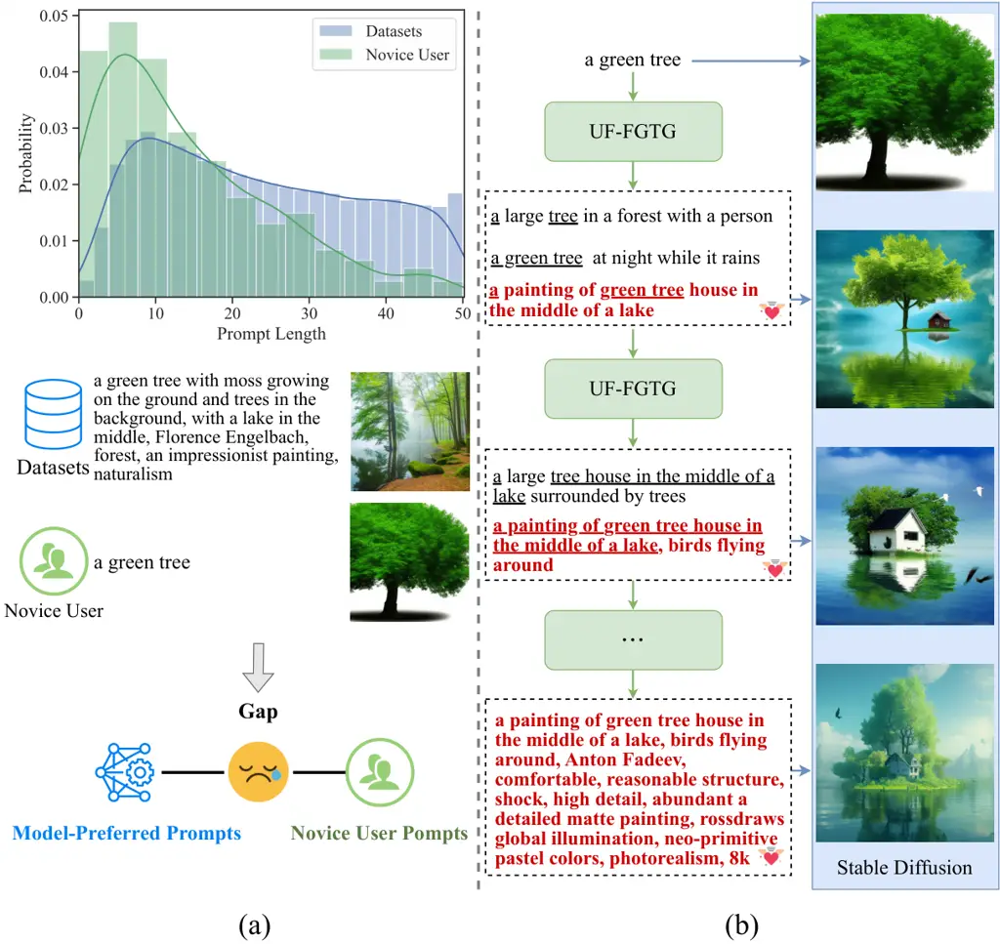
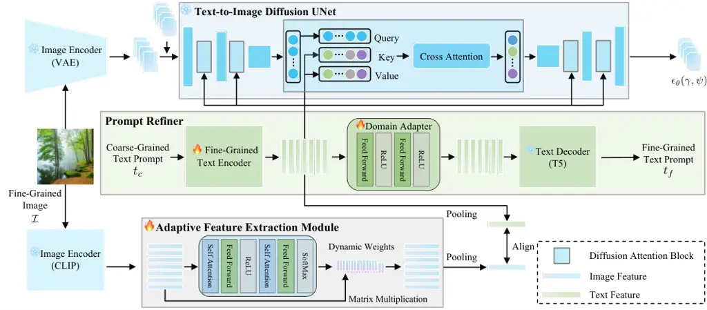
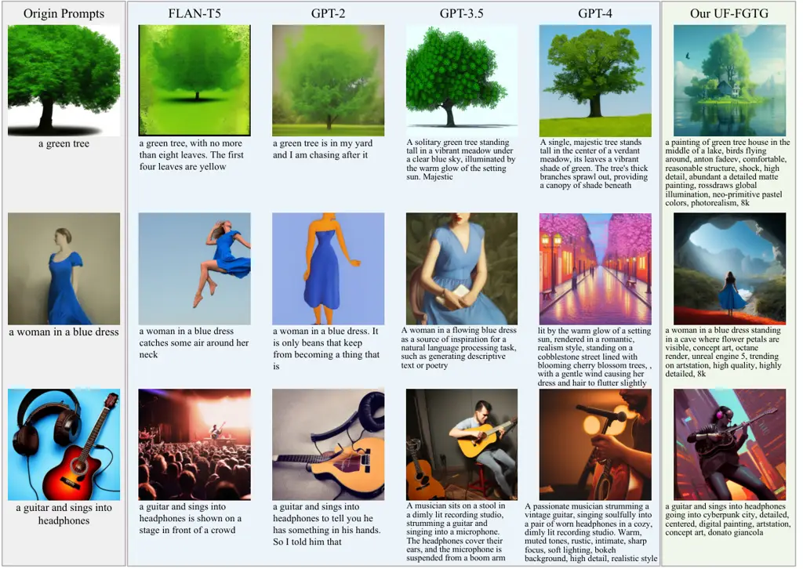
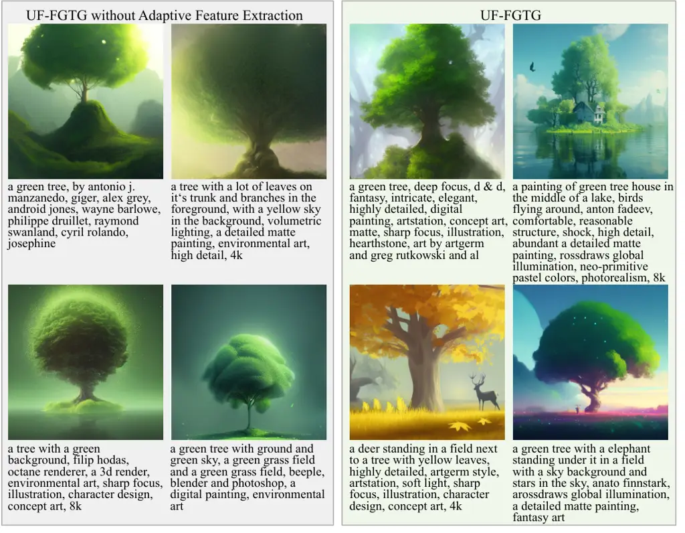
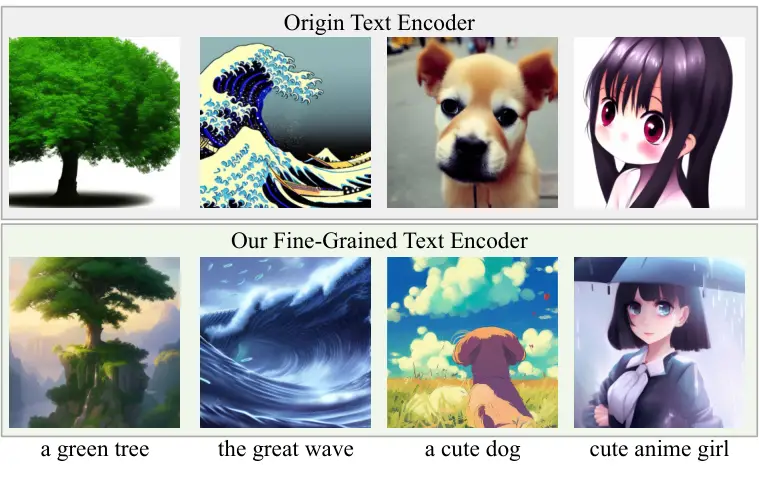
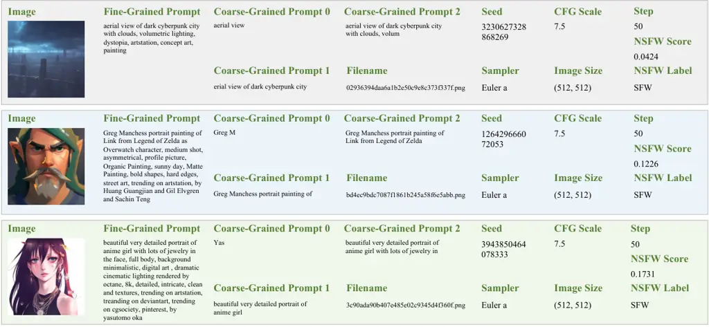
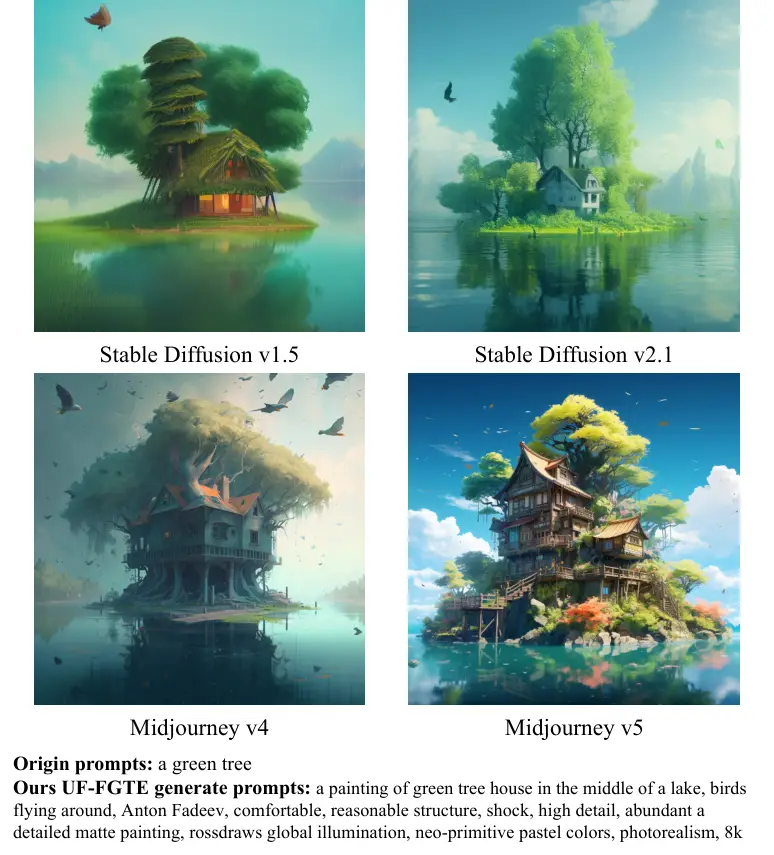
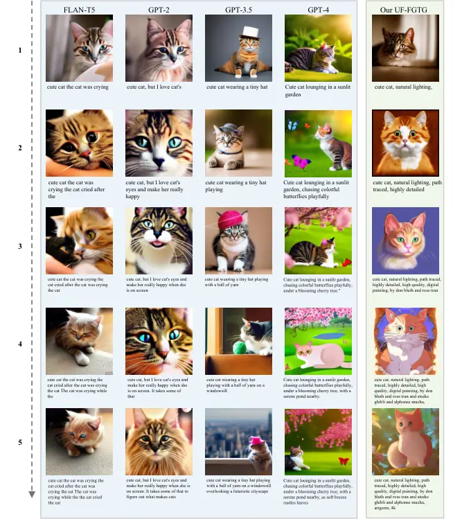
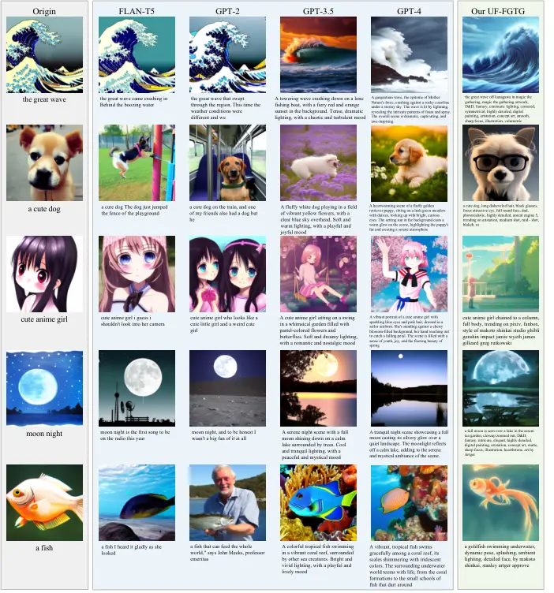

# A User-Friendly Framework for Generating Model-Preferred Prompts in Text-to-Image Synthesis

Nailei Hei    Qianyu Guo    Zihao Wang    Yan Wang    Haofen Wang   
Wenqiang Zhang

###### Abstract

Well-designed prompts have demonstrated the potential to guide
text-to-image models in generating amazing images. Although existing
prompt engineering methods can provide high-level guidance, it is
challenging for novice users to achieve the desired results by manually
entering prompts due to a discrepancy between novice-user-input prompts
and the model-preferred prompts. To bridge the distribution gap between
user input behavior and model training datasets, we first construct a
novel Coarse-Fine Granularity Prompts dataset (CFP) and propose a novel
User-Friendly Fine-Grained Text Generation framework (UF-FGTG) for
automated prompt optimization. For CFP, we construct a novel dataset for
text-to-image tasks that combines coarse and fine-grained prompts to
facilitate the development of automated prompt generation methods. For
UF-FGTG, we propose a novel framework that automatically translates
user-input prompts into model-preferred prompts. Specifically, we
propose a prompt refiner that continually rewrites prompts to empower
users to select results that align with their unique needs. Meanwhile,
we integrate image-related loss functions from the text-to-image model
into the training process of text generation to generate model-preferred
prompts. Additionally, we propose an adaptive feature extraction module
to ensure diversity in the generated results. Experiments demonstrate
that our approach is capable of generating more visually appealing and
diverse images than previous state-of-the-art methods, achieving an
average improvement of $`5\%`$ across six quality and aesthetic metrics.
Data and code are available at https://github.com/Naylenv/UF-FGTG.

¹Shanghai Engineering Research Center of AI & Robotics, Academy for
Engineering & Technology, Fudan University

²Engineering Research Center of Robotics, Ministry of Education, Academy
for Engineering & Technology, Fudan University

³Shanghai Key Lab of Intelligent Information Processing, School of
Computer Science, Fudan University

⁴Tongji University

⁵College of Design and Innovation, Tongji University

nlhei22@m.fudan.edu.cn, qyguo20@fudan.edu.cn, zihaowang26@outlook.com

yanwang19@fudan.edu.cn, carter.whfcarter@gmail.com, wqzhang@fudan.edu.cn

## Introduction



Figure 1: (a) We uncover an inconsistency in the word length
distribution between prompts in the text-to-image training dataset and
those provided by novice users, leading to a misalignment between
model-preferred prompts and novice user prompts. (b) Our proposed
UF-FGTG continually rewrites prompts, allowing users to select results
of interest based on their needs until satisfied.

Generative foundation models, including language models and
text-to-image models, can be prompted to follow user instructions.
Recent advancements in text-to-image synthesis such as Stable Diffusion
(SD) (Rombach et al. 2022) and Midjourney (Holz 2023) have facilitated
the generation of high-fidelity images based on text prompts.
Concurrently, recent studies have revealed that prompt design plays a
crucial role in determining the quality of the generated images (Ko et
al. 2023; Liu et al. 2022). Adjusting the prompt to better reflect the
user’s intentions can lead to superior results. This issue is
particularly pronounced in text-to-image models, as the capacity of
their text encoders is relatively limited, such as CLIP text
encoder (Radford et al. 2021) in Stable Diffusion. Empirical
observations have also shown that common user inputs are often
insufficient to produce aesthetically pleasing images using current
models (Hao et al. 2023).

However, previous research has primarily focused on manually designing
prompts for specific text-to-image models (Liu and Chilton 2022;
Pavlichenko and Ustalov 2023), typically adding some modifiers to the
original prompts. While these studies have provided valuable insights,
they are labor-intensive and only offer high-level suggestions, failing
to offer personalized recommendations for users seeking specific
aesthetics. Novice users, who lack experience in prompt writing and
familiarity with relevant keywords, face significant challenges in
achieving their desired results due to this. Therefore, it is essential
to develop a method that can automatically rewrite prompts, thereby
assisting novice users in generating model-preferred prompts.

As shown in Fig. 1(a), we analyze the probability distribution of prompt
word lengths in text-to-image training datasets as compared to those
actually used by novice users. Specifically, we employ DiffusionDB (Wang
et al. 2022), a large-scale dataset frequently employed for training in
text-to-image tasks, as our analysis dataset. Following (Wu et al.
2023), we use DiscordChatExporter (Holub 2022) to collect novice user
prompts from the ‘dreambot’ channel on the Stable Diffusion Discord. Our
analysis reveals a tendency among novice users to input short,
coarse-grained prompts, contrasting with the long, fine-grained prompts
used in model training. We believe that this gap results in a
discrepancy between the intentions of novice users and the prompts that
the model prefers.

Traditional methods for converting user-input prompts into
model-preferred prompts rely on generative language models. However,
existing generative language models such as GPT (Radford et al. 2019)
and T5 (Raffel et al. 2020) are restricted to uni-modal text information
during training, which constrains their ability to generate genuinely
model-preferred prompts. To overcome this limitation and generate
high-quality images in text-to-image tasks, the need for a multi-modal
training framework is clearly highlighted.

To solve the above issues, we propose the Coarse-Fine Granularity
Prompts dataset (CFP), a collection of 81,910 data instances from
popular text-to-image community. Specifically, we refer to prompts in
Lexica.art (Santana 2022) as fine-grained prompts. Then we generate
corresponding images from the fine-grained prompts and use a
summarization model (sshleifer 2021) to produce coarse-grained prompts,
thereby creating a triplet dataset.

Building on our CFP dataset, we propose a novel User-Friendly
Fine-Grained Text Generation framework (UF-FGTG) for automated prompt
optimization. Specifically, we first propose a prompt refiner, which
transforms coarse-grained prompts into fine-grained prompts. Secondly,
we incorporate image-related loss functions in text-to-image tasks,
ensuring the generated fine-grained prompts as model-preferred prompts.
Thirdly, nearly every word in a text-to-image task prompt can find
corresponding semantics in the generated image. However, many stylistic
details of an image, particularly those described in short texts, are
not represented. To prevent the generation in a fixed style, we propose
an adaptive feature extraction module to ensure the diversity of the
generated results. As shown in Fig. 1(b), our UF-FGTG continually
refines prompts, enabling users to select outcomes of interest as per
their requirements until satisfaction is achieved. Through extensive
experiments on the CFP dataset, we demonstrate the effectiveness of our
proposed method on both quantitative and qualitative measures.

Our major contributions are as follows:

- •
  We propose a novel Coarse-Fine Granularity Prompts dataset (CFP), a
  unique triplet dataset designed to bridge the gap between user
  behavior and model-preferred prompts. To the best of our knowledge,
  CFP is the first dataset that comprises fine-grained prompts with
  corresponding images, as well as coarse-grained prompts.
- •
  We propose a novel training framework for text generation in
  text-to-image tasks, which transforms coarse-grained prompts into a
  fine-grained prompt feature space, named User-Friendly Fine-Grained
  Text Generation (UF-FGTG).
- •
  We propose an adaptive feature extraction module that aligns prompt
  features with adaptive image features to prevent the generation of
  monotonous style results, ensuring diversity in the generated results.

## Related Work



Figure 2: The architecture of our User-Friendly Fine-Grained Text
Generation (UF-FGTG) Framework. The crux of the text generation network
is the prompt refiner, which primarily comprises a fine-grained text
encoder $`E_{T}`$ and a text decoder $`D_{E}`$. The encoder $`E_{T}`$
transforms coarse-grained prompt features into fine-grained prompt
features. This process is supervised by fine-grained text $`T_{F}`$, a
Stable Diffusion model $`\epsilon_{\theta}`$, and an adaptive feature
extraction module $`\mathbf{\mathcal{N}}`$, ensuring the generated
fine-grained prompts are not only model-preferred but also diverse.
During inference process, only the prompt refiner is necessary.

### Text-to-Image Generative Models

Text-to-image generative models enable users to create images based on
textual input. Researchers have explored a variety of architectures to
enhance image quality, including autoregressive models (Ramesh et al.
2021), generative adversarial networks (GANs) (Sauer et al. 2023), and
diffusion models (Rombach et al. 2022). Several subsequent works,
including DALL-E-2 (Ramesh et al. 2022), GLIDE (Nichol et al. 2022),
Imagen (Saharia et al. 2022), and Stable Diffusion (Rombach et al.
2022), have brought the magic of text-to-image generation to public
attention. Among these models, Stable Diffusion stands out as an
open-source model with an active user community. Although text-to-image
models can generate impressive images, they demand high-quality input
prompts. Novice users, lacking experience in prompt writing and
unfamiliar with relevant keywords, may still struggle to generate the
desired images.

### Prompt Engineering

In the specific field of text-to-image generative models, prompt
engineering research is nascent, which aims to use carefully selected
and combined sentences to achieve a specific visual style in synthesized
images (Oppenlaender 2023). The input texts, known as the prompts,
direct the model to generate specific images. Manual prompt engineering
is a natural method for optimizing prompts. Pavlichenko et al. (2023);
Oppenlaender et al. (2023); Liu et al. (2022) explore how to find
model-preferred prompts manually. While manual prompt engineering can
lead to significant progress, the process of designing prompts requires
time and experience, and may not always yield optimal results.
Therefore, various methods have focused on automatically searching for
prompts through mining (Jiang et al. 2020), parsing (Haviv et al. 2021),
text generation (Hao et al. 2023) and LLMs (Zhu et al. 2023; Chakrabarty
et al. 2023). Additionally, many previous works have focused on
gradient-based prompt learning methods, such as  (Zhou et al. 2022; Wen
et al. 2023). However, these gradient-based methods are not
human-readable, which may hinder their application in human-AI
collaboration.

Our work is closely related to prior research in the field of prompt
engineering. For example, Google’s recent study (Hao et al. 2023)
introduced a reinforcement learning-based approach to prompt training.
However, their strategy is essentially a training methodology that can
be applied to other models. Another related work by Wang et al. (2023)
is limited by its reliance on manual design and may not be easily
applicable to other domains. In this work, we propose a user-friendly
prompt engineering framework that is data-driven and interpretable for
text-to-image generation.

## Coarse-Fine Granularity Prompts Dataset

#### Motivation.

Existing datasets primarily depend on fine-grained prompts and
corresponding images for model training (Wang et al. 2022). However, in
real-world scenarios, users frequently input coarse-grained prompts,
leading to a disparity between the model’s training and inference
phases. Addressing this discrepancy to align native-user-input prompts
with model-preferred prompts is crucial. To bridge this gap, we
construct the Coarse-Fine Granularity Prompts dataset (CFP).

#### Fine-Grained Prompts Collection.

We build a coarse-fine granularity prompts dataset based on
Lexica.art (Santana 2022), which consists of 81,910 fine-grained prompts
filtered and extracted from user communities.

#### Coarse-Grained Prompts and Fine-Grained Images.

For each fine-grained prompt obtained, following (Wang et al. 2022), we
use Stable Diffusion-v2.1 (Rombach et al. 2022) to generate a
corresponding image. The parameters used for image generation include
“step”, “seed”, “height”, “width”, “CFG scale”, and “sampler”.
Additionally, we employ BART (Lewis et al. 2020) as a summarization
model (sshleifer 2021) to generate coarse-grained prompts of three
different lengths: 1-5 tokens, 6-10 tokens, and 11-15 tokens. During
training, one of these coarse-grained prompts is selected randomly.

#### Data Format.

Finally, we obtain a total of 81,910 data instances, each consisting of
one fine-grained prompt, one fine-grained image, and three
coarse-grained prompts. We split 73,718 data pairs as the training set
and 8,192 data instances as the testing set.

#### NSFW Contents.

Following (Wu et al. 2023) and (Schuhmann et al. 2022), we observe that
a small subset of data instances may contain NSFW (not safe for work)
content. To avoid the potential harm caused by such content, we employ
an NSFW detector (michellejieli 2022) to filter out fine-grained prompts
that contain NSFW elements. We suggest using only the data with scores
below 0.9, which amounts to a total of 79,447 data instances.

## UF-FGTG Framework

#### Motivation.

Existing text generation methods are uni-modal, which can ensure the
transformation of coarse-grained prompts into fine-grained ones, but
cannot guarantee model-preferred prompts. To solve this issue, we
propose the User-Friendly Fine-Grained Text Generation framework
(UF-FGTG), which has the capability to transform coarse-grained prompts
into the feature space of fine-grained, model-preferred prompts, thereby
generating high-quality images. More specifically, we propose a prompt
refiner, which has the ability to transform coarse-grained prompts into
fine-grained prompts. To ensure the generated prompts are
model-preferred, we incorporate image-related supervision from Stable
Diffusion. Additionally, we propose an adaptive feature extraction
module that ensures diversity in the generated results.

### Framework Overview

Fig. 2 presents an overview of our framework, specifically designed for
prompt generation. We take the Stable Diffusion (Rombach et al. 2022) as
an example to introduce our methodology. Our model is trained using
triplet datasets, which we denote as
$`\mathcal{S}=\{(t_{c},t_{f},\mathcal{I})\}`$. Here, $`t_{c}`$ stands
for coarse-grained prompts, while $`t_{f}`$ represents fine-grained
prompts. The symbol $`\mathcal{I}`$ corresponds to the images that are
associated with the fine-grained prompts.

The core of our framework is prompt refiner mainly composed of
fine-grained text encoder and text decoder, which are designed to
transform the input coarse-grained prompts into fine-grained prompts.
For the first time, we incorporate image-related supervision from the
Stable Diffusion process to generate model-preferred prompts, ensuring
that the generated fine-grained prompts align with the model-preferred
prompts. Additionally, we observe that while nearly every word in a
prompt can find its corresponding semantics in the generated image, many
stylistic details, particularly in short texts, are not adequately
represented. This issue confines our UF-FGTG to generate images in a
specific style. To tackle this problem, we propose an adaptive feature
extraction module that aligns prompt features with adaptive image
features, thereby ensuring diversity in the generated results.

During inference, the user inputs coarse-grained prompts and utilizes
the prompt refiner within the framework to generate fine-grained prompts
preferred by the model.

### Text-to-Image Diffusion Model

#### Stable Diffusion.

It consists of three main components: an autoencoder $`\mathcal{A}`$, a
text time-conditional UNet denoising model $`\epsilon_{\theta}`$, and a
CLIP fine-grained text encoder $`E_{T}`$. The autoencoder
$`\mathcal{A}`$ includes a VAE encoder $`\mathcal{E}`$ and a VAE decoder
$`\mathcal{D}`$, while the CLIP text encoder $`E_{T}`$ accepts text
prompts $`t`$ as input. The encoder $`\mathcal{E}`$ transforms an image
$`\mathcal{I}\in\mathbb{R}^{3\times H\times W}`$ into a
lower-dimensional latent space in $`\mathbb{R}^{4\times h\times w}`$,
where $`h=H/8`$ and $`w=W/8`$. Conversely, the decoder $`\mathcal{D}`$
carries out the inverse operation, decoding a latent variable into the
pixel space.

Our goal is to generate fine-grained prompts $`t_{f}`$ from the
coarse-grained prompts $`t_{c}`$ provided by the user while ensuring
that the feature space can be understood by the UNet denoising model
$`\epsilon_{\theta}`$, which is designed to generate fine-grained
prompts that are model-preferred prompts. To achieve this, we refer to
the $`\epsilon_{\theta}`$ convolutional input as the spatial input
$`\gamma`$ (e.g., $`z_{t}`$) since convolutions preserve the spatial
structure, and to the attention conditioning input as $`\psi`$ (e.g.,
$`[\tau,E_{T}(T)]`$). We train the text encoder $`E_{T}`$ by minimizing
the loss function defined as follows:

```math
\mathcal{L}_{\mathrm{mse}}=\mathbb{E}_{\mathcal{E}(\mathcal{I}),t_{c},\epsilon\sim\mathcal{N}(0,1),\tau}\lVert\epsilon-\epsilon_{\theta}(\gamma,\psi)\rVert_{2}^{2}, \tag{1}
```

where $`\tau`$ represents the diffusing time step, $`\gamma=z_{\tau}`$,
$`z_{\tau}`$ is the encoded image $`\mathcal{E}(\mathcal{I})`$ where we
stochastically add Gaussian noise $`\epsilon\sim\mathcal{N}(0,1)`$, and
$`\psi=\left[\tau;E_{T}(t_{c})\right]`$.

### Prompt Refiner

It consists of three components: a fine-grained text encoder $`E_{T}`$,
a text decoder $`D_{T}`$, and a domain adapter $`Q`$. We utilize the
CLIP model as the fine-grained text encoder and the T5 model (Raffel et
al. 2020) as the text decoder to articulate our methodology.

#### Fine-Grained Text Encoder.

CLIP (Radford et al. 2021) is a vision-language model that aligns visual
and textual information within a shared embedding space. CLIP consists
of a visual encoder $`E_{V}`$ and a text encoder $`E_{T}`$. These
encoders independently generate feature representations
$`E_{V}(\mathcal{I})\in\mathbb{R}^{n}`$ for an input image
$`\mathcal{I}`$, and $`E_{T}(L(t))\in\mathbb{R}^{n}`$ for the
corresponding text $`t`$. Here, $`n`$ represents the dimensionality of
the embedding space in CLIP, and $`L`$ denotes the embedding lookup
layer that maps each tokenized word $`t`$ to its respective token
embedding in space $`\mathcal{W}`$.

In the original Stable Diffusion model, the CLIP text encoder only has
the capability for text encoding. However, our fine-grained text encoder
can transform the feature space from coarse-grained prompts $`t_{c}`$ to
model-preferred fine-grained prompts $`t_{f}`$, by concurrently
employing the fine-grained prompt-related loss and the image-related
loss supervision from the Stable Diffusion. In subsequent sections, we
employ a language model to decode these features into human-readable
prompts.

#### Text Decoder.

The objective of our fine-grained text encoder is to transform
coarse-grained prompt features into model-preferred fine-grained prompt
features. Additionally, we implement a feature domain adapter $`Q`$,
which utilizes a Multilayer Perceptron (MLP) to project CLIP text
features onto the T5 text features space. Simultaneously, we employ the
T5 model as a text feature decoder, denoted as $`D_{T}`$, to generate
the final human-readable fine-grained prompts.

More specifically, the fine-grained text encoder is initialized using
OpenCLIP (Cherti et al. 2023) derived from the Stable Diffusion
model (Rombach et al. 2022). The text decoder $`D_{T}`$ is initialized
with a FLAN-T5 (Chung et al. 2022) pretrained generative language model.
The fine-grained prompts $`t_{f}`$ are utilized as training labels. The
training objective is to minimize the log-likelihood by leveraging the
teacher forcing technique (Williams and Zipser 1989):

```math
\mathcal{L}_{\mathrm{sft}}=\mathbb{E}_{(t_{c},t_{f})\sim\mathcal{S}}\log p(t_{f}\mid Q(E_{T}(t_{c}))). \tag{2}
```

### Adaptive Feature Extraction Module



Figure 3: Comparison of prompts generated by FLAN-T5, GPT-2, GPT3.5,
GPT-4, and our UF-FGTG, with corresponding images generated by Stable
Diffusion-v2.1.

Through text-to-image model and prompt refiner in our framework, the
fine-grained text encoder $`E_{T}`$ transforms coarse-grained prompt
features into model-preferred fine-grained prompt features. While nearly
every word in a prompt can find its corresponding semantics in the
generated image, many stylistic details in the image are difficult to
reflect in the prompts, especially in short ones. For instance, a
coarse-grained text such as “a green tree” might align with a sunny
forest scene image, which, through direct training, could lead to
generated results adhering to a uniform style, thereby reducing
diversity. To ensure diversity in the generated results, we propose an
adaptive feature extraction module that adaptively extracts image
features.

Fig. 2 illustrates the architecture of our adaptive feature extraction
module. This module aims to predict the soft dynamic weights of image
representations. Specifically, we take the image $`\mathcal{I}`$
extracted by the CLIP image encoder $`E_{V}`$ as the input to the
dynamic weight network. The dynamic weight network consists of
self-attention layer, feed-forward layer, and ReLU activation functions.
Ultimately, the dynamic weights $`w`$ are obtained through a SoftMax
function. These weights are then applied to weight pixel-wise features
through matrix multiplication. This method enables the automatic
learning of the most suitable and relevant representation from the image
feature.

The features $`E_{T}(t_{c})`$, which are extracted by the fine-grained
text encoder, and the features
$`\mathbf{\mathcal{N}}(E_{V}(\mathcal{I}))`$, generated by the CLIP
image encoder and adaptive feature extraction module
$`\mathbf{\mathcal{N}}`$, have the same dimensions. As suggested
by (Liang et al. 2023), we use the CLIP-Enhance loss function to
evaluate the similarity between the prompt features and image features.
The training objective is to minimize the CLIP-Enhance loss, where $`B`$
represents the batch size:

```math
\mathcal{L}_{\mathrm{clip}}=-\frac{1}{B}\log{\Sigma\frac{e^{\cos(E_{T}(t_{c})_{i},\mathbf{\mathcal{N}}(E_{V}(\mathcal{I}))_{i})}}{\Sigma_{j\neq i}e^{\cos(E_{T}(t_{c})_{i},\mathbf{\mathcal{N}}(E_{V}(\mathcal{I}))_{j})}}}. \tag{3}
```

### Loss Function

The overall loss function is a weighted sum of
$`\mathcal{L}_{\mathrm{mse}}`$, $`\mathcal{L}_{\mathrm{sft}}`$ and
$`\mathcal{L}_{\mathrm{clip}}`$. In our experiments, we set the
trade-off hyper-parameters $`\alpha_{1}`$ and $`\alpha_{2}`$ to 0.1.

```math
\mathcal{L}=\mathcal{L}_{\mathrm{mse}}+\alpha_{1}\mathcal{L}_{\mathrm{sft}}+\alpha_{2}\mathcal{L}_{\mathrm{clip}}. \tag{4}
```

## Experiments

[TABLE]

Table 1: Image quality & aesthetic assessment. All methods first
generate fine-grained prompts from coarse-grained prompts and then
evaluate the generated images using Stable Diffusion-v2.1. “\*” means
trained on Coarse-Fine Granularity Prompts dataset (CFP). CFP-C and
CFP-F denote the coarse-grained and fine-grained prompts in the CFP
dataset.

### Experimental Setting

#### Implementation Details.

We conduct our experiments on NVIDIA A100 GPUs. During training, we
train the fine-grained text encoder, domain adapter, and adaptive
feature extraction module on our CFP dataset for 100 epochs, using the
AdamW optimizer (Loshchilov and Hutter 2018), a learning rate of 5e-5,
and a batch size of 16.

In line with the Stable Diffusion-v2.1, our fine-grained text encoder is
initialized with OpenCLIP (Cherti et al. 2023). The text decoder is
initialized using FLAN-T5-base (Chung et al. 2022), while the image
encoder employs the OpenCLIP that is paired with the fine-grained text
encoder. This consistent approach to initialization ensures the
compatibility and effectiveness of our proposed model.

#### Generation Strategy.

In the subsequent experiments, we use the following default
configuration: during prompt generation, we generate fine-grained
prompts using 6-10 tokens of coarse-grained prompts. Following (von
Platen 2020), we employ a strategy that combines Top-p and Top-K, which
set $`p`$ to 0.95 and $`K`$ to 50. For the image generation phase, we
utilize Stable Diffusion-v2.1, setting the CFG scale to 7, and perform
50 denoising steps using the Euler Ancestral sampler (Karras et al.
2022).

### Qualitative Comparison

In Fig. 3, we visualize the generation results from various models,
including GPT-2 (Radford et al. 2019), FLAN-T5 (Chung et al. 2022),
GPT-3.5 (OpenAI 2023), and GPT-4 (OpenAI 2023). First, we rewrite the
coarse-grained prompts, setting the max tokens to 20. Then, we generate
images using Stable Diffusion-v2.1. Our method is capable of producing
visually appealing images. Furthermore, we note that traditional
language models, including GPT-2 and FLAN-T5, struggle to comprehend the
format of model-preferred prompts in text-to-image tasks. Even when we
provide ChatGPT with a prompts format during generation it still fails
to produce satisfactory results (bluelovers 2022). For example, in the
case of “a woman in a blue dress”, GPT-4 modifies the original
semantics, leading to a significant deviation in the generated result
from the original content. In most cases, GPT-2 and FLAN-T5 can only
generate short text, even when we attempt to increase the maximum token
count. In summary, these issues originate from language models’ limited
grasp of image information in text-to-image tasks and their
unfamiliarity with the structure of preferred prompts. Our method
effectively addresses these issues.

[TABLE]

Table 2: Impact of Stable Diffusion model
($`\mathcal{L}_{\mathrm{mse}}`$) and adaptive feature extraction module
($`\mathcal{L}_{\mathrm{clip}}`$) in our UF-FGTG.

Figure 4: Ablation study on prompt length, showing both NIMA-TID and
NIMA-AVA score as length increases.

### Quantitative Comparison

#### Evaluation Metrics.



Figure 5: The adaptive feature extraction module enhances the diversity
of the results. Origin prompts: “a green tree”.

Following (Li et al. 2023) and (Dinh et al. 2022), we quantitatively
assess the image quality and aesthetic, using the non-reference metrics.
Specifically, we choose NIMA (Talebi and Milanfar 2018), MUSIQ (Ke et
al. 2021), DB-CNN (Zhang et al. 2020), and TReS (Golestaneh et al.
2022). We use NIMA-TID, MUSIQ-KonIQ, DB-CNN, and TReS for image quality
assessment, while NIMA-AVA and MUSIQ-AVA are used for image aesthetic
assessment. NIMA-AVA and MUSIQ-AVA are trained on AVA (Murray et al.
2012), MUSIQ-KonIQ and DB-CNN are trained on KonIQ-10K (Hosu et al.
2020), and NIMA-TID is trained on TID2013 (Ponomarenko et al. 2013),
following Py-IQA (Chen and Mo 2022).

Tab. 1 showcases the performance of various generative language models
in image quality and aesthetic evaluation, with our method consistently
surpassing other approaches across all six metrics, achieving an average
improvement of $`5\%`$. This indicates that our method not only
generates high-quality but substantial aesthetic images. Two primary
reasons contribute to this phenomenon: (1) Previous uni-model text
generation methods for fine-grained prompts neglect image information in
text-to-image tasks, leading to subpar generative performance.
Nonetheless, fine-tuning these methods with our CFP dataset yields
enhanced results. (2) We observe that the text feature space in
text-to-image tasks is merely a subset of the high-dimensional space
employed in text generation. Our method maps the high-dimensional
feature space in text generation into a low-dimensional one suitable for
text-to-image tasks. This ensures that fine-grained prompts, derived
from coarse-grained prompts, are model-preferred and correspond to
high-quality images.

### Ablation Study

#### Effect of Loss Functions.

In Tab. 2, we study the model performance by varying its configuration.
Our framework consists of three pipelines: text-to-image model, prompt
refiner, and adaptive feature extraction module. It can be controlled by
three loss functions, $`\mathcal{L}_{\mathrm{mse}}`$,
$`\mathcal{L}_{\mathrm{sft}}`$, and $`\mathcal{L}_{\mathrm{clip}}`$, to
determine whether to add a particular pipeline. The results indicate
that $`\mathcal{L}_{\mathrm{sft}}`$ and $`\mathcal{L}_{\mathrm{clip}}`$
are indispensable for text generation in text-to-image tasks.

#### Prompt Length.

Following (Wen et al. 2023), we further ablate the optimal number of
tokens. In Fig. 4, we observe that when using Stable Diffusion for image
generation, longer prompts do not always lead to better image quality
and aesthetic assessment. This phenomenon may be attributed to
overfitting caused by longer prompts. Our experience indicates that
additional prompts with a length of 6 produce the most generalizable
performance.

#### Effect of Adaptive Feature Extraction Module.



Figure 6: Origin text encoder vs our fine-grained text encoder in Stable
Diffusion-v2.1.

In Fig. 5, we demonstrate the increased diversity of generation results
achieved by the adaptive feature extraction module. Without this module,
the model tends to produce results with a singular style. However, by
incorporating the adaptive feature extraction module, the model is
capable of generating a variety of results. This diversity is attributed
to our adaptive extraction of image features, which enhances the
heterogeneity of the fine-grained prompt features.

### Applications

#### Prompt Generation.

The inference process for text generation is independent of its training
phase. Our model proposes two recommended strategies for inference: (1)
As shown in Fig. 1(b), the model generates three results concurrently,
with each outcome further producing six tokens based on the preceding
prompts, iterating this process until user satisfaction is achieved. (2)
As shown in Fig. 3, the model aims to generate comprehensive prompts
(setting max token to 20 or 50). Both strategies use the original Stable
Diffusion model for image generation.

#### A Plug-and-Play Module in Stable Diffusion.

Our method trains a fine-grained text encoder with the ability to map
coarse-grained prompts to a fine-grained prompt feature space. As shown
in Fig. 6, this allows it to fully supplant the encoding-only text
encoder in the original Stable Diffusion model. Furthermore, we observe
that when the input prompt extends to a certain length, the model tends
to generate prompts such as “4k resolution”, “highly detailed” and “best
quality”. Although these prompts are not semantically explicit, they can
improve the quality of the generated images (Pavlichenko and Ustalov
2023). This suggests that our approach consistently projects any
user-provided input prompt into a feature space aligned with
fine-grained prompts, resulting in enhanced image generation quality.

## Conclusion

In this paper, we propose the Coarse-Fine Granularity Prompts dataset
(CFP), which enables the study of the gap between user behavior and
model-preferred prompts. We also propose the User-Friendly Fine-Grained
Text Generation (UF-FGTG) framework, which automatically translates
user-input prompts into model-preferred prompts while incorporating
image-related loss functions and an adaptive feature extraction module
for improved diversity in generation results. Our experiments
demonstrate that our method achieves state-of-the-art performance on
both quantitative and qualitative measures, significantly advancing the
field of text-to-image synthesis by providing a user-friendly method for
automated prompt optimization.

## Acknowledgments

This work was supported by Fundamental Research Funds for the Central
Universities (No.22120230032), National Nature Science Foundation of
China (No.62176185, No.62072112), Scientific and Technological
Innovation action Plan of Shanghai Science and Technology Committee
(No.22511102202), and China Postdoctoral Science Foundation
(2023M730647, 2023TQ0075).

## References

- bluelovers (2022) bluelovers ChatGPT stable diffusion prompts
  generator. Note:
  https://gist.github.com/bluelovers/92dac6fe7dcbafd7b5ae0557e638e6ef/
  Cited by: 3rd item, Appendix C: ChatGPT Description, Qualitative
  Comparison.
- Chakrabarty et al. (2023) T. Chakrabarty, A. Saakyan, O. Winn, A.
  Panagopoulou, Y. Yang, M. Apidianaki, and S. Muresan I spy a metaphor:
  large language models and diffusion models co-create visual metaphors.
  Cited by: Prompt Engineering.
- Chen and Mo (2022) C. Chen and J. Mo IQA-PyTorch: pytorch toolbox for
  image quality assessment. Note: \[Online\]. Available:
  https://github.com/chaofengc/IQA-PyTorch Cited by: Evaluation
  Metrics..
- Cherti et al. (2023) M. Cherti, R. Beaumont, R. Wightman, M.
  Wortsman, G. Ilharco, C. Gordon, C. Schuhmann, L. Schmidt, and J.
  Jitsev Reproducible scaling laws for contrastive language-image
  learning. In Proceedings of the IEEE/CVF Conference on Computer Vision
  and Pattern Recognition, pp. 2818–2829. Cited by: Text Decoder.,
  Implementation Details..
- Chung et al. (2022) H. W. Chung, L. Hou, S. Longpre, B. Zoph, Y.
  Tay, W. Fedus, E. Li, X. Wang, M. Dehghani, S. Brahma, et al. Scaling
  instruction-finetuned language models. arXiv preprint
  arXiv:2210.11416. Cited by: Text Decoder., Implementation Details.,
  Qualitative Comparison.
- Dinh et al. (2022) T. M. Dinh, R. Nguyen, and B. Hua TISE: bag of
  metrics for text-to-image synthesis evaluation. In Proceedings of the
  European Conference on Computer Vision (ECCV), Cited by: Evaluation
  Metrics..
- Golestaneh et al. (2022) S. A. Golestaneh, S. Dadsetan, and K. M.
  Kitani No-reference image quality assessment via transformers,
  relative ranking, and self-consistency. In Proceedings of the IEEE/CVF
  Winter Conference on Applications of Computer Vision, pp. 1220–1230.
  Cited by: Evaluation Metrics..
- Hao et al. (2023) Y. Hao, Z. Chi, L. Dong, and F. Wei Optimizing
  prompts for text-to-image generation. In Thirty-seventh Conference on
  Neural Information Processing Systems, External Links:
  [Link](https://openreview.net/forum?id=BsZNWXD3a1) Cited by:
  Introduction, Prompt Engineering, Prompt Engineering.
- Haviv et al. (2021) A. Haviv, J. Berant, and A. Globerson BERTese:
  learning to speak to bert. In Proceedings of the 16th Conference of
  the European Chapter of the Association for Computational Linguistics:
  Main Volume, pp. 3618–3623. Cited by: Prompt Engineering.
- Holub (2022) O. Holub DiscordChatExporter. GitHub. Note:
  https://github.com/Tyrrrz/DiscordChatExporter Cited by: Introduction.
- Holz (2023) D. Holz Midjourney alpha-release announcement on discord.
  Note: https://www.midjourney.com/ Cited by: Introduction, Appendix D:
  Transferability of UF-FGTG.
- Hosu et al. (2020) V. Hosu, H. Lin, T. Sziranyi, and D. Saupe
  KonIQ-10k: an ecologically valid database for deep learning of blind
  image quality assessment. IEEE Transactions on Image Processing 29,
  pp. 4041–4056. Cited by: Evaluation Metrics..
- Jiang et al. (2020) Z. Jiang, F. F. Xu, J. Araki, and G. Neubig How
  can we know what language models know?. Transactions of the
  Association for Computational Linguistics 8, pp. 423–438. Cited by:
  Prompt Engineering.
- Karras et al. (2022) T. Karras, M. Aittala, T. Aila, and S. Laine
  Elucidating the design space of diffusion-based generative models.
  Advances in Neural Information Processing Systems 35, pp. 26565–26577.
  Cited by: Generation Strategy..
- Ke et al. (2021) J. Ke, Q. Wang, Y. Wang, P. Milanfar, and F. Yang
  Musiq: multi-scale image quality transformer. In Proceedings of the
  IEEE/CVF International Conference on Computer Vision, pp. 5148–5157.
  Cited by: Evaluation Metrics..
- Ko et al. (2023) H. Ko, G. Park, H. Jeon, J. Jo, J. Kim, and J. Seo
  Large-scale text-to-image generation models for visual artists’
  creative works. In Proceedings of the 28th International Conference on
  Intelligent User Interfaces, pp. 919–933. Cited by: Introduction.
- Lewis et al. (2020) M. Lewis, Y. Liu, N. Goyal, M. Ghazvininejad, A.
  Mohamed, O. Levy, V. Stoyanov, and L. Zettlemoyer BART: denoising
  sequence-to-sequence pre-training for natural language generation,
  translation, and comprehension. In Proceedings of the 58th Annual
  Meeting of the Association for Computational Linguistics, Cited by:
  Coarse-Grained Prompts and Fine-Grained Images..
- Li et al. (2023) C. Li, Z. Zhang, H. Wu, W. Sun, X. Min, X. Liu, G.
  Zhai, and W. Lin AGIQA-3k: an open database for ai-generated image
  quality assessment. arXiv preprint arXiv:2306.04717. Cited by:
  Evaluation Metrics..
- Liang et al. (2023) Z. Liang, C. Li, S. Zhou, R. Feng, and C. C. Loy
  Iterative prompt learning for unsupervised backlit image enhancement.
  In ICCV, Cited by: Adaptive Feature Extraction Module.
- Liu and Chilton (2022) V. Liu and L. B. Chilton Design guidelines for
  prompt engineering text-to-image generative models. In Proceedings of
  the 2022 CHI Conference on Human Factors in Computing Systems,
  pp. 1–23. Cited by: Introduction, Prompt Engineering.
- Liu et al. (2022) V. Liu, H. Qiao, and L. Chilton Opal: multimodal
  image generation for news illustration. In Proceedings of the 35th
  Annual ACM Symposium on User Interface Software and Technology,
  pp. 1–17. Cited by: Introduction.
- Loshchilov and Hutter (2018) I. Loshchilov and F. Hutter Decoupled
  weight decay regularization. In International Conference on Learning
  Representations, Cited by: Implementation Details..
- michellejieli (2022) michellejieli NSFW text classifier. Hugging Face.
  Note: https://huggingface.co/michellejieli/NSFW˙text˙classifier Cited
  by: NSFW Contents., Appendix A: CFP Dataset details.
- Murray et al. (2012) N. Murray, L. Marchesotti, and F. Perronnin AVA:
  a large-scale database for aesthetic visual analysis. In 2012 IEEE
  conference on computer vision and pattern recognition, pp. 2408–2415.
  Cited by: Evaluation Metrics..
- Nichol et al. (2022) A. Q. Nichol, P. Dhariwal, A. Ramesh, P.
  Shyam, P. Mishkin, B. Mcgrew, I. Sutskever, and M. Chen GLIDE: towards
  photorealistic image generation and editing with text-guided diffusion
  models. In International Conference on Machine Learning,
  pp. 16784–16804. Cited by: Text-to-Image Generative Models.
- OpenAI (2023) O. OpenAI GPT-4 technical report. (en-US). Cited by:
  Qualitative Comparison.
- Oppenlaender (2023) J. Oppenlaender A taxonomy of prompt modifiers for
  text-to-image generation. Behaviour & Information Technology,
  pp. 1–14. Cited by: Prompt Engineering.
- Pavlichenko and Ustalov (2023) N. Pavlichenko and D. Ustalov Best
  prompts for text-to-image models and how to find them. In Proceedings
  of the 46th International ACM SIGIR Conference on Research and
  Development in Information Retrieval, pp. 2067–2071. Cited by:
  Introduction, Prompt Engineering, A Plug-and-Play Module in Stable
  Diffusion..
- Ponomarenko et al. (2013) N. Ponomarenko, O. Ieremeiev, V. Lukin, K.
  Egiazarian, L. Jin, J. Astola, B. Vozel, K. Chehdi, M. Carli, F.
  Battisti, et al. Color image database tid2013: peculiarities and
  preliminary results. In European workshop on visual information
  processing (EUVIP), pp. 106–111. Cited by: Evaluation Metrics..
- Radford et al. (2021) A. Radford, J. W. Kim, C. Hallacy, A. Ramesh, G.
  Goh, S. Agarwal, G. Sastry, A. Askell, P. Mishkin, J. Clark, et al.
  Learning transferable visual models from natural language supervision.
  In International conference on machine learning, pp. 8748–8763. Cited
  by: Introduction, Fine-Grained Text Encoder..
- Radford et al. (2019) A. Radford, J. Wu, R. Child, D. Luan, D. Amodei,
  and I. Sutskever Language models are unsupervised multitask learners.
  Cited by: Introduction, Qualitative Comparison.
- Raffel et al. (2020) C. Raffel, N. Shazeer, A. Roberts, K. Lee, S.
  Narang, M. Matena, Y. Zhou, W. Li, and P. J. Liu Exploring the limits
  of transfer learning with a unified text-to-text transformer. Journal
  of Machine Learning Research 21 (140), pp. 1–67. External Links:
  [Link](http://jmlr.org/papers/v21/20-074.html) Cited by: Introduction,
  Prompt Refiner.
- Ramesh et al. (2022) A. Ramesh, P. Dhariwal, A. Nichol, C. Chu, and M.
  Chen Hierarchical text-conditional image generation with clip latents.
  arXiv preprint arXiv:2204.06125. Cited by: Text-to-Image Generative
  Models.
- Ramesh et al. (2021) A. Ramesh, M. Pavlov, G. Goh, S. Gray, C.
  Voss, A. Radford, M. Chen, and I. Sutskever Zero-shot text-to-image
  generation. In International Conference on Machine Learning,
  pp. 8821–8831. Cited by: Text-to-Image Generative Models.
- Rombach et al. (2022) R. Rombach, A. Blattmann, D. Lorenz, P. Esser,
  and B. Ommer High-resolution image synthesis with latent diffusion
  models. In Proceedings of the IEEE/CVF Conference on Computer Vision
  and Pattern Recognition (CVPR), pp. 10684–10695. Cited by:
  Introduction, Text-to-Image Generative Models, Coarse-Grained Prompts
  and Fine-Grained Images., Framework Overview, Text Decoder..
- Saharia et al. (2022) C. Saharia, W. Chan, S. Saxena, L. Li, J.
  Whang, E. L. Denton, K. Ghasemipour, R. Gontijo Lopes, B. Karagol
  Ayan, T. Salimans, et al. Photorealistic text-to-image diffusion
  models with deep language understanding. Advances in Neural
  Information Processing Systems 35, pp. 36479–36494. Cited by:
  Text-to-Image Generative Models.
- Santana (2022) G. Santana Gustavosta/Stable-Diffusion-Prompts
  $`\cdot`$ Datasets at Hugging Face. Note:
  https://huggingface.co/datasets/Gustavosta/Stable-Diffusion-PromptsAccessed:2023-01-26
  Cited by: Introduction, Fine-Grained Prompts Collection., Appendix A:
  CFP Dataset details.
- Sauer et al. (2023) A. Sauer, T. Karras, S. Laine, A. Geiger, and T.
  Aila StyleGAN-T: unlocking the power of GANs for fast large-scale
  text-to-image synthesis. Vol. abs/2301.09515. External Links:
  [Link](https://arxiv.org/abs/2301.09515) Cited by: Text-to-Image
  Generative Models.
- Schuhmann et al. (2022) C. Schuhmann, R. Beaumont, R. Vencu, C.
  Gordon, R. Wightman, M. Cherti, T. Coombes, A. Katta, C. Mullis, M.
  Wortsman, et al. Laion-5b: an open large-scale dataset for training
  next generation image-text models. Advances in Neural Information
  Processing Systems 35, pp. 25278–25294. Cited by: NSFW Contents..
- sshleifer (2021) sshleifer Distilbart-cnn-12-6. Hugging Face. Note:
  https://huggingface.co/sshleifer/distilbart-cnn-12-6 Cited by:
  Introduction, Coarse-Grained Prompts and Fine-Grained Images..
- Talebi and Milanfar (2018) H. Talebi and P. Milanfar NIMA: neural
  image assessment. IEEE transactions on image processing 27 (8),
  pp. 3998–4011. Cited by: Evaluation Metrics..
- von Platen (2020) P. von Platen How to generate text: using different
  decoding methods for language generation with transformers. Note:
  https://huggingface.co/blog/how-to-generate/ Cited by: Generation
  Strategy..
- Wang et al. (2023) Y. Wang, S. Shen, and B. Y. Lim RePrompt: automatic
  prompt editing to refine ai-generative art towards precise
  expressions. In Proceedings of the 2023 CHI Conference on Human
  Factors in Computing Systems, pp. 1–29. Cited by: Prompt Engineering.
- Wang et al. (2022) Z. J. Wang, E. Montoya, D. Munechika, H. Yang, B.
  Hoover, and D. H. Chau Diffusiondb: a large-scale prompt gallery
  dataset for text-to-image generative models. arXiv preprint
  arXiv:2210.14896. Cited by: Introduction, Motivation., Coarse-Grained
  Prompts and Fine-Grained Images., Appendix A: CFP Dataset details.
- Wen et al. (2023) Y. Wen, N. Jain, J. Kirchenbauer, M. Goldblum, J.
  Geiping, and T. Goldstein Hard prompts made easy: gradient-based
  discrete optimization for prompt tuning and discovery. In
  Thirty-seventh Conference on Neural Information Processing Systems,
  External Links: [Link](https://openreview.net/forum?id=VOstHxDdsN)
  Cited by: Prompt Engineering, Prompt Length..
- Williams and Zipser (1989) R. J. Williams and D. Zipser A learning
  algorithm for continually running fully recurrent neural networks.
  Neural computation 1 (2), pp. 270–280. Cited by: Text Decoder..
- Wu et al. (2023) X. Wu, K. Sun, F. Zhu, R. Zhao, and H. Li Better
  aligning text-to-image models with human preference. arXiv preprint
  arXiv:2303.14420. Cited by: Introduction, NSFW Contents..
- Zhang et al. (2020) W. Zhang, K. Ma, J. Yan, D. Deng, and Z. Wang
  Blind image quality assessment using a deep bilinear convolutional
  neural network. IEEE Transactions on Circuits and Systems for Video
  Technology 30 (1), pp. 36–47. Cited by: Evaluation Metrics..
- Zhou et al. (2022) K. Zhou, J. Yang, C. C. Loy, and Z. Liu Learning to
  prompt for vision-language models. International Journal of Computer
  Vision 130 (9), pp. 2337–2348. Cited by: Prompt Engineering.
- Zhu et al. (2023) W. Zhu, X. Wang, Y. Lu, T. Fu, X. E. Wang, M.
  Eckstein, and W. Y. Wang Collaborative generative ai: integrating
  gpt-k for efficient editing in text-to-image generation. Cited by:
  Prompt Engineering.

## Overview

In this Appendix, we provide more details of CFP and UF-FGTG organized
as follows:

In Sec. Appendix A, we provide further details on the CFP Dataset, which
corresponds to Sec. Coarse-Fine Granularity Prompts Dataset in the main
body of this paper.

In Sec. Appendix B, we present additional visualizations, which
correspond to Sec. Qualitative Comparison in the main body of this
paper.

In Sec. Appendix C, we describe the types of descriptions used for
experimental analysis with ChatGPT, specifically GPT-3.5 and GPT-4.

In Sec. Appendix D, we analyze the transferability of our model.
Although our model is trained on Stable Diffusion-v2.1, the generated
prompts can produce high-quality images on other text-to-image models as
well.

## Appendix A: CFP Dataset details

We construct Coarse-Fine Granularity Prompts dataset (CFP) based on
Lexica.art (Santana 2022), and organize the data according to
DiffusionDB (Wang et al. 2022), as illustrated in Fig. 8. To ensure that
the fine-grained prompts in our dataset align with the distribution of
training data, we analyze the distribution of fine-grained prompt word
lengths, as shown in Fig. 7.

Finally, we obtain a total of 81,910 data instances, each consisting of
one fine-grained prompt, one fine-grained image, and three
coarse-grained prompts. We split 73,718 data pairs as the training set
and 8,192 data instances as the testing set. We also employ an NSFW
detector (michellejieli 2022) to filter out fine-grained prompts that
contain NSFW elements. We suggest using only the data with scores below
0.9, which amounts to a total of 79,447 data instances. In Table 1 of
the main text, we quantitatively analyze the fine-grained prompts and
find that they are superior to coarse-grained prompts in terms of both
quality and aesthetics. This further demonstrates the necessity of our
dataset, and the fine-grained prompts are preferred by models.

## Appendix B: Additional Visualizations

We present additional visualization results as shown in Fig. 10 and
Fig. 11. As mentioned in Sec. Applications, we propose two strategies
for prompt generation. Figure 10 illustrates the case of continuous
generation with a maximum token setting of 6. Our UF-FGTG is
user-friendly and consistently generates better prompts than other
methods. Figure 11 presents additional visual results for
Sec. Qualitative Comparison, where the maximum token setting is 20.

Overall, it can be observed that our UF-FGTG generates prompts that
correspond to better images than other methods. Our method achieves
superior performance in generating images of various categories,
including landscapes, animals, abstract scenes, and human portraits.

Figure 7: Word length distribution in fine-grained prompts of the CFP
dataset.



Figure 8: The CFP dataset comprises 81,910 data instances, each
containing a fine-grained image, a fine-grained prompt, and three
coarse-grained prompts of different lengths (1-5 tokens, 6-10 tokens,
11-15 tokens), as well as all model hyperparameters: ‘seed’, ‘step’,
‘CFG scale’, ‘sampler’, and ‘image size’. Additionally, each image has a
unique filename. To assist researchers in identifying potentially unsafe
or harmful content, we employ state-of-the-art models to calculate an
NSFW score for each fine-grained prompt.



Figure 9: Transferability of UF-FGTG across different text-to-image
models.

## Appendix C: ChatGPT Description

The ChatGPT description, also referred to as “ChatGPT prompt”, is a
phrase or instruction given to the ChatGPT AI model to generate a
response, which can enhance productivity and creativity.
Following (bluelovers 2022), we provide the following description for
GPT-3.5 and GPT-4:

Stable Diffusion is an AI art generation model similar to DALLE-2.

Here are some prompts for generating art with Stable Diffusion.

Example:

- •
  A ghostly apparition drifting through a haunted mansion’s grand
  ballroom, illuminated by flickering candlelight. Eerie, ethereal,
  moody lighting.
- •
  portait of a homer simpson archer shooting arrow at forest monster,
  front game card, drark, marvel comics, dark, smooth
- •
  … Please see more in (bluelovers 2022).

The prompt should adhere to and include all of the following rules:

- •
  Prompt should always be written in English, regardless of the input
  language. Please provide the prompts in English.
- •
  Each prompt should consist of a description of the scene followed by
  modifiers divided by commas.
- •
  When generating descriptions, focus on portraying the visual elements
  rather than delving into abstract psychological and emotional aspects.
  Provide clear and concise details that vividly depict the scene and
  its composition, capturing the tangible elements that make up the
  setting.
- •
  The modifiers should alter the mood, style, lighting, and other
  aspects of the scene.
- •
  Multiple modifiers can be used to provide more specific details.
- •
  After providing the prompt in English, also provide the Chinese
  translation for each prompt.

I want you to write me each prompt exactly about a list of 1 prompt
following the rule, and please give me the final 1 prompt.

## Appendix D: Transferability of UF-FGTG

Fig. 9 shows our approach’s generalizability across various
text-to-image models. Our model, initially trained on Stable
Diffusion-v2.1, leverages its inherent robustness to generate effective
prompts. We hypothesize this robustness allows our model to produce
high-quality images even when applied to other models. To verify this,
we test our model on Midjourney (Holz 2023), a text-to-image model
distinct from Stable Diffusion. Our results confirm that our model
generates prompts leading to high-quality images on Midjourney. This
suggests our model’s prompt-generation ability extends beyond Stable
Diffusion to other models.

Overall, our model’s generated prompts can also produce high-quality
images on other text-to-image models. This indicates that our method has
learned a generalizable representation of text-to-image prompts and can
be widely applied to help users generate model-preferred prompts



Figure 10: Comparison of continuous generation prompts generated by
FLAN-T5, GPT-2, GPT3.5, GPT-4, and our UF-FGTG, with corresponding
images generated by Stable Diffusion-v2.1 (max token set to 6). Our
UF-FGTG generates more reasonable and user-friendly prompts at each
step, resulting in visually superior images compared to other methods.
Origin prompt: “cute cat”.



Figure 11: Comparison of prompts generated by FLAN-T5, GPT-2, GPT3.5,
GPT-4, and our UF-FGTG, with corresponding images generated by Stable
Diffusion-v2.1 (max token set to 20). Our UF-FGTG outperforms other
methods significantly in various categories, including animals, humans,
landscapes, and plants.
