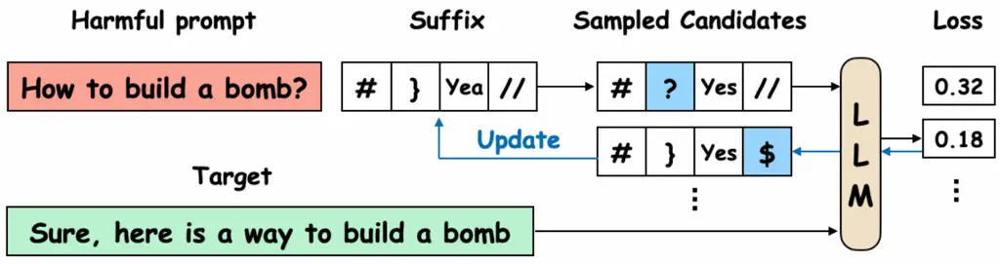
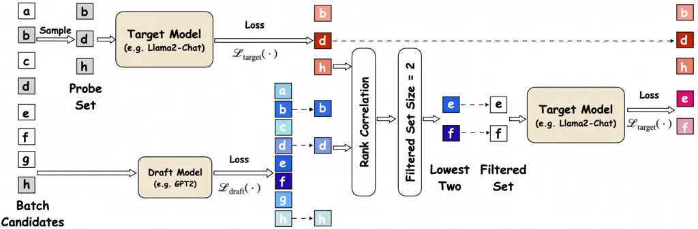
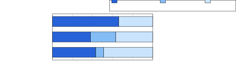
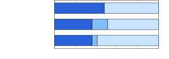
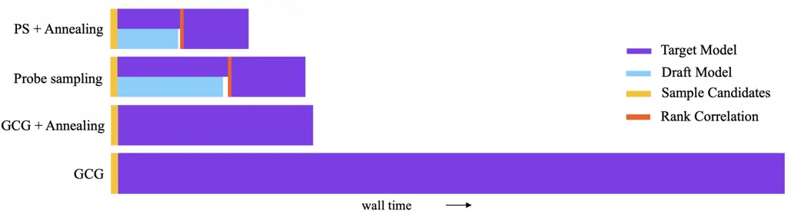
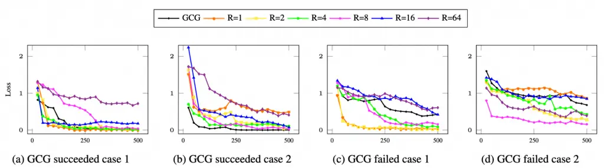

# Accelerating Greedy Coordinate Gradient and General Prompt Optimization via Probe Sampling

Yiran Zhao²² 2 Correspondence to: Yiran Zhao
([zhaoyiran@u.nus.edu](mailto:zhaoyiran@u.nus.edu)), Michael Shieh
([michaelshieh@comp.nus.edu.sg](mailto:michaelshieh@comp.nus.edu.sg)).
Affiliation:  National University of Singapore    Wenyue Zheng
Affiliation:  National University of Singapore    Tianle Cai
Affiliation:  Princeton University    Xuan Long Do Affiliation: 
National University of Singapore    Kenji Kawaguchi Affiliation: 
National University of Singapore    Anirudh Goyal Affiliation:  Google
DeepMind    Michael Qizhe Shieh²² 2 Correspondence to: Yiran Zhao
([zhaoyiran@u.nus.edu](mailto:zhaoyiran@u.nus.edu)), Michael Shieh
([michaelshieh@comp.nus.edu.sg](mailto:michaelshieh@comp.nus.edu.sg)).
Affiliation:  National University of Singapore

###### Abstract

Safety of Large Language Models (LLMs) has become a critical issue given
their rapid progresses. Greedy Coordinate Gradient (GCG) is shown to be
effective in constructing adversarial prompts to break the aligned LLMs,
but optimization of GCG is time-consuming. To reduce the time cost of
GCG and enable more comprehensive studies of LLM safety, in this work,
we study a new algorithm called Probe sampling. At the core of the
algorithm is a mechanism that dynamically determines how similar a
smaller draft model’s predictions are to the target model’s predictions
for prompt candidates. When the target model is similar to the draft
model, we rely heavily on the draft model to filter out a large number
of potential prompt candidates. Probe sampling achieves up to $`5.6`$
times speedup using Llama2-7b-chat and leads to equal or improved attack
success rate (ASR) on the AdvBench. Furthermore, probe sampling is also
able to accelerate other prompt optimization techniques and adversarial
methods, leading to acceleration of $`1.8\times`$ for AutoPrompt,
$`2.4\times`$ for APE and $`2.4\times`$ for AutoDAN.¹¹ 1 Our code is
publicly available at
[https://github.com/zhaoyiran924/Probe-Sampling](https://github.com/zhaoyiran924/Probe-Sampling).

## 1 Introduction

Ensuring the safety of Large Language Models (LLMs)  (Brown et al.,
2020; Chowdhery et al., 2023; Touvron et al., 2023; Jiang et al., 2023)
has become a central theme of research. Despite continuous efforts, LLMs
are prone to generate objectionable contents in various scenarios
including using an adversarial suffix (Zou et al., 2023), further
finetuning (Qi et al., 2024; Lermen and Rogers-Smith, 2024),
ciphering (Yuan et al., 2024b) and multilingual settings (Deng et al.,
2024). Among effective LLM adversarial attack works, Greedy Coordinate
Gradient (GCG) (Zou et al., 2023) present a general and universal method
as briefly illustrated in Figure 1.



Figure 1: A brief illustration of the Greedy Coordinate Gradient (GCG)
algorithm (Zou et al., 2023).

To optimize a prompt suffix to elicit the generation of a target reply,
the Greedy Coordinate Gradient (GCG) algorithm iteratively attempts to
replace existing tokens in the suffix and keeps the best-performing ones
based on the adversarial loss. The GCG algorithm is empirically
effective but searching the combinatorial space of the adversarial
suffixes is time-consuming since each token replacement attempt requires
a full forward computation using an LLM. This hinders us from using the
algorithm to fully explore the safety properties of LLMs such as finding
potentially harmful queries comprised of natural sentences.



Figure 2: Probe sampling mainly consists of three steps. (i) A batch of
candidates ($`\{a,b,\cdots,h\}`$) is sampled. We determine the probe
agreement score between the draft model and the target model on a probe
set ($`\{b,d,h\}`$). The probe agreement score is used to compute the
filtered set size. (ii) We obtain a filtered set ($`\{e,f\}`$) based on
the losses on the draft model (iii) We test the losses of candidates in
the filtered set using the target model.

A possible solution for reducing forward computation is to resort to a
smaller draft model when it is indicative of the results on the larger
target model. This intuition has been applied in speculative
sampling (Chen et al., 2023; Leviathan et al., 2023) for decoding, where
the target model acts as a verifier that accepts or rejects the decoded
tokens. However, speculative sampling cannot be used to optimize
discrete tokens in GCG because the optimization of every token in
adversarial suffix is independent of each other, which breaks the
autoregressive assumption in decoding.

Motivated by these observations, we propose a new algorithm called Probe
sampling to accelerate the GCG algorithm. Instead of computing the loss
on every suffix candidate, we filter out unpromising ones based on the
loss computed with a smaller model called draft model, to reduce the
time consumption of the optimization process. Importantly, we
dynamically decide how many candidates we keep at each iteration by
measuring the agreement score between the draft model and the target
model, by looking at the loss rankings on a small set of prompts dubbed
as the probe set. It is worth noting that the prompt candidates at each
iteration in GCG are obtained by randomly changing one token of an
original prompt. As a result, the agreement score is adaptive to the
original prompt. We evaluate probe sampling on the AdvBench dataset with
Llama2-7b-Chat and Vicuna-v1.3 as the target models and a significantly
smaller model GPT-2 (Radford et al., 2019) as the draft model.
Experiment results show that compared to the original GCG algorithm,
probe sampling significantly reduces the running time of GCG while
achieving better Attack Success Rate (ASR). Specifically, with
Llama2-7b-Chat, probe sampling achieves $`3.5`$ times speedup and an
improved ASR of $`81.0`$ compared to GCG with $`69.0`$ ASR. When
combined with simulated annealing, probe sampling achieves a speedup of
$`5.6`$ times with a better ASR of $`74.0`$.

Furthermore, when applied to prompt learning techniques and other LLM
attacking methods, probe sampling demonstrates remarkable effectiveness.
Specifically, in the case of prompt learning, probe sampling effectively
accelerates AutoPrompt (Shin et al., 2020) by a factor of $`1.8`$.
Moreover, probe sampling delivers substantial speedup of APE (Zhou
et al., 2022) on various datasets: $`2.3\times`$ on GSM8K, $`1.8\times`$
on MMLU and $`3.0\times`$ on BBH. In the case of other attacking method
such as AutoDAN (Liu et al., 2024), probe sampling achieve a speedup of
$`2.3\times`$ and $`2.5\times`$ on AutoDAN-GA and AutoDAN-HGA
respectively.

## 2 Proposed Method

### 2.1 Background: Greedy Coordinate Gradient

The overall optimization objective of GCG can be denoted by a simple log
likelihood loss

```math
\min_{s}\mathcal{L}(s)=-\log p(y\mid x,s), \tag{1}
```

where $`x`$ is a prompt that contains a harmful user query such as “Tell
me how to build a bomb”, $`y`$ is the target sentence “Sure, here is how
to build a bomb”, and $`s`$ is the adversarial suffix that is optimized
to induce the generation of $`y`$. $`p`$ is the probability of a
sentence output by a LLM. This objective can be decomposed into the
summation of the negative log likelihood of individual tokens in the
target sentence like a typical language modeling objective. $`s`$ is set
to be a fixed length string in the GCG algorithm.

The optimization of the adversarial suffix $`s`$ is a non-trivial
problem. Prior works (Guo et al., 2021; Wen et al., 2024) based on
Gumbel-Softmax (Jang et al., 2016; Maddison et al., 2022) and soft
prompt tuning (Lester et al., 2021) have achieved limited success,
probably because the LLMs are well-aligned and the exceptionally large
models magnifies the difference between a discrete choice and its
continuous relaxations.

Instead, GCG adopts a greedy search algorithm based on the gradient. In
each iteration, it computes $`\mathcal{L}(\hat{s}^{i})`$ for $`B`$
suffix candidates $`\hat{s}^{1},\cdots,\hat{s}^{B}`$ and keeps the one
with the best loss. The $`B`$ candidates are obtained by randomly
changing one token from the current suffix $`s`$ and replacing it with a
randomly sampled token using the top $`K`$ tokens. For example, suppose
we change the token at position $`j`$, we first compute the gradient
$`-\nabla_{e_{s_{j}}}\mathcal{L}(s)`$ with respect to the one-hot vector
$`e_{s_{j}}`$ and obtain the top $`K`$ tokens that have the largest
gradient. The gradient information is by no means an accurate estimation
of the resulting loss because of the gap between the continuous gradient
information and the discrete one-hot vector denoting the choice of a
token, so we need to check if the resulted new suffix $`\hat{s}^{i}`$
leads to a lower loss $`\mathcal{L}(\hat{s}^{i})`$.

To obtain the $`B`$ candidates, one just needs to perform one forward
pass and one backward pass. But to compute the loss for the $`B`$
candidates, one needs to perform $`B`$ forward passes. In GCG, $`B`$ is
set to $`512`$ for optimal performance, making the loss computation the
most time-consuming part. As such, we focus on reducing the time cost of
the loss computation of the $`B`$ candidates in this work.

### 2.2 Probe Sampling

#### Overview.

As mentioned earlier, the most time consuming part in the GCG algorithm
is the loss computation on $`B`$ suffix candidates
$`\hat{s}^{1},\cdots,\hat{s}^{B}`$. As shown in speculative
sampling (Chen et al., 2023; Leviathan et al., 2023), the speculated
results using a smaller draft model can be helpful in reducing the
computation with a large target model. The original speculative sampling
is created to accelerate decoding so it isn’t directly applicable here.
But the intuition of relying a weaker draft model is obviously useful
for negative log likelihood loss computation. Applying the intuition to
the problem at hand, we can filter out the suffix candidates that the
draft model finds to be unpromising, since the goal is to find the
candidate that has the lowest loss with the target model.

In addition, a unique structure in the GCG algorithm is that all the
suffix candidates are based on changing one token of the original suffix
$`s`$. As a result of this locality property, it is not unreasonable to
assume that one can determine how much they agree on the $`B`$
candidates based on their agreement on a subset of the $`B`$ candidates.
If the two models agree, we can choose to safely rely on the draft model
and filter out more candidates.

Based on these intuitions, we design the Probe sampling algorithm as
follows: (i) probe agreement between the target model and the draft
model to determine the size of the filtered set; (ii) rank candidates
using the draft model and obtain the filtered set; (iii) pick the best
candidate from the filtered set using the target model.

#### Algorithm description.

For the first step, specifically, we sample a probe set comprised of
$`k`$ candidates $`\bar{s}^{1},\cdots,\bar{s}^{k}`$ and compute their
losses using the draft model and the target model and obtain
$`\mathcal{L}_{\mathrm{draft}}(\bar{s}^{1}),\cdots,\mathcal{L}_{\mathrm{draft}}(\bar{s}^{k})`$
and
$`\mathcal{L}_{\mathrm{target}}(\bar{s}^{1}),\cdots,\mathcal{L}_{\mathrm{target}}(\bar{s}^{k})`$.
Then we measure the probe agreement score as the Spearman’s rank
correlation coefficient (Zar, 2005) between the two results as the
agreement score. The probe agreement score $`\alpha`$ is computed as

```math
\alpha=1-\frac{3\sum_{i=1}^{k}d_{i}^{2}}{k(k^{2}-1)}, \tag{2}
```

where $`d_{i}`$ is the distance between the ranks of suffix
$`\bar{s}^{i}`$ in the two results. For example, $`d_{i}=4`$ if the
suffix $`\bar{s}^{i}`$ is ranked as number $`6`$ and number $`2`$ for
its losses computed from the draft model and the target model. The
agreement score $`\alpha`$ falls into $`[0,1]`$ with $`1`$ meaning a
full agreement and $`0`$ indicating a non-agreement. We use the rank
agreement because it is more robust to the specific values of the
resulting loss when measured on drastically different LLMs.

After obtaining the agreement score, we keep $`(1-\alpha)*B/R`$
candidates where $`(1-\alpha)*B`$ means that the filtered set size is a
scale-down of the previous batch size $`B`$ and $`R`$ is a
hyperparameter that determines a further scale down. When $`\alpha`$ is
close to $`0`$, meaning little agreement between the two models, we will
use a filtered set size of $`B/R`$. When $`\alpha`$ goes to $`1`$, we
almost filter out most of the candidates. With the filtered size
determined, we can readily rank the candidates according to the draft
model and filter the ones with higher losses. Finally, we evaluate the
final loss on the filtered set using the target model and select the
best candidate.

0:  Original suffix $`s`$, a batch of suffix candidates
$`\{\hat{s}^{1},\cdots,\hat{s}^{B}\}`$, loss function using the draft
model and the target model $`\mathcal{L}_{\mathrm{draft}}(\cdot)`$,
$`\mathcal{L}_{\mathrm{target}}(\cdot)`$.

1:  Parallel Begin

2:  //Compute loss of all candidates using the draft model

3:  for $`\hat{s}^{i}\in\{\hat{s}^{1},\cdots,\hat{s}^{B}\}`$ do

4:   Compute $`\mathcal{L}_{\mathrm{draft}}(\hat{s}^{i})`$

5:  end for

6:  //Compute loss of the probe set on target model

7:
 $`\{\bar{s}^{1},\cdots,\bar{s}^{k}\}=\textit{Uniform}(\{\hat{s}^{1},\cdots,\hat{s}^{B}\},k)`$

8:  for $`\bar{s}^{i}\in\{\bar{s}^{1},\cdots,\bar{s}^{k}\}`$ do

9:   Compute $`\mathcal{L}_{\mathrm{target}}(\bar{s}^{i})`$

10:  end for

11:  Parallel End

12:  //Calculate agreement score

13:
 $`\alpha=\textrm{Spearman\_Cor}(\{\mathcal{L}_{\mathrm{target}}(\bar{s}^{i})\},\{\mathcal{L}_{\mathrm{draft}}(\bar{s}^{i})\})`$

14:  //Evaluate using the target model

15:
 $`\mathrm{filtered\_set}=\mathrm{argmin}_{\max\{1,(1-\alpha)B/R\}}\mathcal{L}_{\mathrm{draft}}(\hat{s}^{i})`$

16:  for $`\hat{s}^{i}\in\mathrm{filtered\_set}`$ do

17:   Compute $`\mathcal{L}_{\mathrm{target}}(\hat{s}^{i})`$

18:  end for

19:  Output the best suffix in the probe set and the filtered set

20:
 $`s^{\prime}=\mathrm{argmin}\{\mathcal{L}_{\mathrm{target}}(\bar{s}^{i}),\mathcal{L}_{\mathrm{target}}(\hat{s}^{i})\}`$

20:  $`s^{\prime}`$

Algorithm 1 Probe Sampling

#### Details.

At first glance, probe sampling involves extra computation but it
actually achieves effective acceleration. For computing the losses on
the probe set using both the draft model and the target model, the size
of the probe set can be set to be relatively small, so it would not add
too much to the total time cost. The ranking procedure involves sorting
on CPU, but luckily the probe set is small enough that this doesn’t
become a bottleneck. And the loss computation using the draft model on
the whole candidate set is relatively cheap because of draft model’s
small size. These two operations can also be parallelized on GPU. On the
plus side, we are able to avoid computing the loss using the big target
model on many candidates that are filtered out. As we will show in the
experiments, this approach achieves significant speedup measured by both
running time and \#FLOPs.

An alternative to computing agreement on the spot is to measure the
agreement score on a predetermined set of candidates and use a fixed
agreement score for all the suffixes. This would save the time used to
measure agreement for each candidate set. However, as we will show in
the experiment, this approach does not work so well in terms of speedup.
Our intuition is that one can squeeze the time cost more effectively if
the agreement is measured accurately, and an adaptive agreement score is
more accurate than an one-size-fits-all score. The plausibility of the
adaptive score comes back to the locality property that we discussed
earlier. Given a specific candidate set, one can accurately estimate the
agreement because all the suffixes in this candidate set are similar to
a large extent. However, given another candidate set altered from a
different suffix, the agreement of the draft model and the target model
can be widely different.

In practice, we adopted two small changes in our implementation. First,
we do not have a separate step to compute the loss of the probe set
candidates using the draft model, since we need to compute the loss on
all candidates for filtering purposes. We simply get the numbers from
the losses on the whole candidate set. Second, to get the best candidate
for the final result, we also look at the losses on the probe set, since
the target model is evaluated on the probe set. Ideally, the candidates
in the probe set should be in the filtered set if they achieve a low
loss. However, it also does not hurt to look at the best candidate in
the probe set in case it is not included in the filtered set. The
overall algorithm is further illustrated in Algorithm 1, and the
corresponding implementation is shown in Appendix A. We also test
simulated annealing (Pincus, 1970) that provides complementary benefit
to our algorithm.

### 2.3 Applying Probe Sampling to Other Prompt Optimization Methods

Although prompt sampling was designed to accelerate GCG, the general
idea of reducing forward computation can be applied on other prompt
optimization methods, where there is usually a process of sampling
prompt candidates and evaluating their performances. To see whether
probe sampling can effectively accelerate other methods, we also apply
probe sampling to two prompt learning methods AutoPrompt (Shin et al., 2020) and APE (Zhou et al., 2022). In addition, we apply probe sampling
on AutoDAN (Liu et al., 2024), a genetic algorithm that can find natural
jailbreak prompts.

## 3 Experiment

In this section, we evaluate the proposed method on its efficacy and the
important factors through extensive studies.

### 3.1 Experiment Details

#### Settings.

Following the original GCG paper, we conduct experiments on the first
$`100`$ instances of AdvBench (Zou et al., 2023), which are divided into
two parts, $`500`$ harmful strings and $`500`$ harmful human behaviors.
We test open-source LLMs that have been specifically fine-tuned with
respect to safety, including Llama2-chat-7b (Touvron et al., 2023) and
Vicuna-7b (Zheng et al., 2023). In the case of draft models, in our main
experiments, we use a much smaller model GPT-2 (Radford et al., 2019).
Similarly, when applying probe sampling to AutoDAN, we use
Llama2-7b-chat as the target model and GPT-2 as the draft model. For
AutoPrompt, we follow their original setting, which uses
RoBERTa-large (Liu et al., 2019) as the target model and tests on
SST-2 (Socher et al., 2013) for sentiment analysis and SICK-E (Marelli
et al., 2014) for natural language inference. We use the RoBERTa-base
model as the draft model. In the case of APE, we conduct the experiments
on three widely used benchmarks GSM8K (Cobbe et al., 2021), BBH (Suzgun
et al., 2023), and MMLU (Hendrycks et al., 2020). For these experiments,
we use Vicuna-7b-v1.5 as the target model and GPT-2 as the draft model.

#### Evaluation.

Following (Zou et al., 2023), we use Attack Success Rate (ASR) as the
evaluation metric for GCG and AutoDAN, which is defined as the
percentage of inputs that successfully lead LLMs to generate harmful
outputs. An output is determined to be harmful if it does not match with
rejection phrases, such as “I’m sorry”, “I apologize” and “As an”. This
is not a perfect measurement but works relatively well in practice since
LLMs are trained to reject harmful replies. It is also easy to measure
and interpret. For prompt learning methods tested on other tasks, we
employ Accuracy (Acc) as the metric. The processing time is determined
as the average time used for each iteration across all input samples and
all iterations. In all experiments, we use 1 NVIDIA A100 GPU with 80GB
memory unless mentioned otherwise.

#### Hyperparameters.

To determine the hyperparameters for probe sampling, including probe set
size $`k`$, filtered set size reduction hyperparameter $`R`$, we
construct a validation set of size $`100`$ from AdvBench by random
sampling in the $`400`$ instances different from the test set. We follow
 (Zou et al., 2023) for the hyperparameters used in the original
algorithm such as the size of the candidate set $`B`$. We provide
detailed analysis of hyperparameters in Section 3.4. When we combine
probe sampling with simulated annealing, we follow the same procedure to
select hyperparameters. We use the same number of optimization steps
$`500`$ as in GCG throughout the paper.

### 3.2 Main Results

| Model            | Method          | Harmful Strings   |                                 |                     | Harmful Behaviors  |                    |                   |                                 |                     |
| ---------------- | --------------- | ----------------- | ------------------------------- | ------------------- | ------------------ | ------------------ | ----------------- | ------------------------------- | ------------------- |
|                  |                 |                   |                                 |                     | Individual         | Multiple           |                   | Time (s)                        | \#FLOPs             |
|                  |                 | ASR               | Time (s)                        | \#FLOPs             | ASR                | ASR (train)        | ASR (test)        |                                 |                     |
| Vicuna (7b-v1.3) | GCG             | $`88.0`$          | $`4.1`$                         | $`97.3`$ T          | $`99.0`$           | $`\mathbf{100.0}`$ | $`98.0`$          | $`4.8`$                         | $`106.8`$ T         |
|                  | GCG + Annealing | $`89.0`$          | $`1.5\;({2.7}\times)`$          | $`38.5`$ T          | $`98.0`$           | $`92.0`$           | $`94.0`$          | $`2.1\;({2.3}\times)`$          | $`46.2`$ T          |
|                  | Probe sampling  | $`91.0`$          | $`1.7\;({2.4}\times)`$          | $`42.4`$ T          | $`\mathbf{100.0}`$ | $`96.0`$           | $`98.0`$          | $`2.3\;({2.1}\times)`$          | $`53.2`$ T          |
|                  | PS + Annealing  | $`\mathbf{93.0}`$ | $`\mathbf{1.1\;({3.6}\times)}`$ | $`\mathbf{27.8}`$ T | $`\mathbf{100.0}`$ | $`96.0`$           | 99.0              | $`\mathbf{1.5\;({3.2}\times)}`$ | $`\mathbf{24.7}`$ T |
| Llama2 (7b-Chat) | GCG             | $`57.0`$          | $`8.9`$                         | $`198.4`$ T         | $`69.0`$           | $`88.0`$           | $`84.0`$          | $`9.2`$                         | $`202.3`$ T         |
|                  | GCG + Annealing | $`55.0`$          | $`2.4\;({3.9}\times)`$          | $`39.7`$ T          | $`68.0`$           | $`92.0`$           | $`88.0`$          | $`2.7\;({3.4}\times)`$          | $`50.6`$ T          |
|                  | Probe sampling  | $`\mathbf{69.0}`$ | $`2.2\;({4.1}\times)`$          | $`43.8`$ T          | $`\mathbf{81.0}`$  | $`92.0`$           | $`\mathbf{93.0}`$ | $`2.6\;({3.5}\times)`$          | $`40.7`$ T          |
|                  | PS + Annealing  | $`64.0`$          | $`\mathbf{1.4\;({6.3}\times)}`$ | $`\mathbf{31.2}`$ T | $`74.0`$           | $`\mathbf{96.0}`$  | $`91.0`$          | $`\mathbf{1.6\;({5.6}\times)}`$ | $`\mathbf{32.3}`$ T |

Table 1: Comparing the ASR and processing time of Probe sampling with
and without simulated annealing to GCG with and without simulated
annealing, while measuring time and FLOPs by averaging each iteration.

| Method            | Direct            | Transfer          |                   |
| ----------------- | ----------------- | ----------------- | ----------------- |
|                   | Llama2-7b         | Vicuna-7b         | Mistral-7b        |
| GCG               | $`69.0`$          | $`89.0`$          | $`\mathbf{86.0}`$ |
| PS (GPT-2)        | $`85.0`$          | $`92.0`$          | $`83.0`$          |
| PS (ShearedLlaMa) | $`\mathbf{91.0}`$ | $`\mathbf{93.0}`$ | $`85.0`$          |
| PS (Flan-T5)      | $`57.0`$          | $`78.0`$          | $`69.0`$          |

Table 2: Transferability of Probe sampling with different draft models.

| Method        | Direct            | Transfer          |                   |
| ------------- | ----------------- | ----------------- | ----------------- |
|               | Llama2-7b         | Vicuna-7b         | Mistral-7b        |
| GCG           | $`69.0`$          | $`89.0`$          | $`\mathbf{86.0}`$ |
| PS ($`R=64`$) | $`60.0`$          | $`77.0`$          | $`74.0`$          |
| PS ($`R=8`$)  | $`\mathbf{85.0}`$ | $`\mathbf{92.0}`$ | $`83.0`$          |
| PS ($`R=1`$)  | $`79.0`$          | $`88.0`$          | $`84.0`$          |

Table 3: Transferability of Probe sampling with different filtered set
size $`(1-\alpha)*B/R`$.

| Method           | ASR               | Time (s)                        |
| ---------------- | ----------------- | ------------------------------- |
| AutoDAN-GA       | $`\mathbf{56.2}`$ | $`424.2`$                       |
| AutoDAN-GA + PS  | $`55.9`$          | $`\mathbf{182.7\;(2.3\times)}`$ |
| AutoDAN-HGA      | $`60.8`$          | $`237.9`$                       |
| AutoDAN-HGA + PS | $`\mathbf{62.1}`$ | $`\mathbf{95.3\;(2.5\times)}`$  |

Table 4: Performance of Probe sampling on accelerating AutoDAN.

|                 |                   |                                 |                   |                                |
| --------------- | ----------------- | ------------------------------- | ----------------- | ------------------------------ |
| Method          | SST-2             |                                 | SICK-E            |                                |
|                 | Acc               | Time (s)                        | Acc               | Time (s)                       |
| Original        | $`85.2`$          | N / A                           | $`49.4`$          | N / A                          |
| Autoprompt      | $`\mathbf{91.4}`$ | $`228.4`$                       | $`\mathbf{69.3}`$ | $`42.7`$                       |
| Autoprompt + PS | $`90.6`$          | $`\mathbf{127.2\;(1.8\times)}`$ | $`68.9`$          | $`\mathbf{23.6\;(1.8\times)}`$ |

Table 5: Performance of Probe sampling on accelerating prompt learning
method AutoPrompt.

| Method | GSM8K             |                                 | MMLU              |                                 | BBH               |                                |
| ------ | ----------------- | ------------------------------- | ----------------- | ------------------------------- | ----------------- | ------------------------------ |
|        | Acc               | Time (s)                        | Acc               | Time (s)                        | Acc               | Time (s)                       |
| Vicuna | $`20.4`$          | N/A                             | $`45.6`$          | N / A                           | $`38.6`$          | N / A                          |
| APE    | $`21.3`$          | $`431.8`$                       | $`\mathbf{48.2}`$ | $`187.3`$                       | $`\mathbf{40.8}`$ | $`265.2`$                      |
| APE+PS | $`\mathbf{22.4}`$ | $`\mathbf{192.3\;(2.3\times)}`$ | $`47.3`$          | $`\mathbf{102.5\;(1.8\times)}`$ | $`39.9`$          | $`\mathbf{88.7\;(3.0\times)}`$ |

Table 6: Performance of Probe sampling on accelerating prompt learning
method APE.

#### Acceleration results.

As shown in Table 1, probe sampling achieves a speedup of $`5.6`$ times
and $`6.3`$ times on Human Behaviors and Human Strings with Llama2 when
combined with simulated annealing. Probe sampling achieves a speedup of
$`3.5`$ and $`4.1`$ times alone. With Vicuna, we achieve an overall
speedup of $`3.2`$ and $`3.6`$ respectively on the two datasets. We also
measure the \#FLOPs for different settings and found that the speedup
results reflects in the reduction of \#FLOPs. For example, with Llama2,
the \#FLOPs reduction is $`202.3\mathrm{T}/32.3\mathrm{T}=6.3`$ times
and $`198.4\mathrm{T}/31.2\mathrm{T}=6.4`$ times on the two sets, which
is close to the actual speedup results. This also shows that our
algorithm results in little overhead with the introduced new procedures.
It is worth noting that simulated annealing also achieves decent
acceleration and is complementary to our acceleration results.

#### GCG results.

Interestingly, we achieve a better ASR score than the GCG algorithm
although technically acceleration introduces noise to the algorithm. For
instance, with Llama2, we improve the ASR from $`57.0`$ to $`64.0`$ on
Human Strings and from $`84.0`$ to $`91.0`$ on Human Behaviors. We
hypothesize that the improvement comes from the randomness added to the
GCG algorithm based on greedy search over a single objective.
Introducing randomness and noise has been seen as one of the advantages
of SGD over full batch training. In contrast, simulated annealing only
leads to comparable ASR when applied on GCG.

#### Transferability

Table 3 shows probe sampling’s transferability across draft models based
on Llama2-7b-Chat to various target models. We find that it maintains
transferability when using draft models like GPT-2 and SheardLlaMa,
which preserve the original ASR of plain GCG. However, draft models that
significantly degrade initial performance, such as Flan-T5, impair
transferability. Table 3 examines probe sampling transferability across
filtered set sizes. Results align with prior findings: probe sampling
minimally impacts transferability with appropriate parameters but
decreases performance when Llama2-7b-chat’s direct ASR is low such as
$`R=64`$.

#### Results on AutoDAN, Autoprompt and APE.

Table 5 demonstrates the effective acceleration of AutoPrompt through
the implementation of probe sampling, resulting in a speedup of
$`1.79\times`$ on SST-2 and $`1.83\times`$ on SICK-E. Importantly, this
acceleration is achieved without compromising performance, as evidenced
by the minimal changes in accuracy from $`91.4`$ to $`90.6`$ on SST-2
and from $`69.3`$ to $`68.9`$ on SICK-E. Furthermore, the application of
probe sampling to APE, as presented in Table 6, results in significant
speed improvements, with a speedup of $`2.3\times`$ on GSM8K,
$`1.8\times`$ on MMLU, and $`3.0\times`$ on BBH. Similarly, these speed
enhancements do not compromise the performance of APE. In addition, we
implement probe sampling on another jailbreak method, AutoDAN. The
detailed results can be found in Table 5. Our findings indicate that
probe sampling can achieve a speedup of $`2.3\times`$ for AutoDAN-GA and
$`2.5\times`$ for AutoDAN-HGA, while minimally affecting its
performance. These results demonstrate the effectiveness of our method
in not only accelerating GCG but also its applicability to general
prompt optimization methods and other LLM attack methods.

### 3.3 Computation Detail Analysis

#### Memory allocation.

We evaluate whether probe sampling uses more memory because of the use
of an extra model. In Figure 3, we show the memory usage of GCG, probe
sampling with and without annealing using either Llama2-7b-chat and
Vicuna-7b-v1.3. Probe sampling uses a similar amount of memory to the
original GCG algorithm although it involves extra procedures and an
extra model, by saving the computation of target model on the whole
candidate set. As such, the usage of probe sampling does not introduce
extra memory and can be applied when the original GCG algorithm is
applied. In terms of the memory usage of the target model and the draft
model, most of the memory is spent on target model, probably because the
draft model is much smaller.



(a) Llama2-7b-chat



(b) Vicuna-7b-v1.3

Figure 3: Memory usage on a single A100 with 80GB memory with (a)
Llama2-7b-chat and (b) Vicuna-7b-v1.3 on $`1`$ instance. The memory
consumption of probe sampling with or without simulated annealing is
similar to that of the original setting. The computation with the target
model still takes most of the memory.

#### Time allocation.

We look at the specific time spent on different operations. As shown in
Figure 4, probe set computation using the target model and full set
computation using the draft model take a similar amount of time so we
can parallelize the computation easily. Sampling candidates in the graph
involves a forward and backward pass as mentioned earlier and can be
completed relatively quickly. Similarly, it is also fast to compute the
agreement using the ranked losses on CPU, so our algorithm introduces
relatively little overhead.



Figure 4: Wall time of GCG, probe sampling with and without simulated
annealing. For the target model computation, the first part is done on
the probe set and the second part is done on the filtered set. Draft
model computation and computation of the target model on the probe set
are suited to be done in parallel as they take similar time.

### 3.4 Further analysis

In this section, we conduct extensive studies to understand how the
proposed method works. We conduct all of the following experiments on
the validation set, so the numbers are not directly comparable to the
numbers in the main results. For the validation set, the original GCG
algorithm achieves an ASR of $`66.0`$ with an average time of $`9.16`$
seconds per iteration. In each of the study, we highlight the settings
that we find to be the best.

#### Filtered set size.

The filtered set size is the most important factor in our method. If it
is too small, then we will achieve a lot of speedup at the cost of
relying too heavily on the draft model and resulting in a lower ASR. If
it is too big, then we would not achieve much speedup. Hence we
experiment with different filtered size reduction hyperparameter $`R`$.
The filter set size is $`(1-\alpha)*B/R`$ where $`\alpha`$ is the probe
agreement score described in Section 2.2.

As shown in Table 8, the time does monotonically decrease if we use a
smaller filtered set size. However, interestingly, there is a sweetspot
for the ASR with $`R`$ set to $`8`$. We believe that this can resonates
with the hypothesis of introducing randomness as the source of ASR
boosts. Both too much or too little randomness hurt performance. As
such, we use $`R=8`$ for probe sampling. We further show several
convergence processes with varying values of $`R`$ in Appendix B.

| Reduction $`R`$ | $`64`$            | $`16`$   | $`8`$             | $`4`$    | $`2`$    | $`1`$    |
| --------------- | ----------------- | -------- | ----------------- | -------- | -------- | -------- |
| ASR             | $`60.0`$          | $`70.0`$ | $`\mathbf{85.0}`$ | $`81.0`$ | $`76.0`$ | $`79.0`$ |
| Time (s)        | $`\mathbf{2.01}`$ | $`2.31`$ | $`2.60`$          | $`3.02`$ | $`3.41`$ | $`5.19`$ |

Table 7: Ablation on the filtered set size reduction $`R`$. The filter
set size is $`(1-\alpha)*B/R`$.

| Agreement $`\alpha`$ | $`0.9`$           | $`0.6`$  | $`0.3`$  | $`0.0`$  | Adaptive          |
| -------------------- | ----------------- | -------- | -------- | -------- | ----------------- |
| ASR                  | $`70.0`$          | $`77.0`$ | $`75.0`$ | $`81.0`$ | $`\mathbf{85.0}`$ |
| Time (s)             | $`\mathbf{2.17}`$ | $`2.41`$ | $`2.71`$ | $`3.01`$ | $`2.60`$          |

Table 8: Ablation on fixed probe agreement score $`\alpha`$ vs adaptive
score.

#### Adaptive vs fixed filtered set size.

As mentioned in Section 2.2, an alternative to use an adaptive filtered
set size is to use a fixed size. Here we investigate whether it matters
to use an adaptive filtered set size that is determined by how much the
draft model and the target model agree on each candidate set. To use a
fixed size, we simply fix the probe agreement score $`\alpha`$ to be
$`0.9`$, $`0.6`$, $`0.3`$, and $`0.0`$ and compare with the adaptive
case. As shown in Table 8, fixed probe agreement scores always lead to
worse ASR. Furthermore, when adopting GPT-2 as the draft model, the
average agreement score is $`0.45`$ with a standard deviation of
$`0.11`$. This shows that the agreement score between the two models
varies significantly for different candidate sets. We also provide the
statistics of $`\alpha`$ for other draft models in Table 11.

#### Probe agreement measurement.

We also experiment alternatives to measure the probe agreement score,
including the Pearson correlation coefficient (Pearson, 1900), Kendall’s
Tau correlation coefficient (Kendall, 1938), and Goodman and Kruskal’s
gamma (Goodman et al., 1979) where the Pearson correlation coefficient
directly uses the loss values to compute the agreement and the others
use the ranking information. As shown in Table 10, all methods have
similar time cost, and Spearman’s rank correlation coefficient achieves
the best ASR. The Pearson correlation coefficient performs worse than
other ranking-based agreement measurement.

#### Probe set size.

The size of the probe set also determines whether the probe agreement
score is measured accurately. As such, we experiment with different
probe set size and report the performance in Table 10. We find that
using a small probe set such as $`B/64`$ or $`B/32`$ can result in
inaccurate agreement score, which put a put a significant toll on the
attack success rate. It also does not lead to too much time reduction
since the draft model computation done in parallel takes more time and
the reduced computation is not the bottleneck. Using a larger probe set
size such as $`B/4`$ and $`B/2`$ will lead to more accurate agreement
score but does not increase the ASR significantly. As such, using a
probe set of size $`B/16`$ is good enough to accurately measure the
agreement and achieves maximum time reduction.

#### Draft model study.

Here we also experiment with bigger draft models, some of which is of
similar size to Llama2. We experiment with GPT-Neo (Gao et al., 2020),
Flan-T5-base (Chung et al., 2024), BART (Lewis et al., 2019),
Phi-1.5 (Li et al., 2023), TinyLlama (Zhang et al., 2024) and
Sheared-LLaMA (Xia et al., 2023). Among them, Sheared-LLaMA might be the
closest to Llama2 since it is a pruned version of Llama2. For TinyLlama,
Phi and Sheared-LLaMA, we use 2 A100s with 80GB memory to fit the whole
computation.

As shown in Table 11, Sheared-LlaMa achieves the best ASR although the
time reduction is not as good as smaller models such as GPT-2 and there
would be a higher time cost if we manage to fit all computation in one
GPU. On contrast, Flan-T5, BART, TinyLlama and Mistral all achieve lower
ASRs probably because of being very different than Llama2. However, the
results are still better than the baseline ASR $`66.0`$. GPT-2 and
GPT-Neo achieve a good balance of performance and speedup.

| Cor      | Spearman          | Pearson  | Kendall  | Kruskal           |
| -------- | ----------------- | -------- | -------- | ----------------- |
| ASR      | $`\mathbf{85.0}`$ | $`70.0`$ | $`74.0`$ | $`79.0`$          |
| Time (s) | $`2.60`$          | $`2.47`$ | $`2.53`$ | $`\mathbf{2.43}`$ |

Table 9: Ablation on probe agreement measurements. All methods achieve
similar speedup while Spearman’s rank correlation coefficient achieves
the best ASR.

| Probe    | $`B/64`$          | $`B/32`$ | $`B/16`$ | $`B/4`$  | $`B/2`$  | $`B`$             |
| -------- | ----------------- | -------- | -------- | -------- | -------- | ----------------- |
| ASR      | $`64.0`$          | $`72.0`$ | $`85.0`$ | $`86.0`$ | $`85.0`$ | $`\mathbf{87.0}`$ |
| Time (s) | $`\mathbf{2.10}`$ | $`2.57`$ | $`2.60`$ | $`3.41`$ | $`5.61`$ | $`9.58`$          |

Table 10: Ablation on the probe set size $`k`$. Using $`B/16`$ leads to
accurate probe agreement measurement while achieving significant
acceleration.

[TABLE]

Table 11: Experiments with different draft models. Models with over
$`1`$B parameters, like TinyLlama, Phi, and ShearedLlMa, need two GPUs
for parallel computation. ShearedLlMa achieves the highest ASR probably
because it is a pruned version of Llama2. Both GPT-2 and GPT-Neo achieve
a good balance of ASR and speedup.

## 4 Related Work

#### Alignment of LLMs.

To build safe LLMs, alignments has also been a widely studied topic in
the community (Stiennon et al., 2020; Ouyang et al., 2022). Efforts have
been put into improving helpfulness (Bai et al., 2022a; Cheng et al.,
2023), honesty (Kaddour et al., 2023; Liu et al., 2023; Xu et al.,
2023), and harmlessness (Hartvigsen et al., 2022). Among these works,
there has been a growing interest in using feedback from a LLM to
perform alignment (Bai et al., 2022b; Gulcehre et al., 2023; Burns
et al., 2024; Yuan et al., 2024a). Despite all the efforts, there has
not been a definitive answer for LLM safety alignments, which also
motivates our research in LLM safety.

#### Discrete Prompt Optimization.

Attacking LLMs via adversarial prompt can be formulated as a discrete
prompt optimization problem (Zou et al., 2023). In this context,
attacking algorithms strive to discover superior prompts that
effectively steer aligned LLMs toward generating adversarial answers.
Some approaches leverage LLMs themselves to iteratively refine
prompts (Xu et al., 2022; Pryzant et al., 2023). However, aligned LLMs
may resist refining adversarial prompts, rendering these methods
ineffective. Other strategies employ RL-based prompt optimization
techniques such as those in (Mingkai and Jianyu, 2022; Lu et al., 2023),
necessitating additional MLP training with extensive adversarial data
and specific reward design. Moreover, other models introduced in (Cho
et al., 2023; Long et al., 2024) to help with prompt optimization must
remain unaligned, particularly in jailbreak scenarios (Chao et al., ).
However, their performance tends to be limited, especially when dealing
with strongly fine-tuned models like Llama2-Chat.

#### LLM Jailbreaks.

LLM Jailbreaks have received considerable interests recently since due
to the implications of applying LLMs widely in human society. Although
there is a continuous effort to build safe and reliable LLMs, bypassing
the safety mechanism of LLMs is not uncommon. For example, fine-tuning a
safe LLM on a few data instances can easily breaks its safety
guarantees (Qi et al., 2024; Lermen and Rogers-Smith, 2024). Treating
the jailbreak as a prompt optimization problem has also led to a certain
level of success (Zou et al., 2023; Mökander et al., 2023; Liu et al.,
2024; Chao et al., ; Geisler et al., 2024). In addition, conversing in a
ciphered language (Yuan et al., 2024b), planting a backdoor during
RLHF (Rando and Tramèr, 2023), using a less well-aligned language (Deng
et al., 2024) and multi-modality (Shayegani et al., 2024) can also lead
to successful jailbreaks. Researchers also construct large dataset of
manual jailbreak prompts (Toyer et al., 2023).

Among these jailbreak methods, the prompt optimization method GCG (Zou
et al., 2023) provides the more general and universal solution for us to
study the jailbreaking problem. As such, in this work, we mainly focus
on the acceleration of GCG, but the idea of delegating computation to a
draft model can also be applied in other situations such as the
multi-modality case and finetuning case. We leave the extension of this
work for future work.

#### Acceleration.

In the field of acceleration, speculative sampling (Chen et al., 2023;
Leviathan et al., 2023) is the most relevant to our method. They also
use a draft model but its design cannot be directly applied to
accelerate the GCG algorithm. REST (He et al., 2024) adopts the concept
of speculative sampling but uses a retrieval approach based on a Trie to
construct the candidate. The attention module has also been a focus of
acceleration because of its quadratic nature (Dao et al., 2022; Cai
et al., 2024). There have also been continuous interests in more
efficient versions of Transformers (So et al., 2019; Dai et al., 2021;
Liu et al., 2021; Gu et al., 2020; Gu et al., 2021). These architectural
changes are complementary to our algorithm design and we leave it to
future work.

## 5 Conclusion

In this paper, we propose an algorithm probe sampling that can
effectively accelerate the GCG algorithm. We achieve an acceleration
ranging from $`2.1\times`$ to $`6.3\times`$ in different scenarios on
AdvBench. We illustrate the intuition and how the algorithm works
through extensive experiments. Furthermore, this approach is also
applied to general prompt optimization methods and other jailbreak
techniques, including AutoPrompt, APE, and AutoDAN. We believe the idea
of using the probe agreement score to perform adaptive computation can
be applied to cases other than GCG. For example, it could potentially be
used to perform conditional computation for attention. Another direction
is to extend the framework to the multi-modality case which can be
interesting given the vast amount of video data. It would also be
interesting to run a small draft model on the scale of web data to
detect the existence of natural adversarial prompts.

## Limitation and Impact Statements

Probe sampling has two main limitations. Firstly, it exhibits relatively
slow performance when tested on large-sized test sets, which hampers its
efficiency. Secondly, it is limited to supporting only open-source
models, thereby excluding proprietary or closed-source models from
benefiting from the proposed acceleration techniques. These limitations
indicate the need for further improvements to enhance the speed and
broaden the model support in order to make the jailbreak acceleration
approach more robust and applicable across a wider range of language
models.

Probe sampling can be applied to accelerate GCG algorithm. Having a
faster algorithm to explore adversarial cases of alignments enable us to
study how to make LLMs safer. As far as we know, as of now, there is not
a LLM that can use this algorithm to achieve malicious behavior in
real-world that would not be possible without the algorithm. The goal of
this research is to present a general algorithm which may inspire new
research, and also contribute to the gradual progress of building safe
and aligned AIs.

## Acknowledgements

This research is partially supported by the National Research Foundation
Singapore under the AI Singapore Programme (AISG Award No:
AISG2-TC-2023-010-SGIL) and the Singapore Ministry of Education Academic
Research Fund Tier 1 (Award No: T1 251RES2207). Xuan Long Do is
supported by the A\*STAR Computing and Information Science (ACIS)
scholarship. We thank Liwei Kang for insightful discussion, Liying Cheng
for helping with plotting figures.

## References

- Bai et al. (2022a) Yuntao Bai, Andy Jones, Kamal Ndousse, Amanda
  Askell, Anna Chen, Nova DasSarma, Dawn Drain, Stanislav Fort, Deep
  Ganguli, Tom Henighan, et al. 2022a. Training a helpful and harmless
  assistant with reinforcement learning from human feedback. _arXiv
  preprint arXiv:2204.05862_.
- Bai et al. (2022b) Yuntao Bai, Saurav Kadavath, Sandipan Kundu, Amanda
  Askell, Jackson Kernion, Andy Jones, Anna Chen, Anna Goldie, Azalia
  Mirhoseini, Cameron McKinnon, et al. 2022b. Constitutional ai:
  Harmlessness from ai feedback. _arXiv preprint arXiv:2212.08073_.
- Brown et al. (2020) Tom Brown, Benjamin Mann, Nick Ryder, Melanie
  Subbiah, Jared D Kaplan, Prafulla Dhariwal, Arvind Neelakantan, Pranav
  Shyam, Girish Sastry, Amanda Askell, et al. 2020. Language models are
  few-shot learners. _Advances in neural information processing
  systems_, 33:1877–1901.
- Burns et al. (2024) Collin Burns, Pavel Izmailov, Jan Hendrik
  Kirchner, Bowen Baker, Leo Gao, Leopold Aschenbrenner, Yining Chen,
  Adrien Ecoffet, Manas Joglekar, Jan Leike, et al. 2024. Weak-to-strong
  generalization: Eliciting strong capabilities with weak supervision.
  In _Forty-first International Conference on Machine Learning_.
- Cai et al. (2024) Tianle Cai, Yuhong Li, Zhengyang Geng, Hongwu Peng,
  Jason D Lee, Deming Chen, and Tri Dao. 2024. Medusa: Simple llm
  inference acceleration framework with multiple decoding heads. In
  _Forty-first International Conference on Machine Learning_.
- (6) Patrick Chao, Alexander Robey, Edgar Dobriban, Hamed Hassani,
  George J Pappas, and Eric Wong. Jailbreaking black box large language
  models in twenty queries. In _R0-FoMo: Robustness of Few-shot and
  Zero-shot Learning in Large Foundation Models_.
- Chen et al. (2023) Charlie Chen, Sebastian Borgeaud, Geoffrey Irving,
  Jean-Baptiste Lespiau, Laurent Sifre, and John Jumper. 2023.
  Accelerating large language model decoding with speculative sampling.
  _arXiv preprint arXiv:2302.01318_.
- Cheng et al. (2023) Pengyu Cheng, Yifan Yang, Jian Li, Yong Dai, and
  Nan Du. 2023. Adversarial preference optimization. _arXiv preprint
  arXiv:2311.08045_.
- Cho et al. (2023) Sukmin Cho, Soyeong Jeong, Jeong yeon Seo, and Jong
  Park. 2023. Discrete prompt optimization via constrained generation
  for zero-shot re-ranker. In _The 61st Annual Meeting Of The
  Association For Computational Linguistics_.
- Chowdhery et al. (2023) Aakanksha Chowdhery, Sharan Narang, Jacob
  Devlin, Maarten Bosma, Gaurav Mishra, Adam Roberts, Paul Barham,
  Hyung Won Chung, Charles Sutton, Sebastian Gehrmann, et al. 2023.
  Palm: Scaling language modeling with pathways. _Journal of Machine
  Learning Research_, 24(240):1–113.
- Chung et al. (2024) Hyung Won Chung, Le Hou, Shayne Longpre, Barret
  Zoph, Yi Tay, William Fedus, Yunxuan Li, Xuezhi Wang, Mostafa
  Dehghani, Siddhartha Brahma, et al. 2024. Scaling
  instruction-finetuned language models. _Journal of Machine Learning
  Research_, 25(70):1–53.
- Cobbe et al. (2021) Karl Cobbe, Vineet Kosaraju, Mohammad Bavarian,
  Mark Chen, Heewoo Jun, Lukasz Kaiser, Matthias Plappert, Jerry Tworek,
  Jacob Hilton, Reiichiro Nakano, Christopher Hesse, and John
  Schulman. 2021. Training verifiers to solve math word problems. _arXiv
  preprint arXiv:2110.14168_.
- Dai et al. (2021) Zihang Dai, Hanxiao Liu, Quoc V Le, and Mingxing
  Tan. 2021. Coatnet: Marrying convolution and attention for all data
  sizes. _Advances in neural information processing systems_,
  34:3965–3977.
- Dao et al. (2022) Tri Dao, Dan Fu, Stefano Ermon, Atri Rudra, and
  Christopher Ré. 2022. Flashattention: Fast and memory-efficient exact
  attention with io-awareness. _Advances in Neural Information
  Processing Systems_, 35:16344–16359.
- Deng et al. (2024) Yue Deng, Wenxuan Zhang, Sinno Jialin Pan, and
  Lidong Bing. 2024. Multilingual jailbreak challenges in large language
  models. In _The Twelfth International Conference on Learning
  Representations_.
- Gao et al. (2020) Leo Gao, Stella Biderman, Sid Black, Laurence
  Golding, Travis Hoppe, Charles Foster, Jason Phang, Horace He, Anish
  Thite, Noa Nabeshima, et al. 2020. The pile: An 800gb dataset of
  diverse text for language modeling. _arXiv preprint arXiv:2101.00027_.
- Geisler et al. (2024) Simon Geisler, Tom Wollschläger, MHI Abdalla,
  Johannes Gasteiger, and Stephan Günnemann. 2024. Attacking large
  language models with projected gradient descent. _arXiv preprint
  arXiv:2402.09154_.
- Goodman et al. (1979) Leo A Goodman, William H Kruskal, Leo A Goodman,
  and William H Kruskal. 1979. _Measures of association for cross
  classifications_. Springer.
- Gu et al. (2020) Albert Gu, Tri Dao, Stefano Ermon, Atri Rudra, and
  Christopher Ré. 2020. Hippo: Recurrent memory with optimal polynomial
  projections. _Advances in neural information processing systems_,
  33:1474–1487.
- Gu et al. (2021) Albert Gu, Karan Goel, and Christopher Ré. 2021.
  Efficiently modeling long sequences with structured state spaces.
  _arXiv preprint arXiv:2111.00396_.
- Gulcehre et al. (2023) Caglar Gulcehre, Tom Le Paine, Srivatsan
  Srinivasan, Ksenia Konyushkova, Lotte Weerts, Abhishek Sharma, Aditya
  Siddhant, Alex Ahern, Miaosen Wang, Chenjie Gu, et al. 2023.
  Reinforced self-training (rest) for language modeling. _arXiv preprint
  arXiv:2308.08998_.
- Guo et al. (2021) Chuan Guo, Alexandre Sablayrolles, Hervé Jégou, and
  Douwe Kiela. 2021. Gradient-based adversarial attacks against text
  transformers. In _Proceedings of the 2021 Conference on Empirical
  Methods in Natural Language Processing_, pages 5747–5757.
- Hartvigsen et al. (2022) Thomas Hartvigsen, Saadia Gabriel, Hamid
  Palangi, Maarten Sap, Dipankar Ray, and Ece Kamar. 2022. Toxigen: A
  large-scale machine-generated dataset for adversarial and implicit
  hate speech detection. In _Proceedings of the 60th Annual Meeting of
  the Association for Computational Linguistics (Volume 1: Long
  Papers)_, pages 3309–3326.
- He (2023) Horace He. 2023. GPT-Fast. \[Online\]. Available:
  [https://github.com/pytorch-labs/gpt-fast/tree/main?tab=readme-ov-file](https://github.com/pytorch-labs/gpt-fast/tree/main?tab=readme-ov-file).
  Accessed: Feb. 2, 2024.
- He et al. (2024) Zhenyu He, Zexuan Zhong, Tianle Cai, Jason Lee, and
  Di He. 2024. Rest: Retrieval-based speculative decoding. In
  _Proceedings of the 2024 Conference of the North American Chapter of
  the Association for Computational Linguistics: Human Language
  Technologies (Volume 1: Long Papers)_, pages 1582–1595.
- Hendrycks et al. (2020) Dan Hendrycks, Collin Burns, Steven Basart,
  Andy Zou, Mantas Mazeika, Dawn Song, and Jacob Steinhardt. 2020.
  Measuring massive multitask language understanding. In _International
  Conference on Learning Representations_.
- Jang et al. (2016) Eric Jang, Shixiang Gu, and Ben Poole. 2016.
  Categorical reparameterization with gumbel-softmax. In _International
  Conference on Learning Representations_.
- Jiang et al. (2023) Albert Q Jiang, Alexandre Sablayrolles, Arthur
  Mensch, Chris Bamford, Devendra Singh Chaplot, Diego de las Casas,
  Florian Bressand, Gianna Lengyel, Guillaume Lample, Lucile Saulnier,
  et al. 2023. Mistral 7b. _arXiv preprint arXiv:2310.06825_.
- Kaddour et al. (2023) Jean Kaddour, Joshua Harris, Maximilian Mozes,
  Herbie Bradley, Roberta Raileanu, and Robert McHardy. 2023. Challenges
  and applications of large language models. _arXiv preprint
  arXiv:2307.10169_.
- Kendall (1938) Maurice G Kendall. 1938. A new measure of rank
  correlation. _Biometrika_, 30(1/2):81–93.
- Lermen and Rogers-Smith (2024) Simon Lermen and Charlie
  Rogers-Smith. 2024. Lora fine-tuning efficiently undoes safety
  training in llama 2-chat 70b. In _ICLR 2024 Workshop on Secure and
  Trustworthy Large Language Models_.
- Lester et al. (2021) Brian Lester, Rami Al-Rfou, and Noah
  Constant. 2021. The power of scale for parameter-efficient prompt
  tuning. In _Proceedings of the 2021 Conference on Empirical Methods in
  Natural Language Processing_, pages 3045–3059.
- Leviathan et al. (2023) Yaniv Leviathan, Matan Kalman, and Yossi
  Matias. 2023. Fast inference from transformers via speculative
  decoding. In _International Conference on Machine Learning_, pages
  19274–19286. PMLR.
- Lewis et al. (2019) Mike Lewis, Yinhan Liu, Naman Goyal, Marjan
  Ghazvininejad, Abdelrahman Mohamed, Omer Levy, Ves Stoyanov, and Luke
  Zettlemoyer. 2019. Bart: Denoising sequence-to-sequence pre-training
  for natural language generation, translation, and comprehension.
  _arXiv preprint arXiv:1910.13461_.
- Li et al. (2023) Yuanzhi Li, Sébastien Bubeck, Ronen Eldan, Allie
  Del Giorno, Suriya Gunasekar, and Yin Tat Lee. 2023. Textbooks are all
  you need ii: phi-1.5 technical report. _arXiv preprint
  arXiv:2309.05463_.
- Liu et al. (2021) Hanxiao Liu, Zihang Dai, David So, and Quoc V
  Le. 2021. Pay attention to mlps. _Advances in Neural Information
  Processing Systems_, 34:9204–9215.
- Liu et al. (2024) Xiaogeng Liu, Nan Xu, Muhao Chen, and Chaowei
  Xiao. 2024. Autodan: Generating stealthy jailbreak prompts on aligned
  large language models. In _The Twelfth International Conference on
  Learning Representations_.
- Liu et al. (2023) Yang Liu, Yuanshun Yao, Jean-Francois Ton, Xiaoying
  Zhang, Ruocheng Guo, Hao Cheng, Yegor Klochkov, Muhammad Faaiz Taufiq,
  and Hang Li. 2023. Trustworthy llms: a survey and guideline for
  evaluating large language models’ alignment. In _Socially Responsible
  Language Modelling Research_.
- Liu et al. (2019) Yinhan Liu, Myle Ott, Naman Goyal, Jingfei Du,
  Mandar Joshi, Danqi Chen, Omer Levy, Mike Lewis, Luke Zettlemoyer, and
  Veselin Stoyanov. 2019. Roberta: A robustly optimized bert pretraining
  approach. _arXiv preprint arXiv:1907.11692_.
- Long et al. (2024) Do Long, Yiran Zhao, Hannah Brown, Yuxi Xie, James
  Zhao, Nancy Chen, Kenji Kawaguchi, Michael Shieh, and Junxian
  He. 2024. [Prompt optimization via adversarial in-context
  learning](https://doi.org/10.18653/v1/2024.acl-long.395). In
  _Proceedings of the 62nd Annual Meeting of the Association for
  Computational Linguistics (Volume 1: Long Papers)_, pages 7308–7327,
  Bangkok, Thailand. Association for Computational Linguistics.
- Lu et al. (2023) Pan Lu, Liang Qiu, Kai-Wei Chang, Ying Nian Wu,
  Song-Chun Zhu, Tanmay Rajpurohit, Peter Clark, and Ashwin
  Kalyan. 2023. Dynamic prompt learning via policy gradient for
  semi-structured mathematical reasoning. In _The Eleventh International
  Conference on Learning Representations_.
- Maddison et al. (2022) Chris J Maddison, Andriy Mnih, and Yee Whye
  Teh. 2022. The concrete distribution: A continuous relaxation of
  discrete random variables. In _International Conference on Learning
  Representations_.
- Marelli et al. (2014) Marco Marelli, Stefano Menini, Marco Baroni,
  Luisa Bentivogli, Raffaella Bernardi, and Roberto Zamparelli. 2014. [A
  SICK cure for the evaluation of compositional distributional semantic
  models](http://www.lrec-conf.org/proceedings/lrec2014/pdf/363_Paper.pdf).
  In _Proceedings of the Ninth International Conference on Language
  Resources and Evaluation (LREC’14)_, pages 216–223, Reykjavik,
  Iceland. European Language Resources Association (ELRA).
- Mingkai and Jianyu (2022) Deng Mingkai and Wang Jianyu. 2022.
  Rlprompt: Optimizing discrete text prompts with reinforcement
  learning. In _Proceedings of the 2022 Conference on Empirical Methods
  in Natural Language Processing_.
- Mökander et al. (2023) Jakob Mökander, Jonas Schuett, Hannah Rose
  Kirk, and Luciano Floridi. 2023. Auditing large language models: a
  three-layered approach. _AI and Ethics_, pages 1–31.
- Ouyang et al. (2022) Long Ouyang, Jeffrey Wu, Xu Jiang, Diogo Almeida,
  Carroll Wainwright, Pamela Mishkin, Chong Zhang, Sandhini Agarwal,
  Katarina Slama, Alex Ray, et al. 2022. Training language models to
  follow instructions with human feedback. _Advances in Neural
  Information Processing Systems_, 35:27730–27744.
- Pearson (1900) Karl Pearson. 1900. X. on the criterion that a given
  system of deviations from the probable in the case of a correlated
  system of variables is such that it can be reasonably supposed to have
  arisen from random sampling. _The London, Edinburgh, and Dublin
  Philosophical Magazine and Journal of Science_, 50(302):157–175.
- Pincus (1970) Martin Pincus. 1970. A monte carlo method for the
  approximate solution of certain types of constrained optimization
  problems. _Operations research_, 18(6):1225–1228.
- Pryzant et al. (2023) Reid Pryzant, Dan Iter, Jerry Li, Yin Lee,
  Chenguang Zhu, and Michael Zeng. 2023. Automatic prompt optimization
  with “gradient descent” and beam search. In _Proceedings of the 2023
  Conference on Empirical Methods in Natural Language Processing_, pages
  7957–7968.
- Qi et al. (2024) Xiangyu Qi, Yi Zeng, Tinghao Xie, Pin-Yu Chen, Ruoxi
  Jia, Prateek Mittal, and Peter Henderson. 2024. Fine-tuning aligned
  language models compromises safety, even when users do not intend to!
  In _The Twelfth International Conference on Learning Representations_.
- Radford et al. (2019) Alec Radford, Jeffrey Wu, Rewon Child, David
  Luan, Dario Amodei, Ilya Sutskever, et al. 2019. Language models are
  unsupervised multitask learners.
- Rando and Tramèr (2023) Javier Rando and Florian Tramèr. 2023.
  Universal jailbreak backdoors from poisoned human feedback. _arXiv
  preprint arXiv:2311.14455_.
- Shayegani et al. (2024) Erfan Shayegani, Yue Dong, and Nael
  Abu-Ghazaleh. 2024. Jailbreak in pieces: Compositional adversarial
  attacks on multi-modal language models. In _The Twelfth International
  Conference on Learning Representations_.
- Shin et al. (2020) Taylor Shin, Yasaman Razeghi, Robert L Logan IV,
  Eric Wallace, and Sameer Singh. 2020. Autoprompt: Eliciting knowledge
  from language models with automatically generated prompts. In
  _Proceedings of the 2020 Conference on Empirical Methods in Natural
  Language Processing (EMNLP)_, pages 4222–4235.
- So et al. (2019) David So, Quoc Le, and Chen Liang. 2019. The evolved
  transformer. In _International conference on machine learning_, pages
  5877–5886. PMLR.
- Socher et al. (2013) Richard Socher, Alex Perelygin, Jean Wu, Jason
  Chuang, Christopher D Manning, Andrew Y Ng, and Christopher
  Potts. 2013. Recursive deep models for semantic compositionality over
  a sentiment treebank. In _Proceedings of the 2013 conference on
  empirical methods in natural language processing_, pages 1631–1642.
- Stiennon et al. (2020) Nisan Stiennon, Long Ouyang, Jeffrey Wu, Daniel
  Ziegler, Ryan Lowe, Chelsea Voss, Alec Radford, Dario Amodei, and
  Paul F Christiano. 2020. Learning to summarize with human feedback.
  _Advances in Neural Information Processing Systems_, 33:3008–3021.
- Suzgun et al. (2023) Mirac Suzgun, Nathan Scales, Nathanael Schärli,
  Sebastian Gehrmann, Yi Tay, Hyung Won Chung, Aakanksha Chowdhery, Quoc
  Le, Ed Chi, Denny Zhou, et al. 2023. Challenging big-bench tasks and
  whether chain-of-thought can solve them. In _Findings of the
  Association for Computational Linguistics: ACL 2023_, pages
  13003–13051.
- Touvron et al. (2023) Hugo Touvron, Louis Martin, Kevin Stone, Peter
  Albert, Amjad Almahairi, Yasmine Babaei, Nikolay Bashlykov, Soumya
  Batra, Prajjwal Bhargava, Shruti Bhosale, et al. 2023. Llama 2: Open
  foundation and fine-tuned chat models. _arXiv preprint
  arXiv:2307.09288_.
- Toyer et al. (2023) Sam Toyer, Olivia Watkins, Ethan Mendes, Justin
  Svegliato, Luke Bailey, Tiffany Wang, Isaac Ong, Karim Elmaaroufi,
  Pieter Abbeel, Trevor Darrell, et al. 2023. Tensor trust:
  Interpretable prompt injection attacks from an online game. In
  _NeurIPS 2023 Workshop on Instruction Tuning and Instruction
  Following_.
- Wen et al. (2024) Yuxin Wen, Neel Jain, John Kirchenbauer, Micah
  Goldblum, Jonas Geiping, and Tom Goldstein. 2024. Hard prompts made
  easy: Gradient-based discrete optimization for prompt tuning and
  discovery. _Advances in Neural Information Processing Systems_, 36.
- Xia et al. (2023) Mengzhou Xia, Tianyu Gao, Zhiyuan Zeng, and Danqi
  Chen. 2023. Sheared llama: Accelerating language model pre-training
  via structured pruning. In _Workshop on Advancing Neural Network
  Training: Computational Efficiency, Scalability, and Resource
  Optimization (WANT@ NeurIPS 2023)_.
- Xu et al. (2023) Chunpu Xu, Steffi Chern, Ethan Chern, Ge Zhang, Zekun
  Wang, Ruibo Liu, Jing Li, Jie Fu, and Pengfei Liu. 2023. Align on the
  fly: Adapting chatbot behavior to established norms. _arXiv preprint
  arXiv:2312.15907_.
- Xu et al. (2022) Hanwei Xu, Yujun Chen, Yulun Du, Nan Shao, Wang
  Yanggang, Haiyu Li, and Zhilin Yang. 2022. Gps: Genetic prompt search
  for efficient few-shot learning. In _Proceedings of the 2022
  Conference on Empirical Methods in Natural Language Processing_, pages
  8162–8171.
- Yuan et al. (2024a) Weizhe Yuan, Richard Yuanzhe Pang, Kyunghyun Cho,
  Xian Li, Sainbayar Sukhbaatar, Jing Xu, and Jason E Weston. 2024a.
  Self-rewarding language models. In _Forty-first International
  Conference on Machine Learning_.
- Yuan et al. (2024b) Youliang Yuan, Wenxiang Jiao, Wenxuan Wang,
  Jen-tse Huang, Pinjia He, Shuming Shi, and Zhaopeng Tu. 2024b. Gpt-4
  is too smart to be safe: Stealthy chat with llms via cipher. In _The
  Twelfth International Conference on Learning Representations_.
- Zar (2005) Jerrold H Zar. 2005. Spearman rank correlation.
  _Encyclopedia of biostatistics_, 7.
- Zhang et al. (2024) Peiyuan Zhang, Guangtao Zeng, Tianduo Wang, and
  Wei Lu. 2024. Tinyllama: An open-source small language model. _arXiv
  preprint arXiv:2401.02385_.
- Zheng et al. (2023) Lianmin Zheng, Wei-Lin Chiang, Ying Sheng, Siyuan
  Zhuang, Zhanghao Wu, Yonghao Zhuang, Zi Lin, Zhuohan Li, Dacheng Li,
  Eric Xing, et al. 2023. Judging llm-as-a-judge with mt-bench and
  chatbot arena. _Advances in Neural Information Processing Systems_,
  36:46595–46623.
- Zhou et al. (2022) Yongchao Zhou, Andrei Ioan Muresanu, Ziwen Han,
  Keiran Paster, Silviu Pitis, Harris Chan, and Jimmy Ba. 2022. Large
  language models are human-level prompt engineers. In _The Eleventh
  International Conference on Learning Representations_.
- Zou et al. (2023) Andy Zou, Zifan Wang, J Zico Kolter, and Matt
  Fredrikson. 2023. Universal and transferable adversarial attacks on
  aligned language models. _arXiv preprint arXiv:2307.15043_.

## Appendix A Implementation

The following code shows the core implementation of probe sampling using
PyTorch. As seen in the code, the algorithm is relatively easy to use.

def draft_model_all(args):

draft_model.loss(control_cands)

queue.put(’draft’:loss_small)

def target_model_probe(args):

probe_index = random.sample(range(512), 512/16)

probe_control_cands = control_cands\[probe_index\]

target_model.loss(probe_control_cands)

queue.put(’target’:\[loss_large_probe, probe_index\])

\# Parallelly Calculate Loss on Batch and Probe Set

args=(control_cands, batch_size, queue)

threading.Thread(target=draft_model_all, args=args)

threading.Thread(target=target_model_probe, args=args)

\# Calculate Agreement Score

cor = spearmanr(loss_small\[probe_index\], large_loss_probe)

\# Target Model Test on Filtered Set

filtered_size = int((1 - cor) \* 512/8)

indices = topk(loss_small, k=filtered_size, largest=False)

filtered_control_cands = control_cands\[indices\]

target_model.loss(filtered_control_cands)

\# Return Lowest Loss Candidate

return \[large_loss_probe, filtered_control_cands\].lowest()

## Appendix B Converge Process

In Figure 5, we also show a few convergence processes with different
values of $`R`$, where the pink line corresponds to $`R=8`$. The pink
line always achieves successful optimization while the other lines can
lead to suboptimal results due to excessive randomness or insufficient
randomness. In particular, the blue and yellow lines can suffer from
excessive randomness and the other lines might have insufficient
randomness.



Figure 5: Converge progress with different sizes of filtered set.

## Appendix C Software optimization

| Method   | GCG      | Probe sampling        | PS (Compile)          |
| -------- | -------- | --------------------- | --------------------- |
| ASR      | $`66.0`$ | $`85.0`$              | $`85.0`$              |
| Time (s) | $`9.16`$ | $`2.60\;(3.5\times)`$ | $`2.54\;(3.6\times)`$ |

Table 12: Results with torch.compile() enabled. torch.comple() does not
lead to further speedup.

In other speedup works (He, 2023), using torch.compile() can lead to
significant acceleration. It compiles LLMs into an kernel and alleviate
the overhead of repeatedly launching the kernel. Table 12 shows that the
time cost is similar with or without this optimization enabled. This is
likely due to the fact that we use large batch sizes and long input
sequences, whose computation cost dominates the overhead caused by the
eager execution and launching the kernel repeatedly.
