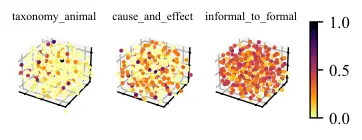
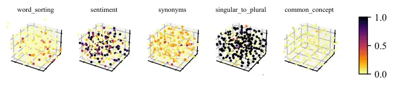
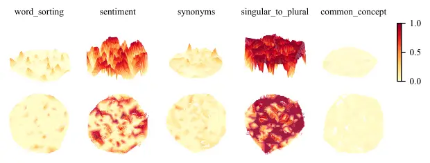

# Localized Zeroth-Order Prompt Optimization

Wenyang Hu Email: [wenyang@comp.nus.edu.sg](mailto:)    Yao Shu
Email: [shuyao@gml.ac.cn](mailto:)    Zongmin Yu
Email: [zongminy@comp.nus.edu.sg](mailto:)    Zhaoxuan Wu
Email: [wu.zhaoxuan@comp.nus.edu.sg](mailto:)    Xiaoqiang Lin
Email: [xiaoqiang.lin@comp.nus.edu.sg](mailto:)    Zhongxiang Dai
Email: [daizx@mit.edu](mailto:)    See-Kiong Ng
Email: [seekiong@nus.edu.sg](mailto:)    & Bryan Kian Hsiang Low
Email: [lowkh@comp.nus.edu.sg](mailto:) Affiliation: Department of
Computer Science, National University of Singapore
Affiliation: Institute of Data Science, National University of Singapore
Affiliation: Guangdong Lab of AI and Digital Economy (SZ)
Affiliation: Laboratory for Information and Decision Systems, MIT

###### Abstract

The efficacy of large language models (LLMs) in understanding and
generating natural language has aroused a wide interest in developing
prompt-based methods to harness the power of black-box LLMs. Existing
methodologies usually prioritize a global optimization for finding the
global optimum, which however will perform poorly in certain tasks. This
thus motivates us to re-think the necessity of finding a global optimum
in prompt optimization. To answer this, we conduct a thorough empirical
study on prompt optimization and draw two major insights. Contrasting
with the rarity of global optimum, local optima are usually prevalent
and well-performed, which can be more worthwhile for efficient prompt
optimization (Insight I). The choice of the input domain, covering both
the generation and the representation of prompts, affects the
identification of well-performing local optima (Insight II). Inspired by
these insights, we propose a novel algorithm, namely localized
zeroth-order prompt optimization (ZOPO), which incorporates a Neural
Tangent Kernel-based derived Gaussian process into standard zeroth-order
optimization for an efficient search of well-performing local optima in
prompt optimization. Remarkably, ZOPO outperforms existing baselines in
terms of both the optimization performance and the query efficiency,
which we demonstrate through extensive experiments.

   

|     |
| --- |
|     |

## 1 Introduction

Large language models (LLMs) have demonstrated remarkable capabilities
for understanding and generating natural languages (Ouyang et al.,
2022a; Touvron et al., 2023). Thanks to the instruction-following
abilities of LLMs (Ouyang et al., 2022b), prompting—adding crafted,
discrete prompts, or namely natural language text, to the input emerges
as an effective and lightweight approach to direct LLMs to generate
specific, desired response (Mishra et al., 2021; Liu et al., 2023). Such
an approach is of particular interest when users interact with
state-of-the-art LLMs like ChatGPT (OpenAI, 2024a) and GPT-4 (OpenAI,
2023), which can only be accessed through black-box APIs (i.e., the
interface of black-box LLMs only accepts discrete texts as input for
querying). So, prompt optimization becomes a critical effort in pursuing
the optimal performance of black-box LLMs on downstream tasks.

Although human knowledge may subjectively guide prompt designs (Reynolds
& McDonell, 2021; Mishra et al., 2021), this process is commonly
time-intensive and its results are not always desirable in practice. To
mitigate such human efforts and achieve better performance in optimizing
crafted prompts, random sampling (Zhou et al., 2023), Bayesian
optimization (Chen et al., 2023; Lin et al., 2023), and evolutionary
algorithms (Guo et al., 2024) have been proposed to generate and select
well-performing prompts automatically. However, most of these existing
strategies prioritize global optimization, dedicating substantial
portions of the query budget to explore the entire search space for the
global optima and consequently making it query-inefficient in practice.
Meanwhile, these strategies typically implement their prompt
optimization across various input domains, resulting in diverse
performance outcomes in practice. These results consequently inspire us
to re-think the questions about the necessity of finding a global
optimum and the essence of the input domain for efficient and effective
prompt optimization.

Figure 1: The performance profile for different methods on instruction
induction tasks, where $`\tau`$ indicates the distance from optimality,
and $`\rho(\tau)`$ is the frequency for the method within $`\tau`$
distance to optimality.

To answer these questions, we provide a thorough empirical study on
prompt optimization. Firstly, we visualize the performance for a number
of randomly sampled prompt candidates on various tasks to show that in
contrast to the scarcity of global optima, local optima are commonly
prevalent and perform well, making them more valuable for
query-efficient prompt optimization (Insight I in Sec. 3.1). Secondly,
we visualize the estimated accuracy distributions for a number of prompt
candidates as well as the corresponding function surfaces using various
embeddings as their representation. The results demonstrate that the
selection of the input domain, including both the generation and
representation of prompt candidates, will influence the identification
of high-performing prompts, especially those local optimal ones (Insight
II in Sec. 3.2). These insights consequently highlight the importance of
local optima and input domain for efficient and effective prompt
optimization.

Inspired by these insights, we novelly propose the Localized
Zeroth-Order Prompt Optimization (ZOPO) algorithm for a considerably
improved prompt optimization as evidenced by Fig. 1. Motivated by
Insight II, we first propose a general domain transformation that
utilizes LLMs for prompt generation and embedding models to transform
these generated prompts into their corresponding hidden representations,
which thereby enjoys not only the remarkable generation ability from any
type of LLMs (white/black-box) (Zhou et al., 2023; Guo et al., 2024) but
also the impressive representation ability from many NLP embedding
models (Chen et al., 2023; Lin et al., 2023) for our prompt optimization
(Sec. 4.1). Inspired by Insight I, we then leverage a cutting-edge
zeroth-order optimization (ZOO) method enhanced by a derived Gaussian
process for efficient gradient estimation (Shu et al., 2023a) to
underpin our localized prompt optimization, which goes one step further
by incorporating the Neural Tangent Kernel (NTK) (Jacot et al., 2018) to
handle the complex and high-dimensional prompt optimization tasks
(Sec. 4.2). Lastly, we present an uncertainty-informed local exploration
method designed to improve the gradient estimation in our derived NTK-GP
framework, thereby augmenting the practical performance of the ZOPO
algorithm (Sec. 4.3). We also conduct extensive experiments to
demonstrate the efficacy of ZOPO (Sec. 5).

To summarize, the contributions of our work include:

- $`\bullet`$
  To the best of our knowledge, we are the first to conduct a thorough
  empirical study in prompt optimization to underscore the value of
  local optima and the essence of input domain for efficient and
  effective prompt optimization.
- $`\bullet`$
  Drawing on the insights gained from our empirical study, we introduce
  the ZOPO algorithm, which outperforms existing baselines in terms of
  not only the optimization performance but also the query efficiency.
- $`\bullet`$
  We conduct extensive studies to confirm the efficacy of our
  algorithmic framework and elucidate the underlying principles or
  insights of our ZOPO algorithm.

## 2 Problem Setup

Given an NLP task that is characterized by a data distribution
$`{\mathcal{D}}`$ and a black-box LLM $`f(\cdot)`$, e.g., ChatGPT
(OpenAI, 2024a), discrete prompt optimization aims to generate a piece
of human-readable text, namely the prompt $`v`$, which will then be
applied to the black-box LLM $`f(\cdot)`$ along with a test input $`x`$
such that the queried LLM output $`f([v;x])`$ is able to correctly
predict the ground-truth label $`y`$ for each
$`(x,y)\sim{\mathcal{D}}`$. This problem is then commonly framed as a
black-box maximization problem over the discrete language space
$`v\in\Omega`$ (Chen et al., 2023; Lin et al., 2023):

```math
\max_{v\in\Omega}F(v)\triangleq\mathbb{E}_{(x,y)\in{\mathcal{D}}_{V}}\ \left[{\mathcal{R}}\left(f([v;x]),y\right)\right] \tag{1}
```

where $`{\mathcal{R}}\left(f([v;x]),y\right)`$ is applied to measure the
alignment between the LLM output $`f([v;x])`$ and the groundtruth $`y`$,
and $`{\mathcal{D}}_{V}`$ is the validation set sampled from
$`{\mathcal{D}}`$. Note that the performance of the optimal instruction
found on $`{\mathcal{D}}_{V}`$ (i.e., $`\argmax_{v}F(v)`$) will be
evaluated on a held-out test set $`{\mathcal{D}}_{T}`$.

## 3 Empirical Study on Prompt Optimization

### 3.1 Local Optima vs. Global Optimum

In prompt optimization, methods like (Chen et al., 2023; Lin et al., 2023) are generally more effective than the others (Zhou et al., 2023;
Guo et al., 2024), which is usually contributed to their usage of
Bayesian optimization, a popular global optimization strategy, that is
able to find the global optimum in low-dimensional problems (Moriconi
et al., 2020). However, these methods sometimes perform poorly in
certain prompt optimization tasks, e.g., cause_and_effect and
informal_to_formal, indicating that they will fail to find the global
optimum in these tasks given a limited query budget. This is likely
because substantial portions of the budget are applied in these methods
to explore the entire search space for the global optimum, which hence
leads to the critical question about the necessity of finding the global
optimum in query-efficient prompt optimization.



Figure 2: The validation accuracy of 300 randomly sampled prompts with
the last token representation on various tasks.

To answer this question, we have employed a 3-dimensional scatter plot
to visualize the performance (differentiated by colors) for 300 randomly
sampled prompt candidates on various tasks, whose prompt embeddings
(i.e., the last token embedding as in Lin et al. (2023)) are reduced by
t-distributed stochastic neighbor embedding (t-SNE) (see more details in
our Appx. C.1.1). The results are in Fig. 2 which shows that the global
optimum (i.e., the points achieving an accuracy of $`\sim 100\%`$) is
consistently rare for a range of prompt optimization tasks, making it
extremely challenging to achieve this global optimum in practice. In
contrast, prompt optimization often features a number of local optima
(e.g., the points achieving accuracy higher than 50% in all the three
tasks of Fig.2). Importantly, these local optima commonly enjoy
impressive performance, suggesting that local optima shall be more
worthwhile to obtain in prompt optimization, especially for the
scenarios of limited query budgets, as summarized below.


Figure 3: The estimated accuracy distribution of prompts generated by
Vicuna-13B or ChatGPT on various instruction induction tasks, where the
vertical dotted line is the mean performance.

### 3.2 Essence of Input Domain

Besides, existing works (Chen et al., 2023; Lin et al., 2023; Guo
et al., 2024) typically apply their prompt optimization in differing
input domains, leading to a wide range of performances in practice.
These results thus inspire us to ask: How essential is the input domain
for finding well-performing prompts, particularly the local optimal
ones? Thoroughly exploring this question is fundamental for the design
of a well-performing prompt optimization algorithm.

To answer this, we first visualize the accuracy distributions of 300
prompt candidates that are randomly generated by Vicuna-13B and ChatGPT
for various tasks to study the essence of prompt generation in Fig. 3
(more details in Appx. C.1.2). Fig. 3 reveals that the prompt candidates
produced by ChatGPT (a black-box model) generally exhibit better
performance than those produced by Vicuna-13B (a white-box model), which
has been widely applied in (Chen et al., 2023; Lin et al., 2023) for
prompt optimization. Importantly, ChatGPT demonstrates a greater
likelihood of generating locally optimal prompt candidates (e.g., the
ones of accuracy higher than 0.5 across all the three plots in Fig. 3).
These results indicate that the ability to generate well-performing
local optima in prompt optimization usually varies for different NLP
models. So, the selection of the prompt generation model is crucial for
finding well-performing optima.

We then investigate the function surface (i.e., accuracy landscape)
using two different embeddings as the representation for prompt
candidates in Fig. 4 (more details in Appx. C.1.2) where the embeddings
are mapped into a 2-dimensional domain using the t-SNE for better
visualizations. Interestingly, Fig. 4 unveils that different
representations will convey a varying number of well-performing local
optima in practice. Particularly, the last token embedding is usually
able to produce a larger number of well-performing local optima than the
SBERT (i.e., a popular sentence embedding transformer Reimers & Gurevych
(2019)) embedding, making it easier to enjoy a good prompt optimization
performance on this domain, as validated in Tab. 5. This therefore
implies that the choice of the prompt representation model is also
essential for the finding of well-performing optima.

Figure 4: The function surfaces on various tasks using the last token
embedding from Vicuna-13B or the SBERT embedding as the representation
for prompt candidates that are generated by Vicuna-13B.

In all, we conclude our aforementioned insights as below.


## 4 The ZOPO Algorithm

Given the insights established in our Sec. 3, we then propose
our Localized Zeroth-Order Prompt Optimization (ZOPO) algorithm
(Algo. 1) for a better-performing as well as more query-efficient prompt
optimization. Specifically, following our Insight II, we first develop a
more general transformation for the input domain of prompt optimization
(Sec. 4.1), which can enjoy both the remarkable generation ability from
any type of LLMs (white/black-box) and the impressive representation
ability from many NLP models. Subsequent to this transformation,
inspired by our Insight I, we propose to use zeroth-order optimization
(ZOO) with a derived NTK Gaussian process inspired from (Shu et al.,
2023a) to find well-performing local optima (Sec. 4.2). Lastly, we
introduce an uncertainty-informed local exploration technique to refine
the gradient estimation in our derived NTK Gaussian process, aiming to
enhance the performance of our ZOPO algorithm in practice (Sec. 4.3).

1:  Input: prompt generation model $`g(\cdot)`$, NLP embedding model
$`h(\cdot)`$, size of prompt candidates $`m`$, iteration number $`T`$,
set $`{\mathcal{V}}=\emptyset`$, set $`{\mathcal{Z}}=\emptyset`$

2:  repeat

3:   $`v\leftarrow g([{\mathcal{D}}_{\text{demo}}])`$

4:   $`z\leftarrow h(v)`$

5:   if $`v\notin{\mathcal{V}}`$ then
$`{\mathcal{V}}\leftarrow{\mathcal{V}}\bigcup\{v\}`$,
$`{\mathcal{Z}}\leftarrow{\mathcal{Z}}\bigcup\{z\}`$

6:  until $`|{\mathcal{V}}|=m`$

7:  for $`t=1`$ to $`T`$ do

8:   if $`\mathds{1}_{A_{t}}(z_{t})=1`$ then do local exploration in
Sec. 4.3

9:
  $`z_{t+1}={\mathcal{P}}_{{\mathcal{Z}}}(z_{t}+\eta_{t}\mu_{t}(z_{t}))`$

10:   $`v_{t+1}=h^{-1}\left(z_{t+1}\right)`$

11:   Query $`z_{t+1}`$ to yield $`\widetilde{F}(z_{t+1})`$

12:  end for

13:  $`z^{*}\leftarrow\argmax_{z_{1:T}}\widetilde{F}(z)`$

14:  Return $`h^{-1}(z^{*})`$

Algorithm 1 The ZOPO Algorithm

### 4.1 A More General Input Domain Transformation

As introduced in our Sec. 3.2, the choice of input domain (including the
generation and representation of candidates) significantly influences
the ultimate performance in prompt optimization: Black-box LLMs (e.g.,
ChatGPT) typically enjoy an advanced generation ability and different
embedding models (e.g., SBERT) have varying representative capacity for
prompt optimization. This naturally inspires us to develop an improved
_domain transformation_ that can utilize not only the remarkable
generation ability from white/black-box LLMs but also the impressive
representation ability from certain NLP models for our prompt
optimization. To achieve this, we propose to make use of the prompt
$`v\in\Omega`$ generated from a LLM $`g(\cdot)`$ and subsequently
transform it into a continuous hidden representation
$`z\in{\mathcal{Z}}\subset{\mathbb{R}}^{d}`$ by other sentence embedding
model $`h(\cdot)`$ for the optimization, i.e., $`v=h^{-1}(z)`$, where
(1) can then be re-framed as

```math
\max_{z\in{\mathcal{Z}}}\widetilde{F}(z)=\mathbb{E}_{(x,y)\in{\mathcal{D}}}\ \left[{\mathcal{R}}\left(f([h^{-1}(z);x]),y\right)\right]\ . \tag{2}
```

Of note, our input domain transformation and (2) enjoy a number of major
advantages compared with previous works: (a) Different from the direct
optimization over the discrete and complex language space $`v\in\Omega`$
in Guo et al. (2024) where optimization algorithms in the numerical
domain can hardly be applied, our transformed input domain leads to a
dense numerical space of lower dimension and therefore allows the usage
of query-efficient optimization algorithms for (2) (e.g., our Algo. 1).
(b) Different from the potential many-to-one mapping in the previous
works (Chen et al., 2023; Lin et al., 2023), i.e., the same discrete
prompt $`v`$ may be generated by various continuous soft prompts $`s`$,
we develop a one-to-one mapping where one prompt generally has a unique
hidden representation $`z`$, which thus can help eliminate the redundant
queries during optimization and ultimately lead to more query-efficient
prompt optimization. (c) Our domain transformation with an independent
generation and representation process is capable of enjoying the
remarkable generation ability from any type of LLMs (white/black-box)
and the impressive representation ability from many NLP models whereas
previous works are highly restricted to the LLMs, thus leading to a
wider application.

##### Practical Implementations.

Before the start of the optimization on (2), we usually generate
numerous prompt _candidates_ $`{\mathcal{V}}=\{v\}`$ and their
corresponding representations $`{\mathcal{Z}}=\{z\}`$ (line 2-6 of
Algo. 1). Two practical methods are considered here for prompt
generation: (a) Feeding randomly sampled soft prompts
$`s\in{\mathbb{R}}^{d}`$ and a few demonstrations
$`{\mathcal{D}}_{\text{demo}}`$ into a white-box LLM $`g(\cdot)`$. (b)
Sampling the output distribution of a black-box LLM $`g(\cdot)`$ given a
generation template filled with $`{\mathcal{D}}_{\text{demo}}`$. The
representations $`{\mathcal{Z}}`$ can be produced by an NLP model
$`h(\cdot)`$. Specifically, if we consider the generation method in (a),
$`z`$ can be chosen as the last token embedding from $`g(\cdot)`$ Lin
et al. (2023) or the soft prompt $`s`$ Chen et al. (2023) when
generating $`v`$. Here $`h(\cdot)`$ then represents a mapping function
from $`v`$ to $`z`$.

### 4.2 Local Optimization with Derived NTK-GP

As local optima are more prevalent than global optimum and can exhibit
compelling performance for prompt optimization tasks (Sec. 3.1), we
propose to apply zeroth-order optimization (ZOO), particularly gradient
descent using estimated gradients, for a well-performing local prompt
optimization on our transformed input domain $`{\mathcal{Z}}`$ in
Sec. 4.1. Unfortunately, existing ZOO algorithms are typically
query-inefficient as many additional queries are required for gradient
estimation in every gradient descent update (Flaxman et al., 2005;
Nesterov & Spokoiny, 2017). In light of this, we resort to the most
recent ZoRD algorithm (Shu et al., 2023a) where a localized surrogate
model will be applied for query-efficient gradient estimations.

Specifically, according to (Shu et al., 2023a), given a well-specified
kernel function $`k(\cdot,\cdot)`$ such that the function
$`\widetilde{F}`$ is sampled from a Gaussian process
$`\widetilde{F}\sim\mathcal{GP}(0,k(\cdot,\cdot))`$ or alternatively
$`\min_{G\sim\mathcal{GP}(0,k(\cdot,\cdot))}\max_{z\in{\mathcal{Z}}}|\widetilde{F}(z)-G(z)|=0`$
and the observed value $`r`$ of function $`\widetilde{F}`$ follows the
Gaussian noise $`{\mathcal{N}}(0,\sigma^{2})`$, then conditioned on the
history of function queries
$`{\mathcal{D}}_{t}\triangleq\{(z_{\tau},r_{\tau})\}_{\tau=1}^{t}`$ of
size $`t`$, $`\nabla\widetilde{F}`$ follows a derived Gaussian Process
$`\mathcal{GP}(\mu(\cdot),\Sigma(\cdot,\cdot))`$ , i.e.,

```math
\begin{gathered}\nabla\widetilde{F}\sim\mathcal{GP}\left(\mu_{t}(\cdot),\Sigma_{t}^{2}(\cdot,\cdot)\right),\end{gathered} \tag{3}
```

in which the mean function $`\mu_{t}(\cdot)`$ and the covariance
function $`\Sigma_{t}^{2}(\cdot,\cdot)`$ are defined as

```math
\displaystyle\mu_{t}(z) \displaystyle\triangleq{\bm{k}}_{t}(z)^{\top}\left({\mathbf{K}}_{t}+\sigma^{2}{\mathbf{I}}\right)^{-1}{\bm{r}}_{t}\ , \tag{4}
```

```math
\displaystyle\Sigma_{t}^{2}(z,z^{\prime}) \displaystyle\triangleq k^{\prime\prime}(z,z^{\prime})-{\bm{k}}_{t}(z)^{\top}\left({\mathbf{K}}_{t}+\sigma^{2}{\mathbf{I}}\right)^{-1}{\bm{k}}_{t}(z^{\prime})\ .
```

Here,
$`{\bm{k}}_{t}(z)^{\top}\triangleq[\partial_{z}k(z,z_{\tau})]_{\tau=1}^{t}`$
is a $`d\times t`$-dimensional matrix,
$`{\mathbf{K}}_{t}\triangleq\left[k(z_{\tau},k(z_{\tau^{\prime}})\right]_{\tau,\tau^{\prime}=1}^{t}`$
is a $`t\times t`$-dimensional matrix,
$`{\bm{r}}_{t}^{\top}\triangleq\left[r_{\tau}\right]_{\tau=1}^{t}`$ is a
$`t`$-dimensional column vector, and
$`k^{\prime\prime}(z,z^{\prime})\triangleq\partial_{z}\partial_{z^{\prime}}k(z,z^{\prime})`$
is a $`d\times d`$-dimensional matrix. As a result, $`\mu_{t}(z)`$ can
be applied to estimate the gradient of the black-box function
$`\widetilde{F}`$ at input $`z`$.

Of note, the underlying black-box function $`\widetilde{F}`$ here is
highly related to deep neural networks (DNN), more specifically
transformers. It naturally inspires us to apply the Neural Tangent
Kernel (NTK) (Jacot et al., 2018) theory for a better approach to the
aforementioned assumption of a well-specified kernel function
$`k(\cdot,\cdot)`$. This is because it has been widely proven that NTK
is capable of well characterizing the predictions of neural networks
(Arora et al., 2019; Lee et al., 2019; Shu et al., 2022a; Shu et al.,
2022b) and therefore should be a better-specified kernel in the setting
of prompt optimization than the simple kernel (i.e., Matérn kernel)
applied in ZoRD (Shu et al., 2023a). Specifically, given a neural
network $`\phi(\theta,z)`$ parameterized by
$`\theta\in{\mathbb{R}}^{p}`$, we employ the following empirical NTK as
the kernel in (3) and (4):

```math
k(z,z^{\prime})=\nabla_{\theta}\phi(\theta,z)^{\top}\nabla_{\theta}\phi(\theta,z)\Big|_{\theta=\theta_{0}} \tag{5}
```

where $`\theta_{0}`$ is the initialized parameter of neural network
$`\phi`$. By incorporating (5) into (4), we realize the derived NTK-GP
for the gradient estimation in our prompt optimization.

Based on this derived NTK-GP, we finally apply standard first-order
optimization (e.g., stochastic gradient descent) with projected
gradients for our local prompt optimization. Specifically, in every
iteration $`t`$ of our Algo. 1, the next promising prompt candidate will
be selected via:

```math
v_{t+1}=h^{-1}\left({\mathcal{P}}_{{\mathcal{Z}}}(z_{t}+\eta_{t}\mu_{t}(z_{t}))\right) \tag{6}
```

where
$`{\mathcal{P}}_{{\mathcal{Z}}}(z)\triangleq\argmin_{z^{\prime}\in{\mathcal{Z}}}\|z-z^{\prime}\|`$
is the projection function that projects the updated
$`z\in{\mathbb{R}}^{d}`$ into domain $`{\mathcal{Z}}`$ and $`\eta_{t}`$
is learning rate.

##### Practical Implementations.

Following the modeling principle of local optimization, only the
neighbors of $`z`$ in the query history $`{\mathcal{D}}_{t}`$ are used
to calculate the gradient $`\mu_{t}(z)`$. As we do not know the exact
DNN for the underlying black-box function $`\widetilde{F}`$, we propose
to approximate it using a small DNN, which is still able to work well
thanks to the theoretically guaranteed universal approximation ability
of DNNs (Shen et al., 2022; Kratsios & Papon, 2022). Our experiments in
Sec. 5.3 will further validate the effectiveness of this implementation.

### 4.3 Uncertainty-Informed Local Exploration

Though the derived NTK-GP allows us to estimate the gradient at _any_
$`z\in{\mathcal{Z}}`$ according to (Shu et al., 2023a), we introduce the
following Prop. 1 to demonstrate that the error in gradient estimation
at a specific input $`z\in{\mathcal{Z}}`$ implies considerable
variability, which is strongly correlated with the number of historical
queries that are effectively relevant for the gradient estimation at the
specific input $`z\in{\mathcal{Z}}`$. This insight, in turn, motivates
the creation of our uncertainty-informed local exploration approach, as
opposed to the adoption of the virtual update mechanism described in
(Shu et al., 2023a) for our prompt optimization strategy.

###### Proposition 1.

Assume $`k(z,z^{\prime})\leq\alpha`$ and
$`\left\|k^{\prime\prime}(z,z)\right\|\leq\kappa`$ for any
$`z,z^{\prime}\in{\mathcal{Z}}`$. Let $`\delta\in(0,1)`$ and
$`N_{z,\beta}\triangleq\{z^{\prime}\in\{z_{\tau}\}_{\tau=1}^{t}\mid\left\|\partial_{z}k(z^{\prime},z)\right\|^{2}\geq\beta\}`$
for given input $`z\in{\mathcal{Z}}`$, the following holds with a
probability of at least $`1-\delta`$,

```math
\displaystyle\left\|\mu_{t}(z)-\nabla F(z)\right\|^{2}\leq\omega\left\|\Sigma_{t}^{2}(z)\right\|\leq\omega\kappa-\frac{\omega\beta/d}{\alpha+\sigma^{2}/|N_{z,\beta}|}
```

where $`\omega=d+2(\sqrt{d}+1)\ln(1/\delta)`$ and
$`\Sigma^{2}_{t}(z)\triangleq\Sigma^{2}_{t}(z,z)`$.

Here, $`N_{z,\beta}`$ denotes a set of historical input queries that are
effectively relevant for the gradient estimation at $`z`$ where
$`\beta`$ can be regarded as a measure of effective relevance. Prop. 1
shows that the gradient estimation error of (3) at a specific input
$`z\in{\mathcal{Z}}`$ is bounded by the norm of covariance matrix
$`\Sigma^{2}_{t}(z)`$, which is related to the query set $`N_{z,\beta}`$
of effective relevance. Specifically, the gradient estimation error at
different $`z`$ varies if the effective relevance $`\beta`$ and the
number of relevant queries $`|N_{z,\beta}|`$ varies with $`z`$. When
$`\beta`$ or $`|N_{z,\beta}|`$ becomes small during ZOO, the gradient
estimation error is likely increased, which will lead to poor
performance in practice. This likely will happen in prompt optimization
especially considering the sparsity of prompt candidates w.r.t. the
continuous domain $`{\mathbb{R}}^{d}`$. That is, both the effective
relevance $`\beta`$ and the number of relevant queries $`|N_{z,\beta}|`$
can be small due to this sparsity. As a consequence, additional input
queries should be conducted to increase both $`\beta`$ and
$`|N_{z,\beta}|`$ for a better-performing prompt optimization.

To this end, we propose an uncertainty-informed local exploration method
that utilizes additional input queries from local searches to reduce
predictive uncertainty and hence the gradient estimation error in
derived NTK-GP according to Prop. 1. Specifically, we propose the local
exploration condition informed by the local trajectory:

```math
\displaystyle\mathds{1}_{A_{t}}(z_{t})=\left\{\begin{array}[]{ll}1&z_{t}\in A_{t}\\
0&z_{t}\notin A_{t}\end{array}\right.
```

where
$`A_{t}=\{z_{t}|\sigma(z_{t-i})\geq\lambda,\ \forall i\in[0,\xi]\}`$ is
the condition that incorporates uncertainties and $`\lambda,\xi`$ are
the thresholds. If this condition is met (i.e.,
$`\mathds{1}_{A_{t}}(z_{t})=1`$), we will query the neighbors of
$`z_{t}`$ in the local region to update our derived NTK-GP, thus
improving its gradient estimation.

##### Practical Implementations.

If we define the set of the $`n`$ nearest neighbors of $`z_{t}`$ as
$`{\mathcal{N}}_{t}\subseteq{\mathcal{Z}}`$ $`s.t.\ |{\mathcal{N}}_{t}|=n`$
and
$`\forall a\in{\mathcal{Z}}\setminus{\mathcal{N}}_{t},\ \|a-z_{t}\|\geq\max_{b\in{\mathcal{N}}_{t}}\|b-z_{t}\|`$,
we propose to query each $`z\in{\mathcal{N}}_{t}`$, whenever
$`\mathds{1}_{A_{t}}(z_{t})=1`$.

| Tasks                   | APE                          | InstructZero                 | INSTINCT                     | EvoPrompt                    | ZOPO                         | $`\textbf{{ZOPO}{}}_{\text{GPT}}`$     | $`\Delta_{1}`$ | $`\Delta_{2}`$ |
| ----------------------- | ---------------------------- | ---------------------------- | ---------------------------- | ---------------------------- | ---------------------------- | -------------------------------------- | -------------- | -------------- |
| antonyms                | $`63.7_{\pm 14.2}`$          | $`82.7_{\pm 0.7}`$           | $`84.7_{\pm 0.3}`$           | $`84.0_{\pm 0.0}`$           | $`\textbf{85.2}_{\pm 3.2}`$  | $`84.0_{\pm 1.4}`$                     | $`0.5`$        | $`-0.7`$       |
| auto_categorization     | $`25.0_{\pm 0.9}`$           | $`25.7_{\pm 1.2}`$           | $`25.0_{\pm 3.3}`$           | $`31.0_{\pm 1.0}`$           | $`\textbf{32.7}_{\pm 1.9}`$  | $`27.0_{\pm 5.0}`$                     | $`1.7`$        | $`-4.0`$       |
| auto_debugging          | $`29.2_{\pm 3.4}`$           | $`37.5_{\pm 0.0}`$           | $`29.2_{\pm 3.4}`$           | $`33.0_{\pm 7.2}`$           | $`\textbf{41.7}_{\pm 15.6}`$ | $`29.2_{\pm 5.9}`$                     | $`4.2`$        | $`-8.3`$       |
| cause_and_effect        | $`57.3_{\pm 8.9}`$           | $`81.3_{\pm 1.1}`$           | $`58.7_{\pm 8.7}`$           | $`84.0_{\pm 13.9}`$          | $`\textbf{94.7}_{\pm 3.7}`$  | $`80.0_{\pm 14.2}`$                    | $`10.7`$       | $`-4.0`$       |
| common_concept          | $`6.9_{\pm 2.1}`$            | $`8.6_{\pm 4.0}`$            | $`21.3_{\pm 0.2}`$           | $`11.1_{\pm 6.9}`$           | $`\textbf{23.5}_{\pm 3.4}`$  | $`2.8_{\pm 0.6}`$                      | $`2.2`$        | $`-18.5`$      |
| diff                    | $`67.3_{\pm 26.7}`$          | $`69.3_{\pm 22.2}`$          | $`\textbf{100.0}_{\pm 0.0}`$ | $`27.3_{\pm 42.2}`$          | $`\textbf{100.0}_{\pm 0.0}`$ | $`100.0_{\pm 0.0}`$                    | $`0.0`$        | $`0.0`$        |
| informal_to_formal      | $`57.4_{\pm 0.3}`$           | $`53.1_{\pm 0.2}`$           | $`55.3_{\pm 0.0}`$           | $`51.6_{\pm 0.9}`$           | $`\textbf{61.3}_{\pm 2.7}`$  | $`61.9_{\pm 2.9}`$                     | $`3.9`$        | $`4.5`$        |
| letters_list            | $`\textbf{100.0}_{\pm 0.0}`$ | $`59.0_{\pm 16.7}`$          | $`\textbf{100.0}_{\pm 0.0}`$ | $`\textbf{100.0}_{\pm 0.0}`$ | $`\textbf{100.0}_{\pm 0.0}`$ | $`100.0_{\pm 0.0}`$                    | $`0.0`$        | $`0.0`$        |
| negation                | $`75.3_{\pm 1.1}`$           | $`77.7_{\pm 1.4}`$           | $`81.7_{\pm 0.3}`$           | $`86.0_{\pm 0.0}`$           | $`\textbf{86.3}_{\pm 0.5}`$  | $`77.7_{\pm 2.6}`$                     | $`0.3`$        | $`-8.3`$       |
| object_counting         | $`36.3_{\pm 1.9}`$           | $`36.0_{\pm 9.3}`$           | $`34.0_{\pm 7.0}`$           | $`\textbf{55.0}_{\pm 5.3}`$  | $`52.3_{\pm 6.6}`$           | $`40.3_{\pm 0.5}`$                     | $`-2.7`$       | $`-14.7`$      |
| odd_one_out             | $`63.3_{\pm 1.4}`$           | $`61.3_{\pm 8.7}`$           | $`\textbf{70.0}_{\pm 1.6}`$  | $`10.0_{\pm 0.0}`$           | $`32.0_{\pm 11.3}`$          | $`68.7_{\pm 2.5}`$                     | $`-38.0`$      | $`-1.3`$       |
| orthography_starts_with | $`45.7_{\pm 14.8}`$          | $`50.7_{\pm 8.7}`$           | $`\textbf{66.7}_{\pm 2.7}`$  | $`15.0_{\pm 3.4}`$           | $`56.5_{\pm 12.6}`$          | $`\pagecolor{gray!20}71.0_{\pm 0.0}`$  | $`-10.2`$      | $`4.3`$        |
| rhymes                  | $`15.7_{\pm 6.4}`$           | $`\textbf{100.0}_{\pm 0.0}`$ | $`\textbf{100.0}_{\pm 0.0}`$ | $`59.7_{\pm 3.1}`$           | $`\textbf{100.0}_{\pm 0.0}`$ | $`61.0_{\pm 2.8}`$                     | $`0.0`$        | $`-39.0`$      |
| second_word_letter      | $`\textbf{74.7}_{\pm 20.3}`$ | $`43.3_{\pm 18.7}`$          | $`10.0_{\pm 4.1}`$           | $`24.7_{\pm 0.6}`$           | $`25.7_{\pm 4.7}`$           | $`96.7_{\pm 2.4}`$                     | $`-49.0`$      | $`22.0`$       |
| sentence_similarity     | $`0.0_{\pm 0.0}`$            | $`0.0_{\pm 0.0}`$            | $`\textbf{14.0}_{\pm 0.5}`$  | $`2.0_{\pm 1.0}`$            | $`7.6_{\pm 9.3}`$            | $`37.3_{\pm 0.9}`$                     | $`-6.4`$       | $`23.3`$       |
| sum                     | $`67.3_{\pm 26.7}`$          | $`\textbf{100.0}_{\pm 0.0}`$ | $`\textbf{100.0}_{\pm 0.0}`$ | $`\textbf{100.0}_{\pm 0.0}`$ | $`\textbf{100.0}_{\pm 0.0}`$ | $`\pagecolor{gray!20}100.0_{\pm 0.0}`$ | $`0.0`$        | $`0.0`$        |
| synonyms                | $`36.0_{\pm 7.6}`$           | $`27.7_{\pm 9.3}`$           | $`30.7_{\pm 4.9}`$           | $`40.3_{\pm 4.0}`$           | $`\textbf{43.3}_{\pm 0.9}`$  | $`44.7_{\pm 4.1}`$                     | $`3.0`$        | $`4.4`$        |
| taxonomy_animal         | $`34.7_{\pm 23.4}`$          | $`71.7_{\pm 8.4}`$           | $`85.7_{\pm 6.0}`$           | $`83.0_{\pm 4.6}`$           | $`\textbf{90.0}_{\pm 7.1}`$  | $`92.3_{\pm 0.5}`$                     | $`4.3`$        | $`6.6`$        |
| word_sorting            | $`33.0_{\pm 3.7}`$           | $`31.0_{\pm 11.4}`$          | $`51.3_{\pm 0.3}`$           | $`48.0_{\pm 21.3}`$          | $`\textbf{60.0}_{\pm 4.2}`$  | $`60.3_{\pm 3.1}`$                     | $`8.7`$        | $`9.0`$        |
| word_unscrambling       | $`44.0_{\pm 13.9}`$          | $`55.0_{\pm 1.7}`$           | $`\textbf{63.3}_{\pm 0.7}`$  | $`51.3_{\pm 4.5}`$           | $`59.3_{\pm 2.8}`$           | $`58.3_{\pm 1.9}`$                     | $`-4.0`$       | $`-5.0`$       |

Table 1: Average test accuracy with standard error (3 runs) for the best
prompt found by different methods for 20 instruction induction tasks.
$`\Delta_{1}`$ indicates the accuracy gap between ZOPO and the
best-performing baselines (among APE, InstructZero, INSTINCT, and
EvoPrompt). $`\Delta_{2}`$ indicates the accuracy gap of ZOPO*(GPT). We
bold the highest accuracy when comparing ZOPO with baselines, and use
gray cell to highlight the highest accuracy when comparing ZOPO*(GPT)
with baselines.

## 5 Experiments

In this section, we evaluate the performance of ZOPO against several
baseline methods, including APE Zhou et al. (2023), InstructZero Chen
et al. (2023), INSTINCT Lin et al. (2023), and EvoPrompt Guo et al.
(2024), on instruction induction tasks Honovich et al. (2023), and on
the arithmetic reasoning tasks with improved chain-of-thought prompts
Zhou et al. (2023); Lin et al. (2023). We use the performance profile
Dolan & Moré (2002), defined in Appx. B.1, as the overall evaluation
metric that measures the frequency (i.e., $`\rho(\tau)`$) of a method
within some distance (i.e., $`\tau`$) from the highest accuracy achieved
by any method. We defer more details on the experiments to Appx. B.

### 5.1 Instruction Induction

Instruction induction tasks are commonly used to investigate the prompt
optimization performance by assessing LLM’s zero-shot in-context
learning ability in previous works (Zhou et al., 2023; Chen et al.,
2023; Lin et al., 2023). Although our ZOPO is a general prompt
optimization method given any prompt generation strategy, here we follow
the same setting of prompt generation from INSTINCT and InstructZero,
only for fair comparison. We also adopt the last token embedding from
Vicuna-13B as the prompt representation (same as INSTINCT). Here
Vicuna-13B is used to generate task-specific prompts by feeding random
soft prompts, and ChatGPT, as the black-box LLM, is the objective
function for prompt evaluation, with a fixed query budget of 165.
Similarly, we also perform a grid search over soft prompt
hyperparameters on the validation set. More experimental details are
deferred to Appx. B.3.

Superior performance of ZOPO. For better distinguishability, we follow
the experimental setting from Lin et al. (2023) to display the results
on 20 challenging tasks reported in Tab. 1, where ZOPO significantly
outperforms all baseline methods. Particularly, our ZOPO performs the
best in 14 out of the 20 tasks presented, while achieving the best
performance profile across different $`\tau`$ (see Fig. 1) compared with
all baseline methods. For more results on all 30 tasks, refer to Tab. 3
in Appx. C.2, where the ZOPO consistently outperforms existing methods.

ZOPO has better query efficiency. To justify that our local optimization
method is more _query-efficient_, we compare ZOPO against baselines at
different query budget scales. The results shown in Fig. 5 and Fig. 10
in Appx. C.2 illustrate that ZOPO generally achieves better performance
with the same number of queries compared with other baseline methods and
yields superior performance upon convergence. We notice that ZOPO
achieves lower validation accuracy yet higher test accuracy on the
taxonomy_animal task than INSTINCT, which suggest ZOPO likely has better
generalization ability.

Figure 5: Comparison of the query efficiency between our ZOPO and other
existing baselines on instruction induction tasks. The first row shows
the test accuracy and the second row shows the validation accuracy
across different tasks.

Connecting ChatGPT with ZOPO. With our proposed domain transformation,
we empirically demonstrate that ZOPO is capable of performing numerical
optimization on ChatGPT-generated prompts. Specifically, we use the same
generation method as in APE (Zhou et al., 2023) to generate
task-specific prompts (i.e., $`{\mathcal{V}}`$) from ChatGPT, and use a
popular embedding model SBERT to provide the corresponding sentence
embeddings (i.e., $`{\mathcal{Z}}`$) for $`{\mathcal{V}}`$. Then we
apply ZOPO to perform optimization over the given $`{\mathcal{V}}`$ and
$`{\mathcal{Z}}`$, which we name ZOPO*(GPT). The result of ZOPO*(GPT)
compared against other baselines is shown in Tab. 1, with the
corresponding performance profile shown in Fig. 9 in App. C.2. Fig. 9
demonstrates that ZOPO*(GPT) significantly outperforms other baselines,
achieving the best performance in 10 out of the 20 tasks as shown in
Tab. 1. Specifically, ZOPO*(GPT) achieves significantly higher accuracy
on some challenging tasks such as second*word_letter and
sentence_similarity (see the accuracy gap $`\Delta*{2}=22.0`$ and
$`23.3`$ in Tab. 1), which we attribute to the high-quality of prompt
candidates generated by ChatGPT. This is also consistent with our
discussion on the input domain in Sec. 3.2. Here we could not draw a
direct comparison between ZOPO and ZOPO*(GPT), as the Vicuna last token
embedding is specifically associated with the prompt generation process
in ZOPO and cannot be applied to ZOPO*(GPT). However, using either ZOPO
or ZOPO*(GPT) is sufficient to outperform baseline methods, which also
provides the flexibility of prompt optimization in practice. Future
research may consider employing better embeddings to further improve the
performance of ZOPO*(GPT).

### 5.2 Improving Chain-of-Thought prompt

The hand-crafted prompt “Let’s think step by step” Kojima et al. (2022)
(denoted as hand-craft) has been shown effective in improving LLMs’
zero-shot multi-step reasoning performance. We show that ZOPO can find a
better chain-of-thought prompt across different arithmetic reasoning
tasks, as evidenced in Table 2. Particularly, ZOPO produces a better
prompt “Let’s find the solution by using the given information.” on
GSM8K compared to other baselines, improving the performance from
$`71.8`$ (hand-craft) to $`75.4`$. Refer to Appx. B.4 for more
experimental details.

| Method       | Task     | Best prompt                                                                            | Score  |
| ------------ | -------- | -------------------------------------------------------------------------------------- | ------ |
| hand-craft   | AQUA-RAT | Let’s think step by step.                                                              | 52.362 |
| InstructZero | AQUA-RAT | Let’s break down the problem.                                                          | 54.331 |
| INSTINCT     | AQUA-RAT | I have a new solution.                                                                 | 54.724 |
| EvoPrompt    | AQUA-RAT | Let’s utilize the substitution method to find a solution, then try it out together.    | 52.756 |
| ZOPO         | AQUA-RAT | Let’s find the solution by breaking down the problem.                                  | 54.724 |
| hand-craft   | SVAMP    | Let’s think step by step.                                                              | 76.25  |
| InstructZero | SVAMP    | Let’s use the equation.                                                                | 79.5   |
| INSTINCT     | SVAMP    | Let’s use our brains.                                                                  | 81.0   |
| EvoPrompt    | SVAMP    | Let’s break down the issue at hand using promptal methods to gain a thorough analysis. | 79.5   |
| ZOPO         | SVAMP    | Let’s use logic to solve the problem.                                                  | 81.0   |
| hand-craft   | GSM8K    | Let’s think step by step.                                                              | 71.797 |
| InstructZero | GSM8K    | Let’s use the prompt to solve the problem.                                             | 74.299 |
| INSTINCT     | GSM8K    | Let’s think about it.                                                                  | 74.526 |
| EvoPrompt    | GSM8K    | Let’s attempt to analyze the situation and give it a shot.                             | 74.526 |
| ZOPO         | GSM8K    | Let’s find the solution by using the given information.                                | 75.360 |

Table 2: The performance of the best zero-shot CoT prompt found by
different methods on three reasoning tasks.

### 5.3 Ablation Study

In this subsection, we conduct quantitative analyses to better
understand the main components of our method ZOPO.

Verifying the Essence of Input Domain. To fairly validate the importance
of input domain on prompt generation, we compare the optimization
performances with different prompts generated by Vicuna-13B and ChatGPT
respectively, using the same embedding model SBERT (i.e., $`h(\cdot)`$).
The result is shown in Table. 4 in Appx. C.3, with the performance
profile in Fig. 11 suggesting that applying ZOPO on ChatGPT-generated
prompts is better. We ascribe its better performance to ChatGPT’s
remarkable prompt generation ability. This confirms the importance of
the input domain on prompt generation in our Insight II.

Besides, different embeddings (i.e., $`{\mathcal{Z}}`$) of the same
prompt candidates can potentially affect the function landscape as shown
in Fig. 4. Thus, we need to study the performance of ZOPO using
different embedding representations given the same set of prompts. We
consider four different embeddings here: the last token embedding from
Vicuna-13B, the OpenAI embedding provided through an API (OpenAI,
2024b), the SBERT embedding, and a randomly projected embedding
baseline. We observe from Tab. 5 in Appx. C.3 that, although last token
embedding is generally better, there are certain tasks that OpenAI and
SBERT embeddings perform equally well or better. Besides, random
embedding shows a distinct lesser performance. This again highlights the
importance of using more structured embeddings for prompt optimization
and indicates the optimal choice of embedding can be _task-dependent_.

Study of NTK-GP and uncertainty-informed local exploration. Further
experiments are conducted to validate the algorithmic design of NTK-GP
(in Sec. 4.2) and uncertainty-informed local exploration (in Sec. 4.3)
of ZOPO. We aim to precisely assess the individual contributions of
these components by comparing two variations of the original ZOPO
algorithm: (a) one with replacing the NTK component with Matérn kernel
(as in ZoRD), and (b) another with the uncertainty-informed local
exploration feature removed. The two variations are compared against the
original ZOPO on the instruction induction tasks, with results shown in
Tab. 6 in Appx. C.4. The superior performance of the original ZOPO
demonstrates clear insights into the significance of each component in
the overall performance of ZOPO.

Additional Results. We also perform an ablation study to examine the
impact of a larger size of the generated prompt candidates (i.e.,
$`|{\mathcal{V}}|`$) on ZOPO and ZOPO\_(GPT) in Appx. C.5, which suggests
a relatively small set of strong prompt candidates (e.g.,
$`|{\mathcal{V}}|=500`$) is sufficient (compared with size 1000 or
2000). Additionally, we provide more demonstrations of our empirical
findings in Sec. 3 on other tasks in Appx. C.1, which is consistent with
our findings.

## 6 Related Work

Soft Prompt Tuning. To control LLMs to perform specific downstream tasks
(e.g., reasoning), soft prompt tuning (Li & Liang, 2021) is usually used
as a lightweight method to fine-tune the LLMs by only optimizing a
continuous vector prepended to the input tokens using gradient descent.
However, when the gradient information of the model is inaccessible,
gradient-free prompt tuning methods Sun et al. (2022b); Sun et al.
(2022a); Diao et al. (2023) are developed to alleviate human efforts in
prompt design. However, those efforts to optimize the task-specific soft
prompts have conventionally relied on the white-box access to the
embedding layers of LLMs, making it inapplicable to state-of-the-art
LLMs like ChatGPT (OpenAI, 2024a) and GPT-4 (OpenAI, 2023) that can only
be accessed through black-box APIs (i.e., only accept natural language
as input).

Discrete Prompt Optimization. We refer to the process of optimizing
discrete prompts as “prompt optimization", which is also a more
practical setting as black-box LLMs only accept discrete inputs.
Reinforcement learning-based methods (Deng et al., 2022; Zhang et al., 2023) focus on discrete token optimization but rely on the output
distribution of the LLMs, which is not accessible in black-box API LLMs
(e.g., ChatGPT). Zhou et al. (2023) instead makes use of LLMs to produce
promising candidate prompts through resampling without applying specific
optimizations. The recent work of Guo et al. (2024) further extends this
model-free approach to evolutionary algorithms and proposes EvoPrompt to
optimize prompts through iterative mutation and crossover. However,
these methods typically require a large number of iterations and queries
to perform well. In this regard, InstructZero Chen et al. (2023)
leverages the induction ability from other white-box LLM $`g(\cdot)`$
for the generation of task-specific prompts, that is
$`v=g([s,{\mathcal{D}}_{\text{demo}}])`$ conditioned on a continuous
soft prompt $`s\in\mathbb{R}^{d}`$ and in-context demonstrations
$`{\mathcal{D}}_{\text{demo}}`$. After that, the optimization on $`v`$
can be transformed into an optimization on the soft prompt $`s`$, where
BO algorithms are employed for a global black-box optimization.
INSTINCT (Lin et al., 2023) further employs neural bandit algorithms and
the last token embeddings from the white-box LLM to further improve the
prompt optimization performance. However, these works prioritize a
global optimization approach that emphasizes the exploration of the
entire space. With an empirical understanding of the underlying target
function (i.e., the black-box API LLMs), we propose a localized ZOO
method that is in contrast to the global optimization approaches.

## 7 Conclusion

In this work, we first provide a thorough empirical study to understand
the characteristics of the target function, and then propose our ZOPO
algorithm for prompt optimization. Specifically, ZOPO embraces a ZOO
approach in pursuit of finding local optima efficiently. Extensive
experiments on 30 instruction induction tasks and 3 reasoning tasks
demonstrate the efficacy of ZOPO, and ablation studies also validate the
design principles of ZOPO. Besides, we propose a domain transformation
that connects powerful LLMs with remarkable embedding models, which
provides the flexibility of choices of input domains in prompt
optimization. This may inspire future research in optimizing prompts
with powerful embeddings.

## References

- Arora et al. (2019) Arora, S., Du, S. S., Hu, W., Li, Z.,
  Salakhutdinov, R., and Wang, R. On exact computation with an
  infinitely wide neural net. In _NeurIPS_, pp. 8139–8148, 2019.
- Chen et al. (2023) Chen, L., Chen, J., Goldstein, T., Huang, H., and
  Zhou, T. InstructZero: Efficient instruction optimization for
  black-box large language models. _arXiv preprint
  arXiv:2306.03082_, 2023.
- Deng et al. (2022) Deng, M., Wang, J., Hsieh, C.-P., Wang, Y., Guo,
  H., Shu, T., Song, M., Xing, E., and Hu, Z. RLPrompt: Optimizing
  discrete text prompts with reinforcement learning. In _Proc. EMNLP_,
  pp. 3369–3391, 2022.
- Diao et al. (2023) Diao, S., Huang, Z., Xu, R., Li, X., Yong, L.,
  Zhou, X., and Zhang, T. Black-box prompt learning for pre-trained
  language models. _Transactions on Machine Learning Research_, 2023.
- Dolan & Moré (2002) Dolan, E. D. and Moré, J. J. Benchmarking
  optimization software with performance profiles. _Mathematical
  programming_, 91:201–213, 2002.
- Flaxman et al. (2005) Flaxman, A., Kalai, A. T., and McMahan, H. B.
  Online convex optimization in the bandit setting: Gradient descent
  without a gradient. In _Proc. SODA_, 2005.
- Guo et al. (2024) Guo, Q., Wang, R., Guo, J., Li, B., Song, K., Tan,
  X., Liu, G., Bian, J., and Yang, Y. Connecting large language models
  with evolutionary algorithms yields powerful prompt optimizers. In
  _ICLR_, 2024.
- Honovich et al. (2023) Honovich, O., Shaham, U., Bowman, S. R., and
  Levy, O. Instruction induction: From few examples to natural language
  task descriptions. In _Proc. ACL_, pp. 1935–1952, 2023.
- Jacot et al. (2018) Jacot, A., Hongler, C., and Gabriel, F. Neural
  Tangent Kernel: Convergence and generalization in neural networks. In
  _Proc. NeurIPS_, pp. 8580–8589, 2018.
- Kojima et al. (2022) Kojima, T., Gu, S. S., Reid, M., Matsuo, Y., and
  Iwasawa, Y. Large language models are zero-shot reasoners. In _Proc.
  NeurIPS_, volume 35, pp. 22199–22213, 2022.
- Kratsios & Papon (2022) Kratsios, A. and Papon, L. Universal
  approximation theorems for differentiable geometric deep learning.
  _The Journal of Machine Learning Research_, 23(1):8896–8968, 2022.
- Lee et al. (2019) Lee, J., Xiao, L., Schoenholz, S. S., Bahri, Y.,
  Novak, R., Sohl-Dickstein, J., and Pennington, J. Wide neural networks
  of any depth evolve as linear models under gradient descent. In _Proc.
  NeurIPS_, pp. 8572–8583, 2019.
- Li & Liang (2021) Li, X. L. and Liang, P. Prefix-tuning: Optimizing
  continuous prompts for generation. _Proc. ACL_, pp. 4582–4597, 2021.
- Lin et al. (2023) Lin, X., Wu, Z., Dai, Z., Hu, W., Shu, Y., Ng,
  S.-K., Jaillet, P., and Low, B. K. H. Use Your INSTINCT: INSTruction
  optimization usIng Neural bandits Coupled with Transformers. In
  _NeurIPS 2023 Workshop on Instruction Tuning and Instruction
  Following_, 2023.
- Liu et al. (2023) Liu, P., Yuan, W., Fu, J., Jiang, Z., Hayashi, H.,
  and Neubig, G. Pre-train, prompt, and predict: A systematic survey of
  prompting methods in natural language processing. _ACM Computing
  Surveys_, 55(9):1–35, 2023.
- Mishra et al. (2021) Mishra, S., Khashabi, D., Baral, C., Choi, Y.,
  and Hajishirzi, H. Reframing instructional prompts to gptk’s language.
  _ACL Findings_, pp. 589–612, 2021.
- Moriconi et al. (2020) Moriconi, R., Deisenroth, M. P., and
  Sesh Kumar, K. High-dimensional bayesian optimization using
  low-dimensional feature spaces. _Machine Learning_,
  109:1925–1943, 2020.
- Nesterov & Spokoiny (2017) Nesterov, Y. E. and Spokoiny, V. G. Random
  gradient-free minimization of convex functions. _Found. Comput.
  Math._, 17(2):527–566, 2017.
- OpenAI (2023) OpenAI. GPT-4 technical report. _arXiv preprint
  arXiv:2303.08774_, 2023.
- OpenAI (2024a) OpenAI. ChatGPT. *https://openai.com/blog/chatgpt*,
  2024a.
- OpenAI (2024b) OpenAI. Documentation of OpenAI’s text embeddings.
  *https://platform.openai.com/docs/guides/embeddings*, 2024b.
- Ouyang et al. (2022a) Ouyang, L., Wu, J., Jiang, X., Almeida, D.,
  Wainwright, C., Mishkin, P., Zhang, C., Agarwal, S., Slama, K., Ray,
  A., et al. Training language models to follow instructions with human
  feedback. _Proc. NeurIPS_, pp. 27730–27744, 2022a.
- Ouyang et al. (2022b) Ouyang, L., Wu, J., Jiang, X., Almeida, D.,
  Wainwright, C. L., Mishkin, P., Zhang, C., Agarwal, S., Slama, K.,
  Ray, A., Schulman, J., Hilton, J., Kelton, F., Miller, L., Simens, M.,
  Askell, A., Welinder, P., Christiano, P., Leike, J., and Lowe, R.
  Training language models to follow instructions with human feedback.
  _arXiv preprint arXiv:2203.02155_, 2022b.
- Reimers & Gurevych (2019) Reimers, N. and Gurevych, I. Sentence-BERT:
  Sentence embeddings using siamese bert-networks. In _Proc.
  EMNLP-IJCNLP_, pp. 3982–3992, 2019.
- Reynolds & McDonell (2021) Reynolds, L. and McDonell, K. Prompt
  programming for large language models: Beyond the few-shot paradigm.
  In _Extended Abstracts of the 2021 CHI Conference on Human Factors in
  Computing Systems_, pp. 1–7, 2021.
- Shen et al. (2022) Shen, Z., Yang, H., and Zhang, S. Optimal
  approximation rate of relu networks in terms of width and depth.
  _Journal de Mathématiques Pures et Appliquées_, 157:101–135, 2022.
- Shu et al. (2022a) Shu, Y., Cai, S., Dai, Z., Ooi, B. C., and Low, B.
  K. H. NASI: Label- and data-agnostic neural architecture search at
  initialization. In _Proc. ICLR_, 2022a.
- Shu et al. (2022b) Shu, Y., Dai, Z., Wu, Z., and Low, B. K. H.
  Unifying and boosting gradient-based training-free neural architecture
  search. In _Proc. NeurIPS_, pp. 33001–33015, 2022b.
- Shu et al. (2023a) Shu, Y., Dai, Z., Sng, W., Verma, A., Jaillet, P.,
  and Low, B. K. H. Zeroth-order optimization with trajectory-informed
  derivative estimation. In _Proc. ICLR_, 2023a.
- Shu et al. (2023b) Shu, Y., Lin, X., Dai, Z., and Low, B. K. H.
  Federated zeroth-order optimization using trajectory-informed
  surrogate gradients. _arXiv preprint arXiv:2308.04077_, 2023b.
- Sun et al. (2022a) Sun, T., He, Z., Qian, H., Huang, X., and Qiu, X.
  Bbtv2: Pure black-box optimization can be comparable to gradient
  descent for few-shot learning. _arXiv preprint arXiv:2205.11200_,
  2022a.
- Sun et al. (2022b) Sun, T., Shao, Y., Qian, H., Huang, X., and Qiu, X.
  Black-box tuning for language-model-as-a-service. In _International
  Conference on Machine Learning_, pp. 20841–20855. PMLR, 2022b.
- Touvron et al. (2023) Touvron, H., Martin, L., Stone, K., Albert, P.,
  Almahairi, A., Babaei, Y., Bashlykov, N., Batra, S., Bhargava, P.,
  Bhosale, S., Bikel, D., Blecher, L., Ferrer, C. C., Chen, M.,
  Cucurull, G., Esiobu, D., Fernandes, J., Fu, J., Fu, W., Fuller, B.,
  Gao, C., Goswami, V., Goyal, N., Hartshorn, A., Hosseini, S., Hou, R.,
  Inan, H., Kardas, M., Kerkez, V., Khabsa, M., Kloumann, I., Korenev,
  A., Koura, P. S., Lachaux, M.-A., Lavril, T., Lee, J., Liskovich, D.,
  Lu, Y., Mao, Y., Martinet, X., Mihaylov, T., Mishra, P., Molybog, I.,
  Nie, Y., Poulton, A., Reizenstein, J., Rungta, R., Saladi, K.,
  Schelten, A., Silva, R., Smith, E. M., Subramanian, R., Tan, X. E.,
  Tang, B., Taylor, R., Williams, A., Kuan, J. X., Xu, P., Yan, Z.,
  Zarov, I., Zhang, Y., Fan, A., Kambadur, M., Narang, S., Rodriguez,
  A., Stojnic, R., Edunov, S., and Scialom, T. Llama 2: Open foundation
  and fine-tuned chat models. _arXiv preprint arXiv:2307.09288_, 2023.
- Zhang et al. (2023) Zhang, T., Wang, X., Zhou, D., Schuurmans, D., and
  Gonzalez, J. E. TEMPERA: Test-time prompt editing via reinforcement
  learning. In _Proc. ICLR_, 2023.
- Zhou et al. (2023) Zhou, Y., Muresanu, A. I., Han, Z., Paster, K.,
  Pitis, S., Chan, H., and Ba, J. Large language models are human-level
  prompt engineers. In _ICLR_, 2023.

## Appendix A Proofs

### A.1 Proof of Prop. 1

We follow the ideas in (Shu et al., 2023a; Shu et al., 2023b) to prove
our Prop. 1. To begin with, we first introduce the following lemmas
adapted from (Shu et al., 2023a):

###### Lemma A.1 (Thm. 1 in (Shu et al., 2023a)).

Let $`\delta\in(0,1)`$ and
$`\omega\triangleq d+2(\sqrt{d}+1)\ln(1/\delta)`$. For any
$`z\in{\mathcal{Z}}`$ and any $`t\geq 1`$, the following holds with
probability of at least $`1-\delta`$,

```math
\displaystyle\left\|\nabla\widetilde{F}(z)-\mu_{t}(z)\right\|^{2}\leq\omega\left\|\Sigma_{t}^{2}(z)\right\|\ .
```

###### Lemma A.2 (Lemma B.4 in (Shu et al., 2023a)).

For any $`z\in{\mathcal{Z}}`$ and any $`t\geq 1`$, the following holds

```math
\displaystyle\left\|\Sigma_{t}^{2}(z)\right\|\leq\left\|\Sigma_{t-1}^{2}({\bm{x}})\right\|\ .
```

Proof of Prop. 1. Recall that the covariance function (refer to (4)) of
our derived NTK-GP conditioned on the history of function queries
$`{\mathcal{D}}_{t}\triangleq\{(z_{\tau},r_{\tau})\}_{\tau=1}^{t}`$ of
size $`t`$ will be

```math
\Sigma_{t}^{2}(z)=k^{\prime\prime}(z,z)-{\bm{k}}_{t}(z)^{\top}\left({\mathbf{K}}_{t}+\sigma^{2}{\mathbf{I}}\right)^{-1}{\bm{k}}_{t}(z)\ . \tag{7}
```

For any $`c\in{\mathbb{R}}`$ and $`z\in{\mathcal{Z}}`$, define
$`N_{z,\beta}\triangleq\{z^{\prime}\in\{z_{\tau}\}_{\tau=1}^{t}\mid\left\|\partial_{z}k(z,z^{\prime})\right\|^{2}\geq\beta\}`$
with $`|N_{z,\beta}|=N`$, the following then holds on the set
$`N_{z,\beta}`$:

```math
\displaystyle\left\|{\bm{k}}_{N}(z)^{\top}{\bm{k}}_{N}(z)\right\| \displaystyle\stackrel{{\scriptstyle(a)}}{{\geq}}\frac{1}{d}\tr\left({\bm{k}}_{N}(z)^{\top}{\bm{k}}_{N}(z)\right) \tag{8}
```

```math
\displaystyle\stackrel{{\scriptstyle(b)}}{{=}}\frac{1}{d}\tr\left({\bm{k}}_{N}(z){\bm{k}}_{N}(z)^{\top}\right)
```

```math
\displaystyle\stackrel{{\scriptstyle(c)}}{{=}}\frac{1}{d}\sum_{n=1}^{N}\left\|\partial_{z}k(z,z^{\prime})\right\|^{2}
```

```math
\displaystyle\stackrel{{\scriptstyle(d)}}{{\geq}}\frac{N\beta}{d}
```

where $`(a)`$ comes from the fact the maximum eigenvalue of a matrix is
always larger or equal to its averaged eigenvalues, $`(b)`$ is based on
$`\tr(AB)=\tr(BA)`$, $`(c)`$ is from the definition of
$`{\bm{k}}_{N}(z)`$, and $`(d)`$ results from the definition of
$`N_{z,\beta}`$.

Meanwhile,

```math
\displaystyle\Sigma_{t}^{2}(z) \displaystyle\stackrel{{\scriptstyle(a)}}{{\preccurlyeq}}k^{\prime\prime}(z,z)-{\bm{k}}_{N}(z)^{\top}\left({\mathbf{K}}_{N}+\sigma^{2}{\mathbf{I}}\right)^{-1}{\bm{k}}_{N}(z) \tag{9}
```

```math
\displaystyle\stackrel{{\scriptstyle(b)}}{{\preccurlyeq}}\kappa{\mathbf{I}}-\left(\lambda_{\max}\left({\mathbf{K}}_{N}\right)+\sigma^{2}\right)^{-1}{\bm{k}}_{N}(z)^{\top}{\bm{k}}_{N}(z)
```

```math
\displaystyle\stackrel{{\scriptstyle(c)}}{{\preccurlyeq}}\kappa{\mathbf{I}}-\frac{{\bm{k}}_{N}(z)^{\top}{\bm{k}}_{N}(z)}{N\alpha+\sigma^{2}}
```

```math
\displaystyle\stackrel{{\scriptstyle(d)}}{{\preccurlyeq}}\left(\kappa-\frac{N\beta/d}{N\alpha+\sigma^{2}}\right){\mathbf{I}}
```

where $`(a)`$ comes from Lemma A.2, $`(b)`$ is based on the assumption
of $`\left\|k^{\prime\prime}(z,z)\right\|\leq\kappa`$ and the definition
of maximum eigenvalue. In addition, $`(c)`$ comes from
$`\lambda_{\max}({\mathbf{K}}_{N})\leq N\max_{z,z^{\prime}\in N_{z,\beta}}k(z,z^{\prime})`$
(i.e., the Gershgorin theorem) and the assumption that
$`k(z,z^{\prime})\leq\alpha`$ for any $`z,z^{\prime}\in{\mathcal{Z}}`$,
and $`(d)`$ is based on the results in (8).

Finally, by introducing the results above into Lemma A.1, we conclude
the proof.

## Appendix B Details of Experimental Settings

### B.1 Evaluation Metrics

Following previous works Zhou et al. (2023); Lin et al. (2023), we use
the F1 score for tasks including _common_concept_ and
_informal_to_formal_; we use the exact set matching for
_orthography_starts_with_ and _taxonomy_animal_; we use the set
containing for _synonyms_; we use the exact matching metric for the rest
of instruction induction tasks; and we use the accuracy metric for the
arithmetic reasoning datasets.

As the number of datasets is tremendous, we use the performance profile
Dolan & Moré (2002) as the evaluation metric that measures the frequency
(i.e., $`\rho(\tau)`$) of a method within some distance (i.e., $`\tau`$)
from the optimality achieved by any method, defined below

```math
\rho_{m}(\tau)=\frac{1}{|\Pi|}\left|\{\pi\in\Pi:r^{*}_{\pi}-r_{\pi,m}\leq\tau\}\right| \tag{10}
```

where $`\Pi`$ is the set of all tasks, $`r_{\pi,m}`$ is the accuracy of
method $`m`$ on task $`\pi`$, and
$`r^{*}_{\pi}=\max\{r_{\pi,m}:\forall m\in{\mathcal{M}}\}`$ is the best
performance achieved by any method in $`{\mathcal{M}}`$ on task $`\pi`$.
Specifically, $`\rho(0)`$ represents the number of tasks where a method
achieves the best performance. Accordingly, we use both $`\rho(0)`$ and
$`\rho(5)`$ as the evaluation indicators in our tables to report the
results.

### B.2 Hyperparameters

For all experiments using ZOPO in this work, we set the learning rate to
0.01, the uncertainty thresholds $`\lambda,\xi`$ to 0.1 and 5
respectively, and the number $`n`$ of nearest neighbors to query in
local exploration (Section 4.3) to 10. A neural network with 2 fully
connected layers of size 32 and ReLU activation functions is used in
NTK-GP as the kernel. We use 20 nearest neighbors to fit the NTK-GP.

### B.3 instruction induction

In this subsection, we describe the experimental details of the
instruction induction tasks.

#### B.3.1 Experimental Specifications

The same data partition and evaluation process as in previous works Zhou
et al. (2023); Chen et al. (2023); Lin et al. (2023) is adopted in this
work, where, for each task, we optimize the generated prompt on a
training set $`{\mathcal{D}}`$, and report the best-performing prompt’s
inference accuracy on a held-out _test set_ $`{\mathcal{D}}_{T}`$.
Specifically, 5 examples are sampled from the training set as the
demonstrations (i.e., $`{\mathcal{D}}_{\text{demo}}`$) for instruction
induction, and another sampled 20 examples from the training set are
used as the _validation set_ $`{\mathcal{D}}_{V}`$ to evaluate the
objective function value as in Equation 1. The total query budget for
each instruction induction task is fixed at 165 for all methods.

#### B.3.2 Implementation Details

To comprehensively compare with the baseline methods, we use
GPT-3.5-turbo-0301 (supported by OpenAI API) as the black-box model for
prompt evaluation and Vicuna-13B-v1.1 as the white-box LLM (i.e.,
$`g(\cdot)`$) to generate the task-specific prompts by feeding
$`g(\cdot)`$ with randomly sampled soft prompts and
$`{\mathcal{D}}_{\text{demo}}`$, which is the same as InstructZero and
INSTINCT. In the experiments, we only generate 500 prompt candidates for
ZOPO (i.e., $`|{\mathcal{V}}|=500`$). Similarly, we also use 40 out of
the 165 queries for random initialization of our optimization method,
which could serve as the only global exploration of the function
landscape at the beginning of local optimization.

To tackle the high dimensionality of soft prompt (i.e., 5120 for one
token embedding as in Vicuna-13B) in optimization, InstructZero and
INSTINCT use random projection to project the soft prompt into a much
smaller intrinsic dimension (e.g., 100). This intrinsic dimension may
empirically affect the quality of generated prompts, as shown in Lin
et al. (2023). Therefore, tuning the intrinsic dimension and the soft
token length could lead to better performance. Previous methods (i.e.,
InstructZero and INSTINCT) perform a grid search over the intrinsic
dimension in {50, 100, 200} and the soft token length {3, 5, 10} on the
validation set and report the accuracy on a held-out test set using the
best prompt found using the validation set. We also adopt this technique
in ZOPO for fair comparison. The soft prompt will be concatenated with
the tokenized embedding of the prompt generation template to generate
task-specific prompt from Vicuna-13B. The prompt generation template and
the prompt evaluation template are shown below in the bounding boxes.


We directly use the reported results of APE, IntructZero, and INSTINCT
from Lin et al. (2023) for comparison, and we report the results of
EvoPrompt with our re-implementation. For a fair comparison, we also use
Vicuna-13B for generating the initial prompt population (of size 20) for
EvoPrompt, and we use GPT-3.5 turbo to perform the genetic algorithm in
EvoPrompt and generate its new prompts. Using GPT-3.5 turbo to generate
new prompts will help improve EvoPrompt’s performance, as compared with
using the relatively smaller model Vicuna-13B.

#### B.3.3 Experimental Details on Query Efficiency

To facilitate a more comprehensive comparison of different prompt
optimization methods at different query budget scales, we set the
maximum query budget to 200, and report the test accuracy of the best
prompt found on the validation set with each incremental query budget,
as shown in Fig. 5 in the main text. We report the mean accuracy and
standard error, using 3 runs with different random seeds. For
InstructZero, INSTINCT, and ZOPO, we directly fix the intrinsic
dimension for generating the soft prompt as 10 and the number of soft
tokens as 5, without using the validation set to perform a grid search
over the intrinsic dimension and the number of soft tokens.


#### B.3.4 Experimental Details on ZOPO\_(GPT)

For our experiment on ZOPO*(GPT) in the main text, we apply ZOPO on
ChatGPT (i.e., GPT-3.5 turbo) generated prompts. We follow the
generation template from APE Zhou et al. (2023), as shown above, to
generate task-specific prompts from ChatGPT. To generate various prompts
using the APE method, we need to sample different sets of demonstrations
(i.e., $`{\mathcal{D}}*{\text{demo}}`$) from the training set, and, for
each $`{\mathcal{D}}\_{\text{demo}}`$, we also need to randomly sample
from the ChatGPT’s response by setting a high temperature (e.g., 0.95).
To maintain the same size of prompt candidates as in the previous
experimental setting of ZOPO, we also generate 500 prompt candidates for
each instruction induction task. To harness the representation power of
existing embedding models, we adopt the sentence transformer model
Reimers & Gurevych (2019) “all-mpnet-base-v2” from HuggingFace to
generate the high-dimensional sentence embedding for each generated
prompt from ChatGPT.

### B.4 Improving Chain-of-Thought Prompt

To improve the zero-shot chain-of-thought prompt performance on
arithmetic reasoning tasks, we make use of the LLM’s induction ability
and enable LLMs to generate different chain-of-thought prompt candidates
by providing some example chain-of-thought prompts. We consider the
evaluation of our method on three arithmetic reasoning datasets (i.e.,
GSM8K, AQUARAT, SVAMP). Similar as APE Zhou et al. (2023), we use all
data from the test set for GSM8K and AQUARAT, and we sample 400 data
points from AQUARAT’s test set to evaluate the corresponding test
accuracy. For all these three datasets, we sample 200 data points from
their training dataset respectively as their individual validation
dataset.

We follow the experimental setting of Lin et al. (2023): use the soft
prompt to generate prompts from Vicuna-13B with a fixed intrinsic
dimension of 1000 and search the soft token length {3, 5, 10} on the
validation set. The corresponding prompt generation template is given
below.

See Tab. 2 for details on the performance of ZOPO against other
baselines on the three reasoning tasks.


## Appendix C Additional Results

### C.1 Extended Empirical Study on Function Landscape

In Section 3, we have empirically studied the landscape of the target
function and incorporated the findings into the design of ZOPO. In the
main text, we have demonstrated the results on three instruction
induction datasets, including _taxonomy_animal, cause_and_effect,_ and
_informal_to_formal_. Here we use more datasets to validate our
findings. Due to the large size of instruction induction tasks (i.e., 30
tasks in total) and the query budget limit (i.e., it incurs monetary
costs when we query the objective function ChatGPT to evaluate the
prompt on the given task), we only experiment with few more randomly
chosen tasks here to further validate our findings.

#### C.1.1 Local Optima vs. Global Optimum

To validate our local optimization design, we study the local optima in
the function landscape, by using a 3-dimensional (reduced by t-SNE)
scatter plot to represent the prompt embeddings (last token embeddings
from Vicuna-13B). Here we provide the empirical results on more
instruction induction tasks, shown in Fig. 6. The heatmap color
represents the validation accuracy of the corresponding prompt. This
allows us to interpret the local optima visually, and we conclude that
many local optima can already exhibit compelling performance.



Figure 6: The validation accuracy of 300 randomly sampled prompts with
the last token representation on various tasks.

#### C.1.2 Essense of Input Domain

##### Prompt Generation

To study the prompt quality of different prompt generation methods, we
compare the prompts generated from Vicuna-13B and those generated from
ChatGPT (i.e., GPT 3.5 turbo). For Vicuna-13B, we use the randomly
sampled soft prompts with a fixed intrinsic dimension of 200 and a
number token length of 10. For ChatGPT, we randomly sample prompts from
the ChatGPT’s response by using the APE generation template filled with
random example demonstrations. For each generation method on each task,
we generate 300 random prompts, and we query the target function with
all prompts. We show the validation accuracy distribution of prompts
generated by the two methods on four more (due to budget constraints)
tasks here in Fig. 7. It demonstrates that ChatGPT has a larger
probability of generating prompts with higher accuracy, also with a
larger mean. The result shows that ChatGPT-generated prompts are
generally better, further validating our finding of the importance of
the input domain.

Figure 7: The estimated accuracy distribution of prompts generated by
Vicuna-13B or ChatGPT on various instruction induction tasks, where the
vertical dotted line indicates the mean performance.

##### Prompt Embedding

The complexity of modeling the target function depends on its function
landscape defined by the embedding domain. To empirically analyze the
black-box target function, we show the accuracy landscape of different
tasks, where we reduce the dimension of the prompt embedding (we use the
last token embedding of Vicuna-13B here) to 2 by using t-SNE. The loss
landscape is visualized in the surface plot shown in Fig. 8. We observe
that different optimization methods achieve similar performances on
tasks like _sentiment_ and _singular_to_plural_, as they have many good
local optima. For other challenging tasks with complex function
landscapes, the good local optima are less, but our methods can still
achieve superior performance. This validates our insight that there are
many good local optima in the embedding space.



Figure 8: The function surfaces on various tasks using the last token
embedding from Vicuna-13B as the representation for prompt candidates
that are generated by Vicuna-13B, with contour plots shown below.

### C.2 Comparison on Instruction Induction Tasks

In Section 5.1 of the main text, we compared our methods with other
baselines on 20 challenging instruction induction tasks. Here we provide
the full results on 30 instruction induction tasks in Section 5.1.

|                                 |                              |                              |                              |                              |                              |                                    |
| ------------------------------- | ---------------------------- | ---------------------------- | ---------------------------- | ---------------------------- | ---------------------------- | ---------------------------------- |
| Tasks                           | APE                          | InstructZero                 | INSTINCT                     | EvoPrompt                    | ZOPO                         | $`\textbf{{ZOPO}{}}_{\text{GPT}}`$ |
| active_to_passive               | $`\textbf{100.0}_{\pm 0.0}`$ | $`99.7_{\pm 0.3}`$           | $`97.0_{\pm 2.5}`$           | $`\textbf{100.0}_{\pm 0.0}`$ | $`\textbf{100.0}_{\pm 0.0}`$ | $`\textbf{100.0}_{\pm 0.0}`$       |
| antonyms                        | $`63.7_{\pm 14.2}`$          | $`82.7_{\pm 0.7}`$           | $`84.7_{\pm 0.3}`$           | $`84.0_{\pm 0.0}`$           | $`\textbf{85.2}_{\pm 3.2}`$  | $`84.0_{\pm 1.4}`$                 |
| auto_categorization             | $`25.0_{\pm 0.9}`$           | $`25.7_{\pm 1.2}`$           | $`25.0_{\pm 3.3}`$           | $`31.0_{\pm 1.0}`$           | $`\textbf{32.7}_{\pm 1.9}`$  | $`27.0_{\pm 5.0}`$                 |
| auto_debugging                  | $`29.2_{\pm 3.4}`$           | $`37.5_{\pm 0.0}`$           | $`29.2_{\pm 3.4}`$           | $`33.0_{\pm 7.2}`$           | $`\textbf{41.7}_{\pm 15.6}`$ | $`29.2_{\pm 5.9}`$                 |
| cause_and_effect                | $`57.3_{\pm 8.9}`$           | $`81.33_{\pm 1.1}`$          | $`58.7_{\pm 8.7}`$           | $`84.0_{\pm 13.9}`$          | $`\textbf{94.7}_{\pm 3.7}`$  | $`80.0_{\pm 14.2}`$                |
| common_concept                  | $`6.9_{\pm 2.1}`$            | $`8.6_{\pm 4.0}`$            | $`21.3_{\pm 0.2}`$           | $`11.1_{\pm 6.9}`$           | $`\textbf{23.5}_{\pm 3.4}`$  | $`2.8_{\pm 0.6}`$                  |
| diff                            | $`67.3_{\pm 26.7}`$          | $`69.3_{\pm 22.2}`$          | $`\textbf{100.0}_{\pm 0.0}`$ | $`27.3_{\pm 42.2}`$          | $`\textbf{100.0}_{\pm 0.0}`$ | $`\textbf{100.0}_{\pm 0.0}`$       |
| first_word_letter               | $`\textbf{100.0}_{\pm 0.0}`$ | $`\textbf{100.0}_{\pm 0.0}`$ | $`93.0_{\pm 5.3}`$           | $`\textbf{100.0}_{\pm 0.0}`$ | $`\textbf{100.0}_{\pm 0.0}`$ | $`\textbf{100.0}_{\pm 0.0}`$       |
| informal_to_formal              | $`57.4_{\pm 0.3}`$           | $`53.1_{\pm 0.2}`$           | $`55.3_{\pm 0.0}`$           | $`51.6_{\pm 0.9}`$           | $`61.3_{\pm 2.7}`$           | $`\textbf{61.9}_{\pm 2.9}`$        |
| larger_animal                   | $`89.7_{\pm 0.5}`$           | $`90.0_{\pm 4.1}`$           | $`\textbf{93.7}_{\pm 0.3}`$  | $`87.3_{\pm 3.1}`$           | $`92.3_{\pm 2.9}`$           | $`92.7_{\pm 1.2}`$                 |
| letters_list                    | $`\textbf{100.0}_{\pm 0.0}`$ | $`59.0_{\pm 16.7}`$          | $`\textbf{100.0}_{\pm 0.0}`$ | $`\textbf{100.0}_{\pm 0.0}`$ | $`\textbf{100.0}_{\pm 0.0}`$ | $`\textbf{100.0}_{\pm 0.0}`$       |
| negation                        | $`75.3_{\pm 1.1}`$           | $`77.7_{\pm 1.4}`$           | $`81.7_{\pm 0.3}`$           | $`86.0_{\pm 0.0}`$           | $`\textbf{86.3}_{\pm 0.5}`$  | $`77.7_{\pm 2.6}`$                 |
| num_to_verbal                   | $`99.7_{\pm 0.3}`$           | $`\textbf{100.0}_{\pm 0.0}`$ | $`\textbf{100.0}_{\pm 0.0}`$ | $`\textbf{100.0}_{\pm 0.0}`$ | $`\textbf{100.0}_{\pm 0.0}`$ | $`\textbf{100.0}_{\pm 0.0}`$       |
| object_counting                 | $`36.3_{\pm 1.9}`$           | $`36.0_{\pm 9.3}`$           | $`34.0_{\pm 7.0}`$           | $`\textbf{55.0}_{\pm 5.3}`$  | $`52.3_{\pm 6.6}`$           | $`40.3_{\pm 0.5}`$                 |
| odd_one_out                     | $`63.3_{\pm 1.4}`$           | $`61.3_{\pm 8.7}`$           | $`\textbf{70.0}_{\pm 1.6}`$  | $`10.0_{\pm 0.0}`$           | $`32.0_{\pm 11.3}`$          | $`68.7_{\pm 2.5}`$                 |
| orthography_starts_with         | $`45.7_{\pm 14.8}`$          | $`50.7_{\pm 8.7}`$           | $`66.7_{\pm 2.7}`$           | $`15.0_{\pm 3.4}`$           | $`56.5_{\pm 12.6}`$          | $`\textbf{71.0}_{\pm 0.0}`$        |
| periodic_elements               | $`92.7_{\pm 2.2}`$           | $`86.7_{\pm 6.1}`$           | $`92.7_{\pm 2.7}`$           | $`98.0_{\pm 1.2}`$           | $`\textbf{100.0}_{\pm 0.0}`$ | $`94.7_{\pm 3.1}`$                 |
| rhymes                          | $`15.7_{\pm 6.4}`$           | $`\textbf{100.0}_{\pm 0.0}`$ | $`\textbf{100.0}_{\pm 0.0}`$ | $`59.7_{\pm 3.1}`$           | $`\textbf{100.0}_{\pm 0.0}`$ | $`61.0_{\pm 2.8}`$                 |
| second_word_letter              | $`74.7_{\pm 20.3}`$          | $`43.3_{\pm 18.7}`$          | $`10.0_{\pm 4.1}`$           | $`24.7_{\pm 0.6}`$           | $`25.7_{\pm 4.7}`$           | $`\textbf{96.7}_{\pm 2.4}`$        |
| sentence_similarity             | $`0.0_{\pm 0.0}`$            | $`0.0_{\pm 0.0}`$            | $`14.0_{\pm 0.5}`$           | $`2.0_{\pm 1.0}`$            | $`7.6_{\pm 9.3}`$            | $`\textbf{37.3}_{\pm 0.9}`$        |
| sentiment                       | $`91.3_{\pm 1.4}`$           | $`87.7_{\pm 2.4}`$           | $`89.7_{\pm 1.4}`$           | $`93.0_{\pm 0.0}`$           | $`\textbf{93.5}_{\pm 0.5}`$  | $`89.3_{\pm 2.1}`$                 |
| singular_to_plural              | $`\textbf{100.0}_{\pm 0.0}`$ | $`98.7_{\pm 1.1}`$           | $`\textbf{100.0}_{\pm 0.0}`$ | $`\textbf{100.0}_{\pm 0.0}`$ | $`\textbf{100.0}_{\pm 0.0}`$ | $`\textbf{100.0}_{\pm 0.0}`$       |
| sum                             | $`67.3_{\pm 26.7}`$          | $`\textbf{100.0}_{\pm 0.0}`$ | $`\textbf{100.0}_{\pm 0.0}`$ | $`\textbf{100.0}_{\pm 0.0}`$ | $`\textbf{100.0}_{\pm 0.0}`$ | $`\textbf{100.0}_{\pm 0.0}`$       |
| synonyms                        | $`36.0_{\pm 7.6}`$           | $`27.7_{\pm 9.3}`$           | $`30.7_{\pm 4.9}`$           | $`40.3_{\pm 4.0}`$           | $`43.3_{\pm 0.9}`$           | $`\textbf{44.7}_{\pm 4.1}`$        |
| taxonomy_animal                 | $`34.7_{\pm 23.4}`$          | $`71.7_{\pm 8.4}`$           | $`85.7_{\pm 6.0}`$           | $`83.0_{\pm 4.6}`$           | $`90.0_{\pm 7.1}`$           | $`\textbf{92.3}_{\pm 0.5}`$        |
| translation_en-de               | $`84.0_{\pm 0.5}`$           | $`82.3_{\pm 0.1}`$           | $`84.0_{\pm 0.5}`$           | $`85.0_{\pm 0.0}`$           | $`\textbf{85.3}_{\pm 0.5}`$  | $`84.7_{\pm 0.6}`$                 |
| translation_en-es               | $`87.0_{\pm 0.0}`$           | $`87.3_{\pm 0.1}`$           | $`\textbf{88.0}_{\pm 0.0}`$  | $`82.3_{\pm 7.4}`$           | $`85.3_{\pm 2.1}`$           | $`86.3_{\pm 2.5}`$                 |
| translation_en-fr               | $`88.7_{\pm 0.3}`$           | $`87.7_{\pm 0.0}`$           | $`83.0_{\pm 2.1}`$           | $`80.7_{\pm 4.5}`$           | $`\textbf{91.0}_{\pm 0.0}`$  | $`86.7_{\pm 2.1}`$                 |
| word_sorting                    | $`33.0_{\pm 3.7}`$           | $`31.0_{\pm 11.4}`$          | $`51.3_{\pm 0.3}`$           | $`48.0_{\pm 21.3}`$          | $`60.0_{\pm 4.2}`$           | $`\textbf{60.3}_{\pm 3.1}`$        |
| word_unscrambling               | $`44.0_{\pm 13.9}`$          | $`59.0_{\pm 5.3}`$           | $`\textbf{63.3}_{\pm 0.7}`$  | $`51.3_{\pm 4.5}`$           | $`59.3_{\pm 2.8}`$           | $`58.3_{\pm 1.9}`$                 |
| \# best-performing tasks        | 4                            | 4                            | 10                           | 7                            | 18                           | 15                                 |
| performance profile $`\rho(5)`$ | 0.37                         | 0.43                         | 0.57                         | 0.47                         | 0.87                         | 0.73                               |

Table 3: Average test accuracy with standard error (3 runs) for the best
prompt found by different methods for all 30 instruction induction
tasks.

The performance profile of ZOPO\_(GPT) compared against other baseline
methods is shown in Fig. 9. This corresponds to the result shown in
Tab. 1.

Figure 9: The performance profile of ZOPO\_(GPT) compared against other
baseline methods on 20 instruction induction tasks.

We also provide additional results on other instruction induction tasks
to compare ZOPO against baseline methods in terms of query efficiency.
The result is shown in Fig. 10.

Figure 10: Comparison of the query efficiency between ZOPO and other
existing baselines on various instruction induction tasks.

### C.3 Verifying the Essence of Input Domain

##### Prompt Generation

To fairly compare the effect of prompts generated by Vicuna-13B and
ChatGPT in terms of the optimization performance by using ZOPO, we adopt
the same embedding representations here, that is we use the SBERT
embedding model for both prompts generated by Vicuna-13B and ChatGPT.
For the prompt generation process, we fix the number of prompt
candidates for both methods to 500. The result of the comparison on 20
instruction induction tasks is shown in Table. 4, where the
corresponding performance profile shown in Fig. 11 suggests that
applying ZOPO on ChatGPT-generated prompts is better than applying it on
Vicuna-generated prompts. This again confirms the importance of the
choice of the input domain (i.e., the prompt generation).

Figure 11: The corresponding performance profile for results shown in
Tab. 4.

| Tasks                   | Vicuna-13B                   | ChatGPT                      |
| ----------------------- | ---------------------------- | ---------------------------- |
| antonyms                | $`78.3_{\pm 4.5}`$           | $`\textbf{84.0}_{\pm 1.4}`$  |
| auto_categorization     | $`\textbf{29.7}_{\pm 2.9}`$  | $`27.0_{\pm 5.0}`$           |
| auto_debugging          | $`\textbf{41.7}_{\pm 15.6}`$ | $`29.2_{\pm 5.9}`$           |
| cause_and_effect        | $`\textbf{86.7}_{\pm 7.5}`$  | $`80.0_{\pm 14.2}`$          |
| common_concept          | $`\textbf{24.9}_{\pm 0.0}`$  | $`2.8_{\pm 0.6}`$            |
| diff                    | $`8.0_{\pm 7.1}`$            | $`\textbf{100.0}_{\pm 0.0}`$ |
| informal_to_formal      | $`\textbf{62.0}_{\pm 3.3}`$  | $`61.9_{\pm 2.9}`$           |
| letters_list            | $`\textbf{100.0}_{\pm 0.0}`$ | $`\textbf{100.0}_{\pm 0.0}`$ |
| negation                | $`\textbf{82.0}_{\pm 2.9}`$  | $`77.7_{\pm 2.6}`$           |
| object_counting         | $`\textbf{45.3}_{\pm 10.3}`$ | $`40.3_{\pm 0.5}`$           |
| odd_one_out             | $`20.0_{\pm 3.3}`$           | $`\textbf{68.7}_{\pm 2.5}`$  |
| orthography_starts_with | $`51.0_{\pm 6.1}`$           | $`\textbf{71.0}_{\pm 0.0}`$  |
| rhymes                  | $`\textbf{100.0}_{\pm 0.0}`$ | $`61.0_{\pm 2.8}`$           |
| second_word_letter      | $`24.3_{\pm 6.0}`$           | $`\textbf{96.7}_{\pm 2.4}`$  |
| sentence_similarity     | $`10.3_{\pm 14.6}`$          | $`\textbf{37.3}_{\pm 0.9}`$  |
| sum                     | $`\textbf{100.0}_{\pm 0.0}`$ | $`\textbf{100.0}_{\pm 0.0}`$ |
| synonyms                | $`40.3_{\pm 1.7}`$           | $`\textbf{44.7}_{\pm 4.1}`$  |
| taxonomy_animal         | $`91.7_{\pm 2.1}`$           | $`\textbf{92.3}_{\pm 0.5}`$  |
| word_sorting            | $`\textbf{62.7}_{\pm 0.5}`$  | $`60.3_{\pm 3.1}`$           |
| word_unscrambling       | $`53.0_{\pm 0.0}`$           | $`\textbf{58.3}_{\pm 1.9}`$  |

Table 4: Fair comparison of the optimization performance of ZOPO with
different generated prompts but the same embedding model (i.e., SBERT).

##### Prompt Embedding

Here we analyze how different embeddings affect the optimization of
ZOPO. We first generate a fixed set of prompts of size 500 from
Vicuna-13B as those in Tab. 1. For the same set of prompts, we consider
four different embeddings here: (a) the Last Token embedding from
Vicuna-13B (b) the OpenAI embedding obtained through its embedding model
“text-embedding-ada-002" API. (OpenAI, 2024b), (c) the SBERT embedding
obtained through the sentence transformer (“all-mpnet-base-v2” from
HuggingFace), and (d) the Random embedding obtained by randomly
projecting the Vicuna embedding into the same dimension. The dimensions
of the four embeddings (from (a) to (d)) are 1536, 756, and 5120
respectively. We compare the optimization performance of the four
embeddings using ZOPO and the results are shown in Tab. 5. We observe
although last token embedding is generally better, there are certain
tasks that OpenAI and SBERT embeddings perform equally well or better,
which indicates the optimal choice of embedding can be _task-dependent_.
Intuitively, random embedding is not representative. Its lesser
performance shown in Tab. 5 again confirms our Insight II in Sec. 3.2,
which says the choice of embedding/input domain is important in prompt
optimization.

| Tasks                    | Last Token (5120)            | OpenAI (1536)                | SBERT (756)                  | Random (5120)                |
| ------------------------ | ---------------------------- | ---------------------------- | ---------------------------- | ---------------------------- |
| antonyms                 | $`\textbf{85.2}_{\pm 3.2}`$  | $`76.7_{\pm 0.4}`$           | $`78.3_{\pm 4.5}`$           | $`79.3_{\pm 3.4}`$           |
| auto_categorization      | $`\textbf{32.7}_{\pm 1.9}`$  | $`31.0_{\pm 2.9}`$           | $`29.7_{\pm 2.9}`$           | $`32.3_{\pm 1.7}`$           |
| auto_debugging           | $`\textbf{41.7}_{\pm 15.6}`$ | $`29.2_{\pm 5.9}`$           | $`\textbf{41.7}_{\pm 15.6}`$ | $`37.5_{\pm 17.7}`$          |
| cause_and_effect         | $`\textbf{94.7}_{\pm 3.7}`$  | $`82.7_{\pm 6.8}`$           | $`86.7_{\pm 7.5}`$           | $`68.0_{\pm 8.6}`$           |
| common_concept           | $`23.5_{\pm 3.4}`$           | $`24.4_{\pm 1.5}`$           | $`\textbf{24.9}_{\pm 0.0}`$  | $`22.4_{\pm 1.8}`$           |
| diff                     | $`\textbf{100.0}_{\pm 0.0}`$ | $`94.7_{\pm 3.1}`$           | $`8.0_{\pm 7.1}`$            | $`15.7_{\pm 7.4}`$           |
| informal_to_formal       | $`61.3_{\pm 2.7}`$           | $`59.4_{\pm 2.4}`$           | $`\textbf{62.0}_{\pm 3.3}`$  | $`58.5_{\pm 3.7}`$           |
| letters_list             | $`\textbf{100.0}_{\pm 0.0}`$ | $`\textbf{100.0}_{\pm 0.0}`$ | $`\textbf{100.0}_{\pm 0.0}`$ | $`\textbf{100.0}_{\pm 0.0}`$ |
| negation                 | $`\textbf{86.3}_{\pm 0.5}`$  | $`82.3_{\pm 1.9}`$           | $`82.0_{\pm 2.9}`$           | $`84.0_{\pm 2.2}`$           |
| object_counting          | $`\textbf{52.3}_{\pm 6.6}`$  | $`51.7_{\pm 6.1}`$           | $`45.3_{\pm 10.3}`$          | $`51.7_{\pm 6.2}`$           |
| odd_one_out              | $`\textbf{32.0}_{\pm 11.3}`$ | $`24.0_{\pm 8.6}`$           | $`20.0_{\pm 3.3}`$           | $`20.0_{\pm 12.3}`$          |
| orthography_starts_with  | $`\textbf{56.5}_{\pm 12.6}`$ | $`56.0_{\pm 4.3}`$           | $`51.0_{\pm 6.1}`$           | $`46.7_{\pm 4.7}`$           |
| rhymes                   | $`\textbf{100.0}_{\pm 0.0}`$ | $`68.7_{\pm 21.5}`$          | $`\textbf{100.0}_{\pm 0.0}`$ | $`96.3_{\pm 2.4}`$           |
| second_word_letter       | $`\textbf{25.7}_{\pm 4.7}`$  | $`24.3_{\pm 5.2}`$           | $`24.3_{\pm 6.0}`$           | $`24.3_{\pm 4.5}`$           |
| sentence_similarity      | $`7.6_{\pm 9.3}`$            | $`\textbf{10.3}_{\pm 14.6}`$ | $`\textbf{10.3}_{\pm 14.6}`$ | $`6.3_{\pm 6.4}`$            |
| sum                      | $`\textbf{100.0}_{\pm 0.0}`$ | $`\textbf{100.0}_{\pm 0.0}`$ | $`\textbf{100.0}_{\pm 0.0}`$ | $`\textbf{100.0}_{\pm 0.0}`$ |
| synonyms                 | $`\textbf{43.3}_{\pm 0.9}`$  | $`40.0_{\pm 0.0}`$           | $`40.3_{\pm 1.7}`$           | $`42.3_{\pm 3.1}`$           |
| taxonomy_animal          | $`90.0_{\pm 7.1}`$           | $`\textbf{91.7}_{\pm 2.6}`$  | $`\textbf{91.7}_{\pm 2.1}`$  | $`89.3_{\pm 6.2}`$           |
| word_sorting             | $`60.0_{\pm 4.2}`$           | $`\textbf{63.0}_{\pm 1.4}`$  | $`62.7_{\pm 0.5}`$           | $`59.7_{\pm 3.8}`$           |
| word_unscrambling        | $`\textbf{59.3}_{\pm 2.8}`$  | $`56.3_{\pm 1.7}`$           | $`53.0_{\pm 0.0}`$           | $`47.3_{\pm 4.2}`$           |
| \# best-performing tasks | 15                           | 5                            | 8                            | 2                            |

Table 5: Average test accuracy with standard error (3 runs) for the best
prompt found by ZOPO with four different embeddings on 20 instruction
induction tasks.

### C.4 Study of NTK-GP and Uncertainty-Informed Local Exploration

To validate the effectiveness of the components, namely NTK-GP (in Sec.
4.2) and uncertainty- informed local exploration (in Sec. 4.3) of ZOPO,
we perform controlled experiments to replace these components.
Specifically, we (a) replace the NTK component with Matérn kernel (as in
the recent ZOO method ZoRD), and (b) remove the uncertainty-informed
local exploration feature. We evaluate the two settings on 20
instruction induction tasks. The result shown in Table 6 illustrates
these two settings are both significantly worse than the original ZOPO,
which validates the effectiveness of NTK-GP and uncertainty-informed
local exploration.

|                                 |                              |                              |                              |
| ------------------------------- | ---------------------------- | ---------------------------- | ---------------------------- |
| Tasks                           | ZOPO                         | ZOPO w/o NTK                 | ZOPO w/o Local Exploration   |
| antonyms                        | $`\textbf{85.2}_{\pm 3.2}`$  | $`79.7_{\pm 9.0}`$           | $`78.7_{\pm 3.1}`$           |
| auto_categorization             | $`32.7_{\pm 1.9}`$           | $`\textbf{34.7}_{\pm 3.7}`$  | $`28.3_{\pm 4.9}`$           |
| auto_debugging                  | $`\textbf{41.7}_{\pm 15.6}`$ | $`29.2_{\pm 5.9}`$           | $`25.0_{\pm 0.0}`$           |
| cause_and_effect                | $`\textbf{94.7}_{\pm 3.7}`$  | $`93.3_{\pm 1.9}`$           | $`85.3_{\pm 6.8}`$           |
| common_concept                  | $`\textbf{23.5}_{\pm 3.4}`$  | $`9.2_{\pm 4.1}`$            | $`22.0_{\pm 5.6}`$           |
| diff                            | $`\textbf{100.0}_{\pm 0.0}`$ | $`13.7_{\pm 6.1}`$           | $`13.7_{\pm 6.1}`$           |
| informal_to_formal              | $`61.3_{\pm 2.7}`$           | $`\textbf{63.4}_{\pm 0.0}`$  | $`\textbf{63.4}_{\pm 0.0}`$  |
| letters_list                    | $`\textbf{100.0}_{\pm 0.0}`$ | $`\textbf{100.0}_{\pm 0.0}`$ | $`\textbf{100.0}_{\pm 0.0}`$ |
| negation                        | $`\textbf{86.3}_{\pm 0.5}`$  | $`85.7_{\pm 0.5}`$           | $`84.7_{\pm 3.3}`$           |
| object_counting                 | $`\textbf{52.3}_{\pm 6.6}`$  | $`39.0_{\pm 7.1}`$           | $`51.7_{\pm 6.2}`$           |
| odd_one_out                     | $`\textbf{32.0}_{\pm 11.3}`$ | $`14.7_{\pm 5.0}`$           | $`\textbf{32.0}_{\pm 8.6}`$  |
| orthography_starts_with         | $`\textbf{56.5}_{\pm 12.6}`$ | $`49.3_{\pm 8.2}`$           | $`46.3_{\pm 9.7}`$           |
| rhymes                          | $`\textbf{100.0}_{\pm 0.0}`$ | $`90.7_{\pm 0.5}`$           | $`93.3_{\pm 6.6}`$           |
| second_word_letter              | $`\textbf{25.7}_{\pm 4.7}`$  | $`\textbf{25.7}_{\pm 6.8}`$  | $`19.7_{\pm 6.8}`$           |
| sentence_similarity             | $`\textbf{7.6}_{\pm 9.3}`$   | $`0.0_{\pm 0.0}`$            | $`0.0_{\pm 0.0}`$            |
| sum                             | $`\textbf{100.0}_{\pm 0.0}`$ | $`93.7_{\pm 9.0}`$           | $`\textbf{100.0}_{\pm 0.0}`$ |
| synonyms                        | $`\textbf{43.3}_{\pm 0.9}`$  | $`38.3_{\pm 0.9}`$           | $`39.7_{\pm 2.5}`$           |
| taxonomy_animal                 | $`90.0_{\pm 7.1}`$           | $`74.7_{\pm 15.1}`$          | $`\textbf{91.3}_{\pm 4.1}`$  |
| word_sorting                    | $`\textbf{60.0}_{\pm 4.2}`$  | $`29.3_{\pm 12.7}`$          | $`56.3_{\pm 0.9}`$           |
| word_unscrambling               | $`\textbf{59.3}_{\pm 2.8}`$  | $`47.3_{\pm 0.9}`$           | $`50.0_{\pm 4.2}`$           |
| \# best-performing tasks        | 17                           | 4                            | 5                            |
| performance profile $`\rho(5)`$ | 1.0                          | 0.35                         | 0.5                          |

Table 6: Ablation study of the design components in ZOPO showing the
average test accuracy reported with standard error (3 runs) on 20
instruction induction tasks.

### C.5 Study of ZOPO with More Prompt Candidates

Intuitively, generating more prompt candidates offers a closer
approximation to the true function landscape. As our optimization method
ZOPO is operated under a given set of prompt candidates, we here conduct
an ablation study to examine the impact of a larger size of the
generated prompt candidates (i.e., $`|{\mathcal{V}}|`$) on the
optimization performance. For ZOPO, we use random soft prompts to feed
Vicuna-13B and generate prompts until $`{\mathcal{V}}=500`$ or
$`{\mathcal{V}}=2000`$. We compare the optimization results of ZOPO
using the two different sizes of prompts, and the results are shown in
Table 7. We also follow the APE generation template to prompt ChatGPT to
generate different sizes of prompt candidates and use SBERT to produce
their embeddings. For ChatGPT-generated prompts in ZOPO\_(GPT), we also
consider two settings, $`{\mathcal{V}}=500`$ or $`{\mathcal{V}}=1000`$
(due to budget constraint). The corresponding result is shown in
Table 8. We observe from the two tables that a larger set of prompt
candidates may not necessarily lead to strictly better performance, and
generating a relatively small set of strong prompt candidates (e.g., of
size 500) is already good enough when we aim to find the optimal prompt.

|                                 |                              |                              |
| ------------------------------- | ---------------------------- | ---------------------------- | ------ | --- | ------------- | ------- |
| Tasks                           | $`                           | {\mathcal{V}}                | =500`$ | $`  | {\mathcal{V}} | =2000`$ |
| antonyms                        | $`85.2_{\pm 3.2}`$           | $`\textbf{86.3}_{\pm 0.9}`$  |
| auto_categorization             | $`32.7_{\pm 1.9}`$           | $`\textbf{37.3}_{\pm 1.2}`$  |
| auto_debugging                  | $`\textbf{41.7}_{\pm 15.6}`$ | $`33.3_{\pm 11.8}`$          |
| cause_and_effect                | $`\textbf{94.7}_{\pm 3.7}`$  | $`\textbf{94.7}_{\pm 1.9}`$  |
| common_concept                  | $`\textbf{23.5}_{\pm 3.4}`$  | $`17.0_{\pm 6.1}`$           |
| diff                            | $`\textbf{100.0}_{\pm 0.0}`$ | $`\textbf{100.0}_{\pm 0.0}`$ |
| informal_to_formal              | $`\textbf{61.3}_{\pm 2.7}`$  | $`56.6_{\pm 4.1}`$           |
| letters_list                    | $`\textbf{100.0}_{\pm 0.0}`$ | $`\textbf{100.0}_{\pm 0.0}`$ |
| negation                        | $`\textbf{86.3}_{\pm 0.5}`$  | $`\textbf{86.3}_{\pm 0.5}`$  |
| object_counting                 | $`52.3_{\pm 6.6}`$           | $`\textbf{53.0}_{\pm 6.5}`$  |
| odd_one_out                     | $`\textbf{32.0}_{\pm 11.3}`$ | $`20.7_{\pm 6.6}`$           |
| orthography_starts_with         | $`\textbf{56.5}_{\pm 12.6}`$ | $`46.0_{\pm 6.9}`$           |
| rhymes                          | $`\textbf{100.0}_{\pm 0.0}`$ | $`\textbf{100.0}_{\pm 0.0}`$ |
| second_word_letter              | $`25.7_{\pm 4.7}`$           | $`\textbf{35.3}_{\pm 27.5}`$ |
| sentence_similarity             | $`7.6_{\pm 9.3}`$            | $`\textbf{24.7}_{\pm 6.1}`$  |
| sum                             | $`\textbf{100.0}_{\pm 0.0}`$ | $`\textbf{100.0}_{\pm 0.0}`$ |
| synonyms                        | $`\textbf{43.3}_{\pm 0.9}`$  | $`40.0_{\pm 3.3}`$           |
| taxonomy_animal                 | $`90.0_{\pm 7.1}`$           | $`\textbf{91.3}_{\pm 7.6}`$  |
| word_sorting                    | $`\textbf{60.0}_{\pm 4.2}`$  | $`59.0_{\pm 6.4}`$           |
| word_unscrambling               | $`\textbf{59.3}_{\pm 2.8}`$  | $`54.7_{\pm 3.3}`$           |
| \# best-performing tasks        | 14                           | 12                           |
| performance profile $`\rho(5)`$ | 0.9                          | 0.8                          |

Table 7: Ablation study of different sizes of prompt candidates in ZOPO.

|                                 |                              |                              |
| ------------------------------- | ---------------------------- | ---------------------------- | ------ | --- | ------------- | ------- |
| Tasks                           | $`                           | {\mathcal{V}}                | =500`$ | $`  | {\mathcal{V}} | =1000`$ |
| antonyms                        | $`\textbf{84.0}_{\pm 1.4}`$  | $`80.3_{\pm 1.2}`$           |
| auto_categorization             | $`27.0_{\pm 5.0}`$           | $`\textbf{28.3}_{\pm 2.4}`$  |
| auto_debugging                  | $`29.2_{\pm 5.9}`$           | $`\textbf{37.5}_{\pm 10.2}`$ |
| cause_and_effect                | $`\textbf{80.0}_{\pm 14.2}`$ | $`78.7_{\pm 3.8}`$           |
| common_concept                  | $`2.8_{\pm 0.6}`$            | $`\textbf{11.7}_{\pm 6.8}`$  |
| diff                            | $`\textbf{100.0}_{\pm 0.0}`$ | $`\textbf{100.0}_{\pm 0.0}`$ |
| informal_to_formal              | $`\textbf{61.9}_{\pm 2.9}`$  | $`57.2_{\pm 8.9}`$           |
| letters_list                    | $`\textbf{100.0}_{\pm 0.0}`$ | $`99.3_{\pm 0.5}`$           |
| negation                        | $`\textbf{77.7}_{\pm 2.6}`$  | $`75.0_{\pm 1.6}`$           |
| object_counting                 | $`40.3_{\pm 0.5}`$           | $`\textbf{41.3}_{\pm 1.2}`$  |
| odd_one_out                     | $`68.7_{\pm 2.5}`$           | $`\textbf{72.0}_{\pm 0.0}`$  |
| orthography_starts_with         | $`71.0_{\pm 0.0}`$           | $`\textbf{71.3}_{\pm 0.9}`$  |
| rhymes                          | $`61.0_{\pm 2.8}`$           | $`\textbf{100.0}_{\pm 0.0}`$ |
| second_word_letter              | $`96.7_{\pm 2.4}`$           | $`\textbf{99.7}_{\pm 0.5}`$  |
| sentence_similarity             | $`\textbf{37.3}_{\pm 0.9}`$  | $`0.0_{\pm 0.0}`$            |
| sum                             | $`\textbf{100.0}_{\pm 0.0}`$ | $`\textbf{100.0}_{\pm 0.0}`$ |
| synonyms                        | $`44.7_{\pm 4.1}`$           | $`\textbf{45.3}_{\pm 1.7}`$  |
| taxonomy_animal                 | $`\textbf{92.3}_{\pm 0.5}`$  | $`89.3_{\pm 1.9}`$           |
| word_sorting                    | $`\textbf{60.3}_{\pm 3.1}`$  | $`54.3_{\pm 7.0}`$           |
| word_unscrambling               | $`58.3_{\pm 1.9}`$           | $`\textbf{60.3}_{\pm 2.5}`$  |
| \# best-performing tasks        | 10                           | 12                           |
| performance profile $`\rho(5)`$ | 0.85                         | 0.9                          |

Table 8: Ablation study of different sizes of prompt candidates in
ZOPO\_(GPT).

### C.6 Best Prompts Found

We list the best prompts discovered by our method ZOPO for every
instruction induction task here in Table 9, which corresponds to the
results in Table 3.

| Task                 | Best prompt                                                                                                                                                                                                                                                                               |
| -------------------- | ----------------------------------------------------------------------------------------------------------------------------------------------------------------------------------------------------------------------------------------------------------------------------------------- |
| active_to_passive    | The prompt was to convert the given sentence into passive voice.                                                                                                                                                                                                                          |
| antonyms             | The prompt was to rewrite the given words into their opposite meaning. So, “humorless" becomes “humorous", “depressing" becomes “cheerful", “unwrap" becomes “wrap", “consumptive" becomes “generative", “uncoil" becomes “coil".                                                         |
| auto_categorization  | The prompt was to input the given names and output the corresponding apparel. For example, the input “Nature Nanotechnology, Annual Review of Biochemistry, and The Lancet Neurology" would output as “top journals".                                                                     |
| auto_debugging       | The prompt was to write a program that would take the given input and output the expected output. For example, the first input was a simple calculation, and the expected output was “2550". The second input was a class definition with a method, and the expected output was “5".      |
| cause_and_effect     | The prompt was to identify the sentence that is the cause and the sentence that is the effect in each pair of sentences. The input sentences are given, and the output is the cause sentence.                                                                                             |
| common_concept       | The prompt was to create a series of pairs of inputs and outputs, where the outputs are related to the inputs in some way. For example, the inputs “guitars" and “pendulums" are related to the output of “involve oscillations.                                                          |
| diff                 | The prompt was to subtract the second number from the first number. For example, the first input would be 41 and the second input would be 13, so the output would be 28 (41 - 13). The same process would be applied for the other inputs and outputs.                                   |
| first_word_letter    | The prompt was to create a program that takes a single input (a word representing a legal concept or term) and outputs a corresponding letter of the alphabet that represents that concept or term. For example, if the input is “year", the program should output “y".                   |
| informal_to_formal\* | The prompt was to rephrase each input sentence using a more formal or polite language.                                                                                                                                                                                                    |
| larger_animal        | The prompt was to create a program that takes two input animals and outputs the animal that is bigger. The program uses the “\>=" operator to compare the size of the first animal to the size of the second animal. If the first animal is bigger, the program outputs the first animal. |
| letters_list         | The prompt was to create a program that takes a single word input (e.g. “year") and outputs a concatenated string of letters and spaces that approximates the pronunciation of that word (e.g. “y e a r").                                                                                |
| negation             | The prompt was to flip the truth value of the input statements. For example, if the input statement is “Cany Ash and Robert Sakula are both Architects," the output should be “Cany Ash and Robert Sakula are not Architects.                                                             |
| num_to_verbal        | The prompt was to write a program that takes a number as input and outputs the number in words, using the appropriate number formatting. The examples provided in the input show the expected output for each number.                                                                     |
| object_counting      | The prompts were to provide the output of a given input, where the input is a list of items and the output is a number representing the total count of those items. The examples given in the prompt show how the prompts should be used to generate the desired output.                  |
| odd_one_out\*        | The prompt was to identify the word that is most different from the others in the group.                                                                                                                                                                                                  |

Table 9: The best prompts discovered by our method ZOPO for every
instruction induction task, where “\*” indicates the best prompt is
found by ZOPO\_(GPT) for that task.

[TABLE]
