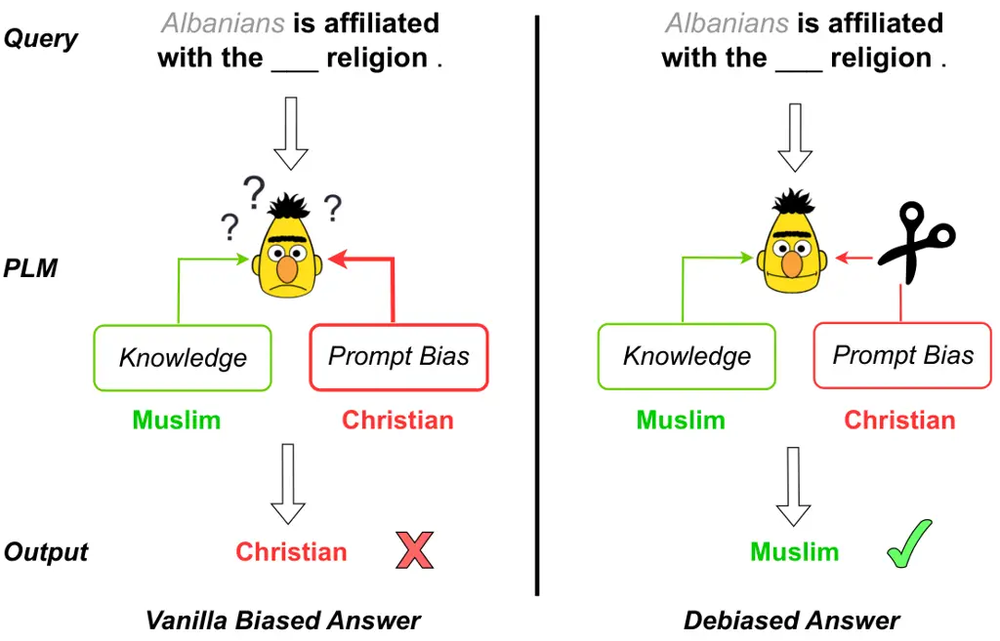

# Take Care of Your Prompt Bias! Investigating and Mitigating Prompt Bias in Factual Knowledge Extraction

  Corresponding Authors: Liang Ding and Xiliang Lu.

###### Abstract

Recent research shows that pre-trained language models (PLMs) suffer
from “prompt bias” in factual knowledge extraction, i.e., prompts tend
to introduce biases toward specific labels. Prompt bias presents a
significant challenge in assessing the factual knowledge within PLMs.
Therefore, this paper aims to improve the reliability of existing
benchmarks by thoroughly investigating and mitigating prompt bias. We
show that: 1) all prompts in the experiments exhibit non-negligible
bias, with gradient-based prompts like AutoPrompt and OptiPrompt
displaying significantly higher levels of bias; 2) prompt bias can
amplify benchmark accuracy unreasonably by overfitting the test
datasets, especially on imbalanced datasets like LAMA. Based on these
findings, we propose a representation-based approach to mitigate the
prompt bias during inference time. Specifically, we first estimate the
biased representation using prompt-only querying, and then remove it
from the model’s internal representations to generate the debiased
representations, which are used to produce the final debiased outputs.
Experiments across various prompts, PLMs, and benchmarks show that our
approach can not only correct the overfitted performance caused by
prompt bias, but also significantly improve the prompt retrieval
capability (up to 10% absolute performance gain). These results indicate
that our approach effectively alleviates prompt bias in knowledge
evaluation, thereby enhancing the reliability of benchmark assessments.
Hopefully, our plug-and-play approach can be a golden standard to
strengthen PLMs toward reliable knowledge bases. Code and data are
released in https://github.com/FelliYang/PromptBias.

Keywords: Factual Knowledge Extraction, Language Models, Prompt Bias

|                                                                                            |
| ------------------------------------------------------------------------------------------ |
| Ziyang Xu¹, Keqin Peng³, Liang Ding⁴, Dacheng Tao⁵, Xiliang Lu^(1,2,6∗)                    |
| ¹Institute of Artificial Intelligence, School of Computer Science, Wuhan University, China |
| ²School of Mathematics and Statistics, Wuhan University, China                             |
| ⁶Hubei Key Laboratory of Computational Science, Wuhan University, China                    |
| ³Beihang University, ⁴The University of Sydney, ⁵Nanyang Technological University          |
| {xuziyang,xllv.math}@whu.edu.cn                                                            |
| {keqin.peng}@buaa.edu.cn                                                                   |
| {liangding.liam,dacheng.tao}@gmail.com                                                     |

Abstract content

## 1.  Introduction

Extracting factual knowledge from PLMs brings new vitality to the
knowledge base construction community that typically requires high
amounts of manual work from domain experts. Researchers have been
fascinated by probing factual knowledge in PLMs Petroni et al. (2019);
Jiang et al. (2020); Kassner and Schütze (2020); Zhong et al. (2021);
Cao et al. (2021). One commonly employed approach involves using
prompt-based querying to extract knowledge from PLMs, i.e., prompting
PLMs to fill masked object slots.



Figure 1: Language models surfer from unintended prompt bias in factual
knowledge extraction. When querying BERT the religion of Albanians, the
model is affected by the prompt bias and makes an incorrect prediction
Christian. With our debiasing approach, the model rectifies its
prediction to the correct answer Muslim.

However, recent research found that the outputs of prompt-based querying
are dominated by prompt bias rather than PLMs’ internal knowledge Cao
et al. (2021), which strongly questions the reliability of current
factual benchmarks. The interference of prompt bias makes it challenging
to evaluate the amount of factual knowledge inside PLMs, significantly
hindering language models from serving as reliable knowledge bases.

This paper aims to improve the reliability of factual knowledge
benchmarks by thoroughly conducting a comprehensive analysis of prompt
bias impact and mitigating it in the knowledge retrieval process. In
this paper, we propose a general method to quantify the prompt bias
across various PLMs and prompt types, and thoroughly assess its impact
on widely used benchmarks such as LAMA. Experiments show that all
current knowledge-extraction prompts have significant prompt bias, with
previously reported high-performing prompts such as AutoPrompt and
Optiprompt often exhibiting more pronounced bias. Moreover, we find that
prompt bias severely compromises benchmark reliability by overfitting
the test datasets and amplifying performance unreasonably. For example,
the prompt bias of OptiPrompt helps inflate absolute accuracy by over
16.47% on the LAMA benchmark when probing the BERT-base model.
Additionally, prompt bias can mislead language models and discourage
models from making correct predictions, as illustrated in Figure 1. This
significantly hinders the knowledge retrieval capabilities of prompts.

Based on these findings, we propose a representation-based approach to
mitigate the prompt bias. Specifically, we first construct a prompt-only
query by replacing the subject slot with a meaningless subject such as
"\[MASK\]". By leveraging the prompt-only query, we can estimate the
PLM’s bias toward the prompt, from which we generate a “biased
representation”. Subsequently, we utilize the biased representation to
mitigate prompt bias by vector operations in the representation layer.

We conduct experiments across different prompts, PLMs and benchmarks,
and find that our approach effectively rectifies the issue of inflated
performance caused by prompt bias overfitting, thereby enhancing the
reliability of factual knowledge benchmarks. Furthermore, our debiasing
approach consistently and significantly improves the retrieval
capability of prompts.

Figure 2: Examples of prompt bias from LAMA manual prompts. “Prompt
bias” shows the BERT-base model probability distributions probed using
prompt-only querying, while “uniform” shows an ideal unbiased
distribution for reference. Prompts are biased towards certain labels.

Our contributions are as follows:

- •
  We propose an approach to quantify the prompt bias in knowledge
  extraction and assess its impact on the reliability of benchmarks. We
  show that all kinds of prompts in the experiments exhibit
  non-negligible prompt bias, with gradient-based prompts playing
  significantly higher levels of bias. Furthermore, we demonstrate two
  negative impacts of prompt bias: 1) unreasonably amplifying benchmark
  performance through overfitting; 2) impairing the prompt retrieval
  capability by misleading PLMs.
- •
  We propose a representation-based debiasing approach to effectively
  tackle the challenge of prompt bias. Experiments show that our
  approach effectively rectifies the inflated performance caused by
  overfitting and improves prompt retrieval capability (up to 10%
  absolute), presenting a reliable and better performance.
- •
  After mitigating prompt bias, we observe that the knowledge retrieval
  abilities of manually designed prompts are comparable to or better
  than those of state-of-the-art prompts. Our debiasing approach has
  shed light on the actual retrieval capabilities of these more complex
  prompts, where we do not observe significant performance improvements.
  OptiPrompt stands out as an exception, although its debiased retrieval
  performance still falls short of expectations.

This paper is an early step in exploring reliable factual knowledge
extraction from PLMs, which employs a simple but effective debiasing
approach. We recommend improving the faithfulness of existing
prompt-based factual knowledge extraction approaches using debiasing
methods.

## 2.  Investigating Prompt Bias

### 2.1.  Uncovering Prompt Bias

Prompts are crucial in converting the downstream task format into a
natural language format that PLMs can understand. In this process, an
ideal prompt, which typically specifies the label space, should not be
inherently biased toward any particular label. However, in practice,
prompts can introduce bias towards specific labels, as observed in tasks
like factual knowledge extraction Cao et al. (2021), which we term as
prompt bias.

To demonstrate the bias induced when using prompts to probe factual
knowledge, we follow previous works Zhao et al. (2021); Cao et al.
(2021) to use prompt-only querying to probe PLMs. Specifically,
prompt-only querying constructs a special input for each prompt by
replacing the `subject` slot \[X\] in a prompt (e.g., “\[X\] used to
communicate in \[Mask\].”) with a meaningless token such as \[Mask\],
N/A or "". By employing prompt-only querying for probing PLMs, we can
observe the inherent bias of the prompt.

Following Cao et al. (2021), we use \[Mask\] as the meaningless token in
this paper. Ideally, in the absence of valid subject information,
prompt-only querying should exhibit a uniform distribution within the
label space. However, the prompts employed in probing factual knowledge
show a severe bias towards specific labels. Figure 2 shows the output
distributions of prompt-only querying for several prompts in the LAMA
benchmark. For example, when probing with “\[X\] is affiliated with the
\[Mask\] religion.”, the BERT-base model is severely biased towards
`Christian`, showing a probability as high as 90%. The prompt bias also
exists in other fields such as sports and industry, as shown in
Figure 2.

### 2.2.  Quantifying Prompt Bias

To comprehensively investigate the prompt bias across different types of
prompts and language models, we quantify the prompt bias using the
Jensen–Shannon(J-S) divergence, which is derived from the
Kullback–Leibler divergence and addresses its asymmetry and infinite
value range.

Specifically, for a language model $`M`$ and a prompt $`T`$, we define
the output probabilities of prompt-only querying as the prompt bias
distribution. Then we quantify the prompt bias using the J-S divergence
between the prompt bias distribution and the uniform distribution,
formulated by:

```math
\displaystyle bias=JS(P_{M}(y|T),U), \tag{1}
```

where $`P_{M}(y|T)`$ and $`U`$ refer to prompt bias distribution and
uniform distribution respectively.

This measurement provides an intuitive quantification of the prompt
bias, where a larger J-S divergence indicates a greater degree of prompt
bias.

As shown in Figure 3, we quantify the prompt bias of four different
prompts across three PLMs. The bias is averaged over 41 relations in the
LAMA benchmark. For additional details about the prompts and benchmark
employed in our study, please refer to Section 4.

Notably, we observe significant prompt bias across all prompt types and
PLMs in our experiments. Specifically, concerning prompt types, manual
prompts and paraphrase-based prompts (LPAQA) exhibit a comparable degree
of bias, whereas gradient-based prompts (AutoPrompt and OptiPrompt) show
a more pronounced bias, up to 0.6 for OptiPrompt. Additionally, although
OptiPrompt and AutoPrompt use the same training dataset, OptiPrompt
exhibits a higher level of bias compared to AutoPrompt. This may stem
from OptiPrompt’s more comprehensive optimization within the continuous
embedding space.

Figure 3: Quantified prompt bias for various prompts and PLMs using J-S
divergence, averaged on 41 relations in the LAMA benchmark.

Regarding different PLMs, BERT-large exhibits a greater bias than
BERT-base, especially in manual and paraphrase-based prompts.
Furthermore, the bias exhibited by BERT models varies significantly
across different prompts, whereas the bias of RoBERTa remains relatively
stable, consistently ranging between 0.55 and 0.58.

### 2.3.  Prompt Bias Impact on Benchmarks

Although we have previously observed and quantified prompt bias, it
remains unclear how prompt bias affects benchmark evaluation. This
section demonstrates two negative impacts of prompt bias.

#### Prompt Bias Can Overfit Datasets and Impairs Benchmark Reliability.

We first assess the overfitting degree of prompt bias on benchmark
datasets. To address this, we explore two strategies for leveraging
prompt bias to answer factual knowledge queries within the benchmark.
The first strategy keep predicting the label with the highest
probability within the prompt bias distribution, e.g., keep predicting
`Christian` for all queries in the LAMA benchmark. The second strategy
involves sampling predictions from the prompt bias distribution. We
employ the first strategy in this experiment due to the fact that it
shows a larger overfitting performance in practice.

Table 1 presents the results, with prompts arranged based on their
vanilla performance (see Table 2 for additional information).
Surprisingly, across various prompts and PLMs, prompt bias achieves
non-trivial performance on LAMA and LAMA-UHN, which are widely used
benchmarks with imbalanced data distributions. Additionally,
gradient-based prompts exhibit a more pronounced overfitting compared to
manual and paraphrased prompts. In contrast, prompt bias exhibits
limited influence on WIKI-UNI due to the uniform data distribution
characteristic of this benchmark.

|            |       |          |          |
| ---------- | ----- | -------- | -------- |
| Prompts    | LAMA  | LAMA-UHN | WIKI-UNI |
| Manual     | 5.23  | 4.87     | 1.05     |
| LPAQA      | 6.36  | 5.89     | 1.7      |
| AutoPrompt | 13.52 | 13.16    | 1.71     |
| OptiPrompt | 16.47 | 17.55    | 1.72     |

Table 1: The overfit accuracy of four types of prompts on three test
datasets, probed with BERT-base, averaged across 41 relations for each
dataset. The accuracy is assessed by always predicting the label biased
most by the prompt. The prompt bias severely overfits imbalanced
datasets like LAMA and LAMA-UHN.

|            |      |          |          |
| ---------- | ---- | -------- | -------- |
| Prompts    | LAMA | LAMA-UHN | WIKI-UNI |
| Manual     | 37.1 | 27.3     | 20.0     |
| LPAQA      | 38.1 | 29.0     | 19.7     |
| AutoPrompt | 43.9 | 33.4     | 20.6     |
| OptiPrompt | 49.4 | 39.5     | 23.1     |

Table 2: Prompts’ vanilla performance on three test datasets, probed
with BERT-base.

#### Prompt Bias Can Mislead Language Models and Impair the Prompt Retrieval Capability.

In addition to overfitting benchmarks, we observe that prompt bias can
potentially mislead PLMs in factual knowledge probing. Table 3
illustrates this phenomenon using examples from the LAMA benchmark. For
instance, when querying the BERT-base model with “Albanians is
affiliated with the \[Mask\] religion .”, it will be affected by the
strong prompt bias shown in Figure 2 and predict the incorrect label
`Christian`. However, the model can predict the correct answer
`Muslim` after mitigating prompt bias using the approach introduced
in Section3. This suggests that prompt bias can mislead PLMs and prevent
them from fully using their knowledge to answer factual queries.

As a result, besides lowering the reliability of benchmarks, prompt bias
also impairs the knowledge retrieval capability of prompts.

|                                                        |            |            |
| ------------------------------------------------------ | ---------- | ---------- |
| Example                                                | Vanilla    | Debiased   |
| Albanians is affiliated with the \[Mask\] religion .   | Christian  | Muslim     |
| Afghanistan is affiliated with the \[Mask\] religion . | Christian  | Islam      |
| Vladislav Tretiak plays in \[Mask\] position .         | midfielder | goaltender |
| Tuukka Rask plays in \[Mask\] position .               | forward    | goaltender |
| iChat is developed by \[Mask\] .                       | Intel      | Apple      |
| Digital Negative is developed by \[Mask\] .            | Intel      | Adobe      |

Table 3: Examples in the LAMA benchmark where BERT-base is misled by
prompt bias and makes incorrect predictions. After debiasing, the model
gives correct answers. Vanilla and rectified predictions are shown in
red and blue respectively.

Figure 4: The pipeline of our method. The red line represents the
process of debiasing, which uses the subtraction of the representations
between prompt-only query $`V_{T(\cdot)}`$ and vanilla query
$`V_{T(x)}`$.

## 3.  Mitigating Prompt Bias

Thus far, we have shown that PLMs suffer from severe prompt bias in
factual knowledge extraction, which negatively impairs benchmark
reliability as well as prompt retrieval capability. Here, we propose a
representation-based approach to mitigate prompt bias. The internal
representation vectors of PLMs encompass their preference for answer
labels, which incorporate both internal knowledge and prompt bias.
Therefore, the prompt bias can be addressed by removing the biased
component from the representation vectors. The key idea is to identify
the biased component in representations through prompt-only querying.
Figure 4 shows the pipeline of our approach.

In detail, given a prompt $`T`$ (e.g., “\[X\] was born in \[Mask\].”)
and a fact knowledge subject $`x`$, we first construct the vanilla query
$`T(x)`$ and the prompt-only query $`T(\cdot)`$ by replacing the "\[X\]"
slot in $`T`$ with $`x`$ and a meaningless token like \[Mask\] ,
respectively. Then we push $`T(x)`$ and $`T(\cdot)`$ into PLMs to get
their representation vectors on the masked position, denoted as
$`V_{T(x)}`$ and $`V_{T(\cdot)}`$. Specifically, the representation
vectors refer to the outputs of the model’s final layer¹¹ 1 The final
layer refers to the layer preceding the output embedding layer.
Typically, the final layer corresponds to the last transformer block,
but it may also denote the linear layer following the transformer blocks
in some cases such as in BERT models., which is crucial for the
debiasing algorithm to work²² 2 Outputs of the final layer don’t suffer
from non-linear transformations until being decoded into tokens.
Therefore, they serve as a solid foundation for the subsequent linear
operations involved in the debiasing process. . Next, we take the
subtraction of two representation vectors as the debiased vector,
namely $`\tilde{V}_{T(x)}`$. This process is formulated by:

```math
\displaystyle\tilde{V}_{T(x)} \displaystyle=V_{T(x)}-V_{T(\cdot)}. \tag{2}
```

We then use $`\tilde{V}_{T(x)}`$ to replace the original representation
vector $`V_{T(x)}`$ in the decoding stage and get the debiased logits:

```math
\displaystyle\tilde{L}_{T(x)} \displaystyle=E^{o}(\tilde{V}_{T(x)}), \tag{3}
```

where $`E^{o}`$ represents the output embedding layer of the PLM. To
obtain the final prediction, we select the label with the highest logit
value in the label space $`\mathcal{C}`$ (see Section 4.4 for more
details) :

```math
\displaystyle\text{token}=\arg\max_{v\in\mathcal{C}}\tilde{L}_{T(x)}(v). \tag{4}
```

Unlike previous approaches that adjust output probabilities using an
affine transformation Guo et al. (2017); Zhao et al. (2021), we address
prompt bias in the representation layer. One advantage of our approach
lies in its capability to generate debiased representation vectors,
which can be utilized to mitigate bias in broader scenarios, such as
sentence embeddings (Jiang et al., 2022).

## 4.  Experimental Setup

### 4.1.  Model Details

Following previous work Zhong et al. (2021), We conducted our main
experiments on BERT-base, BERT-large Devlin et al. (2019) and
RoBERTa-large (Liu et al., 2019) models, which are widely used in
factual knowledge extraction task. Additionally, we perform experiments
on Llama2 Touvron et al. (2023) 7B to further investigate the
generalizability of the debiasing strategy.

### 4.2.  Prompt Settings

We conducted experiments using four different types of prompts:

LAMA Manual refers to a series of manual prompts constructed by Petroni
et al. (2019) to probe factual knowledge within PLMs. To extract factual
knowledge from PLMs, Petroni et al. (2019) manually constructed a
specific prompt for each relation in the LAMA benchmark. For example,
the prompt “\[X\] was born in \[Mask\].” is designed for the relation
`place-of-birth`.

LPAQA refers to the mining-based and paraphrasing-based prompts
constructed by Jiang et al. (2020), which demonstrate better performance
than LAMA Manual in the LAMA benchmark.

AutoPrompt refers to the gradient-guided prompts that are optimized on
discrete token space by Shin et al. (2020). Additional training datasets
are required for optimizing the prompts.

OptiPrompt refers to the continuous prompts proposed by (Zhong et al.,
2021), which optimizes in the continuous embedding space using the same
training datasets as AutoPrompt.

In our experiments, we directly utilize the prompts published by these
works. An exception is OptiPrompt; due to the lack of officially
available prompts, we train OptiPrompt for BERT and RoBERTa models
according to the settings outlined in the paper Zhong et al. (2021).
Further optimization details can be found in Appendix A.1.

### 4.3.  Benchmarks

We involve three benchmarks: two imbalanced benchmarks (LAMA and
LAMA-UHN), and one balanced benchmark (WIKI-UNI). The test datasets of
balanced benchmarks have a uniform label distribution, unlike those of
imbalanced benchmarks.

LAMA is a widely-used benchmark, originally constructed by Petroni
et al. (2019), designed to evaluate various knowledge contained in PLMs.
In LAMA, a fact is defined as a triple (subject, `relation`, object)
such as (Dante, `born-in`, Florence). Following previous work Zhong
et al. (2021), we focus on factual knowledge extraction and use the
TREx Elsahar et al. (2018) subset of LAMA in the experiments. It
contains up to 1000 fact triples for each of the 41 Wikidata relation
types. Notably, LAMA is an imbalanced dataset, particularly regarding
certain relations such as P136 `genre`, where the label “Jazz”
constitutes over 70% of the dataset.

LAMA-UHN is a more challenging variant of LAMA constructed by Poerner
et al. (2020), which is also imbalanced. In comparison to LAMA, LAMA-UHN
filters out fact triples that are easy to guess, such as cases where the
object is a substring of the subject.

WIKI-UNI is a balanced dataset constructed from Wikidata Cao et al.
(2021). It has been meticulously curated to ensure a uniform answer
distribution. WIKI-UNI encompasses the same 41 relations as LAMA and is
of comparable size.

### 4.4.  Querying Paradigms

In factual knowledge extraction, there are mainly two types of querying
paradigms:

- •
  Untyped querying (Petroni et al., 2019; Jiang et al., 2020; Zhong
  et al., 2021) involves querying PLMs for object answers in the whole
  vocabulary or inter-vocab of different PLMs.
- •
  Typed querying (Kassner et al., 2021; Xiong et al., 2020) involves
  querying PLMs for object answers in a candidate set $`\mathcal{C}`$
  that consists of expected type tokens. For example, the candidate set
  $`\mathcal{C}`$ for templates such as "\[X\] was born in \[Mask\]."
  includes all cities present in the PLM’s vocabulary.

In this paper, we focus on prompt bias in typed querying. We take the
candidate set of previous work (Kassner et al., 2021) as a basis and
expand it by adding extra labels inside the test datasets. Additionally,
to maintain consistency with previous work (Cao et al., 2021; Zhong
et al., 2021), we only allow candidate labels consisting of a single
token for BERT and RoBERTa models. Our code is implemented using
![[Uncaptioned
image]](arxiv-2403-09963v2--eb8f289a2a74.figures/figure-2.webp) Transformers (Wolf
et al., 2019) and OpenPrompt (Ding et al., 2022).

|          |            |           |                |     |            |                |     |               |                |
| -------- | ---------- | --------- | -------------- | --- | ---------- | -------------- | --- | ------------- | -------------- |
| Datasets | Prompts    | BERT-Base |                |     | BERT-Large |                |     | Roberta-Large |                |
|          |            | Prec.     | Prec.^(d)      |     | Prec.      | Prec.^(d)      |     | Prec.         | Prec.^(d)      |
|          | Manual     | 20.0      | 24.2 ( +4.2 )  |     | 22.6       | 26.1 ( +3.5 )  |     | 20.1          | 24.0 ( +3.9 )  |
|          | LPAQA      | 19.7      | 24.3 ( +4.6 )  |     | 21.6       | 24.4 ( +2.8 )  |     | 20.1          | 23.6 ( +3.5 )  |
|          | AutoPrompt | 20.6      | 24.7 ( +4.1 )  |     | 21.2       | 25.0 ( +3.8 )  |     | 18.8          | 23.4 ( +4.6 )  |
| WIKI-UNI | OptiPrompt | 23.1      | 25.7 ( +2.6 )  |     | 24.8       | 28.3 ( +3.5 )  |     | 22.2          | 26.4 ( +4.2 )  |
|          | Manual     | 37.1      | 32.4 ( -4.7 )  |     | 38.7       | 32.2 ( -6.5 )  |     | 36.4          | 30.7 ( -5.7 )  |
|          | LPAQA      | 38.1      | 31.0 ( -7.1 )  |     | 40.2       | 31.6 ( -8.6 )  |     | 39.0          | 30.5 ( -8.5 )  |
|          | AutoPrompt | 43.9      | 33.4 ( -10.5 ) |     | 43.5       | 34.8 ( -8.7 )  |     | 42.3          | 26.1 ( -16.2 ) |
| LAMA     | OptiPrompt | 49.7      | 34.1 ( -15.6 ) |     | 52.4       | 38.6 ( -13.8 ) |     | 48.5          | 34.7 ( -13.8 ) |
|          | Manual     | 27.2      | 22.5 ( -4.7 )  |     | 30.0       | 23.0 ( -7.0 )  |     | 28.3          | 22.0 ( -6.3 )  |
|          | LPAQA      | 29.0      | 21.2 ( -7.8 )  |     | 31.7       | 22.5 ( -9.2 )  |     | 31.1          | 21.9 ( -9.2 )  |
|          | AutoPrompt | 33.4      | 22.1 ( -11.3 ) |     | 33.8       | 25.0 ( -8.8 )  |     | 33.9          | 17.6 ( -16.3 ) |
| LAMA-UHN | OptiPrompt | 39.8      | 23.1 ( -16.7 ) |     | 43.6       | 28.3 ( -15.3 ) |     | 39.8          | 24.9 ( -14.9 ) |

Table 4: Top 1 accuracy before and after debiasing across various PLMs,
prompts, and benchmarks, averaged across 41 relations. Results on
imbalanced datasets (LAMA, LAMA-UHN) and the balanced dataset (WIKI-UNI)
are shown in red O and green O backgrounds respectively. The superscript
$`d`$ denotes the debiased performance.

## 5.  Experiments and Results

In this section, we evaluate the effectiveness of our debiasing approach
across various prompts and PLMs. Results are reported in Table 4.

#### Our Approach Rectifies the Inflated Accuracy of Imbalanced Datasets.

After applying the debiasing approach, all prompts suffer from varying
degrees of performance degradation on imbalanced benchmarks,
consistently across different PLMs. Prompts exhibiting significant
overfitting in Table 1 experience greater performance degradation, by up
to -16.7% absolute. We attribute the decline to the correction of
overfitted performance caused by prompt bias. To validate this, we
conduct a thorough analysis to identify the source of the degradation.

Specifically, we first select biased labels from the label space
according to their probabilities in prompt-only querying. Biased labels
refer to labels whose probabilities are higher than those of the uniform
distribution ( e.g., `Christian` in Figure 2). Then we identify test
data containing biased labels as biased data, as they are prone to being
overfitted by prompt bias. Figure 5 plots the ratio of biased data among
the incorrect predictions contributing to the performance degradation.

We find that incorrect predictions caused by the debiasing algorithm
mostly come from biased data, accounting for up to approximately 90% in
both OptiPrompt and AutoPrompt. This suggests that the performance
degradation is mainly attributed to performance correction for prompt
bias overfit. The analysis in Section 6 further supports this.

Figure 5: The ratio of biased data in the performance degraded by
debiasing, across diverse PLMs and prompts, averaged on 41 relations.
Performance degradation mostly comes from biased data.

#### Our Approach Improves the Accuracy of the Balanced Dataset.

Results of the balanced dataset WIKI-UNI listed in Table 4 show that our
approach consistently and significantly improves PLMs’ accuracy on the
WIKI-UNI benchmark, e.g., average +3.9, +3.4 and +4.1 upon BERT-base,
BERT-large and RoBERTa-large, respectively. The improvement mainly comes
from the rectification of incorrect predictions misled by prompt bias,
as illustrated in Table 3.

Figure 6: The impact of debiasing on benchmark accuracy after filtering
out prompt-overfitting data, probed on the BERT-base model using various
prompts. K represents the number of biased labels filtered from raw
benchmarks, see Section 6 for details. After filtering out overfitting
data, the debiasing impact on imbalanced datasets (LAMA, LAMA-UHN) turns
from negative to positive, finally achieving comparable improvements
with the balanced dataset (WIKI-UNI).

#### Limited Improvement in Knowledge Retrieval Abilities with More Complex Prompts.

Previous studies have made efforts to seek prompts with better knowledge
retrieval capability, such as LPAQA, AutoPrompt, and OptiPrompt. Despite
demonstrating improved performance on benchmarks like LAMA, these
complex prompts typically exhibit larger overfitting, as evidenced
in Table1. This raises doubts about their actual effectiveness in
knowledge retrieval.

Our debiasing algorithm sheds light on this issue. Upon mitigating
prompt bias, the performance of these prompts returns to the same level
on imbalanced datasets. Furthermore, their performance is close to each
other on the balanced WIKI-UNI dataset, regardless of debiasing.
Although OptiPrompt exhibits slightly better performance (e.g., average
+4.3 on BERT-large), it still falls short of expectations. These
findings suggest that the purported “better” prompts’ knowledge
retrieval capability is not substantially enhanced when compared to
manual prompts.

## 6.  Analysis and Discussion

#### Debiasing Shows Positive Impacts on Imbalanced Datasets After Filtering Out Prompt-Biased Data.

In the main experiments, we have shown that the debiased performance
drops dramatically on imbalanced datasets (LAMA, LAMA-UHN), which we
attribute to our debiasing approach correcting the overfitting
performance. To further support our interpretation and explore more
deeply the impact of prompt bias on imbalanced datasets, we design
another experiment where we filter out data from imbalanced datasets
that may be overfitted by the prompt bias, namely prompt-biased data. We
are going to study how debiasing affects LAMA and LAMA-UHN performance
without the interference of prompt-biased data.

Concretely, we first use prompt-only querying to probe the model and
find the top-k labels biased by the prompt. Then we filter out data
whose labels are in the top-k biased labels from the datasets. In our
setting, $`k`$ could be 0, 1, 2, 4, 8, 16, 32. Table 6 shows the
filtered dataset size for different $`k`$.

Results on these filtered datasets are reported in Figure 6. We only
show the results on the BERT-base model in the main text. Results on
other models are reported in appendix B. Notably, the performance of
LAMA and LAMA-UHN exhibits a significant improvement after filtering out
prompt-biased data. With the increase of $`k`$, the debiasing effect on
imbalanced datasets gradually shifts from negative to positive,
eventually achieving a level of improvement comparable to that observed
in the balanced dataset WIKI-UNI. These results indicate that our
debiasing approach actually improves rather than degrades the retrieval
ability of prompts on imbalanced datasets, by up to +10.8 on LAMA for
the LPAQA prompt when k=32.

Figure 7: Manual prompts vanilla and debiased accuracy on filtered
WIKI-UNI using different k, probed with BERT-base.

#### Debiasing Benefit for Prompt Retrieval Capability is Underestimated.

Another notable phenomenon is that the debiasing benefit shown on
WIKI-UNI has further improved after removing prompt-biased data. For
example, the debiasing improvements for Manual prompts increase from 4.1
(k=0) to 8.1 (k=32) on the BERT-base model, as shown in Figure 6.

To understand this phenomenon, we thoroughly analyze the performance
variance on filtered WIKI-UNI. Results are reported in Figure 7. We
observe that vanilla performance drops significantly from 20.0 (k=0) to
14.5 (k=32) after removing prompt-biased data. This indicates that
prompt bias also overfit WIKI-UNI, though not as high as LAMA and
LAMA-UHN. Interestingly, while the vanilla performance drops, the
debiased performance is relatively stable. This suggests the benefit of
our debiasing method may be underestimated, with the interference of
prompt-biased data.

In summary, prompt bias can overfit a few data in the balanced dataset.
Using WIKI-UNI directly to evaluate the debiasing benefit on retrieval
capabilities may lead to underestimation.

#### Generalizability of the Debiasing Algorithm on Large Large Models.

We further evaluate the effectiveness of the debiasing strategy on Lama2
7B for Manual and LPAQA prompts. To adapt to auto-regressive language
models, we make some adjustments to the debiasing algorithm; please
refer to Appendix A.3 for more details. Table 5 shows the results.
According to the results, our debiasing strategy consistently enhances
performance and reliability on Llama2, specifically by improving
performance on WIKI-UNI (by up to +4.5) and rectifying overfitted
performance on other imbalanced datasets. These results indicate that
large language models are also at risk of suffering from prompt bias.
Remarkably, the debiased performance of Llama2 7B significantly
surpasses that of BERT and RoBERTa, which might be due to the fact that
Llama2 contains much more factual knowledge.

Overall, our method demonstrates strong generalization capabilities and
offers novel insights into addressing bias issues in large language
models.

|          |         |       |             |
| -------- | ------- | ----- | ----------- |
| Datasets | Prompts | Prec. | Prec.^(d)   |
|          | Manual  | 27.5  | 31.9 (+4.4) |
| WIKI-UNI | LPAQA   | 26.4  | 30.9 (+4.5) |
|          | Manual  | 51.9  | 48.4 (-3.5) |
| LAMA     | LPAQA   | 49.2  | 48.0 (-1.2) |
|          | Manual  | 46.7  | 43.5 (-3.2) |
| LAMA-UHN | LPAQA   | 45.8  | 43.8 (-2.0) |

Table 5: Top 1 accuracy before and after debiasing of Llama2 7B across
several prompts and datasets, averaged on 41 relations. The symbols and
color representations used in this table are consistent with those
described in Table 4.

#### Can Language Models Be Used as Knowledge Bases?

Previous work (Petroni et al., 2019) proposes PLMs have the potential to
be knowledge bases. However, Cao et al. (2021) questions its feasibility
based on their findings that the decent performance stems from prompt
bias overfitting. This paper further investigates whether PLMs can
answer factual queries without overfitting from prompt bias. As shown in
the main results, we find positive evidence that PLMs can achieve
relatively good performance after mitigating prompt bias, even with
Manual prompts. Additionally, the performance is expected to be further
improved with larger PLMs and better prompts. Therefore, we posit
that PLMs have the potential to serve as knowledge bases. To avoid the
negative impacts of prompt bias, it is necessary to use some debiasing
approach like ours in the knowledge probing process.

## 7.  Related Work

#### Factual Knowledge Extraction

Petroni et al. (2019) first introduce the LAMA benchmark to evaluate the
factual knowledge contained in PLMs by prompting, and propose that PLMs
have the potential to serve as knowledge bases.  Kassner et al. (2021)
extend the LAMA benchmark to different languages and investigate factual
knowledge contained in multilingual PLMs. One subsequent research line
focuses on finding prompts with better retrieval capability. Jiang
et al. (2020) use text-mining and paraphrasing to automatically generate
prompts that show better performance than LAMA. Shin et al. (2020)
collect a training dataset consisting of different facts with LAMA and
use a gradient-based searching algorithm (Wallace et al., 2019) to find
better discrete prompts. Liu et al. (2021) and  Zhong et al. (2021) take
a further step by exploring continued prompt optimization on factual
knowledge extraction.

However, some other works point out that PLMs can hardly serve as
reliable knowledge bases currently. Kassner and Schütze (2020) find PLMs
can’t distinguish negated and non-negated queries. Zhong et al. (2021)
show that gradient-based prompts will learn patterns from the training
dataset and overfit test datasets. Cao et al. (2021) find PLMs suffer
from prompt bias in factual knowledge extraction and propose that
previous decent performance may be attributed to the prompt bias
overfitting on test datasets. Inspired by Cao et al. (2021), we take a
further step to quantify the prompt bias across diverse prompts and PLMs
and assess its impact on different benchmarks. We reveal two negative
impacts of prompt bias and propose a novel approach to mitigate the
prompt bias in factual knowledge extraction.

There are more advanced language models He et al. (2020); Zhong et al.
(2022); Zhong et al. (2023b) for complex understanding tasks, e.g.,
GLUE Wang et al. (2018), SuperGLUE Wang et al. (2019), in the future
work, we would explore the bias and the effectiveness of our method in
these models and tasks.

#### Bias in PLM

Bias in PLMs is widely investigated in the NLP field, from training
corpus (Kurita et al., 2019; Webster et al., 2020; Dev et al., 2020) to
downstream tasks such as PLM-based metrics (Sun et al., 2022), machine
translation (Stanovsky et al., 2019; Prates et al., 2020; Wang et al.,
2022a). Many works explore how to mitigate the intrinsic bias in
PLMs (Qian et al., 2019; Bordia and Bowman, 2019; Webster et al., 2020;
Qian et al., 2021; Fei et al., 2023). and the extrinsic bias in
downstream tasks(Zhao et al., 2017; Zhao et al., 2018; Sun et al., 2022;
Wang et al., 2022a; Behnke et al., 2022). Focusing on the intrinsic
bias, counterfactual data augmentation (CDA) (Zmigrod et al., 2019;
Dinan et al., 2020; Webster et al., 2020; Barikeri et al., 2021)
involves re-balancing the training· corpus by swapping bias attribute
words and taking further training. Karimi Mahabadi et al. (2020)
and Utama et al. (2020) adjust the model’s training loss to mitigate
bias by down-weighting the biased data in the corpus. Webster et al.
(2020) propose using dropout regularization (Srivastava et al., 2014) as
a bias mitigation approach. Schick et al. (2021) propose a post-hoc
debiasing technique to discourage PLMs from generating biased text by
leveraging their internal knowledge. There are also other bias
mitigation technologies such as projection-based debiasing (Ravfogel
et al., 2020; Liang et al., 2020), and contrastive learning
debiasing (Lyu et al., 2022). In contrast to our method, most of these
approaches require the extra cost of data manipulations or model
retraining.

Our approach for performing debiasing builds on recent work that
explores data-free debiasing using prompt-only querying (Zhao et al.,
2021). Different from Zhao et al. (2021), we mitigate bias by
manipulating representation vectors instead of output probabilities. One
advantage of our approach is the ability to generate debiased
representation vectors, which can be used in sentence embeddings like
PromptBERT (Jiang et al., 2022). Our approach is also similar to
counterfactual inference (Qian et al., 2021; Wang et al., 2022b) but
their approach only considers keywords in the prompt when distilling
bias and discard relatively unimportant words, which have been shown can
significantly affect prompts (Schick and Schütze, 2021a; Schick and
Schütze, 2021b); in contrast, our target is to mitigate the bias of the
whole prompt.

Although generative language models Touvron et al. (2023); Achiam et al.
(2023) have shown significant success in various language understanding
and generation tasks Zhong et al. (2023a); Peng et al. (2023); Lu et al.
(2023), recent studies Zheng et al. (2024); Lyu et al. (2024) show that
LLMs tend to make biased choices that are inconsistent with their
inherent (generated) knowledge. Our debiasing strategy consistently
enhances performance and reliability on Llama2, demonstrating the
universality of our method and its potential to serve as the standard
post-processing toolkit for large language model. In future work, it is
also worth investigating the prompt bias in other LLM-prompting-based
tasks, such as the lexical choice bias in translation Ding et al.
(2021), decision bias in healthcare copilot Ren et al. (2024).

## 8.  Conclusions

In this paper, we propose a method to quantify the prompt bias in
factual knowledge extraction and demonstrate two negative impacts of
prompt bias: overfitting benchmarks and misleading language models.
Based on these findings, we propose an approach to mitigate the prompt
bias using the representation vector of prompt-only querying.
Experiments show that our approach effectively rectified the inflated
benchmark performance achieved by prompt bias overfitting, resulting in
a more reliable evaluation of factual knowledge within PLMs.
Furthermore, our approach significantly enhances the retrieval
performance of prompts, even within contemporary large language models
like Llama2. Additionally, we observe close performance between
state-of-the-art prompts and vanilla manual prompts after mitigating
prompt bias. This suggests that these “better” prompts achieve their
performance mainly by better overfitting test datasets via prompt bias
rather than their knowledge retrieval capability. These findings
contribute to the development of PLM-based knowledge base construction
by shedding new light on the reliability of existing benchmarks and the
actual amount of factual knowledge within PLMs. Although our debiasing
method is proposed for factual knowledge extraction, this approach can
also be applied to other prompt-based tasks where the prompt bias occurs
such as topic classification. For future work intending to find prompts
with better retrieval capability, we strongly recommend they evaluate
performance with the debiasing method.

## Limitations

Our debiasing method performs a preliminary exploration of how to use
representation to mitigate bias, which we believe can be further
explored and improved. Moreover, the prompt bias estimation strategy (by
masking the input information) may be suboptimal. Additional strategies
and analyses need to be proposed to better estimate the prompt bias. We
leave these works for the future.

## Ethics Statement

We take ethical considerations very seriously and strictly adhere to the
Ethics Policy. This paper focuses on mitigating prompt bias in factual
knowledge extraction. The datasets used in this paper are publicly
available and have been widely adopted by researchers. We ensure that
the findings and conclusions of this paper are reported accurately and
objectively.

## Acknowledgements

We are grateful to the anonymous reviewers and the area chair for their
insightful comments and suggestions. This work is supported by the
National Key Research and Development Program of China (No.
SQ2023YFA1000103) and the National Nature Science Foundation of China
(No.12371424)

## Bibliographical References

##

- Achiam et al. (2023) Josh Achiam, Steven Adler, Sandhini Agarwal, Lama
  Ahmad, Ilge Akkaya, Florencia Leoni Aleman, Diogo Almeida, Janko
  Altenschmidt, Sam Altman, Shyamal Anadkat, et al. 2023. [Gpt-4
  technical report](https://arxiv.org/abs/2303.08774). _arXiv preprint_.
- Barikeri et al. (2021) Soumya Barikeri, Anne Lauscher, Ivan Vulić, and
  Goran Glavaš. 2021. [RedditBias: A real-world resource for bias
  evaluation and debiasing of conversational language
  models](https://aclanthology.org/2021.acl-long.151). In _Proc. of
  ACL_.
- Behnke et al. (2022) Hanna Behnke, Marina Fomicheva, and Lucia
  Specia. 2022. [Bias mitigation in machine translation quality
  estimation](https://aclanthology.org/2022.acl-long.104). In _Proc. of
  ACL_.
- Bordia and Bowman (2019) Shikha Bordia and Samuel R. Bowman. 2019.
  [Identifying and reducing gender bias in word-level language
  models](https://aclanthology.org/N19-3002). In _Proc. of NAACL_.
- Cao et al. (2021) Boxi Cao, Hongyu Lin, Xianpei Han, Le Sun, Lingyong
  Yan, Meng Liao, Tong Xue, and Jin Xu. 2021. [Knowledgeable or educated
  guess? revisiting language models as knowledge
  bases](https://aclanthology.org/2021.acl-long.146). In _Proc. of ACL_.
- Dev et al. (2020) Sunipa Dev, Tao Li, Jeff M. Phillips, and Vivek
  Srikumar. 2020. [On measuring and mitigating biased inferences of word
  embeddings](https://aaai.org/ojs/index.php/AAAI/article/view/6267). In
  _Proc. of AAAI_.
- Devlin et al. (2019) Jacob Devlin, Ming-Wei Chang, Kenton Lee, and
  Kristina Toutanova. 2019. [BERT: Pre-training of deep bidirectional
  transformers for language
  understanding](https://aclanthology.org/N19-1423). In _Proc. of AACL_.
- Dinan et al. (2020) Emily Dinan, Angela Fan, Adina Williams, Jack
  Urbanek, Douwe Kiela, and Jason Weston. 2020. [Queens are powerful
  too: Mitigating gender bias in dialogue
  generation](https://aclanthology.org/2020.emnlp-main.656). In _Proc.
  of EMNLP_.
- Ding et al. (2021) Liang Ding, Longyue Wang, Xuebo Liu, Derek F Wong,
  Dacheng Tao, and Zhaopeng Tu. 2021. [Understanding and improving
  lexical choice in non-autoregressive
  translation](https://openreview.net/forum?id=ZTFeSBIX9C). In _Proc. of
  ICLR_.
- Ding et al. (2022) Ning Ding, Shengding Hu, Weilin Zhao, Yulin Chen,
  Zhiyuan Liu, Haitao Zheng, and Maosong Sun. 2022. [OpenPrompt: An
  open-source framework for
  prompt-learning](https://aclanthology.org/2022.acl-demo.10). In _Proc.
  of ACL_.
- Elsahar et al. (2018) Hady Elsahar, Pavlos Vougiouklis, Arslen Remaci,
  Christophe Gravier, Jonathon Hare, Frederique Laforest, and Elena
  Simperl. 2018. [T-REx: A large scale alignment of natural language
  with knowledge base triples](https://aclanthology.org/L18-1544). In
  _Proc. of LREC_.
- Fei et al. (2023) Yu Fei, Yifan Hou, Zeming Chen, and Antoine
  Bosselut. 2023. [Mitigating label biases for in-context
  learning](https://aclanthology.org/2023.acl-long.783.pdf).
- Guo et al. (2017) Chuan Guo, Geoff Pleiss, Yu Sun, and Kilian Q.
  Weinberger. 2017. [On calibration of modern neural
  networks](http://proceedings.mlr.press/v70/guo17a.html). In _Proc. of
  ICML_.
- He et al. (2020) Pengcheng He, Xiaodong Liu, Jianfeng Gao, and Weizhu
  Chen. 2020. [Deberta: Decoding-enhanced bert with disentangled
  attention](https://arxiv.org/abs/2006.03654). _arXiv preprint_.
- Jiang et al. (2022) Ting Jiang, Jian Jiao, Shaohan Huang, Zihan Zhang,
  Deqing Wang, Fuzhen Zhuang, Furu Wei, Haizhen Huang, Denvy Deng, and
  Qi Zhang. 2022. [PromptBERT: Improving BERT sentence embeddings with
  prompts](https://aclanthology.org/2022.emnlp-main.603). In _Proc. of
  EMNLP_.
- Jiang et al. (2020) Zhengbao Jiang, Frank F. Xu, Jun Araki, and Graham
  Neubig. 2020. [How can we know what language models
  know?](https://aclanthology.org/2020.tacl-1.28) _TACL_.
- Karimi Mahabadi et al. (2020) Rabeeh Karimi Mahabadi, Yonatan
  Belinkov, and James Henderson. 2020. [End-to-end bias mitigation by
  modelling biases in
  corpora](https://aclanthology.org/2020.acl-main.769). In _Proc. of
  ACL_.
- Kassner et al. (2021) Nora Kassner, Philipp Dufter, and Hinrich
  Schütze. 2021. [Multilingual LAMA: Investigating knowledge in
  multilingual pretrained language
  models](https://aclanthology.org/2021.eacl-main.284). In _Proc. of
  EACL_.
- Kassner and Schütze (2020) Nora Kassner and Hinrich Schütze. 2020.
  [Negated and misprimed probes for pretrained language models: Birds
  can talk, but cannot fly](https://aclanthology.org/2020.acl-main.698).
  In _Proc. of ACL_.
- Kurita et al. (2019) Keita Kurita, Nidhi Vyas, Ayush Pareek, Alan W
  Black, and Yulia Tsvetkov. 2019. [Measuring bias in contextualized
  word representations](https://aclanthology.org/W19-3823). In _Proc. of
  Gender Bias in NLP_.
- Liang et al. (2020) Paul Pu Liang, Irene Mengze Li, Emily Zheng,
  Yao Chong Lim, Ruslan Salakhutdinov, and Louis-Philippe Morency. 2020.
  [Towards debiasing sentence
  representations](https://aclanthology.org/2020.acl-main.488). In
  _Proc. of ACL_.
- Liu et al. (2021) Xiao Liu, Yanan Zheng, Zhengxiao Du, Ming Ding,
  Yujie Qian, Zhilin Yang, and Jie Tang. 2021. [GPT understands,
  too](https://arxiv.org/abs/2103.10385). _arXiv preprint_.
- Liu et al. (2019) Yinhan Liu, Myle Ott, Naman Goyal, Jingfei Du,
  Mandar Joshi, Danqi Chen, Omer Levy, Mike Lewis, Luke Zettlemoyer, and
  Veselin Stoyanov. 2019. [Ro{bert}a: A robustly optimized {bert}
  pretraining approach](https://arxiv.org/abs/1907.11692). _arXiv
  preprint_.
- Loshchilov and Hutter (2017) Ilya Loshchilov and Frank Hutter. 2017.
  [Fixing weight decay regularization in
  adam](https://arxiv.org/abs/1711.05101). _arXiv preprint_.
- Lu et al. (2023) Qingyu Lu, Baopu Qiu, Liang Ding, Kanjian Zhang, Tom
  Kocmi, and Dacheng Tao. 2023. [Error analysis prompting enables
  human-like translation evaluation in large language models: A case
  study on chatgpt](https://arxiv.org/pdf/2303.13809.pdf). _arXiv
  preprint_.
- Lyu et al. (2024) Chenyang Lyu, Minghao Wu, and Alham Fikri Aji. 2024.
  [Beyond probabilities: Unveiling the misalignment in evaluating large
  language models](https://arxiv.org/abs/2402.13887). _arXiv preprint_.
- Lyu et al. (2022) Yougang Lyu, Piji Li, Yechang Yang, Maarten de
  Rijke, Pengjie Ren, Yukun Zhao, Dawei Yin, and Zhaochun Ren. 2022.
  [Feature-level debiased natural language
  understanding](https://arxiv.org/abs/2212.05421). In _Proc. of AAAI_.
- Peng et al. (2023) Keqin Peng, Liang Ding, Qihuang Zhong, Li Shen,
  Xuebo Liu, Min Zhang, Yuanxin Ouyang, and Dacheng Tao. 2023. [Towards
  making the most of chatgpt for machine
  translation](https://aclanthology.org/2023.findings-emnlp.373). In
  _Proc. of EMNLP Findings_.
- Petroni et al. (2019) Fabio Petroni, Tim Rocktäschel, Sebastian
  Riedel, Patrick Lewis, Anton Bakhtin, Yuxiang Wu, and Alexander
  Miller. 2019. [Language models as knowledge
  bases?](https://aclanthology.org/D19-1250) In _Proc. of EMNLP_.
- Poerner et al. (2020) Nina Poerner, Ulli Waltinger, and Hinrich
  Schütze. 2020. [E-BERT: Efficient-yet-effective entity embeddings for
  BERT](https://aclanthology.org/2020.findings-emnlp.71). In _Proc. of
  EMNLP Findings_.
- Prates et al. (2020) Marcelo OR Prates, Pedro H Avelar, and Luís C
  Lamb. 2020. [Assessing gender bias in machine translation: a case
  study with google
  translate](https://link.springer.com/article/10.1007/s00521-019-04144-6).
  _Neural Computing and Applications_.
- Qian et al. (2021) Chen Qian, Fuli Feng, Lijie Wen, Chunping Ma, and
  Pengjun Xie. 2021. [Counterfactual inference for text classification
  debiasing](https://aclanthology.org/2021.acl-long.422). In _Proc. of
  ACL_.
- Qian et al. (2019) Yusu Qian, Urwa Muaz, Ben Zhang, and Jae Won
  Hyun. 2019. [Reducing gender bias in word-level language models with a
  gender-equalizing loss function](https://aclanthology.org/P19-2031).
  In _Proc. of ACL_.
- Ravfogel et al. (2020) Shauli Ravfogel, Yanai Elazar, Hila Gonen,
  Michael Twiton, and Yoav Goldberg. 2020. [Null it out: Guarding
  protected attributes by iterative nullspace
  projection](https://aclanthology.org/2020.acl-main.647). In _Proc. of
  ACL_.
- Ren et al. (2024) Zhiyao Ren, Yibing Zhan, Baosheng Yu, Liang Ding,
  and Dacheng Tao. 2024. [Healthcare copilot: Eliciting the power of
  general llms for medical
  consultation](https://arxiv.org/abs/2402.13408). _arXiv preprint_.
- Schick and Schütze (2021a) Timo Schick and Hinrich Schütze. 2021a.
  [Exploiting cloze-questions for few-shot text classification and
  natural language
  inference](https://aclanthology.org/2021.eacl-main.20). In _Proc. of
  EACL_.
- Schick and Schütze (2021b) Timo Schick and Hinrich Schütze. 2021b.
  [It’s not just size that matters: Small language models are also
  few-shot learners](https://aclanthology.org/2021.naacl-main.185). In
  _Proc. of NAACL_.
- Schick et al. (2021) Timo Schick, Sahana Udupa, and Hinrich
  Schütze. 2021. [Self-diagnosis and self-debiasing: A proposal for
  reducing corpus-based bias in
  NLP](https://aclanthology.org/2021.tacl-1.84). _TACL_.
- Shin et al. (2020) Taylor Shin, Yasaman Razeghi, Robert L. Logan IV,
  Eric Wallace, and Sameer Singh. 2020. [AutoPrompt: Eliciting Knowledge
  from Language Models with Automatically Generated
  Prompts](https://aclanthology.org/2020.emnlp-main.346). In _Proc. of
  EMNLP_.
- Srivastava et al. (2014) Nitish Srivastava, Geoffrey Hinton, Alex
  Krizhevsky, Ilya Sutskever, and Ruslan Salakhutdinov. 2014. [Dropout:
  a simple way to prevent neural networks from
  overfitting](https://www.jmlr.org/papers/volume15/srivastava14a/srivastava14a.pdf?utm_content=buffer79b43&utm_medium=social&utm_source=twitter.com&utm_campaign=buffer,).
  _JMLR_.
- Stanovsky et al. (2019) Gabriel Stanovsky, Noah A. Smith, and Luke
  Zettlemoyer. 2019. [Evaluating gender bias in machine
  translation](https://aclanthology.org/P19-1164). In _Proc. of ACL_.
- Sun et al. (2022) Tianxiang Sun, Junliang He, Xipeng Qiu, and Xuanjing
  Huang. 2022. [BERTScore is unfair: On social bias in language
  model-based metrics for text
  generation](https://aclanthology.org/2022.emnlp-main.245). In _Proc.
  of EMNLP_.
- Touvron et al. (2023) Hugo Touvron, Louis Martin, Kevin Stone, Peter
  Albert, Amjad Almahairi, Yasmine Babaei, Nikolay Bashlykov, Soumya
  Batra, Prajjwal Bhargava, Shruti Bhosale, et al. 2023. [Llama 2: Open
  foundation and fine-tuned chat
  models](https://arxiv.org/abs/2307.09288). _arXiv preprint_.
- Utama et al. (2020) Prasetya Ajie Utama, Nafise Sadat Moosavi, and
  Iryna Gurevych. 2020. [Towards debiasing NLU models from unknown
  biases](https://aclanthology.org/2020.emnlp-main.613). In _Proc. of
  EMNLP_.
- Wallace et al. (2019) Eric Wallace, Shi Feng, Nikhil Kandpal, Matt
  Gardner, and Sameer Singh. 2019. [Universal adversarial triggers for
  attacking and analyzing NLP](https://aclanthology.org/D19-1221). In
  _Proc. of EMNLP_.
- Wang et al. (2019) Alex Wang, Yada Pruksachatkun, Nikita Nangia,
  Amanpreet Singh, Julian Michael, Felix Hill, Omer Levy, and Samuel
  Bowman. 2019. [Superglue: A stickier benchmark for general-purpose
  language understanding
  systems](https://proceedings.neurips.cc/paper_files/paper/2019/file/4496bf24afe7fab6f046bf4923da8de6-Paper.pdf).
  In _Proc. of NeurIPS_.
- Wang et al. (2018) Alex Wang, Amanpreet Singh, Julian Michael, Felix
  Hill, Omer Levy, and Samuel Bowman. 2018. Glue: A multi-task benchmark
  and analysis platform for natural language understanding. In _Proc. of
  EMNLP Workshop_.
- Wang et al. (2022a) Jun Wang, Benjamin Rubinstein, and Trevor Cohn.
  2022a. [Measuring and mitigating name biases in neural machine
  translation](https://aclanthology.org/2022.acl-long.184). In _Proc. of
  ACL_.
- Wang et al. (2022b) Yiwei Wang, Muhao Chen, Wenxuan Zhou, Yujun Cai,
  Yuxuan Liang, Dayiheng Liu, Baosong Yang, Juncheng Liu, and Bryan
  Hooi. 2022b. [Should we rely on entity mentions for relation
  extraction? debiasing relation extraction with counterfactual
  analysis](https://aclanthology.org/2022.naacl-main.224). In _Proc. of
  NAACL_.
- Webster et al. (2020) Kellie Webster, Xuezhi Wang, Ian Tenney, Alex
  Beutel, Emily Pitler, Ellie Pavlick, Jilin Chen, Ed Chi, and Slav
  Petrov. 2020. [Measuring and reducing gendered correlations in
  pre-trained models](https://arxiv.org/abs/2010.06032). _arXiv
  preprint_.
- Wolf et al. (2019) Thomas Wolf, Lysandre Debut, Victor Sanh, Julien
  Chaumond, Clement Delangue, Anthony Moi, Pierric Cistac, Tim Rault,
  Rémi Louf, Morgan Funtowicz, and Jamie Brew. 2019. [Huggingface’s
  transformers: State-of-the-art natural language
  processing](https://arxiv.org/abs/1910.03771). _arXiv preprint_.
- Xiong et al. (2020) Wenhan Xiong, Jingfei Du, William Yang Wang, and
  Veselin Stoyanov. 2020. [Pretrained encyclopedia: Weakly supervised
  knowledge-pretrained language
  model](https://openreview.net/forum?id=BJlzm64tDH). In _Proc. of
  ICLR_.
- Zhao et al. (2017) Jieyu Zhao, Tianlu Wang, Mark Yatskar, Vicente
  Ordonez, and Kai-Wei Chang. 2017. [Men also like shopping: Reducing
  gender bias amplification using corpus-level
  constraints](https://aclanthology.org/D17-1323). In _Proc. of EMNLP_.
- Zhao et al. (2018) Jieyu Zhao, Tianlu Wang, Mark Yatskar, Vicente
  Ordonez, and Kai-Wei Chang. 2018. [Gender bias in coreference
  resolution: Evaluation and debiasing
  methods](https://aclanthology.org/N18-2003). In _Proc. of AACL_.
- Zhao et al. (2021) Zihao Zhao, Eric Wallace, Shi Feng, Dan Klein, and
  Sameer Singh. 2021. [Calibrate before use: Improving few-shot
  performance of language
  models](http://proceedings.mlr.press/v139/zhao21c.html). In _Proc. of
  ICML_.
- Zheng et al. (2024) Chujie Zheng, Hao Zhou, Fandong Meng, Jie Zhou,
  and Minlie Huang. 2024. [On large language models’ selection bias in
  multi-choice questions](https://openreview.net/forum?id=shr9PXz7T0).
  In _Proc. of ICLR_.
- Zhong et al. (2023a) Qihuang Zhong, Liang Ding, Juhua Liu, Bo Du, and
  Dacheng Tao. 2023a. [Can chatgpt understand too? a comparative study
  on chatgpt and fine-tuned bert](https://arxiv.org/abs/2302.10198).
  _arXiv preprint_.
- Zhong et al. (2023b) Qihuang Zhong, Liang Ding, Keqin Peng, Juhua Liu,
  Bo Du, Li Shen, Yibing Zhan, and Dacheng Tao. 2023b. [Bag of tricks
  for effective language model pretraining and downstream adaptation: A
  case study on glue](https://arxiv.org/abs/2302.09268). _arXiv
  preprint_.
- Zhong et al. (2022) Qihuang Zhong, Liang Ding, Yibing Zhan, Yu Qiao,
  Yonggang Wen, Li Shen, Juhua Liu, Baosheng Yu, Bo Du, Yixin Chen,
  et al. 2022. [Toward efficient language model pretraining and
  downstream adaptation via self-evolution: A case study on
  superglue](https://arxiv.org/abs/2212.01853). _arXiv preprint_.
- Zhong et al. (2021) Zexuan Zhong, Dan Friedman, and Danqi Chen. 2021.
  [Factual probing is \[MASK\]: Learning vs. learning to
  recall](https://aclanthology.org/2021.naacl-main.398). In _Proc. of
  NAACL_.
- Zmigrod et al. (2019) Ran Zmigrod, Sabrina J. Mielke, Hanna Wallach,
  and Ryan Cotterell. 2019. [Counterfactual data augmentation for
  mitigating gender stereotypes in languages with rich
  morphology](https://aclanthology.org/P19-1161). In _Proc. of ACL_.

## Appendix A Implementation Details

### A.1.  Prompt Optimization

We implement factual knowledge probing based on ![[Uncaptioned
image]](arxiv-2403-09963v2--eb8f289a2a74.figures/figure-2.webp) Transformers (Wolf
et al., 2019) library and OpenPrompt (Ding et al., 2022) library. The
OptiPrompt we reported contains 5 soft tokens and is initialized
randomly. We use an AdamW (Loshchilov and Hutter, 2017) optimizer and a
cosine scheduler with a warmup ratio of 0.1. We train the OptiPrompt
prompts for 50 epochs with a learning rate of 3e-2 and a batch size of 16. All performance of OptiPrompt we reported is averaged results over 3
random seeds.

### A.2.  Typed Querying

We focus on a typed querying paradigm which needs to construct a
candidate set $`\mathcal{C}`$ for each relation. We address this problem
with a few steps.

First, for each relation, we take the candidate set constructed
by Kassner et al. (2021) as our basis. Then we add labels appearing in
LAMA and WIKI-UNI to the basis set, to form a more comprehensive
candidate set. Next, we apply a single token filter on the set for BERT
and RoBERTa, following the settings in previous work. Finally,
optionally, using a common vocabulary filter on the set to fairly
compare different PLMs.

The common vocabulary is obtained from the intersection of the
vocabularies for different models. In our experiments, we use the common
vocabulary constructed by Petroni et al. (2019) for BERT and the common
vocabulary constructed byZhong et al. (2021) for RoBERTa, which contains
 21k and  17k case sensitive tokens respectively.

### A.3.  Adjustments in the Debiasing Algorithm for Llama2

In our main experiment, the debiasing algorithm estimates prompt bias by
leveraging a special \[MASK\] token, which is absent in the vocabulary
of Llama. Therefore, we instead use "N/A" to construct a prompt-only
query. Moreover, considering the attention mechanism of casual language
models, we make minor modifications to original prompts in cases where
output slots do not occur at the prompt’s end. or example, we adjust the
P413 prompt from "\[X\] plays in \[Y\] position." to "\[X\] plays in the
position of \[Y\]."

Another modification is that we adapt the debiasing algorithm to
accommodate multi-token labels. Due to the efficacy of the Llama
tokenizer, most labels in test datasets are tokenized to several tokens.
For multi-token labels, we apply the debiasing strategy every time a new
token is generated, dynamically updating the current prompt-only
template with newly generated tokens.

## Appendix B Additional Results on Filtered Benchmarks

(a) Results on BERT-large

(b) Results on RoBERTa-large

Figure 8: The impact of debiasing on benchmark accuracy after filtering
out top-$`k`$ biased labels from datasets. We show results on the
BERT-large and RoBERTa-large with various prompts and different settings
of $`k`$.

|          |              |             |             |             |             |             |             |
| -------- | ------------ | ----------- | ----------- | ----------- | ----------- | ----------- | ----------- |
| Prompts  | LAMA         |             |             |             |             |             |             |
|          | k=0          | k=1         | k=2         | k=4         | k=8         | k=16        | k=32        |
| LAMA     | 100% (34017) | 96% (32572) | 89% (30346) | 80% (27366) | 73% (24823) | 61% (20860) | 47% (15832) |
| LAMA-UHN | 100% (27102) | 96% (25972) | 88% (23916) | 79% (21521) | 71% (19326) | 60% (16142) | 45% (12121) |
| WIKI-UNI | 100% (62995) | 99% (62451) | 95% (59628) | 86% (53963) | 79% (49515) | 71% (45015) | 63% (39389) |
| Prompts  | LPAQA        |             |             |             |             |             |             |
|          | k=0          | k=1         | k=2         | k=4         | k=8         | k=16        | k=32        |
| LAMA     | 100% (34017) | 93% (31689) | 87% (29540) | 75% (25470) | 68% (23001) | 58% (19757) | 47% (15865) |
| LAMA-UHN | 100% (27102) | 93% (25179) | 86% (23197) | 73% (19739) | 66% (17963) | 56% (15207) | 45% (12163) |
| WIKI-UNI | 100% (62995) | 96% (60171) | 95% (59545) | 86% (53874) | 78% (49379) | 71% (44766) | 62% (39018) |
| Prompts  | AutoPrompt   |             |             |             |             |             |             |
|          | k=0          | k=1         | k=2         | k=4         | k=8         | k=16        | k=32        |
| LAMA     | 100% (34017) | 86% (29193) | 79% (26873) | 73% (24754) | 64% (21795) | 53% (18011) | 42% (14367) |
| LAMA-UHN | 100% (27102) | 86% (23530) | 78% (21307) | 69% (18763) | 60% (16332) | 49% (13248) | 38% (10256) |
| WIKI-UNI | 100% (62995) | 95% (60151) | 94% (59526) | 86% (53871) | 79% (49707) | 71% (44880) | 62% (38880) |
| Prompts  | OptiPrompt   |             |             |             |             |             |             |
|          | k=0          | k=1         | k=2         | k=4         | k=8         | k=16        | k=32        |
| LAMA     | 100% (34017) | 83% (28165) | 75% (25574) | 67% (22638) | 56% (19179) | 47% (15984) | 35% (11832) |
| LAMA-UHN | 100% (27102) | 81% (21952) | 72% (19603) | 63% (17093) | 52% (14213) | 43% (11788) | 32% (8625)  |
| WIKI-UNI | 100% (62995) | 95% (60148) | 91% (57319) | 86% (53866) | 78% (49370) | 71% (44697) | 62% (38911) |

Table 6: Dataset sizes after filtering out top-$`k`$ biased labels using
the prompt-only querying. We show the results of the BERT-base model
with different settings of $`k`$.

Figure 8 shows the impact of debiasing after filtering out biased labels
from datasets on the other two PLMs, which show a similar tendency with
results in the BERT-base model shown in Figure 6.

Table 6 shows the data size of three benchmarks after filtering out
prompt-biased data. The number of prompt-biased data in WIKI-UNI is much
less than in LAMA and LAMA-UHN.
