# BrightDreamer: Generic 3D Gaussian Generative Framework for Fast Text-to-3D Synthesis

Lutao Jiang Affiliation:  AI Thrust, HKUST(GZ)    Xu Zheng Affiliation: 
AI Thrust, HKUST(GZ)    Yuanhuiyi Lyu Affiliation:  AI Thrust, HKUST(GZ)
   Jiazhou Zhou Affiliation:  AI Thrust, HKUST(GZ)    Lin Wang ¹¹ 1
Corresponding author.^(\*) Email: [ljiang553@connect.hkust-gz.edu.cn,
linwang@ntu.edu.sgProject Page:
[https://vlislab22.github.io/BrightDreamer/](https://vlislab22.github.io/BrightDreamer/)](mailto:)
Affiliation: NTU Singapore

###### Abstract

Text-to-3D synthesis has recently seen intriguing advances by combining
the text-to-image priors with 3D representation methods, _e.g_., 3D
Gaussian Splatting (3D GS), via Score Distillation Sampling (SDS).
However, a hurdle of existing methods is the low efficiency, per-prompt
optimization for a single 3D object. Therefore, it is imperative for a
paradigm shift from per-prompt optimization to feed-forward generation
for any unseen text prompts, which yet remains challenging. An obstacle
is how to directly generate a set of millions of 3D Gaussians to
represent a 3D object. This paper presents BrightDreamer, an end-to-end
feed-forward approach that can achieve generalizable and fast (77 ms)
text-to-3D generation. Our key idea is to formulate the generation
process as estimating the 3D deformation from an anchor shape with
predefined positions. For this, we first propose a Text-guided Shape
Deformation (TSD) network to predict the deformed shape and its new
positions, used as the centers (one attribute) of 3D Gaussians. To
estimate the other four attributes (_i.e_., scaling, rotation, opacity,
and SH), we then design a novel Text-guided Triplane Generator (TTG) to
generate a triplane representation for a 3D object. The center of each
Gaussian enables us to transform the spatial feature into the four
attributes. The generated 3D Gaussians can be finally rendered at 705
frames per second. Extensive experiments demonstrate the superiority of
our method over existing methods. Also, BrightDreamer possesses a strong
semantic understanding capability even for complex text prompts. The
code is available in the project page.

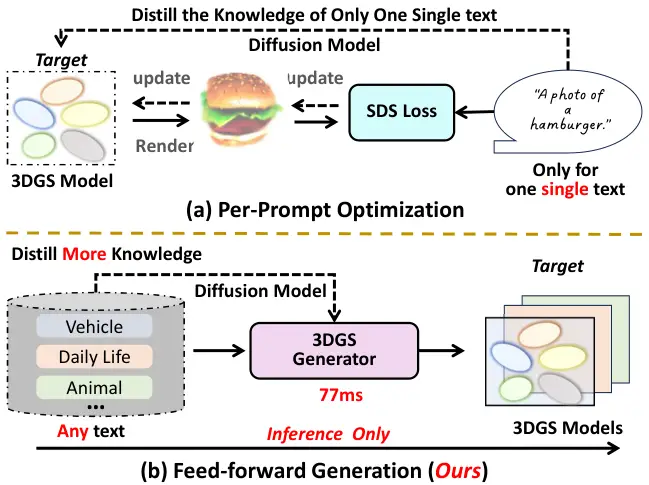

Figure 1: A comparison between per-prompt optimization-based methods,
and our feed-forward generation-based approach with an end-to-end
objective. (a) Optimization-based methods directly initialize a 3D
representation model, _e.g_. 3D Gaussian Splatting (GS). This process
usually suffers from slow per-sample optimization (_e.g_., several hours
for a single text). (b) By contrast, once trained, our approach directly
generates 3D content for any unseen text prompt in 77 ms with a single
run of a feed-forward of our generator.

## 1 Introduction

Text-to-3D generation has received considerable attention in the
computer graphics and vision community owing to its immersive potential
across diverse applications, such as virtual reality and video
gaming \[29\]. Recently, with the emergence of diffusion models \[17,
58\] and neural rendering techniques \[47, 26\], text-to-3D has
witnessed an unprecedented technical advancement. In particular,
pioneering methods, such as DreamFusion \[53\], LatentNeRF \[46\],
SJC \[69\], have sparked significant interest in the research community,
catalyzing a trend toward developing techniques for creating 3D assets
from texts. The follow-up methods then focus on either quality
improvement \[56, 62, 71, 37\] or geometry refinement \[8, 38\] or
training efficiency \[65, 88\].

The dominant paradigm of these methods is to randomly initialize a 3D
representation model, _e.g_., Neural Radiance Fields (NeRF) \[47\] or 3D
Gaussian Splatting (3D GS) \[26\], and optimize such a model to align
with a specific text prompt, as depicted in Fig. 1 (a). Unfortunately,
these methods suffer from two critical constraints. Firstly, as
per-prompt optimization usually requires several tens of thousands of
iterations, this inefficiency brings a considerable obstacle to broader
applications. It is significantly different from the mainstream training
paradigm in the field of 2D image generation \[63, 58, 57\] or 3D-aware
image generation \[61, 5, 20, 51, 6\]: a generative model is trained
with a collection of text-image pairs or images, and the model can
generate the desired content from any input at the inference stage.
Secondly, as shown in Fig. 2(a), existing methods often fail to
accurately process the complex texts. For example, the mainstream
methods struggle in generating 3D content that input prompt contains
complex interaction between multiple entities. This limitation arises
from the models being trained on a single text prompt, resulting in a
degraded capability in comprehensive semantic understanding.

Therefore, it is urgently needed for a paradigm shift from per-prompt
optimization to develop a generic text-to-3D generation framework. Once
trained, the generative framework should be able to generate content
from any text prompts in the inference stage, as depicted in Fig. 1(b).
Furthermore, given the scarcity of 3D data in comparison to the
abundance of 2D image data, leveraging well-trained 2D image diffusion
models to facilitate the training of 3D generative models presents a
more effective and resource-efficient approach. Previously, some
research efforts, _e.g_., ATT3D \[42\] and Instant3D \[33\], have been
made grounded in NeRF representation. The core insight is to add a large
number of texts and take them as conditional inputs to generate explicit
spatial representations, such as triplane \[6\]. Nonetheless, in stark
contrast to the volume rendering in NeRF, 3D GS representation for an
object usually consists of millions of 3D Gaussians. Consequently, there
exists an inherent and natural difficulty in converting the generation
representations into 3D GS ones in their framework.

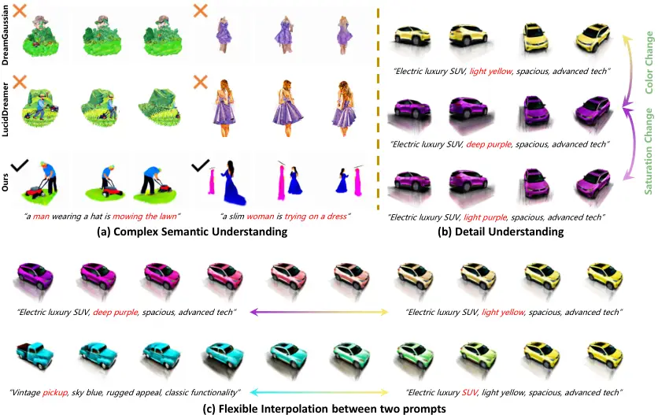

Figure 2: DreamGaussian \[65\] and LucidDreamer \[37\] are both
optimized for a single text. Our result is the direct generation. And
for the display of our generalization, all the prompts do not appear in
our training set. (a) is for showing the complex text understanding. (b)
is to demonstrate our capability of understanding details. It is
noteworthy that light purple, deep purple, and light yellow don’t appear
in the training set. (c) Interpolation between two prompts from color
and shape perspectives.

In this paper, we propose BrightDreamer, an end-to-end feed-forward
framework that, for the first time, can achieve generalizable and fast
(77 ms) text-to-3D GS generation. BrightDreamer exhibits a robust
ability for complex semantic understanding (Fig. 2 (a)), and it
demonstrates a substantial capacity for generalization (Fig. 2 (b)).
Additionally, like traditional generative models \[15\], our generator
can interpolate between two inputs (Fig. 2 (c)), allowing users to
unleash their imagination and creativity, thus expanding the potential
for novel and nuanced design exploration. As stated before, the 3D GS
representation of an object usually comprises several hundreds of
thousands of 3D GS elements. Thus, directly generating such a large
collection is impractical. Our key idea is to redefine this generation
problem as its equal problem, _i.e_., 3D shape deformation.
Specifically, we place and fix some anchor positions to form the initial
shape. Then, it can be deformed to the desired shape by giving different
input prompts through our designed Text-guided Shape Deformation (TSD)
network (Sec. 3.1). Then, the new positions can be set to the centers of
the 3D Gaussian. Upon establishing the basic shape, we elaborately
design a Text-guided Triplane Generator (TTG) to generate a spatial
representation of the 3D object (Sec. 3.2). Subsequently, we utilize the
spatial feature of each center of 3D Gaussian to represent its feature
and translate it into the remaining attributes (including scaling,
rotation, opacity, and SH coefficient) through our well-designed
Gaussian Decoder (Sec. 3.3). For TTG, based on our re-analysis of the
previous convolution-based triplane generation process, we identified
and solved two primary deficiencies. One issue involves the spatial
inhomogeneity observed during the calculation process, as shown in
Fig. 4. The other issue arises from the single-vector style control
mechanism similar to StyleGAN \[22\], which complicates managing
relationships between multiple entities.

Our contributions can be summarized as follows: (I) We propose
BrightDreamer, the first 3D Gaussian generative framework to achieve
generalizable and fast text-to-3D synthesis. (II) We design the
Text-guided Shape Deformation (TSD) network to simplify the difficulty
of direct generation of 3D Gaussians. We design the Text-guided Triplane
Generator (TTG) to generate the object’s spatial features and then
decode them as the 3D Gaussians. For TTG design, we re-analyze and solve
the existing problems in the mainstream triplane generator, including
spatial inhomogeneity and text understanding problems. (III) Extensive
experiments demonstrate that BrightDreamer not only can understand the
complex semantics (while the per-prompt optimization methods fail) but
also can utilize its generalization capability to achieve generation
control.

## 2 Related Works

Text-to-3D Generation. Existing methods can be grouped into two
categories. 1) Optimization-based methods typically commence with a
randomly initialized 3D model, such as NeRF \[47\], and subsequently
employ text-image priors \[54, 58\] to guide and optimize its
parameters. After undergoing thousands of iterative refinements, this
predefined 3D model progressively morphs to embody the shape described
by the corresponding text input. DreamField \[19\] represents the
inaugural foray into text-to-3D methodology, utilizing the pre-trained
text-image model, CLIP \[54\], as a guiding mechanism for the
optimization process of a predefined NeRF model. DreamFusion \[53\]
proposes the Score Distillation Sampling (SDS) to transfer the prior of
the 2D diffusion model \[17\] into a 3D representation model \[47, 50\],
which achieves impressive performance and ignites the research
enthusiastic for the text-to-3D task. Inspired by this, numerous
works \[71, 70, 37, 67, 89, 36, 30, 84, 75\] are devoted to re-designing
the SDS loss, enabling much more local details of the 3D model.
MVDream \[62\] and PerpNeg \[2\] attempt to solve the Janus problem,
_i.e_., multi-face problem in some text prompts. Though these methods
have great generalizability, it usually needs several hours to optimize
a 3D model. 2) Generation-based methods, by contrast, aim to directly
generate a 3D model from a given text, streamlining the process of
text-to-3D generation. ATT3D \[42\] is the first attempt to train a NeRF
model with multiple texts by SDS. Though its generalizability is
limited, benefitting from SDS, the rendered image is better than
previous methods \[59, 7, 14, 41\] and the generated content is not
limited to 3D data \[48, 60\]. Instant3D \[33\] designs some modules to
map the text input to the EG3D model \[6\] and then uses SDS to train
this model. Concurrently, there are also some works focusing on
text-to-image-to-3D model route \[80, 66, 43, 73, 78, 72, 39, 85, 18,
93, 31, 16, 79\]. However, due to the limited amount of 3D datasets, it
is extremely hard to train a generic model to implement this target well
(Sec. 4.3.4). Different from the mentioned works, we propose
BrightDreamer, a generic framework that, for the first time, can achieve
fast (77 ms) direct text-to-3DGS generation. Moreover, our method
doesn’t depend on 3D data, which shows a greater potential.

3D Gaussian Splatting (GS). Recently, 3D GS \[26\] has emerged as the
leading method for 3D representation method of 3D objects or scenes,
offering faster rendering speeds and greater application potential than
NeRF \[47\]. In a short time, a large number of methods have been
proposed to leverage 3D GS for diverse tasks, _e.g_., anti-aliasing
novel view synthesis \[90, 83\], SLAM \[82, 25, 45, 91\], human
reconstruction \[34, 49, 28, 1, 32, 40\], dynamic scene
reconstruction \[44, 86, 74, 87, 81\], and 3D content generation \[77,
10, 65, 88, 35, 37\]. Our work builds on 3D GS, aiming to develop a
generic text-to-3D generation framework that can generate 3D GS with low
latency (77 ms).

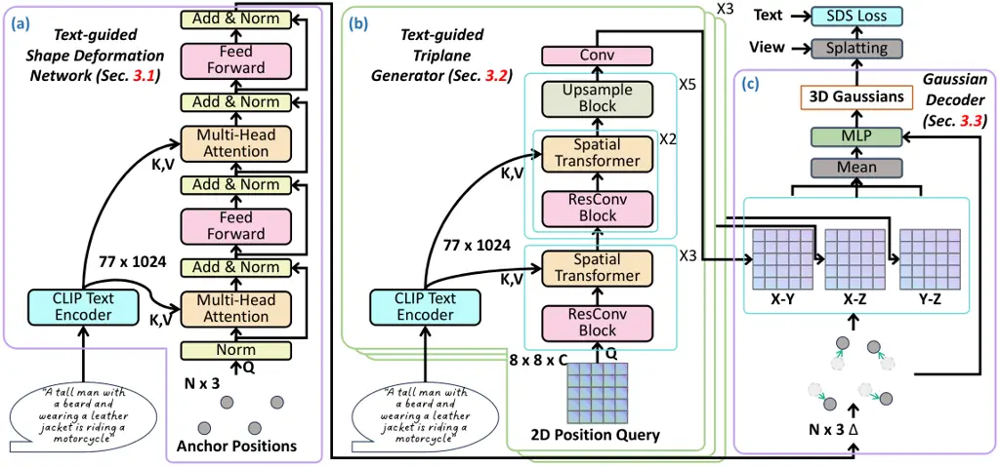

Figure 3: An overview of BrightDreamer. The details of Spatial
Transformer, ResConv Block and Upsample Block are shown in Fig. 5.

## 3 Method

Overview. BrightDreamer aims to generate 3D Gaussians directly from text
prompts. After training, it can generate the 3D GS model with a
remarkably low generation latency (about 77ms). And, the generated 3D
Gaussians can be rendered at an impressive inference speed of over 700
frames per second. Each 3D Gaussian is defined by five attributes:
center $`p^{\prime}`$, scaling $`S`$, rotation $`R`$, opacity
$`\alpha`$, and SH coefficient $`SH`$. Our key idea is two-fold: 1)
Defining anchor positions, _i.e_., predefined positions, to estimate the
center of 3D Gaussians; 2) Building implicit spatial representation,
which can be decomposed to estimate the other four attributes of 3D
Gaussians.

Intuitively, we propose BrightDreamer, and an overview is depicted in
Fig. 3. Given a text prompt as input, we transform it to a
$`77\times 1024`$ embedding through the frozen CLIP text encoder. Next,
the TSD network (Sec. 3.1) transforms the fixed anchor positions to the
desired shape with text guidance. The new positions are used as the
centers of 3D Gaussians. We then design the TTG (Sec. 3.2) to separately
generate three feature planes to construct the implicit spatial
representation. Based on the centers of Gaussians, we can obtain their
spatial features, which are then transferred to the other attributes
through the Gaussian Decoder (Sec. 3.3). Finally, we render 3D Gaussians
to 2D images and use the SDS Loss \[53\] to optimize the whole
framework. We now describe our BrightDreamer in detail.

### 3.1 Text-guided Shape Deformation (TSD)

The goal of TSD is to obtain the center (one attribute) of each 3D
Gaussian. Considering that directly outputting a huge number of center
coordinates is extremely difficult, we overcome this hurdle by deforming
the anchor positions instead of generating them.

Anchor Position. The anchor positions are predefined positions, which
are the fixed coordinates. It serves as one of the inputs for the TSD.
Specifically, we place the anchor positions on the vertices of a 3D
grid, as represented by the gray points in Fig. 3. Then, we design the
TSD network to predict their deviation to deform the initialized shape
of the 3D grid, guided by the text prompt input.

Network Design. As shown in Fig. 3 (a), the inputs of TSD are text
prompts and anchor positions. Firstly, the text prompts are encoded as
the text embedding by an off-the-shelf text encoder, _e.g_., CLIP \[54\]
or T5 \[55\]. Considering the possibility of the complex input sentence,
it remains non-trivial how to bridge each position and word in the
sentence. The cross-attention \[68\] can quantify the correlation degree
between each point and each word within a sentence. We then employ the
cross-attention to design a module to obtain the deviation from the
anchor position. It consists of the Layer Normalization \[3\],
Multi-Head Attention, Feed-Forward Network, and shortcut
connection \[68\]. Consequently, certain positions, correlating more
closely with corresponding words in the sentence, are assigned with
higher attention scores. This process enables the aggregation of
features that more accurately reflect the characteristics of the
corresponding words. The detailed computation process is formulated as
follows:

```math
\displaystyle output=FFN(softmax(\frac{W_{Q}(p)W_{K}(y)}{\sqrt{d}})\cdot W_{V}(y)), \tag{1}
```

where $`p\in\mathbb{R}^{3}`$ is the 3D coordinate of the anchor
position, $`y\in\mathbb{R}^{77\times 1024}`$ is the text embedding of
the input prompt, 77 and 1024 are the sentence length and the embedding
dimension, $`W_{Q}(\cdot)`$, $`W_{K}(\cdot)`$ and $`W_{V}(\cdot)`$ are
the query, key, value transformation function, $`d`$ is the feature
dimension, $`FFN(\cdot)`$ is the feed-forward network. The output of the
TSD network is the offset $`\Delta\in\mathbb{R}^{3}`$ of the anchor
positions. To ensure the stability of the training, we control the
maximum extent to which a point can deviate from the anchor position.
Specifically, given the degree of freedom $`\beta\in\mathbb{R}`$, we use
the following equation to adjust the range of output into interval
$`(-\beta,\beta)`$:

```math
\Delta=2\cdot\beta\cdot sigmoid(output)-\beta. \tag{2}
```

Finally, the deformed position $`p^{\prime}\in\mathbb{R}^{3}`$, which
represents the centers of 3D Gaussian corresponding to input prompt, is
formulated as follows:

```math
p^{\prime}=p+\Delta. \tag{3}
```

### 3.2 Text-guided Triplane Generator (TTG)

After determining the centers of the 3D Gaussians, we need to obtain the
other four attributes. To efficiently assign features to each Gaussian,
the objective of TTG is to generate an implicit spatial representation
in space, represented by the triplane. Thus, we design a novel and
highly efficient triplane generator that takes text prompts as input.

One challenge is that the previous triplane generation approaches, such
as EG3D \[6\] and Instant3D \[33\], exhibit the problem of spatial
inhomogeneity, as shown in Fig. 4. Since they directly segment a feature
map into three feature maps along the channel dimension, only a few
areas are computed together. For example, the position (0, 0) in the 2D
space is unfolded to (0, 0, :), (0, :, 0), and (:, 0, 0), denoted by
blue color in Fig. 4. Taking $`1\times 1`$ Conv as an example, only
these three areas are calculated together. On the contrary, (0, 0, :) is
hardly possible to be calculated with (0, :, 1), because they do not
appear at the same pixel in the 2D feature map. The same applies to the
$`3\times 3`$ Conv. This means that only a few areas share the same
spatial information, while the others do not, thus causing spatial
inhomogeneity. For this, a simple yet effective way is to apply three
generators (without sharing weights).

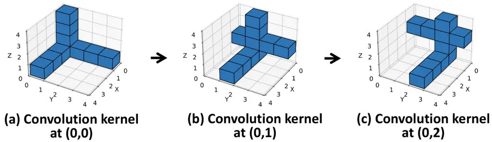

Figure 4: The visualization of expanding 2D convolution kernel (blue
area) to 3D and its moving process in previous convolutional triplane
generator \[6\]. We use $`1\times 1`$ convolutional kernel as an
example. Only several positions are interacted, which leads to spatial
inhomogeneous.

Another challenge is that given the complex prompts, squeezing a
sentence into a single style feature vector to apply AdaIN \[22, 23,
24\] could result in a loss of local details. Therefore, we need a more
fine-grained generation method guided by the word level, thus can retain
more information of text encoder trained on large-scale dataset.
Naturally, calculating cross-attention between the pixels of the feature
map and words in the sentence is a better choice.

To address these two challenges, we design the Text-guided Triplane
Generator (TTG), as shown in Fig. 3 (b). Our TTG is designed with the
inspiration from the spatial transformer block and residual
convolutional block in Stable Diffusion \[58\]. Considering the
increased computational demand associated with pixel-wise self-attention
in the feature map of \[58\], we do not incorporate this layer into our
network. Instead, we find that interleaved convolutional layers can
sufficiently facilitate the interaction within the feature map. The
detailed designs are shown in Fig. 5. For the whole pipeline, we first
initialize a 2D input query according to its 2D trigonometric function
position encoding. Three ResConv Blocks and Spatial Transformer blocks
are stacked to assemble the prompt word features at low resolution
through cross-attention. We then gradually increase the resolution of
the feature map through the stacks of ResConv Blocks, Spatial
Transformer blocks, and Upsample Block by five times, as depicted in
Fig. 3 (b). Finally, we use a Conv layer to output the plane feature. We
describe the design of the Spatial Transformer block, ResConv block, and
Upsample block in detail.

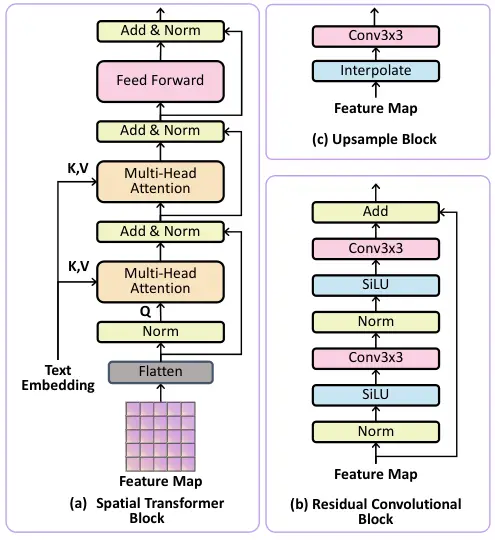

Figure 5: A detailed illustration of specific blocks. (a) Spatial
Transformer Block. (b) Residual Convolutional Block. (c) Upsample Bock.

Spatial Transformer Block. As Fig. 5 (a) shows, the Spatial Transformer
Block comprises two multi-head cross-attention modules and a
feed-forward network \[68\]. The process is initiated by flattening the
2D feature map into a 1D structure, thereby transforming the dimensions
from $`(H,W,C)`$ to $`(H\times W,C)`$, with each pixel’s feature
considered as the input query embedding. Subsequent to this
transformation, the features undergo normalization via Layer
Normalization \[3\]. The normalized features serve as queries, while the
text embeddings act as keys and values in the computation of the
cross-attention feature. This cross-modality attention mechanism is
designed to align the feature map with the corresponding words in the
input sentence. Following the application of two cross-attention
modules, the features are further refined through a feed-forward
network. This sequence of operations also incorporates the use of skip
connections, mirroring the original transformer architecture \[68\], to
facilitate effective feature processing and integration.

ResConv Block. As shown in Fig. 5 (b), the Residual Convolutional Block
includes a Layer Normalization layer, a SiLU activation function \[12\],
and $`3\times 3`$ convolutional layers, with the skip connection between
input and output.

Upsample Block. As depicted in Fig. 5 (c), the Upsample Block begins
with interpolating the feature map to enlarge it by a factor of
$`2\times`$, followed by processing through a $`3\times 3`$
convolutional layer.

### 3.3 3D Gaussians Decoder

We aim to obtain four additional attributes of 3D Gaussian necessary for
generation. Once the triplane, consisting of the three feature planes
$`\pi_{xy}`$, $`\pi_{xz}`$, $`\pi_{yz}`$, is generated, we can obtain
the feature vector $`\mathcal{F}\in\mathbb{R}^{32}`$ of each Gaussian
based on its center $`p^{\prime}`$. This feature vector is then
converted into the additional attributes, including opacity
$`\alpha\in\mathbb{R}`$, scaling $`S\in\mathbb{R}^{3}`$, rotation
$`R\in\mathbb{R}^{4}`$, and SH coefficient.

Specifically, we first project the 3D coordinate onto three planes, X-Y,
X-Z, and Y-Z. Based on the projected 2D coordinates, we can derive the
features $`\mathcal{F}_{xy}`$, $`\mathcal{F}_{xz}`$,
$`\mathcal{F}_{yz}`$ according to the interpolation with their four
vertex in the 2D feature maps. To ensure the gradient back-propagation
is evenly distributed across all three planes, we utilize an averaging
operation to aggregate these features, thereby obtaining the 3D
Gaussian’s feature $`\mathcal{F}`$. Given that the attributes of 3D
Gaussian can be categorized into two groups, _i.e_., shape and color, we
develop two distinct transformation modules $`F_{shape}`$ and
$`F_{color}`$. Each module is a lightweight, two-layer Multi-Layer
Perceptron (MLP) network. To enhance the gradient back-propagation to
the TSD, the center of 3D Gaussian $`p^{\prime}`$ is additionally
inputted into both modules:

```math
\alpha,S,R=F_{shape}(\mathcal{F},p^{\prime}),\;SH=F_{color}(\mathcal{F},p^{\prime}). \tag{4}
```

In the training process, we observe the scaling $`S`$ is not a stable
variation, and the memory consumption of 3D Gaussian rendering is
extremely sensitive to it. Therefore, we use the following equation to
control it to interval $`(a,b)`$:

```math
S=(b-a)\cdot sigmoid(S)+a. \tag{5}
```

Upon obtaining all attributes of 3D Gaussian, our generation process is
completed. We can render it from arbitrary view direction to 2D images.

### 3.4 Optimization

Our training commences with the selection of $`B`$ prompts from the
training set. These prompts are then fed into our 3D Gaussians
generator, which is tasked with generating the corresponding 3D GS
representation of the objects. Following this, we proceed to randomly
sample $`C`$ view directions to render $`C`$ 2D images. The
$`B\times C`$ rendered images are supervised through the Score
Distillation Sampling (SDS) loss function \[53\], as Eq. 6 shows, in
conjunction with the Perp-Neg \[2\]. In this way, our generator can
gradually construct a mapping relationship between text and 3D.

```math
\displaystyle\nabla_{\theta}\mathcal{L}(\phi,\mathbf{x}=g_{\theta}(y))\triangleq\mathbb{E}_{t,\epsilon}\left[w(t)\left(\hat{\epsilon}_{\phi}\left(\mathbf{z}_{t};y^{\prime},t\right)\!-\epsilon\right)\!\frac{\partial\mathbf{x}}{\partial\theta}\right], \tag{6}
```

where $`y`$ is the input prompt embedding of the generator, $`\theta`$
denotes the trainable parameters of 3D Gaussians generator, $`\phi`$
denotes the parameters of denoising network, $`x`$ is the generated
image by process $`g_{\theta}(\cdot)`$, $`w(t)`$ is the weighting
function with time step $`t`$ in the denoising schedule, $`\epsilon`$ is
the random noise, $`z_{t}`$ is the noisy latents encoded from $`x`$,
$`y`$ is the input prompt, and $`y^{\prime}`$ adjusted text according to
the sampling view direction, $`\hat{\epsilon}_{\phi}(\cdot)`$ is the
predicted noise.

## 4 Experiments

This section first outlines the implementation details, inference speed,
parameter count, and training dataset. The following comparison
experiments focus on four aspects: (I) comparison with per-prompt
text-to-3DGS, (II) fine-tuning the generated 3DGS model and then
comparing with per-prompt text-to-3DGS, (III) comparison with amortized
text-to-NeRF, (IV) comparison with text-to-image-to-3DGS methods.
Finally, we present interesting findings regarding unseen words and
conduct ablation studies to validate the network design. It’s worth
noting that all prompts in the experiments don’t appear in the training
dataset.

### 4.1 Implementation Details

Our codebase is constructed on the PyTorch framework \[52\] with
Automatic Mixed Precision Training (AMP) and Gradient Checkpointing
technology \[9\]. We use the Adam optimizer \[27\] with a constant
learning rate of $`5\times{10}^{-5}`$, $`\beta_{1}`$ of $`0.9`$ and
$`\beta_{2}`$ of $`0.99`$. We train our generator using the DeepFloyd
IF \[64\] UNet to calculate the SDS Loss (Eq. 6). The prompt batch size
is set to $`64`$ and the camera batch size is set to $`4`$. All our
experiments are conducted on a server with 8 GPUs with 80GB memory. We
set the freedom $`\beta`$ (Eq. 2) to $`0.2`$, and the range of scaling
$`(a,b)`$ (Eq. 5) to $`(-9,-3)`$. The anchor position is placed as a
$`64^{3}`$ 3D grid, and the resolution of the generated triplane is
$`256\times 256`$. The generator is trained on a single prompt set
including vehicle, daily life, and animal descriptions. We provide the
training pseudo code in supplementary materials.

### 4.2 Demonstration of BrightDreamer

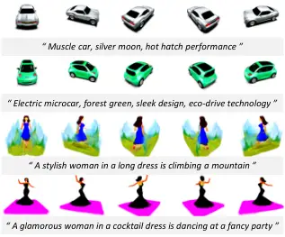

Figure 6: Generation Demonstration. All prompts do not appear in the
training set.

|               |                    |                 |
| ------------- | ------------------ | --------------- |
| Device        | Generation Latency | Rendering Speed |
| RTX 3090 24GB | 79 ms              | 698 FPS         |
| A800 80GB     | 77 ms              | 705 FPS         |

Table 1: The generation latency (millisecond) and rendering speed (FPS,
Frames Per Second).

We show some results in Fig. 6. All prompts don’t appear in the training
set. We also show much more results in supplementary material. In
Tab. 1, we show the inference latency on a single A800 GPU and a single
RTX3090 GPU, which shows a large margin improvement, compared to
optimization-based methods, which need several hours. Our generator
contains about 500M trainable parameters.

### 4.3 Comparison with other methods

We compare our method with previous text-to-3DGS methods. The comparison
experiments setting includes four aspects: (I) comparison with
per-prompt text-to-3DGS, including DreamGaussian \[65\], GSGEN \[10\]
and LucidDreamer \[37\] (II) fine-tuning the generated 3DGS model, and
then compare with per-prompt text-to-3DGS, (III) comparison with
amortized text-to-NeRF, including Instant3D \[33\], (IV) comparison with
text-to-image-to-3DGS methods, including LGM \[66\] and GRM \[80\].
Besides, we present the quantitative results of human preference.

#### 4.3.1 Per-prompt Text-to-3DGS

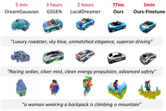

Figure 7: Comparison with per-prompt optimization methods.

We select the current SoTA open-source text-to-3DGS methods, including
DreamGaussian \[65\], GSGEN \[10\] and LucidDreamer \[37\] for
comparison. In this setting, we directly input the text prompt to
BrightDreamer and use the same prompt to optimize the 3D GS model in
other methods. As shown in the first four columns of Fig. 7, the other
methods are hard to generate semantic-aligned 3D GS models from complex
text prompts, primarily due to their limited capability in comprehending
intricate text inputs. A similar conclusion can be found in the
works \[21, 92, 11, 4, 13\]. It is hard to optimize a 3D GS model for a
prompt containing multiple objects. Our method, trained across a diverse
distribution of multiple text prompts, exhibits a robust capability to
comprehend complex prompts effectively.

#### 4.3.2 Quickly Finetuning after generation

We demonstrate that the 3D GS model generated by BrightDreamer can be
efficiently fine-tuned using per-prompt optimization methods to enhance
quality. Specifically, we use the ISM \[37\] loss to optimize the
generated 3D GS model for several hundred iterations. As evidenced in
the last column of Fig. 7, the third and sixth columns of Fig. 8, the
model’s quality of details significantly improves within just several
minutes.

#### 4.3.3 Amortized Text-to-NeRF

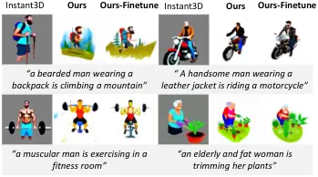

Figure 8: Comparison with amortized text-to-NeRF method.

We compare BrightDreamer with SoTA open-source amortized Text-to-NeRF
methods, Instant3D \[33\]. It is worth noting that our method is the
first amortized Text-to-3DGS method. Moreover, our method inherits
numerous advantages of 3D GS over NeRF. Since ATT3D \[42\] and
Latte3D \[76\] don’t open their code and demo, we don’t compare with
them. As shown in Fig. 8, our semantic alignment is better. Furthermore,
benefiting from the training efficiency of 3D GS, we can quickly
fine-tune the generated 3D GS model to enhance the details.

#### 4.3.4 Text-to-image-to-3DGS

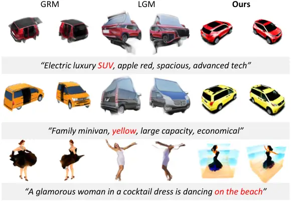

Figure 9: Comparison with text-to-image-to-3DGS methods.

Besides the direct generation of text-to-3DGS, alternative methods also
exist to achieve this goal. For instance, LGM \[66\] and GRM \[80\]
first generate the reference images using a text-to-image diffusion
model, followed by the creation of a 3D model from these images.
However, since the second phase of image-to-3DGS is trained on the
limited 3D dataset, it is hard for them to generate the 3D GS models for
complex prompt input. As shown in Fig. 9, we demonstrate the comparison
result. Furthermore, since these methods require an intermediate image
generation step, they are considerably slower than our BrightDreamer
approach.

#### 4.3.5 Quantitative Comparison

|            |                  |                     |       |
| ---------- | ---------------- | ------------------- | ----- |
| Method     | Instant3D \[33\] | LucidDreamer \[37\] | Ours  |
| Preference | 37.3%            | 7.2%                | 55.4% |

Table 2: Human Preference.

As shown in Tab. 2, we provide the percentage numerical comparison of
human preference choice. We present participants with five rendered
videos along with the corresponding text prompts generated by five
baseline models, allowing them to select their preferred option for each
case. Most of the users expressed a preference for the content generated
by our model.

### 4.4 Discussion about Generalizability

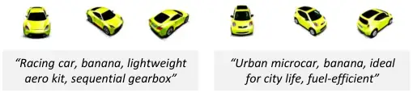

Figure 10: Demonstration of word-level generalizability. The word
“banana” never appears in the training set.

Beyond sentence-level generalizability, our findings indicate that
BrightDreamer can also correctly interpret some unseen words. As
demonstrated in Fig. 10, although the word ”banana” is absent from our
training dataset, BrightDreamer successfully identifies its color. This
capability not only suggests a potential for broad word-level
generalizability but also confirms that BrightDreamer effectively learns
the mapping from text distribution to 3D GS distributions.

### 4.5 Ablation Studies

As shown in Fig. 11, we validate our network design for training.
Compared between Fig. 11 (a) and Fig. 11 (b), our divided triplane
generator can reduce the degree of chaos in the space significantly,
which shows the necessity of our division. As Fig. 11 (a) and Fig. 11
(c) demonstrate, it is necessary to pass the coordinate into the
$`F_{shape}`$ and $`F_{color}`$. This design can construct a gradient
pathway toward the TSD Network, ensuring more accurate shape
formulation.

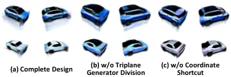

Figure 11: Ablation studies. All models are trained for 10,000
iterations (incomplete training) with the same configuration: (a) Our
complete design, (b) Single generator replacing three separate
generators, (c) Coordinate input removed from $`F_{shape}`$ and
$`F_{color}`$.

## 5 Conclusion

In this paper, we introduce the first text-driven 3D Gaussians
generative framework, BrightDreamer, capable of generating 3D Gaussians
within a remarkably low latency of 77ms. To efficiently generate
millions of 3D Gaussians, we innovatively deform anchor positions and
use these new positions as centers based on the input prompt. This
approach successfully overcomes the challenge of generating a large
number of positions. Regarding network architecture, we thoroughly
reevaluate the triplane generation process and introduce an improved
alternative strategy. Our key contribution is to greatly enhance the
generalized 3D generation, offering a novel and efficient way to create
3D assets from text prompts instantly. Extensive experiments demonstrate
that BrightDreamer possesses strong semantic understanding and
generalization abilities. Due to the limited 3D data, developing methods
based on 2D diffusion is an important direction.

Future work. The spatial resolution of the generated 3D model is
relatively low, resulting in the lack of fine-grained detail. Besides,
since the LGM \[66\] and GRM \[80\] can generate highly detailed
single-object 3D GS models while our method can generate semantic-rich
3D GS models, developing a method that combines these two advantages is
an interesting research direction.

## References

- \[1\] Rameen Abdal, Wang Yifan, Zifan Shi, Yinghao Xu, Ryan Po,
  Zhengfei Kuang, Qifeng Chen, Dit-Yan Yeung, and Gordon Wetzstein.
  Gaussian shell maps for efficient 3d human generation. _arXiv preprint
  arXiv:2311.17857_, 2023.
- \[2\] Mohammadreza Armandpour, Huangjie Zheng, Ali Sadeghian, Amir
  Sadeghian, and Mingyuan Zhou. Re-imagine the negative prompt
  algorithm: Transform 2d diffusion into 3d, alleviate janus problem and
  beyond. _arXiv preprint arXiv:2304.04968_, 2023.
- \[3\] Jimmy Lei Ba, Jamie Ryan Kiros, and Geoffrey E Hinton. Layer
  normalization. _arXiv preprint arXiv:1607.06450_, 2016.
- \[4\] Haotian Bai, Yuanhuiyi Lyu, Lutao Jiang, Sijia Li, Haonan Lu,
  Xiaodong Lin, and Lin Wang. Componerf: Text-guided multi-object
  compositional nerf with editable 3d scene layout. _arXiv preprint
  arXiv:2303.13843_, 2023.
- \[5\] Eric R Chan, Marco Monteiro, Petr Kellnhofer, Jiajun Wu, and
  Gordon Wetzstein. pi-gan: Periodic implicit generative adversarial
  networks for 3d-aware image synthesis. In _Proceedings of the IEEE/CVF
  conference on computer vision and pattern recognition_, pages
  5799–5809, 2021.
- \[6\] Eric R Chan, Connor Z Lin, Matthew A Chan, Koki Nagano, Boxiao
  Pan, Shalini De Mello, Orazio Gallo, Leonidas J Guibas, Jonathan
  Tremblay, Sameh Khamis, et al. Efficient geometry-aware 3d generative
  adversarial networks. In _Proceedings of the IEEE/CVF Conference on
  Computer Vision and Pattern Recognition_, pages 16123–16133, 2022.
- \[7\] Kevin Chen, Christopher B Choy, Manolis Savva, Angel X Chang,
  Thomas Funkhouser, and Silvio Savarese. Text2shape: Generating shapes
  from natural language by learning joint embeddings. In _Computer
  Vision–ACCV 2018: 14th Asian Conference on Computer Vision, Perth,
  Australia, December 2–6, 2018, Revised Selected Papers, Part III 14_,
  pages 100–116. Springer, 2019.
- \[8\] Rui Chen, Yongwei Chen, Ningxin Jiao, and Kui Jia. Fantasia3d:
  Disentangling geometry and appearance for high-quality text-to-3d
  content creation. _arXiv preprint arXiv:2303.13873_, 2023a.
- \[9\] Tianqi Chen, Bing Xu, Chiyuan Zhang, and Carlos Guestrin.
  Training deep nets with sublinear memory cost. _arXiv preprint
  arXiv:1604.06174_, 2016.
- \[10\] Zilong Chen, Feng Wang, and Huaping Liu. Text-to-3d using
  gaussian splatting. _arXiv preprint arXiv:2309.16585_, 2023b.
- \[11\] Xinhua Cheng, Tianyu Yang, Jianan Wang, Yu Li, Lei Zhang, Jian
  Zhang, and Li Yuan. Progressive3d: Progressively local editing for
  text-to-3d content creation with complex semantic prompts. In _The
  Twelfth International Conference on Learning Representations_.
- \[12\] Stefan Elfwing, Eiji Uchibe, and Kenji Doya. Sigmoid-weighted
  linear units for neural network function approximation in
  reinforcement learning. _Neural networks_, 107:3–11, 2018.
- \[13\] Dave Epstein, Ben Poole, Ben Mildenhall, Alexei A Efros, and
  Aleksander Holynski. Disentangled 3d scene generation with layout
  learning. In _Forty-first International Conference on Machine
  Learning_.
- \[14\] Rao Fu, Xiao Zhan, Yiwen Chen, Daniel Ritchie, and Srinath
  Sridhar. Shapecrafter: A recursive text-conditioned 3d shape
  generation model. _Advances in Neural Information Processing Systems_,
  35:8882–8895, 2022.
- \[15\] Ian Goodfellow, Jean Pouget-Abadie, Mehdi Mirza, Bing Xu, David
  Warde-Farley, Sherjil Ozair, Aaron Courville, and Yoshua Bengio.
  Generative adversarial nets. _Advances in neural information
  processing systems_, 27, 2014.
- \[16\] Hao He, Yixun Liang, Luozhou Wang, Yuanhao Cai, Xinli Xu,
  Hao-Xiang Guo, Xiang Wen, and Yingcong Chen. Lucidfusion: Generating
  3d gaussians with arbitrary unposed images. _arXiv preprint
  arXiv:2410.15636_, 2024.
- \[17\] Jonathan Ho, Ajay Jain, and Pieter Abbeel. Denoising diffusion
  probabilistic models. _Advances in neural information processing
  systems_, 33:6840–6851, 2020.
- \[18\] Yicong Hong, Kai Zhang, Jiuxiang Gu, Sai Bi, Yang Zhou, Difan
  Liu, Feng Liu, Kalyan Sunkavalli, Trung Bui, and Hao Tan. Lrm: Large
  reconstruction model for single image to 3d. _arXiv preprint
  arXiv:2311.04400_, 2023.
- \[19\] Ajay Jain, Ben Mildenhall, Jonathan T Barron, Pieter Abbeel,
  and Ben Poole. Zero-shot text-guided object generation with dream
  fields. In _Proceedings of the IEEE/CVF Conference on Computer Vision
  and Pattern Recognition_, pages 867–876, 2022.
- \[20\] Lutao Jiang, Ruyi Ji, and Libo Zhang. Sdf-3dgan: A 3d object
  generative method based on implicit signed distance function. _arXiv
  preprint arXiv:2303.06821_, 2023.
- \[21\] Lutao Jiang, Hangyu Li, and Lin Wang. A general framework to
  boost 3d gs initialization for text-to-3d generation by lexical
  richness. In _Proceedings of the 32nd ACM International Conference on
  Multimedia_, pages 6803–6812, 2024.
- \[22\] Tero Karras, Samuli Laine, and Timo Aila. A style-based
  generator architecture for generative adversarial networks. In
  _Proceedings of the IEEE/CVF conference on computer vision and pattern
  recognition_, pages 4401–4410, 2019.
- \[23\] Tero Karras, Samuli Laine, Miika Aittala, Janne Hellsten,
  Jaakko Lehtinen, and Timo Aila. Analyzing and improving the image
  quality of stylegan. In _Proceedings of the IEEE/CVF conference on
  computer vision and pattern recognition_, pages 8110–8119, 2020.
- \[24\] Tero Karras, Miika Aittala, Samuli Laine, Erik Härkönen, Janne
  Hellsten, Jaakko Lehtinen, and Timo Aila. Alias-free generative
  adversarial networks. _Advances in Neural Information Processing
  Systems_, 34:852–863, 2021.
- \[25\] Nikhil Keetha, Jay Karhade, Krishna Murthy Jatavallabhula,
  Gengshan Yang, Sebastian Scherer, Deva Ramanan, and Jonathon Luiten.
  Splatam: Splat, track & map 3d gaussians for dense rgb-d slam. _arXiv
  preprint arXiv:2312.02126_, 2023.
- \[26\] Bernhard Kerbl, Georgios Kopanas, Thomas Leimkühler, and George
  Drettakis. 3d gaussian splatting for real-time radiance field
  rendering. _ACM Transactions on Graphics_, 42(4), 2023.
- \[27\] Diederik P Kingma and Jimmy Ba. Adam: A method for stochastic
  optimization. _arXiv preprint arXiv:1412.6980_, 2014.
- \[28\] Muhammed Kocabas, Jen-Hao Rick Chang, James Gabriel, Oncel
  Tuzel, and Anurag Ranjan. Hugs: Human gaussian splats. _arXiv preprint
  arXiv:2311.17910_, 2023.
- \[29\] Chenghao Li, Chaoning Zhang, Atish Waghwase, Lik-Hang Lee,
  Francois Rameau, Yang Yang, Sung-Ho Bae, and Choong Seon Hong.
  Generative ai meets 3d: A survey on text-to-3d in aigc era. _arXiv
  preprint arXiv:2305.06131_, 2023a.
- \[30\] Hangyu Li, Xiangxiang Chu, and Dingyuan Shi. Dreamcouple:
  Exploring high quality text-to-3d generation via rectified flow.
  _arXiv preprint arXiv:2408.05008_, 2024a.
- \[31\] Jiahao Li, Hao Tan, Kai Zhang, Zexiang Xu, Fujun Luan, Yinghao
  Xu, Yicong Hong, Kalyan Sunkavalli, Greg Shakhnarovich, and Sai Bi.
  Instant3d: Fast text-to-3d with sparse-view generation and large
  reconstruction model. _arXiv preprint arXiv:2311.06214_, 2023b.
- \[32\] Mingwei Li, Jiachen Tao, Zongxin Yang, and Yi Yang. Human101:
  Training 100+ fps human gaussians in 100s from 1 view. _arXiv preprint
  arXiv:2312.15258_, 2023c.
- \[33\] Ming Li, Pan Zhou, Jia-Wei Liu, Jussi Keppo, Min Lin, Shuicheng
  Yan, and Xiangyu Xu. Instant3d: Instant text-to-3d generation, 2023d.
- \[34\] Mengtian Li, Shengxiang Yao, Zhifeng Xie, Keyu Chen, and
  Yu-Gang Jiang. Gaussianbody: Clothed human reconstruction via 3d
  gaussian splatting. _arXiv preprint arXiv:2401.09720_, 2024b.
- \[35\] Xinhai Li, Huaibin Wang, and Kuo-Kun Tseng. Gaussiandiffusion:
  3d gaussian splatting for denoising diffusion probabilistic models
  with structured noise. _arXiv preprint arXiv:2311.11221_, 2023e.
- \[36\] Zongrui Li, Minghui Hu, Qian Zheng, and Xudong Jiang.
  Connecting consistency distillation to score distillation for
  text-to-3d generation. In _European Conference on Computer Vision_,
  pages 274–291. Springer, 2025.
- \[37\] Yixun Liang, Xin Yang, Jiantao Lin, Haodong Li, Xiaogang Xu,
  and Yingcong Chen. Luciddreamer: Towards high-fidelity text-to-3d
  generation via interval score matching. _arXiv preprint
  arXiv:2311.11284_, 2023.
- \[38\] Chen-Hsuan Lin, Jun Gao, Luming Tang, Towaki Takikawa, Xiaohui
  Zeng, Xun Huang, Karsten Kreis, Sanja Fidler, Ming-Yu Liu, and
  Tsung-Yi Lin. Magic3d: High-resolution text-to-3d content creation. In
  _Proceedings of the IEEE/CVF Conference on Computer Vision and Pattern
  Recognition_, pages 300–309, 2023.
- \[39\] Minghua Liu, Chong Zeng, Xinyue Wei, Ruoxi Shi, Linghao Chen,
  Chao Xu, Mengqi Zhang, Zhaoning Wang, Xiaoshuai Zhang, Isabella Liu,
  et al. Meshformer: High-quality mesh generation with 3d-guided
  reconstruction model. _arXiv preprint arXiv:2408.10198_, 2024.
- \[40\] Xian Liu, Xiaohang Zhan, Jiaxiang Tang, Ying Shan, Gang Zeng,
  Dahua Lin, Xihui Liu, and Ziwei Liu. Humangaussian: Text-driven 3d
  human generation with gaussian splatting. _arXiv preprint
  arXiv:2311.17061_, 2023.
- \[41\] Zhengzhe Liu, Yi Wang, Xiaojuan Qi, and Chi-Wing Fu. Towards
  implicit text-guided 3d shape generation. In _Proceedings of the
  IEEE/CVF Conference on Computer Vision and Pattern Recognition_, pages
  17896–17906, 2022.
- \[42\] Jonathan Lorraine, Kevin Xie, Xiaohui Zeng, Chen-Hsuan Lin,
  Towaki Takikawa, Nicholas Sharp, Tsung-Yi Lin, Ming-Yu Liu, Sanja
  Fidler, and James Lucas. Att3d: Amortized text-to-3d object synthesis.
  _arXiv preprint arXiv:2306.07349_, 2023.
- \[43\] Yuanxun Lu, Jingyang Zhang, Shiwei Li, Tian Fang, David
  McKinnon, Yanghai Tsin, Long Quan, Xun Cao, and Yao Yao. Direct2. 5:
  Diverse text-to-3d generation via multi-view 2.5 d diffusion. In
  _Proceedings of the IEEE/CVF Conference on Computer Vision and Pattern
  Recognition_, pages 8744–8753, 2024.
- \[44\] Jonathon Luiten, Georgios Kopanas, Bastian Leibe, and Deva
  Ramanan. Dynamic 3d gaussians: Tracking by persistent dynamic view
  synthesis. _arXiv preprint arXiv:2308.09713_, 2023.
- \[45\] Hidenobu Matsuki, Riku Murai, Paul HJ Kelly, and Andrew J
  Davison. Gaussian splatting slam. _arXiv preprint
  arXiv:2312.06741_, 2023.
- \[46\] Gal Metzer, Elad Richardson, Or Patashnik, Raja Giryes, and
  Daniel Cohen-Or. Latent-nerf for shape-guided generation of 3d shapes
  and textures. In _Proceedings of the IEEE/CVF Conference on Computer
  Vision and Pattern Recognition_, pages 12663–12673, 2023.
- \[47\] Ben Mildenhall, Pratul P Srinivasan, Matthew Tancik, Jonathan T
  Barron, Ravi Ramamoorthi, and Ren Ng. Nerf: Representing scenes as
  neural radiance fields for view synthesis. _Communications of the
  ACM_, 65(1):99–106, 2021.
- \[48\] Paritosh Mittal, Yen-Chi Cheng, Maneesh Singh, and Shubham
  Tulsiani. Autosdf: Shape priors for 3d completion, reconstruction and
  generation. In _Proceedings of the IEEE/CVF Conference on Computer
  Vision and Pattern Recognition_, pages 306–315, 2022.
- \[49\] Arthur Moreau, Jifei Song, Helisa Dhamo, Richard Shaw, Yiren
  Zhou, and Eduardo Pérez-Pellitero. Human gaussian splatting: Real-time
  rendering of animatable avatars. _arXiv preprint
  arXiv:2311.17113_, 2023.
- \[50\] Thomas Müller, Alex Evans, Christoph Schied, and Alexander
  Keller. Instant neural graphics primitives with a multiresolution hash
  encoding. _ACM Transactions on Graphics (ToG)_, 41(4):1–15, 2022.
- \[51\] Roy Or-El, Xuan Luo, Mengyi Shan, Eli Shechtman, Jeong Joon
  Park, and Ira Kemelmacher-Shlizerman. Stylesdf: High-resolution
  3d-consistent image and geometry generation. In _Proceedings of the
  IEEE/CVF Conference on Computer Vision and Pattern Recognition_, pages
  13503–13513, 2022.
- \[52\] Adam Paszke, Sam Gross, Francisco Massa, Adam Lerer, James
  Bradbury, Gregory Chanan, Trevor Killeen, Zeming Lin, Natalia
  Gimelshein, Luca Antiga, et al. Pytorch: An imperative style,
  high-performance deep learning library. _Advances in neural
  information processing systems_, 32, 2019.
- \[53\] Ben Poole, Ajay Jain, Jonathan T Barron, and Ben Mildenhall.
  Dreamfusion: Text-to-3d using 2d diffusion. In _The Eleventh
  International Conference on Learning Representations_, 2022.
- \[54\] Alec Radford, Jong Wook Kim, Chris Hallacy, Aditya Ramesh,
  Gabriel Goh, Sandhini Agarwal, Girish Sastry, Amanda Askell, Pamela
  Mishkin, Jack Clark, et al. Learning transferable visual models from
  natural language supervision. In _International conference on machine
  learning_, pages 8748–8763. PMLR, 2021.
- \[55\] Colin Raffel, Noam Shazeer, Adam Roberts, Katherine Lee, Sharan
  Narang, Michael Matena, Yanqi Zhou, Wei Li, and Peter J. Liu.
  Exploring the limits of transfer learning with a unified text-to-text
  transformer. _Journal of Machine Learning Research_,
  21(140):1–67, 2020.
- \[56\] Amit Raj, Srinivas Kaza, Ben Poole, Michael Niemeyer, Nataniel
  Ruiz, Ben Mildenhall, Shiran Zada, Kfir Aberman, Michael Rubinstein,
  Jonathan Barron, et al. Dreambooth3d: Subject-driven text-to-3d
  generation. _arXiv preprint arXiv:2303.13508_, 2023.
- \[57\] Aditya Ramesh, Prafulla Dhariwal, Alex Nichol, Casey Chu, and
  Mark Chen. Hierarchical text-conditional image generation with clip
  latents. _arXiv preprint arXiv:2204.06125_, 1(2):3, 2022.
- \[58\] Robin Rombach, Andreas Blattmann, Dominik Lorenz, Patrick
  Esser, and Björn Ommer. High-resolution image synthesis with latent
  diffusion models. In _Proceedings of the IEEE/CVF conference on
  computer vision and pattern recognition_, pages 10684–10695, 2022.
- \[59\] Aditya Sanghi, Hang Chu, Joseph G Lambourne, Ye Wang, Chin-Yi
  Cheng, Marco Fumero, and Kamal Rahimi Malekshan. Clip-forge: Towards
  zero-shot text-to-shape generation. In _Proceedings of the IEEE/CVF
  Conference on Computer Vision and Pattern Recognition_, pages
  18603–18613, 2022.
- \[60\] Aditya Sanghi, Rao Fu, Vivian Liu, Karl DD Willis, Hooman
  Shayani, Amir H Khasahmadi, Srinath Sridhar, and Daniel Ritchie.
  Clip-sculptor: Zero-shot generation of high-fidelity and diverse
  shapes from natural language. In _Proceedings of the IEEE/CVF
  Conference on Computer Vision and Pattern Recognition_, pages
  18339–18348, 2023.
- \[61\] Katja Schwarz, Yiyi Liao, Michael Niemeyer, and Andreas Geiger.
  Graf: Generative radiance fields for 3d-aware image synthesis.
  _Advances in Neural Information Processing Systems_,
  33:20154–20166, 2020.
- \[62\] Yichun Shi, Peng Wang, Jianglong Ye, Mai Long, Kejie Li, and
  Xiao Yang. Mvdream: Multi-view diffusion for 3d generation. _arXiv
  preprint arXiv:2308.16512_, 2023.
- \[63\] Jiaming Song, Chenlin Meng, and Stefano Ermon. Denoising
  diffusion implicit models. _arXiv preprint arXiv:2010.02502_, 2020.
- \[64\] AI Stablility. Deepfloyd-if, 2023.
- \[65\] Jiaxiang Tang, Jiawei Ren, Hang Zhou, Ziwei Liu, and Gang Zeng.
  Dreamgaussian: Generative gaussian splatting for efficient 3d content
  creation. _arXiv preprint arXiv:2309.16653_, 2023.
- \[66\] Jiaxiang Tang, Zhaoxi Chen, Xiaokang Chen, Tengfei Wang, Gang
  Zeng, and Ziwei Liu. Lgm: Large multi-view gaussian model for
  high-resolution 3d content creation. In _European Conference on
  Computer Vision_, pages 1–18. Springer, 2025.
- \[67\] Uy Dieu Tran, Minh Luu, Phong Ha Nguyen, Khoi Nguyen, and
  Binh-Son Hua. Diversedream: Diverse text-to-3d synthesis with
  augmented text embedding. _arXiv preprint arXiv:2312.02192_, 2023.
- \[68\] Ashish Vaswani, Noam Shazeer, Niki Parmar, Jakob Uszkoreit,
  Llion Jones, Aidan N Gomez, Łukasz Kaiser, and Illia Polosukhin.
  Attention is all you need. _Advances in neural information processing
  systems_, 30, 2017.
- \[69\] Haochen Wang, Xiaodan Du, Jiahao Li, Raymond A Yeh, and Greg
  Shakhnarovich. Score jacobian chaining: Lifting pretrained 2d
  diffusion models for 3d generation. In _Proceedings of the IEEE/CVF
  Conference on Computer Vision and Pattern Recognition_, pages
  12619–12629, 2023a.
- \[70\] Peihao Wang, Dejia Xu, Zhiwen Fan, Dilin Wang, Sreyas Mohan,
  Forrest Iandola, Rakesh Ranjan, Yilei Li, Qiang Liu, Zhangyang Wang,
  et al. Taming mode collapse in score distillation for text-to-3d
  generation. In _Proceedings of the IEEE/CVF Conference on Computer
  Vision and Pattern Recognition_, pages 9037–9047, 2024.
- \[71\] Zhengyi Wang, Cheng Lu, Yikai Wang, Fan Bao, Chongxuan Li, Hang
  Su, and Jun Zhu. Prolificdreamer: High-fidelity and diverse text-to-3d
  generation with variational score distillation. _arXiv preprint
  arXiv:2305.16213_, 2023b.
- \[72\] Zhengyi Wang, Yikai Wang, Yifei Chen, Chendong Xiang, Shuo
  Chen, Dajiang Yu, Chongxuan Li, Hang Su, and Jun Zhu. Crm: Single
  image to 3d textured mesh with convolutional reconstruction model. In
  _European Conference on Computer Vision_, pages 57–74. Springer, 2025.
- \[73\] Xinyue Wei, Kai Zhang, Sai Bi, Hao Tan, Fujun Luan, Valentin
  Deschaintre, Kalyan Sunkavalli, Hao Su, and Zexiang Xu. Meshlrm: Large
  reconstruction model for high-quality mesh. _arXiv preprint
  arXiv:2404.12385_, 2024.
- \[74\] Guanjun Wu, Taoran Yi, Jiemin Fang, Lingxi Xie, Xiaopeng Zhang,
  Wei Wei, Wenyu Liu, Qi Tian, and Xinggang Wang. 4d gaussian splatting
  for real-time dynamic scene rendering. _arXiv preprint
  arXiv:2310.08528_, 2023.
- \[75\] Zike Wu, Pan Zhou, Xuanyu Yi, Xiaoding Yuan, and Hanwang Zhang.
  Consistent3d: Towards consistent high-fidelity text-to-3d generation
  with deterministic sampling prior. In _Proceedings of the IEEE/CVF
  Conference on Computer Vision and Pattern Recognition_, pages
  9892–9902, 2024.
- \[76\] Kevin Xie, Jonathan Lorraine, Tianshi Cao, Jun Gao, James
  Lucas, Antonio Torralba, Sanja Fidler, and Xiaohui Zeng. Latte3d:
  Large-scale amortized text-to-enhanced3d synthesis. _arXiv preprint
  arXiv:2403.15385_, 2024.
- \[77\] Dejia Xu, Ye Yuan, Morteza Mardani, Sifei Liu, Jiaming Song,
  Zhangyang Wang, and Arash Vahdat. Agg: Amortized generative 3d
  gaussians for single image to 3d. _arXiv preprint arXiv:2401.04099_,
  2024a.
- \[78\] Jiale Xu, Weihao Cheng, Yiming Gao, Xintao Wang, Shenghua Gao,
  and Ying Shan. Instantmesh: Efficient 3d mesh generation from a single
  image with sparse-view large reconstruction models. _arXiv preprint
  arXiv:2404.07191_, 2024b.
- \[79\] Xinli Xu, Wenhang Ge, Jiantao Lin, Jiawei Feng, Lie Xu, HanFeng
  Zhao, Shunsi Zhang, and Ying-Cong Chen. Flexgen: Flexible multi-view
  generation from text and image inputs. _arXiv preprint
  arXiv:2410.10745_, 2024c.
- \[80\] Yinghao Xu, Zifan Shi, Wang Yifan, Hansheng Chen, Ceyuan Yang,
  Sida Peng, Yujun Shen, and Gordon Wetzstein. Grm: Large gaussian
  reconstruction model for efficient 3d reconstruction and generation.
  _arXiv preprint arXiv:2403.14621_, 2024d.
- \[81\] Zhen Xu, Sida Peng, Haotong Lin, Guangzhao He, Jiaming Sun,
  Yujun Shen, Hujun Bao, and Xiaowei Zhou. 4k4d: Real-time 4d view
  synthesis at 4k resolution. _arXiv preprint arXiv:2310.11448_, 2023.
- \[82\] Chi Yan, Delin Qu, Dong Wang, Dan Xu, Zhigang Wang, Bin Zhao,
  and Xuelong Li. Gs-slam: Dense visual slam with 3d gaussian splatting.
  _arXiv preprint arXiv:2311.11700_, 2023a.
- \[83\] Zhiwen Yan, Weng Fei Low, Yu Chen, and Gim Hee Lee. Multi-scale
  3d gaussian splatting for anti-aliased rendering. _arXiv preprint
  arXiv:2311.17089_, 2023b.
- \[84\] Xiaofeng Yang, Cheng Chen, Xulei Yang, Fayao Liu, and Guosheng
  Lin. Text-to-image rectified flow as plug-and-play priors. _arXiv
  preprint arXiv:2406.03293_, 2024a.
- \[85\] Xianghui Yang, Huiwen Shi, Bowen Zhang, Fan Yang, Jiacheng
  Wang, Hongxu Zhao, Xinhai Liu, Xinzhou Wang, Qingxiang Lin, Jiaao Yu,
  et al. Hunyuan3d-1.0: A unified framework for text-to-3d and
  image-to-3d generation. _arXiv preprint arXiv:2411.02293_, 2024b.
- \[86\] Ziyi Yang, Xinyu Gao, Wen Zhou, Shaohui Jiao, Yuqing Zhang, and
  Xiaogang Jin. Deformable 3d gaussians for high-fidelity monocular
  dynamic scene reconstruction. _arXiv preprint arXiv:2309.13101_,
  2023a.
- \[87\] Zeyu Yang, Hongye Yang, Zijie Pan, Xiatian Zhu, and Li Zhang.
  Real-time photorealistic dynamic scene representation and rendering
  with 4d gaussian splatting. _arXiv preprint arXiv:2310.10642_, 2023b.
- \[88\] Taoran Yi, Jiemin Fang, Guanjun Wu, Lingxi Xie, Xiaopeng Zhang,
  Wenyu Liu, Qi Tian, and Xinggang Wang. Gaussiandreamer: Fast
  generation from text to 3d gaussian splatting with point cloud priors.
  _arXiv preprint arXiv:2310.08529_, 2023.
- \[89\] Xin Yu, Yuan-Chen Guo, Yangguang Li, Ding Liang, Song-Hai
  Zhang, and XIAOJUAN QI. Text-to-3d with classifier score distillation.
  In _The Twelfth International Conference on Learning Representations_.
- \[90\] Zehao Yu, Anpei Chen, Binbin Huang, Torsten Sattler, and
  Andreas Geiger. Mip-splatting: Alias-free 3d gaussian splatting.
  _arXiv preprint arXiv:2311.16493_, 2023.
- \[91\] Vladimir Yugay, Yue Li, Theo Gevers, and Martin R Oswald.
  Gaussian-slam: Photo-realistic dense slam with gaussian splatting.
  _arXiv preprint arXiv:2312.10070_, 2023.
- \[92\] Xiaoyu Zhou, Xingjian Ran, Yajiao Xiong, Jinlin He, Zhiwei Lin,
  Yongtao Wang, Deqing Sun, and Ming-Hsuan Yang. Gala3d: Towards
  text-to-3d complex scene generation via layout-guided generative
  gaussian splatting. In _Forty-first International Conference on
  Machine Learning_.
- \[93\] Zi-Xin Zou, Zhipeng Yu, Yuan-Chen Guo, Yangguang Li, Ding
  Liang, Yan-Pei Cao, and Song-Hai Zhang. Triplane meets gaussian
  splatting: Fast and generalizable single-view 3d reconstruction with
  transformers. In _Proceedings of the IEEE/CVF Conference on Computer
  Vision and Pattern Recognition_, pages 10324–10335, 2024.

## Appendix A Training Details of BrightDreamer

For a clearer illustration of our training pipeline, we provide the
details in Algorithm. 1. We train our BrightDreamer for about 2 days on
a server with 8 GPUs with 80GB memory. Actually, a lower batch size and
less training time can also result in similar quality.

 Input: $`\mathbf{S}`$, training prompts set ; $`B`$, batch size of
prompts; $`C`$, batch size of cameras; $`max\_iter`$, maximum training
iterations

 for $`i`$ $`\xleftarrow{}`$ 1 to max_iter do

  $`prompts`$ $`\xleftarrow{}`$ sample B prompts in $`\mathbf{S}`$;

  $`3D\_GS`$ $`\xleftarrow{}`$ BrightDreamer($`prompts`$);

  $`loss`$ $`\xleftarrow{}`$ 0;

  for $`i`$ $`\xleftarrow{}`$ 1 to B do

   $`cameras`$ $`\xleftarrow{}`$ randomly sample $`C`$ cameras;

   $`images`$ $`\xleftarrow{}`$ render($`3D\_GS[i]`$, $`cameras`$);

   $`texts\_dir`$ $`\xleftarrow{}`$ $`prompt[i]`$ added front/side/back;

   $`loss`$ $`\xleftarrow{}`$ $`loss`$ + SDS($`images`$,
$`texts\_dir`$);   \# Eq. 6

  end for

  optimizer.zero_grad();

  $`loss`$.backward();

  optimizer.step();

 end for

 End.

Algorithm 1 Training Procedures of BrightDreamer

## Appendix B Inference Procedures of Our BrightDreamer

In Algorithm. 2, we provide the inference details of our BrightDreamer.

 Input: $`p`$, the anchor positions; $`prompt`$, input text prompt;

 Output: $`3D\_GS`$, the generated 3D GS; \# Shape Deformation

 $`\Delta`$ $`\xleftarrow{}`$ TSD($`p`$, $`prompt`$);

 $`p^{\prime}`$ $`\xleftarrow{}`$ $`p+\delta`$; \# Triplane Generation

 $`\pi_{xy}`$ $`\xleftarrow{}`$ TTG_XY($`prompts`$);

 $`\pi_{xz}`$ $`\xleftarrow{}`$ TTG_XZ($`prompts`$);

 $`\pi_{yz}`$ $`\xleftarrow{}`$ TTG_YZ($`prompts`$); \# 3D Gaussian
Decoding

 $`\mathcal{F}_{xy}`$ $`\xleftarrow{}`$
grid*sample($`p^{\prime}[...,[0,1]]`$, $`\pi*{xy}`$);

 $`\mathcal{F}_{xz}`$ $`\xleftarrow{}`$
grid*sample($`p^{\prime}[...,[0,2]]`$, $`\pi*{xz}`$);

 $`\mathcal{F}_{yz}`$ $`\xleftarrow{}`$
grid*sample($`p^{\prime}[...,[1,2]]`$, $`\pi*{yz}`$);

 $`\mathcal{F}`$ $`\xleftarrow{}`$ ($`\mathcal{F}_{xy}`$ +
$`\mathcal{F}_{xy}`$ + $`\mathcal{F}_{xy}`$) / 3;

 $`S`$, $`R`$, $`\alpha`$ $`\xleftarrow{}`$
$`F_{shape}`$($`\mathcal{F}`$, $`p^{\prime}`$);

 $`SH`$ $`\xleftarrow{}`$ $`F_{color}`$($`\mathcal{F}`$,
$`p^{\prime}`$); \# 3D GS Construction

 $`3D\_GS`$ $`\xleftarrow{}`$ GaussianModel();

 $`3D\_GS`$.\_xyz $`\xleftarrow{}`$ $`p^{\prime}`$;

 $`3D\_GS`$.\_opacity $`\xleftarrow{}`$ $`\alpha`$;

 $`3D\_GS`$.\_rotation $`\xleftarrow{}`$ $`S`$;

 $`3D\_GS`$.\_scaling $`\xleftarrow{}`$ $`R`$;

 $`3D\_GS`$.\_feature_dc $`\xleftarrow{}`$ $`SH`$;

 return $`3D\_GS`$;

 End.

Algorithm 2 Inference Procedures of Our BrightDreamer

## Appendix C Discussion about Generalization

In Fig. 2 of the main paper, we show the different combinations that
don’t appear in the training prompts, _e.g_., ’deep purple’ and ’light
purple’. Here, we show the word that doesn’t appear in the training
prompts may also be understood. For example, ’banana’ doesn’t appear in
the training process anymore. However, as shown in Fig. 20 and Fig. 28,
it can generate the corresponding color accurately.

## Appendix D More Visual Results

From Fig. 12 to Fig. 51, we provide more multi-view results of our
BrightDreamer. Our method shows strong detail control ability.


Figure 12: Electric luxury SUV, apple red, spacious, advanced tech


Figure 13: Electric luxury SUV, yellow, spacious, advanced tech


Figure 14: Electric luxury SUV, forest green, spacious, advanced tech


Figure 15: Electric luxury SUV, cyan, spacious, advanced tech


Figure 16: Electric luxury SUV, deep blue, spacious, advanced tech


Figure 17: Electric luxury SUV, light purple, spacious, advanced tech


Figure 18: Racing car, deep red, lightweight aero kit, sequential
gearbox

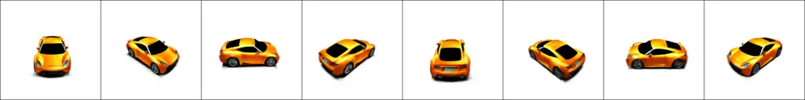

Figure 19: Racing car, blaze orange, lightweight aero kit, sequential
gearbox

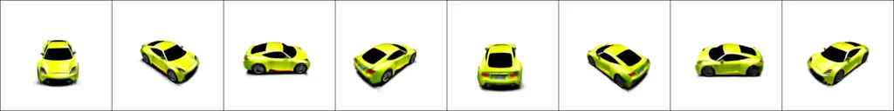

Figure 20: Racing car, banana, lightweight aero kit, sequential gearbox

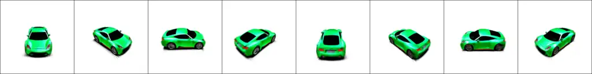

Figure 21: Racing car, green, lightweight aero kit, sequential gearbox

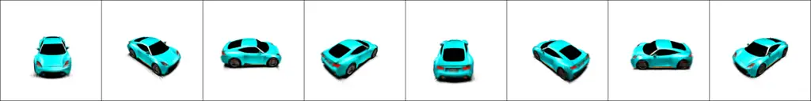

Figure 22: Racing car, cyan, lightweight aero kit, sequential gearbox


Figure 23: Family minivan, purple, large capacity, economical


Figure 24: Family minivan, yellow, large capacity, economical


Figure 25: Family minivan, apple red, large capacity, economical


Figure 26: Family minivan, orange, large capacity, economical

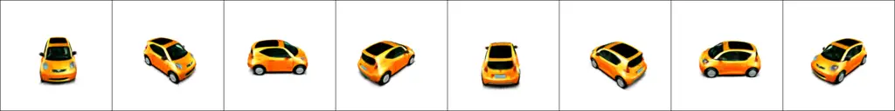

Figure 27: Urban microcar, orange, ideal for city life, fuel-efficient


Figure 28: Urban microcar, banana, ideal for city life, fuel-efficient

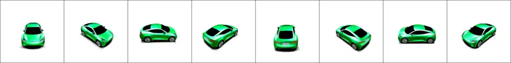

Figure 29: Electric coupe, forest green, sleek design, autonomous
features


Figure 30: Electric coupe, pearl white, sleek design, autonomous
features


Figure 31: Vintage convertible, orange, chrome bumpers, white-wall tires


Figure 32: Vintage convertible, apple red, chrome bumpers, white-wall
tires


Figure 33: Vintage convertible, yellow, chrome bumpers, white-wall tires


Figure 34: a man wearing a backpack is climbing a mountain


Figure 35: a woman wearing a backpack is climbing a mountain


Figure 36: an elderly man wearing a backpack is climbing a mountain

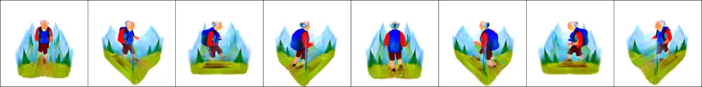

Figure 37: an elderly woman wearing a backpack is climbing a mountain

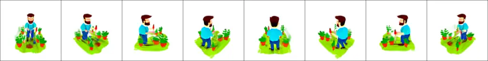

Figure 38: a man is trimming his plants

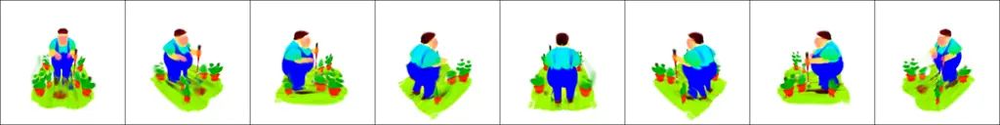

Figure 39: a fat man is trimming his plants

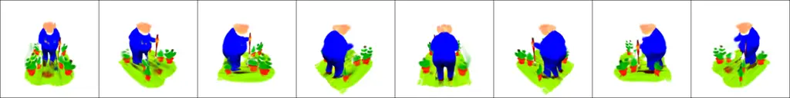

Figure 40: a fat and elderly man is trimming his plants


Figure 41: an elderly man is trimming his plants

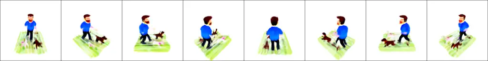

Figure 42: a man is playing with a dog

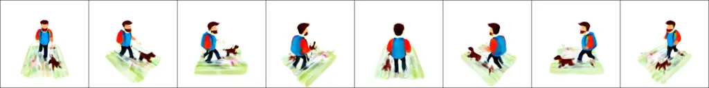

Figure 43: a man wearing a backpack is playing with a dog

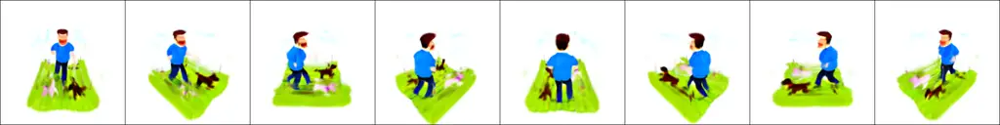

Figure 44: a man is playing with a dog on the lawn

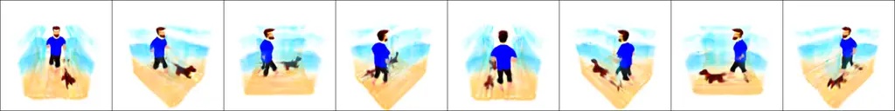

Figure 45: a man is playing with a dog on the beach

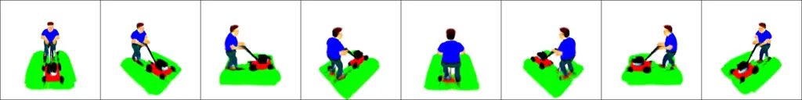

Figure 46: a man is mowing the lawn

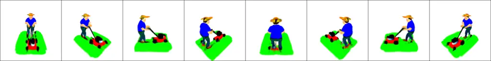

Figure 47: a man wearing a hat is mowing the lawn

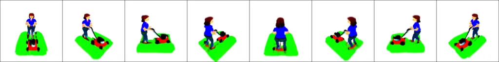

Figure 48: a woman is mowing the lawn

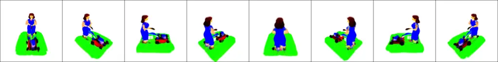

Figure 49: a woman in a long dress is mowing the lawn


Figure 50: A glamorous woman in a cocktail dress is dancing in the park


Figure 51: A glamorous woman in a cocktail dress is dancing on the beach
