# Improving Text-to-Image Consistency via Automatic Prompt Optimization

Oscar Mañas Affiliation: FAIR at Meta Affiliation: Mila
Affiliation: Université de Montréal Contributed equally    Pietro
Astolfi Affiliation: FAIR at Meta Contributed equally    Melissa Hall
Affiliation: FAIR at Meta    Candace Ross Affiliation: FAIR at Meta   
Jack Urbanek Affiliation: FAIR at Meta    Adina Williams
Affiliation: FAIR at Meta    Aishwarya Agrawal Affiliation: Mila
Affiliation: Université de Montréal Affiliation: Canada CIFAR AI Chair
   Adriana Romero-Soriano Affiliation: FAIR at Meta Affiliation: Mila
Affiliation: McGill University Affiliation: Canada CIFAR AI Chair   
Michal Drozdzal Affiliation: FAIR at Meta

###### Abstract

Impressive advances in text-to-image (T2I) generative models have
yielded a plethora of high performing models which are able to generate
aesthetically appealing, photorealistic images. Despite the progress,
these models still struggle to produce images that are consistent with
the input prompt, oftentimes failing to capture object quantities,
relations and attributes properly. Existing solutions to improve
prompt-image consistency suffer from the following challenges: (1) they
oftentimes require model fine-tuning, (2) they only focus on nearby
prompt samples, and (3) they are affected by unfavorable trade-offs
among image quality, representation diversity, and prompt-image
consistency. In this paper, we address these challenges and introduce a
T2I optimization-by-prompting framework, OPT2I, which leverages a large
language model (LLM) to improve prompt-image consistency in T2I models.
Our framework starts from a user prompt and iteratively generates
revised prompts with the goal of maximizing a consistency score. Our
extensive validation on two datasets, MSCOCO and PartiPrompts, shows
that OPT2I can boost the initial consistency score by up to 24.9% in
terms of DSG score while preserving the FID and increasing the recall
between generated and real data. Our work paves the way toward building
more reliable and robust T2I systems by harnessing the power of LLMs.

^(†)^(†)date: August 24, 2026^(†)^(†)correspondence: Oscar Mañas at
[oscar.manas@mila.quebec](mailto:oscar.manas@mila.quebec)


## 1 Introduction

In recent years, we have witnessed remarkable progress in text-to-image
(T2I) generative models (Ramesh et al., 2022; Saharia et al., 2022;
Rombach et al., 2022b; Podell et al., 2023; Dai et al., 2023b). The
photorealistic quality and aesthetics of generated images has positioned
T2I generative models at the center of the current AI revolution.
However, progress in image quality has come at the expense of model
representation diversity and prompt-image consistency (Hall et al.,
2023). From a user’s perspective, the fact that not all the elements of
the input text prompt are properly represented in the generated image is
particularly problematic as it induces a tedious and time-consuming
trial-and-error process with the T2I model to refine the initial prompt
in order to generate the originally intended image. Common consistency
failure modes of the T2I generative models include missing objects,
wrong object cardinality, missing or mixed object attributes, and
non-compliance with requested spatial relationships among objects in the
image (Wu et al., 2023a).

To improve prompt-image consistency, researchers have explored avenues
such as adjusting the sampling guidance scale (Ho and Salimans, 2022),
modifying cross-attention operations (Feng et al., 2022; Epstein et al.,
2023; Liu et al., 2022; Chefer et al., 2023; Wu et al., 2023a),
fine-tuning models (Lee et al., 2023; Wu et al., 2023c; Sun et al.,
2023), leveraging additional input modalities such as layouts (Cho
et al., 2023b; Lian et al., 2023), and selecting images
post-hoc (Karthik et al., 2023). Most of these approaches require access
to the model’s weights and are not applicable when models are only
accessible through an API interface, _e.g_., (Betker et al., 2023). The
only two approaches that are applicable to API-accessible models are
guidance scale modification and post-hoc image selection. However, these
approaches rely on a single text prompt – the one provided by the user –
so their ability to generate diverse images is limited to resampling of
the input noise, _i.e_., changing the random seed. Perhaps more
importantly, both these approaches have unfavorable trade-offs, as they
improve prompt-image consistency at the expense of image quality and
diversity – _e.g_., high guidance scales lead to reduced image quality
and diversity, while post-hoc selecting the most consistent images
decreases significantly the representation diversity.

At the same time, the natural language processing (NLP) community has
explored large language models (LLMs) as prompt optimizers for NLP
tasks (Pryzant et al., 2023; Yang et al., 2023; Guo et al., 2023;
Fernando et al., 2023), showing that LLMs can relieve humans from the
manual and tedious task of prompt-engineering. One particularly
interesting approach is in-context learning (ICL) (Dong et al., 2023),
where an LLM can learn to solve a new task from just a handful of
in-context examples provided in the input prompt. Notably, LLMs can
accomplish this without requiring parameter updates – _e.g_., LLMs can
solve simple regression tasks when provided with a few input-output
examples (Mirchandani et al., 2023). ICL enables rapid task adaptation
by changing the problem definition directly in the prompt. However, ICL
commonly relies on predefined datasets of examples (input-output pairs),
which might be challenging to obtain. To the best of our knowledge, ICL
has not yet been explored in the context of T2I generative models, which
pose unique challenges: (1) the in-context examples of prompts and the
associated scores are not readily available, and (2) the LLM needs to
ground the prompt in the generated images in order to understand how to
refine it. Recently, and once again in the NLP domain,
_optimization-by-prompting_ (OPRO) (Yang et al., 2023) has extended
previous ICL approaches by iteratively optimizing instruction prompts to
maximize task accuracy based on a dataset of input-output examples,
leveraging feedback from past instructions and their respective task
accuracies.

In this work, we propose the first ICL-based method to improve
prompt-image consistency in T2I models. In particular, we leverage
optimization-by-prompting and introduce a novel inference-time
optimization framework for T2I prompts, which constructs a dataset of
in-context examples _on-the-fly_. Our framework, _OPtimization for T2I
generative models_ (OPT2I), involves a pre-trained T2I model, an LLM,
and an automatic prompt-image consistency score – _e.g_.,
CLIPScore (Hessel et al., 2021) or Davidsonian Scene Graph score
(DSG) (Cho et al., 2023a). Through ICL, the LLM iteratively improves a
user-provided text prompt by suggesting alternative prompts that lead to
images that are more aligned with the user’s intention, as measured by
the consistency score. At each optimization iteration, the in-context
examples are updated to include the best solutions found so far.
Intuitively, we expect our method to explore the space of possible
prompt paraphrases and gradually discover the patterns in its previously
suggested prompts that lead to highly-consistent images. Crucially, the
optimized prompts will produce more consistent images on expectation,
across multiple input noise samples. OPT2I is designed to be a versatile
approach that works as a _plug-and-play_ solution with diverse T2I
models, LLMs, and scoring functions since it does not require any
parameter updates. An overview of our framework is presented in
Figure 1.

Through extensive experiments, we show that OPT2I consistently
outperforms paraphrasing baselines (_e.g_., random paraphrasing and
Promptist (Hao et al., 2022)), and boosts the prompt-image consistency
by up to 12.2% and 24.9% on MSCOCO (Lin et al., 2014) and
PartiPrompts (Yu et al., 2022) datasets, respectively. Notably, we
achieve this improvement while preserving the Fréchet Inception Distance
(FID) (Heusel et al., 2017) and increasing the recall between generated
and real data. Moreover, we observe that OPT2I achieves consistent
improvements for diverse T2I models and is robust to the choice of LLM.
Our qualitative results reveal that the optimized prompts oftentimes
emphasize the elements of the initial prompt that do not appear in the
generated images by either providing additional details about those or
reordering elements in the prompt to place the ignored elements at the
beginning. In summary, our contributions are:

- •
  We propose OPT2I, a training-free T2I optimization-by-prompting
  framework that provides refined prompts for a T2I model that improve
  prompt-image consistency.
- •
  OPT2I is a versatile framework as it is not tied to any particular T2I
  model and is robust to both the choice of LLM as well as consistency
  metric.
- •
  We show that OPT2I consistently outperforms paraphrasing baselines and
  can boost the prompt-image consistency by up to 24.9%.

## 2 OPT2I: Optimization by prompting for T2I

Figure 2: Our prompt optimization framework, OPT2I, composed of (1) a
text-to-image (T2I) generative model that generates images from text
prompts, (2) a consistency metric that evaluates the fidelity between
the generated images and the user prompt, and (3) a large language model
(LLM) that leverages task description and a history of prompt-score
tuples to provide revised prompts. At the beginning, the revised prompt
is initialized with the user prompt.

Figure 2 depicts our T2I _optimization-by-prompting_ framework, which is
composed of a pre-trained T2I model and an LLM that work together to
optimize a prompt-image _consistency score_ . Our framework starts from
a _user prompt_ and iteratively generates _revised prompts_ with the
goal of maximizing the chosen consistency score. More concretely, we
start by feeding the user prompt to the T2I model to generate multiple
images. Next, we compute the consistency score between each generated
image and the user prompt, and average the scores. We then initialize
the _meta-prompt history_ with the user prompt and its associated
consistency score. Finally, we feed the meta-prompt to the LLM, which
proposes a set of revised prompts. To start a new optimization step, we
feed the revised prompts back to the T2I model that generate new images.
Note that the consistency score is always computed w.r.t. the user
prompt. At each optimization step, the meta-prompt history is updated to
include the top-$`k`$ most consistent prompts (among revised prompts and
user prompt), along with their consistency score. The prompt
optimization process terminates when a maximum number of iterations is
reached, or when a perfect/target consistency score is achieved.
Finally, the best prompt is selected, namely, the _optimized prompt_.

### 2.1 Problem formulation

We assume access to an LLM, $`f`$, and a pre-trained T2I generative
model, $`g`$. Given a text prompt, $`p`$, we can generate an image $`I`$
conditioned on the prompt with our T2I generator, $`I=g(p)`$. Let us
define the set of all possible paraphrases from $`p`$ that can be
obtained with an LLM as $`\mathbb{P}=\{p_{i}\}`$, and let us introduce a
prompt-image consistency score, $`\mathcal{S}(p,I)`$. Our objective is
to find a prompt paraphrase $`\hat{p}\in\mathbb{P}`$ that maximizes the
expected consistency score of sampled images:

```math
\hat{p}=\underset{p_{i}\sim\mathbb{P}}{\mathrm{argmax}}\ \underset{I\sim g(p_{i})}{\mathbb{E}}\left[\mathcal{S}(p_{0},I)\right],
```

where $`p_{0}`$ denotes the user prompt. We approach the optimization
problem with ICL by iteratively searching for revised prompts generated
by the LLM,

```math
P_{t}=f(C(\{p_{0}\}\cup P_{1},\dots,\ \cup\ P_{t-1})),
```

where $`P_{i}`$ is the set of prompts generated at iteration $`i`$,
$`t`$ is the current iteration, and $`C`$ is a function that defines the
context of prompt-score pairs fed to the LLM.

### 2.2 Meta-prompt design

We adapt LLMs for T2I prompt optimization via ICL. We denote
_meta-prompt_ the prompt which instructs the LLM to optimize prompts for
T2I models. Our meta-prompt is composed of a _task instruction_ and a
_history_ of past revised prompt-score pairs. The list of meta-prompts
used can be found in Appendix A.

The meta-prompt provides context about T2I models, the consistency
metric and the optimization problem. Additionally, it contains a history
of prompt-score pairs that provides context about which paraphrases
worked best in the past for a particular T2I model, encouraging the LLM
to build upon the most successful prompts and removing the need for
explicitly specifying how to modify the T2I prompt. The consistency
score is normalized to an integer between 0 and 100, and we only keep in
the history the top-$`k`$ scoring prompts found so far, sorted by
increasing score.

### 2.3 Optimization objective

A critical part of our framework is feeding visual feedback to the LLM.
The visual feedback is captured by the consistency score, which
determines how good the candidate prompt is at generating consistent
images. Although OPT2I can work with any – even non-differentiable –
consistency score, we argue that the consistency score must be detailed
enough for the LLM to infer how to improve the candidate prompt. While
CLIPScore (Hessel et al., 2021) is arguably the most popular metric for
measuring prompt-image consistency, in our initial experiments we found
that scoring a prompt with a single scalar is too coarse for our
purposes. Thus, we opt for two metrics that provide finer-grained
information about the prompt-image consistency: (1) Davidsonian Scene
Graph (DSG) score (Cho et al., 2023a), and (2) our proposed decomposed
CLIPScore.

DSG assesses prompt-image consistency based on a question generation and
answering approach, similar to TIFA (Hu et al., 2023). In particular,
DSG generates atomic and unique binary questions from the user prompt
that are organized into semantic dependency graphs. For example, “a bike
lying on the ground, covered in snow” is decomposed into: (1) “Is there
a bike?”; (2) “Is the bike lying on the ground?”; (3) “Is the bike
covered in snow?”. In this case, questions (2) and (3) depend on (1),
and so (1) is used to validate (2) and (3). These questions are then
answered by an off-the-shelf VQA model based on the generated image. We
include the resulting question-answer pairs in our meta-prompt. A global
score per prompt-image pair is computed by averaging across answer
scores.

Decomposed CLIPScore computes a partial consistency score for each noun
phrase present in the user prompt. For example, “a bike lying on the
ground, covered in snow” is decomposed into “a bike”, “the ground” and
“snow”. Each noun phrase is then scored against the generated image
using CLIPScore, resulting in a list of pairs of noun phrases and their
associated scores, which are included in our meta-prompt. A global score
per prompt-image pair is computed by averaging across subscores. We
provide examples of decomposed CLIPScore and DSG outputs in Appendix A.

### 2.4 Exploration-exploitation trade-off

During the optimization process, OPT2I requires controllability over the
LLM’s exploration-exploitation trade-off, as the LLM could either focus
on exploring possible revised prompts or on exploiting the context
provided in the meta-prompt history. On the one hand, too much
exploration would hamper the optimization as it could be hard to find a
high quality solution. On the other hand, too much exploitation would
limit the exploration to prompts that are very similar to the ones
already presented in the meta-prompt history. We control this balance by
adjusting the number of generated revised prompts per iteration and the
LLM sampling temperature. Moreover, as our objective is to find prompts
that work well across different T2I input noise samples, we generate
multiple images per prompt at each iteration.

## 3 Experiments

We first introduce our experimental setting. Next, we validate the
effectiveness of OPT2I in improving prompt-image consistency, compare it
to paraphrasing baselines (random paraphrasing and Promptist), and show
some qualitative results. Then, we explore the trade-offs with image
quality and diversity. And finally, we ablate OPT2I components and touch
on post-hoc image selection.

### 3.1 Experimental setting

Benchmarks. We run experiments using prompts from MSCOCO (Lin et al., 2014) and PartiPrompts (P2) (Yu et al., 2022). For MSCOCO, we use the
2000 captions from the validation set as in (Hu et al., 2023). These
captions represent real world scenes containing common objects.
PartiPrompts, instead, is a collection of 1600 artificial prompts, often
unrealistic, divided into categories to stress different capabilities of
T2I generative models. We select our PartiPrompts subset by merging the
first 50 prompts from the most challenging categories: “Properties &
Positioning”, “Quantity”, “Fine-grained Detail”, and “Complex”. This
results in a set of 185 complex prompts.

Baselines. We compare OPT2I against a random paraphrasing baseline,
where the LLM is asked to generate diverse paraphrases of the user
prompt, without any context about the consistency of the images
generated from it. The meta-prompt used to obtain paraphrases is
provided in Appendix A. We also compare to Promptist Hao et al. (2022),
which relies on a dataset of initial and target prompts to finetune an
LLM to rewrite user prompts with the goal of improving image
_aesthetics_, while trying to maintain prompt-image consistency.

Evaluation metrics. We measure the quality of a T2I prompt by averaging
prompt-image consistency scores across multiple image generations
(_i.e_., multiple random seeds for the initial noise). For each
generated image, we compute its consistency with the user prompt. We
consider our proposed decomposed CLIPScore (dCS) and the recent DSG
score (Cho et al., 2023a) as consistency metrics (see Section 2.3 for
more details). For DSG score, we use Instruct-BLIP (Dai et al., 2023a)
as the VQA model. To assess the trade-off between prompt-image
consistency, image quality and diversity, we additionally compute FID
score (Heusel et al., 2017), precision and recall metrics (Naeem et al.,
2020).

LLMs and T2I models. For the T2I model, we consider (1) a
state-of-the-art latent diffusion model, namely LDM-2.1 (Rombach et al.,
2022a), which uses a CLIP text encoder for conditioning, and (2) a
cascaded pixel-based diffusion model, CDM-M, which instead relies on the
conditioning from a large language model, T5-XXL (Raffel et al., 2020),
similarly to (Saharia et al., 2022). For the LLM, we experiment with the
open source Llama-2-70B- chat (Llama-2) (Touvron et al., 2023) and with
GPT-3.5-Turbo-0613 (GPT-3.5) (Brown et al., 2020).

Implementation details. Unless stated otherwise, OPT2I runs for at most
$`30`$ iterations generating $`5`$ new revised prompts per iteration,
while the random paraphrasing baseline generates $`150`$ prompts at once
(see Section 3.4 for a discussion about the relationship between \#iters
and \#prompts/iter). We instruct the LLM to generate revised prompts by
enumerating them in a single response to prevent duplication, rather
than making multiple calls with a sampling temperature greater than
$`0`$. In the optimization meta-prompt, we set the history length to
$`5`$. To speed up image generation, we use DDIM (Song et al., 2020)
sampling. We perform $`50`$ inference steps with LDM-2.1, while for
CDM-M we perform $`100`$ steps with the low-resolution generator and
$`50`$ steps with the super-resolution network – following the default
parameters in both cases. The guidance scale for both T2I models is kept
to the suggested value of $`7.5`$. Finally, in our experiments, we fix
the initial random seeds across iterations and prompts wherever
possible, _i.e_. we fix $`4`$ random seeds for sampling different
prior/noise vectors to generate $`4`$ images from the same prompt.
However, we note that CDM-M does not allow batched generation with fixed
seeds. Experiments without seed-fixing are reported in Appendix B as we
observe no substantial differences.

### 3.2 Main results

(a) dCS (MSCOCO)

(b) dCS (P2)

(c) DSG (MSCOCO)

(d) DSG (P2)

Figure 3: OPT2I curves with different consistency objectives (dCS vs.
DSG), LLMs, and T2I models. Each plot track either the _max_ or the
_mean_ relative improvement in consistency across revised prompts per
iteration.

T2I optimization by prompting. In Figure 3, we plot the prompt
optimization curves with LDM-2.1/CDM-M as T2I models, Llama-2/GPT-3.5 as
LLM, and decomposed CLIPscore (dCS)/DSG as the scorer for prompts from
MSCOCO and PartiPrompts. Each data point corresponds to the _mean_/_max_
relative improvement in consistency score (w.r.t. the user prompt)
achieved by revised prompts generated in that iteration, averaged across
the full dataset of prompts. The optimization curves show an overall
upward trend, which confirms that the LLM in OPT2I is capable of
optimizing T2I prompts. These improvements are especially noticeable in
the _max_ consistency score. The initial dip in mean consistency score
is expected due to the initial exploration, since the LLM has limited
context provided only by the user prompt (1-shot ICL). As the
optimization progresses, the LLM generates more consistent revised
prompts at each iteration, as its context is increasingly enriched with
the performance of previous revised prompts. Notably, achieving a
positive _mean_ relative consistency starting from a single in-context
example is a very challenging task (Wei et al., 2023), and OPT2I
achieves this goal for all configurations except for Llama-2 and GPT-3.5
in the dCS(P2) setting (Figure 3(b)), where it only get close to $`0`$.
As mentioned Section 3.1, PartiPrompts is a hard benchmark containing
highly detailed and complex prompts, so it is perhaps unsurprising that
decomposed CLIPScore falls short (with improvements $`<7\%`$ in the max
case, and $`<2\%`$ in the mean case) – given the imperfect decomposition
into noun-phrases. We also explored a hierarchical version of decomposed
CLIPscore leveraging constituency trees, which did not show any
improvement over our noun-phrase based decomposition, further
reinforcing the criticism that CLIP behaves as a bag-of-words and is
unable to properly capture object attributes and relations (Yuksekgonul
et al., 2022; Yamada et al., 2022). Instead, using a more detailed
consistency score during the prompt optimization process, such as DSG,
results in more significant improvements ($`<17\%`$ in the max case, and
$`<5\%`$ in the mean case).

| Method       | Objective | LLM     | T2I     | Dataset         |                 |
| ------------ | --------- | ------- | ------- | --------------- | --------------- |
|              |           |         |         | MSCOCO          | P2              |
| Paraphrasing | dCS       | Llama-2 | LDM-2.1 | $`+9.96`$       | $`+8.00`$       |
| OPT2I        |           |         |         | $`\bm{+11.88}`$ | $`\bm{+10.34}`$ |
| Paraphrasing | DSG       | Llama-2 | LDM-2.1 | $`+10.67`$      | $`+19.22`$      |
| OPT2I        |           |         |         | $`\bm{+11.21}`$ | $`\bm{+22.24}`$ |
| Paraphrasing | dCS       | GPT-3.5 | LDM-2.1 | $`+9.81`$       | $`+8.06`$       |
| OPT2I        |           |         |         | $`\bm{+10.35}`$ | $`\bm{+9.33}`$  |
| Paraphrasing | DSG       | GPT-3.5 | LDM-2.1 | $`+10.53`$      | $`+19.09`$      |
| OPT2I        |           |         |         | $`\bm{+10.85}`$ | $`\bm{+19.77}`$ |
| Paraphrasing | dCS       | Llama-2 | CDM-M   | $`+11.00`$      | $`+10.29`$      |
| OPT2I        |           |         |         | $`\bm{+12.21}`$ | $`\bm{+12.13}`$ |
| Paraphrasing | DSG       | Llama-2 | CDM-M   | $`+10.53`$      | $`+22.24`$      |
| OPT2I        |           |         |         | $`\bm{+11.07}`$ | $`\bm{+24.93}`$ |

Table 1: Relative improvement in T2I consistency between the user prompt
and the best prompt found, averaged across all prompts in the dataset.
Every method generates the same total number of prompts (and images).

Comparison to paraphrasing baselines. Table 1 shows our proposed OPT2I
framework is robust to the choice of LLM, T2I model and
optimization/evaluation objective. In particular, for dCS, we report
relative improvement as $`score_{best}/score_{init}-1`$. For DSG score,
since the initial score can be zero and it is already a percentage, we
instead report $`score_{best}-score_{init}`$. We observe that OPT2I
consistently outperforms the random paraphrasing baseline across
different LLMs and T2I models. Additionally, we can see that both
paraphrasing and optimization get around a $`10\%`$ boost in consistency
improvement when using DSG as optimization objective instead of dCS for
P2 but not for MSCOCO. This highlights again that more complex prompts,
such as those from PartiPrompts, benefit from a more accurate
consistency metric. We note that some prompts might already have a
fairly high initial consistency score (see App. B.2), so there is little
room for improvement. For instance, prompts from MSCOCO evaluated with
DSG have an average initial score of $`86.54\%`$, which means that the
improvement in this setting has an upper bound of $`13.46\%`$.

In addition to random paraphrasing, we compare OPT2I to Promptist (Hao
et al., 2022) on MSCOCO prompts by generating images from initial/best
prompts ($`4`$ images/prompt) with SD-1.4 (Promptist’s reference model)
and LDM-2.1, evaluating consistency with DSG score. We observe Promptist
decreases the consistency score by $`-3.56\%`$/$`-3.29\%`$ on
SD-1.4/LDM-2.1, while OPT2I (Llama-2) improves consistency by
$`+14.16\%`$/$`+11.21\%`$. This aligns with the results reported in (Hao
et al., 2022), which show that optimizing prompts primarily for
aesthetics actually decreases prompt-image consistency.

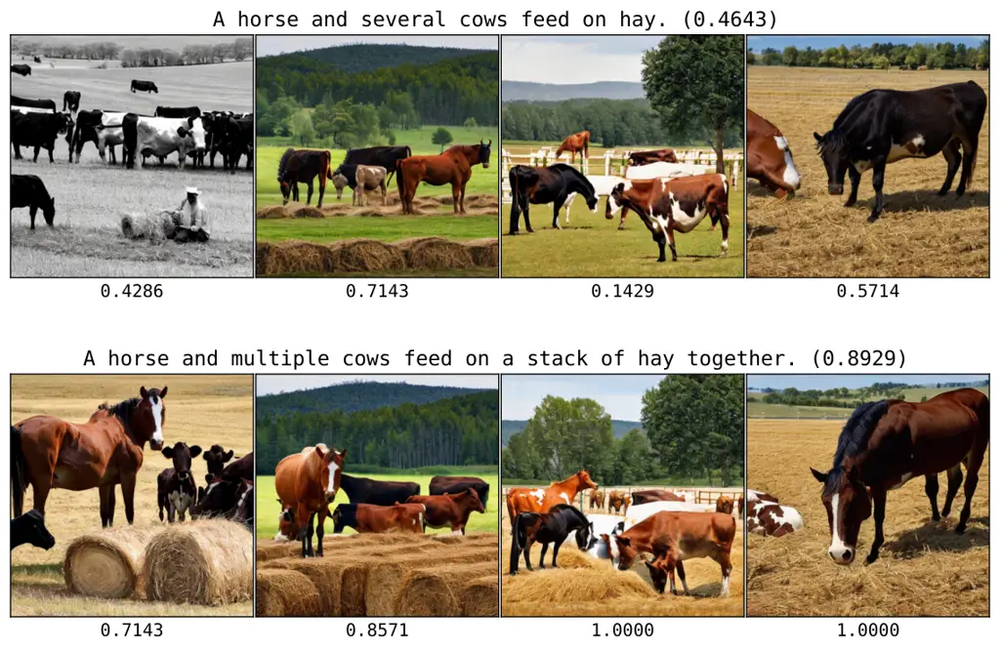

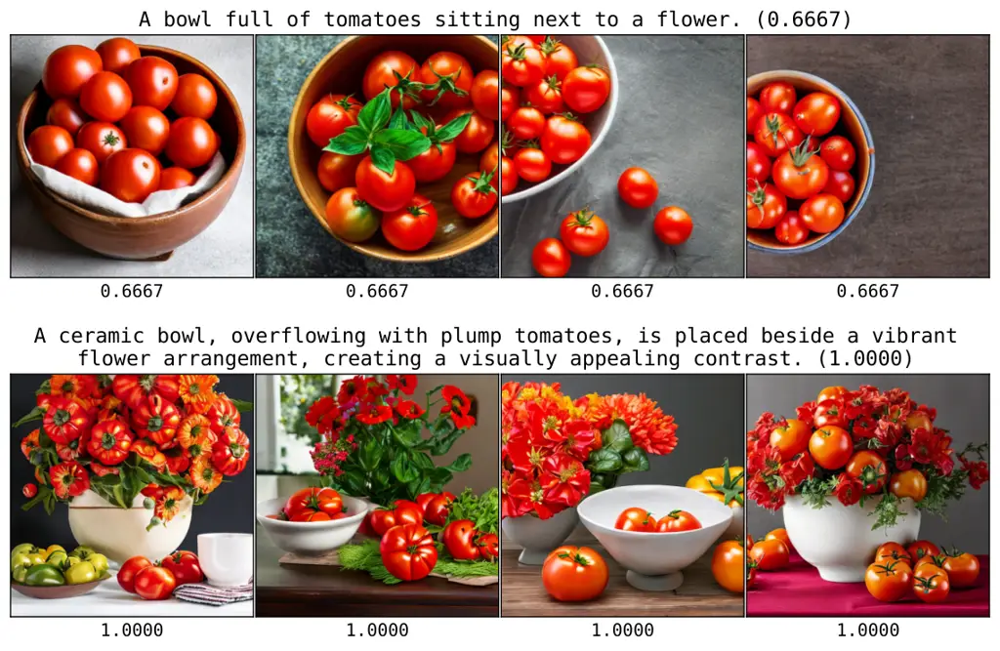

(a) LLM: Llama-2, T2I: LDM-2.1

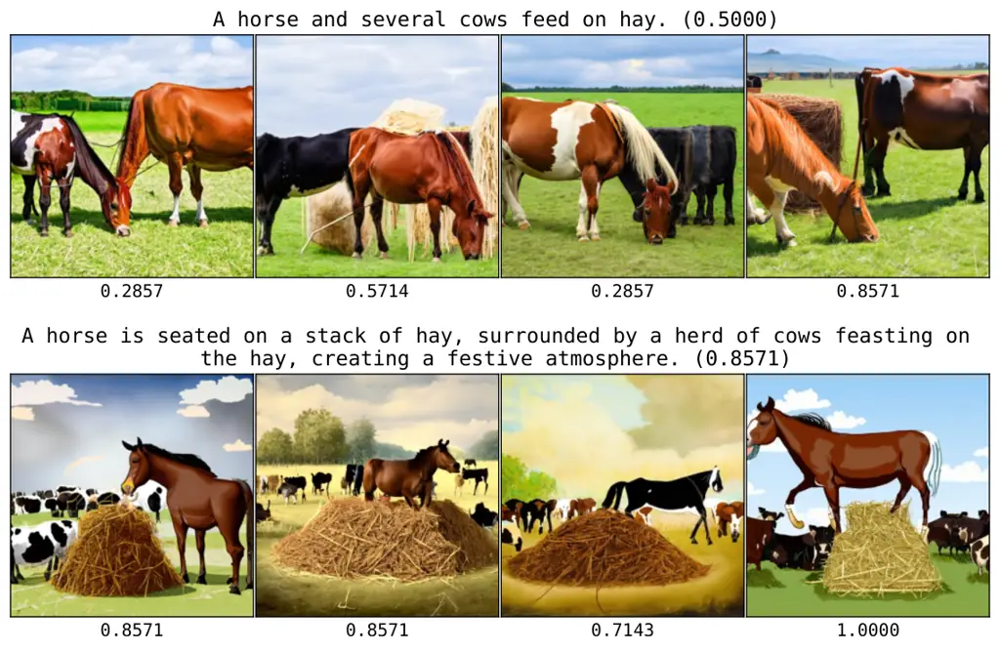

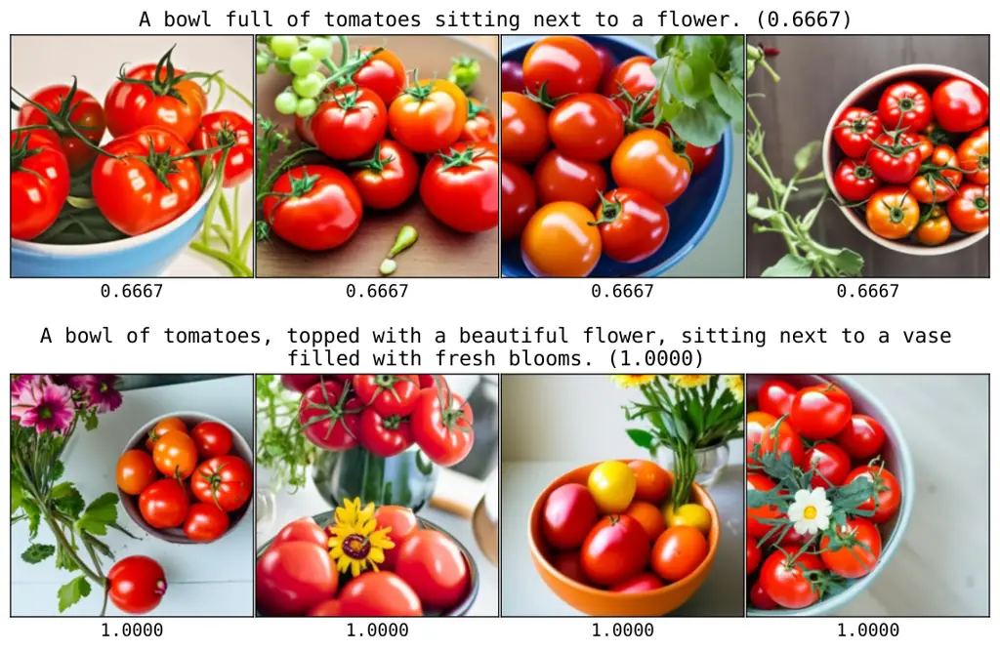

(b) LLM: Llama-2, T2I: CDM-M

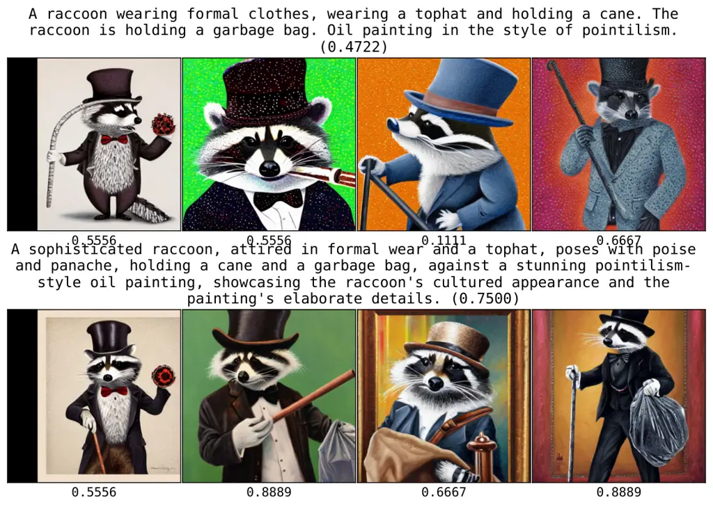

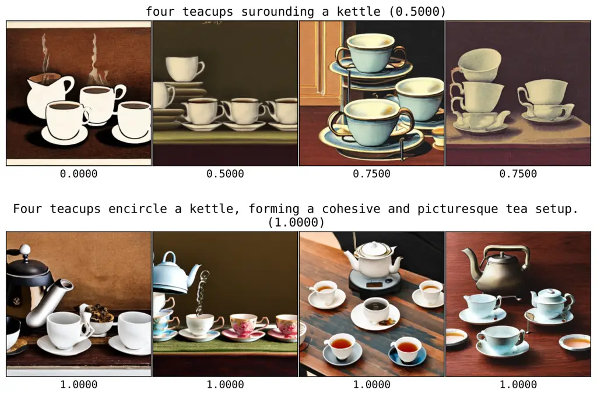

(c) LLM: Llama-2, T2I: LDM-2.1

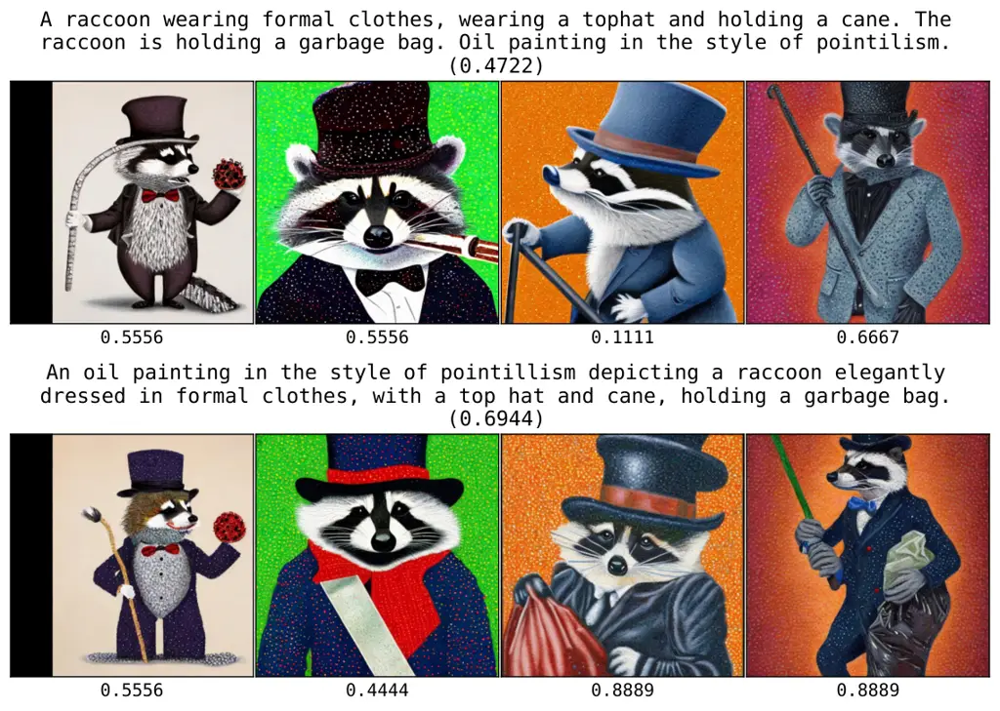

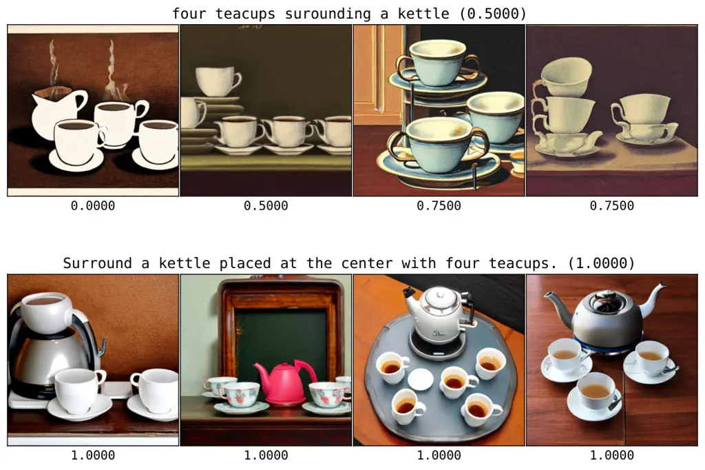

(d) LLM: GPT-3.5, T2I: LDM-2.1

Figure 4: Selected qualitative results for prompts from MSCOCO (a-b) and
P2 (c-d) datasets, using DSG as consistency metric. For each setup, we
display four rows (from the top): initial prompt \#1, optimized prompt
\#1, initial prompt \#2, and optimized prompt \#2. Each column
corresponds to a different T2I model random seed. We report average
consistency score across seeds in between parenthesis.

|         |      |         |         |                      |               |                      |               |                     |               |
| ------- | ---- | ------- | ------- | -------------------- | ------------- | -------------------- | ------------- | ------------------- | ------------- |
| Prompt  | Obj. | LLM     | T2I     | FID ($`\downarrow`$) |               | Prec. ($`\uparrow`$) |               | Rec. ($`\uparrow`$) |               |
|         |      |         |         | IV3                  | CLIP          | IV3                  | CLIP          | IV3                 | CLIP          |
| Initial | -    | -       | LDM-2.1 | $`34.6`$             | $`16.0`$      | $`\bm{81.6}`$        | $`\bm{85.9}`$ | $`47.2`$            | $`22.8`$      |
| OPT2I   | dCS  | Llama-2 | LDM-2.1 | $`34.6`$             | $`14.9`$      | $`70.7`$             | $`81.0`$      | $`\bm{55.6}`$       | $`\bm{30.0}`$ |
| OPT2I   | DSG  | Llama-2 | LDM-2.1 | $`\bm{33.3}`$        | $`15.4`$      | $`79.0`$             | $`84.3`$      | $`54.4`$            | $`27.0`$      |
| OPT2I   | dCS  | GPT-3.5 | LDM-2.1 | $`34.1`$             | $`\bm{14.3}`$ | $`74.9`$             | $`84.0`$      | $`53.9`$            | $`27.3`$      |
| OPT2I   | DSG  | GPT-3.5 | LDM-2.1 | $`\bm{33.4}`$        | $`15.6`$      | $`80.3`$             | $`85.4`$      | $`50.5`$            | $`21.7`$      |
| Initial | -    | -       | CDM-M   | $`41.2`$             | $`\bm{15.2}`$ | $`\bm{82.2}`$        | $`\bm{85.6}`$ | $`38.8`$            | $`26.0`$      |
| OPT2I   | dCS  | Llama-2 | CDM-M   | $`\bm{39.8}`$        | $`\bm{15.2}`$ | $`77.1`$             | $`80.9`$      | $`\bm{45.4}`$       | $`\bm{29.5}`$ |
| OPT2I   | DSG  | Llama-2 | CDM-M   | $`\bm{39.9}`$        | $`\bm{15.2}`$ | $`79.6`$             | $`82.5`$      | $`39.9`$            | $`25.0`$      |

Table 2: Distributional metrics on the MSCOCO dataset.

Qualitative results. In Figure 4, we provide examples of images
generated from user and optimized prompts with OPT2I for different LLMs
and T2I models. We observe OPT2I is capable of finding paraphrases of
the user prompt which considerably improve the consistency between the
generated images and the initial, user-provided prompt, as measured by
DSG in this case. These examples suggest the optimized prompts are
capable of steering the T2I model towards generating visual elements
that were ignored with the initial phrasing. From our qualitative
analysis, we observed the LLM uses several strategies to emphasize the
missing visual elements, such as providing a more detailed description
of those elements (_e.g_., “a flower” $`\rightarrow`$ “a vibrant flower
arrangement”, “a vase filled with fresh blossoms”) or placing them at
the beginning of the sentence (_e.g_., “four teacups surrounding a
kettle” $`\rightarrow`$ “surround a kettle placed at the center with
four teacups”). We note a perfect consistency score does not ensure
perfectly aligned images (_e.g_., for the user prompt “four teacups
surrounding a kettle”, all optimized prompts reach a DSG score of 100%
while the cardinality of teacups remains incorrect), which highlights
the limitations of current prompt-image consistency scores. We also
observe that prompts optimized by Llama-2 tend to be longer than those
from GPT-3.5 (see App. B.5), and that images generated by CDM-M from
user prompts are generally more consistent than those generated by
LDM-2.1, which we attribute to the use of a stronger text encoder
(T5-XXL instead of CLIP).

### 3.3 Trade-offs with image quality and diversity

Following common practice in the T2I community, we evaluate the quality
of OPT2I generations by computing image generation metrics such as FID,
precision (P), and recall (R). We use the $`2000`$ prompts from the
MSCOCO validation set that are included in the TIFAv1 benchmark (Hu
et al., 2023), and generate 4 images for each initial and best prompt.
To ensure robust conclusions, we use two feature extractors in our
metrics: Inception-v3 (IV3) (Szegedy et al., 2016) and CLIP (Radford
et al., 2021). Results in Table 2 show that the FID of prompts optimized
with OPT2I is either on-par or better compared to that of initial
prompts, validating that our method does not trade image quality for
consistency. Hence, we conclude FID is not affected by our optimization
strategy. However, in terms of precision and recall, we observe that
optimized prompts reach higher recall at the expense of lower precision
compared to the user prompt. This is explainable as rephrasing the input
prompt allows to generate more diverse images (higher recall), which may
occasionally fall outside of the manifold of natural images (lower
precision). This phenomenon can be observed in Fig. 12 (Appendix B),
where optimizing for consistency leads to a change of artistic style.

Figure 5: Cumulative _max_ relative dCS as a function of \#revised
prompts = \#iterations $`\cdot`$ \#prompts/iter.

|             |            |           |           |                 |
| ----------- | ---------- | --------- | --------- | --------------- |
| Conciseness | Prioritize | Reasoning | Structure | dCS (%)         |
| ✓           | ✗          | ✗         | ✗         | $`+9.68`$       |
| ✓           | ✓          | ✗         | ✗         | $`\bm{+10.34}`$ |
| ✓           | ✓          | ✓         | ✗         | $`+10.23`$      |
| ✓           | ✓          | ✗         | ✓         | $`+9.99`$       |

Table 3: Meta-prompt ablations.

### 3.4 Ablations

We perform ablations with Llama-2 and LDM-2.1 on PartiPrompts using
default parameters unless otherwise specified. Figure 5 illustrates the
trade-off between exploration and exploitation, implemented as the
number of revised prompts per iteration (#prompts/iter) and the number
of optimization iterations (#iterations), respectively. Generating more
prompts at each iteration increases the _exploration_ of multiple
solutions given the same context, while by increasing the number of
iterations, the LLM can _exploit_ more frequent feedback from the T2I
model and the consistency score. We observe that increasing number of
iterations leads to a higher consistency improvement. In other words,
more exploitation is beneficial with a fixed budget of 150 prompt
generations. However, pushing exploitation too much, _i.e_.,
\#it $`=150`$ and \#p/it $`=1`$, becomes harmful.

In table 3, we report relative consistency (dCS) when ablating for
different task instructions in the meta-prompt. We explore four
instruction additions to be combined with our base meta-prompt.
_Conciseness_ encourages to explore paraphrases beyond just adding
details/adjectives; _Prioritize_ encourages focusing on
missing/low-score elements; _Reasoning_ encourages to reason about the
in-context examples; and _Structure_ asks for simple vocabulary
informative of the structure of images, _e.g_., foreground and
background (full meta-prompts are provided in Appendix A). We observe
that _Prioritize_ achieves slightly better performance over _Reasoning_
and _Structure_, yet the LLM remains fairly robust to specific
meta-prompt phrasing.

Figure 6: Average DSG score for the top-$`k`$ most consistent images
among $`600`$.

### 3.5 Post-hoc image selection

We emphasize OPT2I aims to optimize _prompts_ to generate more
consistent _images on expectation_. However, for the sake of
completeness, we also evaluate the setting where we generate the same
amount of images from the initial prompt and select the most consistent
ones. In particular, we generate $`600`$ images from PartiPrompts using
either random image sampling from the initial prompt, paraphrasing, or
OPT2I, and select the top-$`k`$ most consistent images based on DSG
score. In Fig. 6, we observe that OPT2I consistently outperforms both
baselines. Interestingly, sampling from the initial prompt outperforms
paraphrasing, which might be due to random paraphrases deviating too
much from the user’s intent.

## 4 Related work

Improving consistency in T2I models. Several recent works propose
extensions to T2I models to improve their faithfulness to user prompts.
Some studies focus on improving the guidance with cross-attention (Feng
et al., 2022; Epstein et al., 2023; Liu et al., 2022; Chefer et al.,
2023; Wu et al., 2023a). Other studies first convert a textual prompt
into a layout before feeding it to a layout-to-image generative
model (Cho et al., 2023b; Lian et al., 2023). Recent works also finetune
T2I models on human (Lee et al., 2023; Wu et al., 2023c; Wallace et al., 2023) or AI model (Sun et al., 2023) feedback, or perform post-hoc image
selection (Karthik et al., 2023). In contrast, OPT2I acts exclusively at
the level of input prompt in text space, without accessing model
weights, making it applicable to a wider range of T2I models, including
those only accessible through an API.

LLMs as prompt optimizers. Several recent works explore the role of LLMs
as prompt optimizers for NLP tasks. Some use LLMs to directly optimize
the task instruction for ICL (Zhou et al., 2022; Pryzant et al., 2023;
Yang et al., 2023). Other studies use LLMs to mutate prompts for
evolutionary algorithms (Guo et al., 2023; Fernando et al., 2023). A
crucial difference between these works and our method is that they
optimize a task instruction prompt by using a training set, which is
subsequently applied across test examples, while we perform multimodal
inference-time optimization on individual T2I prompts. More similar to
our work, other studies rewrite prompts for T2I models using an LLM.
(Hao et al., 2022) finetunes an LLM with reinforcement learning to
improve image aesthetics, while (Valerio et al., 2023) focuses on
filtering out non-visual prompt elements. In contrast, OPT2I aims to
improve prompt-image consistency via optimization-by-prompting.

Evaluating prompt-image consistency. Several metrics have been proposed
to evaluate prompt-image consistency. CLIPScore (Hessel et al., 2021) is
the de facto standard for measuring the compatibility of image-caption
pairs, used both for image captioning and text-conditioned image
generation. However, CLIPScore provides a single global score, which can
be too coarse to understand failures in the generated images.
Consequently, subsequent metrics such as TIFA (Hu et al., 2023),
VQ² (Yarom et al., 2023) or DSG (Cho et al., 2023a) propose generating
pairs of questions and answers from T2I prompts and using off-the-shelf
VQA models to evaluate each of them on the generated images, providing a
fine-grained score. Other recent studies suggest directly learning a
prompt-image consistency metric from human feedback (Xu et al., 2023; Wu
et al., 2023b; Kirstain et al., 2023). However, none of these metrics
are without flaws and human judgment remains the most reliable way of
evaluating prompt-image consistency.

## 5 Conclusions

In this paper, we introduced the first T2I optimization-by-prompting
framework to improve prompt-image consistency. Through extensive
evaluations, we showed that OPT2I can be effectively applied to
different combinations of LLM, T2I models and consistency metrics,
consistently outperforming paraphrasing baselines and yielding
prompt-image consistency improvements of up to $`24.9\%`$ over the user
prompt, while maintaining the FID between generated and real images. By
contrasting MSCOCO and PartiPrompts results, we highlighted the
importance of the choice of consistency score: complex prompts in
PartiPrompts appear to significantly benefit from more detailed scores
such as DSG. Qualitatively, we observed that optimizing prompts for
prompt-image consistency oftentimes translates into emphasizing
initially ignored elements in the generated images, by either providing
additional details about those or rewording the prompt such that the
ignored elements appear at the beginning. Interestingly, such prompt
modifications steer the generated images away from the learned modes,
resulting in a higher recall w.r.t. the real data distribution.

Limitations. One limitation of our method is that it expects
prompt-image consistency scores to work reasonably well. However, this
assumption might not hold in some cases. For instance, it has been shown
that CLIP (used for CLIPScore) sometimes behaves like a
bag-of-words (Yuksekgonul et al., 2022; Yamada et al., 2022). VQA-based
prompt-image consistency metrics such as TIFA or DSG also suffer from
limitations in generating questions (_e.g_., the question “Is the horse
on the hay?” is generated from the prompt “A horse and several cows feed
on hay.”) or in answering them with a VQA model (_e.g_., for the prompt
“A bowl full of tomatoes sitting next to a flower.”, the VQA model
answers that there is a flower when it is in fact a bouquet made of
tomatoes). Moreover, using these metrics as optimization objectives
might exacerbate their failure modes by finding prompts which generate
images that fulfill the requirements for a high score in an adversarial
way. This highlights the need for further research in developing more
robust prompt-image consistency metrics which can be used as
optimization objectives in addition to evaluation.

Another limitation of our approach is its runtime, which is a
consequence of performing inference-time optimization. For instance,
running the optimization process with Llama-2, LDM-2.1 and DSG score,
generating $`5`$ prompt paraphrases per iteration and $`4`$ images per
prompt with $`50`$ diffusion steps, takes $`7.34`$/$`20.27`$ iterations
on average for COCO/PartiPrompts, which translates to
$`\sim\!10`$/$`28`$ minutes when using NVIDIA V100 GPUs. However, we
emphasize that (1) OPT2I is designed to be a versatile approach that
works as a _plug-and-play_ solution with diverse T2I models and LLMs
since it does not require any parameter updates nor training data, and
(2) optimizing T2I prompts with our automatic framework relieves humans
from the manual and tedious task of prompt-engineering.

## References

- Betker et al. (2023) James Betker, Gabriel Goh, Li Jing, Tim Brooks,
  Jianfeng Wang, Linjie Li, Long Ouyang, Juntang Zhuang, Joyce Lee,
  Yufei Guo, et al. Improving image generation with better captions.
  _Computer Science. https://cdn. openai. com/papers/dall-e-3. pdf_,
  2(3):8, 2023.
- Brown et al. (2020) Tom Brown, Benjamin Mann, Nick Ryder, Melanie
  Subbiah, Jared D Kaplan, Prafulla Dhariwal, Arvind Neelakantan, Pranav
  Shyam, Girish Sastry, Amanda Askell, et al. Language models are
  few-shot learners. _Advances in neural information processing
  systems_, 33:1877–1901, 2020.
- Chefer et al. (2023) Hila Chefer, Yuval Alaluf, Yael Vinker, Lior
  Wolf, and Daniel Cohen-Or. Attend-and-excite: Attention-based semantic
  guidance for text-to-image diffusion models. _ACM Transactions on
  Graphics (TOG)_, 42(4):1–10, 2023.
- Cho et al. (2023a) Jaemin Cho, Yushi Hu, Roopal Garg, Peter Anderson,
  Ranjay Krishna, Jason Baldridge, Mohit Bansal, Jordi Pont-Tuset, and
  Su Wang. Davidsonian scene graph: Improving reliability in
  fine-grained evaluation for text-image generation. _arXiv preprint
  arXiv:2310.18235_, 2023a.
- Cho et al. (2023b) Jaemin Cho, Abhay Zala, and Mohit Bansal. Visual
  programming for text-to-image generation and evaluation. _arXiv
  preprint arXiv:2305.15328_, 2023b.
- Dai et al. (2023a) Wenliang Dai, Junnan Li, Dongxu Li, Anthony
  Meng Huat Tiong, Junqi Zhao, Weisheng Wang, Boyang Li, Pascale Fung,
  and Steven Hoi. Instructblip: Towards general-purpose vision-language
  models with instruction tuning, 2023a.
- Dai et al. (2023b) Xiaoliang Dai, Ji Hou, Chih-Yao Ma, Sam Tsai,
  Jialiang Wang, Rui Wang, Peizhao Zhang, Simon Vandenhende, Xiaofang
  Wang, Abhimanyu Dubey, et al. Emu: Enhancing image generation models
  using photogenic needles in a haystack. _arXiv preprint
  arXiv:2309.15807_, 2023b.
- Dong et al. (2023) Qingxiu Dong, Lei Li, Damai Dai, Ce Zheng, Zhiyong
  Wu, Baobao Chang, Xu Sun, Jingjing Xu, Lei Li, and Zhifang Sui. A
  survey on in-context learning, 2023.
- Epstein et al. (2023) Dave Epstein, Allan Jabri, Ben Poole, Alexei A
  Efros, and Aleksander Holynski. Diffusion self-guidance for
  controllable image generation. _arXiv preprint
  arXiv:2306.00986_, 2023.
- Feng et al. (2022) Weixi Feng, Xuehai He, Tsu-Jui Fu, Varun Jampani,
  Arjun Reddy Akula, Pradyumna Narayana, Sugato Basu, Xin Eric Wang, and
  William Yang Wang. Training-free structured diffusion guidance for
  compositional text-to-image synthesis. In _The Eleventh International
  Conference on Learning Representations_, 2022.
- Fernando et al. (2023) Chrisantha Fernando, Dylan Banarse, Henryk
  Michalewski, Simon Osindero, and Tim Rocktäschel. Promptbreeder:
  Self-referential self-improvement via prompt evolution. _arXiv
  preprint arXiv:2309.16797_, 2023.
- Guo et al. (2023) Qingyan Guo, Rui Wang, Junliang Guo, Bei Li, Kaitao
  Song, Xu Tan, Guoqing Liu, Jiang Bian, and Yujiu Yang. Connecting
  large language models with evolutionary algorithms yields powerful
  prompt optimizers. _arXiv preprint arXiv:2309.08532_, 2023.
- Hall et al. (2023) Melissa Hall, Candace Ross, Adina Williams, Nicolas
  Carion, Michal Drozdzal, and Adriana Romero Soriano. Dig in:
  Evaluating disparities in image generations with indicators for
  geographic diversity, 2023.
- Hao et al. (2022) Yaru Hao, Zewen Chi, Li Dong, and Furu Wei.
  Optimizing prompts for text-to-image generation. _arXiv preprint
  arXiv:2212.09611_, 2022.
- Hessel et al. (2021) Jack Hessel, Ari Holtzman, Maxwell Forbes,
  Ronan Le Bras, and Yejin Choi. Clipscore: A reference-free evaluation
  metric for image captioning. _arXiv preprint arXiv:2104.08718_, 2021.
- Heusel et al. (2017) Martin Heusel, Hubert Ramsauer, Thomas
  Unterthiner, Bernhard Nessler, and Sepp Hochreiter. Gans trained by a
  two time-scale update rule converge to a local nash equilibrium.
  _Advances in neural information processing systems_, 30, 2017.
- Ho and Salimans (2022) Jonathan Ho and Tim Salimans. Classifier-free
  diffusion guidance, 2022.
- Hu et al. (2023) Yushi Hu, Benlin Liu, Jungo Kasai, Yizhong Wang, Mari
  Ostendorf, Ranjay Krishna, and Noah A. Smith. Tifa: Accurate and
  interpretable text-to-image faithfulness evaluation with question
  answering. In _Proceedings of the IEEE/CVF International Conference on
  Computer Vision (ICCV)_, pages 20406–20417, October 2023.
- Karthik et al. (2023) Shyamgopal Karthik, Karsten Roth, Massimiliano
  Mancini, and Zeynep Akata. If at first you don’t succeed, try, try
  again: Faithful diffusion-based text-to-image generation by selection.
  _arXiv preprint arXiv:2305.13308_, 2023.
- Kirstain et al. (2023) Yuval Kirstain, Adam Polyak, Uriel Singer,
  Shahbuland Matiana, Joe Penna, and Omer Levy. Pick-a-pic: An open
  dataset of user preferences for text-to-image generation. _arXiv
  preprint arXiv:2305.01569_, 2023.
- Lee et al. (2023) Kimin Lee, Hao Liu, Moonkyung Ryu, Olivia Watkins,
  Yuqing Du, Craig Boutilier, Pieter Abbeel, Mohammad Ghavamzadeh, and
  Shixiang Shane Gu. Aligning text-to-image models using human feedback.
  _arXiv preprint arXiv:2302.12192_, 2023.
- Lian et al. (2023) Long Lian, Boyi Li, Adam Yala, and Trevor Darrell.
  Llm-grounded diffusion: Enhancing prompt understanding of
  text-to-image diffusion models with large language models. _arXiv
  preprint arXiv:2305.13655_, 2023.
- Lin et al. (2014) Tsung-Yi Lin, Michael Maire, Serge Belongie, James
  Hays, Pietro Perona, Deva Ramanan, Piotr Dollár, and C Lawrence
  Zitnick. Microsoft coco: Common objects in context. In _Computer
  Vision–ECCV 2014: 13th European Conference, Zurich, Switzerland,
  September 6-12, 2014, Proceedings, Part V 13_, pages 740–755.
  Springer, 2014.
- Liu et al. (2022) Nan Liu, Shuang Li, Yilun Du, Antonio Torralba, and
  Joshua B Tenenbaum. Compositional visual generation with composable
  diffusion models. In _European Conference on Computer Vision_, pages
  423–439. Springer, 2022.
- Mirchandani et al. (2023) Suvir Mirchandani, Fei Xia, Pete Florence,
  Danny Driess, Montserrat Gonzalez Arenas, Kanishka Rao, Dorsa Sadigh,
  Andy Zeng, et al. Large language models as general pattern machines.
  In _7th Annual Conference on Robot Learning_, 2023.
- Naeem et al. (2020) Muhammad Ferjad Naeem, Seong Joon Oh, Youngjung
  Uh, Yunjey Choi, and Jaejun Yoo. Reliable fidelity and diversity
  metrics for generative models. In _International Conference on Machine
  Learning_, pages 7176–7185. PMLR, 2020.
- (27) Large Model Systems Organization. Chatbot arena leaderboard.
  [https://huggingface.co/spaces/lmsys/chatbot-arena-leaderboard](https://huggingface.co/spaces/lmsys/chatbot-arena-leaderboard).
- Podell et al. (2023) Dustin Podell, Zion English, Kyle Lacey, Andreas
  Blattmann, Tim Dockhorn, Jonas Müller, Joe Penna, and Robin Rombach.
  Sdxl: Improving latent diffusion models for high-resolution image
  synthesis. _arXiv preprint arXiv:2307.01952_, 2023.
- Pryzant et al. (2023) Reid Pryzant, Dan Iter, Jerry Li, Yin Tat Lee,
  Chenguang Zhu, and Michael Zeng. Automatic prompt optimization with”
  gradient descent” and beam search. _arXiv preprint
  arXiv:2305.03495_, 2023.
- Radford et al. (2021) Alec Radford, Jong Wook Kim, Chris Hallacy,
  Aditya Ramesh, Gabriel Goh, Sandhini Agarwal, Girish Sastry, Amanda
  Askell, Pamela Mishkin, Jack Clark, et al. Learning transferable
  visual models from natural language supervision. In _International
  conference on machine learning_, pages 8748–8763. PMLR, 2021.
- Raffel et al. (2020) Colin Raffel, Noam Shazeer, Adam Roberts,
  Katherine Lee, Sharan Narang, Michael Matena, Yanqi Zhou, Wei Li, and
  Peter J Liu. Exploring the limits of transfer learning with a unified
  text-to-text transformer. _The Journal of Machine Learning Research_,
  21(1):5485–5551, 2020.
- Ramesh et al. (2022) Aditya Ramesh, Prafulla Dhariwal, Alex Nichol,
  Casey Chu, and Mark Chen. Hierarchical text-conditional image
  generation with clip latents, 2022.
- Rombach et al. (2022a) Robin Rombach, Andreas Blattmann, Dominik
  Lorenz, Patrick Esser, and Björn Ommer. High-resolution image
  synthesis with latent diffusion models. In _Proceedings of the
  IEEE/CVF conference on computer vision and pattern recognition_, pages
  10684–10695, 2022a.
- Rombach et al. (2022b) Robin Rombach, Andreas Blattmann, Dominik
  Lorenz, Patrick Esser, and Björn Ommer. High-resolution image
  synthesis with latent diffusion models, 2022b.
- Saharia et al. (2022) Chitwan Saharia, William Chan, Saurabh Saxena,
  Lala Li, Jay Whang, Emily Denton, Seyed Kamyar Seyed Ghasemipour,
  Burcu Karagol Ayan, S. Sara Mahdavi, Rapha Gontijo Lopes, Tim
  Salimans, Jonathan Ho, David J Fleet, and Mohammad Norouzi.
  Photorealistic text-to-image diffusion models with deep language
  understanding, 2022.
- Song et al. (2020) Jiaming Song, Chenlin Meng, and Stefano Ermon.
  Denoising diffusion implicit models. _arXiv preprint
  arXiv:2010.02502_, 2020.
- Sun et al. (2023) Jiao Sun, Deqing Fu, Yushi Hu, Su Wang, Royi Rassin,
  Da-Cheng Juan, Dana Alon, Charles Herrmann, Sjoerd van Steenkiste,
  Ranjay Krishna, et al. Dreamsync: Aligning text-to-image generation
  with image understanding feedback. _arXiv preprint
  arXiv:2311.17946_, 2023.
- Szegedy et al. (2016) Christian Szegedy, Vincent Vanhoucke, Sergey
  Ioffe, Jon Shlens, and Zbigniew Wojna. Rethinking the inception
  architecture for computer vision. In _Proceedings of the IEEE
  conference on computer vision and pattern recognition_, pages
  2818–2826, 2016.
- Touvron et al. (2023) Hugo Touvron, Louis Martin, Kevin Stone, Peter
  Albert, Amjad Almahairi, Yasmine Babaei, Nikolay Bashlykov, Soumya
  Batra, Prajjwal Bhargava, Shruti Bhosale, et al. Llama 2: Open
  foundation and fine-tuned chat models. _arXiv preprint
  arXiv:2307.09288_, 2023.
- Valerio et al. (2023) Rodrigo Valerio, Joao Bordalo, Michal Yarom,
  Yonattan Bitton, Idan Szpektor, and Joao Magalhaes. Transferring
  visual attributes from natural language to verified image generation.
  _arXiv preprint arXiv:2305.15026_, 2023.
- Wallace et al. (2023) Bram Wallace, Meihua Dang, Rafael Rafailov,
  Linqi Zhou, Aaron Lou, Senthil Purushwalkam, Stefano Ermon, Caiming
  Xiong, Shafiq Joty, and Nikhil Naik. Diffusion model alignment using
  direct preference optimization. _arXiv preprint
  arXiv:2311.12908_, 2023.
- Wei et al. (2023) Jerry Wei, Jason Wei, Yi Tay, Dustin Tran, Albert
  Webson, Yifeng Lu, Xinyun Chen, Hanxiao Liu, Da Huang, Denny Zhou,
  et al. Larger language models do in-context learning differently.
  _arXiv preprint arXiv:2303.03846_, 2023.
- Wu et al. (2023a) Qiucheng Wu, Yujian Liu, Handong Zhao, Trung Bui,
  Zhe Lin, Yang Zhang, and Shiyu Chang. Harnessing the spatial-temporal
  attention of diffusion models for high-fidelity text-to-image
  synthesis. In _Proceedings of the IEEE/CVF International Conference on
  Computer Vision_, pages 7766–7776, 2023a.
- Wu et al. (2023b) Xiaoshi Wu, Yiming Hao, Keqiang Sun, Yixiong Chen,
  Feng Zhu, Rui Zhao, and Hongsheng Li. Human preference score v2: A
  solid benchmark for evaluating human preferences of text-to-image
  synthesis. _arXiv preprint arXiv:2306.09341_, 2023b.
- Wu et al. (2023c) Xiaoshi Wu, Keqiang Sun, Feng Zhu, Rui Zhao, and
  Hongsheng Li. Better aligning text-to-image models with human
  preference. _arXiv preprint arXiv:2303.14420_, 2023c.
- Xu et al. (2023) Jiazheng Xu, Xiao Liu, Yuchen Wu, Yuxuan Tong, Qinkai
  Li, Ming Ding, Jie Tang, and Yuxiao Dong. Imagereward: Learning and
  evaluating human preferences for text-to-image generation. _arXiv
  preprint arXiv:2304.05977_, 2023.
- Yamada et al. (2022) Yutaro Yamada, Yingtian Tang, and Ilker Yildirim.
  When are lemons purple? the concept association bias of clip. _arXiv
  preprint arXiv:2212.12043_, 2022.
- Yang et al. (2023) Chengrun Yang, Xuezhi Wang, Yifeng Lu, Hanxiao Liu,
  Quoc V Le, Denny Zhou, and Xinyun Chen. Large language models as
  optimizers. _arXiv preprint arXiv:2309.03409_, 2023.
- Yarom et al. (2023) Michal Yarom, Yonatan Bitton, Soravit Changpinyo,
  Roee Aharoni, Jonathan Herzig, Oran Lang, Eran Ofek, and Idan
  Szpektor. What you see is what you read? improving text-image
  alignment evaluation. _arXiv preprint arXiv:2305.10400_, 2023.
- Yu et al. (2022) Jiahui Yu, Yuanzhong Xu, Jing Yu Koh, Thang Luong,
  Gunjan Baid, Zirui Wang, Vijay Vasudevan, Alexander Ku, Yinfei Yang,
  Burcu Karagol Ayan, et al. Scaling autoregressive models for
  content-rich text-to-image generation. _arXiv preprint
  arXiv:2206.10789_, 2022.
- Yuksekgonul et al. (2022) Mert Yuksekgonul, Federico Bianchi,
  Pratyusha Kalluri, Dan Jurafsky, and James Zou. When and why
  vision-language models behave like bags-of-words, and what to do about
  it? In _The Eleventh International Conference on Learning
  Representations_, 2022.
- Zhou et al. (2022) Yongchao Zhou, Andrei Ioan Muresanu, Ziwen Han,
  Keiran Paster, Silviu Pitis, Harris Chan, and Jimmy Ba. Large language
  models are human-level prompt engineers. In _The Eleventh
  International Conference on Learning Representations_, 2022.

## Appendix A Additional method details

### A.1 Meta-prompts

Meta-prompts 1-5 include all the prompts used in our work. The teal text
is fed to the LLM as a system prompt, and the purple text denotes
placeholders to be dynamically filled.


Prompt 1: Meta-prompt used for decomposing prompts into noun phrases for
dCS.


Prompt 2: Meta-prompt used for the paraphrasing baseline.


Prompt 3: Meta-prompt used for OPT2I with dCS as scorer.


Prompt 4: Meta-prompt used for OPT2I with DGS as scorer.

Conciseness:


Conciseness + prioritize:


Conciseness + prioritize + reasoning:


Conciseness + prioritize + structure:


Prompt 5: Meta-prompt ablations. Modifications w.r.t. the base
meta-prompt are denoted with different colors.

### A.2 Examples of prompt decompositions

Table 4 shows a few examples of outputs generated by dCS (noun phrases)
and DSG (binary questions) from the input prompt. These outputs are then
used to compute a fine-grained consistency score w.r.t. the generated
image, either with a multimodal encoder (dCS) or a VQA model (DSG).

| Prompt                                                                                           | dCS                                                                  | DSG                                                                                                                                                                                                                                                                       |
| ------------------------------------------------------------------------------------------------ | -------------------------------------------------------------------- | ------------------------------------------------------------------------------------------------------------------------------------------------------------------------------------------------------------------------------------------------------------------------- |
| “A ginger cat is sleeping next to the window.”                                                   | “ginger cat”, “window”                                               | “Is there a cat?”, “Is the cat ginger?”, “Is the cat sleeping?”, “Is there a window?”, “Is the cat next to the window?”                                                                                                                                                   |
| “Many electronic wires pass over the road with few cars on it.”                                  | “electronic wires”, “road”, “cars”                                   | “Are there many electronic wires?”, “Is there a road?”, “Are there few cars?”, “Do the electronic wires pass over the road?”, “Are the cars on the road?”                                                                                                                 |
| “there is a long hot dog that has toppings on it”                                                | “long hot dog”, “toppings”                                           | “Is there a hot dog?”, “Is the hot dog long?”, “Is the hot dog hot?”, “Are there toppings on the hot dog?”                                                                                                                                                                |
| “the mona lisa wearing a cowboy hat and screaming a punk song into a microphone”                 | “the mona lisa”, “a cowboy hat”, “a punk song”, “a microphone”       | “Is there the Mona Lisa?”, “Is the Mona Lisa wearing a cowboy hat?”, “Is the Mona Lisa holding a microphone?”, “Is the hat a cowboy hat?”, “Is the Mona Lisa screaming?”, “Is the song the Mona Lisa is singing punk?”, “Is the Mona Lisa screaming into the microphone?” |
| “a photograph of a bird wearing headphones and speaking into a microphone in a recording studio” | “photograph”, “bird”, “headphones”, “microphone”, “recording studio” | “Is this a photograph?”, “Is there a bird?”, “Does the bird have headphones?”, “Does the bird have a microphone?”, “Is there a recording studio?”, “Is the bird speaking into the microphone?”, “Is the bird wearing headphones?”, “Is the bird in the recording studio?” |
| “concentric squares fading from yellow on the outside to deep orange on the inside”              | “concentric squares”, “yellow”, “outside”, “deep orange”, “inside”   | “Are there squares?”, “Are the squares concentric?”, “Is the outer square yellow?”, “Is the inner square deep orange?”, “Is the inner square inside the outer square?”, “Is the outer square on the outside?”, “Is the inner square on the inside?”                       |

Table 4: Prompt decompositions into noun phrases (dCS) and binary
questions (DGS).

## Appendix B Additional results

| Method       | Objective | LLM     | T2I     | Dataset         |                 |
| ------------ | --------- | ------- | ------- | --------------- | --------------- |
|              |           |         |         | MSCOCO          | P2              |
| Paraphrasing | dCS       | Llama-2 | LDM-2.1 | $`+9.86`$       | $`+8.00`$       |
| 1-shot ICL   |           |         |         | $`+10.67`$      | $`+8.74`$       |
| OPT2I        |           |         |         | $`\bm{+11.68}`$ | $`\bm{+10.34}`$ |
| Paraphrasing | DSG       | Llama-2 | LDM-2.1 | $`+9.92`$       | $`+19.22`$      |
| 1-shot ICL   |           |         |         | $`+10.14`$      | $`+19.69`$      |
| OPT2I        |           |         |         | $`\bm{+11.02}`$ | $`\bm{+22.24}`$ |
| Paraphrasing | dCS       | GPT-3.5 | LDM-2.1 | $`+9.64`$       | $`+8.06`$       |
| 1-shot ICL   |           |         |         | $`+9.21*`$      | $`+8.72`$       |
| OPT2I        |           |         |         | $`\bm{+10.56}`$ | $`\bm{+9.33}`$  |
| Paraphrasing | DSG       | GPT-3.5 | LDM-2.1 | $`+10.21`$      | $`+19.09`$      |
| 1-shot ICL   |           |         |         | $`+10.09*`$     | $`+18.94*`$     |
| OPT2I        |           |         |         | $`\bm{+11.19}`$ | $`\bm{+19.77}`$ |
| Paraphrasing | dCS       | Llama-2 | CDM-M   | $`+11.38`$      | $`+10.29`$      |
| 1-shot ICL   |           |         |         | $`+12.19`$      | $`+11.34`$      |
| OPT2I        |           |         |         | $`\bm{+12.65}`$ | $`\bm{+12.13}`$ |
| Paraphrasing | DSG       | Llama-2 | CDM-M   | $`+9.86`$       | $`+22.24`$      |
| 1-shot ICL   |           |         |         | $`+10.10`$      | $`+22.25`$      |
| OPT2I        |           |         |         | $`\bm{+10.15}`$ | $`\bm{+24.93}`$ |

Table 5: Comparison with 1-shot in-context learning (ICL). We report
relative improvement (%) in prompt-image consistency between the user
prompt and the best prompt found, averaged across all prompts in the
dataset.

| Method       | LLM     | T2I     | MSCOCO                                           |                                           | P2                                               |                                           |
| ------------ | ------- | ------- | ------------------------------------------------ | ----------------------------------------- | ------------------------------------------------ | ----------------------------------------- |
|              |         |         | $`\mathcal{S_{\mathrm{DSG}}}(p_{0},g(p_{0}))<1`$ | All                                       | $`\mathcal{S_{\mathrm{DSG}}}(p_{0},g(p_{0}))<1`$ | All                                       |
| Paraphrasing | Llama-2 | LDM-2.1 | $`+17.74`$                                       | $`{\color[rgb]{0.5,0.5,0.5}+10.67}`$      | $`+21.95`$                                       | $`{\color[rgb]{0.5,0.5,0.5}+19.22}`$      |
| OPT2I        |         |         | $`\bm{+18.63}`$                                  | $`{\color[rgb]{0.5,0.5,0.5}\bm{+11.21}}`$ | $`\bm{+25.39}`$                                  | $`{\color[rgb]{0.5,0.5,0.5}\bm{+22.24}}`$ |
| Paraphrasing | GPT-3.5 | LDM-2.1 | $`+17.52`$                                       | $`{\color[rgb]{0.5,0.5,0.5}+10.53}`$      | $`+21.80`$                                       | $`{\color[rgb]{0.5,0.5,0.5}+19.09}`$      |
| OPT2I        |         |         | $`\bm{+18.05}`$                                  | $`{\color[rgb]{0.5,0.5,0.5}\bm{+10.85}}`$ | $`\bm{+22.58}`$                                  | $`{\color[rgb]{0.5,0.5,0.5}\bm{+19.77}}`$ |
| Paraphrasing | Llama-2 | CDM-M   | $`+18.65`$                                       | $`{\color[rgb]{0.5,0.5,0.5}+10.53}`$      | $`+26.54`$                                       | $`{\color[rgb]{0.5,0.5,0.5}+22.24}`$      |
| OPT2I        |         |         | $`\bm{+19.61}`$                                  | $`{\color[rgb]{0.5,0.5,0.5}\bm{+11.07}}`$ | $`\bm{+29.19}`$                                  | $`{\color[rgb]{0.5,0.5,0.5}\bm{+24.93}}`$ |

Table 6: Relative prompt-image consistency improvement between the user
prompt and the best prompt found, averaged across prompts.

### B.1 1-shot in-context learning as baseline

In this experiment, we compare OPT2I with 1-shot in-context learning
(ICL), which we implement by running OPT2I with \#iter $`=1`$ and
\#prompts/iter $`=150`$. Note that, in this setting, the LLM only
receives feedback about the performance of the user prompt. We maintain
the same experimental setting described in Section 3, except we use 200
prompts for MSCOCO, and report the results in Table 5. First, we notice
that 1-shot ICL achieves higher prompt-image consistency than random
paraphrasing in all settings except when using GPT-3.5, which performs
on-par or slightly worse (marked with \* in Table 5, see also the
discussion in Section B.5). Second, and more importantly, we observe
that OPT2I outperforms the 1-shot ICL baseline regardless of the
consistency objective, LLM, or T2I model adopted. These results
reinforce our previous claims: (1) the iterative procedure allows OPT2I
to keep improving revised prompts over time, and (2) 1-shot ICL is
challenging due to the limited feedback provided to the LLM about how to
improve the user prompt, and thus only minor improvements in
prompt-image consistency can be obtained over random paraphrasing.

(a) DSG (MSCOCO)

(b) DSG (P2)

Figure 7: OPT2I optimization curves obtained with prompts having
$`\mathcal{S_{\mathrm{DSG}}}(p_{0})<1`$, marked by “\*\*” and full
colors. In contrast, faded-color curves consider all prompts. Each plot
tracks either the _max_ or the _mean_ relative improvement in
consistency across revised prompts per iteration.

### B.2 Filtering out already consistent user prompts

When adopting the DSG objective, user prompts might already achieve a
perfect consistency score initially, _i.e_.,
$`\mathcal{S_{\mathrm{DSG}}}(p_{0},g(p_{0}))=1`$. We observe this
phenomenon happens with higher frequency on the simpler MSCOCO prompts
($`\sim`$$`40\%`$), and with less frequency on the more complex
PartiPrompts prompts ($`\sim`$$`10\%`$). Since
$`\mathcal{S_{\mathrm{DSG}}}(p_{0},g(p_{0}))`$ can be computed
beforehand, we can avoid optimizing for those user prompts that have
already a perfect initial $`\mathcal{S_{\mathrm{DSG}}}`$ and better
showcase the optimization performance of OPT2I. We provide the updated
optimization curves in Figure 7, and report the final results in
Table 6. In both cases, we highlight results obtained by filtering out
“perfect” user prompts with full colors, and contrast them against
results obtained with all prompts in faded colors (equivalent to
Figure 3).

In Table 6, we observe a higher relative improvement for both MSCOCO and
PartiPrompts in all configurations when filtering out “perfect” user
prompts, which is more prominent for MSCOCO because the number of
excluded prompts is higher. In Figure 7, we observe similar consistent
and considerable increases of all optimization curves when considering
both _mean_ and _max_ consistency improvement. In the _mean_ case, we
remark a reduction in the initial dip in relative consistency,
especially in MSCOCO, where OPT2I reaches a positive relative
consistency much earlier, _i.e_., it $`=[6,2,2]`$ vs. it $`=[23,8,5]`$
with Llama-2, GPT-3.5, and CDM-M, respectively.

(a) fixed seed

(b) non-fixed seed

Figure 8: OPT2I optimization curves with (a) fixed or (b) non-fixed
seed. Each curve uses optimizes a different number of images per prompt.
Y-axis is aligned between (a) and (b). Curves obtained with Llama-2 and
LDM-2.1 on 200 out of the 2000 prompts from MSCOCO.

### B.3 Impact of seed-fixing and \#images/prompt

In this experiment, we ablate the impact of fixing the random seed of
the initial noise for the diffusion model throughout the optimization
process when optimizing different numbers of images/prompt. We use our
default configuration with Llama-2 and LDM-2.1 on MSCOCO. In
Figure 8(a), we show the optimization curves obtained when optimizing
$`1`$, $`4`$ (default), and $`10`$ images/prompt with fixed image seed.
As expected, we observe no meaningful differences in _mean_ consistency
improvement. In contrast, the _max_ consistency improvement shows a
clear distinction between optimizing a single image (single seed) and
optimizing $`4`$ or $`10`$, with the former achieving more substantial
improvements. We argue that when optimizing a single image seed, OPT2I
is more sensitive to changes in the prompts, _i.e_., there is a higher
variance among the scores of revised prompts. We then contrast the
optimization curves with fixed seed (8(a)) against the non-fixed seed
ones (8(b)). Our hypothesis is that optimizing, when not fixing the
seed, generating too few images/prompt leads to an unstable/unreliable
feedback for the LLM due to the high variance of the generations.
Indeed, looking at the optimization curves, we notice that optimizing a
single image without fixing the seed is more difficult for OPT2I, which
results in a noisy and less steep trajectory, especially in the _mean_
case. In contrast, when OPT2I optimizes $`4`$ or $`10`$ images/prompt
with no fixed seed, both the _max_ and _mean_ curve remain similar
w.r.t. to using a fixed seed. This supports our choice of generating
$`4`$ images/prompt, as it provides enough diversity in the generations
while being substantially more computationally efficient than generating
$`10`$.

Figure 9: Relative improvement in prompt-image consistency between the
user prompt and the best prompt found, averaged across PartiPrompts
prompts and broken down by challenge aspect.

### B.4 Stratified PartiPrompts results

Figure 9 shows the relative improvement in consistency score (dCS or
DSG) on prompts from PartiPrompts (P2), broken down by challenge aspect.
Note that we only sampled prompts from four of the most difficult
dimensions in P2: “Complex”, “Fine-grained Detail”, “Quantity”, and
“Properties & Positioning”. Intuitively, this plot shows what kinds of
prompts are easier to optimize for OPT2I when using different LLMs, T2I
models and consistency scores.

The most significant improvement in consistency is observed for prompts
related to “Properties & Positioning” when using Llama-2 in conjunction
with CDM-M and dCS. Similarly, the combination of Llama-2, CDM-M, and
DSG yields the best results for prompts about “Quantity”. For other
challenges, CDM-M continues to provide the most substantial consistency
improvement, although the margin is narrower compared to LDM-2.1.
Interestingly, GPT-3.5 shows the smallest improvement in consistency for
prompts about “Quantity”, regardless of whether dCS or DGS metrics are
used. Consistency improvements for prompts from the “Complex” and
“Fine-grained Detail” challenges are comparable, which is expected due
to their inherent similarities.

(a) Prompt length

(b) Text similarity w/ user prompt

Figure 10: Text analysis of revised prompts generated by Llama-2 and
GPT-3.5.

### B.5 Why is GPT-3.5 not as good as Llama-2?

In Figure 3 and Table 1, we observe that OPT2I achieves worse results
when using GPT-3.5 as the LLM. Notably, the optimization curves with
GPT-3.5 are flatter than when using Llama-2. This result is rather
surprising, as current leaderboards chiang2024chatbot indicate that
GPT-3.5 generally outperforms Llama-2 on a wide variety of NLP tasks.
So, in this experiment, we aim to shed light on the possible causes.
Given the closed (and expensive) access to GPT-3.5, our initial
exploration of the meta-prompt structure and phrasing was based on
Llama-2, and later on we used the exact same prompt with GPT-3.5. Hence,
one hypothesis for the observed phenomenon is that our meta-prompt is
better optimized for Llama-2. Another hypothesis is that each LLM has a
different balance point between exploration and exploitation for the
same sampling temperature of $`1.0`$. In particular, given the flatter
optimization curves drawn by GPT-3.5, we conjecture that it explores
less diverse prompts than Llama-2. To verify this, we analyze some text
properties of the revised prompts generated by both LLMs.

Figure 10(a) tracks the length (in number of characters) of the revised
prompts at each iteration, and Figure 10(b) tracks CLIP text similarity
between revised prompts and the user prompt along the optimization
process, both averaged over the revised prompts generated at the same
iterations and over all prompts in the dataset. We observe that when
using Llama-2 for OPT2I, the revised prompts generated at each iteration
are longer and more semantically dissimilar to the user prompt compared
to those generated by GPT-3.5. This means that OPT2I benefits from
greater prompt diversity to find the best T2I prompts that lead to more
consistent images, which is better achieved with Llama-2. Additionally,
we note that both the prompt length and the semantic similarity with the
user prompt start plateauing around the maximum number of iterations we
set, which further validates our selected value of $`30`$. We leave as
future work ablating for the sampling temperature with both LLMs.

### B.6 Additional qualitative examples

Figures 11 and 12 show some additional selected examples of user prompt
and revised prompts throughout the optimization process, along with the
generated images and consistency scores. In particular, we select
revised prompts such that the consistency score of the generated images
(w.r.t. the user prompt) is strictly higher than the previous best score
found so far, _i.e_., the leaps in prompt-image consistency.

Figure 11 shows revised prompts generated with DSG as the scorer. Since
DSG is computed as an average of binary scores, it is more coarse than
CLIPScore and thus there are fewer leaps in consistency. Overall, we
observe that the intermediate revised prompt manages to increase the
consistency score in some of the generated images but not for all of
them. The best prompt, however, usually manages to improve all 4
generated images.

Figure 12 shows revised prompts generated with dCS as the scorer. In
this case, we can see a gradual increase in average dCS, which visually
translates to generated images which are more consistent with the user
prompt on average. The strong effect of the initial latent noise in the
image structure is evident, yet substantial modifications in the format
of the input prompt used to condition the generation lead to significant
changes in how the T2I model interprets the structure determined by the
initial noise (_e.g_., between rows 2-3 and 4-5 in the squirrel
example). We also note that dCS (CLIPScore averaged over subprompts) can
occasionally fall short as an evaluation metric for image-text
consistency. This is primarily because dCS tends to focus on the
presence of visual elements, overlooking other aspects such as spatial
relationships. In the toilet example, for instance, we observe how the
generated images progressively become more consistent up to a certain
point (around row 6). Beyond this point, the revised prompts and the
generated images start degenerating (_e.g_., by overemphasizing certain
elements), while dCS continues to improve. This highlights that, while
dCS may serve as a useful fine-grained consistency metric to provide
visual feedback for T2I prompt optimization with an LLM, it may not be
as effective for evaluation purposes.

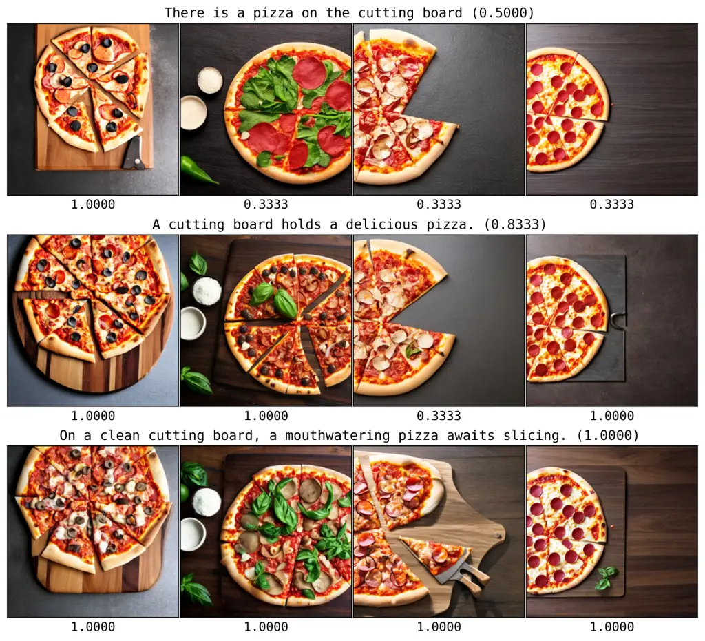

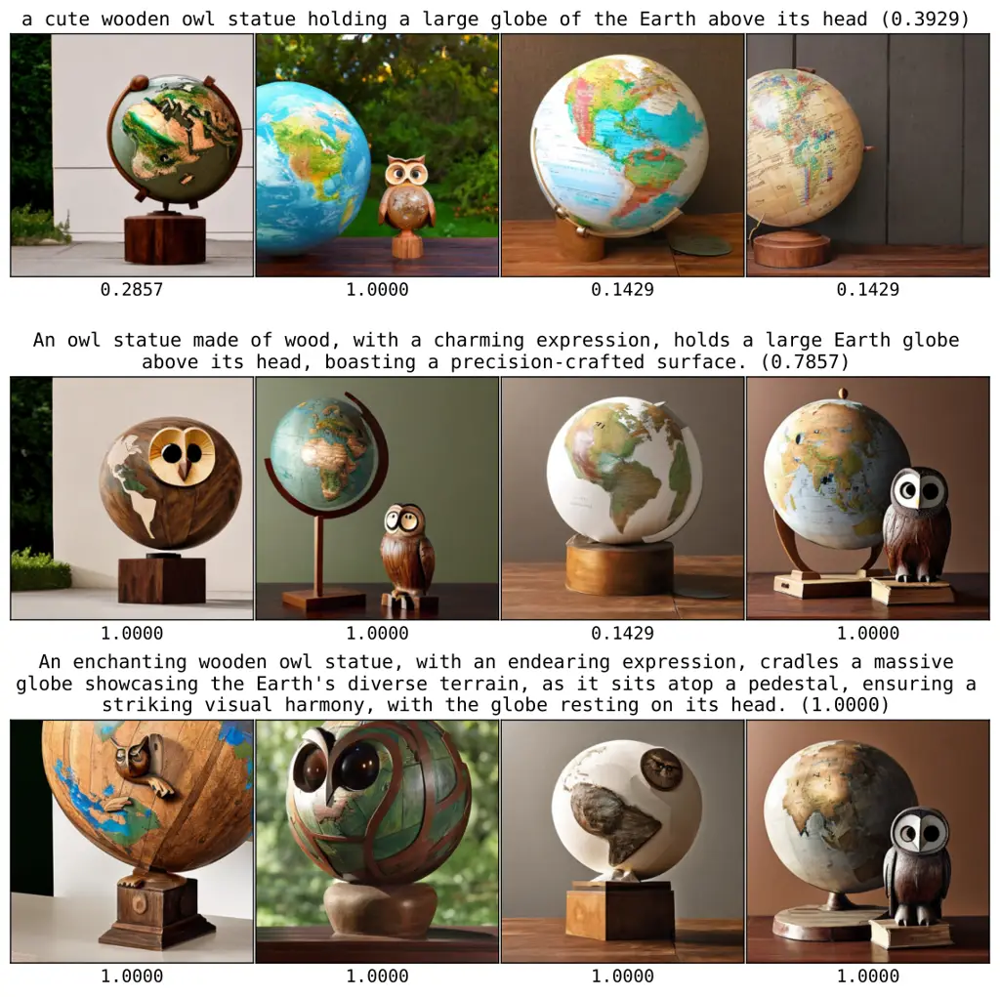

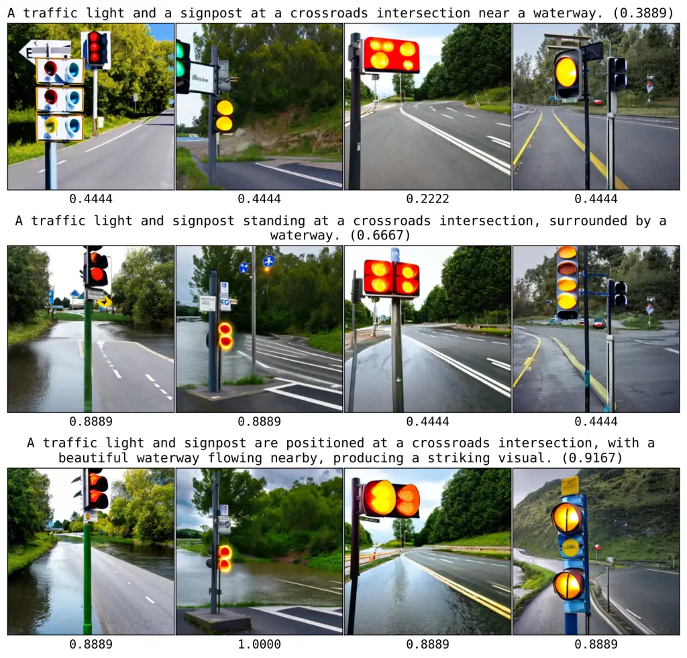

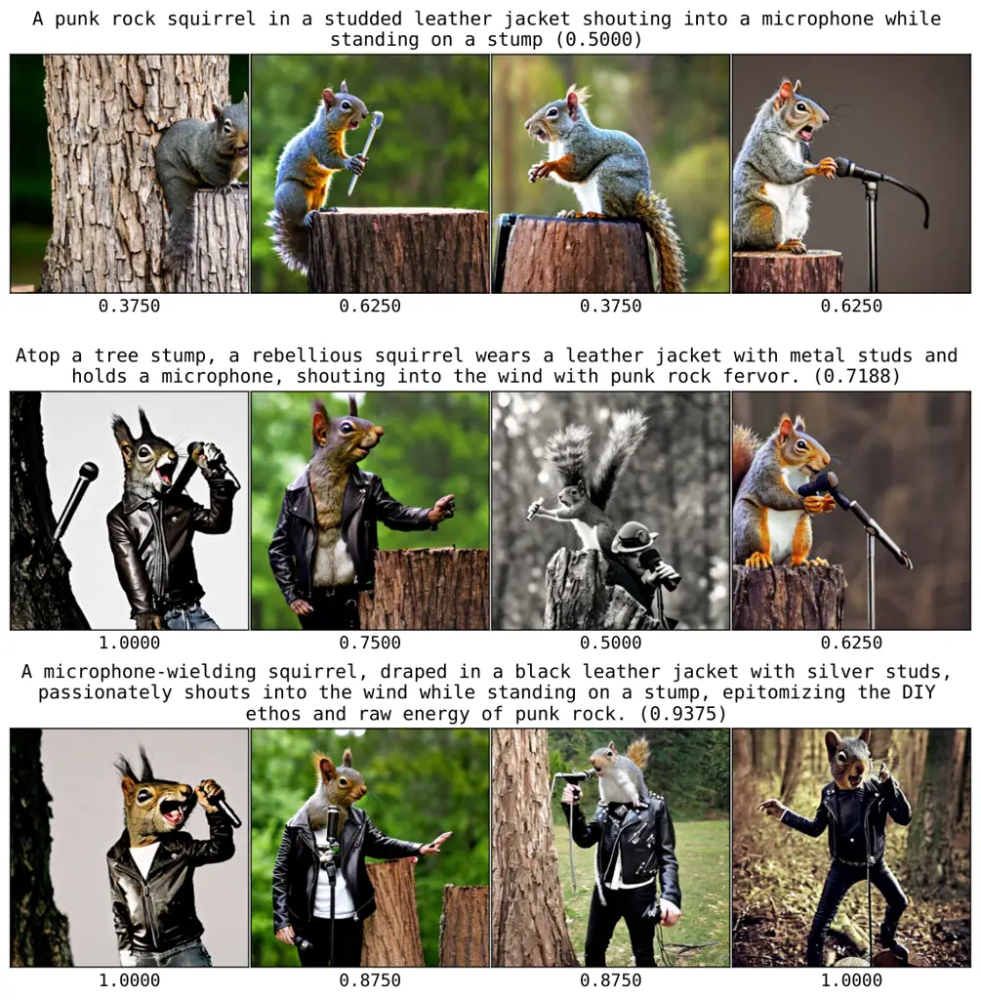

Figure 11: Selected examples of initial prompts from MSCOCO (left) and
PartiPrompts (right) and revised prompts across the optimization, along
with the generated images. The optimizer refines prompts for LDM-2.1
using Llama-2 as LLM and DSG as scorer. We report DSG score averaged
across images.

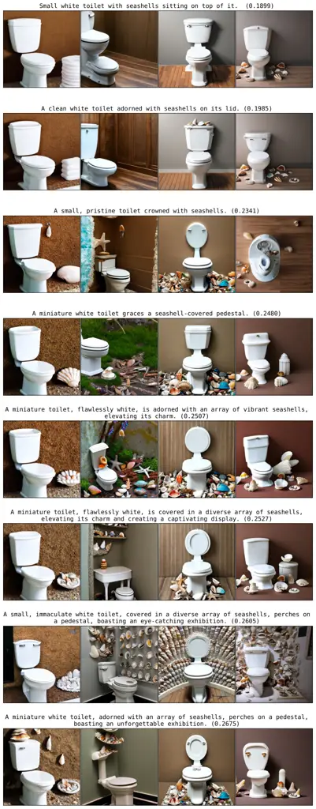

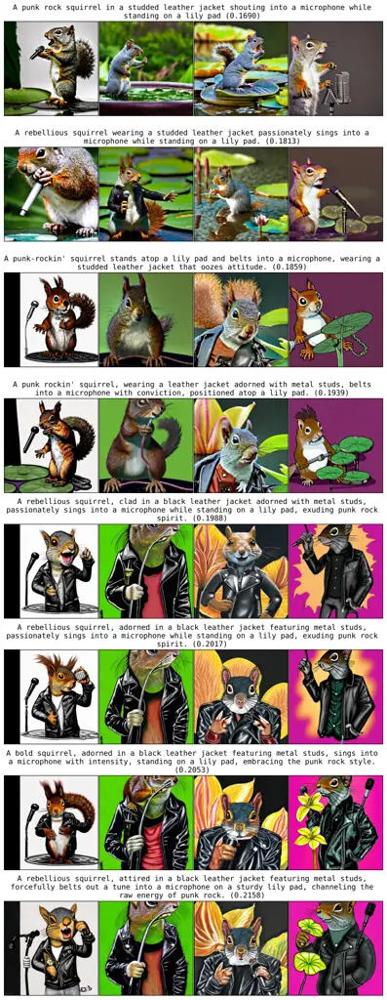

Figure 12: Selected examples of initial prompts from MSCOCO (left) and
PartiPrompts (right) and revised prompts across the optimization, along
with the generated images. The optimizer refines prompts for LDM-2.1
using Llama-2 as LLM and dCS as scorer. We report dCS score averaged
across images.
