# InstructBrush: Learning Attention-based Instruction Optimization for Image Editing

Ruoyu Zhao    Qingnan Fan    Fei Kou    Shuai Qin    Hong Gu    Wei Wu
   Pengcheng Xu    Mingrui Zhu    Nannan Wang    Xinbo Gao Affiliation: 
Project Page:
[https://royzhao926.github.io/InstructBrush/](https://royzhao926.github.io/InstructBrush/)
Affiliation: Xidian University   VIVO    CityU   Western University   
Affiliation: Chongqing University of Posts and Telecommunications

###### Abstract

In recent years, instruction-based image editing methods have garnered
significant attention in image editing. However, despite encompassing a
wide range of editing priors, these methods are helpless when handling
editing tasks that are challenging to accurately describe through
language. We propose InstructBrush, an inversion method for
instruction-based image editing methods to bridge this gap. It extracts
editing effects from exemplar image pairs as editing instructions, which
are further applied for image editing. Two key techniques are introduced
into InstructBrush, Attention-based Instruction Optimization and
Transformation-oriented Instruction Initialization, to address the
limitations of the previous method in terms of inversion effects and
instruction generalization. To explore the ability of instruction
inversion methods to guide image editing in open scenarios, we establish
a Transformation-Oriented Paired Benchmark (TOP-Bench), which contains a
rich set of scenes and editing types. The creation of this benchmark
paves the way for further exploration of instruction inversion.
Quantitatively and qualitatively, our approach achieves superior
performance in editing and is more semantically consistent with the
target editing effects.

###### Keywords: 

Image Editing Prompt Inversion Diffusion Models

⁰⁰footnotetext: $`*`$Work done during the students’ internships at
VIVO.  
$`\dagger`$corresponding author.

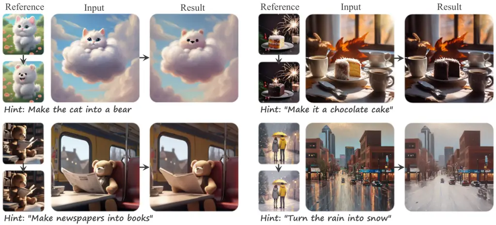

Figure 1: InstructBrush: an inversion method for instruction-based image
editing methods. It extracts editing effects from few reference image
pairs as editing instructions, which are further applied for image
editing. our InstructBrush achieves superior performance in editing and
is more semantically consistent with the target editing effects.

## 1 Introduction

Recently developed instruction-based image editing methods \[6, 57, 19,
15, 42\] enable users to effortlessly achieve their editing goals using
natural language instructions. These methods have garnered significant
attention owing to their flexibility and versatility in image editing,
concurrently fostering research on a unified vision task framework
\[19\]. While instruction-based image editing models encompass rich
prior knowledge, they still face challenges when dealing with editing
that are difficult to express accurately through textual instructions.
Therefore, exploring the replacement of textual instructions more
consistent with the desired target transformation to guide the precise
editing of new images is an important research problem.

This motivates the demand for the problem of instruction inversion,
which learns an instruction from a handful of image pairs exhibiting the
same editing effect, and subsequently applies it to edit new images.
These image pairs that provide information about image transformations
are also called visual prompts. Instruction inversion not only serves as
a valuable replacement when language is imprecise in describing specific
editing concepts but also provides a promising solution for extracting
priors in instruction-based editing models, aiding in the training of
downstream vision tasks \[28, 62\].

The closest work to ours in this field is \[34\], which attempts to
invert visual prompts as text instructions for editing new images. It
struggles with the editing effects for two reasons: 1) Inverting
instructions in CLIP space limits their representational ability. Since
CLIP is trained on text-image pairs with rough descriptions, it is
challenging to provide specific representations of the image
transformation details \[11\]. 2) Its instruction initialization
strategy introduces editing-irrelevant content prior to instruction
optimization, hence limiting the generalization of the instruction in
generalized scenarios.

To bridge these gaps, we introduce InstructBrush, a method to extract
the editing effect from image pairs as editing instruction and then
apply it to edit new images. In contrast to the previous method, we
propose the Attention-based Instruction Optimization. It localizes and
optimizes the editing instruction within the cross-attention layers in
the U-Net architecture \[40\] of the diffusion model, providing a more
direct and effective approach to guide image editing. To assist in the
optimization, we introduce the Transformation-oriented Instruction
Initialization. It ingeniously incorporates the editing-related prior
into the learned instruction by identifying unique phrases that describe
the changes before and after image editing. This effectively mitigates
the risk of compromising instruction generalization by introducing
irrelevant content information and promotes semantic alignment of the
instruction with the objectives.

To investigate the ability of the instruction inversion methods in
guiding image editing in diverse scenarios, we establish
Transformation-Oriented Paired Benchmark (TOP-Bench) tailored for
instruction inversion tasks. This benchmark comprises a total of 750
images, encompassing 25 distinct editing effects, with each effect
having 10 pairs of training data and 5 pairs of testing data. The
creation of this benchmark not only helps to evaluate the potential of
existing methods in guiding image editing, but also paves the way for
further research in instruction inversion. Qualitatively and
quantitatively, our method surpasses the existing methods in terms of
performance and demonstrates greater semantically consistency with the
target editing effects.

In summary, our contributions are threefold:

- •
  We introduce InstructBrush, a novel solution to instruction inversion,
  which extracts the editing instruction from exemplar image pairs for
  the subsequent image editing task.
- •
  We propose the Attention-based Instruction Optimization which is
  optimized within the feature space of the cross-attention, improving
  the results of instruction inversion, and the Transformation-oriented
  Instruction Initialization for instructions optimization, ingeniously
  integrating textual priors capturing changes between images pairs into
  the optimized instructions.
- •
  We establish Transformation-Oriented Paired Benchmark (TOP-Bench) for
  instruction inversion to assess its adaptability across diverse
  scenarios. Both qualitatively and quantitatively, our approach
  achieves more robust editing and is more semantically consistent with
  the target editing effects.

## 2 Related Work

Instruction-based Image Editing. Text-guided diffusion models \[35, 38,
41, 39, 37, 5, 12\] have taken the world by storm. By leveraging the
robust generative priors of these models, InstructPix2Pix (IP2P) \[6\]
makes the initial attempt to use a triplet dataset for training a model
that edits images based on instructions, achieving intuitive and
user-friendly instruction-based image editing. HIVE \[59\] incorporates
reward learning from human feedback to fine-tune IP2P for instruction
editing that is more aligned with user preferences. To explore the
application of instruction-based editing in real-world images,
MagicBrush \[57\] constructs a large-scale manually annotated dataset to
fine-tune IP2P, greatly improving the effect in real image editing.
Several existing methods, such as InstructDiffusion \[19\] and Emu Edit
\[42\] extend instruction-based editing methods to new visual tasks,
demonstrating the potential of instruction-based image editing methods
as a universal framework for visual tasks. Recently, some efforts \[15,
23\] leverage Multimodal Large Language Models (MLLMs) to enhance the
performance of instructions, facilitating more accurate editing. Other
efforts \[43, 20, 29\] concentration flexible and high-fidelity local
editing, addressing the limitations of instruction-based editing in
processing local details of images. Additionally, instruction-based
image editing has been extended to 3D \[9\] and video \[54\] editing
tasks, showcasing its tremendous application value.

Diffusion-based Prompt Inversion. The diffusion-based prompt inversion
methods aim to learn the text prompt from a handful of images describing
concepts, thereby guiding the generation of diffusion models. Textual
Inversion \[16\] learns text embeddings corresponding to pseudo-words to
represent the target concepts. The pseudo-words can be combined with
free text to guide the generation of images containing target concepts.
Based on their research, some works \[13, 46, 60, 2, 61\] explore the
effects of different inversion spaces on prompt inversion. Other works
\[17, 52, 3, 8, 56, 30\] train an image encoder based on text inversion
to achieve generation guided by a given reference image. Additionally,
ReVersion \[24\] focuses on learning the relation between objects
through contrastive learning. PEZ \[53\] inverts hard prompts by
projecting learned embeddings onto adjacent interpretable word
embeddings, providing a new solution for image captioning. \[45\]
decomposes a visual concept, allowing users to explore hidden
sub-concepts of the object of interest. Lego \[33\] uses carefully
designed prompt learning methods to learn abstract concepts that are
entangled with the subject from few samples. These methods focus on
learning concepts to guide image generation, while our study aims to
learn the transformations between image pairs to guide image editing.

Visual In-context Learning. In-context learning \[7\], which originated
from the field of natural language processing (NLP), has been promoted
as a learning paradigm. This paradigm enables the execution of a given
task on a sample query after learning the task from a set of examples.
VisualPrompting \[4\] first introduced the concept of visual contextual
learning. It uses an inpainting-based approach with grid-like inputs and
has shown remarkable results in many tasks. Subsequent works \[47, 48,
14\] broaden the application areas of the framework, such as keypoint
detection \[47\], image denoising \[47\], image segmentation \[48\] and
3D point cloud \[14\]. Recent works \[49, 10\] introduce in-context
learning on diffusion models to accomplish various visual tasks, but
they require guidance from textual instructions. ImageBrush \[55\]
models visual transformations as a diffusion-based inpainting problem.
However, it still requires grid images as input, which poses a
significant burden when processing high-resolution images. Unlike these
methods, Visii \[34\] focuses on editing tasks. It inverses exemplar
image pairs into a text instruction within an instruction-based image
editing model, replacing textual instructions to guide the editing of
new images. Our approach similarly focuses on image editing based on
instruction inversion and achieves more robust editing and
generalization ability to new scenarios.

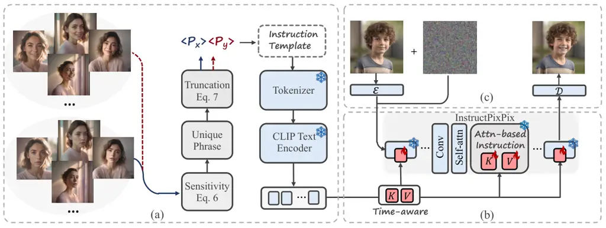

Figure 2: The Framework of InstructBrush. InstructBrush inverts
instructions from exemplar image pairs by proposing novel
Transformation-oriented Instruction Initialization (a) and
Attention-based Instruction Optimization (b) modules. The former is
proposed to initialize the instruction, which effectively introduces the
editing-related prior to facilitate semantic alignment of the
instruction with the exemplar image pairs. The latter introduces the
editing instruction into the cross-attention layers of the
instruction-based image editing model and directly optimizes the Keys
and Values corresponding to the instruction within these layers. After
optimization, the learned instructions are used to guide the editing of
new images (c).

## 3 Preliminaries

Latent Diffusion Models. Stable Diffusion (SD), a variant of the latent
diffusion model (LDM) \[39\], serves as a text-guided diffusion model.
To generate high-resolution images while enhancing computational
efficiency in the training process, it employs a pre-trained variational
autoencoder (VAE) encoder $`\mathcal{E}(\cdot)`$ to map images into
latent space and perform an iterative denoising process. Subsequently,
the predicted images is mapping back into pixel space through the
pre-trained VAE decoder $`\mathcal{D}(\cdot)`$. For each denoising step,
the simplified optimization objective is defined as follows:

```math
\displaystyle L_{LDM}(\theta)\coloneqq\mathbb{E}_{\mathcal{E}(x),\epsilon,t}\!\left[{\left\|\epsilon-\epsilon_{\theta}(z_{t},t,\tau_{\theta}(c)\right\|^{2}_{2}}\right]. \tag{1}
```

In this process, the text description $`c`$ is first tokenized into
textual embeddings by a Tokenizer. The textual embeddings are then
passed through the CLIP text encoder $`\tau_{\theta}(\cdot)`$ to obtain
text conditions. The resulting text conditions are used to guide the
diffusion denoising process.

InstructPix2Pix. Our method is based on InstructPix2Pix (IP2P) \[6\], an
instruction-guided image editing method. After encoding the input image
$`c_{I}`$ using the VAE encoder, IP2P concatenates the noisy latent
$`z_{t}`$ with the encoded latent $`\mathcal{E}(c_{I})`$ in the first
convolutional layer of SD. Subsequently, it uses a generated triplet
dataset to perform instruction tuning \[51\] on the improved network.
This method maximizes the utilization of SD’s powerful generative prior,
thereby enabling stunning image editing based on human instructions
$`c_{T}`$. The simplified denoising optimization objective is defined
by:

```math
\displaystyle L_{IP2P}(\theta)\coloneqq\mathbb{E}_{\mathcal{E}(x),\mathcal{E}\left(c_{I}\right),c_{T},\epsilon,t}\!\left[{\left\|\epsilon-\epsilon_{\theta}(z_{t},t,\mathcal{E}(c_{I}),c_{T})\right\|^{2}_{2}}\right]. \tag{2}
```

The dual conditional framework of IP2P employs both input image $`I`$
and text instruction $`t`$ for guidance, achieved through an enhanced
classifier-free guidance (CFG) strategy \[22\]. The improved CFG
incorporates two distinct guidance scales, $`s_{T}`$ and $`s_{I}`$,
adjustable to balance guidance strength between text and image
conditions. It learns the score estimate predicted by the network
corresponding to a single denoising step as follows:

```math
\displaystyle\tilde{e}_{\theta}\left(z_{t},c_{I},c_{T}\right) \displaystyle=e_{\theta}\left(z_{t},\varnothing,\varnothing\right) \tag{3}
```

```math
\displaystyle+s_{I}\cdot\left(e_{\theta}\left(z_{t},c_{I},\varnothing\right)-e_{\theta}\left(z_{t},\varnothing,\varnothing\right)\right)
```

```math
\displaystyle+s_{T}\cdot\left(e_{\theta}\left(z_{t},c_{I},c_{T}\right)-e_{\theta}\left(z_{t},c_{I},\varnothing\right)\right).
```

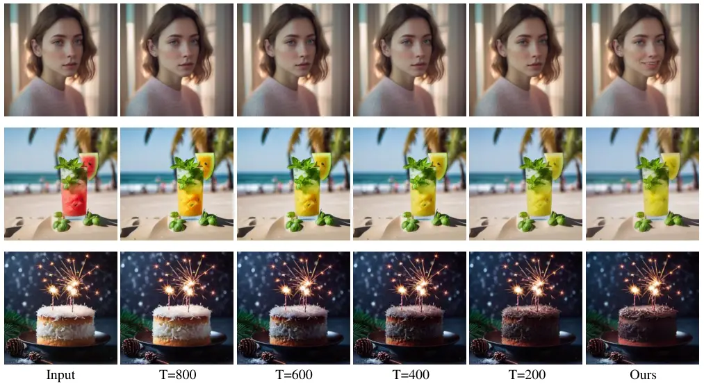

Figure 3: Visualization of Applying Time-aware Instructions to Various
Denoising Steps. Example: $`T=800`$ represents the application of our
time-aware instruction before the denoising time step of 800 (steps 1000
to 800), while the None instruction is applied to the denoising process
after 800 steps (steps 800 to 0). Therefore, $`T=1000`$ indicates the
input image, and $`T=0`$ indicates our full implementation. The
visualization results show that in the early denoising stages, the
editing focuses on coarse information such as colors (rows 2 and 3); in
the later stages, the editing focuses on detailed information such as
textures and facial expressions (rows 1 and 3).

## 4 Method

The pipeline of InstructBrush is demonstrated in Figure 2. Based on the
instruction-based image editing methods \[6\], InstructBrush inverts
exemplar image pairs as editing instructions and applies them to editing
new images. It proposes novel Attention-based Instruction Optimization
and Transformation-oriented Instruction Initialization modules. The
former introduces the editing instruction into the cross-attention
layers of the instruction-based image editing model and directly
optimizes the Keys and Values corresponding to the instruction within
these layers, facilitating more effective instruction inversion
(Section 4.1). The latter is proposed to initialize the optimized
instruction, which effectively introduces the editing-related prior to
facilitate semantic alignment of the instruction with the exemplar image
pairs (Section 4.2).

### 4.1 Attention-based Instruction Optimization

Inspired by Textual Inversion \[16\], The current instruction inversion
method \[34\] optimizes the output embeddings of the CLIP text encoder
using image pairs, aiming to represent the transformation effects
between image pairs in CLIP space. However, CLIP is trained on
text-image pairs with rough descriptions, and its feature space is prone
to losing the detailed representation of the image \[11\]. Therefore, it
is difficult to achieve the requirement of only optimizing the
instruction that represents the target transformation in CLIP space.
Instead, we focus on optimizing the features in cross-attention. These
features are projected from textual embeddings to representations
consistent with image features, enabling a more precise representation
of image transformation details \[21, 43\]. As a result, we introduce an
attention-based instruction optimization that optimizes editing
instructions in the image feature space of the cross-attention layers in
the diffusion model, fostering more effective instruction inversion.

Attention-based Instruction. Considering a single-head cross-attention,
let $`Q`$ be the query, $`K`$, $`V`$ be the keys and values from the
instruction, respectively, the cross-attention is given by:

```math
\displaystyle\begin{aligned} \text{Attention}\left(Q,K,V\right)=\text{Softmax}\Big(\frac{QK^{T}}{\sqrt{d^{\prime}}}\Big)V.\end{aligned} \tag{4}
```

Here, $`K,V\in\mathbb{R}^{l\times d}`$, where $`l`$ represents the token
length of the instruction, and $`d`$ represents the feature dimension,
the value of which depends on the position of the cross-attention layer
in the U-Net framework. We optimize the features
$`\gamma_{K},\gamma_{V}\in\mathbb{R}^{m\times d}`$ with a length of
$`m\in l`$ in the key and value corresponding to the first $`m`$ tokens
of the text instruction. Because after linear projection, instruction
embeddings transform from text embedding to image features, exhibiting
stronger image representation capabilities. To optimize the feature
embeddings of the editing instruction, our optimization objective is
derived from the simplified least squares error in Eq. 2:

```math
\displaystyle\begin{aligned} \gamma=\argmin\mathbb{E}_{\mathcal{E}(x),\mathcal{E}\left(c_{I}\right),c_{T},\epsilon,t}\!\left[{\left\|\epsilon-\epsilon_{\theta}(z_{t},t,\mathcal{E}(c_{I}),c_{T})\right\|^{2}_{2}}\right].\end{aligned} \tag{5}
```

Here, $`\gamma=\left\{\gamma_{K},\gamma_{V}\right\}_{1\ldots n}`$
represents the features of keys and values from the first $`m`$ tokens
of the text instruction in all $`n`$ cross-attention layers. The value
of $`m`$ corresponds to the number of text tokens used for instruction
initialization, as described in Section 4.2.

Time-aware Instruction. In the text-guided diffusion models, the
denoising process focuses on image generation from low-frequency
structure to high-frequency details \[13, 60\]. We believe that a
similar property also exists in instruction-based editing models, where
different denoising processes primarily focus on distinct
transformations. Therefore, we divide the instruction optimization
equally into $`j`$ parts based on denoising time steps, allowing
instructions to focus on different editing tasks at different denoising
time steps. We visualize the effect of applying our time-aware
instructions on image editing during different denoising periods in
Figure 3. The visualization results show that in the early denoising
stages, the editing focuses on coarse information such as colors; in the
later stages, the editing focuses on detailed information such as
textures and facial expressions. Now, we have
$`\gamma=\left\{\gamma_{K},\gamma_{V}\right\}^{j}_{1\ldots n}`$, where
$`j`$ is 5 by default. In this way, the learned instructions can capture
more details of transformations, which can guide the editing of new
images more robustly.

### 4.2 Transformation-oriented Instruction Initialization

Concept inversion (such as Textual Inversion), using the semantic class
word (e.g., dog, cat) for initialization, provides prior information for
the target concept learning. However, the instruction inversion requires
learning a sentence describing the image transformation. Manually
initializing a sentence based on the transformation of reference image
pairs is not only laborious but also subjective. The existing method
\[34\] utilizes the caption method \[53\] to obtain the caption of
after-editing images in the training set as the start point of the
optimization. Despite the introduction of transformation-related prior
knowledge, this content-oriented initialization approach can
simultaneously introduce editing-irrelevant content information about
the training scenario, hindering the generalization of instruction to
new scenarios. Instead, our method directly extracts the information
related to image transformations that assist in the optimization process
of instruction without affecting its generalization ability.
Specifically, we first extract unique phrases that differentiate the
images before and after editing as editing-related priors. Subsequently,
we incorporate them into the image transformation template for
instruction initialization.

Unique Phrase Extraction. Given a set of image pairs
$`\{\{x\},\{y\}\}`$, where $`\{x\}`$ and $`\{y\}`$ represent the image
sets before and after editing, for a single set $`\{x\}`$, we search for
a caption based on the image-text feature similarity as
$`CAP_{x}=\{<\!p_{1}\!>,\ldots,<\!p_{r}\!>\}`$. Here, $`<\!p_{i}\!>`$
represents a phrase from the vocabulary of \[1\], and $`r`$ represents
the adjustable number of phrases to form the caption, which is set to 5
by default. Subsequently, we compare the feature similarity between
$`CAP_{x}`$ and the image sets $`\{x\}`$, $`\{y\}`$ respectively, and
then measure the difference in feature similarity of the same phrase
with the two sets as the sensitivity. This process can be represented as
follows:

```math
\displaystyle\begin{aligned} sens_{i}\left(<\!p_{i}\!>\right)=sim\left(<\!p_{i}\!>,\{x\}\right)-sim\left(<\!p_{i}\!>,\{y\}\right)\end{aligned} \tag{6}
```

Here, $`sens_{i}`$ denotes the sensitivity of the $`i`$th phrase in
$`CAP_{x}`$ and $`sim`$ denotes the CLIP feature similarity. We identify
the phrase with maximum sensitivity as the unique phrase $`<\!p_{x}\!>`$
of the set $`\{x\}`$. However, there exist certain edits whose relevant
information cannot be recognized by a caption. To avoid the unique
phrase containing editing-irrelevant information, we define the
following conditions:

```math
\displaystyle\begin{aligned} <\!p_{x}\!>=\begin{cases}<\!p_{x}\!>&\text{ if }sens\left(<\!p_{x}\!>\right)\geq\eta\\
\varnothing&\text{ otherwise},\end{cases}\end{aligned} \tag{7}
```

where $`\eta`$ represents a constant that controls the truncation of
unique phrases, set to 0.15 by default.

Image Transformation Template. With the above method, we can get the
unique phrases $`<\!p_{x}\!>`$ and $`<\!p_{y}\!>`$ for sets $`\{x\}`$
and $`\{y\}`$. Then we incorporate them into the image transformation
template. For example, we use
$`{}^{\prime\prime}turn<\!p_{x}\!>into<\!p_{y}\!>^{\prime\prime}`$ as a
starting point for instruction optimization. Note that when
$`<\!p_{y}\!>=\varnothing`$, we use None instruction for initialization
and optimize fixed-length features for Keys and Values in
cross-attention. Although the initialized instruction is not sufficient
to express the target editing effect, it can introduce prior knowledge
of transformation, aiding the semantics of learned instruction to be
close to the target.

## 5 Transformation-oriented Paired Benchmark

To investigate the editing capabilities of various instruction inversion
methods in open scenarios and facilitate a fair comparison of these
methods, We establish a benchmark named TOP-Bench
(Transformation-Oriented Paired Benchmark), which can be utilized for
both qualitative and quantitative evaluations. Our benchmark spans 25
datasets corresponding to different editing effects. It covers a wide
range of editing categories and scenarios, allowing for division from
multiple dimensions. Each dataset consists of 10 pairs of training
images and 5 pairs of testing images, totaling 750 images. Additionally,
we provide text instructions aligned with the transformation effects for
each dataset. Please refer to the Supplementary for data acquisition and
detailed introduction.

To further analyze the advantages of our method, we categorize the
benchmark into two different categories: TOP-Global and TOP-Local,
corresponding to datasets of 14 global editing effects and 11 local
editing effects, respectively. We compare the quantitative results of
different methods in these two categories to validate the effectiveness
of our method.

## 6 Experiments

In this section, we present qualitative and quantitative results. The
experimental results demonstrate that our proposed InstructBrush
outperforms existing methods.

Implementation Details. The implementation is based on one NVIDIA Tesla
V100 GPU. We use pre-trained IP2P and optimized the features of the keys
and values corresponding to the instruction tokens (around 10) obtained
from our instruction initialization method. We divide the learned
instructions into 5 parts according to the denoising time step, and
optimize each part with 1000 steps using a learning rate of 0.001 and a
batch size of 1, respectively, for a total of 5000 steps. The whole
training process takes about 25 minutes. During both training and
inference, we adopt a text guidance scale $`s_{T}=7.5`$ and an image
guidance scale $`s_{I}=1.5`$. And we use the Euler ancestral sampler
with denoising variance schedule \[26\] with a sampling step of $`T=20`$
during the inference process.

Metrics. We use four objective evaluation metrics on the benchmark.
Specifically, we employ full-reference quality metrics PSNR, SSIM
\[50\], and LPIPS \[58\] to assess the consistency between the generated
images and the ground truth, quantifying the image editing capabilities
of each method. In addition, we measure the CLIP directional similarity
\[18\] between image pairs to evaluate the semantic alignment between
the editing direction of each method and the target. Specifically, we
measure the consistency between the average editing direction from the
input images to the generated images and the average direction of the
training image pairs.

Compared Methods. We compare our InstructBrush with the state-of-the-art
competitor Visii \[34\] and the base editing model IP2P \[6\]. We use an
image resolution of $`512\times 512`$ for comparison with other methods.
For Visii, we utilize its official implementation, while for IP2P, we
employ its Diffusers \[36\] version. All experiments are conducted
following the official recommended configurations.

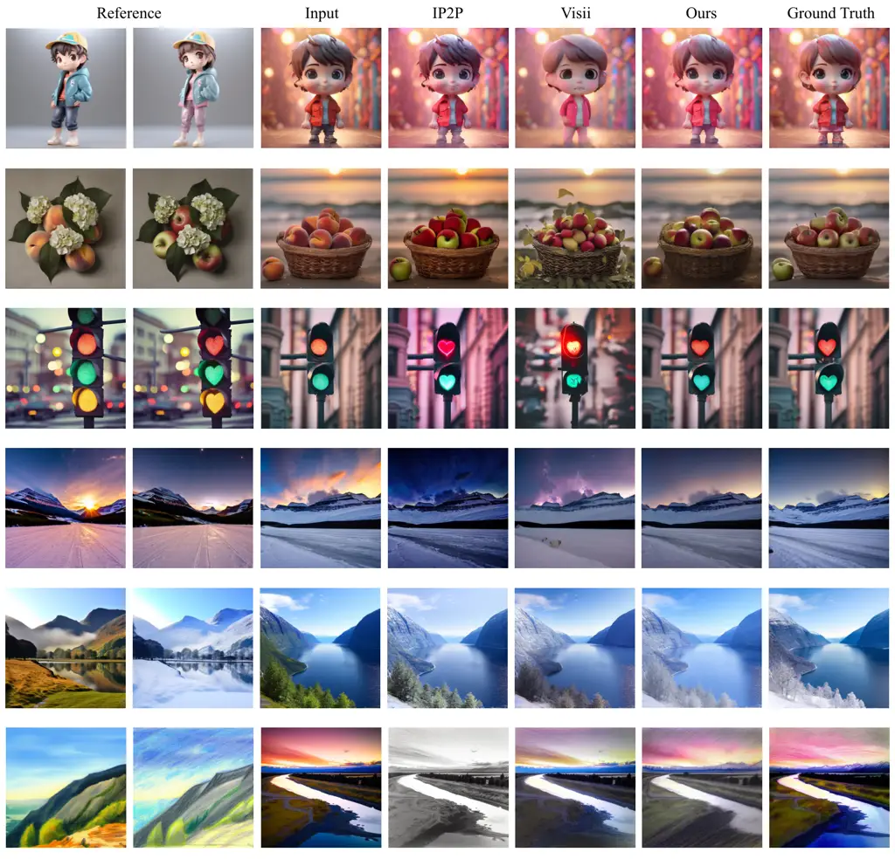

Figure 4: Qualitative Comparisons with Existing Methods. Our method
achieves superior performance in both local and global image editing. It
effectively avoids introducing editing-irrelevant information from the
training images, showing better instruction generalization.


Figure 5: More Visualization Results of Our Method. Our method
demonstrates robust performance on both local and global editing. And it
does not introduce scene information of the training image when editing
new images, which reflects the instruction generalization of our method.

|            |              |                   |                   |                      |                        |
| ---------- | ------------ | ----------------- | ----------------- | -------------------- | ---------------------- |
| Datasets   | Method       | PSNR $`\uparrow`$ | SSIM $`\uparrow`$ | LPIPS $`\downarrow`$ | Direct. $`\downarrow`$ |
| TOP-Global | IP2P \[6\]   | 16.10             | 0.5467            | 0.2810               | 0.2997                 |
|            | Visii \[34\] | 15.87             | 0.4947            | 0.3866               | 0.3938                 |
|            | Ours         | 18.66\_(17.5%↑)   | 0.5842\_(18.1%↑)  | 0.2526\_(34.7%↓)     | 0.2798\_(28.9%↓)       |
| TOP-Local  | IP2P \[6\]   | 20.12             | 0.7701            | 0.1648               | 0.5236                 |
|            | Visii \[34\] | 18.76             | 0.7157            | 0.2585               | 0.2560                 |
|            | Ours         | 23.26\_(24.0%↑)   | 0.8297\_(15.9%↑)  | 0.1143\_(55.8%↓)     | 0.3576                 |
| TOP-Bench  | IP2P \[6\]   | 17.87             | 0.6450            | 0.2298               | 0.3982                 |
|            | Visii \[34\] | 17.14             | 0.5919            | 0.3303               | 0.3332                 |
|            | Ours         | 20.68\_(20.6%↑)   | 0.6922\_(16.9%↑)  | 0.1918\_(41.9%↓)     | 0.3140\_(5.7%↓)        |

Table 1: Quantitative Results. We measure the average PSNR, SSIM, LPIPS,
and CLIP direction scores of several methods in different editing tasks.
Our method is significantly superior to other methods. We highlight in
red the percentage of our method that exceeds Visii.

### 6.1 Comparisons

Qualitative Comparisons. To demonstrate the advantages of our
InstruchBrush in image editing, we compared it with the existing
instruction inversion method Visii and the base model IP2P. We use our
TOP-Bench to evaluate the results of different methods. For instruction
inversion methods, we employ 10 reference before-and-after editing image
pairs to optimize the instruction for each editing effect. For IP2P, we
utilize natural text instructions provided by TOP-Bench for editing.
Subsequently, we present a comparison of the results of editing the test
images in Figure 4. IP2P can easily edit input images using text
instructions, but it is difficult to reproduce the editing effects
displayed by images that are difficult to express in language. Even if
we have text descriptions paired with reference images, due to slight
deviations between the text instructions of the base model and the
editing task \[42\], there are failures and coupling situations, as
shown in rows 3 through 6. Although Visii optimizes instructions to
learn the target editing concept and solves the problem of IP2P not
being able to specifically represent image changes using text
instructions alone, its content-oriented initialization reduces the
instructions generalization. It can easily introduce content information
in the training image during the instruction editing process, as shown
in rows 2 and 3. In addition, the limitations of optimization space also
make it difficult to accurately learn target editing concepts. By
contrast, our InstructBrush demonstrates superior editing performance.
Fig. 5 illustrates more qualitative results obtained by our method. It
demonstrates robust performance on both local and global editing. And it
does not introduce scene information of the training image when editing
new images, which reflects the instruction generalization of our method.

Quantitative Comparisons. In addition to qualitative comparisons, we
conduct a detailed quantitative evaluation of these methods on
TOP-Local, TOP-Global, and overall TOP-Bench. As shown in Table 1, the
editing performance of our method surpasses that of other methods at
both the editing effects and semantic alignment. In addition, compared
to the results of Visii, our method shows a more significant improvement
on TOP-Local than on TOP-Global. This is because in local editing tasks,
training images contain more editing-irrelevant scene information. The
content-oriented initialization of Visii introduces them to the
initialized instructions, posing a greater obstacle to optimization. On
the contrary, the transformation-oriented instruction initialization
used by our method can accurately capture the transformations between
image pairs and use them for initialization, thus improving instruction
generalization.

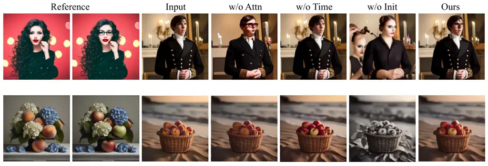

Figure 6: Visualization Results of Ablation Study. We visualize the
independent effects of our proposed attention-based instruction,
time-aware instruction, and transition-oriented instruction
initialization on the results, intuitively highlighting the importance
of these configurations.

|          |                   |                   |                      |                        |
| -------- | ----------------- | ----------------- | -------------------- | ---------------------- |
| Method   | PSNR $`\uparrow`$ | SSIM $`\uparrow`$ | LPIPS $`\downarrow`$ | Direct. $`\downarrow`$ |
| w/o Attn | 19.56             | 0.6709            | 0.2179               | 0.3124                 |
| w/o Time | 19.64             | 0.6656            | 0.2271               | 0.2910                 |
| w/o Init | 20.22             | 0.6841            | 0.2018               | 0.3747                 |
| Ours     | 20.68             | 0.6922            | 0.1918               | 0.3140                 |

Table 2: Ablation Study. We validate the independent impact of our
proposed attention-based instruction, time-aware instruction, and
transformation-oriented instruction initialization on results,
emphasizing the importance of these configurations.

### 6.2 Ablation Studies

Attention-based Instruction Ablation. The use of attention-based
instruction aims to avoid the limitation of CLIP space on the
representation ability of target transformations and achieve a more
accurate representation of image transformation details. The metrics
PSNR, SSIM, and LPIPS are calculated between the output and the ground
truth to evaluate the editing performance. We report results in Table 2
and observe that adopting attention-based instructions replaced with
CLIP space-based instructions effectively improves the editing
performance of the instructions. Additionally, we also observe in Figure
6 that compared to inversion in CLIP space, optimizing instruction in
attention space has shown significant improvements in editing.

Time-aware Instruction Ablation. The use of time-aware instructions
facilitates instruction optimization by allowing instructions to focus
on learning different transformations at different denoising time steps.
Table 2 explicitly shows that the use of time-aware instruction helps to
improve the editing effect. The same result is confirmed in Figure 6.
This suggests that it is necessary to optimize the corresponding
instructions for different denoising time steps to fit the image
transform of interest for the current step.

Transformation-oriented Instruction Initialization Ablation.
Content-oriented initialization methods introduce irrelevant content
information from the training images, thereby interfering with the
optimization process. As depicted in Figure 6, the use of the
content-oriented initialization method results in the leakage of content
information from the training image into the edited image. By enabling
instruction initialization to prioritize image changes over image
content, it not only enhances the editing capabilities of learned
instructions, but also aligns the edited image with the target
transformation in terms of semantic information, which is confirmed in
Table 2.

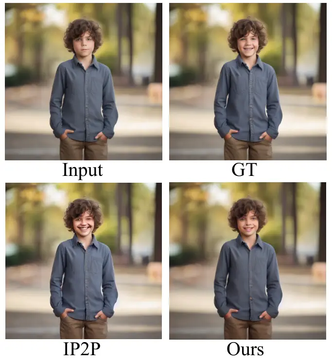

Figure 7: Failure case for our method.

### 6.3 Limitations

As the implementation of this method relies on instruction-based editing
models, the implementation of editing is constrained by the prior of the
base model. As shown in Figure 7, even if we capture the editing
concept, however, the upper bound for modifying subtle facial
expressions still depends on the generation ability of IP2P. In
addition, our initialization method is limited by the vocabulary used to
search for unique phrases. If the phrase is not present in the
vocabulary, our initialization method will initialize using None
instruction, which will not introduce any editing prior.

## 7 Conclusion

We present a novel approach to extracting the transformation effects
accurately of image pairs into editing instructions, which are then
utilized to guide the editing of new images. To enhance the accuracy and
generalization of inverted instructions, we propose attention-based
instruction optimization and transformation-oriented instruction
initialization. In addition, we establish a benchmark for instruction
inversion to further investigate the capabilities of various instruction
inversion methods. We qualitatively and quantitatively validate the
effectiveness of our proposed method. In the future, we will apply our
method to more powerful instruction-based image editing models for more
robust editing performance. We hope that this work will stimulate more
research on instruction inversion and serve as a prior extraction method
to help downstream task training.

## References

- \[1\] Clip-interrogator.
  [https://github.com/pharmapsychotic/clip-interrogator](https://github.com/pharmapsychotic/clip-interrogator) (2022)
- \[2\] Alaluf, Y., Richardson, E., Metzer, G., Cohen-Or, D.: A neural
  space-time representation for text-to-image personalization. ACM
  Transactions on Graphics (TOG) 42(6), 1–10 (2023)
- \[3\] Arar, M., Gal, R., Atzmon, Y., Chechik, G., Cohen-Or, D.,
  Shamir, A., H. Bermano, A.: Domain-agnostic tuning-encoder for fast
  personalization of text-to-image models. In: SIGGRAPH Asia 2023
  Conference Papers. pp. 1–10 (2023)
- \[4\] Bar, A., Gandelsman, Y., Darrell, T., Globerson, A., Efros, A.:
  Visual prompting via image inpainting. Advances in Neural Information
  Processing Systems 35, 25005–25017 (2022)
- \[5\] Betker, J., Goh, G., Jing, L., Brooks, T., Wang, J., Li, L.,
  Ouyang, L., Zhuang, J., Lee, J., Guo, Y., et al.: Improving image
  generation with better captions. Computer Science. https://cdn.
  openai. com/papers/dall-e-3. pdf 2(3),  8 (2023)
- \[6\] Brooks, T., Holynski, A., Efros, A.A.: Instructpix2pix: Learning
  to follow image editing instructions. In: Proceedings of the IEEE/CVF
  Conference on Computer Vision and Pattern Recognition. pp.
  18392–18402 (2023)
- \[7\] Brown, T., Mann, B., Ryder, N., Subbiah, M., Kaplan, J.D.,
  Dhariwal, P., Neelakantan, A., Shyam, P., Sastry, G., Askell, A.,
  et al.: Language models are few-shot learners. Advances in neural
  information processing systems 33, 1877–1901 (2020)
- \[8\] Chen, L., Zhao, M., Liu, Y., Ding, M., Song, Y., Wang, S., Wang,
  X., Yang, H., Liu, J., Du, K., et al.: Photoverse: Tuning-free image
  customization with text-to-image diffusion models. arXiv preprint
  arXiv:2309.05793 (2023)
- \[9\] Chen, M., Xie, J., Laina, I., Vedaldi, A.: Shap-editor:
  Instruction-guided latent 3d editing in seconds. arXiv preprint
  arXiv:2312.09246 (2023)
- \[10\] Chen, T., Liu, Y., Wang, Z., Yuan, J., You, Q., Yang, H., Zhou,
  M.: Improving in-context learning in diffusion models with visual
  context-modulated prompts. arXiv preprint arXiv:2312.01408 (2023)
- \[11\] Chen, X., Huang, L., Liu, Y., Shen, Y., Zhao, D., Zhao, H.:
  Anydoor: Zero-shot object-level image customization. arXiv preprint
  arXiv:2307.09481 (2023)
- \[12\] Dai, X., Hou, J., Ma, C.Y., Tsai, S., Wang, J., Wang, R.,
  Zhang, P., Vandenhende, S., Wang, X., Dubey, A., et al.: Emu:
  Enhancing image generation models using photogenic needles in a
  haystack. arXiv preprint arXiv:2309.15807 (2023)
- \[13\] Daras, G., Dimakis, A.: Multiresolution textual inversion. In:
  NeurIPS 2022 Workshop on Score-Based Methods (2022)
- \[14\] Fang, Z., Li, X., Li, X., Buhmann, J.M., Loy, C.C., Liu, M.:
  Explore in-context learning for 3d point cloud understanding. Advances
  in Neural Information Processing Systems 36 (2024)
- \[15\] Fu, T.J., Hu, W., Du, X., Wang, W.Y., Yang, Y., Gan, Z.:
  Guiding instruction-based image editing via multimodal large language
  models. arXiv preprint arXiv:2309.17102 (2023)
- \[16\] Gal, R., Alaluf, Y., Atzmon, Y., Patashnik, O., Bermano, A.H.,
  Chechik, G., Cohen-Or, D.: An image is worth one word: Personalizing
  text-to-image generation using textual inversion. arXiv preprint
  arXiv:2208.01618 (2022)
- \[17\] Gal, R., Arar, M., Atzmon, Y., Bermano, A.H., Chechik, G.,
  Cohen-Or, D.: Encoder-based domain tuning for fast personalization of
  text-to-image models. ACM Transactions on Graphics (TOG) 42(4),
  1–13 (2023)
- \[18\] Gal, R., Patashnik, O., Maron, H., Bermano, A.H., Chechik, G.,
  Cohen-Or, D.: Stylegan-nada: Clip-guided domain adaptation of image
  generators. ACM Transactions on Graphics (TOG) 41(4), 1–13 (2022)
- \[19\] Geng, Z., Yang, B., Hang, T., Li, C., Gu, S., Zhang, T., Bao,
  J., Zhang, Z., Hu, H., Chen, D., et al.: Instructdiffusion: A
  generalist modeling interface for vision tasks. arXiv preprint
  arXiv:2309.03895 (2023)
- \[20\] Guo, Q., Lin, T.: Focus on your instruction: Fine-grained and
  multi-instruction image editing by attention modulation. arXiv
  preprint arXiv:2312.10113 (2023)
- \[21\] Hertz, A., Mokady, R., Tenenbaum, J., Aberman, K., Pritch, Y.,
  Cohen-or, D.: Prompt-to-prompt image editing with cross-attention
  control. In: The Eleventh International Conference on Learning
  Representations (2022)
- \[22\] Ho, J., Salimans, T.: Classifier-free diffusion guidance. arXiv
  preprint arXiv:2207.12598 (2022)
- \[23\] Huang, Y., Xie, L., Wang, X., Yuan, Z., Cun, X., Ge, Y., Zhou,
  J., Dong, C., Huang, R., Zhang, R., et al.: Smartedit: Exploring
  complex instruction-based image editing with multimodal large language
  models. arXiv preprint arXiv:2312.06739 (2023)
- \[24\] Huang, Z., Wu, T., Jiang, Y., Chan, K.C., Liu, Z.: Reversion:
  Diffusion-based relation inversion from images. arXiv preprint
  arXiv:2303.13495 (2023)
- \[25\] Ju, X., Zeng, A., Bian, Y., Liu, S., Xu, Q.: Direct inversion:
  Boosting diffusion-based editing with 3 lines of code. In: The Twelfth
  International Conference on Learning Representations (2023)
- \[26\] Karras, T., Aittala, M., Aila, T., Laine, S.: Elucidating the
  design space of diffusion-based generative models. Advances in Neural
  Information Processing Systems 35, 26565–26577 (2022)
- \[27\] Krizhevsky, A., Sutskever, I., Hinton, G.E.: Imagenet
  classification with deep convolutional neural networks. Advances in
  neural information processing systems 25 (2012)
- \[28\] Lee, H.Y., Tseng, H.Y., Yang, M.H.: Exploiting diffusion prior
  for generalizable pixel-level semantic prediction. arXiv preprint
  arXiv:2311.18832 (2023)
- \[29\] Li, S., Zeng, B., Feng, Y., Gao, S., Liu, X., Liu, J., Lin, L.,
  Tang, X., Hu, Y., Liu, J., et al.: Zone: Zero-shot instruction-guided
  local editing. arXiv preprint arXiv:2312.16794 (2023)
- \[30\] Li, Z., Cao, M., Wang, X., Qi, Z., Cheng, M.M., Shan, Y.:
  Photomaker: Customizing realistic human photos via stacked id
  embedding. arXiv preprint arXiv:2312.04461 (2023)
- \[31\] Liang, J., Zeng, H., Cui, M., Xie, X., Zhang, L.: Ppr10k: A
  large-scale portrait photo retouching dataset with human-region mask
  and group-level consistency. In: Proceedings of the IEEE/CVF
  Conference on Computer Vision and Pattern Recognition. pp.
  653–661 (2021)
- \[32\] Mokady, R., Hertz, A., Aberman, K., Pritch, Y., Cohen-Or, D.:
  Null-text inversion for editing real images using guided diffusion
  models. In: Proceedings of the IEEE/CVF Conference on Computer Vision
  and Pattern Recognition (CVPR). pp. 6038–6047 (2023)
- \[33\] Motamed, S., Paudel, D.P., Van Gool, L.: Lego: Learning to
  disentangle and invert concepts beyond object appearance in
  text-to-image diffusion models. arXiv preprint arXiv:2311.13833 (2023)
- \[34\] Nguyen, T., Li, Y., Ojha, U., Lee, Y.J.: Visual instruction
  inversion: Image editing via image prompting. In: Thirty-seventh
  Conference on Neural Information Processing Systems (2023)
- \[35\] Nichol, A., Dhariwal, P., Ramesh, A., Shyam, P., Mishkin, P.,
  McGrew, B., Sutskever, I., Chen, M.: Glide: Towards photorealistic
  image generation and editing with text-guided diffusion models. arXiv
  preprint arXiv:2112.10741 (2021)
- \[36\] von Platen, P., Patil, S., Lozhkov, A., Cuenca, P., Lambert,
  N., Rasul, K., Davaadorj, M., Wolf, T.: Diffusers: State-of-the-art
  diffusion models.
  [https://github.com/huggingface/diffusers](https://github.com/huggingface/diffusers) (2022)
- \[37\] Podell, D., English, Z., Lacey, K., Blattmann, A., Dockhorn,
  T., Müller, J., Penna, J., Rombach, R.: Sdxl: Improving latent
  diffusion models for high-resolution image synthesis. arXiv preprint
  arXiv:2307.01952 (2023)
- \[38\] Ramesh, A., Dhariwal, P., Nichol, A., Chu, C., Chen, M.:
  Hierarchical text-conditional image generation with clip latents.
  arXiv preprint arXiv:2204.06125 1(2),  3 (2022)
- \[39\] Rombach, R., Blattmann, A., Lorenz, D., Esser, P., Ommer, B.:
  High-resolution image synthesis with latent diffusion models. In:
  Proceedings of the IEEE/CVF conference on computer vision and pattern
  recognition. pp. 10684–10695 (2022)
- \[40\] Ronneberger, O., Fischer, P., Brox, T.: U-net: Convolutional
  networks for biomedical image segmentation. In: Medical Image
  Computing and Computer-Assisted Intervention–MICCAI 2015: 18th
  International Conference, Munich, Germany, October 5-9, 2015,
  Proceedings, Part III 18. pp. 234–241. Springer (2015)
- \[41\] Saharia, C., Chan, W., Saxena, S., Li, L., Whang, J., Denton,
  E.L., Ghasemipour, K., Gontijo Lopes, R., Karagol Ayan, B., Salimans,
  T., et al.: Photorealistic text-to-image diffusion models with deep
  language understanding. Advances in Neural Information Processing
  Systems 35, 36479–36494 (2022)
- \[42\] Sheynin, S., Polyak, A., Singer, U., Kirstain, Y., Zohar, A.,
  Ashual, O., Parikh, D., Taigman, Y.: Emu edit: Precise image editing
  via recognition and generation tasks. arXiv preprint
  arXiv:2311.10089 (2023)
- \[43\] Simsar, E., Tonioni, A., Xian, Y., Hofmann, T., Tombari, F.:
  Lime: Localized image editing via attention regularization in
  diffusion models (2023)
- \[44\] Tumanyan, N., Geyer, M., Bagon, S., Dekel, T.: Plug-and-play
  diffusion features for text-driven image-to-image translation. In:
  Proceedings of the IEEE/CVF Conference on Computer Vision and Pattern
  Recognition (CVPR). pp. 1921–1930 (2023)
- \[45\] Vinker, Y., Voynov, A., Cohen-Or, D., Shamir, A.: Concept
  decomposition for visual exploration and inspiration. ACM Transactions
  on Graphics (TOG) 42(6), 1–13 (2023)
- \[46\] Voynov, A., Chu, Q., Cohen-Or, D., Aberman, K.: $`p+`$:
  Extended textual conditioning in text-to-image generation. arXiv
  preprint arXiv:2303.09522 (2023)
- \[47\] Wang, X., Wang, W., Cao, Y., Shen, C., Huang, T.: Images speak
  in images: A generalist painter for in-context visual learning. In:
  Proceedings of the IEEE/CVF Conference on Computer Vision and Pattern
  Recognition. pp. 6830–6839 (2023)
- \[48\] Wang, X., Zhang, X., Cao, Y., Wang, W., Shen, C., Huang, T.:
  Seggpt: Segmenting everything in context. arXiv preprint
  arXiv:2304.03284 (2023)
- \[49\] Wang, Z., Jiang, Y., Lu, Y., He, P., Chen, W., Wang, Z., Zhou,
  M., et al.: In-context learning unlocked for diffusion models.
  Advances in Neural Information Processing Systems 36 (2024)
- \[50\] Wang, Z., Bovik, A.C., Sheikh, H.R., Simoncelli, E.P.: Image
  quality assessment: from error visibility to structural similarity.
  IEEE transactions on image processing 13(4), 600–612 (2004)
- \[51\] Wei, J., Bosma, M., Zhao, V., Guu, K., Yu, A.W., Lester, B.,
  Du, N., Dai, A.M., Le, Q.V.: Finetuned language models are zero-shot
  learners. In: International Conference on Learning
  Representations (2021)
- \[52\] Wei, Y., Zhang, Y., Ji, Z., Bai, J., Zhang, L., Zuo, W.: Elite:
  Encoding visual concepts into textual embeddings for customized
  text-to-image generation. arXiv preprint arXiv:2302.13848 (2023)
- \[53\] Wen, Y., Jain, N., Kirchenbauer, J., Goldblum, M., Geiping, J.,
  Goldstein, T.: Hard prompts made easy: Gradient-based discrete
  optimization for prompt tuning and discovery. arXiv preprint
  arXiv:2302.03668 (2023)
- \[54\] Xing, Z., Dai, Q., Zhang, Z., Zhang, H., Hu, H., Wu, Z., Jiang,
  Y.G.: Vidiff: Translating videos via multi-modal instructions with
  diffusion models. arXiv preprint arXiv:2311.18837 (2023)
- \[55\] Yang, Y., Peng, H., Shen, Y., Yang, Y., Hu, H., Qiu, L., Koike,
  H., et al.: Imagebrush: Learning visual in-context instructions for
  exemplar-based image manipulation. Advances in Neural Information
  Processing Systems 36 (2024)
- \[56\] Ye, H., Zhang, J., Liu, S., Han, X., Yang, W.: Ip-adapter: Text
  compatible image prompt adapter for text-to-image diffusion models.
  arXiv preprint arXiv:2308.06721 (2023)
- \[57\] Zhang, K., Mo, L., Chen, W., Sun, H., Su, Y.: Magicbrush: A
  manually annotated dataset for instruction-guided image editing. arXiv
  preprint arXiv:2306.10012 (2023)
- \[58\] Zhang, R., Isola, P., Efros, A.A., Shechtman, E., Wang, O.: The
  unreasonable effectiveness of deep features as a perceptual metric.
  In: Proceedings of the IEEE conference on computer vision and pattern
  recognition. pp. 586–595 (2018)
- \[59\] Zhang, S., Yang, X., Feng, Y., Qin, C., Chen, C.C., Yu, N.,
  Chen, Z., Wang, H., Savarese, S., Ermon, S., et al.: Hive: Harnessing
  human feedback for instructional visual editing. arXiv preprint
  arXiv:2303.09618 (2023)
- \[60\] Zhang, Y., Dong, W., Tang, F., Huang, N., Huang, H., Ma, C.,
  Lee, T.Y., Deussen, O., Xu, C.: Prospect: Prompt spectrum for
  attribute-aware personalization of diffusion models. ACM Transactions
  on Graphics (TOG) 42(6), 1–14 (2023)
- \[61\] Zhao, R., Zhu, M., Dong, S., Wang, N., Gao, X.: Catversion:
  Concatenating embeddings for diffusion-based text-to-image
  personalization. arXiv preprint arXiv:2311.14631 (2023)
- \[62\] Zhao, W., Rao, Y., Liu, Z., Liu, B., Zhou, J., Lu, J.:
  Unleashing text-to-image diffusion models for visual perception. arXiv
  preprint arXiv:2303.02153 (2023)

## Appendix 0.A Evaluaion Metrics

We use four objective evaluation metrics on the benchmark. Specifically,
we employ full-reference quality metrics PSNR, SSIM \[50\], and LPIPS
\[58\] to assess the consistency between the generated images and the
ground truth, quantifying the image editing capabilities of each method.
Among them, higher PSNR indicates more similarity between the results
and the ground truth; higher SSIM indicates that the results are
structurally more similar to the ground truth; we implement the
evaluation of LPIPS based on AlexNet \[27\], and smaller LPIPS indicates
that the results has a better features similarity between the results
and the ground truth. In addition, we measure the CLIP directional
similarity \[18\] between image pairs to evaluate the semantic alignment
between the editing direction of each method and the target.
Specifically, we measure the consistency between the average editing
direction from the input images to the generated images and the average
direction of the training image pairs. We define the CLIP image
directional similarity as follows:

```math
1-\operatorname{cos}\left(\Delta_{x\rightarrow y},\Delta_{x^{\prime}\rightarrow y^{\prime}}\right), \tag{8}
```

where $`\Delta_{x\rightarrow y}`$ is the CLIP direction from the input
image to the result image, and
$`\Delta_{x^{\prime}\rightarrow y^{\prime}}`$ is the CLIP direction
between the reference images.

[TABLE]

Table 3: Benchmark Presentation. The benchmark has a total of 25 editing
effects, evenly covering both local and global editing.

## Appendix 0.B Benchmark Construction

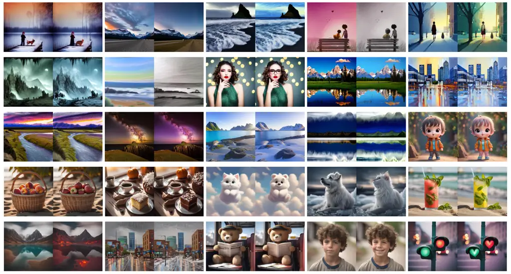

Figure 8: Visualization of Our Benchmark. Our benchmark spans 25
datasets corresponding to different editing effects. It covers a wide
range of editing categories and scenarios, allowing for division from
multiple dimensions. Each dataset consists of 10 pairs of training
images and 5 pairs of testing images, totaling 750 images. We show a
pair of before-and-after transformation examples for each editing
effect.

In recent years, there has been rapid development in text-guided image
editing methods. The evaluation of image editing effectiveness has also
evolved. Initially, the editing effect is solely evaluated through
qualitative presentations and user study \[21, 32\], which led to
significant subjectivity. Subsequently, PNP \[44\] establishes a
benchmark for text-guided image editing, which assesses the performance
of text-based image editing methods using text-image and image-image
feature similarity scores. Later, Direct Inversion \[25\] introduces a
more robust benchmark for text-guided image editing methods, comprising
700 images and 10 editing types, and utilizes 8 evaluation metrics for
an objective and comprehensive assessment. Although these benchmarks are
widely used by existing text-guided image editing methods, however, the
lack of paired training data prevents them from being applicable to the
instruction inversion methods. Visii \[34\] utilizes the filtered
dataset of IP2P \[6\] for evaluation. However, despite being filtered by
CLIP similarity, The overall quality of the IP2P training data is still
poor, which is reflected in the quality and fidelity of the images
before and after their editing. Furthermore, the dataset of IP2P
contains fewer pairs of data for the same editing type, which hinders an
accurate assessment of the performance of the instruction inversion
method under the few-shot setting.

To investigate the editing capabilities of various instruction inversion
methods in open scenarios and facilitate a fair comparison of these
methods, We establish a benchmark named TOP-Bench
(Transformation-Oriented Paired Benchmark), which can be utilized for
both qualitative and quantitative evaluations. Our benchmark spans 25
datasets corresponding to different editing effects. It covers a wide
range of editing categories and scenarios, allowing for division from
multiple dimensions. Each dataset consists of 10 pairs of training
images and 5 pairs of testing images, totaling 750 images. Additionally,
we provide text instructions aligned with the transformation effects for
each dataset.

In order to obtain paired data representing image editing, we refer to
the IP2P method of generating data and utilize the existing image
editing method P2P \[21\] to directly generate paired data before and
after editing. For different editing effects, some of them completely
replicate the training set of IP2P, i.e., using the image caption as
well as the editing instructions are from the training set of IP2P, and
the same settings of IP2P are used to generate and filter the
high-quality data of the present method so as to represent the editing
of the scene in the domain; while for some editing effects, we generate
them through the SDXL-based P2P, while the image caption as well as the
editing instructions are obtained based on GPT-4 to represent the
editing of the out-of-domain scene. TOP-Bench provides paired before and
after editing data. It is suitable for the evaluation of instruction
inversion methods. At the same time, TOP-Bench can be segmented in
multiple dimensions to comprehensively evaluate the performance of
instruction reversal methods. A detailed presentation of the datasets
representing the different editing effects within TOP-Bench and their
categorization is shown in Figure 8 and Table 3.

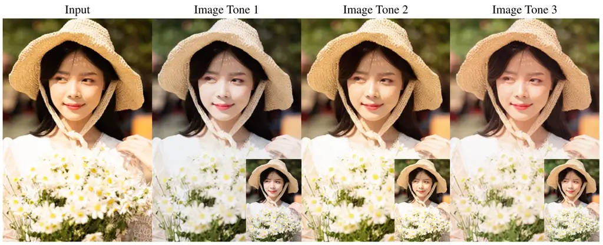

Figure 9: Image Tone Modification. Our InstructBrush can extract
different image tones based on a handful of data pairs and apply them to
new images. The image on the left gives the input image, and the images
on the right show three different outputs, corresponding to three image
tones, and the ground truth is given in the bottom right corner of each
output image for reference.

## Appendix 0.C Extra Applications

Image Retouching. Image retouching is the process of changing or
improving the quality of an image. This involves enhancing colors,
removing imperfections, adjusting lighting, or making other edits to
improve the overall appearance of an image. Implementing image
retouching using the instruction-based image editing models is
challenging because the vast majority of image retouching
transformations are difficult to describe using textual instructions.
Our method helps in this task. Given paired data before and after image
retouching, our InstructBrush can extract editing instructions
representing this image transformation from the prior of generative
model. The aligned instructions obtained through this process facilitate
training for downstream tasks. As shown in Figure 9, our InstructBrush
can extract image tones based on few image pairs that represent tonal
transformations from PPR10K \[31\] and apply these transformations to
new images.

## Appendix 0.D Additional Experiments

### 0.D.1 One-shot Editing

To further demonstrate the advantages of our method, we test the
quantitative results of different methods under 1-shot setting. We use
the first pair of images from each training sets within the benchmark as
our 1-shot training data pair. All settings were kept the same as in
previous experiments. As shown in Table 4. Our method outperforms the
other methods under 1-shot and has the same trend as the few-shot
quantitative experiments. Compared to the results of Visii, our method
still shows a more significant improvement on TOP-Local than on
TOP-Global for the 1-shot setting. This shows in local editing tasks,
training images contain more editing-irrelevant scene information. The
content-oriented initialization of Visii introduces them to the
initialized instructions, posing a greater obstacle to optimization. Our
method can accurately capture the transformations between image pairs
and use them for initialization, thus improving instruction
generalization.

|            |              |                   |                   |                      |                        |
| ---------- | ------------ | ----------------- | ----------------- | -------------------- | ---------------------- |
| Datasets   | Method       | PSNR $`\uparrow`$ | SSIM $`\uparrow`$ | LPIPS $`\downarrow`$ | Direct. $`\downarrow`$ |
| TOP-Global | IP2P \[6\]   | 16.10             | 0.5467            | 0.2810               | 0.2997                 |
|            | Visii \[34\] | 16.01             | 0.5071            | 0.3692               | 0.2909                 |
|            | Ours         | 17.79\_(11.1%↑)   | 0.5761\_(13.6%↑)  | 0.2748\_(25.6%↓)     | 0.3008                 |
| TOP-Local  | IP2P \[6\]   | 20.12             | 0.7701            | 0.1648               | 0.5236                 |
|            | Visii \[34\] | 19.73             | 0.7293            | 0.2309               | 0.5736                 |
|            | Ours         | 23.08\_(17.0%↑)   | 0.8270\_(13.4%↑)  | 0.1172\_(49.2%↓)     | 0.4790\_(16.5%↓)       |
| TOP-Bench  | IP2P \[6\]   | 17.87             | 0.6450            | 0.2298               | 0.3982                 |
|            | Visii \[34\] | 17.65             | 0.6049            | 0.3083               | 0.4153                 |
|            | Ours         | 20.11\_(13.9%↑)   | 0.6865\_(13.5%↑)  | 0.2055\_(33.3%↓)     | 0.3792\_(8.7%↓)        |

Table 4: Quantitative Results for One-shot. We measure the average PSNR,
SSIM, LPIPS, and CLIP direction scores of several methods in different
editing tasks. In 1-shot settings, our method demonstrates significant
superiority over other methods. We highlight in red the percentage of
our method that exceeds Visii.

### 0.D.2 More Visualization Results

We show more qualitative comparison results for local and global editing
in Figure 10 and Figure 11, and show more visualization results of our
method applied to local and global editing in Figure 12 and Figure 13.

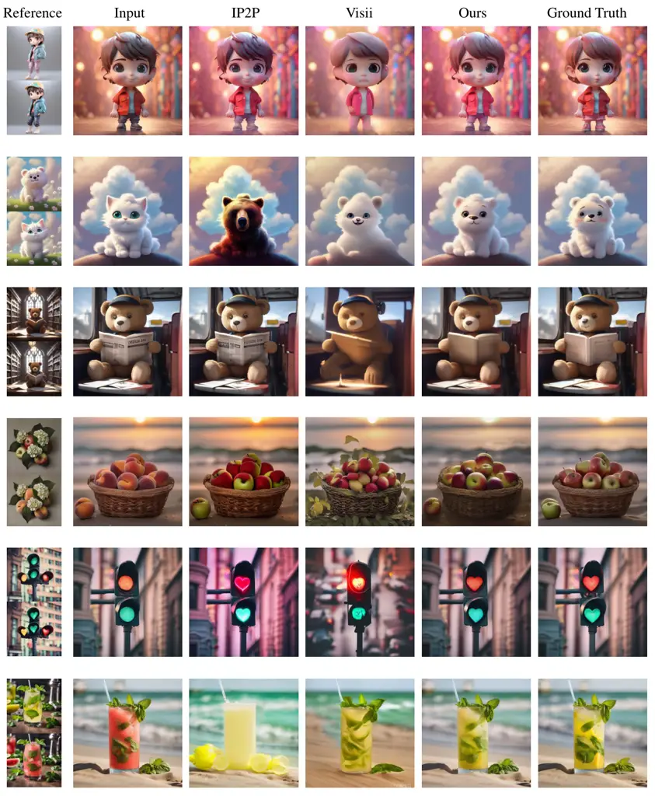

Figure 10: Qualitative Comparisons in Local Editing. We show more
qualitative results on local editing. The results show that our method
performs well in local editing. It effectively avoids introducing
editing-independent information from the training image and shows better
instruction generalization.

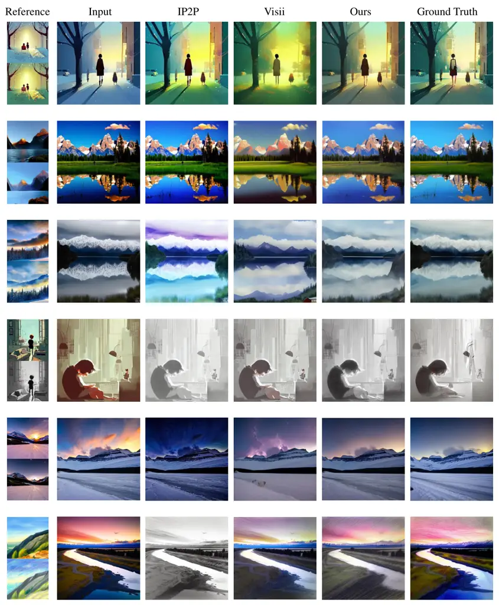

Figure 11: Qualitative Comparisons in Global Editing. We show more
qualitative results on global editing. The results show that our method
performs well in global editing. It effectively avoids introducing
editing-independent information from the training image and shows better
instruction generalization.

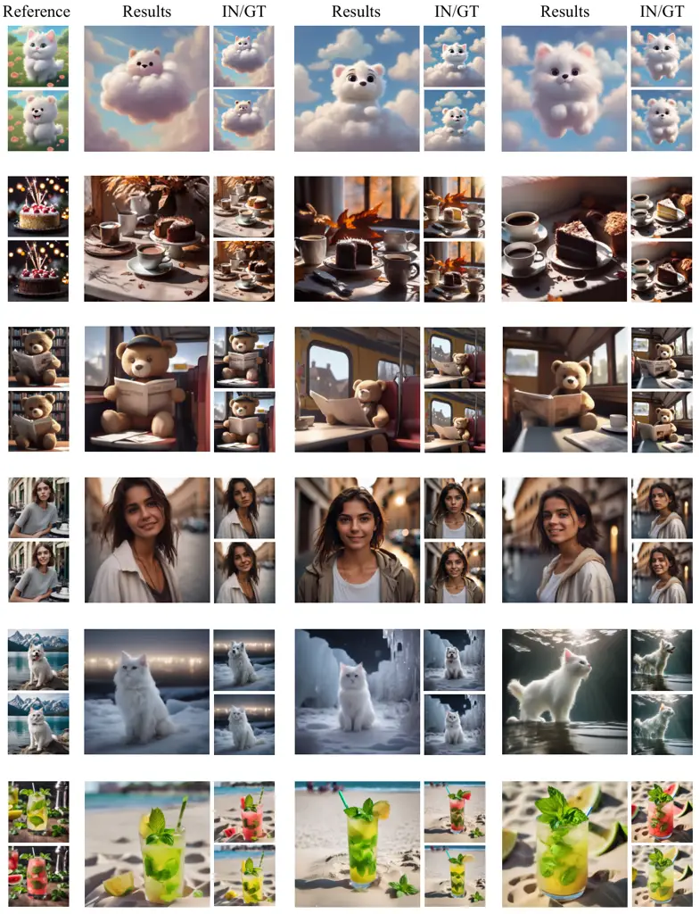

Figure 12: More Visualization Results of Our Method for Local Editing.
Our method shows robust performance in local editing. Moreover, it does
not introduce the scene information of the training image when editing a
new image, which reflects the instructive generality of our method.

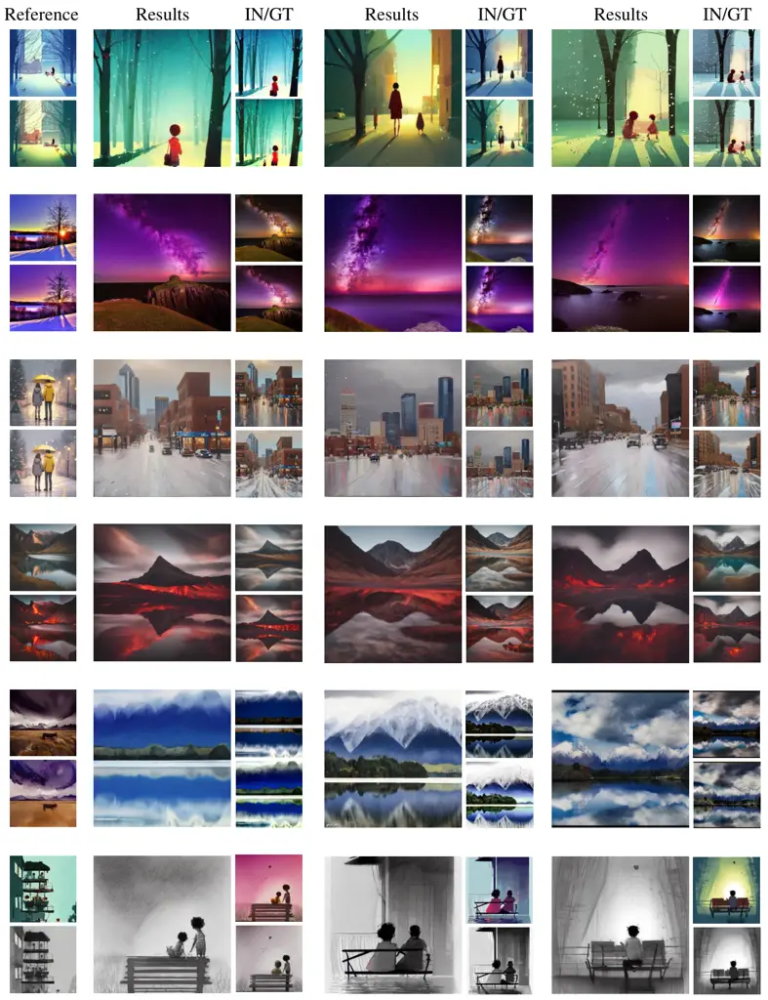

Figure 13: More Visualization Results of Our Method for Global Editing.
Our method shows robust performance in global editing. Moreover, it does
not introduce the scene information of the training image when editing a
new image, which reflects the instructive generality of our method.
