# Dynamic Prompt Optimizing for Text-to-Image Generation

Wenyi Mo Affiliation: Gaoling School of Artificial Intelligence, Renmin
University of China Affiliation: Beijing Key Laboratory of Big Data
Management and Analysis Methods    Tianyu Zhang Affiliation: Du Xiaoman
Technology    Yalong Bai Affiliation: Du Xiaoman Technology    Bing Su
Affiliation: Gaoling School of Artificial Intelligence, Renmin
University of China    Ji-Rong Wen Affiliation: Gaoling School of
Artificial Intelligence, Renmin University of China Affiliation: Beijing
Key Laboratory of Big Data Management and Analysis Methods    Qing Yang
Affiliation: Du Xiaoman Technology

###### Abstract

Text-to-image generative models, specifically those based on diffusion
models like Imagen and Stable Diffusion, have made substantial
advancements. Recently, there has been a surge of interest in the
delicate refinement of text prompts. Users assign weights or alter the
injection time steps of certain words in the text prompts to improve the
quality of generated images. However, the success of fine-control
prompts depends on the accuracy of the text prompts and the careful
selection of weights and time steps, which requires significant manual
intervention. To address this, we introduce the Prompt Auto-Editing
(PAE) method. Besides refining the original prompts for image
generation, we further employ an online reinforcement learning strategy
to explore the weights and injection time steps of each word, leading to
the dynamic fine-control prompts. The reward function during training
encourages the model to consider aesthetic score, semantic consistency,
and user preferences. Experimental results demonstrate that our proposed
method effectively improves the original prompts, generating visually
more appealing images while maintaining semantic alignment. Code is
available at [this https URL](https://github.com/Mowenyii/PAE).

## 1 Introduction

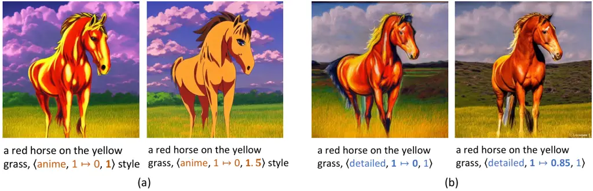

Figure 1: Generation results with the same seed using dynamic
fine-control prompt (one plain token is extended into a triple of
$`\left\langle\text{token},\text{effect range},\text{weight}\right\rangle`$).
It can be seen that (a) increasing the weight of anime to 1.5 can
amplify the sense of anime; (b) applying the word detailed in the first
15% denoising timesteps can generate more natural texture details than
applying it in all timesteps.

Text-to-image generative models take a user-provided text to generate
images matching the description \[1, 17, 31, 30\]. The input text is
called a prompt since it prompts the generative models to follow the
user’s instructions. However, it has been reported that recent
text-to-image models are sensitive to prompts \[5, 16, 20\]. The
organization of the input prompts plays a crucial role in determining
the quality and relevance of the generated images. Interestingly, even
when two prompts convey identical meanings, different expressions of
these prompts may yield vastly different image interpretations.
Therefore, it is crucial to craft appropriate prompts that convey the
user’s intended ideas and establish clear communication with the
generative model.

For a given pre-trained text-to-image generative model, it is unclear
which type of prompt is the most suitable. Consequently, users heavily
rely on heuristic engineering methods \[22\] by repeatedly running the
generative model with modified prompt candidates in search of an optimal
one. They append modifier words to enhance the art style or emphasize
the image quality. These hand-crafted heuristics need to be implemented
separately for each design intention and generative model, resulting in
a costly, time-consuming, and labor-intensive trial-and-error process.
Although there are learning-based methods \[9, 45\] that aim to enhance
the quality of image generation results by rephasing or appending
modifiers to user-input prompts, these methods lack control over the
extent to which the added modifier words influence the image generation
process.

It is a common practice to assign varying levels of importance to
specific words in the design of text prompt¹¹ 1
[https://github.com/AUTOMATIC1111/stable-diffusion-webui/wiki/Features#attentionemphasis](https://github.com/AUTOMATIC1111/stable-diffusion-webui/wiki/Features#attentionemphasis).
This technique allows for more precise control over the generation
process, as illustrated in Fig. 1 (a). Another notable characteristic of
the diffusion model is the multi-step denoising process. This multi-step
design allows us to use different prompts at different time steps, thus
achieving better results. By precisely adjusting the effect time range
of modifier words during this process, a significant enhancement of the
visual aesthetics of the generated image can be achieved, as shown in
Fig. 1 (b). Therefore, to achieve more precise and detailed control over
various aspects of the generated image, we propose a novel prompt format
called the Dynamic Fine-control Prompt (DF-Prompt). It consists of
several triples of tokens, effect ranges, and importance levels.
Traditional hand-crafted heuristic prompt engineering approaches
struggle to handle such intricate and granular adjustments. Hence, it is
necessary to develop an automated method for providing fine-grained
optimization of prompts.

In this study, we propose a method called Prompt Auto-Editing (PAE). The
primary aim of PAE is to optimize user-provided plain prompts to
DF-Prompts for generating high-quality images. This optimization process
is achieved through reinforcement learning. PAE involves a two-stage
training process. In the first training stage of PAE, we introduce an
automated method to overcome the dependency on manually constructed
training samples. We define a confidence score to automatically filter
publicly available prompt-image data. It ensures that the selected
images are both visually pleasing and semantically consistent with the
corresponding text. We then use this filtered dataset to fine-tune a
pre-trained language model. The result is a tailored model that can
enhance a given prompt with suitable modifiers. The second stage of PAE
is based on the tailored model. We use online reinforcement learning
tasks to encourage the model to explore better combinations of prompts
and extra parameters, i.e., the effect range and weight of each
modifier. To support this, we build a multidimensional reward system
that takes into account factors such as aesthetic ratings, consistency
between image and text semantics, and user preferences. Through the
above process, PAE can automatically find the appropriate dynamic
fine-grained prompt tokens. To demonstrate the effectiveness of our
approach, we apply PAE to optimize text prompts from several public
datasets, including Lexica.art²² 2
[https://lexica.art/](https://lexica.art/), DiffusionDB \[39\], and
COCO \[15\]. The experimental results show that our method can greatly
improve human preference and aesthetic score while maintaining semantic
consistency between the generated images and the original prompts. The
contributions are as follows.

- •
  Dynamic fine-control prompt editing framework: We introduce a
  framework that enhances prompt editing flexibility. By integrating the
  effect range and weight of modifier tokens into a reinforcement
  learning framework, we enable fine-grained control and precise
  adjustments in image generation.
- •
  Effective results: Our method’s effectiveness is thoroughly validated
  through experiments on several datasets. The results show that our
  approach improves image aesthetics, ensures semantic consistency
  between prompts and generated images, and aligns more closely with
  human preferences.
- •
  Insightful findings: Our research reveals that artist names and
  texture-related modifiers enhance the artistic quality of generated
  images, while preserving the original semantics. It is more effective
  to introduce these terms in the latter half, rather than the initial
  half of the diffusion process. Assigning a lower weight to complex
  terms promotes a more balanced image generation. These findings hold
  significant implications for creative work and future research.

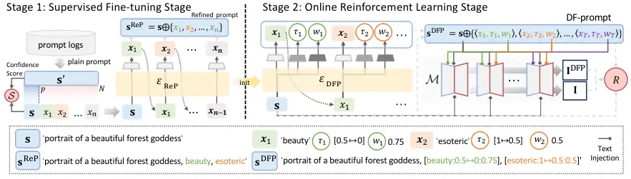

Figure 2: The training process of PAE. (Stage 1) We select the training
prompts based on a confidence score $`\mathcal{S}`$ as shown in Eq. 1,
then fine-tune a pre-trained language model. The result is
$`\mathcal{E}_{\mathrm{ReP}}`$, a model that produces refined prompts.
(Stage 2) We initialize the policy model $`\mathcal{E}_{\mathrm{DFP}}`$
using $`\mathcal{E}_{\mathrm{ReP}}`$. We add two linear headers to this
model. These headers, along with the one predicting word tokens, use the
same model’s intermediate representation for their predictions. We then
transform these predictions into DF-prompts. These DF-prompts modify the
text injection mode of the diffusion model $`\mathcal{M}`$, which in
turn affects the output images. During the online exploration, we use
the original plain prompt $`\mathbf{s}`$, the optimized DF-prompt
$`{\mathbf{s}}^{\mathrm{DFP}}`$, and their respective images
$`\mathbf{I}`$ and $`{\mathbf{I}}^{\mathrm{DFP}}`$ to compute the reward
$`R`$. Finally, we update the policy model by minimizing a loss function
as defined in Eq. 3.

## 2 Related work

Content generation AI-generated content (AIGC) \[27, 31, 30, 29, 43, 23,
3, 37\] has made revolutionary progress in recent years, particularly in
natural language processing. Large language models such as BERT \[6\],
GPT-1 to GPT-4 \[24, 25, 2, 18\], and ChatGPT³³ 3
[https://chat.openai.com/](https://chat.openai.com/) have demonstrated
exceptional text understanding and generation ability. Their
advancements have greatly influenced the generation of text-to-image
content. With the development of generative models \[7, 33, 34, 35\] and
multi-modal pre-training techniques \[26\], text-to-image generative
models such as DALL·E 2 \[29\], Imagen \[31\], Stable Diffusion \[30\]
and Versatile Diffusion \[43\] have showcased impressive performance in
generating high-quality images. These breakthroughs have captured the
attention of both academia and industry due to their potential impact on
content production and applications in the open creative scene, etc. In
this paper, the proposed dynamic prompt editing framework utilizes a
language generation model to assist text-to-image generation.

Text-to-image prompt collection and analysis In recent years, several
studies have been conducted to explore the generative ability of
text-to-image generative models. Some researchers collect prompt-image
pairs from online communities or expert users \[39, 41, 42, 38\].
DiffusionDB \[39\], containing 2 million images, is collected from
online public Stable Diffusion servers. It provides a valuable resource
for researchers to study and improve the performance of text-to-image
models. More recently, Xu et al. \[42\] build an expert comparison
dataset, including 137K prompt-image pairs from text-to-image models.
These pairs are evaluated in terms of aesthetics, text-image alignment,
toxicity, and biases. With the wealth of data, we aim to develop an
automatic prompt editing method that can improve the performance of
text-to-image models and generate high-quality images that satisfy
users’ demands.

Prompt design Text-to-image generative models \[4, 11, 28, 29, 17, 31,
30\] are currently experiencing significant advancements, resulting in
impressive visual effects from the generated images. However, these
models only yield satisfactory images given appropriate input prompts,
leading users to invest considerable time in modifying the prompts to
ensure the generated images are aesthetically pleasing. In pursuit of
higher-quality images, both researchers and online communities
contribute creatively to prompt engineering for text-to-image
generation \[19, 22, 39\]. For instance, Pavlichenko et al. \[22\]
employ the genetic algorithm \[8\] to select a range of prompt keywords
that enhance the quality of the images. Concurrently,
Oppenlaender \[20\] utilizes auto-ethnographic research to understand
the prompt design of online communities and categorizes existing prompt
modifiers into six categories. Additionally, Liu et al. \[16\] collect
over a thousand prompts for multiple group comparison experiments and
proposes design guidelines for text-to-image prompt engineering.
Recently, Hao et al. \[9\] propose a learning-based prompt optimization
method using reinforcement learning. These approaches primarily focus on
modifications to plain prompts and fail to achieve fine-control
information injection. In this paper, we introduce a novel prompt
editing framework to achieve fine-control prompt optimization. A
reinforcement learning strategy is used to develop the capability of
extending modifiers, adjusting weights, and adaptively fitting effect
step ranges of the modifier tokens, with aesthetics, text-image semantic
consistency, and human preferences serving as the reward.

## 3 Method

In this section, we introduce the novel prompt format for
diffusion-based text-to-image generative models. To achieve automated
prompt editing, we design a two-stage training process, called Prompt
Auto-Editing (PAE). PAE includes a supervised fine-tuning stage for
refined prompt generation and an online reinforcement learning stage for
dynamic fine-control prompt generation.

### 3.1 Definitions of Dynamic Fine-control Prompt

Given a pre-trained text-to-image generative model $`\mathcal{M}`$ and
user input text $`\mathbf{s}`$, our goal is to produce a modified prompt
$`\mathbf{s}^{m}`$ with fine-grained control so that the generated
image, $`\mathbf{I}^{m}\sim\mathcal{M}(\mathbf{s}^{m})`$, exhibits
enhanced visual effects while remaining faithful to the semantics of the
initial prompt $`\mathbf{s}`$. The modified prompt $`\mathbf{s}^{m}`$
contains the initial prompt $`\mathbf{s}`$ and a set of predicted
modifiers $`\mathbf{A}=\{x_{1},\cdots,x_{i},\cdots,x_{n}\}`$, i.e.,
$`\mathbf{s}^{m}=\mathbf{s}\oplus\mathbf{A}`$. The $`\oplus`$ symbol
indicates the append operation.

We hereby define a new prompt format that enriches the information of
the initial prompt, named Dynamic Fine-Control Prompt (DF-Prompt).
Within this paradigm, each token $`x_{i}`$ of the modifier set
$`\mathbf{A}`$ is coupled with an effect range $`\tau_{i}`$ and a
specific weight $`w_{i}`$, resulting in a triple
$`{a}_{i}\!=\!\left\langle x_{i},\tau_{i},w_{i}\right\rangle`$, where
$`w_{i}`$ is a float number that weights the token embeddings for
controlling the overall influences of token $`x_{i}`$ during image
generating. The range $`\tau_{i}\!=\![b_{i}\!\mapsto\!e_{i}]`$
$`(1\!\geq\!b_{i}\!\geq\!e_{i}\!\geq\!0)`$ is the normalized range that
delineates the start and end steps during the iterative denoising
process of the text-to-image model. We define the DF-Prompt token set is
$`\mathbf{A}^{\mathrm{DFP}}=\{\langle x_{1},\tau_{1},w_{1}\rangle,\cdots,\langle x_{n},\tau_{n},w_{n}\rangle\}`$,
and the DF-Prompt is
$`\mathbf{s}^{\mathrm{DFP}}=\mathbf{s}\oplus\mathbf{A}^{\mathrm{DFP}}`$.
The essence of DF-Prompt lies in facilitating a more precise and
controlled generation, ensuring the refined prompts are optimally
structured for $`\mathcal{M}`$ to process. In order to facilitate
demonstration and code implementation, we also define a plain-text
format, where the triples are written within square brackets,
\[token:range:weight\]. For instance, as shown in Fig. 2, a DF-Prompt is
written as “portrait of a beautiful forest goddess, \[beauty :
$`0.5\!\mapsto\!0`$ : 0.75\], \[esoteric : $`1\!\mapsto\!0.5`$ : 0.5\]”.

### 3.2 Overview of PAE

We formulate the prompt editing problem as a reinforcement learning task
and propose a Prompt Auto-Editing method named PAE. PAE enhances the
user-provided prompt by adding modifiers in an auto-regressive manner
while assigning corresponding effect ranges and weights. As illustrated
in Fig. 2, PAE operates in two distinct training stages. Stage 1: To
enrich simple prompts, we fine-tune a pre-trained language model on a
curated prompt-image dataset. The dataset is specifically selected based
on a confidence score $`\mathcal{S}`$. The result of this stage is a
refined prompt model $`\mathcal{E}_{\mathrm{ReP}}`$. Stage 2: This stage
involves an online reinforcement learning process. We implement a policy
model $`\mathcal{E}_{\mathrm{DFP}}`$ initialized from
$`\mathcal{E}_{\mathrm{ReP}}`$. The policy model interacts with the
environment (the text-to-image model $`\mathcal{M}`$) through the
current policy (the model-derived mapping from the input prompt to the
dynamic fine-control prompt). A reward function is defined to evaluate
the aesthetic appeal of the generated image, its semantic similarity to
the input text, and its alignment with human preference. The policy
model $`\mathcal{E}_{\mathrm{DFP}}`$ is then optimized based on a
defined loss function.

### 3.3 Finetuning for Plain Prompt Refinement

In the first stage, we utilize selected data to fine-tune the
GPT-2 \[25\] model to get a plain prompt refining model
$`{\mathcal{E}}_{\mathrm{ReP}}`$. The model
$`{\mathcal{E}}_{\mathrm{ReP}}`$ predicts suffix modifiers one by one,
and this process repeats until the model outputs the stop sign, i.e.,
\<\|endoftext\|\>. Given a prompt $`\mathbf{s}`$, we construct the
refined prompt as
$`{\mathbf{s}}^{\mathrm{ReP}}\!=\!\mathbf{s}\oplus\mathbf{A}`$,
where $`\mathbf{A}~\sim~{\mathcal{E}}_{\mathrm{ReP}}(\mathbf{s})`$.

Data Selection. Different from previous methods that depend on
human-in-the-loop annotation datasets \[22\], we collect training data
from public text-image datasets and online communities. Given the
inconsistent quality of images in publicly available text-image pairs,
not all prompts are suitable for model training. Therefore, we devise an
automated process for data filtration and training sample construction.
The rule for data filtration stipulates that only instances that
demonstrate an improvement in aesthetics and maintain semantic relevance
after the addition of modifiers are retained. As depicted on the left
of Fig. 2, we start with a given prompt $`\mathbf{s}^{\prime}`$ from
publicly available prompt logs. The original prompt
$`\mathbf{s}^{\prime}`$ is split at a division point
$`p\in\{1,\cdots,N\}`$. Here, $`N`$ represents the number of tokens in
$`\mathbf{s}^{\prime}`$. The text preceding the division point is
considered to contain primary information, describing the main theme of
the image; the text following the division point is regarded as
secondary, providing supplementary suffixes as modifier words. According
to \[39\], we select the first comma in $`\mathbf{s}^{\prime}`$ as the
division point. Following this, we obtain the short prompt
$`\mathbf{s}=\{s_{1},...,s_{p}\}`$, which is the first $`p`$ tokens
joined together. The remaining tokens form the modifier set
$`\mathbf{A}=\{x_{1},\cdots,x_{n}|x_{1}=s_{p+1},\cdots,x_{n}=s_{N}\}`$.
Lastly, we define a confidence score,
$`\mathcal{S}(\mathbf{s},\mathbf{s}^{\prime})`$. Using this, we
construct the training samples as follows:

```math
\displaystyle\mathbb{D} \displaystyle=\left\{\left\langle\mathbf{s},\mathbf{A}\right\rangle\mid\mathcal{S}(\mathbf{s}^{\prime},\mathbf{s})>0\right\}, \tag{1}
```

```math
\displaystyle\mathcal{S}(\mathbf{s}^{\prime},\mathbf{s}) \displaystyle=\mathbb{E}_{\mathbf{I}^{\prime}\sim\mathcal{M}(\mathbf{s}^{\prime}),\mathbf{I}\sim\mathcal{M}(\mathbf{s})}\big[u\left(g_{\mathrm{aes}}(\mathbf{I}^{\prime})-g_{\mathrm{aes}}(\mathbf{I})\right)
```

```math
\displaystyle\times u\left(g_{\mathrm{CLIP}}(\mathbf{s},\mathbf{I}^{\prime})-g_{\mathrm{CLIP}}(\mathbf{s},\mathbf{I})+\gamma\right)\big],
```

where $`g_{\mathrm{CLIP}}`$ measures the image-text relevance by using
pre-trained CLIP model \[26\] and $`g_{\mathrm{aes}}`$ returns the
aesthetic score⁴⁴ 4
[https://github.com/christophschuhmann/improved-aesthetic-predictor](https://github.com/christophschuhmann/improved-aesthetic-predictor).
The parameter $`\gamma`$ acts as a tolerance constant. Additionally,
$`u(z)`$ represents a characteristic function that returns 1 if $`z>0`$
and 0 otherwise.

We train the language model based on the training datasets
$`\mathbb{D}`$ using teacher forcing methods \[40\], and perform a
direct auto-regressive style negative log-likelihood loss on the next
token:

```math
\mathcal{L}_{\mathrm{ReP}}=-\mathbb{E}_{\left\langle\mathbf{s},\mathbf{A}\right\rangle\sim\mathbb{D}}\left[\log{P(\mathbf{A}|\mathbf{s},\mathcal{E}}_{\mathrm{ReP}})\right]. \tag{2}
```

In this way, the trained model $`\mathcal{E}_{\mathrm{ReP}}`$ is
proficient in handling brief prompt inputs, i.e., simple text describing
the image theme, and predicting appropriate modifiers to formulate
refined prompts $`\mathbf{s}^{\mathrm{ReP}}`$, thereby elevating the
aesthetic quality of the generated image.

### 3.4 RL for DF-Prompt Generation

In the second training stage, we aim to explore better prompt
configurations by specifying effect ranges and weights for additional
modifier suffixes.

Online reinforcement learning. We utilize PPO algorithm \[32\], a
popular reinforcement learning method known for its effectiveness and
stability. The aim is to maximize the expected cumulative reward over
the training set $`\mathbb{D}`$. We add two head layers on
$`{\mathcal{E}}_{\mathrm{ReP}}`$ to predict the effect range and weight
corresponding to each token, and initialize the parameters of additional
layers to output $`\tau_{i}=[1\mapsto 0]`$ and $`w_{i}=1`$ for every
token $`x_{i}`$. After that, $`{\mathcal{E}}_{\mathrm{ReP}}`$ is used to
initialize a policy model $`\mathcal{E}_{\mathrm{DFP}}`$. During an
episode of prompt optimization, we set the initial state as the initial
text $`\mathbf{s}=\{s_{1},...,s_{p}\}`$. The action space is tripartite:
word space $`\mathcal{V}`$, discrete time range space
$`\mathcal{T}=\{0.5\mapsto 0,1\mapsto 0,1\mapsto 0.5\}`$, and discrete
weight space $`\mathcal{W}=\{0.5,0.75,1,1.25,1.5\}`$. At each step $`t`$
of online exploration, the model selects an action
$`a_{t}=\left\langle x_{t},\tau_{t},w_{t}|x_{t}\in\mathcal{V},\tau_{t}\in\mathcal{T},w_{t}\in\mathcal{W}\right\rangle`$,
in accordance with the policy model
$`a_{t}\sim\mathcal{E}_{\mathrm{DFP}}(\mathbf{s}_{<t})`$. To be
consistent with the input format of the language model, we define the
state at $`t`$-th step with tokens only, i.e.,
$`\mathbf{s}_{<t}=\mathbf{s}\oplus\{x_{1},x_{2},\cdots,x_{t-1}\}`$.

During training, the policy model $`\mathcal{E}_{\mathrm{DFP}}`$
interacts with the text-to-image model $`\mathcal{M}`$. We make
adjustments to the text encoder module of the model, with the specific
implementation details outlined in supplementary materials. These
modifications allow for weighting individual tokens and customizing the
effective time range during the denoising process. The predicted action
set
$`\mathbf{A}^{\mathrm{DFP}}=\{\langle x_{1},\tau_{1},w_{1}\rangle,\cdots,\langle x_{T},\tau_{T},w_{T}\rangle\}`$
are used to generate images. Using the generated images, we compute the
reward $`R(\mathbf{s},\mathbf{A}^{\mathrm{DFP}})`$. We define a loss
function $`\mathcal{L}_{\mathrm{DFP}}`$, which is used to optimize the
policy model:

```math
\vskip-2.5pt\mathcal{L}_{\mathrm{DFP}}=-\mathbb{E}_{\mathbf{s}\sim\mathbb{D},\mathbf{A}^{\mathrm{DFP}}\sim\mathcal{E}_{\mathrm{DFP}}}\left[R(\mathbf{s},\mathbf{A}^{\mathrm{DFP}})-\eta D_{\mathrm{KL}}\right], \tag{3}
```

where $`D_{\mathrm{KL}}`$ computes the Kullback-Leibler
divergence \[14\]. It serves as a regulation constraint to minimize
differences between the output modifiers of the policy model
$`\mathcal{E}_{\mathrm{DFP}}`$ and those of the initial model
$`\mathcal{E}_{\mathrm{ReP}}`$ \[21\]. We also use Gaussian
distributions to supervise the effect range probability distribution and
weight distribution predicted by $`\mathcal{E}_{\mathrm{DFP}}`$. More
implementation details are in Sec. 4.2.

Another component in PPO is the value model. Its role is to estimate the
expected cumulative reward from the current state, directed by the
policy model’s actions. Its optimization objective is to minimize the
difference between the predicted and actual rewards. In the optimization
process, the policy model and the value model are optimized alternately,
so that they can promote each other to maximize the expected cumulative
reward. We initialize the value model with
$`\mathcal{E}_{\mathrm{ReP}}`$ and replace the initial linear layer with
a regression head for better performance.

Reward definition. We construct the reward
$`R(\mathbf{s},\mathbf{A}^{\mathrm{DFP}})`$ using CLIP Score, Aesthetic
Score, and PickScore \[13\]:

```math
\begin{split}R(\mathbf{s},\mathbf{A}^{\mathrm{DFP}})=&\mathbb{E}_{\mathbf{I}\sim\mathcal{M}(\mathbf{s}),\mathbf{I}^{\mathrm{DFP}}\sim\mathcal{M}(\mathbf{s}\oplus\mathbf{A}^{\mathrm{DFP}})}[\\
&\min\left(g_{\mathrm{CLIP}}\left(\mathbf{s},\mathbf{I}^{\mathrm{DFP}}\right)-\zeta,0\right)\\
&+\min\left(g_{\mathrm{PKS}}\left(\mathbf{s},\mathbf{I}^{\mathrm{DFP}}\right)-\kappa,0\right)\\
&+\alpha\cdot\left(g_{\mathrm{aes}}(\mathbf{I}^{\mathrm{DFP}})-\beta\cdot g_{\mathrm{aes}}({\mathbf{I}})\right)].\end{split} \tag{4}
```

where $`g_{\mathrm{PKS}}`$ denotes the learned human preference
evaluation metric of PickScore. The symbols $`\zeta`$ and $`\kappa`$ set
minimum thresholds for CLIP score and PickScore contributions to the
reward, while $`\alpha`$ and $`\beta`$ scale the Aes score’s impact.

## 4 Experiments

### 4.1 Experimental Setup

Data Collection. The public text-image pair sources include Lexica.art
and DiffusionDB \[39\]. The NSFW images are recognized with an image
classification model and removed from the training data. After that, we
conduct data selection as described in Sec. 3.3. Finally, we get about
$`450,000`$ prompts. We randomly select 500
$`\left\langle\mathbf{s},\mathbf{s}^{\prime}\right\rangle`$ pairs from
DiffusionDB for validation and extract $`1,000`$ prompts from Lexica.art
and DiffusionDB respectively for evaluation. In particular, we also use
$`1,000`$ prompts randomly selected from COCO \[15\] dataset for
out-of-domain evaluation. The training set, validation set, and test set
are independent of each other.

Comparison to other methods. We compare the prompts edited with our
method to four types of prompts: the short primary prompts
$`\mathbf{s}`$, the original human-written prompts
$`\mathbf{s}^{\prime}`$, and the prompts generated from the same short
prompt s by the pre-trained GPT-2 \[25\] and Promptist \[9\].
Human-written prompts are randomly chosen from user-provided prompt
datasets like Lexica.art and DiffusionDB, while short prompts are the
texts before the first commas.

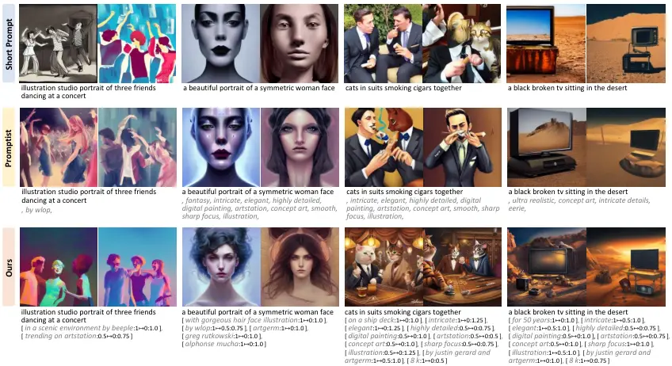

Figure 3: Generated images using Stable Diffusion v1.4 with short
prompts, Promptist \[9\], and our method. In each column, the images are
generated using the same random seed. Our method shows the ability to
moderately expand the semantic content, such as “in a scenic
environment”, “with gorgeous hair face illustration”, “on a ship deck”
and “for 50 years.” These expansions stimulate users’ imagination while
enhancing the comprehensiveness and aesthetic quality of the image.

Metrics. We utilize four metrics to evaluate the results of edited
prompts: Aesthetic score, CLIP score \[26\], PickScore \[13\], CMMD
score \[12\]. The Aesthetic score reflects the visual attractiveness of
an image. Higher values indicate better visual quality. The CLIP score
evaluates the alignment between the generated image and the prompt.
PickScore is an automatic measurement standard used to comprehensively
assess the visual quality and text alignment of images. Larger values
indicate a greater consistency between the generated image and human
preferences. CMMD offers a more accurate and consistent measure of image
quality by not assuming a normal distribution of data and being
efficient with sample sizes. Lower CMMD values indicate more realistic
images. In our evaluation, we report the Aesthetic scores of the
corresponding images, CLIP scores between the short prompt and the
images generated by the edited prompt. For PickScore, We report the
relative pairwise comparisons
$`\mathbb{E}[g_{\mathrm{PKS}}(\mathbf{s},{\mathbf{I}}^{m})\geq g_{\mathrm{PKS}}(\mathbf{s},{\mathbf{I}})]`$
between the edited prompt $`\mathbf{s}^{m}`$ and the short prompt
$`\mathbf{s}`$. We report CMMD between the generated images and the real
images corresponding to the prompts in the COCO dataset.

### 4.2 Implementation Details

For the processes of data collection, model training, and evaluation, we
use Stable Diffusion v1.4 \[30\] with the UniPC solver \[44\], and set
the inference time steps to 10.

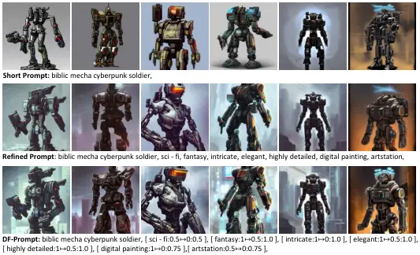

Figure 4: Our method generate the DF-Prompt, which corresponds to the
generated images with more detailed textures and a richer background for
a better visual effect than the refined prompt. The images are generated
using the same random seed in each column.

Supervised fine-tuning. Empirically, we find that when training with the
default settings for both effect range and weight
($`\tau_{i}=[1\mapsto 0]`$ and $`w_{i}=1`$) as a one-point distribution,
the policy model is prone to overfitting to this settings. To address
this, we apply a strategy similar to Label Smoothing \[36\] in the first
stage to enhance the model’s learning process. This strategy involves
sampling discrete values from Gaussian distributions. The means of these
distributions are consistent with the values of the default settings for
effect range and weight, and they share a uniform variance of
$`\sigma`$. The frequency of different joint settings is shown in the
dotted line marked by “label” in Fig. 5 (b$`\sim`$d). This introduction
of random sampling from Gaussian distributions aims to diversify the
training signal in the first stage, thereby enabling better
generalization in second stages. For the model structure of
$`\mathcal{E}_{\mathrm{ReP}}`$, we load the pre-trained GPT-2
Medium \[25\] weights and add two linear heads directly to approximate
the distributions. We can use the distributions predicted by these heads
to supervise the effect range probability distribution and weight
distribution predicted by $`\mathcal{E}_{\mathrm{DFP}}`$. We train the
model for 50k steps, using a batch size of 64 and a learning rate of
$`5\times 10^{-5}`$, with the Adam optimizer. The block size is 256. To
avoid the model learning fixed patterns, we introduce variability by
randomly altering the case of the prompt’s first letter and replacing
commas with periods at a 50% probability. In our implementation, phrases
separated by commas share the same effect range and weight, calculated
using the mode of the range and weight among these phrases.

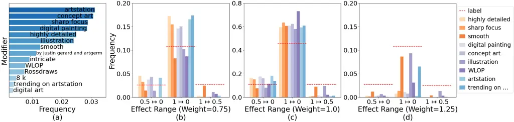

Figure 5: (a) The 15 most frequently generated modifiers. (b$`\sim`$d)
The frequency of different combinations of settings.

Online reinforcement learning. In our experiment, we follow the approach
by Hao et al. \[9\] to set $`\zeta=0.28`$ in the reward function. The
stability of the rewards is crucial in our process. To ensure this, we
calculate the reward by generating two images per prompt. We train both
the policy and the value models for 3,000 episodes, each with a batch
size of 32. For optimization, we set the learning rate to
$`5\times 10^{-5}`$ and employ the Adam optimizer for both models. We
adjust the Adam optimizer’s hyper-parameters, setting $`\beta_{1}`$ to
0.9 and $`\beta_{2}`$ to 0.95. The KL coefficient $`\eta`$ is 0.02. To
save memory, we use a simplified version of the PPO algorithm that
processes one PPO epoch per batch.

### 4.3 Evaluation and Analysis

Qualitative analysis. As shown in Fig. 3, based on the short prompts,
PAE adds texture-related terms like “highly detailed”, the artist’s name
“justin gerard and artgerm”, and some highly aesthetically related words
“elegant”, “artstation” to enhance the aesthetic quality of the
generated images. As shown in Fig. 4, the DF-prompt generated by our
method can provide finer control than the refined prompt.

| Method       | PickScore ($`\uparrow`$) | CLIP Score ($`\uparrow`$) | Aes Score ($`\uparrow`$) |
| ------------ | ------------------------ | ------------------------- | ------------------------ |
| Short Prompt | -                        | 0.28                      | 5.58                     |
| GPT-2        | 47.9%                    | 0.25                      | 5.38                     |
| Human        | 72.5%                    | 0.26                      | 6.07                     |
| Promptist    | 68.4%                    | 0.27                      | 6.11                     |
| PAE (Ours)   | 73.9%                    | 0.26                      | 6.12                     |

Table 1: Quantitative comparison on Lexica.art.

| Method     | CMMD ($`\downarrow`$) |
| ---------- | --------------------- |
| Promptist  | 1.147                 |
| PAE (Ours) | 1.125                 |

Table 2: Quantitative comparison using the CMMD metric.

Quantitative comparison. We evaluate PAE on two in-domain datasets:
Lexica.art and DiffusionDB. As shown in Tab. 1 and Tab. 3, the results
show that PAE surpasses other methods in terms of Aesthetic Score, and
it achieves a human preference Pick Score that closely mirrors the
human-written prompt. This suggests that PAE aligns well with human
aesthetic preferences. Additionally, we evaluate PAE on the
out-of-domain dataset COCO. As shown in Tab. 4, PAE outperforms other
methods in terms of Pick Score. This consistent performance across
various datasets demonstrates the robustness and versatility of the PAE
method. Furthermore, as shown in Tab. 2, PAE outperforms Promptist, as
it indicates lower CMMD scores \[12\]. This shows that the prompts
edited by our method generate images of superior quality and enhanced
realism.

| Method       | PickScore ($`\uparrow`$) | CLIP Score ($`\uparrow`$) | Aes Score ($`\uparrow`$) |
| ------------ | ------------------------ | ------------------------- | ------------------------ |
| Short Prompt | -                        | 0.28                      | 5.58                     |
| GPT-2        | 48.1%                    | 0.25                      | 5.40                     |
| Human        | 70.5%                    | 0.26                      | 5.84                     |
| Promptist    | 62.3%                    | 0.27                      | 6.06                     |
| PAE (Ours)   | 64.4%                    | 0.26                      | 6.07                     |

Table 3: Quantitative comparison on DiffusionDB.

| Method       | PickScore ($`\uparrow`$) | CLIP Score ($`\uparrow`$) | Aes Score ($`\uparrow`$) |
| ------------ | ------------------------ | ------------------------- | ------------------------ |
| Short Prompt | -                        | 0.27                      | 5.37                     |
| GPT-2        | 51.2%                    | 0.25                      | 5.24                     |
| Promptist    | 53.4%                    | 0.25                      | 6.15                     |
| PAE (Ours)   | 53.8%                    | 0.25                      | 6.09                     |

Table 4: Quantitative comparison on COCO.

Statistical analysis of text. We apply our method to 3,500 prompts,
gathering DF-prompt tokens from the policy model. The top 15 frequently
generated modifiers are displayed in Fig. 5 (a). They mainly pertain to
art trends such as “artstation”, artist names like “WLOP”, art styles
and types such as “digital painting” and “illustration”, and
texture-related terms like “highly detailed” and “smooth”. These
modifiers subtly boost the artistic vibe without significantly altering
the prompt’s semantics. In Fig. 5 (b$`\sim`$d), the red dotted lines
indicate the frequency of the label case as detailed in Sec. 4.2. We
observe several phenomena and attempt to interpret them: 1) In (c), most
terms mentioned above appear more frequently than the label case under
the $`1\mapsto 0`$ and $`0.5\mapsto 0`$ settings. This suggests that
these effect ranges yield higher rewards during training when the weight
is 1.0, hence the policy model leans towards selecting them. 2) Also in
(c), the $`0.5\mapsto 0`$ setting outperforms the $`1\mapsto 0.5`$
setting. This suggests that injecting texture-related terms and art
styles (except “smooth” and “illustration”) into the final 50% of
diffusion time steps is more effective than in the first 50%. This
latter half of the diffusion time steps is typically when image details
and structure start to form. Hence, it’s optimal to introduce
texture-related terms and art styles at this stage, as they can directly
impact the image’s details and structure. Conversely, introducing these
elements in the initial 50% of the diffusion time steps may not
significantly influence the final image, as these elements could be
overwhelmed by subsequent diffusion steps when the image is still
relatively unstructured. 3) Comparing the $`1\mapsto 0`$ setting in (b)
and that in (d), the setting with weight $`=0.75`$ occurs more
frequently than weight $`=1.25`$. By assigning a lower weight (0.75),
the prompt effectively instructs the generative model to pay less
attention to these tokens. This could lead the model to consider all
tokens more evenly when generating images, resulting in a more balanced
and potentially superior outcome. Furthermore, these elements (like
“digital painting”, “concept art”, “artstation”, etc.) are inherently
complex and can be interpreted in various ways. If the model focuses
excessively on the tokens (due to the higher weight of 1.25), it might
struggle to generate coherent images due to these concepts’ complexity
and ambiguity. Note that the aforementioned observations merely reflect
the trends, different prompts may have different optimal choices, which
is why our method is necessary.

### 4.4 Ablation Study

We conduct ablation experiments on the DiffusionDB validation dataset to
examine the effects of different data settings, training settings, and
prompt types.

Data Settings. The main parameters associated with the training data are
a variance $`\sigma`$ in Sec. 4.2 and a tolerance constant $`\gamma`$
in Eq. 1. As shown in Tab. 5, the setting of
$`\sigma=0.5,\,\gamma=0.01`$ obtains the highest aesthetic score, so we
choose it as the parameter setting for other experiments.

| Data Settings                | CLIP Score ($`\uparrow`$) | Aes Score ($`\uparrow`$) |
| ---------------------------- | ------------------------- | ------------------------ |
| $`\sigma=0.5,\,\gamma=0.00`$ | 0.26                      | 6.01                     |
| $`\sigma=0.5,\,\gamma=0.01`$ | 0.26                      | 6.03                     |
| $`\sigma=1.0,\,\gamma=0.00`$ | 0.26                      | 5.95                     |
| $`\sigma=1.0,\,\gamma=0.01`$ | 0.26                      | 5.94                     |

Table 5: Ablation experiments on hyperparameters of the validation set.
We validate the results of the first-stage model
$`\mathcal{E}_{\mathrm{ReP}}`$ at 50k steps on the DiffusionDB
Validation set.

|     | Reward Settings                     | Pick\* ($`\uparrow`$) | CLIP ($`\uparrow`$) | Aes ($`\uparrow`$) |
| --- | ----------------------------------- | --------------------- | ------------------- | ------------------ |
| (1) | $`\alpha=1,\,\beta=0,\,\kappa=16`$  | 53.8%                 | 0.26                | 6.01               |
|     | $`\alpha=1,\,\beta=0,\,\kappa=18`$  | 58.0%                 | 0.26                | 6.04               |
|     | $`\alpha=1,\,\beta=0,\,\kappa=20`$  | 56.4%                 | 0.26                | 6.05               |
| (2) | $`\alpha=1,\,\beta=1,\,\kappa=16`$  | 3.8%                  | 0.28                | 5.56               |
|     | $`\alpha=1,\,\beta=1,\,\kappa=18`$  | 9.6%                  | 0.28                | 5.54               |
|     | $`\alpha=1,\,\beta=1,\,\kappa=20`$  | 5.2%                  | 0.28                | 5.56               |
| (3) | $`\alpha=5,\,\beta=1,\,\kappa=18`$  | 52.0%                 | 0.26                | 5.97               |
|     | $`\alpha=10,\,\beta=1,\,\kappa=18`$ | 57.0%                 | 0.26                | 5.93               |

- • \* To highlight the disparity, we report the measure
  $`\mathbb{E}[g_{\mathrm{PKS}}(\mathbf{s},{\mathbf{I}}^{m})>g_{\mathrm{PKS}}(\mathbf{s},{\mathbf{I}})]`$.

Table 6: Ablation experiments on different parameters of reward. The
second stage model $`\mathcal{E}_{\mathrm{DFP}}`$ is trained for 1,000
episodes.

Training Settings. In our method, the reward is primarily influenced by
three main parameters: $`\alpha`$, $`\beta`$, and $`\kappa`$, as
outlined in Eq. 4. In Tab. 6, we observe that when $`\kappa=18`$, a
higher PickScore is achieved, while the CLIP score and Aes Score remain
relatively consistent compared to other values of $`\kappa`$.
Comparisons between (1) and (2), setting $`\beta=1`$ results in a
significant increase in the CLIP score, but leads to a decrease in both
the aesthetic score and PickScore, compared to when $`\beta=0`$.
Furthermore, in comparing (2) and (3), we find that an increase in
$`\alpha`$ boosts both the latter scores, albeit at the cost of the CLIP
score. Given that our task is primarily aimed at enhancing human
preferences and aesthetics without causing significant semantic
deviations, we choose $`\alpha=1,\,\beta=0,\,\kappa=18`$ for other
experiments. We also demonstrate the improvement brought by the second
stage of training. In Tab. 7, compared with
$`\mathcal{E}_{\mathrm{ReP}}`$, the policy model
$`\mathcal{E}_{\mathrm{DFP}}`$ can bring comprehensive improvement.

Ablation experiments on different episodes. As shown in Fig. 6 (a), the
policy model achieves its peak reward after 3,000 episodes of training.
Consequently, we adopt 3,000 episodes as the standard setting for other
experiments.

DF-prompt format. As shown in Fig. 6 (b), when other settings remain the
same, the reward increases with the output of the policy model using the
DF-Prompt format instead of the plain prompt format. This indicates that
compared to plain prompts, DF-Prompts enhance the aesthetic appeal of
the generated images. They also strengthen the alignment between the
image and the prompt, making the image more in line with human
preferences.

| Method                         | PickScore\* ($`\uparrow`$) | CLIP Score ($`\uparrow`$) | Aes Score ($`\uparrow`$) | Reward ($`\uparrow`$) |
| ------------------------------ | -------------------------- | ------------------------- | ------------------------ | --------------------- |
| $`\mathcal{E}_{\mathrm{ReP}}`$ | 53.8%                      | 0.26                      | 6.03                     | 4.49                  |
| $`\mathcal{E}_{\mathrm{DFP}}`$ | 57.8%                      | 0.26                      | 6.07                     | 4.58                  |

Table 7: Comparison between the initial model
$`\mathcal{E}_{\mathrm{ReP}}`$ and the second stage model
$`\mathcal{E}_{\mathrm{DFP}}`$ trained over 3,000 episodes.

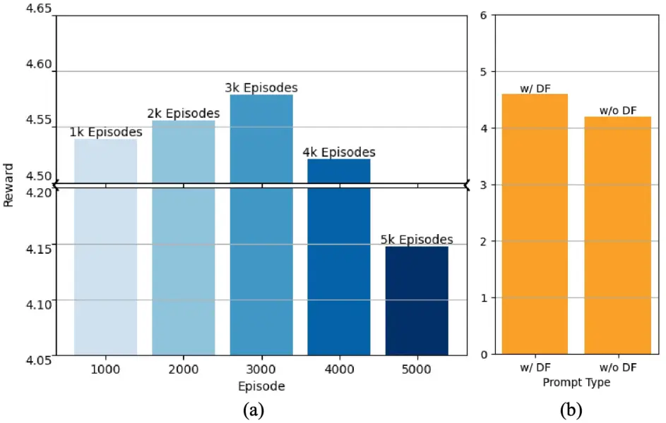

Figure 6: (a) The relationship between episode and reward. (b) Ablation
experiments with different prompt types.

## 5 Conclusion

In this paper, we propose PAE, a novel method for automatically editing
prompts to improve the quality of images generated by a pre-trained
text-to-image model. Unlike existing methods that require heuristic
human engineering of prompts, PAE automatically edits input prompts and
provides more flexible and fine-grained control. Experimental
evaluations demonstrate the effectiveness and efficiency of PAE, which
exhibits strong generalization abilities and performs well on both
in-domain and out-of-domain data.

Acknowledgment This work was supported in part by the National Natural
Science Foundation of China No. 62376277, Beijing Outstanding Young
Scientist Program NO. BJJWZYJH012019100020098, and Public Computing
Cloud, Renmin University of China.

## References

- \[1\] Fan Bao, Shen Nie, Kaiwen Xue, Yue Cao, Chongxuan Li, Hang Su,
  and Jun Zhu. All are worth words: A vit backbone for diffusion models.
  _2023 IEEE/CVF Conference on Computer Vision and Pattern Recognition
  (CVPR)_, pages 22669–22679, 2023.
- \[2\] Tom B. Brown, Benjamin Mann, Nick Ryder, Melanie Subbiah, Jared
  Kaplan, Prafulla Dhariwal, Arvind Neelakantan, Pranav Shyam, Girish
  Sastry, Amanda Askell, Sandhini Agarwal, Ariel Herbert-Voss, Gretchen
  Krueger, T. J. Henighan, Rewon Child, Aditya Ramesh, Daniel M.
  Ziegler, Jeff Wu, Clemens Winter, Christopher Hesse, Mark Chen, Eric
  Sigler, Mateusz Litwin, Scott Gray, Benjamin Chess, Jack Clark,
  Christopher Berner, Sam McCandlish, Alec Radford, Ilya Sutskever, and
  Dario Amodei. Language models are few-shot learners. _arXiv_,
  abs/2005.14165, 2020.
- \[3\] Aakanksha Chowdhery, Sharan Narang, Jacob Devlin, Maarten Bosma,
  Gaurav Mishra, Adam Roberts, Paul Barham, Hyung Won Chung, Charles
  Sutton, Sebastian Gehrmann, Parker Schuh, Kensen Shi, Sasha
  Tsvyashchenko, Joshua Maynez, Abhishek Rao, Parker Barnes, Yi Tay,
  Noam Shazeer, Vinodkumar Prabhakaran, Emily Reif, Nan Du, Ben
  Hutchinson, Reiner Pope, James Bradbury, Jacob Austin, Michael Isard,
  Guy Gur-Ari, Pengcheng Yin, Toju Duke, Anselm Levskaya, Sanjay
  Ghemawat, Sunipa Dev, Henryk Michalewski, Xavier Garcia, Vedant Misra,
  Kevin Robinson, Liam Fedus, Denny Zhou, Daphne Ippolito, David Luan,
  Hyeontaek Lim, Barret Zoph, Alexander Spiridonov, Ryan Sepassi, David
  Dohan, Shivani Agrawal, Mark Omernick, Andrew M. Dai,
  Thanumalayan Sankaranarayana Pillai, Marie Pellat, Aitor Lewkowycz,
  Erica Moreira, Rewon Child, Oleksandr Polozov, Katherine Lee, Zongwei
  Zhou, Xuezhi Wang, Brennan Saeta, Mark Diaz, Orhan Firat, Michele
  Catasta, Jason Wei, Kathy Meier-Hellstern, Douglas Eck, Jeff Dean,
  Slav Petrov, and Noah Fiedel. Palm: Scaling language modeling with
  pathways. _J. Mach. Learn. Res._, 24:240:1–240:113, 2023.
- \[4\] Katherine Crowson, Stella Biderman, Daniel Kornis, Dashiell
  Stander, Eric Hallahan, Louis Castricato, and Edward Raff. VQGAN-CLIP:
  open domain image generation and editing with natural language
  guidance. In _Computer Vision - ECCV 2022 - 17th European Conference,
  Tel Aviv, Israel, October 23-27, 2022, Proceedings, Part XXXVII_,
  pages 88–105. Springer, 2022.
- \[5\] Nassim Dehouche and Kullathida Dehouche. What is in a
  text-to-image prompt: The potential of stable diffusion in visual arts
  education. _CoRR_, abs/2301.01902, 2023.
- \[6\] Jacob Devlin, Ming-Wei Chang, Kenton Lee, and Kristina
  Toutanova. BERT: pre-training of deep bidirectional transformers for
  language understanding. In _Proceedings of the 2019 Conference of the
  North American Chapter of the Association for Computational
  Linguistics: Human Language Technologies, NAACL-HLT 2019, Minneapolis,
  MN, USA, June 2-7, 2019, Volume 1 (Long and Short Papers)_, pages
  4171–4186. Association for Computational Linguistics, 2019.
- \[7\] Patrick Esser, Robin Rombach, and Björn Ommer. Taming
  transformers for high-resolution image synthesis. _2021 IEEE/CVF
  Conference on Computer Vision and Pattern Recognition (CVPR)_, pages
  12868–12878, 2020.
- \[8\] David E. Goldberg. _Genetic Algorithms in Search Optimization
  and Machine Learning_. Addison-Wesley, 1989.
- \[9\] Yaru Hao, Zewen Chi, Li Dong, and Furu Wei. Optimizing prompts
  for text-to-image generation. _CoRR_, abs/2212.09611, 2022.
- \[10\] Martin Heusel, Hubert Ramsauer, Thomas Unterthiner, Bernhard
  Nessler, and Sepp Hochreiter. Gans trained by a two time-scale update
  rule converge to a local nash equilibrium. In _Advances in Neural
  Information Processing Systems 30: Annual Conference on Neural
  Information Processing Systems 2017, December 4-9, 2017, Long Beach,
  CA, USA_, pages 6626–6637, 2017.
- \[11\] Jonathan Ho, Chitwan Saharia, William Chan, David J. Fleet,
  Mohammad Norouzi, and Tim Salimans. Cascaded diffusion models for high
  fidelity image generation. _J. Mach. Learn. Res._,
  23:47:1–47:33, 2022.
- \[12\] Sadeep Jayasumana, Srikumar Ramalingam, Andreas Veit, Daniel
  Glasner, Ayan Chakrabarti, and Sanjiv Kumar. Rethinking FID: towards a
  better evaluation metric for image generation. _CoRR_,
  abs/2401.09603, 2024.
- \[13\] Yuval Kirstain, Adam Polyak, Uriel Singer, Shahbuland Matiana,
  Joe Penna, and Omer Levy. Pick-a-pic: An open dataset of user
  preferences for text-to-image generation. _arXiv preprint
  arXiv:2305.01569_, 2023.
- \[14\] S. Kullback and R. A. Leibler. On information and sufficiency.
  _The Annals of Mathematical Statistics_, 22(1):79–86, 1951.
- \[15\] Tsung-Yi Lin, Michael Maire, Serge Belongie, James Hays, Pietro
  Perona, Deva Ramanan, Piotr Dollár, and C. Lawrence Zitnick. Microsoft
  coco: Common objects in context. In _Computer Vision – ECCV 2014_,
  pages 740–755, Cham, 2014. Springer International Publishing.
- \[16\] Vivian Liu and Lydia B. Chilton. Design guidelines for prompt
  engineering text-to-image generative models. _Proceedings of the 2022
  CHI Conference on Human Factors in Computing Systems_, 2022.
- \[17\] Alex Nichol, Prafulla Dhariwal, Aditya Ramesh, Pranav Shyam,
  Pamela Mishkin, Bob McGrew, Ilya Sutskever, and Mark Chen. Glide:
  Towards photorealistic image generation and editing with text-guided
  diffusion models. In _ICML_, 2022.
- \[18\] OpenAI. Gpt-4 technical report. _arXiv_, abs/2303.08774, 2023.
- \[19\] Jonas Oppenlaender. The creativity of text-to-image generation.
  In _25th International Academic Mindtrek conference, Academic Mindtrek
  2022, Tampere, Finland, November 16-18, 2022_, pages 192–202, 2022a.
- \[20\] Jonas Oppenlaender. A taxonomy of prompt modifiers for
  text-to-image generation. _arXiv_, abs/2204.13988, 2022b.
- \[21\] Long Ouyang, Jeffrey Wu, Xu Jiang, Diogo Almeida, Carroll L.
  Wainwright, Pamela Mishkin, Chong Zhang, Sandhini Agarwal, Katarina
  Slama, Alex Ray, John Schulman, Jacob Hilton, Fraser Kelton, Luke
  Miller, Maddie Simens, Amanda Askell, Peter Welinder, Paul F.
  Christiano, Jan Leike, and Ryan Lowe. Training language models to
  follow instructions with human feedback. In _NeurIPS_, 2022.
- \[22\] Nikita Pavlichenko and Dmitry Ustalov. Best prompts for
  text-to-image models and how to find them. _arXiv_,
  abs/2209.11711, 2022.
- \[23\] William Peebles and Saining Xie. Scalable diffusion models with
  transformers. In _Proceedings of the IEEE/CVF International Conference
  on Computer Vision_, pages 4195–4205, 2023.
- \[24\] Alec Radford and Karthik Narasimhan. Improving language
  understanding by generative pre-training. OpenAI, 2018.
- \[25\] Alec Radford, Jeff Wu, Rewon Child, David Luan, Dario Amodei,
  and Ilya Sutskever. Language models are unsupervised multitask
  learners. 2019.
- \[26\] Alec Radford, Jong Wook Kim, Chris Hallacy, Aditya Ramesh,
  Gabriel Goh, Sandhini Agarwal, Girish Sastry, Amanda Askell, Pamela
  Mishkin, Jack Clark, Gretchen Krueger, and Ilya Sutskever. Learning
  transferable visual models from natural language supervision. In
  _Proceedings of the 38th International Conference on Machine Learning,
  ICML 2021, 18-24 July 2021, Virtual Event_, pages 8748–8763.
  PMLR, 2021.
- \[27\] Aditya Ramesh, Mikhail Pavlov, Gabriel Goh, Scott Gray, Chelsea
  Voss, Alec Radford, Mark Chen, and Ilya Sutskever. Zero-shot
  text-to-image generation. In _Proceedings of the 38th International
  Conference on Machine Learning, ICML 2021, 18-24 July 2021, Virtual
  Event_, pages 8821–8831. PMLR, 2021.
- \[28\] Aditya Ramesh, Prafulla Dhariwal, Alex Nichol, Casey Chu, and
  Mark Chen. Hierarchical text-conditional image generation with CLIP
  latents. _CoRR_, abs/2204.06125, 2022a.
- \[29\] Aditya Ramesh, Prafulla Dhariwal, Alex Nichol, Casey Chu, and
  Mark Chen. Hierarchical text-conditional image generation with clip
  latents. _arXiv_, abs/2204.06125, 2022b.
- \[30\] Robin Rombach, A. Blattmann, Dominik Lorenz, Patrick Esser, and
  Björn Ommer. High-resolution image synthesis with latent diffusion
  models. _2022 IEEE/CVF Conference on Computer Vision and Pattern
  Recognition (CVPR)_, pages 10674–10685, 2022.
- \[31\] Chitwan Saharia, William Chan, Saurabh Saxena, Lala Li, Jay
  Whang, Emily L. Denton, Seyed Kamyar Seyed Ghasemipour,
  Raphael Gontijo Lopes, Burcu Karagol Ayan, Tim Salimans, Jonathan Ho,
  David J. Fleet, and Mohammad Norouzi. Photorealistic text-to-image
  diffusion models with deep language understanding. In _NeurIPS_, 2022.
- \[32\] John Schulman, Filip Wolski, Prafulla Dhariwal, Alec Radford,
  and Oleg Klimov. Proximal policy optimization algorithms. _CoRR_,
  abs/1707.06347, 2017.
- \[33\] Jascha Narain Sohl-Dickstein, Eric A. Weiss, Niru
  Maheswaranathan, and Surya Ganguli. Deep unsupervised learning using
  nonequilibrium thermodynamics. _arXiv_, abs/1503.03585, 2015.
- \[34\] Xingzhe Su, Wenwen Qiang, Jie Hu, Fengge Wu, Changwen Zheng,
  and Fuchun Sun. Intriguing property and counterfactual explanation of
  gan for remote sensing image generation, 2023a.
- \[35\] Xingzhe Su, Wenwen Qiang, Zeen Song, Hang Gao, Fengge Wu, and
  Changwen Zheng. A unified gan framework regarding manifold alignment
  for remote sensing images generation. _arXiv preprint
  arXiv:2305.19507_, 2023b.
- \[36\] Christian Szegedy, Vincent Vanhoucke, Sergey Ioffe, Jonathon
  Shlens, and Zbigniew Wojna. Rethinking the inception architecture for
  computer vision. _2016 IEEE Conference on Computer Vision and Pattern
  Recognition (CVPR)_, pages 2818–2826, 2015.
- \[37\] Hugo Touvron, Thibaut Lavril, Gautier Izacard, Xavier Martinet,
  Marie-Anne Lachaux, Timothée Lacroix, Baptiste Rozière, Naman Goyal,
  Eric Hambro, Faisal Azhar, Aurélien Rodriguez, Armand Joulin, Edouard
  Grave, and Guillaume Lample. Llama: Open and efficient foundation
  language models. _CoRR_, abs/2302.13971, 2023.
- \[38\] Kailas Vodrahalli and James Zou. Artwhisperer: A dataset for
  characterizing human-ai interactions in artistic creations. _CoRR_,
  abs/2306.08141, 2023.
- \[39\] Zijie J. Wang, Evan Montoya, David Munechika, Haoyang Yang,
  Benjamin Hoover, and Duen Horng Chau. DiffusionDB: A large-scale
  prompt gallery dataset for text-to-image generative models. In
  _Proceedings of the 61st Annual Meeting of the Association for
  Computational Linguistics (Volume 1: Long Papers)_, pages 893–911,
  Toronto, Canada, 2023. Association for Computational Linguistics.
- \[40\] Ronald J. Williams and David Zipser. A learning algorithm for
  continually running fully recurrent neural networks. _Neural Comput._,
  1(2):270–280, 1989.
- \[41\] Yutong Xie, Zhaoying Pan, Jinge Ma, Luo Jie, and Qiaozhu Mei. A
  prompt log analysis of text-to-image generation systems. In
  _Proceedings of the ACM Web Conference 2023, WWW 2023, Austin, TX,
  USA, 30 April 2023 - 4 May 2023_, pages 3892–3902. ACM, 2023.
- \[42\] Jiazheng Xu, Xiao Liu, Yuchen Wu, Yuxuan Tong, Qinkai Li, Ming
  Ding, Jie Tang, and Yuxiao Dong. Imagereward: Learning and evaluating
  human preferences for text-to-image generation. _arXiv_,
  abs/2304.05977, 2023.
- \[43\] Xingqian Xu, Zhangyang Wang, Eric Zhang, Kai Wang, and Humphrey
  Shi. Versatile diffusion: Text, images and variations all in one
  diffusion model. _CoRR_, abs/2211.08332, 2022.
- \[44\] Wenliang Zhao, Lujia Bai, Yongming Rao, Jie Zhou, and Jiwen Lu.
  Unipc: A unified predictor-corrector framework for fast sampling of
  diffusion models. _arXiv_, abs/2302.04867, 2023.
- \[45\] Wanrong Zhu, Xinyi Wang, Yujie Lu, Tsu-Jui Fu, Xin Eric Wang,
  Miguel P. Eckstein, and William Yang Wang. Collaborative generative
  AI: integrating gpt-k for efficient editing in text-to-image
  generation. _CoRR_, abs/2305.11317, 2023.

Supplementary Material

In this appendix, we provide additional information and materials to
complement our research, including training samples, more qualitative
results, additional experimental details, and discussion.

## A. Examples of training data

We utilize a diverse range of text-image pairs sourced from public
datasets and online communities. As shown in Fig. 8, we present some
prompts that are included in our training data. These prompts have
undergone filtration and construction following the automated process
described in Sec. 3.3. The short prompts $`\mathbf{s}`$ primarily
describe the subject matter of the images, while the modifiers
(highlighted in gray) provide additional details and enhance the
aesthetic appeal of the images. In the figure, the term “Aes” denotes
the aesthetic score, and “CLIP” quantifies the semantic relevance of the
generated image to the short prompt. We can see that the generated
images $`\mathbf{I}^{\prime}`$ corresponding to the original prompt
$`\mathbf{s}^{\prime}`$ are more visually effective than the generated
images $`\mathbf{I}`$ corresponding to the short prompt $`\mathbf{s}`$.

| Lexica.art           | Aes  | CLIP |
| -------------------- | ---- | ---- |
| Short Prompt         | 5.58 | 0.28 |
| + “artstation”       | 5.83 | 0.26 |
| + “concept art”      | 5.68 | 0.30 |
| + “digital painting” | 5.79 | 0.30 |
| + “sharp focus”      | 5.60 | 0.28 |
| + “highly detailed”  | 5.64 | 0.29 |

Table 8: The effect of different words on generating images.

|           |          |        |                        |            |                          |       |
| --------- | -------- | ------ | ---------------------- | ---------- | ------------------------ | ----- |
| Method    | Training |        | Inference (per prompt) |            | T2I Pipeline (per image) |       |
| Stage 1   | Stage 2  | Ours   | Promptist              | Vanilla SD | Dynamic SD               |       |
| GPU Times | 18 hours | 3 days | 0.73s                  | 0.69s      | 5.64s                    | 5.71s |

Table 9: Experiment on an A800 (80GB) GPU.

## B. More detailed statistical analysis

Fig. 7 indicates a predominance of shorter token sequences in model
predictions, implying that adding a few modifiers can significantly
enhance an image’s visual appeal without altering the original prompt’s
meaning. Fig. 5 (b-d) show frequently generated modifiers, most of which
are trends, styles, and texture terms. We also conduct experiments to
analyze word impact. As shown in Tab. 8, “artstation” boosts Aesthetic
scores at the cost of text-image similarity, whereas styles and texture
modifiers slightly increase Aesthetic scores while preserving alignment.

Figure 7: Frequency of the number of predicted word tokens.

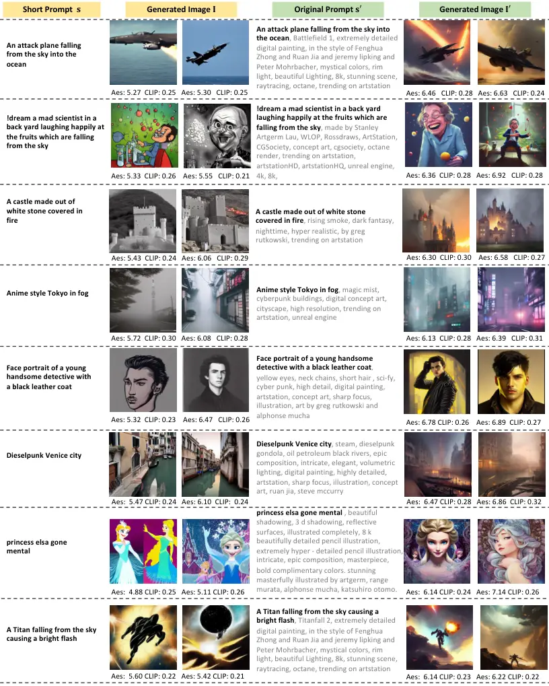

Figure 8: Some examples of the training data.

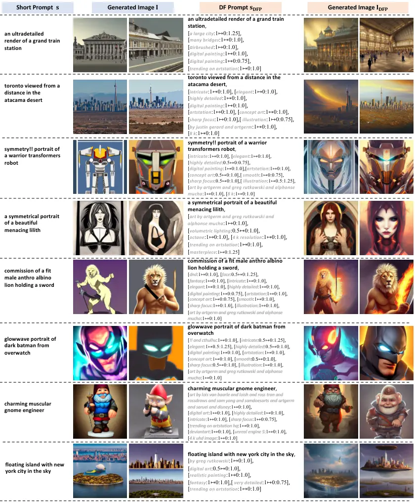

Figure 9: More examples of the generated images.

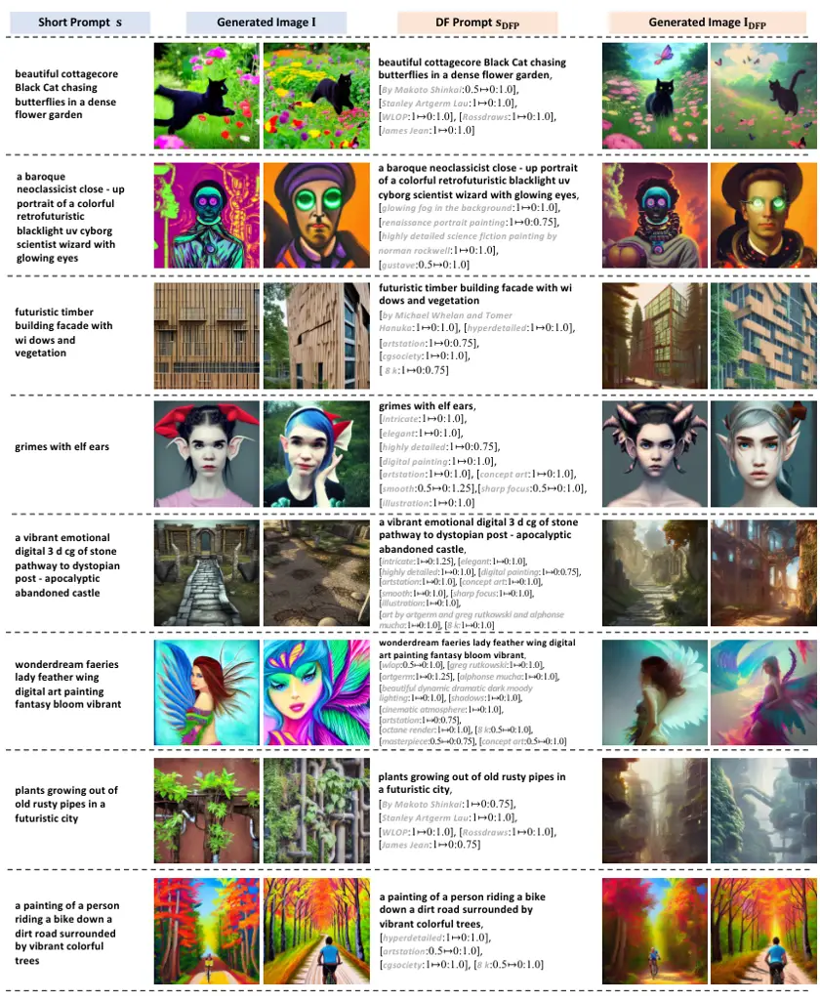

Figure 10: More examples of the generated images.

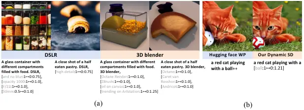

Figure 11: (a) Examples of practicability. (b) Weight methods.

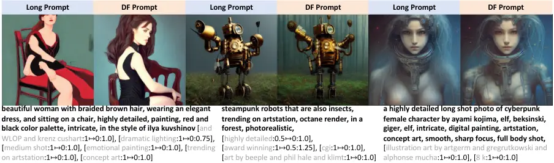

Figure 12: The input long prompts are in bold.

## C. Enhanced text encoder for DF-prompt

In Stable Diffusion, the text encoder is modified to achieve
fine-grained control over the generated effects. These modifications
involve two key aspects:

- •
  We introduce weights for each word embedding, representing the impact
  of a word or phrase on the resulting image. To accomplish this, we
  apply a weighting operation to each word’s embedding by multiplying it
  with a specific weight. Subsequently, we normalize the entire set of
  text embeddings, ensuring that the overall mean value remains
  consistent with the original text embeddings. This normalization step
  is crucial for maintaining numerical stability. Our technique yields
  results similar to the existing prompt weighting method (Fig. 11(b))
  but having dynamic time-range control. The pseudo-code for weighting
  tokens is below.

  1 \# Given text_embs:\[77x768\], weights:\[77,\]

  2 previous_mean = text_embs.mean() \# float

  3 text_embs \*= weights

  4 current_mean = text_embs.mean()

  5 text_embs \*= previous_mean / current_mean

  Listing 1: Python pseudo code for weighting tokens.

- •
  The injection time steps are regulated using a dictionary. This
  dictionary maps each word or phrase to a designated time step, which
  determines when to initiate and conclude the injection of that
  specific word or phrase during the image generation process. By
  manipulating the time steps in the dictionary, precise control over
  the duration of different concepts within the generated image can be
  achieved.

These modifications empower the text encoder to exert more precise
control over the effects within the Stable Diffusion framework. As a
result, more personalized and user-specific image-generation outcomes
can be attained.

| Method ( +“DSLR”) | FID ($`\downarrow`$) |
| ----------------- | -------------------- |
| Promptist         | 70.80                |
| PAE (Ours)        | 69.84                |

Table 10: Quantitative comparison of image quality between our method
and Promptist, measured using the FID metric.

## D. More experimental details

For the evaluation process, we use a maximum new token length of 75 for
all evaluated models. We use a temperature of 0.9 during the evaluation
and apply a top-k sampling strategy with a k-value of 200. To ensure
consistency, we use the same seed in all quantitative evaluation
experiments.

## E. More qualitative results

In this section, we present more qualitative results, as depicted in
Figs. 9 and 10. We compare the images $`\mathbf{I}^{\mathrm{DFP}}`$
generated using DF-Prompts with the images $`\mathbf{I}`$ generated
using the short prompts. For example, in Fig. 9, we observe that the
images corresponding to DF-Prompts, $`\mathbf{I}^{\mathrm{DFP}}`$,
exhibit more vibrant details and aesthetically pleasing color
combinations compared to the images $`\mathbf{I}`$ generated from the
short prompts. Some specific examples include “symmetry!! portrait of a
warrior transformers robot”, “a symmetrical portrait of a beautiful
menacing lilith”, “commission of a fit male anthro albino lion holding a
sword” and “glowwave portrait of dark batman from overwatch”. We ensure
fairness and consistency by generating the columns corresponding to
$`\mathbf{I}`$ and $`\mathbf{I}^{\mathrm{DFP}}`$ using the same seed.

Empirical evidence shows that our method not only creates aesthetically
pleasing images but also caters precisely to user queries, such as
achieving photorealism with “DSLR” or creating 3D-rendered effects with
“3D blender” in user prompts (Fig. 11(a)). Our method shows adaptability
when integrating detailed modifiers like “DSLR” and achieves competitive
Frechet Inception Distance (FID) \[10\] (Tab. 10). This adaptability is
critical in practical applications.

The time cost of each stage is shown in Tab. 9. As for inference, the
average time is marginally higher than that of Promptist (+0.04 s).
Moreover, our Dynamic Stable Diffusion (Dynamic SD) method is slightly
slower than the Vanilla SD method, but the difference is minimal.

## F. Discussion

The significant enhancement in image quality and text alignment observed
in Fig. 3 of the main paper for the case “cats in suits smoking cigars
together” can be attributed to our model’s reward mechanism.
Specifically, we incorporate the Aes score to encourage actions that
improve aesthetic features and the CLIP score to ensure semantic
coherence. Additionally, our reward function introduces the PickScore,
which allows for more diverse prompt modifiers and ultimately leads to
improved image quality. In Fig. 3, the inclusion of new semantic
elements like “on a ship deck” alongside other modifiers contributes
significantly to the visual appeal of the generated output.

Differences among PAE, Promptist, hugging face weighting prompt method
(WP)⁵⁵ 5
[https://huggingface.co/docs/diffusers/using-diffusers/weighted_prompts](https://huggingface.co/docs/diffusers/using-diffusers/weighted_prompts)
lie in that Promptist focuses solely on prompt expansion, while WP
manipulates the likelihood of certain phrases appearing in images by
artificially setting their weights. PAE, on the other hand, innovatively
introduces dynamic prompts, and dynamically adjusts the weights of
different phrases during various stages of image denoising, thus
achieving more granular control over the image generation process.
Additionally, PAE introduces a richer set of reward metrics (aligning
closely with user preferences), without the need for manual
intervention, resulting in visually striking and semantically consistent
images.

As shown in Figs. 9 and 10, the generated image
$`\mathbf{I}^{\mathrm{DFP}}`$ maintains the identity consistency of the
image $`\mathbf{I}`$ produced by the short prompt $`\mathbf{s}`$ when
using the same seed. Meanwhile, it incorporates additional image details
that enhance visual appeal. This is evident in Fig. 9 with the example
of a “commission of a fit male anthro albino lion holding a sword,” and
in Fig. 10 with “Grimes with elf ears.” This capability can be further
developed to ensure consistent role generation. To further enhance our
model, it is advantageous to incorporate more comprehensive reward
considerations. For instance, evaluating generated images based on
factors such as high resolution and proportional composition can
contribute to their overall quality and realism. Furthermore, to address
issues such as attribute leakage and missing objects observed in the
original Stable Diffusion method, advanced control techniques can be
explored. One potential approach involves incorporating control
attention maps into the action space. By selectively directing attention
to specific regions in the input image, the model gains finer control
over the generation process. Consequently, issues related to attribute
leakage can be mitigated, and the preservation of important elements can
be ensured. By exploring these possibilities and developing more
sophisticated control mechanisms, we can enhance the capabilities of our
model and overcome the limitations observed in its current
implementation.
