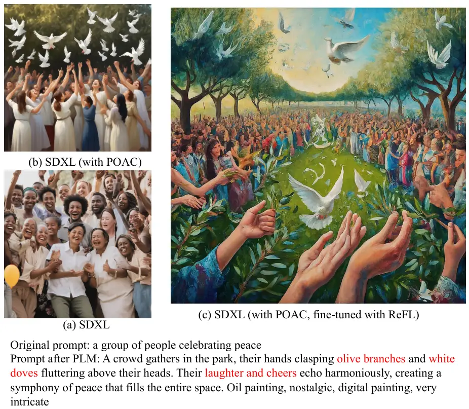
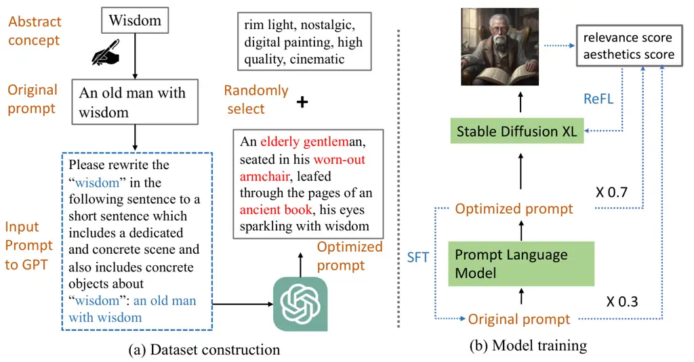
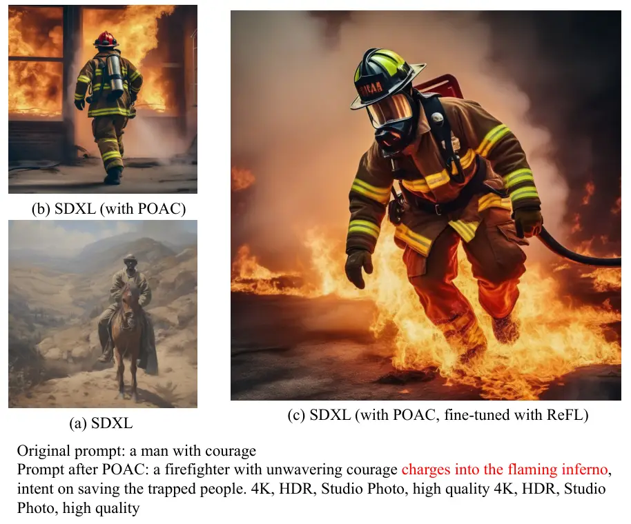
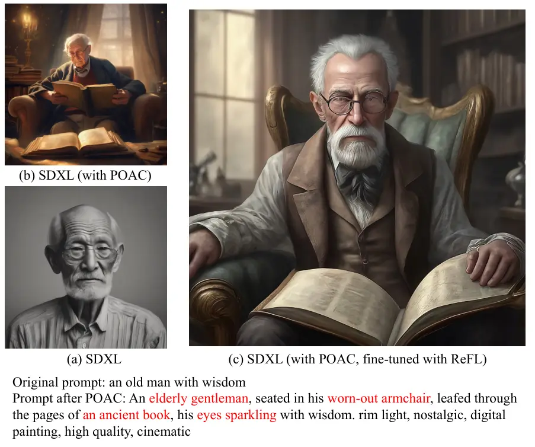
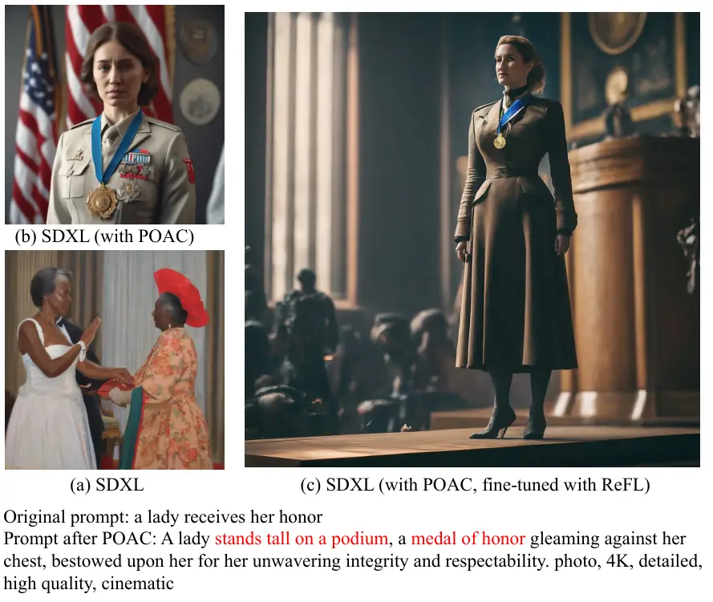
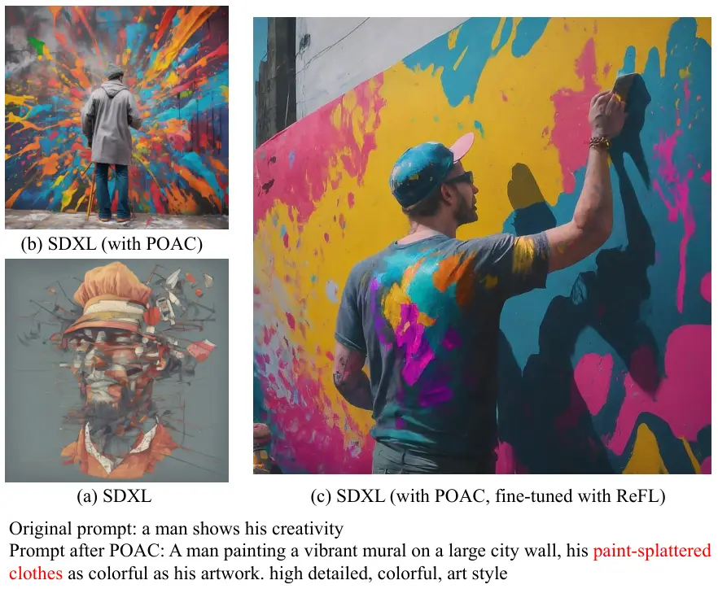
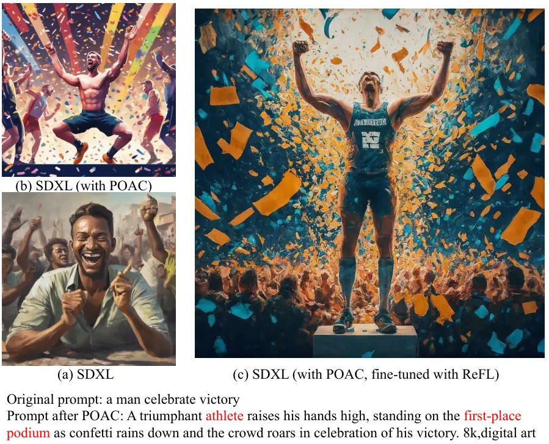
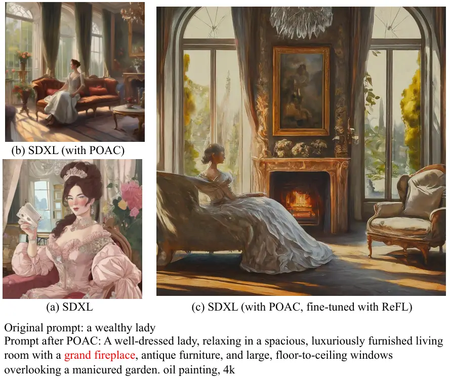

# Prompt Optimizer of Text-to-Image Diffusion Models for Abstract Concept Understanding

Conference: Companion Proceedings of the ACM Web Conference 2024; May
13–17, 2024; Singapore, SingaporeCompanion Proceedings of the ACM Web
Conference 2024 (WWW ’24 Companion), May 13–17, 2024, Singapore,
SingaporeDOI: [10.1145/3589335.3651927](https://doi.org/10.1145/3589335.3651927)ISBN: 979-8-4007-0172-6/24/05CCS: Computing
methodologies Computer visionCCS: Computing methodologies Artificial
intelligence

Zezhong Fan Note: Both authors contributed equally to this research.
Affiliation: Walmart Global Tech, Sunnyvale, California, USA email:
<zezhong.fan@walmart.com> , Xiaohan Li Affiliation: Walmart Global Tech,
Sunnyvale, California, USA email: <xiaohan.li@walmart.com> , Chenhao
Fang Note: Work done while at Walmart. Affiliation: University of
Wisconsin-Madison, Wisconsin, USA email: <chenhao.fang@outlook.com> ,
Topojoy Biswas Affiliation: Walmart Global Tech, Sunnyvale, California,
USA email: <topojoy.biswas@walmart.com> , Kaushiki Nag
Affiliation: Walmart Global Tech, Sunnyvale, California, USA email:
<kaushiki.nag@walmart.com> , Jianpeng Xu Affiliation: Walmart Global
Tech, Sunnyvale, California, USA email: <jianpeng.xu@walmart.com> and
Kannan Achan Affiliation: Walmart Global Tech, Sunnyvale, California,
USA email: <kannan.achan@walmart.com>

© acmlicensed

###### Abstract.

The rapid evolution of text-to-image diffusion models has opened the
door of generative AI, enabling the translation of textual descriptions
into visually compelling images with remarkable quality. However, a
persistent challenge within this domain is the optimization of prompts
to effectively convey abstract concepts into concrete objects. For
example, text encoders can hardly express "peace", while can easily
illustrate olive branches and white doves. This paper introduces a novel
approach named Prompt Optimizer for Abstract Concepts (POAC)
specifically designed to enhance the performance of text-to-image
diffusion models in interpreting and generating images from abstract
concepts. We propose a Prompt Language Model (PLM), which is initialized
from a pre-trained language model, and then fine-tuned with a curated
dataset of abstract concept prompts. The dataset is created with GPT-4
to extend the abstract concept to a scene and concrete objects. Our
framework employs a Reinforcement Learning (RL)-based optimization
strategy, focusing on the alignment between the generated images by a
stable diffusion model and optimized prompts. Through extensive
experiments, we demonstrate that our proposed POAC significantly
improves the accuracy and aesthetic quality of generated images,
particularly in description of abstract concepts and alignment with
optimized prompts. We also present a comprehensive analysis of our
model’s performance across diffusion models under different settings,
showcasing its versatility and effectiveness in enhancing abstract
concept representation.

###### Keywords: 

Image generation, Diffusion models, Prompt optimization, Abstract
concepts

## 1. Introduction

In human daily communication, concepts serve as a medium that conveys
diverse ideas. People usually utilize two different ways to express
their thoughts: concrete objects and abstract concepts. Concrete objects
refer to tangible, observable, and measurable phenomena or entities and
they are based on sensory perception and can be directly experienced
like a tree or rain. On the other hand, abstract concepts refer to ideas
or theories that are not based on physical or concrete phenomena, such
as "peace" and "courage". They are intangible and cannot be directly
observed or measured. Abstract concepts play an important role in
expressing complex emotions and shaping ethical and moral values. In
real life, to alleviate the obstacles caused by abstract concepts in
daily communication, people often explain them with their related
concrete objects and visible objects. For example, as shown in Figure 1
when people introduce the "Peace" concept, they often refer to olive
branches and white doves to help others understand.



Figure 1. Examples of image generation with or without prompt optimizer.
(a) SDXL: only input the original prompt. (b) SDXL (with POAC): input
the prompt optimized by POAC to SDXL. (c) Generate the image with the
fine-tuned SDXL with ReFL and optimized prompt.

Recent cutting-edge Text-to-Image (T2I) generation models including
Stable Diffusion (Rombach et al., 2022) ,DALL•E (Ramesh et al., 2021),
Imagen (Saharia et al., 2022) and Dreambooth (Ruiz et al., 2023) have
achieved outstanding achievements in generating high-resolution
realistic images. However, these models are trained with large-scale
text-image pairs datasets which mainly concentrate on concrete and
physical objects and attributes, thus failing to generate accurate
visualizations or descriptions for abstract ideas as their narrow
understanding of these abstract concepts.

There are three main challenges in comprehending and explaining the
abstract concept in images using T2I generation models. First, the
current research has primarily examined subject-driven T2I models (Ruiz
et al., 2023; Kumari et al., 2023a; Ma et al., 2023; Kumari et al.,
2023b) that concentrate solely on concrete objects in image generation.
However, expressing abstract concepts in images is challenging as they
require association with concrete objects. Currently, there is limited
research on the translation of abstract concepts to concrete objects.
Second, the most recent T2I model for abstract concepts (Liao et al., 2023) enhances prompt optimization by utilizing a Large Language Model
(LLM) (Brown et al., 2020) and expanding abstract concepts to encompass
multiple concrete objects. However, this optimization solely focuses on
the language aspect and does not align with the image generation
process. Third, the utilization of LLMs requires the use of a large GPU
server or purchasing services from a third-party company, both of which
are costly and not easily scalable. In this paper, we intend to develop
a compact language model that specifically focuses on prompt
optimization to enhance scalability.

To address the above challenges, we propose a novel Prompt Optimization
framework of Text-to-Image Generation for Abstract Concepts (POAC) that
purposes on bridging the diffusion model and the abstract concepts while
ensuring the generation faithfulness and maintaining aesthetic appeal.
Inspired by the recent advances in prompt optimization and abstract
concept understanding (Liao et al., 2023; Hao et al., 2022; Lee et al.,
2024), we first trained a Prompt Language Model (PLM) with Supervised
Fine-Tuning (SFT) based on a pre-trained language model such as
GPT2 (Radford et al., 2019) on a collection of text inputs with abstract
concepts and optimized prompt with physical scenes and objects
corresponding to them. Then we employ Reward Feedback Learning (ReFL)
based on Reinforcement Learning (RL) to align the PLM with the diffusion
model. The ReFL is applied to fine-tune the diffusion model using
generated images and optimized prompts generated by PLM as well as
original prompts with different weights to improve the alignment between
human intents and generated images. In Figure 1, we can see that the
image (c) generated by fine-tuned SDXL with ReFL has a better alignment
with the prompt as it has both white doves and olive branches while
image (b) only includes white doves. The reward used in both stages is a
combination of relevance scores (Radford et al., 2021) and aesthetic
scores (Xu et al., 2023). To help the model better understand the
abstract concept, we also create a dataset with the help of
GPT-4 (Achiam et al., 2023) to map abstract concepts to concrete
objects.

We conduct experiments with one of the cutting-edge T2I diffusion
models, Stable Diffusion XL (SDXL) (Podell et al., 2023). We evaluate
our methods utilizing the latest benchmark and human evaluation. The
experimental results show that POAC can precisely express and understand
abstract concepts with visible details while ensuring aesthetic appeal
and faithfulness of generated images. Moreover, we also find that
two-stage reinforcement learning plays a vital role in improving image
quality and aligning with human preference.

The main contributions of our works are as follows:

- •
  With the assistance of GPT-4, a dataset is constructed to correlate
  abstract concepts with concrete objects.
- •
  We fine-tune a Prompt Language Model (PLM), which rewrites the
  abstract concepts in the original prompts to concrete objects in the
  optimized prompts.
- •
  We also fine-tune the SDXL with ReFL to align the optimized prompts
  and original prompts with the generated images.

## 2. Related works

### 2.1. Text-to-Image Generation

Text-to-Image generation is a crucial task which aims to generate images
based on user-input textual descriptions in computer vision. The
existing models in this domain can be categorized as either
autoregressive  (Gafni et al., 2022; Yu et al., 2022; Ramesh et al., 2021) or diffusion models  (Nichol et al., 2021; Ramesh et al., 2022;
Rombach et al., 2022; Saharia et al., 2022), as evidenced by prior
research. Notably, DALL-E  (Ramesh et al., 2021) stands out as a
significant advancement in autoregressive models due to its impressive
zero-shot capabilities. However, diffusion models have also shown very
promising results. Based on prior works in the diffusion models
 (Dhariwal and Nichol, 2021; Ho et al., 2022), GLIDE model  (Nichol
et al., 2021) introduces an innovative approach to conditioning the
diffusion model based on an input text caption. Additionally, DALL-E 2
 (Ramesh et al., 2022) model is further improved by incorporating a
supplemental CLIP image embedding, which enhances the model’s diversity.
Other certain efforts, such as Stable Diffusion  (Rombach et al., 2022),
prioritize computational efficiency by initially representing input
images as low-dimensional latent codes. However, due to most of training
prompts of these models only including concrete objects in real-life and
lack of mapping of abstract concepts and images, it is still a challenge
for diffusion models to fully understand abstract concept directly.

To further align text-to-image generation models with human
understandings, many efforts have been made to alleviate the gap between
models and human preference  (Hao et al., 2022; Xu et al., 2023; Wu
et al., 2023; Dong et al., 2023; Lee et al., 2023). For example, Lee et
al. (Lee et al., 2023) emphasize text alignment with diffusion models,
utilizing a reward model that was trained on datasets annotated by human
evaluators to fine-tune the text-to-image model. Similarly, ImageReward
 (Xu et al., 2023) provides a comprehensive human preference reward
model that align text with images from aesthetics, toxicity, and biases.
To enhance the original prompt, Hao et al. (Hao et al., 2022) propose a
prompt adaptation framework to train a language model with a
reinforcement learning framework. However, there are still a gap of
aligning the human preferences with abstract concepts.

### 2.2. Concept Representation in Image Generation

The field of image generation has witnessed a notable surge in interest
in the representation of concepts. This includes efforts in concept
customization (Ruiz et al., 2023; Gal et al., 2023; Kumari et al.,
2023b; Wei et al., 2023) which have sought to enrich Text-to-Image (T2I)
models with new concepts. These concepts typically focus on
incorporating specific entities, ranging from novel creations to
personalized items from everyday life, such as a pet dog. Additionally,
the area of concept disambiguation, as explored in (Mehrabi et al.,
2022), addresses the challenges posed by the syntactic ambiguity in
human instructions, which can obscure the intended meanings and
relationships of physical items, without extensively examining the
nuanced differences among abstract concepts. In conclusion, recent
research in image generation has focused on the visualization of
tangible concepts instead of abstract ones. Our objective is to narrow
this research gap by deepening the exploration of abstract concepts in
image generation.

### 2.3. Prompt Optimization for Diffusion Models

As large-scale models reliant on textual inputs continue to evolve (Chen
et al., 2023; Liu et al., 2024; Maragheh et al., 2023; Fang et al.,
2024), the substantial resources required for their training and
fine-tuning present a significant barrier for many researchers. In
response, prompt optimization has been recognized as an effective
strategy. This approach enhances image generation quality without the
need for altering the underlying model architecture or engaging in
labor-intensive training processes for T2I models. The area of prompt
optimization is still in its early stages and suffers from a scarcity of
exhaustive studies. Practical advice on writing effective T2I prompts is
primarily shared through blogs and manuals (Oppenlaender, 2022a;
Oppenlaender, 2022b; Pavlichenko and Ustalov, 2023), which summarize the
essential elements and descriptive terms that enhance image style.
Prompt optimization can be applied within textual or embedding
dimensions, including soft tuning methods (Lester et al., 2021), with
some researchers focusing on developing optimization models that closely
integrate with T2I models (Hao et al., 2022). While existing efforts in
T2I prompt optimization (Lee et al., 2024) largely concentrate on
refining the stylistic and aesthetic qualities of generated images, our
study intends to focus on advancing the visual representation of
abstract concepts.

## 3. Methodology



Figure 2. (a) The dataset construction process. We manually rewrite the
abstract concept "wisdom" to a short prompt. With the help of GPT, we
prompt is optimized with detailed and concrete objects (in red). The art
styles are randomly selected and added to the optimized prompt. (b) The
training process of Prompt Language Model (PLM) and Stable Diffusion XL
(SDXL). PLM is fine-tuned with original and optimized prompts by
Supervised Fine-Tune (SFT). The SDXL is fine-tuned by Reward Feedback
Learning (ReFL) to align the prompts and the image.

The aims of Prompt Optimizer for Abstract Concepts (POAC) is to
automatically enrich abstract concepts with their corresponding concrete
objects and feed optimized prompts into a diffusion model to generate
aesthetic and faithful images. Figure 1 presents the overview of our
framework. POAC is composed of two parts: 1) Prompt Language Model (PLM)
is built based on a pre-trained language model (GPT2) (Radford et al., 2019) and 2) Stable Diffusion XL (SDXL), which is a large-scale
diffusion model  (Podell et al., 2023). We also construct a dataset
containing pairs of abstract concepts and their corresponding concrete
objects. With Supervised Fine-Tuning(SFT), we fine-tune the PLM with our
constructed dataset. Then we conduct reinforcement learning on the SDXL
to maximize target reward to improve diffusion model understanding of
abstract concepts and ensure alignment with prompts and aesthetics of
generated images.

### 3.1. Datasets

We first collect top-500 abstract concepts from IBM Concept
Abstractness¹¹ 1
https://developer.ibm.com/exchanges/data/all/concept-abstractness/ based
on their degree of abstractness. Then, we manually extend each abstract
concept into a short prompt including it as the source input to PLM. For
example, as shown in Figure 2, we extend "wisdom" to "an old man with
wisdom". Finally, we leverage the strong knowledge and understanding of
abstract concepts of GPT-4 (Achiam et al., 2023) to rewrite the source
input into a new prompt with a dedicated scene and concrete objects that
can express the abstract concepts clearly and effectively as target
outputs. From high-quality human-engineered prompts from various
diffusion models in Internet (Oppenlaender, 2022a; Pavlichenko and
Ustalov, 2023), we can discover that most prompts are composed of two
parts: main content that describes the user’s intention, and some
modifiers expressing image style such as artist name and art style. To
ensure the quality and diversity of generated images, we randomly add
modifiers to target outputs.

### 3.2. Supervised Fine-tuning

We first fine-tune PLM initialized with a pre-trained language model
(GPT-2 (Radford et al., 2019)) on a set of original and optimized prompt
pairs. A parallel prompt dataset
$`\mathcal{D}={(\mathbf{x},\mathbf{y})}`$ contains prompt pairs of short
prompts with abstract concepts and rewritten prompts with corresponding
concrete objects. The training objective is to maximize the
log-likelihood:

```math
\mathcal{L}_{SFT}=-\mathbb{E}_{(\mathbf{x},\mathbf{y})\sim\mathcal{D}}\log p(\mathbf{y}|\mathbf{x}) \tag{1}
```

where PLM is trained to be used to generate the input prompts of the
diffusion model.

### 3.3. Reward Function

To ensure the faithfulness and quality of generated images, we design
our reward function from two perspectives: relevance to abstract
concepts and aesthetics. The goal motivates us to define the reward
function $`\mathcal{R}(\cdot)`$ from the above two perspectives. First,
we use CLIP scores (Radford et al., 2021) to measure the relevance of
between generated images and prompts containing abstract concepts as
well as optimized prompts with concrete objects. The relevance score is
defined as below:

```math
\mathcal{R}_{rel}(\mathbf{x},{\mathbf{y}})=\mathbb{E}_{i_{\mathbf{y}}\sim\mathcal{G}(\mathbf{y})}[f_{rel}(\mathbf{x},\mathbf{y},i_{\mathbf{y}})] \tag{2}
```

```math
f_{rel}(\mathbf{x},i_{\mathbf{y}})=0.3*g_{CLIP}(\mathbf{x},i_{\mathbf{y}})+0.7*g_{CLIP}(\mathbf{y},i_{\mathbf{y}}) \tag{3}
```

where $`i_{\mathbf{y}}\sim\mathcal{G}`$ represents sampling images
$`i_{\mathbf{y}}`$ from the diffusion model $`\mathcal{G}`$ with
$`\mathbf{y}`$ as input prompts. $`g_{CLIP}`$ is the CLIP similarity
function. We determine different weights for CLIP scores of original
prompts with abstract concepts and optimized prompts with concrete
objects to 0.3 and 0.7 because we want to encourage the model to focus
more on physical details while ensuring intentions from original
abstract concepts.

Then, to measure the aesthetic preference of images, we use
ImageReward (Xu et al., 2023) score which is a T2I human preference
reward model. It is trained based on a large human-annotated aesthetic
preference dataset containing 137k expert comparisons. The aesthetic
score is defined as:

```math
\mathcal{R}_{aes}(\mathbf{y})=\mathbb{E}_{i_{y}\sim\mathcal{G}(\mathbf{y})}[g_{aes}(i_{\mathbf{y}})], \tag{4}
```

where $`g_{aes}`$ denotes ImageReward score.

Finally we define the overall reward by combining the above scores:

```math
\mathcal{R}(\mathbf{x},\mathbf{y})=\mathcal{R}_{rel}(\mathbf{x},\mathbf{y})+\mathcal{R}_{aes}(\mathbf{y}) \tag{5}
```

### 3.4. Reward Feedback Learning

To make diffusion models better align with abstract concepts, we adopt a
strategy known as Reward Feedback Learning (ReFL) (Xu et al., 2023).
During the Reward Feedback Learning stage, ReFL is employed to fine-tune
diffusion models based on the reward function in 3.3. The reward
functions are employed to back-propagate and update the diffusion
parameters after a predetermined range of steps. In practice, to
mitigate the over-optimization issue and stabilize the fine-tuning, we
re-weight reward loss and regularize with pre-training loss. After ReFL,
the diffusion model is optimized with a focus on aligning generated
images with abstract concepts. The loss of ReFL is formulated as

```math
\mathcal{L}_{r}=\lambda\mathbb{E}_{y\sim\mathcal{Y}}(\phi(\mathcal{R}(\mathbf{x},\mathbf{y}))), \tag{6}
```

```math
\mathcal{L}_{pre}=\mathbb{E}_{(y,i_{y})\sim\mathcal{G}(y)}(\mathbb{E}_{\varepsilon(i_{y}),y,\epsilon\sim\mathcal{N}(0,1),t[||\epsilon-\epsilon_{\theta}(z_{t},t)||^{2}_{2}]}), \tag{7}
```

where $`\mathcal{L}_{r}`$ is the final reward loss function and
$`\mathcal{L}_{pre}`$ is the loss function of SDXL. $`\phi`$ is a map
function. $`\epsilon`$ is noise, $`\epsilon_{\theta}`$ is the denoising
autoencoder and $`z_{t}`$ is the latent embedding in the denoising
autoencoder. With the ReFL, we can fine-tune the SDXL to make it better
align with the original and optimized prompt with PLM.

## 4. Experiments



(a) Courage



(b) Wisdom



(c) Honor



(d) Creativity



(e) Victory



(f) Wealth

Figure 3. Qualitative comparison of SDXL only, SDXL with POAC and SDXL
with POAC, fine-tuned with ReFL.

[TABLE]

Table 1. Prompt optimization with our proposed POAC on abstract concepts
"Happiness", "Anger", "Friendship", "Dream", "Mercy" and "Adventure".
The red phrases are concrete objects about the abstract concepts.

We conduct experiments to validate our proposed method. Initially, we
explain the implementation details in Section 4.1. Then we visualize the
results and conduct comparative experiments between baseline models and
our POAC framework in Section 4.2

### 4.1. Implementation Detail

Dataset Construction. For PLM, we collect top-500 abstract concepts from
IBM Concept Abstractness²² 2
https://developer.ibm.com/exchanges/data/all/concept-abstractness/ based
on their degree of abstractness. Then we manually write each concept
into three different forms or a short prompt including it as the source
input to PLM. Then we leverage GPT-4 to rewrite each source input into
three different prompts with a dedicated scene and concrete objects
correspond to their abstract concepts as target output. After
experimenting with different prompt templates, we discover that the
following prompt template for GPT-4 can generate the most satisfied
target outputs: "Please rewrite the \[Abstract Concept\] in the
following sentence to a short sentence which includes a dedicated and
concrete scene and also includes concrete objects about \[Source
Input\]". Then we collect modifiers from user-input prompts from
Lexica³³ 3 https://lexica.art. We randomly add modifiers, e.g. oil
painting, nostalgic, digital painting, very intricate in Figure 1, to
the end of target prompts to ensure the diversity and quality of
prompts. For reward feedback learning, the pre-training dataset is from
a 625k subset of LAION-5B  (Schuhmann et al., 2022) selected by
aesthetic score.

Supervised fine-tuning. We fine-tune GPT-2 to predict the target prompt
with the source prompt as conditional input. The input format is
\[Source\] Rephrase:\[Target\]. The model is fine-tuned with a learning
rate of 5e-5, and a max length of 512 while maintaining a batch size of 64.

Reward Feedback Learning. We use SDXL as our model backbone. The model
is fine-tuned in half-precision with a learning rate set to 1e-5.
Following The sample step range \[T1, T2\] is defined as \[1, 10\] where
total steps T is set to 40. The regularizer $`\lambda`$ is set to 1e-3.

### 4.2. Qualitative Comparison

In Figure 3, we illustrate the generated images of six abstract
concepts: (a) courage, (b) wisdom, (c) honor, (d)creativity, (e)
victory. From the images, we have the following observations.

- •
  In (a) Courage, the SDXL with the original prompt only outputs a man
  riding a horse, which has limited relation to courage. In SDXL (with
  POAC), the optimized prompt provides a scene where a firefighter faces
  a flaming house, which is a better expression of courage. In SDXL
  (with POAC, fine-tuned with ReFL), the firefighter is walking on fire,
  which matches the "charges into the flaming inferno" in the prompt.
- •
  In (b) Wisdom, the initial output from plain SDXL only depicts an old
  man. However, by optimizing the prompt with POAC, the generated image
  now includes more specific details, such as portraying the old man
  reading a book, which effectively conveys the idea of wisdom. After
  further fine-tuning the model with ReFL, the resulting image now shows
  the old man dressed in a respectable suit, effectively illustrating
  the concept of an "elderly gentleman" as mentioned in the prompt. This
  enhancement ensures that the generated image better aligns with the
  intended representation of the prompt.
- •
  In (c) Honor, SDXL generates an image of two ladies talking, which is
  not directly associated with honor. However, after optimizing the
  prompt with POAC, the revised prompt includes more specific details,
  such as a lady with "a medal of honor". After further fine-tuning SDXL
  with ReFL, the generated image now depicts a scene where "a lady
  stands tall on a podium", aligning better with the prompt.
- •
  In (d) Creativity, the original prompt can hardly be understood by
  SDXL. With POAC, SDXL generates an image of a man wearing a clean
  jacket and painting colorful artwork. However, the prompt optimized by
  PLM indicates that the man’s clothes are also splattered with paint.
  After further fine-tuning with ReFL, the model is able to generate an
  image of a man wearing a t-shirt that is paint-splattered.
- •
  In (e) Victory, the original prompt with SDXL only generates an image
  of a laughing man, which is only loosely associated with victory.
  However, by optimizing the prompt with PLM, the revised prompt
  includes more concrete objects that directly depict victory, such as
  an "athlete" and a "first-place podium". After further fine-tuning
  with ReFL, the generated image now clearly shows an athlete wearing a
  jersey, standing on the podium, with people cheering in the
  background.
- •
  In (f) Wealth, the image generated from the original prompt can also
  depict a wealthy woman holding a stack of cash. However, the overall
  quality of the image is poor. After optimizing the prompt, the
  generated image can more effectively portray the luxurious environment
  that she is in. The concrete object, a "grand fireplace," is now
  clearly visible in the image produced after fine-tuning the SDXL with
  ReFL.

In Table 1, we also provide more examples about the original prompts and
optimized prompts generated by PLM about four abstract concepts:
"Happiness", "Anger", "Friendship", "Dream", "Mercy" and "Adventure".
The red phrases are concrete objects about the abstract concepts. From
this table, we have the following findings:

\(1\) Our proposed POAC has the ability to transform the original prompt
into a scene that utilizes concrete objects, making it easier for SDXL
to comprehend. For instance, we associate "Happiness" with "a child’s
laughter," "Anger" with a "red face," and "Adventure" with a "backpack
and torch." In our daily lives, these abstract concepts encompass human
emotions and experiences, and we often rely on concrete objects to
illustrate them. Through our method, we bridge the divide between human
language and the abstract concepts and objects depicted in images,
thereby enhancing understanding.

\(2\) In each optimized prompt, there are 2 or 3 concrete objects
highlighted in red. These objects can be a place, an item, an
expression, or an action, and they can all be effectively represented
with images. By harnessing the advanced natural language understanding
capabilities of the GPT-4 model, our method connects this powerful
language model with a diffusion model to generate images that are more
closely related to real-life scenarios.

|                         |           |           |
| ----------------------- | --------- | --------- |
| Models                  | Rel Score | Aes Score |
| SDXL                    | 0.21      | 0.19      |
| SDXL with POAC          | 0.29      | 0.25      |
| SDXL with POAC and ReFL | 0.32      | 0.26      |

Table 2. Qualitative comparison of SDXL, SDXL with POAC and SDXL with
POAC and ReFL.

### 4.3. Quantitative Comparison

We also show the quantitative evaluation results of the relevance score
(Rel Score) and aesthetics score (Aes Score) respectively in Table 2
based on the relevance and aesthetics score in Section 3.3. From this
table, we can see that

- •
  SDXL with POAC and ReFL achieves the best performance in terms of both
  scores, thus highlighting the efficacy of our approach. The aesthetics
  score of SDXL with POAC and ReFL exhibits a mere 4% improvement when
  compared to SDXL with POAC alone, indicating that our method can
  enhance the aesthetic quality of the generated image. Furthermore,
  there is a noteworthy improvement of over 10% in the relevance score,
  signifying that the fine-tuned SDXL model can align more effectively
  with the optimized prompts.
- •
  SDXL with POAC, without the inclusion of ReFL, exhibits a 38%
  improvement over plain SDXL. This suggests that SDXL struggles to
  comprehend abstract concepts, while our method greatly aids SDXL in
  accurately depicting the image by utilizing concrete objects to
  represent these abstract concepts.

## 5. Conclusion

This study presents the development and evaluation of the Prompt
Optimizer for Abstract Concepts (POAC), a pioneering method aimed at
refining the capabilities of text-to-image diffusion models in
accurately rendering images from abstract ideas. Leveraging a Prompt
Language Model (PLM) derived from an initially pre-trained language
model and further fine-tuned with a specialized dataset of abstract
concept prompts created using GPT-4, our approach maps abstract concepts
to detailed scenes and concrete objects. Employing a reinforcement
learning-based optimization strategy, POAC aligns the stable diffusion
model’s image generation with the optimized prompts, significantly
enhancing both the precision and the visual appeal of the output. The
effectiveness of POAC is validated through qualitative and quantitative
experiments, showing notable improvements in image generation tasks and
proving its quality and relevance of prompts under different settings
for better abstract concept visualization.

In future work, we will explore additional solutions to address the
alignment problem between prompts and generated images. In addition to
abstract concepts, there are other barriers that need to be overcome to
produce accurate and visually pleasing images, such as biases related to
race, nationality, or gender in the generated images. By improving the
prompt language model’s ability to optimize prompts for balanced
outcomes across different groups, we can effectively address bias issues
without having to train the diffusion model from scratch.

## References

- Achiam et al. (2023) Josh Achiam, Steven Adler, Sandhini Agarwal, Lama
  Ahmad, Ilge Akkaya, Florencia Leoni Aleman, Diogo Almeida, Janko
  Altenschmidt, Sam Altman, Shyamal Anadkat, et al. 2023. Gpt-4
  technical report. _arXiv preprint arXiv:2303.08774_ (2023).
- Brown et al. (2020) Tom Brown, Benjamin Mann, Nick Ryder, Melanie
  Subbiah, Jared D Kaplan, Prafulla Dhariwal, Arvind Neelakantan, Pranav
  Shyam, Girish Sastry, Amanda Askell, et al. 2020. Language models are
  few-shot learners. _Advances in neural information processing systems_
  33 (2020), 1877–1901.
- Chen et al. (2023) Jiao Chen, Luyi Ma, Xiaohan Li, Nikhil Thakurdesai,
  Jianpeng Xu, Jason HD Cho, Kaushiki Nag, Evren Korpeoglu, Sushant
  Kumar, and Kannan Achan. 2023. Knowledge Graph Completion Models are
  Few-shot Learners: An Empirical Study of Relation Labeling in
  E-commerce with LLMs. _arXiv preprint arXiv:2305.09858_ (2023).
- Dhariwal and Nichol (2021) Prafulla Dhariwal and Alexander
  Nichol. 2021. Diffusion models beat gans on image synthesis. _Advances
  in neural information processing systems_ 34 (2021), 8780–8794.
- Dong et al. (2023) Hanze Dong, Wei Xiong, Deepanshu Goyal, Rui Pan,
  Shizhe Diao, Jipeng Zhang, Kashun Shum, and Tong Zhang. 2023. Raft:
  Reward ranked finetuning for generative foundation model alignment.
  _arXiv preprint arXiv:2304.06767_ (2023).
- Fang et al. (2024) Chenhao Fang, Xiaohan Li, Zezhong Fan, Jianpeng Xu,
  Kaushiki Nag, Evren Korpeoglu, Sushant Kumar, and Kannan Achan. 2024.
  LLM-Ensemble: Optimal Large Language Model Ensemble Method for
  E-commerce Product Attribute Value Extraction. _arXiv preprint
  arXiv:2403.00863_ (2024).
- Gafni et al. (2022) Oran Gafni, Adam Polyak, Oron Ashual, Shelly
  Sheynin, Devi Parikh, and Yaniv Taigman. 2022. Make-a-scene:
  Scene-based text-to-image generation with human priors. In _European
  Conference on Computer Vision_. Springer, 89–106.
- Gal et al. (2023) Rinon Gal, Yuval Alaluf, Yuval Atzmon, Or Patashnik,
  Amit H Bermano, Gal Chechik, and Daniel Cohen-Or. 2023. An image is
  worth one word: Personalizing text-to-image generation using textual
  inversion. _ICLR_ (2023).
- Hao et al. (2022) Yaru Hao, Zewen Chi, Li Dong, and Furu Wei. 2022.
  Optimizing prompts for text-to-image generation. _arXiv preprint
  arXiv:2212.09611_ (2022).
- Ho et al. (2022) Jonathan Ho, Chitwan Saharia, William Chan, David J
  Fleet, Mohammad Norouzi, and Tim Salimans. 2022. Cascaded diffusion
  models for high fidelity image generation. _Journal of Machine
  Learning Research_ 23, 47 (2022), 1–33.
- Kumari et al. (2023a) Nupur Kumari, Bingliang Zhang, Sheng-Yu Wang,
  Eli Shechtman, Richard Zhang, and Jun-Yan Zhu. 2023a. Ablating
  concepts in text-to-image diffusion models. In _Proceedings of the
  IEEE/CVF International Conference on Computer Vision_. 22691–22702.
- Kumari et al. (2023b) Nupur Kumari, Bingliang Zhang, Richard Zhang,
  Eli Shechtman, and Jun-Yan Zhu. 2023b. Multi-concept customization of
  text-to-image diffusion. In _Proceedings of the IEEE/CVF Conference on
  Computer Vision and Pattern Recognition_. 1931–1941.
- Lee et al. (2023) Kimin Lee, Hao Liu, Moonkyung Ryu, Olivia Watkins,
  Yuqing Du, Craig Boutilier, Pieter Abbeel, Mohammad Ghavamzadeh, and
  Shixiang Shane Gu. 2023. Aligning text-to-image models using human
  feedback. _arXiv preprint arXiv:2302.12192_ (2023).
- Lee et al. (2024) Seunghun Lee, Jihoon Lee, Chan Ho Bae, Myung-Seok
  Choi, Ryong Lee, and Sangtae Ahn. 2024. Optimizing Prompts using
  In-Context Few-Shot Learning for Text-to-Image Generative Models.
  _IEEE Access_ (2024).
- Lester et al. (2021) Brian Lester, Rami Al-Rfou, and Noah
  Constant. 2021. The power of scale for parameter-efficient prompt
  tuning. _arXiv preprint arXiv:2104.08691_ (2021).
- Liao et al. (2023) Jiayi Liao, Xu Chen, Qiang Fu, Lun Du, Xiangnan He,
  Xiang Wang, Shi Han, and Dongmei Zhang. 2023. Text-to-Image Generation
  for Abstract Concepts. _arXiv preprint arXiv:2309.14623_ (2023).
- Liu et al. (2024) Jiayi Liu, Tinghan Yang, and Jennifer Neville. 2024.
  CliqueParcel: An Approach For Batching LLM Prompts That Jointly
  Optimizes Efficiency And Faithfulness. _arXiv preprint
  arXiv:2402.14833_ (2024).
- Ma et al. (2023) Jian Ma, Junhao Liang, Chen Chen, and Haonan
  Lu. 2023. Subject-diffusion: Open domain personalized text-to-image
  generation without test-time fine-tuning. _arXiv preprint
  arXiv:2307.11410_ (2023).
- Maragheh et al. (2023) Reza Yousefi Maragheh, Chenhao Fang,
  Charan Chand Irugu, Parth Parikh, Jason Cho, Jianpeng Xu, Saranyan
  Sukumar, Malay Patel, Evren Korpeoglu, Sushant Kumar, et al. 2023.
  LLM-TAKE: Theme-Aware Keyword Extraction Using Large Language Models.
  In _2023 IEEE International Conference on Big Data (BigData)_. IEEE,
  4318–4324.
- Mehrabi et al. (2022) Ninareh Mehrabi, Palash Goyal, Apurv Verma,
  Jwala Dhamala, Varun Kumar, Qian Hu, Kai-Wei Chang, Richard Zemel,
  Aram Galstyan, and Rahul Gupta. 2022. Is the elephant flying?
  resolving ambiguities in text-to-image generative models. _arXiv
  preprint arXiv:2211.12503_ (2022).
- Nichol et al. (2021) Alex Nichol, Prafulla Dhariwal, Aditya Ramesh,
  Pranav Shyam, Pamela Mishkin, Bob McGrew, Ilya Sutskever, and Mark
  Chen. 2021. Glide: Towards photorealistic image generation and editing
  with text-guided diffusion models. _arXiv preprint arXiv:2112.10741_
  (2021).
- Oppenlaender (2022a) Jonas Oppenlaender. 2022a. Prompt engineering for
  text-based generative art. _arXiv preprint arXiv:2204.13988_ (2022).
- Oppenlaender (2022b) Jonas Oppenlaender. 2022b. A taxonomy of prompt
  modifiers for text-to-image generation. _arXiv preprint
  arXiv:2204.13988_ (2022).
- Pavlichenko and Ustalov (2023) Nikita Pavlichenko and Dmitry
  Ustalov. 2023. Best prompts for text-to-image models and how to find
  them. In _Proceedings of the 46th International ACM SIGIR Conference
  on Research and Development in Information Retrieval_. 2067–2071.
- Podell et al. (2023) Dustin Podell, Zion English, Kyle Lacey, Andreas
  Blattmann, Tim Dockhorn, Jonas Müller, Joe Penna, and Robin
  Rombach. 2023. Sdxl: Improving latent diffusion models for
  high-resolution image synthesis. _arXiv preprint arXiv:2307.01952_
  (2023).
- Radford et al. (2021) Alec Radford, Jong Wook Kim, Chris Hallacy,
  Aditya Ramesh, Gabriel Goh, Sandhini Agarwal, Girish Sastry, Amanda
  Askell, Pamela Mishkin, Jack Clark, et al. 2021. Learning transferable
  visual models from natural language supervision. In _International
  conference on machine learning_. PMLR, 8748–8763.
- Radford et al. (2019) Alec Radford, Jeffrey Wu, Rewon Child, David
  Luan, Dario Amodei, Ilya Sutskever, et al. 2019. Language models are
  unsupervised multitask learners. _OpenAI blog_ 1, 8 (2019), 9.
- Ramesh et al. (2022) Aditya Ramesh, Prafulla Dhariwal, Alex Nichol,
  Casey Chu, and Mark Chen. 2022. Hierarchical text-conditional image
  generation with clip latents. _arXiv preprint arXiv:2204.06125_ 1, 2
  (2022), 3.
- Ramesh et al. (2021) Aditya Ramesh, Mikhail Pavlov, Gabriel Goh, Scott
  Gray, Chelsea Voss, Alec Radford, Mark Chen, and Ilya Sutskever. 2021.
  Zero-shot text-to-image generation. In _International Conference on
  Machine Learning_. PMLR, 8821–8831.
- Rombach et al. (2022) Robin Rombach, Andreas Blattmann, Dominik
  Lorenz, Patrick Esser, and Björn Ommer. 2022. High-resolution image
  synthesis with latent diffusion models. In _Proceedings of the
  IEEE/CVF conference on computer vision and pattern recognition_.
  10684–10695.
- Ruiz et al. (2023) Nataniel Ruiz, Yuanzhen Li, Varun Jampani, Yael
  Pritch, Michael Rubinstein, and Kfir Aberman. 2023. Dreambooth: Fine
  tuning text-to-image diffusion models for subject-driven generation.
  In _Proceedings of the IEEE/CVF Conference on Computer Vision and
  Pattern Recognition_. 22500–22510.
- Saharia et al. (2022) Chitwan Saharia, William Chan, Saurabh Saxena,
  Lala Li, Jay Whang, Emily L Denton, Kamyar Ghasemipour, Raphael
  Gontijo Lopes, Burcu Karagol Ayan, Tim Salimans, et al. 2022.
  Photorealistic text-to-image diffusion models with deep language
  understanding. _Advances in Neural Information Processing Systems_ 35
  (2022), 36479–36494.
- Schuhmann et al. (2022) Christoph Schuhmann, Romain Beaumont, Richard
  Vencu, Cade Gordon, Ross Wightman, Mehdi Cherti, Theo Coombes, Aarush
  Katta, Clayton Mullis, Mitchell Wortsman, et al. 2022. Laion-5b: An
  open large-scale dataset for training next generation image-text
  models. _Advances in Neural Information Processing Systems_ 35 (2022),
  25278–25294.
- Wei et al. (2023) Yuxiang Wei, Yabo Zhang, Zhilong Ji, Jinfeng Bai,
  Lei Zhang, and Wangmeng Zuo. 2023. Elite: Encoding visual concepts
  into textual embeddings for customized text-to-image generation.
  _ICCV_ (2023).
- Wu et al. (2023) Xiaoshi Wu, Keqiang Sun, Feng Zhu, Rui Zhao, and
  Hongsheng Li. 2023. Better aligning text-to-image models with human
  preference. _arXiv preprint arXiv:2303.14420_ (2023).
- Xu et al. (2023) Jiazheng Xu, Xiao Liu, Yuchen Wu, Yuxuan Tong, Qinkai
  Li, Ming Ding, Jie Tang, and Yuxiao Dong. 2023. Imagereward: Learning
  and evaluating human preferences for text-to-image generation. _arXiv
  preprint arXiv:2304.05977_ (2023).
- Yu et al. (2022) Jiahui Yu, Yuanzhong Xu, Jing Yu Koh, Thang Luong,
  Gunjan Baid, Zirui Wang, Vijay Vasudevan, Alexander Ku, Yinfei Yang,
  Burcu Karagol Ayan, et al. 2022. Scaling autoregressive models for
  content-rich text-to-image generation. _arXiv preprint
  arXiv:2206.10789_ 2, 3 (2022), 5.
