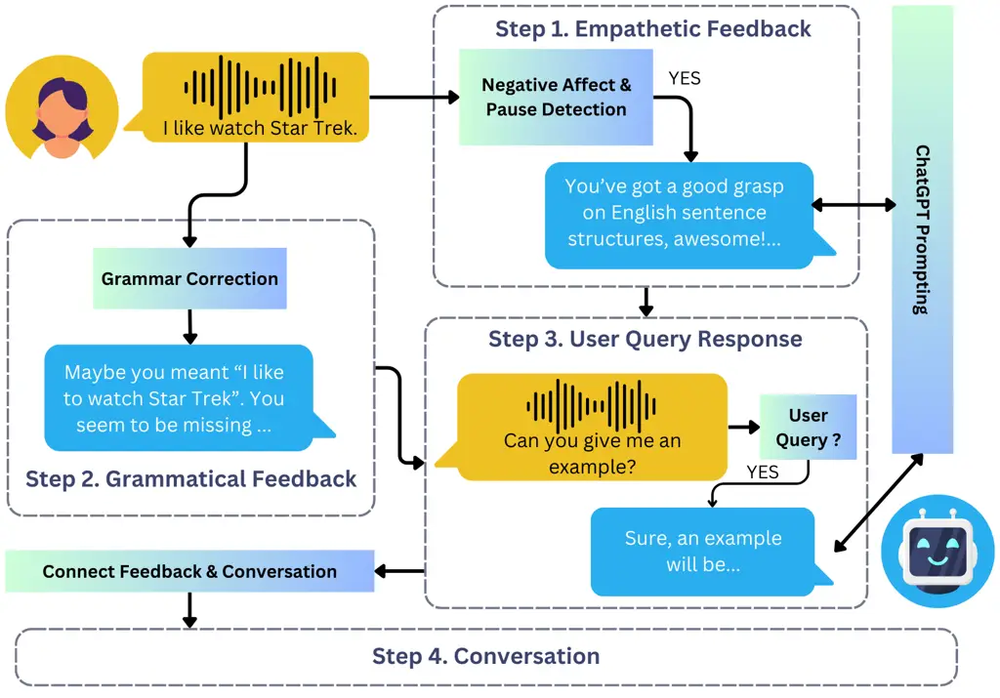

# Using Adaptive Empathetic Responses for Teaching English

Li Siyan    Teresa Shao    Zhou Yu    Julia Hirschberg
Affiliation: Department of Computer Science Affiliation: Columbia
University
Email: [{siyan.li,ts3488,zy2461,jbh2019}@columbia.edu](mailto:)

###### Abstract

Existing English-teaching chatbots rarely incorporate empathy explicitly
in their feedback, but empathetic feedback could help keep students
engaged and reduce learner anxiety. Toward this end, we propose the task
of negative emotion detection via audio, for recognizing empathetic
feedback opportunities in language learning. We then build the first
spoken English-teaching chatbot with adaptive, empathetic feedback. This
feedback is synthesized through automatic prompt optimization of ChatGPT
and is evaluated with English learners. We demonstrate the effectiveness
of our system through a preliminary user study.

## 1 Introduction

Teacher empathy has been shown to improve the learning experience,
including increasing learner engagement and reducing anxiety Cooper
(2002); lam2011empathy; zhang2022toward. Recently, wu2023teachers
suggests that students’ perceived affective support (PAS) from teachers
has a positive correlation with L2 grit, defined as the passion and
perseverance for second-language learning teimouri2022l2. PAS generally
corresponds to the perceived level of support for emotional needs. Its
definition includes caring, valuing responses, listening, and
encouragement sakiz2007does. We therefore expect empathy to correlate
positively with PAS. We aim to examine whether an empathetic,
English-teaching system with high PAS similarly boosts L2 grit.

English-teaching systems have adopted affective components for various
purposes zhai2022systematic. However, the systems that have introduced
empathetic components into pedagogy are either situated in ubiquitous
learning environments Dai et al. (2014); santos2016toward or are not
naturalistic or seamless in their approaches to accounting for student
affect wu2022affective. An interactive system that effectively detects
and alleviates ESL learner anxiety without sensors (e.g. pulse rate
monitors) or cameras has yet to be implemented.

Detecting negative emotion from a learner’s audio is a promising way to
offer empathetic feedback. However, off-the-shelf English speech emotion
recognition models are often trained on data collected with native
speakers of English Busso et al. (2008); lotfian2017building. We
hypothesize that English spoken by non-native speakers will have
differences lin2014understanding that challenge these off-the-shelf
models. To address this, we develop a preliminary pipeline for this task
using annotated audio data and incorporate it into a spoken empathetic
chatbot system.

Our spoken chatbot detects negative emotions or prolonged pauses and
then responds empathetically to encourage students. This
negative-emotion-responsive design is inspired by an automated physics
tutor that senses student frustration using sensors and cameras D’mello
and Graesser (2013). We currently employ model-based and automatic
approaches for sensing negative affect in user audio. The chatbot also
provides grammar feedback. We utilize a grammar correction model for
grammatical feedback and ChatGPT with optimized prompting for empathetic
feedback. Positive preliminary user study results indicate that users
perceive affective support from our system, paving the way for future
large-scale experiments to study our system’s effect on learner L2 grit.

Our main contributions are: 1) We release a dataset of Mandarin-accented
English speech with high-quality ASR transcripts and negative emotion
annotations, and 2) We propose the first sensor-free educational English
chatbot that detects negative affect and intervenes by providing
adaptive empathetic feedback ¹¹ 1 The dataset and code are in
[https://github.com/siyan-sylvia-li/adaptive_empathetic_BEA2024](https://github.com/siyan-sylvia-li/adaptive_empathetic_BEA2024).

## 2 Related Work

### 2.1 Emotion Recognition in English-Teaching Systems

Past English-teaching systems often relied on facial emotion recognition
for detecting user affective states. lin2015perspective features a
teaching assistant that recognizes the user’s emotional state from
facial expressions and then adjusts the material’s difficulty.
zhang2022affective proposes a convolutional neural network-based
approach to learner emotion recognition to be used in future systems. We
are not considering the visual modality due to the constraints of the
dialogue framework we build upon.

mazur2011proposal creates a gamified scoring system to adapt to
different users. This system is equipped with affect classification for
Japanese textual input, yet the role of empathy here is unclear.

Other systems have employed less seamless approaches to detecting affect
changes. wu2022affective constructs an emotion recognition module by
recording the number of times a learner clicks on positive and negative
emoticons. santos2016toward employs Arduino, an open-source electronic
prototyping platform to detect learner physiological changes, such as
pulses and skin conductivity. Another ubiquitous learning system, Dai
et al. (2014), uses speech signal and multi-agent behavioral data for
online learning and a neural mechanism model for analyzing learners’
emotional characteristics.

Figure 1: System Design Overview.

### 2.2 Affective English-Teaching Chatbots

Chatbots are effective in increasing student conversational activity
during discussions goda2014conversation, improving listening skills
kim2018study and grammar kim2019future, and enhancing writing abilities
lin2020enhancing. Since ChatGPT appeared, the quality of chatbot
responses has improved dramatically, eliminating concerns about adverse
effects on student outcomes due to low response quality Fryer et al.
(2020).

Ayedoun et al. (2015) introduces a multimodal agent that simulates a
restaurant waiter to situate participants in a social conversational
context to improve their willingness to communicate. Ayedoun et al.
(2020) further improves this system by incorporating communication
strategies and affective backchannels to provide personalized
scaffolding. While the systems alleviate learner anxiety, learner
emotions are not directly accounted for or addressed. Both systems also
rely on pre-scripted dialogue and are restricted in scenarios.

shi2020design builds an empathetic spoken chatbot into a WeChat program
for English tutoring. The GPT-2-based radford2019language chatbot
utilizes an ontology and a retrieval-based generation approach similar
to XiaoIce zhou2020design. Despite being empathetic, the bot only uses
audio for pronunciation correction.

### 2.3 Pauses and Anxiety in ESL Context

Foreign language anxiety can correlate with higher pause rates and lower
fluency. perez2019role established that learners with higher language
anxiety tend to pause more frequently. In a study by
wilang2018complexity that monitors ESL speakers speaking during an exam,
pausing is associated with heart rate spikes for some, indicating
anxiety during pauses. ESL teachers have also noted pauses and
stammering as signs of students struggling with language anxiety
kasap2019anxiety.

## 3 System Design

### 3.1 Overview

Figure 1 shows a system overview: User audio is sent to the Empathetic
Feedback module to determine whether the user is distressed. If so, the
bot produces empathetic feedback using past user utterances; otherwise,
the system continues to the Grammatical Feedback stage, where grammar
critiques are given if applicable. If either feedback mechanism is
triggered, the system transitions back to the original conversation
through the User Query Response stage if the user follows up with the
feedback, then through the Connect Feedback & Conversation module. To
avoid overwhelming users, we ensure at least two turns between
grammatical feedback and four turns between empathetic feedback. We
discussed our design with ESL students and consulted teachers before
finalizing our system. See Appendix A for details.

We build on an existing dialogue framework li2022using for speech and
text dialogue system development. The system allows users to converse
with the chatbot by recording their utterances through a microphone. The
utterance is then converted to text using Whisper medium
radford2023robust and the text and audio are sent to the chatbot for
further analyses and response synthesis. The chatbot response is spoken
using SpeechT5 Ao et al. (2022). For the specific speaker embedding, we
selected one of the slt clips from the CMU Arctic speech
databaseskominek2004cmu manually. When choosing the speaker embedding,
we aimed for a female voice that can sufficiently induce perceived
empathy.

### 3.2 Data Used

To create data for testing various modules, we utilized audio clips of
native Mandarin speakers conversing with a chatbot collected from an
English practice platform li2022using. 3,200 audio clips from 613
conversations and 163 users remained after filtering. The filtering
process removes audio clips containing only Mandarin, duplicates, and a
subset of self-introductions from the users. We were not able to
eliminate all identifying information from this stage of filtering, but
we will remove all identifiable information before publicizing our data.
Each audio clip ranges from one second to two minutes. We did not
collect demographic information for user identity protection.

We transcribed all audio clips with Whisper medium for training the
text-based models in our pipeline. Whisper is not always sufficiently
robust to handle heavily accented speech in our data; however, to
realistically simulate the environment for our models, we choose not to
correct these transcriptions, although we will release the data after
manually correcting the transcripts to ensure quality. Realistically,
our system should improve as more accent-robust real-time ASR systems
emerge.

| Input                                  | Correction                             | Llama                                                                              |
| -------------------------------------- | -------------------------------------- | ---------------------------------------------------------------------------------- |
| I like to read book and study English. | I like to read books and study English | I like to read books and study English. I also like to spend time with my friends. |
| Love story                             | Love story.                            | Love story. Maybe I will write a book one of these days.                           |

Table 1: Examples of the trained Llama model extending the original
output.

| Model           | EM   | SM   | Corr. |
| --------------- | ---- | ---- | ----- |
| Flan-T5-base    | 0.56 | 0.65 | N/A   |
| Flan-T5-XL      | 0.6  | 0.68 | 0.53  |
| Flan-T5-XXL     | 0.62 | 0.72 | 0.58  |
| Llama-2-chat-7b | 0.30 | 0.68 | 0.58  |

Table 2: Exact match scores, substring match scores, and GPT correction
scores for different grammar correction models.

| Label    | Definition                                                                                                                                                                                                                                                             | Counts |
| -------- | ---------------------------------------------------------------------------------------------------------------------------------------------------------------------------------------------------------------------------------------------------------------------- | ------ |
| Unusable | The audio is either completely silent, the speaker(s) are conversing in Mandarin, or the utterance is completely unintelligible.                                                                                                                                       | 8      |
| Negative | The speaker displays negative sentiments: e.g. anger, frustration, or sadness. Include instances in which the speaker displays an unwillingness to communicate. Include instances where the speaker asks for clarification, as it is an implicit display of confusion. | 39     |
| Pauses   | The speaker makes many pauses during their utterance. These pauses make it sound like the speaker is struggling to construct the sentences.                                                                                                                            | 54     |
| Neutral  | This includes all usable clips that are labeled neither negative nor pauses.                                                                                                                                                                                           | 200    |

Table 3: Definitions for different labels in our data labeling process
and their corresponding counts in our labeled audio dataset. These label
definitions were presented to the annotators.

### 3.3 Grammatical Feedback

Grammar Correction Model: Following the framework in
liang-etal-2023-chatback, we train a grammar correction model to modify
user utterance transcripts. We originally prompted ChatGPT for grammar
correction feedback. However, responses were often hallucinated or
malformed, including using the original utterance as the correction
despite correctly identifying grammatical mistakes. Therefore, we train
a Llama-2-7b touvron2023llama model on ErAConD yuan-etal-2022-eracond,
which contains high-quality error-correction pairs collected from
human-chatbot written dialogues. Since grammar correction is a
sequence-to-sequence task, we train additional Flan-T5 models Chung
et al. (2022) on the same data. We include more details about the
training process in Appendix D.

To evaluate the models, we compute the exact match scores between model
predictions and the ground truth corrections in the ErAConD test set.
Llama occasionally extends its output (See Table 1), so we include
another criterion, substring match, to indicate whether the ground truth
is included in the prediction. We also evaluate grammar correction
quality on transcribed spoken utterances for Flan-T5-XL, XXL, and Llama.
Our trained models correct 100 transcribed spoken utterances. Due to the
lack of ground truth grammar corrections, we use AI feedback from
GPT-4-Turbo to assess if each prediction is grammatically correct. The
results of the evaluation are shown in Table 2.

We observe an increase from exact match to substring match across the
board because the ground truth grammatical corrections do not always
append periods, while most trained models do. As we transition to
out-of-domain data (from written to transcription), we see a decrease in
correction accuracy. However, this drop is the smallest for Llama,
suggesting higher generalizability to out-of-domain data. We, therefore,
choose Llama for our grammar correction model for its relatively higher
robustness and smaller size than Flan-T5-XXL.

Grammatical Feedback Format: We would like to present grammar model
corrections to the students. Upon considering our design survey results,
we choose conversational recasts lyster2013oral. This involves
reformulating student utterances, often including confirmation checks
(e.g. "Did you mean \[corrected sentence\]?"). We implement the recast
by pre-pending the corrected sentence with a random confirmation check
phrase (e.g. "I think you meant"). When the corrected sentence is longer
than 20 words, we instead identify a dependency parse constituent
containing the error to avoid repeating the entire sentence when
possible. Since the sentences are sentence-tokenized before being
corrected, we ignore Llama corrections longer than one sentence. This
addresses the previous Llama extension issue.

In addition to a conversational recast, we want to explain how the
student’s utterance is incorrect. We utilize the conversational grammar
correction feedback templates proposed in liang-etal-2023-chatback and
append the templated feedback to the utterance. See examples of our
grammatical feedback in Appendix G.

### 3.4 Negative Emotion and Pause Detection

Data Labeling: Since no accented speech emotion classification dataset
exists, we labeled our audio clips to create evaluation data for our
pipeline. We used four labels: Negative, Pauses, Neutral, and Unusable.
Two Mandarin native speakers with high English proficiency annotated
approximately 10% of the data with a Kappa of 0.893. We only include
audio clips whose labels both annotators agreed upon. Our audio
dataset’s data distribution and label definitions are in Table 3. The
label definitions were presented to the annotators as the annotation
scheme. The annotators also labeled clips featuring both negative affect
and pauses as “Negative” to promote better label balance, since students
rarely display negative emotions in our data.

Negative Emotion Detection: Because of the shortage of emotion-labeled
accented speech data, we could not train new audio classification models
for our specific task. Instead, we manipulate a popular out-of-the-box
speech emotion classification model²² 2
https://huggingface.co/ehcalabres/wav2vec2-lg-xlsr-en-speech-emotion-recognition.
We test different configurations and settings for this model on the
small emotion-labeled dataset from the previous segment. Specifically,
given the output probabilities for different emotions, we first combine
a subset of them to form our estimated probability of negative affect.
Thresholding is then applied to provide the final prediction. Our
results indicate that the optimal configuration is the predicted
probability for only “anger” and a threshold of 0.4. Using this
information, we reach a weighted F1 score of 0.78 on our Negative and
Neutral audio clips. See Appendix C for details.

The current speech emotion recognition models do not perform well on our
task, as speculated. Anecdotally, when directly running classification
on our audio clips using the model, many clips classified by us as
“Neutral” are often classified as sad or disgusted.

| Metric       | Clip Label | Mean | Diff |
| ------------ | ---------- | ---- | ---- |
| Ratio        | Pauses     | 0.41 |      |
|              | Neutral    | 0.32 | 0.09 |
| Pause Rate   | Pauses     | 0.60 |      |
|              | Neutral    | 0.55 | 0.05 |
| Pause Length | Pauses     | 0.68 |      |
|              | Neutral    | 0.49 | 0.19 |

Table 4: The three metrics for the clips labeled as “Pauses” and
“Neutral” in our audio data. We include the average values for the
metrics, as well as the differences between the different clip labels.

Pause Detection: As established, prolonged pauses indicate the presence
of foreign language anxiety and should be considered as a cue in our
framework. We aim to develop automated metrics that identify user
utterances with these pauses.

We devise three metrics for determining whether an audio clip fulfills
the criteria for “Pauses”:

1.  1.  Silence Ratio: The quotient of the total amount of silence in a clip
        and the clip length.
2.  2.  Pause Rate: The result of dividing the number of pauses by audio
        length.
3.  3.  Average Pause Length: The average length of pauses.

For computing these metrics, we equip our system with Silero-VAD
Silero-VAD, a fast and enterprise-grade voice activity detection
package. Silero-VAD identifies and locates speech segments, and it
allows speech extraction from the original audio such that the resulting
clip is speech-only. We can therefore compute the total lengths of
silence and pauses in an audio, as well as the number of pauses in an
audio clip.

Other features, such as pause location, can also be used to indicate the
level of anxiety. We leave the exploration of these features to future
work.

To compare the ability of these metrics to differentiate between
“Neutral” and “Pauses” clips, we calculate the values of these three
metrics on these clips. We further measure the differences between the
metric values for the two categories (Table 4). The “Average Pause
Length” metric yields the highest difference, which suggests it
effectively separates “Neutral” and “Pauses” clips. In addition, we
experiment with various thresholds for differentiating the two types of
audio using “Average Pause Length” (See Appendix B) and select a
threshold of 0.5.

### 3.5 Empathetic Response Generation

Data Construction: Given the ASR transcripts of user utterances in a
conversation, we added all instances of three consecutive utterances to
our data (i.e., utterances 1+2+3, 2+3+4, etc). This created 2014
segments for optimizing our ChatGPT prompts. Due to cost constraints, we
only used 625 conversation segments for prompt optimization: 125 for
optimization, 200 for evaluation and iteration, and 300 for held-out
testing.

Implementation: Our desiderata for the empathetic response generation
module include the following: 1. Tailored to the user; 2. Empathetic and
encouraging; 3. Including actionable feedback or specific examples the
user can learn from. Because there are no sufficiently large datasets
that precisely fulfill these requirements, we rely on prompting ChatGPT
to generate such responses. Unfortunately, large language models are
sensitive to how they are prompted. Simple trial-and-error did not
achieve consistently satisfactory responses in our preliminary
experiments (Zeroshot stage).

We employed the DSPy framework khattab2023dspy to optimize for prompts
while satisfying our desiderata (Optimized stage). We first tasked GPT-4
to check whether each requirement is satisfied in a given response (e.g.
is the utterance empathetic and encouraging). This is a form of AI
feedback Bai et al. (2022). GPT-4 appears successful in this text
annotation task, consistent with results established in
gilardi2023chatgpt. Using the AI feedback as our metrics, we aimed to
optimize our prompts to maximize the metrics. DSPy supplies the
BayesianSignatureOptimizer, which references simple descriptions of our
desiderata to suggest sample instructions and few-shot examples. Using
this Bayesian-model-powered optimization process, we improved the
metrics on a held-out test set from 68.3 (at the Zeroshot stage) to
89.8. We discuss whether the improvement aligns with human intuition in
Section 5.1.

We observe that the outputs of our optimized prompt are often formal,
while most of our design survey participants prefer colloquial feedback.
To address this, we insert a final rewrite call to rewrite the optimized
prompt output to a more colloquial version (Rewrite stage). GPT-4
evaluates this stage’s outputs as 88.7.

During inference time, when we detect that the user requires empathetic
feedback, the user’s three most recent utterances are concatenated and
fed into ChatGPT with the optimized prompt. The output undergoes the
Rewrite stage to produce the final output. All ChatGPT prompts and GPT-4
feedback prompts used for this module are included in Appendix I. See
Appendix J for examples of outputs at different stages.

### 3.6 Connecting Feedback and Conversation

User Query Response: Our feedback modules are currently intended for
single-turn feedback (i.e. the bot provides the feedback without
anticipating that the user will ask clarification questions), but in
preliminary user studies, we noticed that users do inquire about the
feedback. Therefore, we handle this case by constructing a ChatGPT call
with the immediate conversation context and asking for a response to the
user’s query. We classify a user response to feedback as a relevant
query with a rule-based approach. We use this rule-based approach
instead of forwarding all post-feedback user queries to ChatGPT because
prior users would ask about the bot’s creator and training data,
resulting in unintended behavior (e.g. the bot claiming it is created by
Google or OpenAI engineers).

Transition: We employ templates for a smooth transition between feedback
and the original conversation. Before entering the feedback stage, we
cache the original bot response to return to the conversation afterward.
More details about templates and ChatGPT prompts are provided in
Appendix E.

### 3.7 Conversation

Unlike the other modules that only need to be activated sporadically,
the conversation module is invoked for almost every turn. This poses
additional needs for inference speed and costs, which motivates using a
locally stored model.

We selected a Vicuna model fine-tuned for curriculum-driven
conversations li2023curriculum. The model allows for customization of
topics, chatbot personas, and vocabulary to incorporate into the
conversation. li2023curriculum noticed that brevity instructions are
sometimes ignored by ChatGPT. This further makes ChatGPT not ideal for
our spoken conversation use-case, as run-on utterances may be difficult
to comprehend in a speech setting. Users found the Vicuna model more
helpful for developing conversational skills, providing natural and
realistic utterances, and aligning with users’ English proficiency
levels.

The topic of “Name a movie that has had an enduring impact on you” was
chosen for relatability. We randomly selected a vocabulary and one of
the female personas to match the TTS voice. Bot feedback and user
responses to feedback are not included in the conversation history when
prompting the Vicuna model to keep the components modular and prevent
out-of-distribution behavior.

|         |         |       |        |      |        |      |        |      |
| ------- | ------- | ----- | ------ | ---- | ------ | ---- | ------ | ---- |
|         | Quality | Conf. | Useful | Enc. | Listen | Care | Praise | PAS  |
| Average | 3.75    | 3.33  | 3.83   | 3.16 | 3.58   | 3.08 | 3.25   | 3.27 |
| Std     | 1.05    | 1.07  | 1.19   | 1.64 | 1.16   | 1.24 | 1.60   | 1.16 |

Table 5: Post-survey results. "Conf." stands for confidence, "Enc."
stands for encourage, and "PAS" stands for perceived affective support.

## 4 User Study

Fourteen native Mandarin speakers were recruited from social media and
the authors’ connections. Each participant conversed with the chatbot
for at least 10 turns (a turn is one round of exchange between the
chatbot and the user). A pre-survey for participant English proficiency
and a post-survey for user experience were administered. In the
pre-survey, we obtain an approximate assessment of the participants’
English proficiency including their standardized test scores,
self-reported proficiency, and the frequency at which they speak English
daily. After the participants interacted with our system, they were
presented with a post-survey which includes a modified version of the
teacher affective support scale (the last four items below)
sakiz2007does adapted for our context and general evaluations of
conversation quality.

Our Likert-scale post-survey includes:

Quality: How was the conversation quality?

Confidence: Do you feel that you are more confident after conversing
with the chatbot?

Useful: Do you think the chatbot’s grammar feedback is useful?

Encourage: The chatbot encourages me when I am having difficulties in
the conversation.

Listen: The chatbot listens to me when I have something to say.

Care: My opinion matters to the chatbot.

Praise: The chatbot recognizes and appreciates when I am good at
something.

Details for the surveys can be found in Appendix H. Example
conversations between the participants and the bot can be found in
Appendix G.

| Stage     | vs. Zeroshot | vs. Optimized | vs. Rewrite |
| --------- | ------------ | ------------- | ----------- |
| Zeroshot  | -            | 0.52          | 0.45        |
| Optimized | 0.47         | -             | 0.45        |
| Rewrite   | 0.54         | 0.54          | -           |

Table 6: Win rates between each pair of empathetic feedback generation
stages.

## 5 Results and Discussion

### 5.1 Empathetic Generation Evaluation

We asked each participant to rank the different stages of empathetic
feedback (Zeroshot, Optimized, Rewrite). Participants ranked responses
generated in these three stages on the same segment for 30 randomly
selected segments. At least 3 participants ranked each triple. We also
asked the participants how they would improve the utterance they ranked
at \#1 for each conversation segment.

In Table 6, Rewrite wins more often against both Zeroshot and Optimized,
suggesting that the Rewrite improves Optimized stage outputs. Optimized
outputs are often not preferred due to their formality and length. Since
Rewrite rephrases Optimized outputs without modifying core content, it
appears that the participants are ranking the content from Optimized
relatively higher than the content from Zeroshot. Another result is that
Zeroshot is often ranked as \#1 or \#3, illustrating that Zeroshot
outputs are less consistent in quality. Despite being scored higher by
GPT-4, Optimized does not significantly outperform Zeroshot. This could
be due to DSPy optimization focusing on fulfilling metrics without
considering human preferences, or due to raters having various
standards.

As for improving the feedback, participants reported that the best
responses are still too verbose (one wrote "the shorter the better") and
requested better feedback examples. They mentioned that generic praises
can sound disingenuous, detrimental to the intention to encourage. Some
suggested that praise may not be necessary for every piece of feedback,
especially when participants receive multiple feedback during a
conversation. One future direction would be to develop more
context-aware mechanisms for more naturalistic and long-term empathetic
feedback.

### 5.2 Conversation Statistics

Two participants did not receive empathetic feedback and were excluded
from analyses. For the other twelve participants, each conversed for an
average of 14.5 turns and received 1.9 grammatical feedbacks and 1.3
empathetic feedbacks.

### 5.3 Survey Results

On average, our participants have approximately 14.25 years of
experience learning English. They all rated themselves above three out
of five for self-reported English proficiency (higher is more
proficient) with an average of 3.92. The participants who disclosed
their IELTS and TOEFL scores had 7.3 and 109.3 averages respectively.
For the question on English usage frequency, the average was 3.41 (one
being for English only, five being for Mandarin only). Our participants
have intermediate English proficiency but do not speak English
frequently.

The post-survey results are shown in Table 5. In addition to the survey
items, we include PAS as an aggregate metric by averaging the four
adapted PAS survey items. The participants often consider the
conversation quality to be high. They reported gaining moderate
confidence after the conversation, and consider the bot’s feedback
useful. As for the survey items involving PAS, the results contain
higher variance. While users believe that the bot appears to listen to
them fairly attentively (potentially as an effect of the grammatical
feedback), they are more ambivalent about whether the bot encourages
them or praises them appropriately. We suspect that the reason for lower
“Encouragement” ratings stems from our imperfect detection mechanism;
empathetic feedback might have been given when the user was not exactly
struggling. The participants also could not have struggled at all during
the conversation. A potential reason for the high variance in “Praise”
ratings is the disingenuous-sounding encouragement mentioned in
Section 5.1. Additionally, user motivation for using our system can
affect their self-reported results. Participants who only intend to test
the system rather than improve their English might rate it poorly.

### 5.4 Dialogue Inspection and User Feedback

We inspect conversations with low PAS to identify failure modes of our
system. The conversation with the lowest PAS includes both technical
issues in the system (the user was baffled by the frequent interruptions
in the system) and the chatbot forgetting the conversation history due
to the limited context length of our model. Another conversation
features significant ASR errors and the error propagation led to
nonsensical grammatical feedback which confused the user. Due to current
limitations in user query processing after bot feedback, some user
queries were occasionally ignored, but the presence of these does not
dictate low PAS.

We requested feedback from our participants. They praised the ASR
accuracy and feedback quality, mentioning that they feel encouraged
after receiving feedback. Some users stated that the goal of spoken
English is to keep the conversation going, and therefore only egregious
grammar errors should be corrected. Others would solicit grammar
feedback from the system and exhibit dismay when it did not recognize
their errors. One user mentioned that they would stammer and have
disfluencies that would be recognized as grammatical errors. Some users
disliked the stiffness of the feedback formats as they felt the
conversation flows were interrupted. A subset of responses are presented
in Appendix F.

These observations highlight limitations in our current system. To
improve user experience, we will develop more seamless feedback
mechanisms and robust user query classification. Additionally, we aim to
create better grammar models suited for transcribed utterances and
resilient to disfluencies and fillers. Additional goals include
detecting technical difficulties so the chatbot can apologize for any
interruption, as well as conversation summarizers to inform our model of
previous discussions.

## 6 Conclusion and Future Work

In this work, we propose the negative emotion detection task in the
context of English learning to capture learner frustration and anxiety.
We also introduce the first English-teaching chatbot that provides
adaptive, empathetic feedback to students using our negative affect
detection pipeline. Initial trials with end users demonstrate the
potential of our system. For future work, we intend to scale up our user
evaluations and verify our hypothesis that our system can effectively
improve student L2 grit.

For future work, apart from addressing participant feedback, we intend
to expand our experiments to include more thorough comparisons between
the different experimental conditions to establish more robust results.
Specifically, we want to determine whether our adaptive empathetic
feedback improves L2 grit more than no empathetic feedback or fixed
feedback upon multiple chatbot interactions. Another interesting topic
to examine more closely would be whether humans behave and react
similarly when conversing with chatbots and real-life English teachers.
We intend to include participants from an ESL course in our next study.

## 7 Limitations

Our current system serves as a proof-of-concept for a chatbot system
capable of adaptive empathetic feedback, and it is by no means perfect.
While our modular design allows for more rigorous control for future
experiments, there can easily be error propagation between modules, and
none of the modules are completely error-proof, as we have illustrated
in our paper. To begin with, our speech emotion recognition pipeline
does not successfully capture all instances of negative affect in our
labeled data. The Llama model used for grammar correction still cannot
correct all instances in the ErAConD test set. Our user query detection
mechanism can miss relevant queries. All of these should be improved in
future iterations of the system.

The current user study results are preliminary and do not offer
sufficient statistical strength for solid conclusions. In future, we
will aim for larger user studies by recruiting broadly on social media
and at our institution.

Our data is currently labeled only by two labelers, which renders our
labels less valid. We will aim to include more labelers to improve the
validity of our emotion-labeled data.

## 8 Ethical Considerations

Any applications interfacing with humans, especially students, need to
consider accidental psychological harm done to the students as a result
of generations. To address this, we performed rigorous testing prior to
our user study.

There is potentially self-identifying information present in our audio
data. We will filter out self-identifying information before releasing
the data to protect user identity.

## References

- Ao et al. (2022) Junyi Ao, Rui Wang, Long Zhou, Chengyi Wang, Shuo
  Ren, Yu Wu, Shujie Liu, Tom Ko, Qing Li, Yu Zhang, Zhihua Wei, Yao
  Qian, Jinyu Li, and Furu Wei. 2022. [SpeechT5: Unified-modal
  encoder-decoder pre-training for spoken language
  processing](https://doi.org/10.18653/v1/2022.acl-long.393). In
  _Proceedings of the 60th Annual Meeting of the Association for
  Computational Linguistics (Volume 1: Long Papers)_, pages 5723–5738,
  Dublin, Ireland. Association for Computational Linguistics.

- Ayedoun et al. (2015) Emmanuel Ayedoun, Yuki Hayashi, and Kazuhisa
  Seta. 2015. A conversational agent to encourage willingness to
  communicate in the context of english as a foreign language. _Procedia
  Computer Science_, 60:1433–1442.

- Ayedoun et al. (2020) Emmanuel Ayedoun, Yuki Hayashi, and Kazuhisa
  Seta. 2020. Toward personalized scaffolding and fading of motivational
  support in l2 learner–dialogue agent interactions: an exploratory
  study. _IEEE Transactions on Learning Technologies_, 13(3):604–616.

- Bai et al. (2022) Yuntao Bai, Saurav Kadavath, Sandipan Kundu, Amanda
  Askell, Jackson Kernion, Andy Jones, Anna Chen, Anna Goldie, Azalia
  Mirhoseini, Cameron McKinnon, et al. 2022. Constitutional ai:
  Harmlessness from ai feedback. _arXiv preprint arXiv:2212.08073_.

- Busso et al. (2008) Carlos Busso, Murtaza Bulut, Chi-Chun Lee, Abe
  Kazemzadeh, Emily Mower, Samuel Kim, Jeannette N Chang, Sungbok Lee,
  and Shrikanth S Narayanan. 2008. Iemocap: Interactive emotional dyadic
  motion capture database. _Language resources and evaluation_,
  42:335–359.

- Chung et al. (2022) Hyung Won Chung, Le Hou, Shayne Longpre, Barret
  Zoph, Yi Tay, William Fedus, Yunxuan Li, Xuezhi Wang, Mostafa
  Dehghani, Siddhartha Brahma, et al. 2022. Scaling
  instruction-finetuned language models. _arXiv preprint
  arXiv:2210.11416_.

- Cooper (2002) Bridget Cooper. 2002. _Teachers as moral models: the
  role of empathy in the relationships between teachers and their
  pupils_. Ph.D. thesis, Leeds Metropolitan University.

- Dai et al. (2014) Weihui Dai, Shuang Huang, Xuan Zhou, Xueer Yu,
  Mirjana Ivanovi, and Dongrong Xu. 2014. Emotional intelligence system
  for ubiquitous smart foreign language education based on neural
  mechanism. _Journal of Information Technology Applications &
  Management_, 21(3):65–77.

- D’mello and Graesser (2013) Sidney D’mello and Art Graesser. 2013.
  Autotutor and affective autotutor: Learning by talking with
  cognitively and emotionally intelligent computers that talk back. _ACM
  Transactions on Interactive Intelligent Systems (TiiS)_, 2(4):1–39.

-

## Appendix A Chatbot Design Discussion

A total of 12 Mandarin native speakers were recruited through the
authors’ personal connections to provide feedback on our chatbot design.
We provided a Google Form for them to complete. We later released a
version on social media that gained many more responses, but since we do
not utilize the results from that survey directly in this work, we
reserve the discussion and incorporation of these results for future
work.

We translated a subset of relevant questions and response options from
Mandarin. We have abridged preambles in the questionnaire for brevity.
The questions and responses of our survey are as follows (the percentage
in the parentheses corresponds to the percentage of participants who
selected that option):

1.  1.  How would you like an English teacher to give you feedback?
    - •
      Formal (25%)
    - •
      Colloquial (75%)

2.  2.  How long should the feedback be?
    - •
      1 - 2 sentences (8.3%)
    - •
      2 - 3 sentences (41.7%)
    - •
      3 - 4 sentences (50%)
    - •
      4+ sentences (0%)

3.  3.  If you have made a grammatical error, what specific attributes
        should a teacher’s feedback for you have? Please select all that are
        applicable.
    - •
      Correct your mistakes directly (58.3%)
    - •
      Correct your mistakes interactively through Q & A (33.3%)
    - •
      Give you examples so that you can learn from the example and avoid
      making the same mistakes again (75%)

4.  4.  What is your ideal form of encouraging and empathetic feedback?
        Please select all that apply.
    - •
      Give you encouragement (e.g. "You are doing great!", "I am proud
      of you!") (58.3%)
    - •
      Tell you what you are good at in terms of your spoken English
      (75%)
    - •
      Tell you what you can improve in your spoken English (58.3%)
    - •
      Tell you how you can improve through examples (75%)
    - •
      Provide you with plausible and actionable advice for improving
      your English (41.7%)

## Appendix B Experiments for Pause Detection

After computing the pause length metric values for all audio clips
labeled as either “neutral” or “pauses”, we compared the effect of
varying pause detection mechanisms and thresholds. We computed the
classification accuracy values when using different pause detection
metrics and different threshold values. We aim to obtain the highest
possible classification accuracy values for our metric-threshold
combination.

We present the results for varying threshold values for Silence Ratio,
Pause Rate, and Average Pause Length in Tables 7, 8, and 9,
respectively.

| Threshold | Neutral% | Pauses% |
| --------- | -------- | ------- |
| 0.1       | 100.0    | 3.5     |
| 0.2       | 98.1     | 22.5    |
| 0.3       | 72.2     | 53.0    |
| 0.4       | 44.4     | 72.5    |
| 0.5       | 26.0     | 85.5    |
| 0.6       | 7.4      | 92.0    |
| 0.7       | 3.7      | 97.0    |

Table 7: Classification accuracy for Neutral and Pauses audio clips
using the Silence Ratio pause detection metric.

| Threshold | Neutral% | Pauses% |
| --------- | -------- | ------- |
| 0.1       | 100.0    | 0.0     |
| 0.2       | 98.1     | 1.5     |
| 0.3       | 96.3     | 9.5     |
| 0.4       | 88.9     | 18.5    |
| 0.5       | 74.1     | 39.5    |
| 0.6       | 50.0     | 61.0    |
| 0.7       | 29.6     | 85.0    |

Table 8: Classification accuracy for Neutral and Pauses audio clips
using the Pause Rate pause detection metric.

| Threshold | Neutral% | Pauses% |
| --------- | -------- | ------- |
| 0.1       | 98.1     | 21.5    |
| 0.2       | 98.1     | 24      |
| 0.3       | 96.3     | 34.5    |
| 0.4       | 88.9     | 54.4    |
| 0.5       | 70.4     | 73.0    |
| 0.6       | 61.1     | 81.5    |
| 0.7       | 38.9     | 89.5    |

Table 9: Classification accuracy for Neutral and Pauses audio clips
using the Average Pause Length pause detection metric.

## Appendix C Experiments for Negative Emotion Detection

The wav2vec model we have selected outputs probabilities for the
following emotions given a speech segment: angry, calm, disgust,
fearful, happy, neutral, sad, and surprised. This model is a fine-tuned
version of grosman2021xlsr53-large-english, which is a widely popular
automatic speech recognition model. The model is then fine-tuned on the
RAVDESS dataset livingstone2018ryerson for the speech emotion
recognition downstream task.

We explored the following methods for combining the output probabilities
from the model to produce the negative affect estimate. Here, we include
anger for each of our methods because frustration and anger can manifest
themselves in a similar manner in speech.

1.  1.  Anger + Disgust + Fearful + Sad (ADFS) - 0
2.  2.  Anger + Disgust + Fearful (ADF) - 1
3.  3.  Anger + Disgust (AD) - 4
4.  4.  Anger + Fearful (AF) - 5
5.  5.  Disgust + Fearful (DF) - 3
6.  6.  Anger (A) - 2

For the values of the threshold, we experimented with 0.1 through 0.9
with an increment of 0.1.

We evaluated the different setups on all audio clips labeled as Neutral
or Negative in our labeled data subset. The weighted F1 score was
computed to account for class imbalance. We included the best F1 scores
achievable by each setup, along with their corresponding thresholds for
obtaining the best F1 scores, in Table 10.

| Setup | Threshold | Best F1 |
| ----- | --------- | ------- |
| ADFS  | 0.9       | 0.57    |
| ADF   | 0.8       | 0.76    |
| AD    | 0.8       | 0.76    |
| AF    | 0.4       | 0.76    |
| DF    | 0.8       | 0.76    |
| A     | 0.4       | 0.78    |

Table 10: The best achievable weighted F1 scores and their corresponding
threshold values for each of the speech recognition model output
aggregation methods.

## Appendix D Training Details for Llama and Flan-T5 Models

All models were trained on a single 40 GB GPU. Models were trained for
10 epochs and the best models were selected using validation set loss.
Flan-T5-base was trained without any parameter-efficient fine-tuning,
but all other models were trained using PEFT and Lora. We will release
model training and inference code if accepted.

## Appendix E Details on the Connecting Feedback and Conversation Component

### E.1 Identifying Query

We utilized a simple rule-based approach to determine whether an
utterance provided by a user after bot feedback is a question about the
feedback or the English learning process. Namely, we (1) checked that a
"?" is in the transcribed utterance; (2) checked whether one of the
words in this list belongs in the utterance: "grammar", "grammatical",
"vocab", "English", "mistake", "example", "sentence". If both conditions
were fulfilled, we then interfaced with ChatGPT to respond to user
queries.

### E.2 Responding to Query

Since we anticipate that the user will only be responding to the bot
feedback, we would not need to include too much context in our ChatGPT
call. We supplied the following prompt to ChatGPT to obtain a response
to give to the user.

f"""Based on the following conversation history:\\n\\n{convo}, answer
the user’s following query: "{user_query}" Answer in a spoken utterance.
Provide specific feedback, but be succinct."""

### E.3 Transitioning

If the user does not respond to the bot feedback with a query, or when
the bot has finished responding to the user query, the system would then
return to the original conversation flow. This transition was obtained
by prefixing the cached original bot response with one of the randomly
selected phrases. There are two general scenarios here:

1.  1.  The user expresses gratitude by including "thank" in their
        utterance.
2.  2.  The user does not explicitly express gratitude.

The code for constructing the prefix to prepend to the original bot
response is as follows:

if "thank" in text.lower():

prefix = random.choice(\["Of course!", "No problem at all.", "Yeah, no
problem!", "No problem!"\]) + " " + random.choice(\["Back to the
conversation.", "Back to our convo.", "Let’s go back to chatting.", "Now
we circle back."\])

else:

prefix = random.choice(

\["Sounds great.", "Alright, let’s continue our conversation.", "Great,
let’s get back to it!",

"Okay let’s go back to our conversation.", "Now back to our
conversation.", "Okay!",

"Lets’ go back to our chat.", "Let’s keep chatting."\])

## Appendix F User Feedback

We asked participants to share their experience with the chatbot, and
received the following responses. All responses have been paraphrased
and translated from Mandarin:

User A: I like the chatbot and I look forward to the finished product…
When the chatbot corrects my grammar, the way it corrects me is very
stiff and clunky, and it can interfere with the immersive experience…
Additionally, when I use filler words or discourse markers or perform
self-repair in the conversation, the bot would catch these as
grammatical errors even though they should not be treated as such.

User B: Your chatbot has high ASR accuracy, and the quality of the
conversation is quite good! However, it may be challenging to provide
English learners with sufficient help, because I asked for more specific
feedback after receiving a feedback and it went back to talking about
movies.

User C: One thing I really like about the chatbot is that the feedback
is very timely! When using ChatGPT I don’t always get very prompt
feedback. We have a foreigner English teacher coming next week and your
bot is definitely a life-saver.

User D: I don’t think some trivial grammatical errors, like mixing is
and was when discussing movie plots, should be corrected. I also asked
for the bot for word choice improvements but it didn’t give me any.

User E: The conversation has high quality, and although the feedback can
lag behind one or two sentences, the feedback is always correct and
helpful. The bot clearly understands what you are trying to convey and
can continue the conversation despite grammar errors. Sometimes it uses
sentences that can be too complex for beginners, but providing Mandarin
translations for bot utterances can be helpful.

## Appendix G Example Conversations

The following are conversation excerpts between our bot and different
users. Here, blue indicates empathetic feedback, orange indicates a
transition between feedback stage and the conversation, and red
indicates a grammatical feedback.

We first examine a successful conversation example. Note that the
empathetic feedback is activated when the user experiences hesitation:

User: Actually, I hardly ever watch movies, so could I describe opera?

Bot: Sure! What’s the name of the opera that you’d like to describe?

User: Okay, that’s Turandot, which describes a love story between a
Chinese princess and a foreign prince.

Bot: I believe you wanted to say "Okay, that’s Turandot, which is a
story about a love between a Chinese princess and a foreign prince.". In
this sentence you used the verb "describes", but it doesn’t sound
natural. I’d recommend using the word "is a story about". Does that
sound good?

User: you

Bot: Okay let’s go back to our conversation. Interesting! I can’t say
that I’m familiar with it. Could you tell me more about the story?

User: This Chinese princess whose grandma is… Wait a minute.

Bot: You’ve got a good grasp of the topic and can explain yourself
clearly, which is awesome! Just tweak your grammar and sentence
structure for a more natural flow. For instance, instead of saying "I
hardly ever watch movies, so could I describe opera?", try "Since I
rarely watch movies, can I talk about opera instead?" Keep at it, and
you’ll see improvement in no time! Does that sound alright to you?

User: Yes, and now I will go to talk about the context of the opera.

Bot: Okay! Yes, go on. What’s the story about?

User: This story is about the Chinese princess, Truong Du, whose grandma
was bullied by the foreigners. So Truong Du set a rule to the man who
want to marry him that he must answer three questions and then he can
marry her or dad. The cover of the, answered the three questions and
finally married with Torandu.

Bot: Perhaps what you meant to say was "who wants " and not want In this
sentence you made a mistake on the verb "want". The correct verb form
here is "wants". Remember to make your verbs agree with their subjects.
How does that sound?

User: That sounds great, okay I understand.

Bot: Alright, let’s continue our conversation. That’s certainly a unique
story! What did you like most about the opera?

 

Here we see a failure of recognizing user query due to the rule-based
nature of our query recognition mechanism.

Bot: I’m doing alright, thanks. Have you watched any good movies lately?

User: No, not really. I don’t watch any movie.

Bot: Really? You don’t watch any movies? Not even the classics?

User: then it won’t be lately. I do watch classics. Which one you want
to talk about?

Bot: Well, I was thinking about the movie "Citizen Kane". What do you
think about it?

User: That is a very very classical one. I had it some time ago I
couldn’t really remember the plot could you rephrase it for me?

Bot: Sure, it’s about a journalist who becomes a powerful newspaper
publisher and his journey to find the meaning of "rosebud" which holds
the key to his soul.

User: Yeah, I sort of like that idea. You know, start being a nobody and
then with one’s effort you became a big shot in the industry.

Bot: Exactly, it’s a great story of how one’s perseverance and hard work
can lead to success. I also love the way the director used different
narrative techniques to tell the story.

User: I couldn’t remember exactly. Could you give me an example?

Bot: Sure, one of the techniques used is the use of different reporters
telling the story of Kane’s life. Each one provides a different
perspective on who he was as a person and the events that shaped his
life.

User: Yeah I would say that was quite innovative at that time when the
movie was first released. Anyway what else you want to talk about?

Bot: You’re doing great with understanding and expressing the topic
clearly! Just brush up on grammar and sentence structure, like saying "I
can’t remember exactly." Keep practicing to keep getting better!

User: All right, anything else for me?

Bot: Lets’ go back to our chat. Well, I was also thinking about "The
Godfather". Have you seen it?

User: Oh yes, I really love the music. The Godfather theme in both 1 and 2. I didn’t really watch Godfather, the third part.

Bot: I believe you wanted to say "I didn’t really watch The Godfather,
the third part.". You seem to be missing a determiner in this sentence.
You should probably add "The" to make the sentence sound more natural.
Does that sound alright to you?

## Appendix H Pre Survey and Post Survey

The surveys have been translated from Mandarin.

### H.1 Pre-Survey

1.  1.  How many years have you been learning English?
2.  2.  How would you rate your English proficiency (1 star for beginner, 5
        stars for proficient)?
3.  3.  What is your IELTS score?
4.  4.  What is your TOEFL score?
5.  5.  How much English do you speak every day (1 star for English only, 5
        stars for Mandarin only)?

### H.2 Post-Survey

1.  1.  How was the quality of your conversation on a scale of 1 to 5?
2.  2.  Do you feel that you are more confident after conversing with the
        chatbot? Rate on a scale of 1 to 5.
3.  3.  Do you think the chatbot’s grammar feedback is useful? Rate on a
        scale of 1 to 5.
4.  4.  The chatbot encourages me when I am having difficulties in the
        conversation (1-star for "Not like me at all", 5-stars for "Very
        much like me").
5.  5.  The chatbot listens to me when I have something to say (1-star for
        "Not like me at all", 5-stars for "Very much like me").
6.  6.  My opinion matters to the chatbot (1-star for "Not like me at all",
        5-stars for "Very much like me").
7.  7.  The chatbot recognizes and appreciates when I am good at something
        (1-star for "Not like me at all", 5-stars for "Very much like me").

## Appendix I Empathetic Feedback Generation ChatGPT Prompts

### I.1 Zero-shot Prompt

A student is learning English. You are assessing a spoken utterance. In
at most two sentences, summarize (1) their specific strengths in English
skills and (2) things they can work on to improve. Address the student
in the second person. Include specific examples that the student can
learn from. Be colloquial, as if in spoken conversation.

---

Follow the following format.

Convo: \\\$\\convo\\

Reasoning: Let’s think step by step in order to \\\${produce the
output}. We ...

Output: Treat this as a spoken conversation, so be succinct, colloquial,
and empathetic.

---

Convo: - Yeah, I always talk to my parents about the student. - Yeah, so
the person that I met, you know, that I’ve met, that I want to study
with is one of my classmates, Tom, and how I met this, met Tom is when I
was in high school and he’s in my next classroom and he is one of the
best students in the other class and I really admire his intelligence
and I learn a lot from him and I’ve known him since, you know, 2016 and
he is one of the best students in the other class so that’s why I want
to study with him.

Reasoning: Let’s think step by step in order to assess your spoken
utterance. We can see that you have a strong grasp of English vocabulary
and grammar, as evidenced by your ability to express complex ideas and
use a variety of sentence structures. However, you may want to work on
your pronunciation and intonation, as some of your words were not clear
and your speech lacked natural rhythm. For example, you said "met"
instead of "meet" and "classroom" instead of "classmate." Practicing
with a native speaker or using online resources can help you improve in
this area. Keep up the good work!

Output:

### I.2 Optimized Prompt

Proposed Instruction: You’re playing the role of an encouraging English
tutor for a student who is actively learning and practicing their
English through conversation. Your task is to listen attentively to
their spoken utterances and provide constructive feedback. In your
response, kindly highlight (1) one specific strength they showed or an
aspect they did well in during the conversation, complimenting their
effort or skill in English, and (2) offer one focused suggestion on how
they can improve further, making it actionable and clear. Use colloquial
language to maintain the conversational tone, directly addressing the
student with "you", and where possible, reference specific examples from
their speech to illustrate your points. Your feedback should feel like a
supportive nudge towards their language learning journey, keeping it
concise and personalized.

---

Follow the following format.

Convo: \${convo}

Reasoning: Let’s think step by step in order to \${produce the output}.
We ...

Feedback: Treat this as a spoken conversation, so be succinct,
colloquial, and empathetic.

---

Convo: - Sorry, I have not get some information about the personal
medical data sharing. Well, I think it’s maybe something related to
digital. Like, it’s different from the traditional medical system. Like,
all medical systems transfer from the traditional one into the digital
one. And maybe the digital systems will help the hospital to organize
the patients and to regulate some patient’s information with high
efficiency and better orders. So it may saves a lot of time for
some... - Yeah, maybe like if you go to one hospital and if the doctor
keeps a capital record on his on the paper then you left this hospital
go to another hospital the new doctor have no idea about your situation
if all information of patients can put on the website or in other words
those are online information that whether we change the hospital the
doctor can get access to our information and we can show our situation
to to those doctors yeah it’s a good idea - Yeah, if we put some
information online, it means we lose our Privacy or our information is
easy to be steered by some Bad person. Yeah, maybe some people they have
some Some disease which they don’t want to be known They want to keep at
a secret if we upload their disease Their information about this disease
some people there will feel uncomfortable maybe we can like set some
System which only allowed the The doctor can see all this information
Information something like the bank so people cannot get a sex to the
system if they are not Permated permitted to do these things

Reasoning: Let’s think step by step in order to assess your spoken
utterance. You have a strong understanding of the topic and are able to
explain it clearly. However, you can work on your pronunciation and
grammar to improve your fluency. For example, you can practice
pronouncing words like "information" and "permitted" more clearly and
work on using proper verb tenses. Keep practicing and you will continue
to improve!

Feedback: You have a good grasp of the topic and can explain it well.
However, you can work on your pronunciation and grammar to improve your
fluency. For example, try practicing words like "information" and
"permitted" and using proper verb tenses. Keep practicing and you’ll get
even better!

---

Convo: - The people who influence me the most was my primary teacher, Ms
Wong. She made me follow the English teaching class on the road to the
next level. She is so gentle, so calm, so professional. And the method
she is teaching, she is interesting. So in her English class, my
attention is always focused. She makes me feel that English is a very
interesting subject. And she always shares with me the experience in
English that she is in the world, her life, her study life and the
normal life in the world. And that made me think that English is a
necessary and important skill. And it played an important role in our
life. - Yes, I told her, I always, when I chat with my friends, I will
always mention this teacher. She, although she is the primary English
teacher for me, is nearly 17 years ago. Yeah, it’s a long time and we
haven’t had a long time to say that. I still remember her and always
remember what she did for us. - I think the childhood is the most...
It’s the most pure and carefree days. In that time happiness is the very
easy. And we always do what we like. We don’t need to concern our life,
concern how to make money for living.

Reasoning: Let’s think step by step in order to assess your spoken
English skills. You have a strong foundation in English, as evidenced by
your ability to express yourself clearly and fluently. However, you can
work on your pronunciation and intonation to make your speech more
natural and engaging. For example, you can practice speaking with a
native speaker or listen to English podcasts to improve your
pronunciation and intonation. Keep up the good work and continue to
practice, and you will see improvement in no time!

Feedback: You have a great foundation in English, and it’s clear that
you have a strong grasp of the language. However, you can work on your
pronunciation and intonation to make your speech sound more natural and
engaging. For example, you can try practicing with a native speaker or
listening to English podcasts to improve your pronunciation and
intonation. Keep up the good work and keep practicing, and you’ll see
improvement in no time!

---

Convo: - Yes, of course. I usually focus on my test work. - When I was
reading books or I’m doing some hard work. - I will find some help,
maybe from another people or from folks.

Reasoning: Let’s think step by step in order to assess this spoken
utterance. We can see that you have a good grasp of basic English
skills, such as using the correct verb tense and sentence structure.
However, you may want to work on your vocabulary and pronunciation, as
some words were mispronounced and you used "folks" instead of "people"
or "others."

Feedback: You have a good understanding of basic English skills, like
using the right verb tense and sentence structure. However, you may want
to focus on expanding your vocabulary and improving your pronunciation.
For example, instead of saying "folks," you can use "people" or
"others." Keep practicing and seeking help from others to improve your
skills.

---

Convo: - Well, as a way of recording things, I think it’s much simpler
and easier for you to take photos than writing a journal or something
like that. - No, not really, because back then a few decades ago I think
going to cinema was really expensive and we cannot afford it when I was
a kid. - I prefer go to cinema with my friends because I don’t have
quite the same taste for movie or films with my parents so our friends
is much better.

Reasoning: Let’s think step by step in order to assess your spoken
English skills. We can see that you have a good grasp of vocabulary and
can express your thoughts clearly. However, you can work on your grammar
and sentence structure to make your speech more fluent and natural. For
example, instead of saying "I prefer go to cinema", you can say "I
prefer going to the cinema". This will make your sentence more
grammatically correct and sound more natural. Keep practicing and you
will improve in no time!

Feedback: You have a good grasp of vocabulary and can express your
thoughts clearly, which is great! However, you can work on your grammar
and sentence structure to make your speech more fluent and natural. For
example, instead of saying "I prefer go to cinema", you can say "I
prefer going to the cinema". Keep practicing and you will improve in no
time!

---

Convo: - Small businesses like small pop and man shops that people would
open, small restaurants. I think those are pretty, you know, the go-to
small business that one can think of on top of their minds. - I think I
would prefer big companies because big companies are more insured, the
quality is more controlled and if you have any issues with the product
you have easier time to get a refund or replacement for small companies.
I do understand that they have higher operation costs so sometimes they
would try not to have refunds and replacements and so on. So it’s
understandable but as a consumer I would prefer big companies with their
insurance policies so I think that is my choice. - Well, I think it’s
better to live it to work in a big company because in big companies you
have a bigger platform. You have chances to learn from people who came
before you, who were also working in the company. You have chances to
work across companies because you have a lot of business dealing with
them. And big companies often give their staff training with something
that most small companies lack. So at least at the beginning stage of
your career, I think working in a big company is definitely a better
way. They’re the better choice for most people.

Reasoning: Let’s think step by step in order to assess your spoken
utterance. You have a strong understanding of the differences between
small and big businesses, and you provide specific examples to support
your points. However, you can work on your pronunciation and intonation
to make your speech more clear and engaging. For example, try to
enunciate each word clearly and vary your tone to emphasize important
points. This will help you communicate your ideas more effectively.

Feedback: You have a good grasp of the differences between small and big
businesses and you give good examples to support your points. But you
can work on your pronunciation and intonation to make your speech more
clear and engaging. For example, try to say each word clearly and change
your tone to emphasize important points. This will help you communicate
your ideas more effectively.

---

Convo: - I like to listen to popular music. It is easy to follow. It’s
easy to sing. I like to share those favorite songs with my friends
together. And when I listen to some music or some songs that sound so
good, I like to listen to it again and again. - My favorite singer is
Joe Shen. He is a male singer. His voice is similar to a female singer’s
voice. His songs are clean and clear and he can sing all kinds of songs.
He can speak eight languages. It’s amazing. I really like his songs. -
Yeah, I do like art. I like to, I like those pictures, paintings. I
really want to draw some pictures by myself but I’m not good at it. I’d
like to see them.

Reasoning: Let’s think step by step in order to

### I.3 Rewrite Prompts

There are two stages to the rewrite process. In the first stage, we
employed the following prompt:

Shorten and rewrite this utterance to sound simple, natural, and
engaging; remove any assessment of speech including pronunciation and
intonation:\\n\\n{empathetic_output}

Here, empathetic_output refers to the output from the Optimized stage.
We then continued appending the following message to the current session
with ChatGPT:

Make your response different and casual, and shorten to 3 - 4 sentences

The output from ChatGPT after this additional prompting was used as the
final output.

## Appendix J Example Outputs at Different Stages

The following conversation segments are selected at random and may
contain ASR errors.

 

Conversation Segment:

1.  1.  To be honest, I don’t want to live on another planet because I think
        the earth is comfortable and it is suitable for us.
2.  2.  A little. I have some knowledge about the moon and the moon.
3.  3.  When I was a student in primary school, I went to… I often go to a
        picnic with my friends.

Zeroshot: You have a good grasp of the topic and can express your
thoughts clearly. However, you can work on your fluency and
pronunciation to make your speech more natural and easy to understand.
For example, you can practice speaking more slowly and enunciating your
words clearly. Also, try to listen to native speakers and imitate their
pronunciation to improve your own. Keep up the good work!

Optimized: You have a good understanding of the topic and can express
your thoughts clearly, which is great! However, you can work on your
grammar and sentence structure to make your speech more fluent and
natural. For example, instead of saying “I went to… I often go to a
picnic”, you can say “I used to go on picnics with my friends when I was
a student in primary school.” This will make your sentence more
grammatically correct and sound more natural. Keep practicing and you
will improve in no time!

Rewrite: You’ve got a good handle on the topic and express yourself
clearly, which is awesome! Just tweak your grammar and sentence
structure for a smoother and more natural flow. For example, instead of
saying “I went to… I often go to a picnic,” try “I used to go on picnics
with my friends back in primary school.” Keep at it, and you’ll get even
better in no time!

 

Conversation Segment:

1.  1.  Well, probably like less diet, less fat tissues would really be
        beneficial to your health and to your general functions.
2.  2.  What’s the word again? I’ve never heard of it. Could you explain the
        terminology to me?
3.  3.  Okay, that sounds… Well, I’m asking you the word you’re talking
        about the triple action capillates. Yeah, but what’s that?

Zeroshot: You have a good understanding of vocabulary and sentence
structure, but you may need to work on your pronunciation and listening
skills. For example, when you didn’t understand the word “capillates,”
you asked for clarification, which is great. To improve, try practicing
speaking and listening to English more often. Keep asking for
clarification when needed, and you’ll continue to improve.

Optimized: You have a good understanding of the topic and can express
your thoughts clearly, which is great! However, you can work on your
vocabulary and pronunciation to improve your fluency. For example,
instead of saying “less diet,” you can say “a healthier diet” and
instead of saying “capillates,” you can say “capillaries.” Keep
practicing and expanding your vocabulary to improve your skills.

Rewrite: You’ve got a good grasp of the topic and can explain things
clearly, which is awesome! Just work on your vocab and pronunciation for
smoother conversation. Try swapping “less diet” for “healthier diet” and
“capillates” for “capillaries.” Keep at it and keep expanding your vocab
to get even better!

 

Conversation Segment:

1.  1.  Hmm, actually it depends. If I’m concentrating on the things that
        I’m interested in, I won’t feel bored. But if the things just go so
        embarrassed or so boring, I will distract by something else. And
        another situation is that I may fall asleep.
2.  2.  Well, I actually do not have a memory of that. Because I think
        sitting on the floors may be the things that the boys do. And
        however, you know, I’m a girl who likes a tiny and quiet place to
        sit.
3.  3.  Of course, while speaking of a person with these strong impression,
        I would say that was my Chinese teacher in my primary school. I
        remember she taught us in my fifth grade. At my first sight, she
        looked really irradible, which made me have the feeling of this
        teacher is the person you can’t get along well with. So I always
        keep the distance with her. However, what upset me the most was
        right there. These schools always don’t allow the students to bring
        any entertainment things. I was just a kid, so I bought some comics
        to my friend as well as some classmates and spread it. Well, the
        comics are really interesting. After my Chinese teacher, who is also
        my class class teacher, knew that she just threw it out of my
        classroom window in front of all my classmates. And that was really
        embarrassing. So that memory kept kept a long time in my mind and I
        don’t really like that teacher. Even now, I can still remember her
        with not really good memories.

Zeroshot: You’re doing great in English, you can express yourself well
and your thoughts are clear. But you can work on your pronunciation and
intonation to make your speech more engaging and natural. Try practicing
in front of a mirror or recording yourself to identify areas for
improvement. Keep it up!

Optimized: You have a good understanding of the topic and can express
your thoughts clearly, which is great! However, you can work on your
grammar and sentence structure to make your speech more fluent and
natural. For example, instead of saying "I remember she taught us in my
fifth grade", you can say "I remember she taught us when I was in fifth
grade." Also, try to use more descriptive words to make your story more
engaging. Keep practicing and you will continue to improve!

Rewrite: You’ve got a good grasp of the topic and express yourself
clearly, awesome! Just tweak your grammar and sentence structure for a
smoother flow. For example, instead of saying "I remember she taught us
in my fifth grade," you could say "I remember she taught us when I was
in fifth grade." Keep practicing, and you’ll keep improving!

 

Conversation Segment:

1.  1.  People are often willing to get to know new people in various
        situations. Firstly, when individuals join new social or
        professional environments, such as starting a new job or moving to a
        new city, they are more open to meeting new people as they seek to
        establish social connections and build a support network. Secondly,
2.  2.  People go to various places to meet new people and expand their
        social circles. One common place is social events and gatherings
        such as parties, social clubs and community events. These provide
        opportunities for individuals to interact with others who share
        similar interests or are part of the same community.
3.  3.  Studying a conversation can be approached in various ways depending
        on the context and the individuals involved. One common way is
        through initiating a topic of mutual interest. This could involve
        asking open-ended questions or making observations about the current
        situation. For example, at a social gathering, one might start a
        conversation by commenting on the events, complimenting someone’s
        attire, or discussing a shared hobby.

Zeroshot: You’re great at starting conversations and finding common
interests with others, which is a valuable skill in making new
connections. However, you can work on being more confident and assertive
in your approach, as well as actively listening and asking follow-up
questions to keep the conversation going. For example, instead of just
commenting on the events, try asking others about their experiences or
opinions. This will show your interest and help you build deeper
connections with people.

Optimized: You have a good understanding of the topic and can explain it
clearly. However, you can work on your pronunciation and intonation to
make your speech more engaging and natural. For example, try to vary
your tone and emphasize important words to make your speech more
interesting. Keep practicing and you will continue to improve!

Rewrite: You’ve got a good grip on the topic and explain it well. To
spice up your speech, try varying your tone and emphasizing important
words. Keep practicing, and you’ll keep getting better!

 

Conversation Segment:

1.  1.  Well, I’m afraid that I can’t give you the straight answer. But in
        the city where I live now, the weather is always raining because
        it’s located in the southeastern part of China and it’s also close
        to the sea. Sometimes I like to stay in the sunny days because I
        really like the moment when I read some books in the afternoon in
        the sunny days.
2.  2.  Well, there are some different kinds of styles in terms of weather
        situations in my hometown. For instance, in spring, the air is mild
        and fresh. In summer, the weather is so hot. In autumn, the weather
        started to become a little cold compared with the weather in summer.
        In winter, the weather in my hometown is quite cold.
3.  3.  Well, I’m afraid that I can’t give you the straight answer. This
        mainly depends on different situations. When the weather is so dry,
        so when it’s raining, I really like the rainy days. On the contrary,
        as I mentioned before, I really like the time when I spent in the
        sunny days like reading a book when I felt very tired.

Zeroshot: Hey there! Your pronunciation and intonation are on point,
making it easy for me to understand you. But to make your speech more
interesting, try using different words and sentence structures. For
example, instead of saying "I really like", you can say "I’m fond of" or
"I’m a big fan of". Also, use more descriptive adjectives like
"scorching" or "sweltering" to paint a clearer picture. Keep practicing
and you’ll see improvement in no time!

Optimized: You have a good understanding of different weather situations
and can describe them clearly, which is great! However, you can work on
your grammar and sentence structure to make your speech more fluent and
natural. For example, instead of saying "I really like the time when I
spent in the sunny days", you can say "I really enjoy spending time in
the sunny days." Keep practicing and you will continue to improve!

Rewrite: You’re good at understanding different weather situations and
describing them clearly, that’s awesome! Just work on grammar and
sentence structure to make your speech flow better. For example, say "I
love spending time on sunny days" instead of "I really like the time
when I spent in the sunny days." Keep practicing to improve even more!
