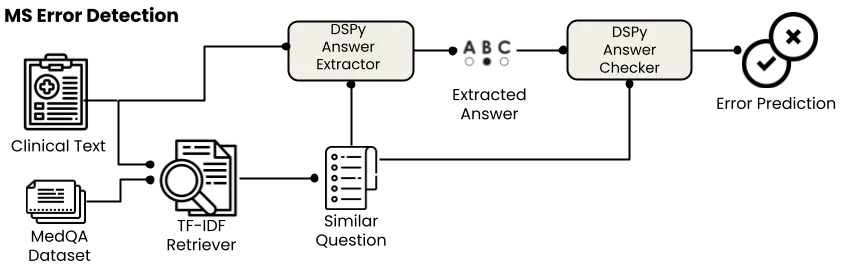
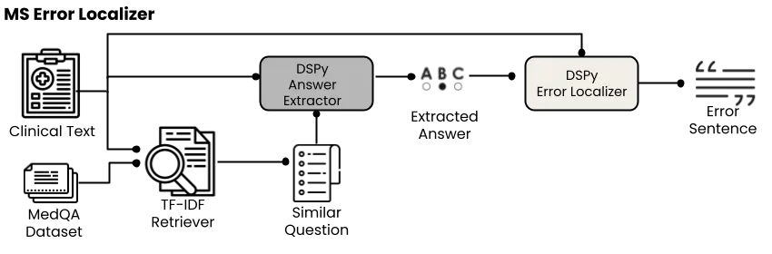
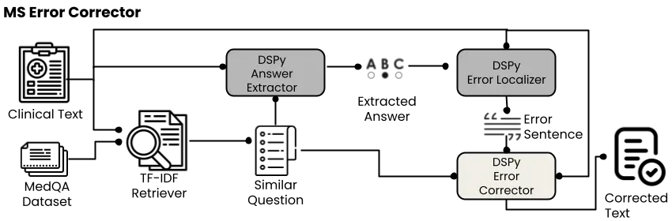

# WangLab at MEDIQA-CORR 2024: Optimized LLM-based Programs for Medical Error Detection and Correction

Augustin Toma Ronald Xie Steven Palayew Patrick R. Lawler Bo Wang
Email: [{augustin.toma, ronald.xie,
steven.palayew}@mail.utoronto.ca](mailto:) Affiliation: University of
Toronto Affiliation: Vector Institute Affiliation: McGill University
Affiliation: Peter Munk Cardiac Centre, University Health Network
Affiliation: AI Hub, University Health Network
Email: [bowang@vectorinstitute.ai](mailto:)

###### Abstract

Medical errors in clinical text pose significant risks to patient
safety. The MEDIQA-CORR 2024 shared task focuses on detecting and
correcting these errors across three subtasks: identifying the presence
of an error, extracting the erroneous sentence, and generating a
corrected sentence. In this paper, we present our approach that achieved
top performance in all three subtasks. For the MS dataset, which
contains subtle errors, we developed a retrieval-based system leveraging
external medical question-answering datasets. For the UW dataset,
reflecting more realistic clinical notes, we created a pipeline of
modules to detect, localize, and correct errors. Both approaches
utilized the DSPy framework for optimizing prompts and few-shot examples
in large language model (LLM) based programs. Our results demonstrate
the effectiveness of LLM based programs for medical error correction.
However, our approach has limitations in addressing the full diversity
of potential errors in medical documentation. We discuss the
implications of our work and highlight future research directions to
advance the robustness and applicability of medical error detection and
correction systems.

## 1 Introduction

Medical errors pose a significant threat to patient safety and can have
severe consequences, including increased morbidity, mortality, and
healthcare costs. Detecting and correcting these errors in clinical text
is crucial for ensuring accurate medical documentation and facilitating
effective communication among healthcare professionals. One of the
fastest-growing use cases for artificial intelligence (AI) in healthcare
is clinical note generation, often from transcriptions of
physician-patient dialogues. However, assessing the quality and accuracy
of these notes is challenging, and automated detection and correction of
errors could have a significant impact on patient care. The reliability
of large language models (LLMs) in critical applications, such as
healthcare, is a major concern due to the potential for hallucinations
(generating false or nonsensical information) and inconsistencies.
Robust solutions to the question of error detection and correction are
essential for addressing these concerns and enabling the safe and
effective use of LLMs in medical contexts.

The MEDIQA-CORR 2024 (Ben Abacha et al., 2024a) shared task focuses on
identifying and correcting medical errors in clinical notes. Each text
is either correct or contains a single error. The task involves three
subtasks: (1) detecting the presence of an error, (2) extracting the
erroneous sentence, and (3) generating a corrected sentence for flagged
texts.

In this paper, we present our approach, which achieved the top
performance across all three subtasks in the MEDIQA-CORR 2024
competition. We develop a series of LLM-based programs using DSPy, a
framework for optimizing prompts and few-shot examples. We provide a
detailed description of our methodology and results, followed by a
discussion of the implications of our work and future directions in the
field of medical error detection and correction.

## 2 Related Work

The use of large language models (LLMs) in medicine has attracted
considerable attention in recent years. The release of LLMs such as
GPT-4 has led to intensive research in the medical community (Nori
et al., 2023), particularly in clinical note generation. The MEDIQA-Chat
2023 (Ben Abacha et al., 2023) competition showcased the performance of
automated note generation solutions (Giorgi et al., 2023), and further
work has demonstrated that LLMs can sometimes outperform humans on
clinical text summarization tasks (Van Veen et al., 2024).

However, there has been limited research focusing on granular audits of
these clinical notes with respect to accuracy and error correction. The
MEDIQA-CORR 2024 shared task addresses this gap by providing a platform
for researchers to develop and evaluate novel approaches to error
detection and correction in clinical text, ultimately contributing to
the development of more reliable AI systems in healthcare.

## 3 Task Description

The MEDIQA-CORR 2024 shared task provides two distinct datasets: MS and
UW (Ben Abacha et al., 2024b). The MS dataset consists of a Training Set
containing 2,189 clinical texts and a Validation Set (#1) containing 574
clinical texts. The UW dataset, on the other hand, consists solely of a
Validation Set (#2) containing 160 clinical texts. The test set for the
shared task includes clinical texts from both the MS and UW collections.

The evaluation metrics for the MEDIQA-CORR 2024 shared task vary across
the three subtasks:

- •
  Subtask 1 (Error Flag Prediction): Evaluated using Accuracy.
- •
  Subtask 2 (Error Sentence Detection): Evaluated using Accuracy.
- •
  Subtask 3 (Sentence Correction): Evaluated using ROUGE Lin (2004),
  BERTScore Zhang et al. (2020), BLEURT Sellam et al. (2020),
  Aggregate-Score (mean of ROUGE-1-F, BERTScore, BLEURT-20), and
  Composite Scores.

The Composite Score for each text in Subtask 3 is calculated as follows:

1.  1.  Assign 1 point if both the system correction and the reference
        correction are "NA"
2.  2.  Assign 0 points if only one of the system correction or the
        reference correction is "NA"
3.  3.  Calculate the score based on metrics (ROUGE, BERTScore, BLEURT and
        the Aggregate-Score) within the range of \[0, 1\] if both the system
        correction and reference correction are non-"NA" sentences.

## 4 Approach

### 4.1 Overview

Upon reviewing the MS and UW datasets, it became apparent that these two
datasets presented distinct challenges. The errors in the MS dataset
were often extremely subtle, to the point that many errors did not
actually seem like errors, and in fact, clinicians on our team often
couldn’t identify the presence of an error within the text. However,
when reviewing corrected text from the training set, it became clear
that corrections were often ’optimal’ completions. For example, consider
the following error and its correction:

> Error sentence: After reviewing imaging, the causal pathogen was
> determined to be Haemophilus influenzae. (Ben Abacha et al., 2024b)
>
> Corrected sentence: After reviewing imaging, the causal pathogen was
> determined to be Streptococcus pneumoniae. (Ben Abacha et al., 2024b)

These types of errors are subtle and seem akin to multiple-choice
questions, where often multiple answers could independently be seen as
correct completions, but only in the context of one another would you
deem one answer wrong. On the other hand, the UW dataset appeared to
reflect realistic clinical notes, and the errors were more apparent. For
example, consider the following error and its correction:

> Error sentence: Hypokalemia - based on laboratory findings patient has
> hypervalinemia. (Ben Abacha et al., 2024b)
>
> Corrected sentence: Hypokalemia - based on laboratory findings patient
> has hypokalemia. (Ben Abacha et al., 2024b)

In this case, the error involves a nonsensical term (hypervalinemia, a
rare metabolic condition) when the context makes it clear that the
patient has hypokalemia (low potassium levels). These are errors that a
clinician can identify from the text alone.

The distinct characteristics of the MS and UW datasets prompted us to
develop a two-pronged approach to the MEDIQA-CORR 2024 shared task. For
the MS dataset, we employed a retrieval-based system to identify similar
questions from external medical question-answering datasets and leverage
the knowledge contained in these datasets to detect and correct errors.
For the UW dataset, we created a series of modules to detect, localize,
and correct errors in clinical text snippets. Both approaches were built
on DSPy (Khattab et al., 2023), a novel framework for systematically
optimizing prompts and few-shot examples in LLM based programs.

### 4.2 Approach for MS Dataset

Our approach to the MS dataset involves a multi-step process that
leverages retrieval-based methods and the DSPy framework, as illustrated
in Figures 1, 2, and 3. In all of our experiments, we utilized
GPT-4-0125-preview as the underlying large language model, using default
generation parameters (temperature of 1.0, top_p of 1) with the
exception of a max tokens value of 4096.

#### 4.2.1 Retrieval of Similar Questions

First, we employ a retrieval-based approach to identify similar
questions from the MedQA dataset (Jin et al., 2020). MedQA is a medical
question-answering dataset that contains multiple-choice questions, each
with a set of answer options and a correct answer. By leveraging the
knowledge contained in this external dataset, we aim to detect and
correct errors in the MS dataset. We use TF-IDF (Sparck Jones, 1972) to
calculate the similarity between the given question in the MS dataset
and the questions in MedQA, retrieving the most similar questions along
with their answer options and correct answers for further analysis.

#### 4.2.2 Identifying Answer Choices within Query Text

To identify the implicit answer choice within the query text, we employ
a two-step process using DSPy programs. First, we send both the query
text and the identified similar multiple-choice question to a DSPy
module that utilizes chain of thought (Wei et al., 2023) and the
BootstrapFewShotWithRandomSearch teleprompter (Khattab et al., 2023).
This teleprompter generates 20 few-shot examples by sampling from the
training set and testing the module’s performance on the validation set.
The module aims to extract the answer choice that appears to be present
in the query text.

The output from this module is then passed to a second DSPy module,
which also leverages the BootstrapFewShotWithRandomSearch teleprompter.
This module creates multiple few-shot examples that compare the
extracted answer against the true answer from the multiple-choice
question, as shown in Figure 1. We simultaneously bootstrap these two
steps, optimizing the entire pipeline based on the accuracy of the
overall error flag prediction.

The result of this bootstrapping process is a compiled program with
optimized multi-step chain of thought prompts based on the module’s
performance on error detection accuracy. This approach allows us to
effectively identify the presence of errors in the query text by
leveraging the knowledge from external medical question-answering
datasets.

Figure 1: Predicting the presence of an error through a comparison to
the retrieved question

#### 4.2.3 Localizing Errors within Query Text

After detecting an error in the query text, we use a DSPy module to
identify the specific line containing the error, as illustrated in
Figure 2. This module takes the extracted answer choice and the
preprocessed query text as inputs and then an LLM call is done to
determine which line most closely matches the erroneous answer choice.

Our experiments showed that GPT-4’s performance was high enough that we
did not need to compile the program or bootstrap few-shot prompts via a
DSPy teleprompter.

The module outputs the line number where the error is located, which is
crucial for the subsequent error correction step, as it allows for
targeted correction of the relevant text.

Figure 2: Identifying the error sentence

#### 4.2.4 Error Correction with DSPy

After identifying the error location within the query text, we use a
final DSPy module to generate a corrected version of the text, as
illustrated in Figure 3. This module takes three inputs: the error line,
the extracted answer choice, and the correct answer derived from the
most similar retrieved multiple-choice question.

The error correction module utilizes a chain of thought prompt along
with 20 few-shot examples generated by the
BootstrapFewShotWithRandomSearch teleprompter. This teleprompter samples
examples from the training set and generates intermediate labels, such
as rationales for the chain of thought, to provide additional context
and guidance for the language model during the error correction process.
The teleprompter optimizes the selection of few-shot prompts based on
their performance on the validation set, using the ROUGE-L score as the
metric.

The selected few-shot examples, accompanied by the generated
intermediate labels, demonstrate how to modify the error line based on
the extracted answer choice and the correct answer, serving as a
reference for the model to learn from and adapt to the specific error
correction task.

The module outputs the corrected version of the query text, with the
error line revised based on the correct answer derived from the most
similar multiple-choice question. This corrected text represents the
final output of our retrieval-based approach for the MS dataset,
addressing the subtle errors present in the clinical text.

Figure 3: Generating the corrected sentence

### 4.3 Approach for UW Dataset

Our approach for the UW dataset involves optimizing a series of DSPy
modules to accomplish all three subtasks sequentially, as illustrated in
Figure 4. In all of our experiments, we utilized GPT-4-0125-preview as
the underlying large language model, using default generation parameters
(temperature of 1.0, top_p of 1) with the exception of a max tokens
value of 4096.

Figure 4: Overview of the UW dataset pipeline, consisting of three main
stages: error detection, error localization, and error correction. Each
stage is implemented using a DSPy module optimized with the MIPRO
teleprompter (Khattab et al., 2023) The pipeline also includes a quality
control step based on the ROUGE-L score between the original erroneous
text and the corrected version.

#### 4.3.1 Error Detection with DSPy

For the UW dataset, we first employ a DSPy program to identify whether
an error exists in the given clinical text snippet. This program is
optimized using the Multi-prompt Instruction Proposal Optimizer (MIPRO)
teleprompter, which generates and optimizes both the base prompts and
few-shot examples. MIPRO optimizes the prompts and few-shot examples to
maximize performance on the validation set, which we created by dividing
the UW training collection (160 examples) into 80 training examples, 40
validation examples, and 40 test examples. The optimizer uses error flag
accuracy as the metric to optimize and generates 20 examples. We also
incorporate chain of thought reasoning into the DSPy module.

#### 4.3.2 Error Localization

If an error is detected in the clinical text snippet, we use another
DSPy module to identify the specific line containing the error. This
module is also optimized using MIPRO, which generates 20 bootstrap
examples that include chain of thought rationales. Using a separate DSPy
module for error localization allows us to precisely identify the source
of the error and facilitate targeted corrections. The exact match of the
error line is used as the metric for optimization, and this module is
trained only on a subset of the training samples that contain errors.

#### 4.3.3 Error Correction

After identifying the error line, we use a third DSPy module to generate
a corrected version of the erroneous text. This module is also optimized
using MIPRO, following the same process as the previous modules. The
error correction module takes the erroneous text as input and generates
a corrected version based on the optimized prompts and weights. MIPRO
uses the ROUGE-L score against the known correct sentence as the metric
to optimize, and this module is trained only on a subset of the training
samples that contain errors.

#### 4.3.4 Quality Control with ROUGE-L

To ensure the quality of the generated corrections, we calculate the
ROUGE-L score between the original erroneous text and the corrected
version. If the ROUGE-L score is below a threshold of 0.7, which we set
as an arbitrary estimate for quality, we reject the correction and use
the original erroneous text instead. This fallback mechanism is based on
the observation that the ROUGE-L score of the erroneous text tends to be
quite high since the error is only a small portion of the sentence.
However, this fallback is more of a contest-metric-focused feature
rather than something that significantly improves performance.

## 5 Results and Discussion

### 5.1 Overall Performance in the MEDIQA-CORR 2024 Shared Task

Our approach achieved top performance in the MEDIQA-CORR 2024 shared
task across all three subtasks. Tables 1, 2, and 3 present the
performance of the top 10 teams in each subtask.

### 5.2 Performance on Subtask 1 - Error Prediction

In the official contest results for binary error prediction, our
approach achieved an accuracy of 86.5%, ranking first among all
participating teams. Table 1 shows the top 10 teams’ performance on Task

1.

| Rank | Team                   | Error Flags Accuracy |
| ---- | ---------------------- | -------------------- |
| 1    | WangLab                | 86.5%                |
| 2    | MediFact               | 73.7%                |
| 3    | knowlab_AIMed          | 69.4%                |
| 4    | EM_Mixers              | 68.0%                |
| 5    | IKIM                   | 67.8%                |
| 6    | IryoNLP                | 67.1%                |
| 7    | Edinburgh Clinical NLP | 66.9%                |
| 8    | hyeonhwang             | 63.5%                |
| 9    | PromptMind             | 62.2%                |
| 10   | CLD-MEC                | 56.6%                |

Table 1: Top 10 teams’ performance on Task 1 (Error Flags Accuracy)

### 5.3 Performance on Subtask 2 - Error Sentence Detection

For error sentence detection, we obtained an accuracy of 83.6%, ranking
first among all teams. Table 2 presents the top 10 teams’ performance.

| Rank | Team                   | Error Sentence Detection Accuracy |
| ---- | ---------------------- | --------------------------------- |
| 1    | WangLab                | 83.6%                             |
| 2    | EM_Mixers              | 64.0%                             |
| 3    | knowlab_AIMed          | 61.9%                             |
| 4    | hyeonhwang             | 61.5%                             |
| 5    | Edinburgh Clinical NLP | 61.1%                             |
| 6    | IryoNLP                | 61.0%                             |
| 7    | PromptMind             | 60.9%                             |
| 8    | MediFact               | 60.0%                             |
| 9    | IKIM                   | 59.0%                             |
| 10   | HSE NLP                | 52.0%                             |

Table 2: Top 10 teams’ performance on Task 2 (Error Sentence Detection
Accuracy)

These results demonstrate the effectiveness of our few-shot learning and
CoT-based approach in detecting the presence of errors and localizing
the specific sentences containing the errors.

### 5.4 Performance on Subtask 3 - Sentence Correction

For subtask C (Sentence Correction), the official contest results show
that our approach achieved an Aggregate-Score of 0.789, which is the
mean of ROUGE-1-F (0.776), BERTScore (0.809), and BLEURT (0.783). This
was the highest score among the participating teams for the sentence
correction task. Table 3 displays the top 10 teams’ performance on Task 3.

| Rank | Team                   | AggregateScore | R1F   | BERTSCORE | BLEURT | AggregateCR |
| ---- | ---------------------- | -------------- | ----- | --------- | ------ | ----------- |
| 1    | WangLab                | 0.789          | 0.776 | 0.809     | 0.783  | 0.775       |
| 2    | PromptMind             | 0.787          | 0.807 | 0.806     | 0.747  | 0.574       |
| 3    | HSE NLP                | 0.781          | 0.779 | 0.806     | 0.756  | 0.512       |
| 4    | hyeonhwang             | 0.734          | 0.729 | 0.767     | 0.705  | 0.571       |
| 5    | Maven                  | 0.733          | 0.703 | 0.744     | 0.752  | 0.524       |
| 6    | Edinburgh Clinical NLP | 0.711          | 0.678 | 0.744     | 0.711  | 0.563       |
| 7    | knowlab_AIMed          | 0.658          | 0.643 | 0.677     | 0.654  | 0.573       |
| 8    | EM_Mixers              | 0.587          | 0.571 | 0.595     | 0.596  | 0.548       |
| 9    | IryoNLP                | 0.581          | 0.561 | 0.592     | 0.591  | 0.528       |
| 10   | IKIM                   | 0.559          | 0.523 | 0.564     | 0.588  | 0.550       |

Table 3: Top 10 teams’ performance on Task 3 (Aggregate Score and its
components)

The official contest results highlight the competitive performance of
our approach across all three subtasks of the MEDIQA-CORR 2024 shared
task, demonstrating its effectiveness in detecting, localizing, and
correcting medical errors in clinical text for both the MS and UW
datasets.

### 5.5 Implications and Limitations of the Approach

Our work contributes to the ongoing efforts in improving the accuracy
and reliability of medical information in clinical text. The automated
detection and correction of certain types of errors could ensure the
quality and consistency of medical documentation, ultimately supporting
patient safety and quality of care. The development and integration of
more advanced systems could help alleviate the burden of manual error
checking for the specific error types addressed, allowing healthcare
providers to allocate more time and resources to delivering high-quality
patient care.

However, it is important to acknowledge the limitations of our approach
in the context of the diverse nature of errors in medical documentation.
While our system demonstrates strong performance on the MS and UW
datasets, it focuses on a specific subset of errors and has not been
shown to be effective in addressing the wide diversity of errors that
can occur in medical documentation.

For instance, our approach does not currently address errors that are
propagated through multiple notes when a physician references prior
documents containing inaccuracies, such as incorrect medical history.
Such errors can be particularly challenging to identify and correct, as
they may require a comprehensive understanding of the patient’s medical
history, the context of the referenced documents, and the resolution of
conflicting statements across documents. Our system has not been
designed or evaluated for handling these types of errors.

Moreover, our approach does not cover errors that originate from sources
beyond the scope of our training data, such as poor transcriptions,
entries in the wrong medical record, or errors in decision making. These
types of errors may necessitate different strategies and techniques for
detection and correction, and our current approach has not been
developed to handle them.

Additionally, the reliance on external datasets for the retrieval-based
approach in the MS dataset limits the generalizability of our method to
other medical domains or datasets. In fact, we believe that an approach
used in the MS dataset might actually create further errors if used on
real clinical text, as real clinical practice does not always reflect
optimal or most likely completions. The effectiveness of our approach in
detecting and correcting errors may vary depending on the specific
characteristics and error types present in different medical contexts,
and further evaluation would be necessary to assess its performance in
diverse settings.

| Error Flags Accuracy (Task 1)              |                  |                    |                |                  |
| ------------------------------------------ | ---------------- | ------------------ | -------------- | ---------------- |
|                                            | GPT-3.5 Compiled | GPT-3.5 Uncompiled | GPT-4 Compiled | GPT-4 Uncompiled |
| Error Flags Accuracy                       | 94.0% (0.4%)     | 81.2% (0.7%)       | 97.3% (0.1%)   | 88.9% (0.5%)     |
| Error Sentence Detection Accuracy (Task 2) |                  |                    |                |                  |
|                                            | GPT-3.5 Compiled | GPT-3.5 Uncompiled | GPT-4 Compiled | GPT-4 Uncompiled |
| Error Sentence Detection Accuracy          | 92.8% (0.5%)     | 78.5% (0.8%)       | 97.0% (0.1%)   | 88.0% (0.8%)     |
| Task 3 Metrics                             |                  |                    |                |                  |
| Metric                                     | GPT-3.5 Compiled | GPT-3.5 Uncompiled | GPT-4 Compiled | GPT-4 Uncompiled |
| aggregate_subset_check                     | 0.853 (0.001)    | 0.809 (0.011)      | 0.824 (0.003)  | 0.827 (0.003)    |
| R1F_subset_check                           | 0.827 (0.003)    | 0.778 (0.017)      | 0.789 (0.003)  | 0.792 (0.003)    |
| BERTSCORE_subset_check                     | 0.874 (0.001)    | 0.827 (0.013)      | 0.856 (0.003)  | 0.857 (0.002)    |
| BLEURT_subset_check                        | 0.859 (0.000)    | 0.824 (0.006)      | 0.827 (0.002)  | 0.832 (0.003)    |
| AggregateC                                 | 0.864 (0.004)    | 0.736 (0.010)      | 0.878 (0.002)  | 0.792 (0.005)    |

Table 4: Ablation studies for error flag accuracy (Task 1), error
sentence detection accuracy (Task 2), and Task 3 metrics. Numbers in
parentheses represent standard deviations.

#### 5.5.1 Impact of Different LLMs and Compilation

After the competition ended, we performed additional experiments to
compare the performance of our approach when using GPT-4 and GPT-3.5 as
the underlying language models for the DSPy modules, as well as the
impact of using compiled and uncompiled DSPy programs.

Table 4 presents the results of the ablation study for error flag
accuracy (Task 1), error sentence detection accuracy (Task 2), and
various metrics for Task 3. The results show that using GPT-4 as the
underlying LLM consistently yields better performance compared to
GPT-3.5 across all tasks. For Task 1, the compiled GPT-4 model achieves
the highest accuracy of 97.3% (0.1%), while for Task 2, it achieves an
accuracy of 97.0% (0.1%). The compiled DSPy programs outperform their
uncompiled counterparts for both GPT-3.5 and GPT-4.

In Task 3, the compiled GPT-4 model consistently outperforms the other
models across all metrics, with the highest AggregateC score of 0.878
(0.002). Moreover, the results demonstrate that using compiled DSPy
programs consistently outperforms the uncompiled approach across all
tasks and datasets, emphasizing the significance of systematic
optimization techniques in enhancing the performance of our error
detection and correction system.

It is important to note that we did not isolate the impact of retrieval
in our post-competition experiments, as it was a fundamental component
of all the modules in our approach. Removing the retrieval component
would require the development of a new solution. However, the strong
performance of our uncompiled GPT-3.5 solution suggests that a
significant portion of the performance could be attributed to the
retrieval process itself. Future work should explore the impact of
different retrieval strategies on the performance of error detection and
correction in clinical text.

### 5.6 Future Research Directions

Although our approach has demonstrated competitive performance in the
MEDIQA-CORR 2024 shared task, there are several potential avenues for
future research that could further improve the effectiveness and
applicability of our system.

One area for future investigation is the fine-tuning of open access
models specifically for clinical notes (Toma et al., 2023). While
fine-tuning may lead to higher performance, we focused on working with
DSPy in the current study and did not have the computational resources
to maintain the necessary throughput and latency during initial
experimentation. Future studies could examine the trade-offs between
fine-tuning and using off-the-shelf models with prompt optimization
techniques, taking into account factors such as performance, efficiency,
and scalability.

Another direction for future research is the expansion of the benchmark
dataset to include a broader range of errors, such as those spanning
multiple documents or involving suboptimal clinical decisions.
Broadening the scope of the dataset would enhance the robustness of
error detection and correction systems and extend their applicability to
more complex clinical scenarios.

Integrating domain-specific knowledge, such as medical ontologies or
expert-curated rules, into our approach could improve the system’s
ability to handle complex medical cases and make more informed
decisions. This would be particularly relevant if the errors include
suboptimal clinical decisions, as the system could provide more
comprehensive support to healthcare professionals.

Lastly, developing more comprehensive and robust methods for measuring
and correcting errors is an area with significant potential. This could
involve creating standardized evaluation metrics and datasets that
better capture the intricacies of medical errors and developing more
advanced error correction techniques that can handle a wider range of
error types and contexts.

## 6 Conclusion

The approach presented in this paper, which combines retrieval-based
methods, few-shot learning, and systematic prompt optimization,
demonstrates the potential of AI-assisted tools for detecting and
correcting medical errors in clinical text. The strong performance
achieved across all three subtasks of the MEDIQA-CORR 2024 shared task
highlights the effectiveness of our methods in addressing the specific
challenges posed by different datasets and error types. However, further
research is necessary to extend the applicability of our approach to a
wider range of medical contexts, incorporate domain-specific knowledge,
and integrate with existing clinical systems. As the field of
AI-assisted medical error detection and correction continues to evolve,
collaboration between AI researchers and healthcare professionals will
be crucial to develop solutions that effectively augment and support
clinical decision-making processes, ultimately contributing to improved
patient safety and healthcare quality.

## References

- Ben Abacha et al. (2024a) Asma Ben Abacha, Wen wai Yim, Yujuan Fu,
  Zhaoyi Sun, Fei Xia, and Meliha Yetisgen. 2024a. Overview of the
  mediqa-corr 2024 shared task on medical error detection and
  correction. In _Proceedings of the 6th Clinical Natural Language
  Processing Workshop_, Mexico City, Mexico. Association for
  Computational Linguistics.
- Ben Abacha et al. (2024b) Asma Ben Abacha, Wen wai Yim, Yujuan Fu,
  Zhaoyi Sun, Meliha Yetisgen, Fei Xia, and Thomas Lin. 2024b. Medec: A
  benchmark for medical error detection and correction in clinical
  notes. _CoRR_.
- Ben Abacha et al. (2023) Asma Ben Abacha, Wen-wai Yim, Griffin Adams,
  Neal Snider, and Meliha Yetisgen. 2023. [Overview of the MEDIQA-chat
  2023 shared tasks on the summarization & generation of doctor-patient
  conversations](https://doi.org/10.18653/v1/2023.clinicalnlp-1.52). In
  _Proceedings of the 5th Clinical Natural Language Processing
  Workshop_, pages 503–513, Toronto, Canada. Association for
  Computational Linguistics.
- Giorgi et al. (2023) John Giorgi, Augustin Toma, Ronald Xie, Sondra
  Chen, Kevin An, Grace Zheng, and Bo Wang. 2023. [WangLab at
  MEDIQA-chat 2023: Clinical note generation from doctor-patient
  conversations using large language
  models](https://doi.org/10.18653/v1/2023.clinicalnlp-1.36). In
  _Proceedings of the 5th Clinical Natural Language Processing
  Workshop_, pages 323–334, Toronto, Canada. Association for
  Computational Linguistics.
- Jin et al. (2020) Di Jin, Eileen Pan, Nassim Oufattole, Wei-Hung Weng,
  Hanyi Fang, and Peter Szolovits. 2020. [What disease does this patient
  have? a large-scale open domain question answering dataset from
  medical exams](https://arxiv.org/abs/2009.13081). _Preprint_,
  arXiv:2009.13081.
- Khattab et al. (2023) Omar Khattab, Arnav Singhvi, Paridhi Maheshwari,
  Zhiyuan Zhang, Keshav Santhanam, Sri Vardhamanan, Saiful Haq, Ashutosh
  Sharma, Thomas T. Joshi, Hanna Moazam, Heather Miller, Matei Zaharia,
  and Christopher Potts. 2023. [Dspy: Compiling declarative language
  model calls into self-improving
  pipelines](https://arxiv.org/abs/2310.03714). _Preprint_,
  arXiv:2310.03714.
- Lin (2004) Chin-Yew Lin. 2004. [ROUGE: A package for automatic
  evaluation of summaries](https://aclanthology.org/W04-1013). In _Text
  Summarization Branches Out_, pages 74–81, Barcelona, Spain.
  Association for Computational Linguistics.
- Nori et al. (2023) Harsha Nori, Nicholas King, Scott Mayer McKinney,
  Dean Carignan, and Eric Horvitz. 2023. [Capabilities of gpt-4 on
  medical challenge problems](https://arxiv.org/abs/2303.13375).
  _Preprint_, arXiv:2303.13375.
- Sellam et al. (2020) Thibault Sellam, Dipanjan Das, and Ankur P.
  Parikh. 2020. [Bleurt: Learning robust metrics for text
  generation](https://arxiv.org/abs/2004.04696). _Preprint_,
  arXiv:2004.04696.
- Sparck Jones (1972) Karen Sparck Jones. 1972. A statistical
  interpretation of term specificity and its application in retrieval.
  _Journal of documentation_, 28(1):11–21.
- Toma et al. (2023) Augustin Toma, Patrick R. Lawler, Jimmy Ba,
  Rahul G. Krishnan, Barry B. Rubin, and Bo Wang. 2023. [Clinical camel:
  An open expert-level medical language model with dialogue-based
  knowledge encoding](https://arxiv.org/abs/2305.12031). _Preprint_,
  arXiv:2305.12031.
- Van Veen et al. (2024) Dave Van Veen, Cara Van Uden, Louis
  Blankemeier, Jean-Benoit Delbrouck, Asad Aali, Christian Bluethgen,
  Anuj Pareek, Malgorzata Polacin, Eduardo Pontes Reis, Anna
  Seehofnerová, Nidhi Rohatgi, Poonam Hosamani, William Collins, Neera
  Ahuja, Curtis P. Langlotz, Jason Hom, Sergios Gatidis, John Pauly, and
  Akshay S. Chaudhari. 2024. [Adapted large language models can
  outperform medical experts in clinical text
  summarization](https://doi.org/10.1038/s41591-024-02855-5). _Nature
  Medicine_.
- Wei et al. (2023) Jason Wei, Xuezhi Wang, Dale Schuurmans, Maarten
  Bosma, Brian Ichter, Fei Xia, Ed Chi, Quoc Le, and Denny Zhou. 2023.
  [Chain-of-thought prompting elicits reasoning in large language
  models](https://arxiv.org/abs/2201.11903). _Preprint_,
  arXiv:2201.11903.
- Zhang et al. (2020) Tianyi Zhang, Varsha Kishore, Felix Wu, Kilian Q.
  Weinberger, and Yoav Artzi. 2020. [Bertscore: Evaluating text
  generation with bert](https://arxiv.org/abs/1904.09675). _Preprint_,
  arXiv:1904.09675.
