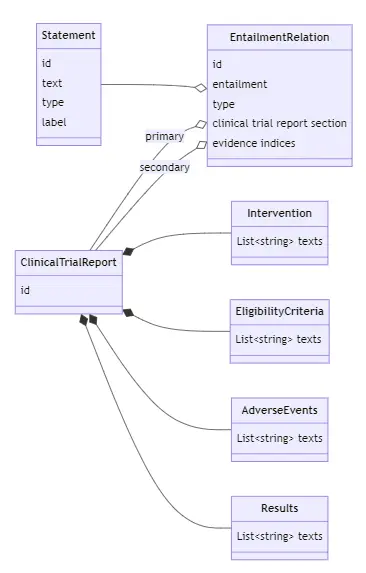
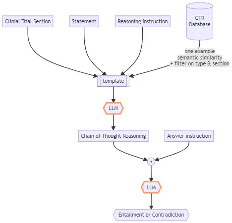
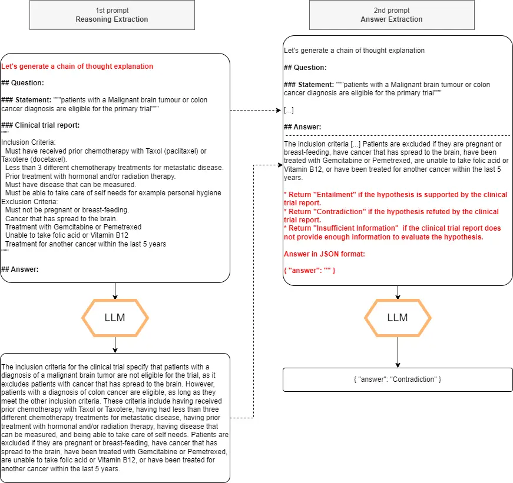

# CRCL at SemEval-2024 Task 2: Simple prompt optimizations

Clément Brutti-Mairesse Affiliation: CRCL / Lyon, France
Email: [clement.bruttimairesse@lyon.unicancer.fr](mailto:)    Loïc
Verlingue Affiliation: CLB/CRCL / Lyon, France
Email: [loic.verlingue@lyon.unicancer.fr](mailto:)

###### Abstract

We present a baseline for the SemEval 2024 task 2 challenge, whose
objective is to ascertain the inference relationship between pairs of
clinical trial report sections and statements.

We apply prompt optimization techniques with LLM Instruct models
provided as a Language Model-as-a-Service (LMaaS).

We observed, in line with recent findings, that synthetic CoT prompts
significantly enhance manually crafted ones.

The source code is available at this GitHub repository
[github.com/ClementBM-CLB/semeval-2024](https://github.com/ClementBM-CLB/semeval-2024).

## 1 Introduction

Since the introduction of large pre-trained transformer models such as
GPT-3.5, released in early 2022, foundational models have begun to be
utilized widely. While BERT-like models have proven to be effective in
various NLP tasks such as Named Entity Recognition Devlin et al. (2019),
scaling up the number of parameters in transformer models not only
enhances their capabilities but also endows them with new abilities not
seen in smaller models Zhao et al. (2023). These capabilities are
particularly evident in natural language inference tasks, where the
model must deduce the veracity of two given texts Zhong et al. (2023).

LLMs, gaining popularity for their reasoning capabilities, still face
trustworthiness concerns, crucial in the medical domain where decisions
affect lives. Medical devices must exhibit reliability and undergo
rigorous testing before they are brought to market. SemEval 2024 Jullien
et al. (2023b); Jullien et al. (2024) focuses on assessing NLI system
robustness, coherence, and accuracy, particularly LLMs prone to shortcut
learning, factual discrepancies, and performance degradation from word
distribution shifts Liu et al. (2023).

Fine-tuning, while effective for task and domain adaptation, demands
excessive resources in the case of large language models (LLMs). In the
medical field, data is highly sensitive and protected by privacy
regulations. Therefore, applying fine-tuning techniques to such
sensitive data would imply that medical centers have readily available
on-premise infrastructure Sun et al. (2023). Considering these
limitations, we investigate hard prompt optimization techniques such as
Chain-of-Thought prompting Wei et al. (2023). Acknowledging the
in-context learning (ICL) as an indirect method of fine-tuning, we also
explored in-context learning strategies Dai et al. (2023). Among them,
we were particularly inspired by MedPrompt, a promising composite
prompting method applied to medical datasets, which achieved a 27%
reduction in error rates on MedQA Nori et al. (2023).

Following the SemEval 2024 task 7 Jullien et al. (2023a), SemEval 2024
task 2 focuses on identifying the inference relationship (entailment vs.
contradiction) between Clinical Trial Report (CTR) statement pairs.
These statements and the supporting evidence are crafted by individuals
with expertise in the clinical domain, including clinical trial
organizers and research oncologists. The clinical trials information is
sourced from the ¹¹ 1 https://clinicaltrials.gov/clinicaltrials.gov
website (maintained by the NIH). We have evaluated three LLM prompting
methods to address this task.

## 2 Methods

### 2.1 Tasks

The challenge involves analyzing a statement alongside one or two
clinical trial reports to ascertain if the statement logically follows
from the information presented in the clinical trial. Typically, a
statement is a concise text averaging 19.5 words and may contain one or
several claims pertaining to the clinical trial. It refers to one of
four sections of the clinical trial report: Adverse Events, Eligibility
Criteria, Results, or Interventions. Each section represents a distinct
part of the clinical trial documentation as recorded in the
clinicaltrials.gov database. The text from these sections has an average
length of 265 words.



Figure 1: SemEval 2024 dataset data model

For the purpose of evaluating this task, the evaluation dataset was
generated to allow us to assess the reliability (faithfulness) and
consistency of the inference predictions. This was achieved by
paraphrasing the text to retain the same meaning, as well as by making
minor alterations to the text that change the inference relationship.

### 2.2 Prompting

We explored three prompting optimization techniques: 1) OPRO approach,
which iterates over labeled examples to determine the most effective
instruction Yang et al. (2023), 2) self-generated chain of thought
Kojima et al. (2023), 3) in-context learning (ICL) strategy by
incorporating one example for one-shot prompting Nori et al. (2023).

### 2.3 OPRO optimization

The OPRO technique exploits the model’s capability to generate prompts
based on a few exemplars and previous instructions.

In essence, the model is tasked with creating prompt instructions that
are intended to solve the given problems. While this method enables the
discovery of the most suitable instructions for each set, it still
demands extensive resources due to its iterative optimization process.
For this reason, we apply this technique to only a subset of
representative examples from the development dataset.

Data: $`N`$ samples, $`M`$ test samples and $`P`$ instructions and their
F1 scores

Result: $`P`$ instructions

for _10 times_ do

   Format the $`P`$ instructions and $`N`$ samples as a context $`C`$
for the LLM

   Generate instruction with the LLM and context $`C`$

   for _$`M`$ test samples_ do

      Format the instruction and the test sample as a context

      Generate prediction with the LLM

   end for

   Calculate the F1 score for the generated instruction

   Add the new instruction to the $`P`$ list if its F1 score is greater
than the lower instruction’s score of the list

end for

Algorithm 1 OPRO prompt optimization

### 2.4 Zero-shot Chain-of-Thought prompt

Unlike the previous method, which constrained instructions based on the
type and section of the sample, we allowed the model to generate a chain
of thought reasoning using a task-agnostic meta-prompt.

Data: $`N`$ samples

Result: $`N`$ predictions

for _$`N`$ samples_ do

   Format the $`N`$ samples as a context $`C_{reasoning}`$

   Generate chain-of-thought with the LLM and the context
$`C_{reasoning}`$

   Format the generated chain-of-thought with the sample and the
formating instruction

   Generate the prediction with the LLM and the context
$`C_{formating}`$

end for

Algorithm 2 Zero-shot Chain-of-Thought prompt

The model first generate a CoT reasoning to answer the question. Then,
given the previous, it is prompted to generate a conclusion and provide
the final answer—whether it entails or contradicts—in a standardized
json format (algorithm 2). See the figure 3 in appendix for a detailed
example.

### 2.5 Dynamic one-shot Chain-of-Thought prompt

We hypothesized that selecting one meaningful example from a set
(statement, clinical trial report) with a correct reasoning path could
enhance the performance of the NLI system.

This experiment is divided into two tasks. First, we build a database of
exemplars from the train dataset. Each sample corresponds to a statement
and a clinical trial report section, along with its associated reasoning
path (generated by the model) and predicted label. We filter the records
where the model provides correct answers and index the embeddings of the
statements into a vector database.

Next, for each test sample, we select a sample from the train dataset
that is semantically close according to the squared L2 distance defined
as $`d=\sum\left(s_{i}-s^{train}_{i}\right)^{2}`$. We choose the
$`s^{train}`$ sample with the lowest distance to the $`s`$ sample that
has either the same type, the same section, or both, preferably.

Data: $`N`$ training samples

Result: Vector database of statement and reasoning paths

for _$`N`$ samples_ do

   Calculate the embeddings of the statement

   Generate prediction following the same procedure as in Algorithm 1

   If the prediction is accurate, add the embedding vector to the
database

end for

Algorithm 3 Vector database building



Figure 2: Dynamic one-shot prompting workflow

## 3 Language models

We evaluated Mixtral-8x7B-Instruct Jiang et al. (2024), GPT3.5 Ouyang
et al. (2022), Qwen-72b-chat Bai et al. (2023), and Mistral-7B-Instruct.
For all inference tasks, except instruction generation, we did not use
sampling techniques.

To calculate vector embeddings, we utilized the msmarco-bert-base-dot-v5
model, in conjunction with ²² 2 https://www.trychroma.com/chromadb to
store the embeddings in a vector database, thereby facilitating
similarity score calculations using L2 norm.

## 4 Evaluation metrics

Faithfulness measures the extent to which a given system arrives at the
correct prediction for the correct reason. This is estimated by
measuring the ability of a model to correctly change its predictions
when exposed to a semantic altering intervention. Given $`N`$ statements
$`x_{i}`$ in the contrast set ($`C`$), their respective original
statements $`y_{i}`$, and model predictions $`f()`$ we compute
faithfulness using Equation 1.

```math
\displaystyle Faithfulness=\frac{1}{N}\sum_{1}^{N}\left|f(y_{i})-f(x_{i})\right| \tag{1}
```

```math
\displaystyle x_{i}\in C:\text{Label}(x_{i})\neq\text{Label}(y_{i}),\text{ and }f(y_{i})=\text{Label}(y_{i})
```

Consistency aims to measure the extent to which a given system produces
the same outputs for semantically equivalent problems. Therefore,
consistency is measured as the ability of a system to predict the same
label for original statements and contrast statements for semantic
preserving interventions. Given $`N`$ statements $`x_{i}`$ in the
contrast set ($`C`$), their respective original statements $`y_{i}`$,
and model predictions $`f()`$ we compute faithfulness using Equation 2.

```math
\displaystyle Consistency=\frac{1}{N}\sum_{1}^{N}1-\left|f(y_{i})-f(x_{i})\right| \tag{2}
```

```math
\displaystyle x_{i}\in C:\text{Label}(x_{i})=\text{Label}(y_{i})
```

## 5 Results

### 5.1 Main results

Our team ranked sixth in faithfulness score, and we fell outside the top
10 for the baseline F1 score (0.70) and consistency (0.70). We observed
that handcrafted prompts were generally less effective than optimized
prompts or meta-prompts.

Prompting strategies were first tested on the dev dataset and then run
on the test dataset. The results are shown in the table 1.
Mixtral-8x7B-Instruct demonstrated the best quality-to-time ratio. The
dynamic one-shot prompting achieved the highest Faithfulness score and
Consistency score. While the best F1 score goes for the zero-shot CoT
prompt approach. These results must be interpreted with caution because
the model does not always return a well-formatted answer in JSON format.
In cases where the answered entailment label is unknown, our approach
was to prioritize the contradiction label.

Because of time limitations, we had to train and assess the prompt
strategy using the development dataset, which consisted of 200 samples.
We solely used the training dataset to gather examples for inputting
into the vector database for the one-shot prompt strategy. The execution
of the entailment task on the test dataset required 20 hours for each
prompting strategy. The team’s outcomes for the task are presented in
table 2.

| Model        | Optimization     | Base F1 | Consistency | Faithfulness |
| ------------ | ---------------- | ------- | ----------- | ------------ |
| Mixtral-8x7B | Zero-shot CoT    | 0.70    | 0.70        | 0.87         |
| Mixtral-8x7B | Dynamic one-shot | 0.60    | 0.71        | 0.89         |
| Mixtral-8x7B | OPRO             | 0.59    | 0.65        | 0.81         |

Table 1: Prompt optimization strategies with Mixtral-8x7B-Instruct-v0.1
on the test dataset

|           |           |           |              |             |
| --------- | --------- | --------- | ------------ | ----------- |
| Ranking   | Base F1   | Base F1   | Faithfulness | Consistency |
| 1         | dodoodo   | 0.78 (3)  | 0.92 (3)     | 0.81 (1)    |
| 2         | aryopg    | 0.78 (5)  | 0.95 (2)     | 0.78 (2)    |
| 3         | jvl       | 0.78 (4)  | 0.80 (13)    | 0.77 (3)    |
| $`\cdot`$ | $`\cdot`$ | $`\cdot`$ | $`\cdot`$    | $`\cdot`$   |
| 17        | ClementBM | 0.70 (18) | 0.87 (6)     | 0.70 (17)   |
| $`\cdot`$ | $`\cdot`$ | $`\cdot`$ | $`\cdot`$    | $`\cdot`$   |

Table 2: Team ranking on the test dataset

### 5.2 Other evaluations

We also investigated reformulation methods, such as rephrasing negative
statements, paraphrasing statements to maintain the original meaning,
and rewording sections of the clinical trial report Cheng et al. (2023),
we did not observe an improvement in inference accuracy (data not
shown).

We observed that applying dynamic one-shot technique (F1=0.60) obtained
a 10-point drop compared to the Zero-Shot CoT (F1=0.70). We also
observed that implementing preprocessing steps could improve the
performance of the entailment task (such as enriching the clinical trial
section with additional information, transforming negative statements
into positive ones, etc.).

While experimenting with various prompt instructions to reformulate or
paraphrase the statement before logical prediction on inference, we
found that it didn’t significantly improve performance. One detail worth
mentioning is perhaps a processing step on the clinical trial report
section. We observed that the model sometimes struggles to identify
which paragraph of the report section matches which cohort. To address
this, we explicitly added the cohort number to the subtitle of the
section. All other lines of the section were concatenated without
change, each separated by a newline.

## 6 Conclusion

By employing prompt optimization techniques with LLM Instruct models, we
see the significant enhancement Zero-shot CoT prompts provide compared
to manually crafted ones. This highlights the critical role of utilizing
advanced techniques in LLM prompting to enhance inference tasks,
particularly in domains like clinical trials.

## 7 Acknowledgments

This work was supported by TM2 interreg Grant from the European Regional
Development Fund, TRIAL MATCH 2 (N°SYNERGIE 20023).

## References

- Bai et al. (2023) Jinze Bai, Shuai Bai, Yunfei Chu, Zeyu Cui, Kai
  Dang, Xiaodong Deng, Yang Fan, Wenbin Ge, Yu Han, Fei Huang, Binyuan
  Hui, Luo Ji, Mei Li, Junyang Lin, Runji Lin, Dayiheng Liu, Gao Liu,
  Chengqiang Lu, Keming Lu, Jianxin Ma, Rui Men, Xingzhang Ren,
  Xuancheng Ren, Chuanqi Tan, Sinan Tan, Jianhong Tu, Peng Wang, Shijie
  Wang, Wei Wang, Shengguang Wu, Benfeng Xu, Jin Xu, An Yang, Hao Yang,
  Jian Yang, Shusheng Yang, Yang Yao, Bowen Yu, Hongyi Yuan, Zheng Yuan,
  Jianwei Zhang, Xingxuan Zhang, Yichang Zhang, Zhenru Zhang, Chang
  Zhou, Jingren Zhou, Xiaohuan Zhou, and Tianhang Zhu. 2023. [Qwen
  Technical Report](https://doi.org/10.48550/arXiv.2309.16609).
  ArXiv:2309.16609 \[cs\].
- Cheng et al. (2023) Daixuan Cheng, Shaohan Huang, and Furu Wei. 2023.
  [Adapting Large Language Models via Reading
  Comprehension](https://doi.org/10.48550/arXiv.2309.09530).
  ArXiv:2309.09530 \[cs\].
- Dai et al. (2023) Damai Dai, Yutao Sun, Li Dong, Yaru Hao, Shuming Ma,
  Zhifang Sui, and Furu Wei. 2023. [Why Can GPT Learn In-Context?
  Language Models Implicitly Perform Gradient Descent as
  Meta-Optimizers](https://doi.org/10.48550/arXiv.2212.10559).
  ArXiv:2212.10559 \[cs\].
- Devlin et al. (2019) Jacob Devlin, Ming-Wei Chang, Kenton Lee, and
  Kristina Toutanova. 2019. [BERT: Pre-training of Deep Bidirectional
  Transformers for Language
  Understanding](https://doi.org/10.48550/arXiv.1810.04805).
  ArXiv:1810.04805 \[cs\].
- Jiang et al. (2024) Albert Q. Jiang, Alexandre Sablayrolles, Antoine
  Roux, Arthur Mensch, Blanche Savary, Chris Bamford, Devendra Singh
  Chaplot, Diego de las Casas, Emma Bou Hanna, Florian Bressand, Gianna
  Lengyel, Guillaume Bour, Guillaume Lample, Lélio Renard Lavaud, Lucile
  Saulnier, Marie-Anne Lachaux, Pierre Stock, Sandeep Subramanian,
  Sophia Yang, Szymon Antoniak, Teven Le Scao, Théophile Gervet, Thibaut
  Lavril, Thomas Wang, Timothée Lacroix, and William El Sayed. 2024.
  [Mixtral of Experts](https://doi.org/10.48550/arXiv.2401.04088).
  ArXiv:2401.04088 \[cs\].
- Jullien et al. (2024) Maël Jullien, Marco Valentino, and André
  Freitas. 2024. SemEval-2024 task 2: Safe biomedical natural language
  inference for clinical trials. In _Proceedings of the 18th
  International Workshop on Semantic Evaluation (SemEval-2024)_.
  Association for Computational Linguistics.
- Jullien et al. (2023a) Mael Jullien, Marco Valentino, Hannah Frost,
  Paul O’Regan, Dónal Landers, and Andre Freitas. 2023a. [NLI4CT:
  Multi-evidence natural language inference for clinical trial
  reports](https://doi.org/10.18653/v1/2023.emnlp-main.1041). In
  _Proceedings of the 2023 Conference on Empirical Methods in Natural
  Language Processing_, pages 16745–16764, Singapore. Association for
  Computational Linguistics.
- Jullien et al. (2023b) Maël Jullien, Marco Valentino, Hannah Frost,
  Paul O’regan, Donal Landers, and André Freitas. 2023b. [SemEval-2023
  task 7: Multi-evidence natural language inference for clinical trial
  data](https://doi.org/10.18653/v1/2023.semeval-1.307). In _Proceedings
  of the 17th International Workshop on Semantic Evaluation
  (SemEval-2023)_, pages 2216–2226, Toronto, Canada. Association for
  Computational Linguistics.
- Kojima et al. (2023) Takeshi Kojima, Shixiang Shane Gu, Machel Reid,
  Yutaka Matsuo, and Yusuke Iwasawa. 2023. [Large Language Models are
  Zero-Shot Reasoners](https://doi.org/10.48550/arXiv.2205.11916).
  ArXiv:2205.11916 \[cs\].
- Liu et al. (2023) Hanmeng Liu, Ruoxi Ning, Zhiyang Teng, Jian Liu,
  Qiji Zhou, and Yue Zhang. 2023. [Evaluating the Logical Reasoning
  Ability of ChatGPT and
  GPT-4](https://doi.org/10.48550/arXiv.2304.03439). ArXiv:2304.03439
  \[cs\].
- Nori et al. (2023) Harsha Nori, Yin Tat Lee, Sheng Zhang, Dean
  Carignan, Richard Edgar, Nicolo Fusi, Nicholas King, Jonathan Larson,
  Yuanzhi Li, Weishung Liu, Renqian Luo, Scott Mayer McKinney,
  Robert Osazuwa Ness, Hoifung Poon, Tao Qin, Naoto Usuyama, Chris
  White, and Eric Horvitz. 2023. [Can Generalist Foundation Models
  Outcompete Special-Purpose Tuning? Case Study in
  Medicine](https://doi.org/10.48550/arXiv.2311.16452). ArXiv:2311.16452
  \[cs\].
- Ouyang et al. (2022) Long Ouyang, Jeff Wu, Xu Jiang, Diogo Almeida,
  Carroll L. Wainwright, Pamela Mishkin, Chong Zhang, Sandhini Agarwal,
  Katarina Slama, Alex Ray, John Schulman, Jacob Hilton, Fraser Kelton,
  Luke Miller, Maddie Simens, Amanda Askell, Peter Welinder, Paul
  Christiano, Jan Leike, and Ryan Lowe. 2022. [Training language models
  to follow instructions with human
  feedback](https://doi.org/10.48550/arXiv.2203.02155). ArXiv:2203.02155
  \[cs\].
- Sun et al. (2023) Qiushi Sun, Chengcheng Han, Nuo Chen, Renyu Zhu,
  Jingyang Gong, Xiang Li, and Ming Gao. 2023. [Make Prompt-based
  Black-Box Tuning Colorful: Boosting Model Generalization from Three
  Orthogonal Perspectives](https://doi.org/10.48550/arXiv.2305.08088).
  ArXiv:2305.08088 \[cs\].
- Wei et al. (2023) Jason Wei, Xuezhi Wang, Dale Schuurmans, Maarten
  Bosma, Brian Ichter, Fei Xia, Ed Chi, Quoc Le, and Denny Zhou. 2023.
  [Chain-of-Thought Prompting Elicits Reasoning in Large Language
  Models](https://doi.org/10.48550/arXiv.2201.11903). ArXiv:2201.11903
  \[cs\].
- Yang et al. (2023) Chengrun Yang, Xuezhi Wang, Yifeng Lu, Hanxiao Liu,
  Quoc V. Le, Denny Zhou, and Xinyun Chen. 2023. [Large Language Models
  as Optimizers](https://doi.org/10.48550/arXiv.2309.03409).
  ArXiv:2309.03409 \[cs\].
- Zhao et al. (2023) Wayne Xin Zhao, Kun Zhou, Junyi Li, Tianyi Tang,
  Xiaolei Wang, Yupeng Hou, Yingqian Min, Beichen Zhang, Junjie Zhang,
  Zican Dong, Yifan Du, Chen Yang, Yushuo Chen, Zhipeng Chen, Jinhao
  Jiang, Ruiyang Ren, Yifan Li, Xinyu Tang, Zikang Liu, Peiyu Liu,
  Jian-Yun Nie, and Ji-Rong Wen. 2023. [A Survey of Large Language
  Models](https://doi.org/10.48550/arXiv.2303.18223). ArXiv:2303.18223
  \[cs\].
- Zhong et al. (2023) Qihuang Zhong, Liang Ding, Juhua Liu, Bo Du, and
  Dacheng Tao. 2023. [Can ChatGPT Understand Too? A Comparative Study on
  ChatGPT and Fine-tuned
  BERT](https://doi.org/10.48550/arXiv.2302.10198). ArXiv:2302.10198
  \[cs\].

## Appendix A Prompt instructions

### A.1 Zero-shot CoT prompt instruction

The following diagram illustrates with a sample from the dev dataset,
how prompts are crafted. The Zero-shot CoT approach involves prompting
the LLM twice.



Figure 3: Zero-shot CoT prompting sample pipeline
