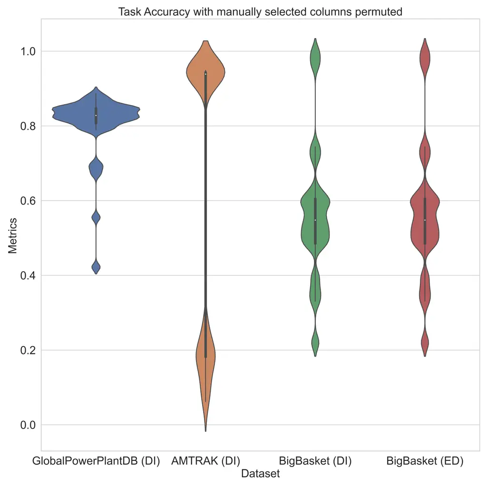
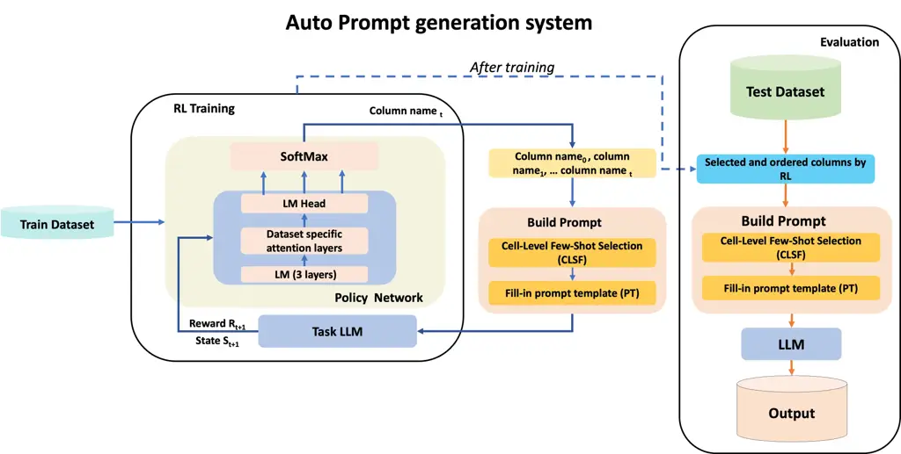
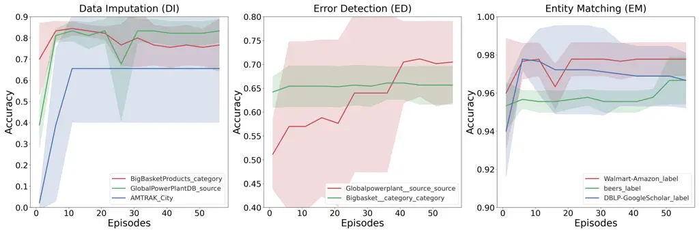

# An Automatic Prompt Generation System for Tabular Data Tasks

Ashlesha Akella Affiliation: IBM Research, India
Email: [ashlesha.akella@ibm.com](mailto:)    Abhijit Manatkar
Affiliation: IBM Research, India
Email: [abhijitmanatkar@ibm.com](mailto:)    Brij Chavda
Affiliation: IBM Research, India
Email: [brijkumar.chavda@ibm.com](mailto:)    Hima Patel
Affiliation: IBM Research, India Email: [himapatel@in.ibm.com](mailto:)

###### Abstract

Efficient processing of tabular data is important in various industries,
especially when working with datasets containing a large number of
columns. Large language models (LLMs) have demonstrated their ability on
several tasks through carefully crafted prompts. However, creating
effective prompts for tabular datasets is challenging due to the
structured nature of the data and the need to manage numerous columns.
This paper presents an innovative auto-prompt generation system suitable
for multiple LLMs, with minimal training. It proposes two novel
methods; 1) A Reinforcement Learning-based algorithm for identifying and
sequencing task-relevant columns 2) Cell-level similarity-based approach
for enhancing few-shot example selection. Our approach has been
extensively tested across 66 datasets, demonstrating improved
performance in three downstream tasks: data imputation, error detection,
and entity matching using two distinct LLMs; Google flan-t5-xxl and
Mixtral 8x7B.

## 1 Introduction

Recent advancements in pre-training large language models have paved the
way for prompt-based and in-context learning Brown et al. (2020); Raffel
et al. (2020), providing an efficient approach to tackle a wide range of
tasks. Generating a suitable prompt is particularly important when
harnessing pre-trained LLMs for tabular downstream tasks. Unlike natural
language sentences, tabular data necessitates specific formatting,
column preferences, and in-context examples. In the domain of tabular
data downstream tasks, prompts are frequently customized for each
dataset and specific downstream tasks to ensure consistent and efficient
performance. A few studies Narayan et al. (2022); Zhang et al. (2023b)
have demonstrated this approach, wherein prompts are crafted for a given
dataset and task by manually selecting columns and relevant in-context
(few-shot) examples. Additionally, recent research has introduced
automated methods that target specific components of prompt such as
in-context examples Huh et al. (2023). This leads us to two pivotal
questions; Firstly, what are the components or parts of the prompt that
significantly impact performance in tabular tasks? Secondly, how can we
devise automated methods for the components to generate prompts that can
be efficient and effective for tabular data tasks?

Figure 1: Example Prompt Template for Data Imputation task

In tabular data tasks, a vanilla prompt typically includes a row of
information where each column name is paired with its respective value,
for example: _Brand: Dell; Price: \$349.00; Feature: Newest Dell
Inspiron_. However, providing all column information of a row may
introduce unnecessary details, redundancy, and noise, while also
inefficiently using input tokens, potentially leaving inadequate space
for additional crucial information such as few-shot examples. Our
empirical analysis reveals that carefully selecting columns to be
included in the prompt improves task performance, aligning with prior
research findings by Narayan et al. (2022); Zhang et al. (2023b). In
addition to choosing the right columns, we noticed a significant
improvement in performance when we carefully arranged these column
details in the prompt. This underscores the importance of both selecting
the columns and arranging them in a specific order. Particularly,
dealing with large datasets with many columns poses a practical
challenge.

Furthermore, our study demonstrates a performance difference between
traditional few-shot example selection methods developed for natural
language (NL) focused tasks and our proposed cell-level similarity
few-shot (CLFS) example selection approach for tabular data. The
NL-based method serializes a row into a sentence and selects few-shot
examples based on similarity, potentially losing relevant information by
imposing a sentence structure on the tabular data during serialization.
In contrast, the proposed CLFS method considers each cell’s information
independently with the aim of selecting few-shot examples at a cell
level similarity.

To this end, we introduced an auto-prompt generation system designed to
be compatible with various LLMs without the need for extensive training.
This system introduces a novel approach emphasizing two essential
elements:

1.  1.  The identification and sequencing of task-relevant columns
        facilitated by a Reinforcement Learning-based algorithm.
2.  2.  A few-shot selection approach based on cell-level similarity.

## 2 Related Work

Recent studies on tabular data tasks have demonstrated that LLMs can
effectively tackle data wrangling tasks, through different strategies,
including pre-training and fine-tuning Gong et al. (2020); Iida et al.
(2021); Somepalli et al. (2021); Wang et al. (2020); Tang et al. (2020),
prefix-tuning Vos et al. (2022) and prompt learning Liu et al. (2022);
Chen et al. (2023); Zhang et al. (2023a). However, these training
methodologies pose significant computational demands and exhibit high
time complexity. Furthermore, many of these approaches require
adjustments to the model parameters, a process that proves impractical
for black-box language models like ChatGPT.

Previous research has achieved success in developing methods for
generating prompts for tabular data tasks Narayan et al. (2022); Zhang
et al. (2023b). However, a challenge exists due to the reliance on
manual processes to select columns and few-shot examples. This manual
approach becomes especially difficult when dealing with large datasets
with many columns. The study by Huh et al. (2023) propose a few-shot
selection method that utilizes an embedding of a row transformed into a
natural language sentence, raising questions about integrating tabular
structure-aware few-shot selection methods for tabular data.

This paper discusses the importance of selecting and organizing columns
with empirical results, followed by an overview of two auto-prompt
generation systems. Extensive testing was carried out across 3 different
tabular data tasks; Data Imputation (DI), Error Detection (ED), and
Entity Matching (EM), utilizing 66 datasets using two models: Google
flan-t5-xxl (11B parameters) Chung et al. (2022) and Mixtral 8x7B (47B
parameters) Jiang et al. (2024) ¹¹ 1 Specifically, we use the GPTQ
Frantar et al. (2022) quantized version of the model available at
[https://huggingface.co/TheBloke/Mixtral-8x7B-Instruct-v0.1-GPTQ](https://huggingface.co/TheBloke/Mixtral-8x7B-Instruct-v0.1-GPTQ).
Mixtral 8x7B is a Sparse Mixture of Experts (SMoE) Model consisting of 8
feedforward blocks (i.e. experts) at each layer. For each token, at each
layer, 2 out of 8 experts are selected for inference which results in a
total of 13B active parameters..

## 3 Motivation

Tabular data, especially with wider datasets, presents a challenge when
inputting all column details into LLMs for row-level tasks (e.g., Data
Imputation, Error Detection). It becomes evident that selecting columns
is crucial for optimizing the performance of LLMs.

In addition to choosing columns, we conducted a study to explore the
impact of column arrangement on downstream tasks performance. In this
experiment, we manually selected specific columns for a dataset and
downstream task and then created prompts using a template (see Figure
1). Figure 2 demonstrates the significant effect of different column
orders on accuracy. For instance, when examining the Data Imputation
task on the AMTRAK dataset, a wide range of accuracies was observed,
varying from 0.06 to 0.95 for the manually selected columns but in
different orders and combinations. This shows that using an optimal
sequence of subset columns is crucial while generating a prompt for
tabular data tasks.



Figure 2: Variations in accuracy across different combinations and
permutations for manually selected columns for Data Imputation (DI) and
Error detection (ED). We collected accuracies for all possible
permutations of the selected columns (per dataset and per task) and
visualized the distributions of accuracies.

This can be considered as solving a sequential decision-making problem.
This study uses Reinforcement Learning (RL) to optimize column selection
and ordering in order to improve accuracy and performance in tabular
data tasks.

Another component, namely few-shot example selection, becomes critical
in light of the improved performance shown by LLMs when provided with a
small set of illustrative examples (few-shot examples) in the prompt.
Selecting these examples is extensively studied in the field of Natural
Language tasks Ma et al. (2023); Liu et al. (2021) and these methods
typically retrieve similar examples from a pool using similarity metrics
such as BM25 Robertson et al. (1994) or cosine-similarity calculated
over task specification embeddings obtained from encoder-only models
like BERT Devlin et al. (2019) and RoBERTa Liu et al. (2019), etc. Our
exploration reveals that a modified approach for calculating the
similarity measure leads to improved performance. To address this, our
work proposes a new Cell-Level Similarity Measure for retrieving
in-context examples that takes into account the semantic similarity of
individual cells in a row, and is seen to outperform natural language
inspired baselines.

We evaluated the performance of the proposed system on 3 downstream
tasks Data Imputation (DI), Error Detection (ED) and Entity Matching
(EM). More details on the downstream as provided in Appendix A.4.

## 4 Method and Implementation



Figure 3: The architecture comprises three modules: RL agent Training
Module for Column Selection, Build Prompt Module and Evaluation.

In this section, we explain the methodology of developing our
auto-prompt generation system. We begin by describing the overall
architecture of the system, followed by description of individual
components.

### 4.1 Architecture

The architecture of our system, as seen in Figure 3, comprises of three
modules: RL agent training for Column Selection (RLCS), Build Prompt
module, and Evaluation. The RL agent is trained to generate a sequence
of column names. The Build Prompt module contains Cell-level Similarity
based Few-shot selection (CLFS) to select few-shot examples and the
Prompt Template module which fills in a predefined prompt template with
selected column information from the test sample and the selected
few-shot examples. Once an RL agent is trained, we obtain an optimal
sequence of selected columns from the final model which is used during
evaluation.

### 4.2 Reinforcement Learning based Column Selection: RLCS

The process of choosing columns as a sequence can be seen as a
decision-making procedure that can be represented as a Markov Decision
Process (MDP). This includes a set of states $`S`$, a set of actions
$`A`$, a transition function $`P:S\times A\rightarrow S`$ and a reward
function $`R:S\rightarrow{\mathbb{R}}`$. The objective for the RL agent
is to maximize its expected cumulative reward defined by
$`\mathcal{R}=\mathop{\mathbb{E}}[\sum_{t=0}^{T}\gamma^{t}r_{t}]`$,
where $`r_{t}`$ denotes reward at step $`t`$ and $`\gamma\in[0,1]`$
signifies a discounting factor for rewards over time steps. We use the
Soft Q-Learning algorithm Haarnoja et al. (2017); Guo et al. (2021) to
train the network with the goal of maximizing cumulative rewards within
an episode.

#### 4.2.1 State and Action Representation

An initial state is defined as $`s_{0}=d_{0}`$, where $`d_{0}`$ is a
brief description of the dataset (e.g: $`d_{0}`$ = ‘This dataset
contains products on the Bigbasket website’). At each time step $`t`$,
the RL agent selects one column name $`a_{t}`$ from the action space
$`A`$. The transition function $`P(s_{t},a_{t})=s_{t+1}`$ appends the
selected column to the previous state, i.e., $`s_{t+1}`$ =
$`\oplus(s_{t},a_{t})`$. There exists termination criteria based on the
number of columns chosen.

#### 4.2.2 Policy Network

We use an attention-based architecture in the policy network for the RL
agent. The first three layers of the policy network are taken from a
small LLM and kept frozen. Specifically, we utilize the initial 3 layers
of GPT-2 Radford et al. (2019). This is followed by a trainable
multi-headed attention layer with two heads, followed by the LM head
layer from GPT-2. The initial three layers and the LM head layer are
taken from the smallest version of GPT-2 with 124M parameters. Let
$`\mathcal{M}`$ represent the policy network and
$`\mathcal{M}\left(y\mid s,{\theta}\right)`$ be the logit value of
policy network for a token $`y`$ given state $`s`$ and weight parameters
$`\theta`$. During training, only the multi headed attention layer is
trained while all other layers remain frozen. For every column,
$`col\ name_{i}`$ we calculate the mean of logits for all $`n_{i}`$
tokens $`\{y^{i}_{0},y^{i}_{1},\dots y^{i}_{n_{i}-1}\}`$ in the name of
that column, yielding $`q_{s,\textit{col name}_{i}}`$. This computation
is performed for all columns ($`\forall i\in\{0,1,\dots N-1\}`$),
resulting in the vector of Q-values $`\mathbf{q_{s}}`$. Subsequently, a
softmax function is applied to $`\mathbf{q_{s}}`$ to obtain a
probability distribution over the columns. During exploitation, the
action $`a_{t}`$ is $`\arg\max`$ over this distribution. During
exploration (i.e. while training), $`a_{t}`$ is obtained by sampling
from this distribution.

```math
A=\{\textit{col name}_{0},\textit{col name}_{1},\dots\textit{col name}_{N-1}\} \tag{1}
```

```math
\mathbf{q_{s}}=\{q_{s,\textit{col name}_{0}}\dots q_{s,\textit{col name}_{N-1}}\} \tag{2}
```

```math
q_{s,\textit{col name}_{i}}=\frac{1}{n_{i}}\sum_{k=0}^{n_{i}-1}\mathcal{M}\left(y_{k}^{i}\mid s,\theta\right) \tag{3}
```

```math
a_{t}=\underset{a\in A}{\arg\max}\left(softmax(\mathbf{q_{s}})\right) \tag{4}
```

Here $`N`$ is the number of columns, $`n_{i}`$ represents the total
number of tokens of column $`\textit{col name}_{i}`$.

At each timestep, a new column name is added to the list of selected
columns. Based on these selections, CLFS chooses few-shot examples that
are then sent to the PT module (shown in Figure 3) as input for Task-LM.
The agent receives a reward at each timestep $`t`$ following:

```math
r_{t}=\begin{cases}20-3t&\text{if Task-LM matches the }\\
&\text{expected output}\\
-0.5&\text{otherwise}\end{cases} \tag{5}
```

Figure 4 in the Appendix illustrates that the RL-based approach can
identify an optimal sequence of column sets across training episodes.
The columns chosen by RL and those selected manually for each dataset
and task can be found in Appendix A.3.

| Task | Dataset                 | Baseline         | MCS-RFS          | MCS-NFS     | MCS-CLFS    | RLCS-CLFS   | Baseline     | RLCS-CLFS    |
| ---- | ----------------------- | ---------------- | ---------------- | ----------- | ----------- | ----------- | ------------ | ------------ |
|      | \#columns               | flan-t5-xxl      | flan-t5-xxl      | flan-t5-xxl | flan-t5-xxl | flan-t5-xxl | Mixtral 8x7B | Mixtral 8x7B |
|      |                         |                  |                  |             |             | (Ours)      |              | (Ours)       |
| DI   | Restaurant (6)          | $`0.75\pm 0.02`$ | $`0.76\pm 0.02`$ | 0.75        | 0.77        | 0.82        | 0.92         | 0.97         |
|      | BigBasket (14)          | $`0.32\pm 0.12`$ | $`0.75\pm 0.00`$ | 0.86        | 0.93        | 0.92        | 0.91         | 0.92         |
|      | GlobalPowerPlant (40)   | $`0.61\pm 0.06`$ | $`0.75\pm 0.00`$ | 0.85        | 0.85        | 0.90        | 0.84         | 0.84         |
|      | AMTRAK (86)             | $`0.57\pm 0.11`$ | $`0.91\pm 0.00`$ | 0.93        | 0.92        | 0.98        | 0.61         | 0.81         |
| ED   | Adult (15)              | $`0.50\pm 0.00`$ | $`0.62\pm 0.02`$ | 0.96        | 0.89        | 0.95        | 0.54         | 0.78         |
|      | Hospital (23)           | $`0.49\pm 0.00`$ | $`0.70\pm 0.00`$ | 0.56        | 0.57        | 0.85        | 0.36         | 0.81         |
|      | Global PowerPlant (40)  | $`0.33\pm 0.11`$ | $`0.34\pm 0.00`$ | 0.42        | 0.52        | 0.83        | 0.90         | 0.95         |
|      | BigBasket (14)          | $`0.39\pm 0.12`$ | $`0.38\pm 0.00`$ | 0.39        | 0.39        | 0.87        | 0.37         | 0.95         |
| EM   | Fodors-Zagats (14)      | $`0.86\pm 0.01`$ | $`0.97\pm 0.02`$ | 0.96        | 0.93        | 1.00        | 0.92         | 0.99         |
|      | DBLP-GoogleScholar (10) | $`0.69\pm 0.02`$ | $`0.84\pm 0.04`$ | 0.74        | 0.81        | 0.85        | 0.83         | 0.85         |
|      | beers (10)              | $`0.71\pm 0.03`$ | $`0.84\pm 0.08`$ | 0.81        | 0.81        | 0.89        | 0.88         | 0.91         |
|      | Walmart-Amazon (12)     | $`0.54\pm 0.02`$ | $`0.79\pm 0.04`$ | 0.87        | 0.87        | 0.87        | 0.91         | 0.91         |

Table 1: Performance of Data Imputation (DI), Error Detection (ED) and
Entity Matching (EM) tasks under 5 varied conditions on Google
flan-t5-xxl (11B) model and 2 conditions with Mixtral 8x7B. \#columns
shows the number of columns in the Dataset. As metrics, accuracy is used
for DI and F1-macro used for ED and EM. Baseline and MCS-RFS experiments
are for 3 different seeds, where accuracy is $`\emph{avg}\pm\emph{std}`$

### 4.3 Cell-Level Similarity Measure based Few-shot Selection: CLFS

The proposed Cell-Level Similarity Measure uses an embedding technique
to preserve the semantic content of each cell in a row. A pool of
examples, denoted as $`P`$, is available for selecting a few-shot
examples. Two methods were explored to understand the performance
difference between Natural Language-based (NL) approach and the proposed
CLFS approach.

In the NL-based approach, an embedding for each row is generated by
serializing it using a template (as discussed in section 4.4) and then
encoding it into a latent space using model $`B`$ (typically an
encoder-only transformer model). For every test sample, cosine
similarity ($`sim_{NL}`$) was calculated between the test sample
$`r_{t}`$ and all samples from the pool $`P`$, and then top k samples
from $`P`$ with the highest similarity scores with the test sample are
chosen as few-shot examples for that test sample.

```math
sim_{NL}(r_{t},r_{x})=B(ser(r_{t}))^{T}B(ser(r_{x})) \tag{6}
```

where $`ser(r)`$ serializes row $`r`$, $`r_{t}`$ and $`r_{x}`$ are the
test sample and a sample from $`P`$ respectively.

This method requires presenting a row of tabular data as a serialized
string of text which is then embedded using a Language Model trained on
natural language data. The presentation and the encoding model in this
method treat the table row like a string of natural language text, which
can result in sub-optimal embeddings because of information loss from a
representational mismatch. The proposed CLFS method embeds each cell of
the row independently of other cells, and then computes the similarity
$`sim_{CL}`$ between a test sample $`r_{t}`$ and a sample $`r_{x}`$ from
pool $`P`$ as the average of similarities between corresponding cells.

```math
sim_{CL}(r_{t},r_{x})=\frac{\sum_{c\in C}B(r_{t}[c])^{T}B(r_{x}[c])}{|C|} \tag{7}
```

where $`C`$ is the set of columns and $`r[c]`$ gives the value for the
cell at the intersection of column $`c\in C`$ and row $`r`$.

### 4.4 Prompt template

The prompt template for tabular data wrangling tasks includes a brief
description of the serialization, followed by serialized few-shot
examples and a test example. An illustrative example of the prompt
template is presented in Figure 1. The serialization of both the
few-shot examples and the test example follows

```math
{F}_{i}^{r}=\Downarrow_{n=1}^{N}Example\ {n}:\oplus\Downarrow_{j=1}^{c}h_{j}^{n}\oplus:\oplus v_{n,j}^{n}\oplus{}
```

```math
{S}_{i}^{r}={F}_{i}^{r}\Downarrow TestExample:\oplus\Downarrow_{j=1}^{c}h_{j}^{i}\oplus:\oplus v_{j}^{i}\oplus{}
```

For $`i^{th}`$ test row, $`{F}^{r}_{i}`$ is serialized $`n^{th}`$
few-shot, $`N`$ is the total number of few-shot examples, $`c`$ is the
number of columns, $`h_{j}^{n}`$ is the $`j^{th}`$ column name and
$`v_{j}^{n}`$ is the value of column $`j`$ of $`n^{th}`$ few-shot.
$`\Downarrow`$ is the new line operator and $`\oplus`$ is the
concatenation operator.

## 5 Datasets

We gathered datasets from various sources like Kaggle ²² 2
https://www.kaggle.com and Open ML ³³ 3 https://openml.org, ensuring
datasets containing numerous columns (upto 120 columns) across different
domains. All the datasets gathered are in the format Comma Seperated
Values (CSV) files. For the data imputation task, specific columns were
chosen for imputing values across all rows within those columns.
Real-world databases commonly have both syntactic and semantic errors
Chu et al. (2013); Heidari et al. (2019); Mayfield et al. (2010). In the
error detection task, selected columns in the datasets were introduced
with errors: around 25% of cell values were replaced with out-of-domain
strings for semantic errors (e.g., ‘Stationer’ in the ‘County name’
column), while approximately 25% of cell values within a specific column
had random letter additions introduced as syntactic errors. For entity
matching tasks, we used datasets previously studied in literature Mudgal
et al. (2018).

## 6 Experimental Results

This section describes the experiments carried out in our study. We
compared 5 different conditions including our proposed system to
highlight the importance of each of the components. These experiments
included 12 datasets across 3 tasks using Google flan-t5-xxl as shown in
Table 1. On observing similar trends with Mixtral 8x7B as with
flan-t5-xxl, we only report results for our system and the baseline with
Mixtral 8x7B.

1.  1.  _Baseline_: For the baseline method, no column selection is done and
        data from all columns in included in the prompt. Columns are
        permuted in the order in which they appear in the dataset and
        few-shot examples are chosen randomly. We conduct experiments with
        three different seeds.
2.  2.  _Manual Column Selection and Random Few-shot examples (MCS-RFS)_: To
        assess the efficacy of carefully chosen manual columns, we conducted
        experiments by manually selecting columns and selecting random
        few-shot examples using three different seeds, while keeping the
        column order consistent across all seeds.
3.  3.  _Manual Column Selection and NLP Few-shot Selection (MCS-NFS)_: This
        method seeks to assess the performance of the cosine similarity
        few-shot selection method used in Natural Language tasks. For
        selecting few-shot examples, the $`sim_{NL}`$ similarity metric (6)
        is used.
4.  4.  _Manual Column Selection and Cell-Level Similarity Few-shot
        selection (MCS-CLFS)_: This method seeks to assess the impact of
        using the cell level similarity metric $`sim_{CL}`$ (7) for
        selecting few-shot examples. In this method and the previous one,
        columns are selected manually while keeping the column order
        consistent across methods.

Additionally, the comparison between baseline and auto-prompt generation
results was conducted across 66 datasets (see Appendix Tables 3, 4 and
5). Each of the studied datasets are partitioned into train, validation
and test splits. The train split is used for training the RL-based
column selection agent. The validation split is used as the pool $`P`$
for selecting few-shot examples and metrics are reported on the test
split. For the settings which use few-shot example selection,
all-distilroberta-v1 from the SentenceTransformers library Reimers and
Gurevych (2019) is used as the encoding model $`B`$.

## 7 Conclusion and Future Work

The results indicate that our proposed system significantly outperforms
the baseline as well as methods based on combinations of manual column
selection, random few-shot selection and natural language based few-shot
selection. Our research underscores the efficacy of an auto-prompt
generation system in enhancing tabular data tasks across various
datasets and tasks using Large Language Models. Manual column selection
and sequencing, found to be a cumbersome process, necessitates an
automatic method, a gap which is suitable filled by our RL-based
algorithm. Our proposed cell-level similarity measure exhibits improved
performance compared to the NL-based few-shot selection method. Overall,
the auto-prompt generation system showcases versatility and
generalizability across diverse tasks and datasets, providing a
streamlined solution for efficient tabular data tasks.

As part of future work, the following directions of study may be
worthwhile:

1.  1.  Expanding the automatic prompt-generation system to more row-level
        downstream tasks and analyzing its performance.
2.  2.  Training of a unified model for column selection and sequencing
        across tabular datasets.
3.  3.  Identifying other parts/components of the prompt that can be
        automatically optimized for tabular tasks.

## References

- Brown et al. (2020) Tom Brown, Benjamin Mann, Nick Ryder, Melanie
  Subbiah, Jared D Kaplan, Prafulla Dhariwal, Arvind Neelakantan, Pranav
  Shyam, Girish Sastry, Amanda Askell, Sandhini Agarwal, Ariel
  Herbert-Voss, Gretchen Krueger, Tom Henighan, Rewon Child, Aditya
  Ramesh, Daniel Ziegler, Jeffrey Wu, Clemens Winter, Chris Hesse, Mark
  Chen, Eric Sigler, Mateusz Litwin, Scott Gray, Benjamin Chess, Jack
  Clark, Christopher Berner, Sam McCandlish, Alec Radford, Ilya
  Sutskever, and Dario Amodei. 2020. [Language models are few-shot
  learners](https://proceedings.neurips.cc/paper_files/paper/2020/file/1457c0d6bfcb4967418bfb8ac142f64a-Paper.pdf).
  In _Advances in Neural Information Processing Systems_, volume 33,
  pages 1877–1901. Curran Associates, Inc.
- Chen et al. (2023) Kuan-Yu Chen, Ping-Han Chiang, Hsin-Rung Chou,
  Tingwei Chen, and Tien-Hao Chang. 2023. [Trompt: Towards a better deep
  neural network for tabular
  data](https://api.semanticscholar.org/CorpusID:258968005). _ArXiv_,
  abs/2305.18446.
- Chu et al. (2013) Xu Chu, Ihab F. Ilyas, and Paolo Papotti. 2013.
  [Holistic data cleaning: Putting violations into
  context](https://api.semanticscholar.org/CorpusID:5999797). _2013 IEEE
  29th International Conference on Data Engineering (ICDE)_, pages
  458–469.
- Chung et al. (2022) Hyung Won Chung, Le Hou, S. Longpre, Barret Zoph,
  Yi Tay, William Fedus, Eric Li, Xuezhi Wang, Mostafa Dehghani,
  Siddhartha Brahma, Albert Webson, Shixiang Shane Gu, Zhuyun Dai, Mirac
  Suzgun, Xinyun Chen, Aakanksha Chowdhery, Dasha Valter, Sharan Narang,
  Gaurav Mishra, Adams Wei Yu, Vincent Zhao, Yanping Huang, Andrew M.
  Dai, Hongkun Yu, Slav Petrov, Ed Huai hsin Chi, Jeff Dean, Jacob
  Devlin, Adam Roberts, Denny Zhou, Quoc V. Le, and Jason Wei. 2022.
  [Scaling instruction-finetuned language
  models](https://api.semanticscholar.org/CorpusID:253018554). _ArXiv_,
  abs/2210.11416.
- Devlin et al. (2019) Jacob Devlin, Ming-Wei Chang, Kenton Lee, and
  Kristina Toutanova. 2019. [Bert: Pre-training of deep bidirectional
  transformers for language
  understanding](https://api.semanticscholar.org/CorpusID:52967399). In
  _North American Chapter of the Association for Computational
  Linguistics_.
- Frantar et al. (2022) Elias Frantar, Saleh Ashkboos, Torsten Hoefler,
  and Dan Alistarh. 2022. [Gptq: Accurate post-training quantization for
  generative pre-trained
  transformers](https://api.semanticscholar.org/CorpusID:253237200).
  _ArXiv_, abs/2210.17323.
- Gong et al. (2020) Heng Gong, Yawei Sun, Xiaocheng Feng, Bing Qin, Wei
  Bi, Xiaojiang Liu, and Ting Liu. 2020. [Tablegpt: Few-shot
  table-to-text generation with table structure reconstruction and
  content matching](https://api.semanticscholar.org/CorpusID:227231240).
  In _International Conference on Computational Linguistics_.
- Guo et al. (2021) Han Guo, Bowen Tan, Zhengzhong Liu, Eric P. Xing,
  and Zhiting Hu. 2021. [Efficient (soft) q-learning for text generation
  with limited good
  data](https://api.semanticscholar.org/CorpusID:253098270). In
  _Conference on Empirical Methods in Natural Language Processing_.
- Haarnoja et al. (2017) Tuomas Haarnoja, Haoran Tang, P. Abbeel, and
  Sergey Levine. 2017. [Reinforcement learning with deep energy-based
  policies](https://api.semanticscholar.org/CorpusID:11227891). In
  _International Conference on Machine Learning_.
- Heidari et al. (2019) Alireza Heidari, Joshua McGrath, Ihab F. Ilyas,
  and Theodoros Rekatsinas. 2019. [Holodetect: Few-shot learning for
  error detection](https://api.semanticscholar.org/CorpusID:102353360).
  _Proceedings of the 2019 International Conference on Management of
  Data_.
- Huh et al. (2023) Joon Suk Huh, Changho Shin, and Elina Choi. 2023.
  [Pool-search-demonstrate: Improving data-wrangling LLMs via better
  in-context examples](https://openreview.net/forum?id=6Kb3pE9nWQ). In
  _NeurIPS 2023 Second Table Representation Learning Workshop_.
- Iida et al. (2021) Hiroshi Iida, Dung Ngoc Thai, Varun Manjunatha, and
  Mohit Iyyer. 2021. [Tabbie: Pretrained representations of tabular
  data](https://api.semanticscholar.org/CorpusID:233864627). In _North
  American Chapter of the Association for Computational Linguistics_.
- Jiang et al. (2024) Albert Q. Jiang, Alexandre Sablayrolles, Antoine
  Roux, Arthur Mensch, Blanche Savary, Chris Bamford, Devendra Singh
  Chaplot, Diego de Las Casas, Emma Bou Hanna, Florian Bressand, Gianna
  Lengyel, Guillaume Bour, Guillaume Lample, L’elio Renard Lavaud,
  Lucile Saulnier, Marie-Anne Lachaux, Pierre Stock, Sandeep
  Subramanian, Sophia Yang, Szymon Antoniak, Teven Le Scao, Théophile
  Gervet, Thibaut Lavril, Thomas Wang, Timothée Lacroix, and William El
  Sayed. 2024. [Mixtral of
  experts](https://api.semanticscholar.org/CorpusID:266844877).
- Liu et al. (2022) Chi-Liang Liu, Hung yi Lee, and Wen tau Yih. 2022.
  [Structured prompt
  tuning](https://api.semanticscholar.org/CorpusID:249063150). _ArXiv_,
  abs/2205.12309.
- Liu et al. (2021) Jiachang Liu, Dinghan Shen, Yizhe Zhang, Bill Dolan,
  Lawrence Carin, and Weizhu Chen. 2021. [What makes good in-context
  examples for
  gpt-3?](https://api.semanticscholar.org/CorpusID:231632658) In
  _Workshop on Knowledge Extraction and Integration for Deep Learning
  Architectures; Deep Learning Inside Out_.
- Liu et al. (2019) Yinhan Liu, Myle Ott, Naman Goyal, Jingfei Du,
  Mandar Joshi, Danqi Chen, Omer Levy, Mike Lewis, Luke Zettlemoyer, and
  Veselin Stoyanov. 2019. [Roberta: A robustly optimized bert
  pretraining
  approach](https://api.semanticscholar.org/CorpusID:198953378).
  _ArXiv_, abs/1907.11692.
- Ma et al. (2023) Huan Ma, Changqing Zhang, Yatao Bian, Lemao Liu,
  Zhirui Zhang, Peilin Zhao, Shu Zhang, H. Fu, Qinghua Hu, and Bing
  Wu. 2023. [Fairness-guided few-shot prompting for large language
  models](https://api.semanticscholar.org/CorpusID:257687840). _ArXiv_,
  abs/2303.13217.
- Mayfield et al. (2010) Chris Mayfield, Jennifer Neville, and Sunil
  Prabhakar. 2010. [Eracer: a database approach for statistical
  inference and data
  cleaning](https://api.semanticscholar.org/CorpusID:2145954).
  _Proceedings of the 2010 ACM SIGMOD International Conference on
  Management of data_.
- Mudgal et al. (2018) Sidharth Mudgal, Han Li, Theodoros Rekatsinas,
  AnHai Doan, Youngchoon Park, Ganesh Krishnan, Rohit Deep, Esteban
  Arcaute, and Vijay Raghavendra. 2018. [Deep learning for entity
  matching: A design space
  exploration](https://api.semanticscholar.org/CorpusID:44063437).
  _Proceedings of the 2018 International Conference on Management of
  Data_.
- Narayan et al. (2022) Avanika Narayan, Ines Chami, Laurel J. Orr, and
  Christopher R’e. 2022. [Can foundation models wrangle your
  data?](https://api.semanticscholar.org/CorpusID:248965029) _Proc. VLDB
  Endow._, 16:738–746.
- Radford et al. (2019) Alec Radford, Jeff Wu, Rewon Child, David Luan,
  Dario Amodei, and Ilya Sutskever. 2019. [Language models are
  unsupervised multitask
  learners](https://api.semanticscholar.org/CorpusID:160025533).
- Raffel et al. (2020) Colin Raffel, Noam Shazeer, Adam Roberts,
  Katherine Lee, Sharan Narang, Michael Matena, Yanqi Zhou, Wei Li, and
  Peter J Liu. 2020. [Exploring the limits of transfer learning with a
  unified text-to-text
  transformer](https://dl.acm.org/doi/abs/10.5555/3455716.3455856). _The
  Journal of Machine Learning Research_, 21(1):5485–5551.
- Reimers and Gurevych (2019) Nils Reimers and Iryna Gurevych. 2019.
  [Sentence-bert: Sentence embeddings using siamese
  bert-networks](http://arxiv.org/abs/1908.10084). In _Proceedings of
  the 2019 Conference on Empirical Methods in Natural Language
  Processing_. Association for Computational Linguistics.
- Robertson et al. (1994) Stephen E. Robertson, Steve Walker, Susan
  Jones, Micheline Hancock-Beaulieu, and Mike Gatford. 1994. [Okapi at
  trec-3](https://api.semanticscholar.org/CorpusID:3946054). In _Text
  Retrieval Conference_.
- Somepalli et al. (2021) Gowthami Somepalli, Micah Goldblum, Avi
  Schwarzschild, C. Bayan Bruss, and Tom Goldstein. 2021. [Saint:
  Improved neural networks for tabular data via row attention and
  contrastive
  pre-training](https://api.semanticscholar.org/CorpusID:235293989).
  _ArXiv_, abs/2106.01342.
- Tang et al. (2020) Nan Tang, Ju Fan, Fangyi Li, Jianhong Tu, Xiaoyong
  Du, Guoliang Li, Samuel Madden, and Mourad Ouzzani. 2020. [Rpt:
  Relational pre-trained transformer is almost all you need towards
  democratizing data
  preparation](https://api.semanticscholar.org/CorpusID:232432173).
  _Proc. VLDB Endow._, 14:1254–1261.
- Vos et al. (2022) David Vos, Till Döhmen, and Sebastian
  Schelter. 2022. [Towards parameter-efficient automation of data
  wrangling tasks with
  prefix-tuning](https://openreview.net/forum?id=8kyYJs2YkFH). In
  _NeurIPS 2022 First Table Representation Workshop_.
- Wang et al. (2020) Zhiruo Wang, Haoyu Dong, Ran Jia, Jia Li, Zhiyi Fu,
  Shi Han, and Dongmei Zhang. 2020. [Tuta: Tree-based transformers for
  generally structured table
  pre-training](https://api.semanticscholar.org/CorpusID:235447018).
  _Proceedings of the 27th ACM SIGKDD Conference on Knowledge Discovery
  & Data Mining_.
- Zhang et al. (2023a) Haochen Zhang, Yuyang Dong, Chuan Xiao, and
  M. Oyamada. 2023a. [Jellyfish: A large language model for data
  preprocessing](https://api.semanticscholar.org/CorpusID:265609811).
  _ArXiv_, abs/2312.01678.
- Zhang et al. (2023b) Haochen Zhang, Yuyang Dong, Chuan Xiao, and
  M. Oyamada. 2023b. [Large language models as data
  preprocessors](https://api.semanticscholar.org/CorpusID:261397017).
  _ArXiv_, abs/2308.16361.

## Appendix A Appendix

### A.1 Reinforcement Learning Parameters

The hyperparameter settings for reinforcement learning employed in this
study are delineated in Table 2.

### A.2 Reinforcement Learning Reward Graph

Figure 4 illustrates that the RL-based approach can identify an optimal
sequence of column sets across training episodes.

### A.3 Manually selected columns and RL selected columns

Table 6 shows the columns that were manually selected and those selected
and sequenced by the RL algorithm for 12 datasets across three tasks.

### A.4 Downstream Tasks

In the assessment of an Auto-prompt generation system for tabular
datasets, we performed three distinct downstream tasks: Data Imputation,
Error Detection, and Entity Matching.

- •
  Data Imputation (DI): DI entails predicting missing values in a given
  column and row. For instance, if a dataset for restaurants has some
  missing values in the "state" column, the data imputation task
  involves predicting the value of "state" based on other details for
  that specific row.
- •
  Error Detection (ED): ED focuses on identifying errors within a given
  row. As an example, consider a dataset where an error is present in
  the "City" column with the value "Computer."
- •
  Entity Matching(EM): involves comparing two rows to determine if they
  match semantically. For instance, when comparing two CSV files
  containing details of products from different ecommerce websites, this
  task aims to establish whether there is a match between each product
  listed in one CSV file with those listed in another.

### A.5 Overall Results

Table 3, Table 4 and Table 5 display the extensive results of the
proposed auto-prompt generation system across three tasks: data
imputation, error detection, and entity matching. The system utilized a
diverse set of 66 datasets.

|                               |                 |
| ----------------------------- | --------------- |
| Parameter Name                | Parameter Value |
| Discount factor $`\gamma`$    | 0.6             |
| Learning rate                 | $`1e-4`$        |
| Batch size                    | 200             |
| Number of episodes            | 60              |
| Exploration fact $`\epsilon`$ | 0.4             |
| Max replay buffer size        | 3000            |

Table 2: Reinforcement Learning Hyper Parameters

| Dataset                        | Target Column         | Baseline          | Ours              | Baseline       | Ours           |
| ------------------------------ | --------------------- | ----------------- | ----------------- | -------------- | -------------- |
| (#columns)                     |                       | flan-t5-xxl (11B) | flan-t5-xxl (11B) | Mixtral (8x7B) | Mixtral (8x7B) |
| Airline Dataset (15)           | Country Name          | 0.78              | 0.97              | 0.92           | 0.99           |
| Airline Dataset (15)           | Airport Continent     | 0.87              | 1.00              | 0.67           | 1.00           |
| Airline Dataset (15)           | Airport Country Code  | 0.68              | 0.90              | 0.99           | 1.00           |
| Airline Dataset (15)           | Continents            | 0.91              | 1.00              | 1.00           | 1.00           |
| customer support tickets (17)  | Ticket Type           | 0.21              | 0.21              | 0.08           | 0.20           |
| customer support tickets (17)  | Ticket Priority       | 0.16              | 0.27              | 0.14           | 0.25           |
| customer support tickets (17)  | Ticket Subject        | 0.01              | 0.06              | 0.01           | 0.05           |
| finance sentiment analysis (2) | Sentiment             | 0.51              | 0.51              | 0.68           | 0.70           |
| flipkart ecommerce (15)        | product_category_tree | 0.12              | 0.48              | 0.01           | 0.31           |
| flipkart ecommerce (15)        | brand                 | 0.59              | 0.58              | 0.20           | 0.49           |
| fortune1000_2023 (31)          | Dropped_in_Rank       | 0.93              | 0.94              | 0.68           | 0.91           |
| fortune1000_2023 (31)          | Gained_in_Rank        | 0.73              | 0.93              | 0.77           | 0.93           |
| fortune1000_2023 (31)          | Sector                | 0.42              | 0.89              | 0.25           | 0.87           |
| fortune1000_2023 (31)          | HeadquartersState     | 0.68              | 0.88              | 0.65           | 0.97           |
| fortune1000_2023 (31)          | Industry              | 0.13              | 0.23              | 0.12           | 0.34           |
| IPM Matches (16)               | city                  | 0.66              | 0.85              | 0.86           | 0.94           |
| shopping trends (19)           | Season                | 0.22              | 0.28              | 0.20           | 0.26           |
| shopping trends (19)           | Category              | 0.62              | 1.00              | 0.68           | 0.99           |
| starbucks in california (24)   | state                 | 1.00              | 1.00              | 0.83           | 1.00           |
| starbucks in california (24)   | city                  | 0.04              | 0.44              | 0.73           | 0.86           |
| starbucks in california (24)   | county                | 1.00              | 1.00              | 0.88           | 0.99           |
| starbucks in california (24)   | 24_hour_service       | 0.00              | 0.76              | 0.00           | 0.79           |
| Restaurants (6)                | City                  | 0.75              | 0.82              | 0.92           | 0.97           |
| BigBasket (14)                 | category              | 0.32              | 0.92              | 0.91           | 0.92           |
| Global PowerPlantDB (40)       | source                | 0.61              | 0.90              | 0.84           | 0.84           |
| AMTRAK (86)                    | city                  | 0.57              | 0.98              | 0.61           | 0.81           |
| Speed Dating (124)             | race                  | 0.30              | 0.61              | 0.35           | 0.64           |

Table 3: Data Imputation Task

| Dataset                        | Target Column         | Baseline          | Ours              | Baseline       | Ours           |
| ------------------------------ | --------------------- | ----------------- | ----------------- | -------------- | -------------- |
| (#columns)                     |                       | flan-t5-xxl (11B) | flan-t5-xxl (11B) | Mixtral (8x7B) | Mixtral (8x7B) |
| customer support tickets (17)  | Ticket Priority       | 0.45              | 0.93              | 0.86           | 0.99           |
| customer support tickets (17)  | Ticket Type           | 0.38              | 0.81              | 0.68           | 0.98           |
| customer support tickets (17)  | Ticket Subject        | 0.42              | 0.68              | 0.74           | 0.98           |
| shopping trends (19)           | Category              | 0.38              | 0.76              | 0.90           | 0.98           |
| shopping trends (19)           | Season                | 0.45              | 0.95              | 0.91           | 0.96           |
| GlobalPowerPlantDB (36)        | source                | 0.34              | 0.83              | 0.90           | 0.95           |
| GlobalPowerPlantDB (36)        | country               | 0.37              | 0.85              | 0.83           | 0.97           |
| GlobalPowerPlantDB (36)        | country long          | 0.38              | 0.87              | 1.00           | 0.98           |
| GlobalPowerPlantDB (36)        | source                | 0.33              | 0.83              | 0.71           | 0.95           |
| flipkart ecommerce (15)        | product_category_tree | 0.00              | 0.79              | 0.63           | 0.70           |
| flipkart ecommerce (15)        | brand                 | 0.39              | 0.84              | 0.73           | 0.87           |
| finance sentiment analysis (2) | Sentiment             | 0.37              | 0.37              | 0.74           | 0.97           |
| fortune1000_2023 (31)          | Sector                | 0.38              | 0.39              | 0.98           | 0.99           |
| fortune1000_2023 (31)          | HeadquartersState     | 0.39              | 0.89              | 0.99           | 0.99           |
| fortune1000_2023 (31)          | Industry              | 0.38              | 0.77              | 0.89           | 0.96           |
| fortune1000_2023 (31)          | Dropped_in_Rank       | 0.46              | 0.86              | 0.90           | 1.00           |
| fortune1000_2023 (31)          | Gained_in_Rank        | 0.42              | 0.81              | 0.87           | 0.99           |
| BigBasket Products (14)        | sub_category          | 0.38              | 0.48              | 0.80           | 0.45           |
| BigBasket Products (14)        | type                  | 0.38              | 0.86              | 0.82           | 0.88           |
| BigBasket Products (14)        | category              | 0.39              | 0.87              | 0.37           | 0.95           |
| Airline Dataset (15)           | Continents            | 0.43              | 0.91              | 0.99           | 0.91           |
| Airline Dataset (15)           | Airport Continent     | 0.42              | 0.76              | 0.91           | 0.99           |
| Airline Dataset (15)           | Airport Country Code  | 0.77              | 0.91              | 0.98           | 0.99           |
| Airline Dataset (15)           | Country Name          | 0.53              | 0.96              | 0.95           | 0.96           |
| starbucks in california (24)   | county                | 0.42              | 0.53              | 1.00           | 0.98           |
| starbucks in california (24)   | city                  | 0.40              | 0.79              | 0.97           | 0.95           |
| starbucks in california (24)   | 24_hour_service       | 0.28              | 0.93              | 0.93           | 0.99           |
| starbucks in california (24)   | state                 | 0.38              | 0.89              | 1.00           | 1.00           |
| Speed Dating (124)             | race                  | 0.33              | 0.69              | 0.33           | 0.73           |
| IPM Matches (16)               | city                  | 0.42              | 0.88              | 0.93           | 0.91           |
| Adult (15)                     | (Multiple targets)    | 0.50              | 0.95              | 0.54           | 0.78           |
| Hospital (23)                  | (Multiple targets)    | 0.49              | 0.85              | 0.36           | 0.81           |

Table 4: Error detection Task

| Dataset                 | Baseline          | Ours              | Baseline       | Ours           |
| ----------------------- | ----------------- | ----------------- | -------------- | -------------- |
| (#columns)              | flan-t5-xxl (11B) | flan-t5-xxl (11B) | Mixtral (8x7B) | Mixtral (8x7B) |
| Fodors-Zagats (14)      | 0.86              | 1.00              | 0.92           | 0.99           |
| DBLP-GoogleScholar (10) | 0.69              | 0.85              | 0.83           | 0.85           |
| beers (10)              | 0.71              | 0.89              | 0.88           | 0.91           |
| Walmart-Amazon (12)     | 0.54              | 0.87              | 0.91           | 0.91           |
| iTunes-Amazon (16)      | 0.78              | 0.89              | 0.76           | 0.91           |
| DBLP-ACM (8)            | 0.90              | 0.98              | 0.87           | 0.94           |
| Amazon-Google (6)       | 0.50              | 0.63              | 0.73           | 0.73           |

Table 5: Entity Matching Task

| Task | Dataset Name       | Manually Selected columns                                                   | RL selected columns                                                |
| ---- | ------------------ | --------------------------------------------------------------------------- | ------------------------------------------------------------------ |
| DI   | Restaurant         | Name, Address, Phone                                                        | Address, Name                                                      |
|      | BigBasket          | sub_category, product, description, type                                    | description, sub_category, type, product                           |
|      | Global PowerPlant  | owner, geo_source, name, country_long                                       | geolocation_source, country, gppd_idnr                             |
|      | AMTRAK             | StationName, address1, address2, State, Zip                                 | Zip, StationName, StationServicesPaging                            |
| ED   | Global Power Plant | owner, geo_source, name, country_long                                       | geolocation_source, country, estimated_generation_note_2015        |
|      | BigBasket          | sub_category, product, description, type                                    | brand, sub_category, market_price                                  |
| EM   | Fodors-Zagats      | l_name, l_addr, l_city, l_class, r_name, r_addr, r_city, r_class            | r_class, l_class                                                   |
|      | DBLP-GoogleScholar | l_title, l_authors, l_venue, r_title, r_authors, r_venue                    | r_title, l_title, r_venue, l_venue                                 |
|      | beers              | l_Beer_Name, l_Brew_Factory_Name, l_Style, r_Beer_Name, r_Brew_Factory_Name | l_Beer_Name, r_Beer_Name, l_Brew_Factory_Name, r_Brew_Factory_Name |
|      | Walmart-Amazon     | l_title, l_brand, l_modelno, r_title, r_brand, r_modelno                    | r_title, l_title, l_modelno, r_modelno                             |

Table 6: Manual and RL selected columns per dataset (the columns that
were manually selected and those selected and sequenced by the RL
algorithm for 12 datasets across three tasks.)



Figure 4: The plot shows, reward accumulated by the RL-agent while
undergoing training for each episode. The solid lines represent the
average, and the shaded areas depict the highest and lowest test
accuracy across 3 different seeds.
