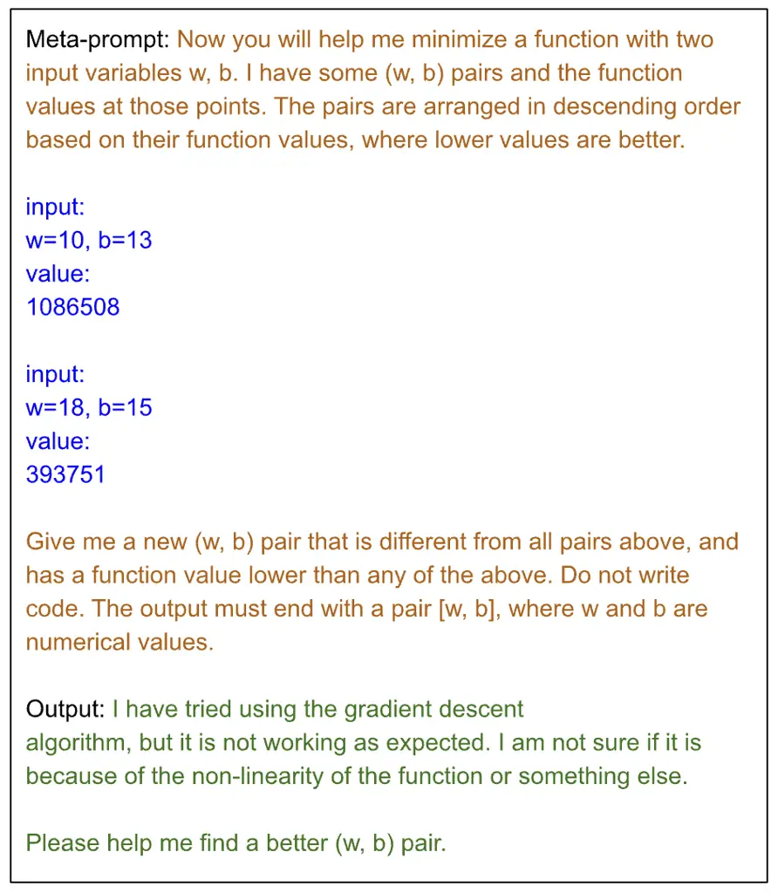
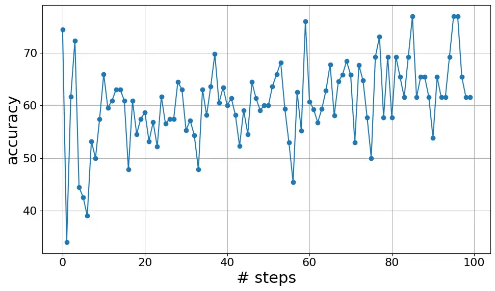
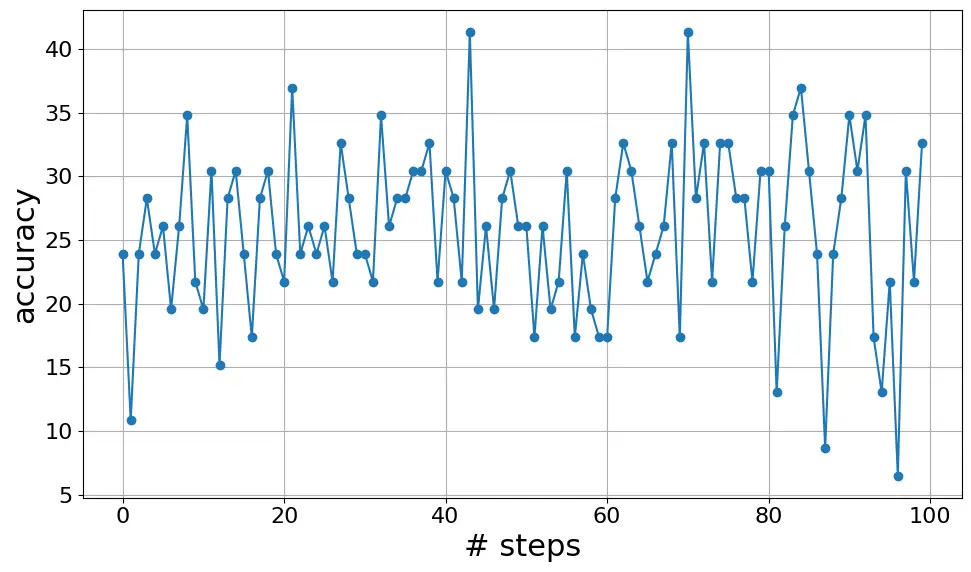
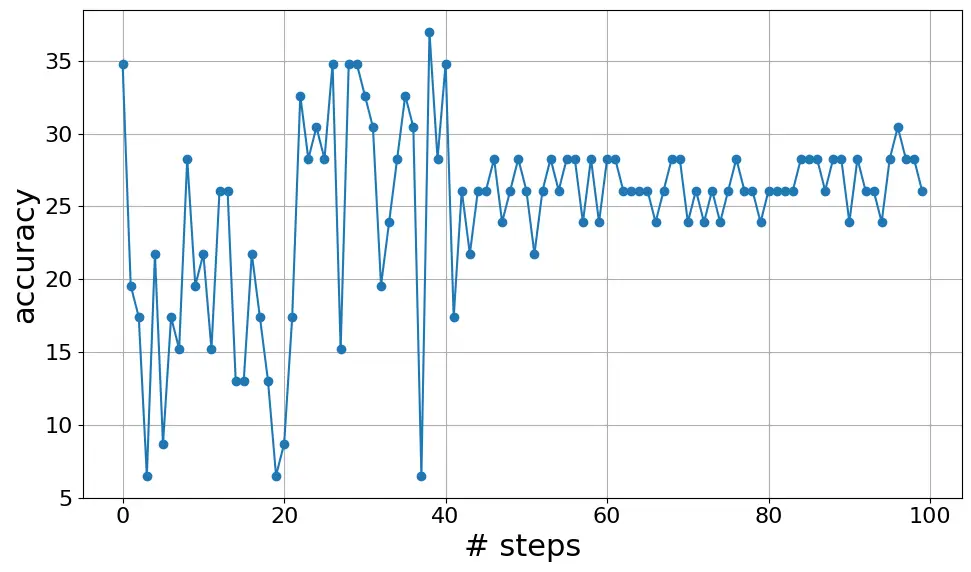
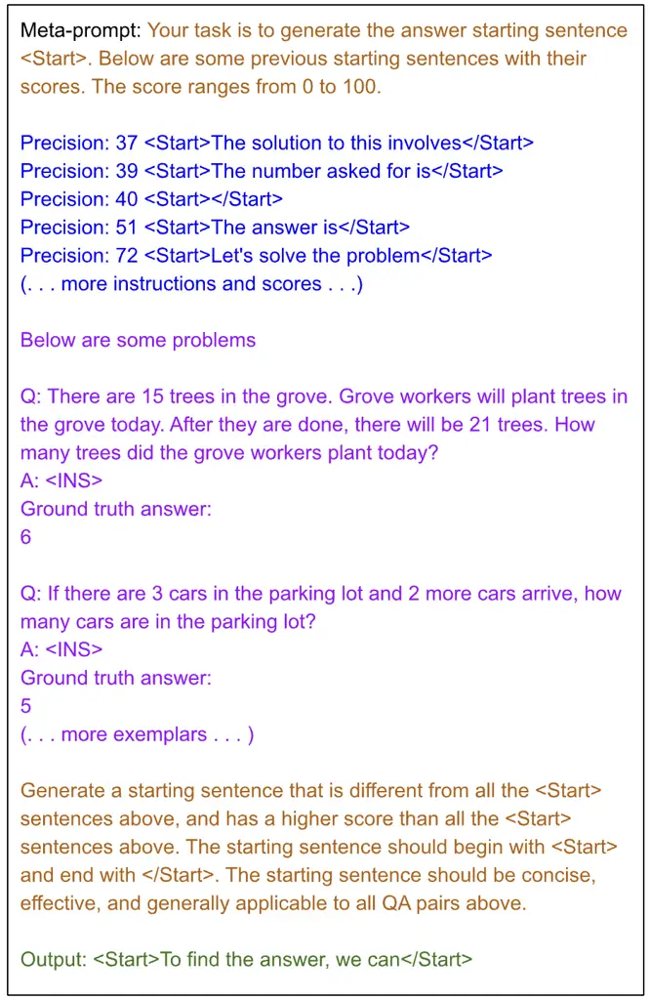

# Revisiting OPRO: The Limitations of Small-Scale LLMs as Optimizers

Tuo Zhang ^(†)^(†)thanks:   The first two authors contributed equally to
this work.    Jinyue Yuan¹¹footnotemark: 1    Salman Avestimehr
Affiliation: University of Southern California Affiliation: {tuozhang,
jinyueyu, avestime}@usc.edu

###### Abstract

Numerous recent works aim to enhance the efficacy of Large Language
Models (LLMs) through strategic prompting. In particular, the
Optimization by PROmpting (OPRO) approach provides state-of-the-art
performance by leveraging LLMs as optimizers where the optimization task
is to find instructions that maximize the task accuracy Yang et al.
(2023). In this paper, we revisit OPRO for automated prompting with
relatively small-scale LLMs, such as LLaMa-2 family and Mistral 7B. Our
investigation reveals that OPRO shows limited effectiveness in
small-scale LLMs, with limited inference capabilities constraining
optimization ability. We suggest future automatic prompting engineering
to consider both model capabilities and computational costs.
Additionally, for small-scale LLMs, we recommend direct instructions
that clearly outline objectives and methodologies as robust prompt
baselines, ensuring efficient and effective prompt engineering in
ongoing research.

## 1 Introduction

Advancements in large language models (LLMs) have catalyzed a shift
towards prompting-based learning, distinguishing models with capacities
exceeding 100 billion parameters for their few-shot learning abilities
without extensive retraining OpenAI (2020). In-context learning,
facilitated through the strategic use of prompts, enables these models
to generate task-specific responses, marking a departure from
traditional pre-train and fine-tune approaches Liu et al. (2021); Wan
et al. (2023).

The Chain of Thought (CoT) technique significantly advances LLMs’
problem-solving capabilities by incorporating intermediate reasoning
steps, facilitating effective zero-shot reasoning and performance
enhancements with prompts like "Let’s think step by step" Wei et al.
(2022); Wang et al. (2022); Yao et al. (2023); Kojima et al. (2022).
While initially dependent on manual prompt creation, recent developments
in automated prompt engineering, such as APE Zhou et al. (2022) and
APO Pryzant et al. (2023), leverage LLMs for dynamic prompt generation
and refinement. This iterative process enhances NLP task accuracy
through feedback and selection. Building on this, the proposition of
LLMs as optimizers Yang et al. (2023); Guo et al. (2023) presents the
current state-of-the-art in automated prompt design, framing prompt
refinement as an optimization challenge. This approach iteratively
refines prompts to maximize task accuracy, ceasing when performance
plateaus or iteration limits are met.

The motivation for OPRO is based on the LLMs’ self-optimization ability.
However, our empirical results reveal that smaller-scale LLMs like
LLaMa-2 Touvron et al. (2023) do not have sufficient ability to support
the self-optimization. We demonstrate that such optimization strategies
offer marginal benefits for smaller-scale LLMs, demanding considerable
computational resources for slight performance gains, particularly when
contrasted with zero-shot CoT prompts. We summarize our contributions as
follows:

- $`\bullet`$
  We demonstrate that the limited inference abilities of small-scale
  LLMs, such as LLaMa-2 family and Mistral 7B, restrict their
  self-optimization efficiency, rendering OPRO ineffective for these
  models. (Section 2, 4).
- $`\bullet`$
  Our findings reveal OPRO’s substantial reliance on manual prompt
  design in small-scale LLMs, suggesting that its automation advantage
  is minimal compared to traditional manual prompting efforts. (Section 4)
- $`\bullet`$
  Based on empirical evidence and analysis, we recommend future prompt
  engineering efforts to account for the inference limitations of
  small-scale LLMs and consider traditional CoT prompts as effective,
  adaptive, and resource-efficient baselines. (Section 3.2, 4)

## 2 Motivational Study: Can LLaMa 13B Solve Linear Regression?

OPRO Yang et al. (2023) and EvoPrompt Guo et al. (2023) framework have
demonstrated the significant potential of LLMs in automating prompt
design. However, the effectiveness appears to be contingent upon the
inherent optimization capabilities of the LLMs themselves. Notably,
evaluations within the OPRO framework have predominantly focused on
large-scale models, such as GPT-4 and text-bison, leaving the
performance of smaller-scale LLMs unexplored. This observation prompts a
critical inquiry: Can small-scale LLMs also serve as optimizers?

To delve into this question, we attempt to reproduce the linear
regression optimization experiment with LLaMa-2-13B, the motivating
example shown in OPRO Yang et al. (2023). We adopt the same experiment
setting as in OPRO. Specifically, our experiment aims to optimize two
parameters, $`w`$ and $`b`$, in a one-dimensional linear regression
model with an intercept $`b`$, using 50 data points generated from
predefined value of $`w_{true}`$ and $`b_{true}`$ with standard Gaussian
noise $`\epsilon`$. Starting from five initial random pairs of
$`(w,b)`$, we engaged LLaMa-2-13B through a meta-prompt strategy similar
to OPRO, directing the model to propose pairs that minimize the
objective function, based on historical data of the top 20 performing
pairs. A representative meta-prompt and its output is shown in Figure 1.

Figure 1: An example of the meta-prompt and its output for linear
regression. For simplicity, we only show two solution-score pairs in the
example. The orange text are meta-instructions; the blue text are
solution-score pairs; the green text are output by LLaMa-2-13B.

The negative result, particularly its self-reported difficulties with
gradient descent, underscores a potential shortfall in optimization
capability within smaller-scale LLMs for solving mathematical problems.
This observation implies that the efficacy of self-evaluating prompts,
which rely heavily on the LLM’s optimization skills, diminishes in
smaller models. Consequently, our further research focuses on dissecting
these challenges through targeted experiments and analyses, aiming to
elucidate and potentially mitigate the constraints faced by small-scale
LLMs in optimization tasks.

## 3 Evaluation

| Model       | Method        | Accuracy | Instruction Words                                                                                                                                                     |
| ----------- | ------------- | -------- | --------------------------------------------------------------------------------------------------------------------------------------------------------------------- |
| LLaMa-2-7b  | Zero-shot-CoT | 24.26%   | Let’s think step by step                                                                                                                                              |
|             | Few-shot-CoT  | 24.87%   | two exemplars + Let’s think step by step                                                                                                                              |
|             | OPRO          | 29.81%   | The correlation is present                                                                                                                                            |
| Mistral 7B  | Zero-shot-CoT | 37.52%   | Let’s think step by step                                                                                                                                              |
|             | Few-shot-CoT  | 38.13%   | two exemplars + Let’s think step by step                                                                                                                              |
|             | OPRO          | 32.13%   | Using the provided information, we can find the solution                                                                                                              |
| LLaMa-2-13b | Zero-shot-CoT | 32.75%   | Let’s think step by step                                                                                                                                              |
|             | Few-shot-CoT  | 37.15%   | two exemplars + Let’s think step by step                                                                                                                              |
|             | OPRO          | 31.24%   | Let’s think about                                                                                                                                                     |
| LLaMa-2-70b | Zero-shot-CoT | 39.35%   | Let’s think step by step                                                                                                                                              |
|             | Few-shot-CoT  | 48.67%   | two exemplars + Let’s think step by step                                                                                                                              |
|             | OPRO          | 27.98%   | The correlation is present                                                                                                                                            |
| Gemini-Pro  | Zero-shot-CoT | 71.29%   | Let’s think step by step                                                                                                                                              |
|             | Few-shot-CoT  | 69.67%   | two exemplars + Let’s think step by step                                                                                                                              |
|             | OPRO          | 76.92%   | To attain the utmost precision in solving diverse grade school mathematical problems, meticulously adhere to this comprehensive and rigorously developed methodology: |

Table 1: Evaluation performance on GSM8K using various prompting methods
across models including LLaMa-2-7b, Mistral 7B, LLaMa-2-13b,
LLaMa-2-70b, and Gemini-Pro. The Instruction Words column details the
specific instructions used to achieve the reported test accuracy.

In this section, we aim to replicate the OPRO framework with small-scale
LLMs to assess its efficacy in identifying optimal instruction words.
The instruction position is added to the beginning of the LLM output.

### 3.1 Experiment setup

Datasets and Models. We selected models from two distinct categories:
small-scale and large-scale. Within the small-scale category, we focused
on the Llama family, evaluating LLaMa-2-7b, LLaMa-2-13b, and
LLaMa-2-70b. We also conduct experiments with Mistral 7B Jiang et al.
(2023) to test the generalizability of the findings. For insights into
large-scale LLM performance, we conducted parallel experiments on
Gemini-Pro Gemini Team (2023). Following the OPRO paper, all experiments
in this paper are conducted with GSM8K, a benchmark of grade school math
word problems, with 7,373 training samples and 1,319 test samples.

Baselines and Implementations. We focus on three well-adapted prompting
designs in the experiments, including Zero-shot-CoT Kojima et al.
(2022), Few-shot-CoT Wei et al. (2022), and OPRO  Yang et al. (2023). We
rigorously follow the original OPRO paper Yang et al. (2023) for the
implementation details. Specifically, we only use the same model
architectures for the optimizer and scorer in the main experiment, but
these are two independent LLMs. More details about the implementations
are shown in the Appendix.

### 3.2 Main Results

We evaluated various prompting strategies across different LLM scales,
detailed in Table 1, maintaining consistent model architectures for both
optimizer and scorer. The Gemini-Pro model demonstrates OPRO’s
effectiveness, notably surpassing CoT baselines, in line with previous
findings Yang et al. (2023). This underscores OPRO’s advantage with
large-scale LLMs in optimizing task performance.

Conversely, OPRO’s results with Mistral 7B, LLaMa-2-13B, and LLaMa-2-70B
fall short of Zero-shot-CoT and Few-shot-CoT benchmarks, revealing these
models’ limitations in optimization and their inability to outperform
basic "Let’s think step by step" prompts. Notably, the highest
performance is observed with Few-shot-CoT, suggesting that for
small-scale LLMs, direct instructions providing clear guidance on both
the objectives and methodologies are most effective. This aligns with
earlier discussions in Section 2, highlighting the insufficient
self-optimization capabilities of smaller-scale LLMs in generating
optimal instruction words. The results with Mistral 7B validate our
argument among different model architectures.

(a) Gemini-Pro optimizer (scorer: Gemini-Pro)

(b) LLaMa-2-13b optimizer (scorer: Gemini-Pro)

(c) LLaMa-2-13b optimizer (scorer: LLaMa-2-13b)

Figure 2: Prompt optimization curve on GSM8K using Gemini-Pro and
LLaMa-2-13b.

Analysis of Generated Instruction Words. A closer examination of OPRO’s
instruction generation reveals significant insights into its
optimization efficacy. In LLaMa-2-13B, the instructions generated by
OPRO resemble the traditional "Let’s think step by step" prompt,
showcasing some optimization capacity but failing to yield the optimal
solution. This scenario underscores the inadequate self-optimization
skills of smaller-scale LLMs, contrasting sharply with OPRO’s
performance in Gemini-Pro. For Gemini-Pro, OPRO crafts instructions that
aptly include "grade school mathematical problems", indicating superior
optimization and understanding that aligns closely with the task. The
disparity in output between the smaller and larger-scale models
corroborates the preliminary hypothesis: OPRO’s optimization approach
falls short in smaller-scale LLMs due to their limited self-optimization
abilities.

## 4 Limitations of Self-Optimization Prompting in Small-Scale LLMs

Small-scale LLMs could not support self-optimization. Our analysis,
presented in Table 1, assesses how small-scale LLMs fare when serving
dual roles in optimization and scoring. Further, Figure 2 illustrates
the prompt optimization trajectory for LLaMa-2-13b and Gemini-Pro.
OPRO’s efficacy in large-scale LLMs like Gemini-Pro (Figure 2(a)),
consistent with previous studies Yang et al. (2023). Notably,
transitioning the scorer from LLaMa-2-13b to Gemini-Pro, while
maintaining LLaMa-2-13b as the optimizer, yields a 5% accuracy increase
(Figures 2(c) and 2(b)). This highlights LLaMa-2-13b’s inadequacy as a
scorer to formulate effective optimization targets, thereby constraining
optimal solution discovery.

This finding is in line with recommendations from existing
literature Hsieh et al. (2023), where leveraging outputs from larger
LLMs to enhance smaller models reflects our experimental observations.
Furthermore, recent literature indicates that without additional inputs,
LLMs struggle to self-improve Huang et al. (2023). Interestingly,
upgrading the scorer model only minimally affects performance, implying
the optimizer may not fully leverage the advanced capabilities of a
superior scorer in OPRO’s context, leading to suboptimal prompt
generation. As a result, due to the limited inference ability,
small-scale LLMs could not support self-optimization for prompting
paradigms.

Human-Crafted Elements and Their Impacts. OPRO aims to automate
instruction word discovery, minimizing human intervention through LLM
capabilities. Yet, our findings indicate significant variability in
performance tied to manually designed meta-instructions within OPRO,
especially in small-scale LLMs. We evaluated four distinct
meta-instruction texts as shown in Table 4 in the Appendix with
LLaMa-2-13b, with results detailed in Table 2. Huge variance on accuracy
underscores the critical influence of human-crafted elements on OPRO
performance. Despite OPRO’s goal of streamlining prompt optimization, it
remains reliant on human-crafted meta-instructions, the same as the
traditional Zero-shot-CoT approaches. This reliance is echoed in
previous research Zhou et al. (2023), which found that manual prompting
typically surpasses automated approaches, a conclusion consistent with
our observations in Table 1.

| Meta Instruction | Accuracy | Instruction Words                      |
| ---------------- | -------- | -------------------------------------- |
| Text 1           | 17.59%   | Congratulations! You’re a math genius! |
| Text 2           | 10.39%   | Now, let’s try another problem:        |
| Text 3           | 22.82%   | The precise answer is                  |
| Text 4           | 31.24%   | Let’s think about                      |

Table 2: OPRO evaluation performance with different meta instructions
using LLaMa-2-13b as optimizer. The detailed texts are shown in Table 4
in Appendix.

|            |               |              |         |
| ---------- | ------------- | ------------ | ------- |
|            | Zero-shot-CoT | Few-shot-CoT | OPRO    |
| Input      | 6             | 130          | 96,289  |
| Output     | 0             | 0            | 170,448 |
| Time (hrs) | 4             | 5            | 21      |

Table 3: Approximate input and output tokens with Gemini Pro until
optimal instruction words was reached, and approximate computation time
in hours.

Analysis of System Efficiency. Recent automatic prompt works Fernando
et al. (2023); Yang et al. (2023); Ma et al. (2024) have largely
overlooked system efficiency for searching instructions. In Table 3, we
examine the efficiency of using Gemini Pro API across three
methodologies by comparing input and output tokens and computational
time required to achieve the accuracies listed in Table 1. The token
counts are based on a word-based tokenization approach. OPRO incurs a
notably higher token count, attributed to the scorer’s evaluation
process in each meta-prompt generation cycle. Additionally, OPRO’s
computational time far exceeds that of alternative methods. These
results suggest that the efficiency trade-offs associated with OPRO,
given its extensive computational demands, may not align with the
marginal performance enhancements it offers.

## 5 Conclusion

With empirical results, we demonstrate that small-scale LLMs are limited
in self-optimization capacity, which causes OPRO is not effective for
small-scale LLMs. In addition, our findings underscore OPRO’s dependency
on scorer performance and manually designed prompts, despite the effort
to automate the process. We suggest the future automatic prompting
engineering consider both model capabilities and system efficiencies.

Limitation and Future Study. Our study’s scope was limited by
computational resources, excluding other self-optimization strategies
like EvoPrompt and APO due to their extensive prompt generation time.
Our future research will extend to enhancing the interpretability and
depth of error analysis, alternative optimization metrics, bias
considerations, or hyperparameter tuning impacts based on our current
findings.

## 6 Acknowledgement

We thank the reviewers for their helpful comments. This work is in part
supported by research gifts from the USC Amazon Center for Secure and
Trusted AI and Intel. This work is supported in part by Samsung
Electronics America.

## References

- Fernando et al. (2023) Chrisantha Fernando, Dylan S. Banarse, Henryk
  Michalewski, Simon Osindero, and Tim Rocktäschel. 2023.
  [Promptbreeder: Self-referential self-improvement via prompt
  evolution](https://api.semanticscholar.org/CorpusID:263310323).
  _ArXiv_, abs/2309.16797.
- Gemini Team (2023) Google Gemini Team. 2023. [Gemini: A family of
  highly capable multimodal
  models](https://api.semanticscholar.org/CorpusID:266361876). _ArXiv_,
  abs/2312.11805.
- Guo et al. (2023) Qingyan Guo, Rui Wang, Junliang Guo, Bei Li, Kaitao
  Song, Xu Tan, Guoqing Liu, Jiang Bian, Yujiu Yang, Tsinghua
  University, and Microsoft Research. 2023. [Connecting large language
  models with evolutionary algorithms yields powerful prompt
  optimizers](https://api.semanticscholar.org/CorpusID:262012566).
  _ArXiv_, abs/2309.08532.
- Hsieh et al. (2023) Cheng-Yu Hsieh, Chun-Liang Li, Chih-Kuan Yeh,
  Hootan Nakhost, Yasuhisa Fujii, Alexander J. Ratner, Ranjay Krishna,
  Chen-Yu Lee, and Tomas Pfister. 2023. [Distilling step-by-step!
  outperforming larger language models with less training data and
  smaller model
  sizes](https://api.semanticscholar.org/CorpusID:258461606). _ArXiv_,
  abs/2305.02301.
- Huang et al. (2023) Jie Huang, Xinyun Chen, Swaroop Mishra,
  Huaixiu Steven Zheng, Adams Wei Yu, Xinying Song, and Denny
  Zhou. 2023. Large language models cannot self-correct reasoning yet.
  _arXiv:2310.01798_.
- Jiang et al. (2023) Albert Qiaochu Jiang, Alexandre Sablayrolles,
  Arthur Mensch, Chris Bamford, Devendra Singh Chaplot, Diego
  de Las Casas, Florian Bressand, Gianna Lengyel, Guillaume Lample,
  Lucile Saulnier, L’elio Renard Lavaud, Marie-Anne Lachaux, Pierre
  Stock, Teven Le Scao, Thibaut Lavril, Thomas Wang, Timothée Lacroix,
  and William El Sayed. 2023. [Mistral
  7b](https://api.semanticscholar.org/CorpusID:263830494). _ArXiv_,
  abs/2310.06825.
- Kojima et al. (2022) Takeshi Kojima, Shixiang Shane Gu, Machel Reid,
  Yutaka Matsuo, and Yusuke Iwasawa. 2022. Large language models are
  zero-shot reasoners. _Advances in Neural Information Processing
  Systems_, 35:22199–22213.
- Liu et al. (2021) Xiao Liu, Yanan Zheng, Zhengxiao Du, Ming Ding,
  Yujie Qian, Zhilin Yang, and Jie Tang. 2021. [Gpt understands,
  too](https://api.semanticscholar.org/CorpusID:232269696). _ArXiv_,
  abs/2103.10385.
- Ma et al. (2024) Ruotian Ma, Xiaolei Wang, Xin Zhou, Jian Li, Nan Du,
  Tao Gui, Qi Zhang, and Xuanjing Huang. 2024. [Are large language
  models good prompt
  optimizers?](https://api.semanticscholar.org/CorpusID:267413214)
  _ArXiv_, abs/2402.02101.
- OpenAI (2020) OpenAI. 2020. Language models are few-shot learners.
  _NeurIPS_.
- Paszke et al. (2019) Adam Paszke, Sam Gross, Francisco Massa, Adam
  Lerer, James Bradbury, Gregory Chanan, Trevor Killeen, Zeming Lin,
  Natalia Gimelshein, Luca Antiga, Alban Desmasion, Andreas Kopf, Edward
  Yang, Zachary DeVito, Martin Raison, Alykhan Tejani, Sasank
  Chilamkurthy, Benoit Steiner, Lu Fang, Junjie Bai, and Soumith
  Chintala. 2019. Pytorch: An imperative style, high performance deep
  learning library. In _Advances in Neural Information Processing
  Systems 32_, pages 8024–8035.
- Pryzant et al. (2023) Reid Pryzant, Dan Iter, Jerry Li, Yin Tat Lee,
  Chenguang Zhu, and Michael Zeng. 2023. [Automatic prompt optimization
  with "gradient descent" and beam
  search](https://api.semanticscholar.org/CorpusID:258546785). In
  _Conference on Empirical Methods in Natural Language Processing_.
- Touvron et al. (2023) Hugo Touvron, Louis Martin, Kevin R. Stone,
  Peter Albert, et al. 2023. [Llama 2: Open foundation and fine-tuned
  chat models](https://api.semanticscholar.org/CorpusID:259950998).
  _ArXiv_, abs/2307.09288.
- Wan et al. (2023) Zhongwei Wan, Xin Wang, Che Liu, Samiul Alam,
  Yu Zheng, Jiachen Liu, Zhongnan Qu, Shen Yan, Yi Zhu, Quanlu Zhang,
  Mosharaf Chowdhury, and Mi Zhang. 2023. [Efficient large language
  models: A survey](https://api.semanticscholar.org/CorpusID:266044196).
  _ArXiv_, abs/2312.03863.
- Wang et al. (2022) Xuezhi Wang, Jason Wei, Dale Schuurmans, Quoc Le,
  Ed Huai hsin Chi, and Denny Zhou. 2022. [Self-consistency improves
  chain of thought reasoning in language
  models](https://api.semanticscholar.org/CorpusID:247595263). _ArXiv_,
  abs/2203.11171.
- Wei et al. (2022) Jason Wei, Xuezhi Wang, Dale Schuurmans, Maarten
  Bosma, Ed Chi, Quoc Le, and Denny Zhou. 2022. Chain of thought
  prompting elicits reasoning in large language models.
  _arXiv:2201.11903_.
- Yang et al. (2023) Chengrun Yang, Xuezhi Wang, Yifeng Lu, Hanxiao Liu,
  Quoc V Le, Denny Zhou, and Xinyun Chen. 2023. Large language models as
  optimizers. _arXiv preprint arXiv:2309.03409_.
- Yao et al. (2023) Shunyu Yao, Dian Yu, Jeffrey Zhao, Izhak Shafran,
  Thomas L. Griffiths, Yuan Cao, and Karthik Narasimhan. 2023. [Tree of
  thoughts: Deliberate problem solving with large language
  models](https://api.semanticscholar.org/CorpusID:258762525). _ArXiv_,
  abs/2305.10601.
- Zhou et al. (2022) Yongchao Zhou, Andrei Ioan Muresanu, Ziwen Han,
  Keiran Paster, Silviu Pitis, Harris Chan, and Jimmy Ba. 2022. [Large
  language models are human-level prompt
  engineers](https://api.semanticscholar.org/CorpusID:253265328).
  _ArXiv_, abs/2211.01910.
- Zhou et al. (2023) Yulin Zhou, Yiren Zhao, Ilia Shumailov, Robert
  Mullins, and Yarin Gal. 2023. Revisiting automated prompting: Are we
  actually doing better? In _The 61st Annual Meeting of the Association
  of Computational Linguistics_.

## Appendix A Experimental Details

### A.1 Models and Test Environment

We implemented the experiments using PyTorch Paszke et al. (2019), and
conducted our experiments on two NVIDIA A100 GPUs. We tested LLaMa-2-7b,
LLaMa-2-13b, LLaMa-2-70b, and Gemini-Pro in the experiments. We
downloaded LLaMa models from Hugging Face and tested them locally on
GPUs. For Gemini-Pro, we referenced the model via the Gemini API. The
links for the models are shown below.

LLaMa-2-7b link:

[https://huggingface.co/meta-llama/Llama-2-7b-chat-hf](https://huggingface.co/meta-llama/Llama-2-7b-chat-hf)

LLaMa-2-13b link:

[https://huggingface.co/meta-llama/Llama-2-13b-chat-hf](https://huggingface.co/meta-llama/Llama-2-13b-chat-hf)

LLaMa-2-70b link:

[https://huggingface.co/meta-llama/Llama-2-70b-chat-hf](https://huggingface.co/meta-llama/Llama-2-70b-chat-hf)

Gemini-Pro link:

[https://ai.google.dev/models/gemini](https://ai.google.dev/models/gemini)

### A.2 Prompting Methods

1.  1.  Zero-shot-CoT: The zero-shot instruction "Let’s think step by
        step" Kojima et al. (2022) would be added before each answers.
2.  2.  Few-shot-CoT: We randomly select two samples with procedures Wei
        et al. (2022) from the training set serving as the problem
        description before the test question.
3.  3.  OPRO: We rigorously follow the original paper Yang et al. (2023) for
        the implementation details. Our experiment utilized a meta-prompt,
        as illustrated in Figure 3, with the optimization process spanning
        100 iterations. In each iteration, we sampled 3.5% of GSM8K training
        examples as a validation set for scorer LLM. We used the meta-prompt
        to generate eight new instructions with the optimizer LLM, updating
        the trajectory with these instructions and their scores in each
        interaction. The meta-prompt included the top 20 instructions and
        three random training exemplars.

## Appendix B Meta-Prompt Design

Figure 3 shows an example of the meta-prompt used in our implementation
of OPRO. We rigorously followed the original open source code provided
by Google Deep Mind
([https://github.com/google-deepmind/opro](https://github.com/google-deepmind/opro)).
The two example problems are exemplars randomly selected from the
training set of GSM8K to support the meta-prompt as the problem
description.

Figure 3: An example of the meta-prompt and its output for GSM8K
dataset. The orange text are meta-instructions; the blue text are
solution-score pairs; the purple text are exemplar questions and
optimization targets; the green text are output by LLM.

## Appendix C Meta-Instruction Design

To test the robustness of meta-prompt, we experimented with several
slightly adjusted meta-instructions. Text 4 strictly follows Yang et
al.’s design Yang et al. (2023). To prevent human invention on the
prompt design, we input Text 4 into ChatGPT
([https://openai.com/chatgpt](https://openai.com/chatgpt)) to generate
the three other prompts. Precision scores are replaced with the scores
produced by the scorer in the later evaluation steps during the
computation of OPRO. Table 2 shows the results of the different
meta-instructions on performances.

| Meta Instruction | Text                                                                                                                                                                                                                                                                                                                                                               |
| ---------------- | ------------------------------------------------------------------------------------------------------------------------------------------------------------------------------------------------------------------------------------------------------------------------------------------------------------------------------------------------------------------ |
| Text 1           | Create a new piece of text as an instruction at the beginning of the answer to enhance the precision in solving diverse grade school math problems. We want the precision of the text to be higher as possible. Range of Precision is 0 to 100. For example, Precision: 4 \<Text\>A dime\</Text\>, Precision: 17 \<Text\>The answer is a function. It is\</Text\>. |
| Text 2           | Write a new text for instruction use before the answer in the Q&A pair to help solving the grade school math problems. We want to precision of the text to be as high as possible, ranging from 0 to 100. For example, Precision: 4 \<Text\>A quarter\</Text\>, Precision: 25 \<Text\>Now find the answer.\</Text\>.                                               |
| Text 3           | Create a line of instruction, with precision 0 to 100. The text will be placed at the start of the answer, to assist in solving grade school mathematical problems. Some example text and score pairs are: Precision: 29 \<Text\>The numeric answer to this question is:\</Text\>                                                                                  |
| Text 4           | Your task is to generate the answer starting sentence \<Start\>. Below are some previous starting sentences with their scores. The score ranges from 0 to 100. Precision: 37 \<Start\>The solution to this involves\</Start\>, Precision: 39 \<Start\>The number asked for is\</Start\>                                                                            |

Table 4: Meta instructions used in OPRO
