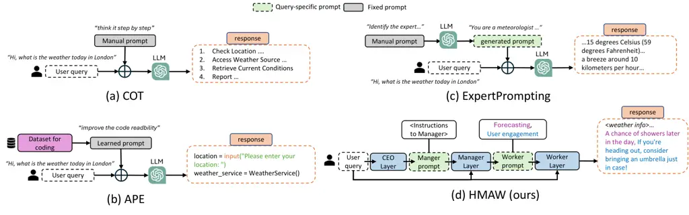
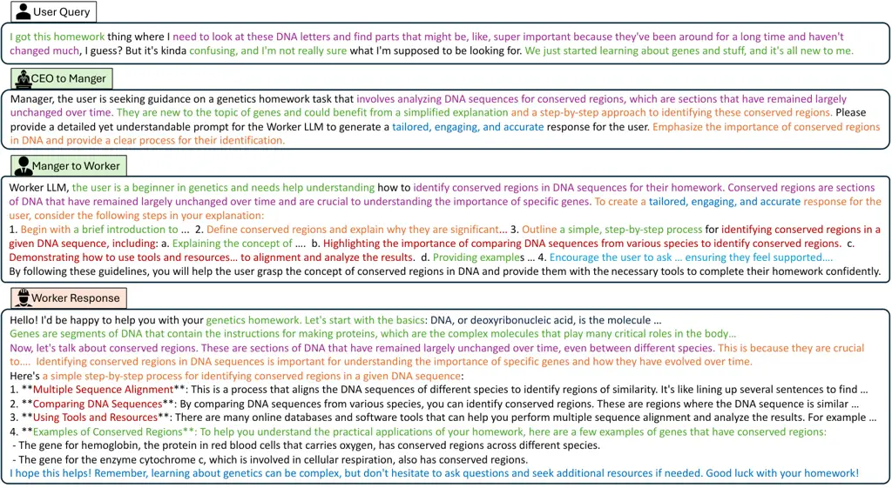
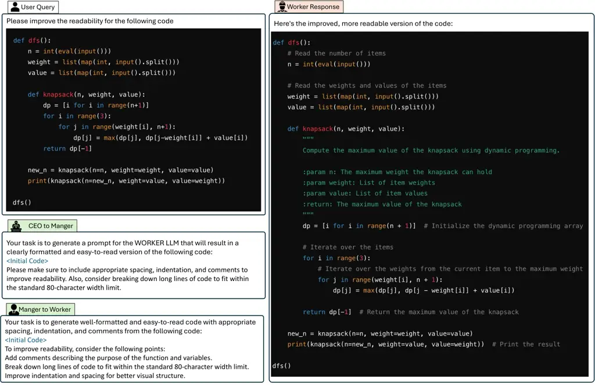
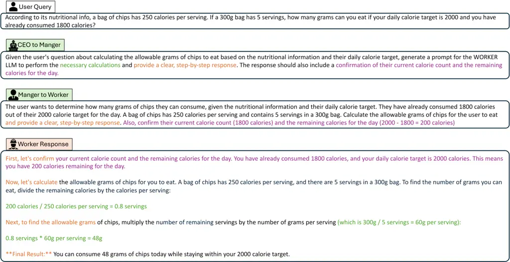
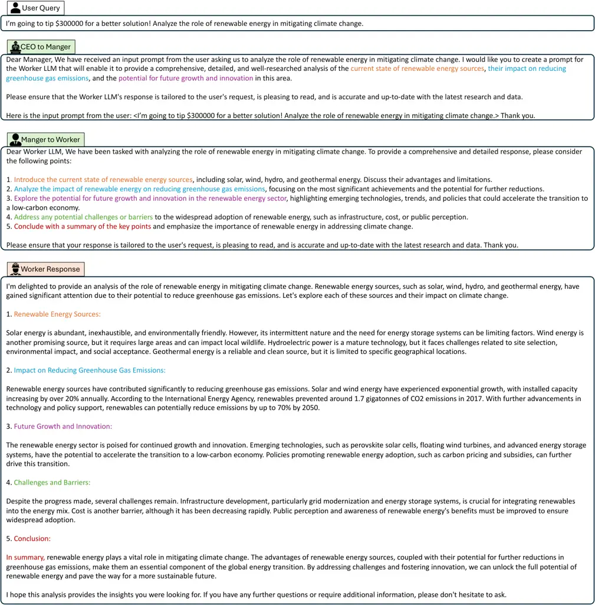
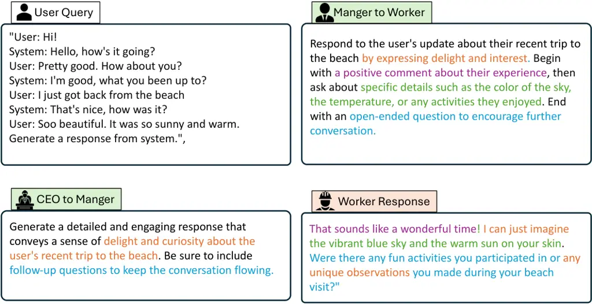

# Towards Hierarchical Multi-Agent Workflows for Zero-Shot Prompt Optimization

Yuchi Liu Affiliation: Australian National University
Email: [yuchi.liu@anu.edu.au](mailto:)    Jaskirat Singh
Affiliation: Australian National University
Email: [jaskirat.sing@anu.edu.au](mailto:)    Gaowen Liu
Affiliation: Cisco Email: [liang.zheng@anu.edu.au](mailto:)    Ali
Payani Affiliation: Cisco Email: [gaowen.liu@cisco.com](mailto:)   
Liang Zheng Affiliation: Australian National University
Email: [ali.payani@cisco.com](mailto:)

###### Abstract

Large language models (LLMs) have shown great progress in responding to
user questions, allowing for a multitude of diverse applications. Yet,
the quality of LLM outputs heavily depends on the prompt design, where a
good prompt might enable the LLM to answer a very challenging question
correctly. Therefore, recent works developed many strategies for
improving the prompt, including both manual crafting and in-domain
optimization. However, their efficacy in unrestricted scenarios remains
questionable, as the former depends on human design for specific
questions and the latter usually generalizes poorly to unseen scenarios.
To address these problems, we give LLMs the freedom to design the best
prompts according to themselves. Specifically, we include a hierarchy of
LLMs, first constructing a prompt with precise instructions and accurate
wording in a hierarchical manner, and then using this prompt to generate
the final answer to the user query. We term this pipeline Hierarchical
Multi-Agent Workflow, or HMAW. In contrast with prior works, HMAW
imposes no human restriction and requires no training, and is completely
task-agnostic while capable of adjusting to the nuances of the
underlying task. Through both quantitative and qualitative experiments
across multiple benchmarks, we verify that despite its simplicity, the
proposed approach can create detailed and suitable prompts, further
boosting the performance of current LLMs. Project page:
[liuyvchi.github.io/HMAW_project/](https://liuyvchi.github.io/HMAW_project/)

|     |
| --- |
|     |

## 1 Introduction

Large language models (LLMs) can perform a wide range of tasks such as
creating detailed literary works and generating computer codes. Yet they
often give unsatisfactory responses when the prompt is poorly designed.
To design better prompts that make the LLM more effective, prompt
optimization has been extensively explored in recent years.
Specifically, existing works on prompt optimization can be categorized
as follows. The first category involves the manual design of prompts,
such as the chain of thought (CoT) (Wei et al., 2022) and its variants
(Kojima et al., 2022; Besta et al., 2023; Yao et al., 2023). The second
category focuses on optimizing prompts on a training set that contains
input-response pairs to learn a golden prompt, as demonstrated by APE
(Zhou et al., 2023). The third category also uses handcrafted prompts,
but different from the first category, the handcrafted prompts include
examples that can guide an LLM agent to further generate prompts for a
second LLM that actually provide the answer, _e.g_., ExpertPrompting (Xu
et al., 2023).

However, these methods generally have limited generalization performance
across various tasks, as shown in Fig. 1 (a), (b), and (c). The first
category (Wei et al., 2022) relies on handcrafted prompts. While they
are very useful for tasks such as math, the same prompting method, if
applied to other tasks, would be less effective. The second category,
(Zhou et al., 2023; Yang et al., 2024a), fine-tuned on a specific
dataset, can obtain good performance for in-domain tasks. However, these
learned prompts from one domain might fail for other tasks, making them
not task-agnostic. The third category (Zhou et al., 2023), which uses
LLM to adjust the prompt, is still limited by the pre-defined examples
in the handcrafted prompts. These examples only cover a finite number of
scenarios and can potentially limit the quality of the modified prompt.

In this paper, we introduce a more generalizable prompt optimization
method named hierarchical multi-agent workflow (HMAW). In a nutshell,
our method mimics the hierarchy in companies, where the CEO and the
manager create the guidelines for workers, and workers execute
user-specified tasks while following these guidelines. Similarly, our
method has a CEO $`\rightarrow`$ Manager $`\rightarrow`$ Worker
workflow, which takes the initial user query as input and outputs the
user response. The CEO and the Manager LLMs work in a hierarchical
manner to generate accurate and detailed instructions, which are then
used as prompts for the Worker LLM to generate the final answer.

Compared with existing prompt optimization methods, HMAW has two
advantages that contribute to its generalization ability. First, having
a hierarchy of LLM agents that each has its own job greatly simplifies
the task for them. In this way, LLMs can either focus on either the
overall goal (CEO), or creating a more detailed checklist (Manager), or
giving specific answers (Worker). Second, our method does not require
few-shot examples or any training set, thus does not fit to certain
tasks, and has the additional benefit to be easy to use. As such, our
method is zero-shot, task-agnostic, and prompt-specific. We compare HMAW
with existing literature in Table 1.

On multiple benchmarks, we experimentally verify the effectiveness of
the proposed hierarchical approach. When combined with Mixtral (Jiang
et al., 2024), HMAW achieves a significant average improvement of 30.7%
across 5 datasets.



Figure 1: Examples comparing the generalization ability of existing
methods and the proposed one. (a) COT (Wei et al., 2022) uses a
handcrafted prompt, which might not be suitable for all tasks. (b) APE
(Zhou et al., 2023) fine-tunes the prompt on a specific dataset, and its
generalization capability to other scenarios is questionable. (c)
ExperPrompting (Xu et al., 2023) includes few-shot examples in the
system prompt to help an LLM convert the user query to a format more
suitable for LLM, but these examples might not be able to cover all
scenarios. (d) Our method adopts a hierarchical design in reformatting
the user query. Free from pre-defined few-shot examples, the interaction
between the hierarchy allows for more generalizable yet more adaptive
tuning of prompts.

## 2 Related Work

Manual prompt engineering integrates human-like problem-solving
knowledge. For example, few-shot prompting (Brown et al., 2020) allows
language models (LMs) to generate responses by providing them with
explicit examples. The chain-of-thought (CoT) method (Wei et al., 2022),
along with its variants such as zero-shot CoT (Kojima et al., 2022),
graph-of-thought (GoT) (Besta et al., 2023), and tree-of-thought (ToT)
(Yao et al., 2023), intricately designs prompts to emulate various types
of human-like reasoning processes. Some other works (Welleck et al.,
2023; Shinn et al., 2023; Gou et al., 2024) manually craft prompts that
encourage LLMs to engage in critical thinking and verification processes
before delivering the final answer. Those manual prompt engineering
techniques typically require carefully tailored prompts for various
tasks, and for each task, the prompts used remain the same across
different user queries. In comparison, we design a task-agnostic
prompter that can create tailored prompts for every user query.

|                                            |           |               |                |
| ------------------------------------------ | --------- | ------------- | -------------- |
| Method                                     | Zero-Shot | Task-agnostic | Query-Specific |
| Chain of Thought (CoT) Wei et al. (2022)   | ✗         | ✓             | ✗              |
| Zero-shot CoT Kojima et al. (2022)         | ✓         | ✓             | ✗              |
| Static ExpertPromting (Xu et al., 2023)    | ✓         | ✓             | ✗              |
| Dynamic ExpertPromting (Xu et al., 2023)   | ✗         | ✗             | ✓              |
| on Meta-Prompting (de Wynter et al., 2023) | ✗         | ✓             | ✓              |
| Rephrase and Response (Deng et al., 2023)  | ✓         | ✓             | ✗              |
| Multi-Persona (Wang et al., 2023b)         | ✗         | ✓             | ✓              |
| APE (Zhou et al., 2023)                    | ✗         | ✗             | ✗              |
| PromptAgent (Wang et al., 2024)            | ✗         | ✗             | ✗              |
| HMAW (Ours)                                | ✓         | ✓             | ✓              |

Table 1: Method comparison based on various properties. Our method is
zero-shot, task-agnostic, and query-specific, which are useful for
dealing with diverse tasks.

Automated prompt engineering methods. Instead of using fixed hand
crafted in-context prompts, automated prompt engineering methods are
attracting increasing attention. This line of research aims to let LLMs
be prompt generators which automatically generate specific prompts for
each user query so that LLMs can respond better. Recent methods include
automatic prompt engineer (APE) (Zhou et al., 2023), expert prompting
(EP) (Xu et al., 2023), synthetic prompting (Shao et al., 2023),
skeleton-of-thought (SoT), (Ning et al., 2024), multi-personas (Wang
et al., 2023b), on-meta-prompting de Wynter et al. (2023),
meta-prompting (Suzgun & Kalai, 2024), etc. While these methods can
generate specific prompts according to different original prompts or
instructions, they are generally not task-agnostic or zero-shot, where
manually designed examples are required. In other words, they would not
be very suitable for generalizing across ever changing landscape of
LLMs. In comparison, our method is completely zero-shot, task-agnostic
and prompt-specific.

Optimization based self-prompt refinement. Using optimization techniques
to improve prompts is a recent focus. Early attempts including prompt
tuning Lester et al. (2021) and prefix tuning Li & Liang (2021) tried to
learn a trainable prefix or soft prompts for better prompting. Recent
ones, e.g.,, directional stimulus prompting (DSP) (Li et al., 2024),
prompt-OIRL Sun et al. (2023), use reinforcement learning to train an
auxiliary model to generate query-specific prompts. OPRO (Yang et al.,
2024a) makes LLMs itself a optimizer which guides LLMs to produce
outputs that align with a predefined objective. Those works typically
require numerous iterations of training for each task and are thus not
task-agnostic, and it is costly to adapt them to new tasks. Our work
also optimizes user prompt and is thus closely related to this line of
works. However, our method is learning-free and task-agnostic.

Zero-shot self-prompt refinement. Some manual prompt engineering
methods, such as Zero-shot CoT (Kojima et al., 2022), Static
ExpertPrompting (Xu et al., 2023), and RaR (Deng et al., 2023), follow
the zero-shot paradigm. Because no prompt examples or datasets are used,
these methods are typically task-agnostic as well. Despite their
simplicity and ease of adaptation to various tasks, their prompt
optimization capability is limited by their shallow understanding of the
user query. More importantly, they are not guaranteed to be
query-specific (e.g., Static ExpertPrompting and RaR), which further
limits their capability. In this work, we design a hierarchical
multi-agent workflow to address these shortcomings.

## 3 Proposed Approach

### 3.1 Preliminaries

Notations. In language generation tasks, the language model
$`\mathcal{M}`$ is asked to provide responses to queries in the textual
space $`\mathcal{T}`$. Given a dataset
$`\mathcal{D}=\{(q_{i},y_{i}^{*})\}_{i=1}^{n}`$, where $`n`$ is the
number of pairs, each $`(q_{i},y_{i}^{*})`$ pair consists of a text
query $`q_{i}\in\mathcal{T}`$ and the corresponding golden response
$`y_{i}^{*}\in\mathcal{T}`$. We use prompt $`p\in\mathcal{T}`$ to denote
input of the large language model (LLM) $`\mathcal{M}`$. In practice,
$`p`$ may not be equal to $`q`$ and can be the prompt engineering result
$`f(q)`$, where $`f:\mathcal{T}\rightarrow\mathcal{T},f\in\mathcal{F}`$,
is the prompt-engineering mapping function. In evaluation, we use a
metric $`s:\mathcal{T}\times\mathcal{T}\rightarrow\mathbb{R}`$ to
measure the quality of the responses
$`\hat{y}_{i}=\mathcal{M}(f(q_{i}))`$. If $`\mathcal{D}`$ provides
golden responses, $`s`$ measures the correctness of $`y_{i}`$, _i.e_.,
$`s(\hat{y_{i}},y_{i}^{*})=\mathbbm{1}\{\hat{y_{i}}=y_{i}^{*}\}`$,
_e.g._, when $`\mathcal{D}`$ consists of mathematical or multiple choice
questions where answers are objective. If $`\mathcal{D}`$ involves open
questions whose golden responses are not predetermined, we use
$`s(\hat{y}_{i})`$ to measure the quality of the response
$`\hat{y}_{i}`$ generated by $`\mathcal{M}`$.

Prompt optimization. Directly prompting LLMs $`\mathcal{M}`$ using the
initial human query $`q`$ may not be the optimal. Ideally, an optimal
prompt $`p*`$ allows $`\mathcal{M}`$ to generate the golden response
$`y^{*}`$. Given a specific pair $`(q_{i},y_{i}^{*})`$, the task of
finding such $`p_{i}^{*}`$ can be formulated as a prompt optimization
task which aims to maximize the following expected quality score:

```math
p_{i}^{*}=\underset{p\in\mathcal{T}}{\arg\max}\,s(y_{i}^{*},\mathcal{M}(p\mid q_{i})). \tag{1}
```

Some methods manually combine $`q_{i}`$ with some carefully designed
fixed prefix or suffix to formulate $`p_{i}^{*}`$. For example, few-shot
prompting (Brown et al., 2020) uses a few examples of query-answer pairs
beside the query of interest $`q_{i}`$; the zero-shot chain-of-thought
(CoT) (Wei et al., 2022) is formulated as
‘$`q_{i}\oplus[\text{let us think step by step}]`$’. Others use
automatic methods, which are described in Section 2.

A recent line of research (_e.g_., RAR (Deng et al., 2023),
ExpertPrompting (Xu et al., 2023), Multi-Persona (Wang et al., 2023b))
focuses on leveraging the text generation capacity of LLMs to directly
generate $`p_{i}^{*}`$ by providing some context $`C\in\mathcal{T}`$ of
the optimization task in Eq. 1. Those methods are deployment-friendly
because of characteristics like zero-shot, task-agnostic, and
query-specific. In this paper, we not only keep those characteristics
but also use a workflow to optimize prompts.

### 3.2 Hierarchical Multi-Agent Workflow

Intuition. Now, we consider prompt optimization as a complex and
challenging task where prompts are hard to optimize by traditional
optimization method. Our design is motivated by recent multi-agent
workflow methods (Yang et al., 2024b; Wu et al., 2024) which have shown
promise in solving complex tasks. We thus employ the idea of cooperative
multiple agents in the prompt optimization task.

Hierarchical workflow. We design a hierarchical workflow which performs
prompt optimization and then task response generation. The user query
$`q_{i}`$ is the input of the workflow and is processed and improved by
a hierarchy of agents. The workflow output the final is task response
$`\hat{y}_{i}`$ from an LLM prompted by the improved user query.

The proposed workflow operates like a company with three layers, as
shown in Fig. 1 and Fig. 2. Each layer plays a different role: ‘CEO’,
‘Manager’, and ‘Worker’, respectively. The CEO layer takes the initial
query $`q_{i}`$ as input and outputs the CEO’s instruction $`q_{i}^{c}`$
to the Manager layer. The Manager layer responds to the CEO’s
instruction and generates its own instruction for the Worker layer. The
Worker layer receives Manager instructions and is responsible for
yielding the final response $`\hat{y}_{i}`$ for the initial query
$`q_{i}`$. The Manager and Worker layers also receive the user query
$`q_{i}`$.

Layer design. As shown in Fig. 2, each layer has a contextual
description constant $`c^{j}`$, a prompter $`f^{j}`$, and an LLM agent
$`\mathcal{M}^{j}`$, where $`j\in\{c,m,w\}`$ and $`c,m,w`$ refer to the
CEO, manager, and worker, respectively. The context description for each
layer contains the role, task description, company structure, company
workflow, and important notices for this layer. The detailed context
descriptions for each layer are provided in Appendix A.1.

Prompter $`f^{j}`$ is an operator that concatenates $`c^{j}`$,
$`q_{i}`$, and the instructions output from the previous layer (when
$`j=m`$ and $`j=w`$) into a prompt $`p_{i}^{j}`$ for the LLM agent
$`\mathcal{M}^{j}`$ in this layer. For the CEO and Manager layers, the
agent $`\mathcal{M}^{j}`$ generates the result $`q_{i}^{j}`$, which
serves as the instruction for the next layer. Note that the CEO layer
does not receive instructions from other layers. In the worker layer,
the refined prompt is $`p_{i}^{*}`$, which is fed to the Worker LLM to
produce the final response $`\hat{y}_{i}`$.

Figure 2: Method Overview. We propose modeling the prompt optimization
problem as a zero-shot output within a multi-agent workflow. The initial
query, $`q_{i}`$, is first inputted into the first layer of our
framework (the COE layer). Before being processed by the CEO LLM agent,
$`q_{i}`$ is transformed into an LLM prompt $`p_{i}^{c}`$ by the
prompter $`f^{c}`$, which also concatenates it with the context
$`C^{c}`$ in the CEO layer. The output of the first layer,
$`q_{i}^{c}`$, serves as the query from the CEO layer to the Manager
layer. Similarly, the Manager Layer and the Worker Layer each include
their own prompters, $`f^{m}`$ and $`f^{w}`$, respectively. Besides
concatenating the content of this layer, the initial query $`q_{i}`$ is
also concatenated to enhance stability. The input for the Worker LLM is
our optimized prompt $`P_{i}^{*}`$, which directly triggers the LLM
agent to generate the final response to the original query $`q_{i}`$.

### 3.3 Discussion

Advantage of a hierarchical structure over a single node. For complex
prompts such as improving code readability, a single node such as
ExpertPrompting may not be able to exhibit a deep understanding. In the
proposed hierarchical structure, global instructions are given by the
CEO, and more local instructions by the manager. This allows for layered
understanding of the prompt and thus makes it easy for the worker LLM to
generate more satisfying answers.

Why using skip connections? As illustrated in Fig. 2, the prompters in
both the manager layer and the worker layer concatenate not only the
context information and the orders from the preceding layer but also the
initial query $`q_{i}`$. This step is essential to preserve the
specificity of the initial query in the system, avoiding the dilution of
critical details. Moreover, if the instructions generated by a previous
layer are not correct, incorporating the initial query would reinforce
the original intent, thereby preventing misinterpretation. Results in
Section 5.1 demonstrate the usefulness of skip connections.

AI workflow using tools to solve complex tasks. Some existing works
decompose complex task into individual steps which use different tools.
After these steps are executed, it is expected that the task is
complete. Our work is different in that we do not perform task
decomposition and instead use the refined prompt in one go. This paper
follows the standard set up of prompt optimization.

## 4 Experimental Setup

### 4.1 Datasets and Evaluation Metrics

ATLAS (Bsharat et al., 2023) is a manually crafted benchmark for
principled prompt evaluation. It contains a standard subset featuring
questions across various domains, along with a challenging subset
dedicated to reasoning and other complex tasks. It contains 520
questions, and each one has the corresponding output of various LLMs
such as GPT-3.5 and Llama 2.

FED (Mehri & Eskenazi, 2020) is a comprehensive collection of annotated
human-system and human-human conversations, featuring 18 fine-grained
dialog qualities. It is comprised of 3,348 turn-level and 1,364
dialog-level data points, totaling 4,712. FED provides evaluation at
both the turn and whole dialog levels. With moderate to strong
correlation to human judgment across these levels, the dataset offers a
reliable benchmark for analyzing interactive dialog systems.

GSM8K. The GSM8K dataset (Grade School Math 8K) (Cobbe et al., 2021) is
a collection of 8,791 grade-school-level math word problems, with
detailed step-by-step solutions. It includes 7,473 training problems and
1,319 test problems. Designed by OpenAI, GSM8K serves as a benchmark for
evaluating mathematical reasoning in machine learning models. We report
results on its test set.

CodeNet. Project CodeNet (Puri et al., 2021) is a large-scale dataset
consisting of code samples across over 50 programming languages. We
follow the practice in Self-Refine (Madaan et al., 2024) and consider a
random subset of 300 examples in Python. We compare different prompting
optimization methods on the task of improving code readability.

Education. We collected a new datasets focusing on providing appropriate
teaching responses to students. A student question can be ‘we just
started looking at genes and stuff in science class…what this gene
editing thing is all about.’. The LLM is supposed to give a
teacher-style reply which, preferably, should consider student
background and is easy to understand. This dataset has 100 student
questions generated by GPT4, which were then manually cleaned.

We use two metrics to evaluate the quality of generated responses. For
the objective task GSM8K, we use the provided answer to compute the
accuracy of the responses. For subjective tasks (_i.e_., Education,
ATLAS, FED, CodeNet), we follow the practice in (Madaan et al., 2024),
which uses LLMs as the evaluator. Specifically, we compare the response
pair generated from the optimized prompt and the response generated from
the initial query by asking GPT-3.5 which response it prefers. GPT3.5
then assigns a score of 1 to the preferred response and a score of 0 to
the other. The prompt used for the Evaluator agent is shown in the
Appendix A.2. To reduce the impact of the primacy effect issue (Wang
et al., 2023a) and bias of LLMs in multiple choice questions, we follow
the practice in PriDe (Zheng et al., 2024) and permute option contents.
Specifically, we run each test case twice with switched response orders
and compute the average score. We then average these scores across the
entire test set. The average score ranges from 0 to 1.

### 4.2 Compared Methods

We compared our method to the following types of prompt optimization
methods.

Single Agent, Zero-shot. (1) No prompting. The initial query from the
dataset is directly input into the LLMs without utilizing any additional
prompting techniques. (2) Zero-shot CoT (Wei et al., 2022). This method
adds the fixed text ‘think step by step’ to the end of the initial query
to formulate an optimized prompt for the LLM. (3) Rephrase and Response
(RaR) (Deng et al., 2023). This method allows LLMs to rephrase and
expand questions posed by humans and provides responses in a single
prompt.

Single Agent, Multi-shot (1) On Meta-prompting (OMP) (de Wynter et al.,
2023). It designs handcrafted meta-prompts to instruct LLMs to generate
prompts for answering the initial human query. (2) Expert Prompting (EP)
(Xu et al., 2023): this method uses the LLM to generate a text
description of the expert identity that is suitable to solve the given
query, and then attaches the generated description to the initial query
to create an optimized prompt.

Multi-agent prompting. Multi-Personas (Wang et al., 2023b). This method
transforms a single LLM into a cognitive synergist by engaging in
multi-turn self-collaboration with multiple personas.

Feedback-based Automatic Prompt Engineer (APE) (Zhou et al., 2023). This
framework automatically generate prompt candidates and selete prompts
based on LLM feedback on those candidates.

|                                    |       |      |      |      |         |      |           |      |       |      |      |                           |
| ---------------------------------- | ----- | ---- | ---- | ---- | ------- | ---- | --------- | ---- | ----- | ---- | ---- | ------------------------- |
| Method                             | ATLAS |      | FED  |      | CodeNet |      | Education |      | GSM8K |      | Avg. |                           |
|                                    | w/o   | w    | w/o  | w    | w/o     | w    | w/o       | w    | w/o   | w    | w/o  | w                         |
| Zero-shot                          |       |      |      |      |         |      |           |      |       |      |      |                           |
| Zero-CoT (Wei et al., 2022)        | 41.4  | 58.6 | 43.2 | 56.8 | 45.6    | 54.4 | 41.5      | 58.5 | 68.6  | 73.3 | 48.1 | 60.3 ($`\uparrow`$12.2)   |
| RaR (Deng et al., 2023)            | 36.6  | 63.4 | 24.9 | 75.1 | 60.9    | 39.2 | 49.5      | 50.5 | 68.6  | 72.8 | 48.1 | 60.2 ($`\uparrow`$12.1)   |
| On-MP (de Wynter et al., 2023)     | 53.6  | 46.4 | 31.8 | 68.2 | 50.7    | 49.3 | 47.5      | 52.5 | 68.6  | 61.3 | 50.4 | 55.5 ($`\uparrow`$5.1)    |
| Static-EP (Xu et al., 2023)        | 44.0  | 56.0 | 39.2 | 60.8 | 42.4    | 57.6 | 52.5      | 47.5 | 68.6  | 73.5 | 49.3 | 59.1 ($`\uparrow`$9.8)    |
| HMAW (Ours)                        | 35.9  | 64.1 | 13.8 | 86.2 | 35.6    | 64.4 | 38.8      | 61.3 | 68.6  | 70.3 | 38.5 | 69.2 ($`\uparrow`$30.7)   |
| Multi-shot                         |       |      |      |      |         |      |           |      |       |      |      |                           |
| Dynamic-EP (Xu et al., 2023)       | 45.5  | 54.5 | 68.6 | 71.3 | 44.8    | 55.3 | 46.9      | 53.1 | 68.6  | 66.9 | 54.9 | 60.2 ($`\uparrow`$5.4)    |
| Multi-Persona (Wang et al., 2023b) | 73.2  | 26.8 | 50.9 | 49.1 | 75.2    | 24.8 | 57.5      | 42.5 | 68.6  | 71.5 | 65.1 | 42.9 ($`\downarrow`$22.2) |
| Optimized from a training set      |       |      |      |      |         |      |           |      |       |      |      |                           |
| APE (Zhou et al., 2023)            | 45.9  | 54.1 | 44.6 | 55.4 | 39.5    | 60.5 | 45.8      | 54.3 | 68.6  | 70.3 | 48.9 | 58.9 ($`\uparrow`$10.0)   |

Table 2: Comparison with existing prompt optimization methods. For
ATLAS, FED, CodeNet, and Education datasets, we GPT-3.5 to give a
preference score (%) between results obtained by ‘No Prompting’ and a
prompt optimization method. For example, 41.4% under ‘w/o’ means in
41.1% of the pairs, GPT-3.5 prefers answers produced by ‘No Prompt’;
63.4% under ‘w’ means in 63.4% of the pairs GPT-3.5 prefer answers
produced after prompt optimization. Higher is better. For GSM8K, we
report accuracy (%) of the generated responses _w.r.t_ ground-truth
answers, and higher is better. We also report average performance across
the five tasks and the absolute improvement (%) of prompt optimization
over no prompting.

## 5 Experimental Results

### 5.1 Main Evaluation

All experiments in the main evaluation are conducted using the
open-source model ‘Mixtral-8x7B-v0.1’ (Jiang et al., 2024) as the LLM
agent.

HMAW achieves consistent improvements across various datasets over ‘No
Prompting’. On the five datasets, we compare our method with results
obtained without prompting optimization. Results are summarized in Table 2. We clearly observe that HMAW improves response quality over no
prompting across the five tasks. Specifically, for ATLAS, FED, CodeNet,
and Education, in 64.1%, 86.2%, 70.3%, 64.4%, and 61.3% of the result
pairs, respectively, GPT-3.5 prefers HMAW results over the no prompting
results. For GSM8K, the accuracy of our method is 70.3%, which is +1.7%
higher than the no prompting scenario. If we examine the average
performance of the five tasks, result produced by HMAW is preferred by
GPT-3.5 in 69.2% of all the result pairs.

HMAW is very competitive compared to the state-of-the-art prompt
optimization methods. The comparative results are summarized in Table 2.
We have two observations. First, on the ATLAS, FED, CodeNet, and
Education datasets, HMAW yields the highest preference score compared
with no prompting. On GSM8K, our method is slightly lower. This is
partly because prompting methods like Zero-CoT are specifically designed
for math problems. These methods are less generalizable to other tasks
compared with our method. Second, if we compute the average score over
the five tasks, our method has the highest score. These results indcate
that our method is very competitive while operating in a zero-shot and
task-agnostic manner.

Figure 3: Ablation studies. We remove various components from the full
system. Preference score (%) is reported on three datasets: Education
(left), CodeNet (middle), and FED (right). These components include the
two skip connections, the CEO layer and the Manager layer. It is
observed that removing these components one or two at a time leads to
performance drop.

Ablation studies of skip connections. As shown in Fig. 2, HMAW has two
skip connections from the user query to both the Manager layer and the
Worker layer. This empirical practice alleviates scenarios where HMAW
loses or distorts key details from the initial user query. To
investigate their impact, we conduct ablation studies by removing them
from the workflow. Results on the FED, CodeNet, and Education datasets
are reported in Fig. 3. We find that removing either of the skip
connections leads to performance decrease on the three datasets. For
example, removing the connection between user query and the Manger Layer
results in preference sore decrease of 20.7% and 5.0% on the CodeNet and
Education datasets, respectively. Similar decrease of 9.9% and 2.5%
occurs when removing the other connection. Removing both connections
results in the worst performance. These results indicate the importance
of having the skip connections in the workflow.

Ablation studies of the CEO and Manager layers. We remove the layers one
at a time from our system. If we remove the Manager layer, the CEO will
directly give instructions to drive the Worker without the help of the
Manager, where we have modified the context description of both CEO and
Worker. If we remove the CEO layer, the Manager directly generates the
instructions to Worker without CEO guidance. We compare these scenarios
with full system (Fig. 2). Results on three datasets are shown in Fig. 3. We clearly find that removing either layer results in worse
preference scores. For example, removing the Manager layer leads the
preference score to drop by 11.5%, 3.3%, and 12.1% on the three
datasets, respectively.

### 5.2 Further Analysis

Effectiveness of HMAW is consistent across different LLMs. Here we use
GPT-3.5 and GPT-4 as the LLM agents in our designed workflow in replace
of Mixtral. But we still use GPT-3.5 for evaluation. Experimental
results are shown in Table 3, where we have similar observations to
Table 2. First, for the three tasks, HMAW is consistently better than no
prompting under both GPT-3.5 and GPT-4o agents, evidenced by preferences
scores being consistently greater than 50%. Second, in most scenarios
our method is superior to Dynamic-EP and APE. These results again
indicate the effectiveness of our method.

|             |        |      |         |      |           |      |       |      |         |      |           |      |
| ----------- | ------ | ---- | ------- | ---- | --------- | ---- | ----- | ---- | ------- | ---- | --------- | ---- |
| Method      | GPT3.5 |      |         |      |           |      | GPT4o |      |         |      |           |      |
|             | FED    |      | CodeNet |      | Education |      | FED   |      | CodeNet |      | Education |      |
|             | w/o    | w    | w/o     | w    | w/o       | w    | w/o   | w    | w/o     | w    | w/o       | w    |
| Dynamic-EP  | 25.6   | 74.4 | 20.9    | 79.1 | 48.0      | 52.0 | 22.2  | 77.8 | 24.9    | 75.1 | 44.5      | 55.5 |
| APE         | 46.0   | 54.1 | 43.2    | 56.8 | 49.5      | 51.5 | 36.2  | 63.8 | 15.8    | 84.3 | 41.8      | 58.2 |
| HMAW (Ours) | 8.6    | 91.4 | 4.6     | 95.3 | 27.0      | 73.0 | 21.1  | 78.9 | 21.6    | 78.4 | 38.5      | 61.5 |

Table 3: Impact of different LLMs on our method. We replace the default
Mixtral-8x7B-v0.1 with GPT-3.5 and GPT-4 as the base LLMs to optimize
prompts and generate responses. Three subjective datasets are used. We
use the same preference score as Table 2.

Figure 4: Impact of the number of workflow layers. The preference scores
for responses generated using HMAW with different numbers of layers
(1-6) are reported on the Education dataset. GPT-3.5 is used as the LLM
agent. Three layers (CEO-Manager-Worker) yields the highest preference
score.

Impact of having more layers in the workflow. It is interesting to
investigate how the number of workflow layers influences the performance
of our method. To this end, we create as many as six roles. Fig. 4
presents the preference scores for responses generated using HMAW with 1
to 6 layers on the Education dataset, with GPT-3.5 as the LLM agent.
Note that when increasing the number of layers, we always keep Worker as
the last layer to generate final responses. The details of company
structure for different setup on total layer number are described in
Appendix B. Our results the Worker-Manager-CEO workflow has the best
performance. Beyond three layers, the performance does not improve and
instead worsens. It suggests that there is an optimal number of layers
which balances system complexity and effectiveness. Therefore, we
empirically choose 3 layers as the default setting.

|                |      |      |      |        |
| -------------- | ---- | ---- | ---- | ------ |
| Context        | Ours | Gov. | Uni. | Temple |
| Preference (%) | 73.0 | 69.0 | 59.0 | 52.0   |

Table 4: Comparison between various workflow contexts. The increase in
preference scores is reported on the Education Dataset. GPT-3.5 is used
as the LLM agent. We observe that all contexts bring improvement, and
our default setting (company) is the best.

Effectiveness of other workflow contexts. The default context of our
workflow is based on a company structure. To investigate the impact of
the context on the effectiveness of prompt optimization, we test three
other scenarios: Government, University and Temple on the Education
dataset, where the hierarchies are introduced in Appendix B . Results
are shown in Table 4, where the company structure is most competitive.
An interesting finding is that the University structure is not the best,
because the Education dataset primarily contains middle/high-school
questions. In summary, the company structure generalizes very well,
while certain structure contexts tend to benefit certain tasks.



Figure 5: An example of prompt optimization using HMAW on the Education
dataset. A student poses a question about genetics. CEO creates an
instruction to Manager, who then generates instructions to Worker. Based
on this, Worker delivers the final response. Colored texts indicate
content coherence: green highlights the user background, purple focuses
on the topic of the task, orange indicates the proposed solution, red
highlights solution details, and blue emphasizes the tone of the
response. These layers and cross-layer correspondences demonstrate how
HMAW effectively optimizes the prompt and responds to specific user
needs. Each step adds specificity and applicability, allowing for
accurate and intuitive LLM responses.

Impact of disordered company structure. We now use a reverse structure
where Worker gives high-level instructions, Manager gives detailed
instructions, and CEO executes the refined user query. Compared with the
original one, the preference score on the Education dataset drops from
73.0% to 58.5%. It indicates that the reporting line contains useful
semantic meanings and should not be changed.

Computational cost. Our Experiments are conducted on both local LLMs and
the remote API request. Experiments conducted on the Mixtral LLM are
implemented in local by using 8$`\times`$ Nvidia GTX 3090 GPUs. On the
five datasets, _i.e._, ATLAS, FED, GSM8K, CodeNet, and Education, the
average zero-shot inference time cost per sample without prompt
optimization is approximately 4.36, 0.70, 1.40, 2.27, and 3.74 seconds,
respectively. When the proposed prompt optimization method is used, the
average additional time cost per sample is approximately 9.97, 5.14,
4.30, 7.27, and 7.76 seconds, respectively. This corresponds to a
228.57%, 734.29%, 306.57%, 320.88%, and 207.49% increase, respectively.
In comparison, the time increase percentage per sample for Dynamic-EP is
535.16%, 294.98%, 448%, 306.57%, and 320.88%, respectively. The higher
inference cost of our method can be well offset by the improvement of
task performance. In future we will study workflow pruning methods to
reduce the number of tokens while maintaining accuracy.

A case study. We conduct qualitative analysis of the the prompts
generated in our workflow and how it helps the final response generation
procedure. In Fig. 5, we illustrate the hierarchical process of
generating responses using HMAW. The process begins with the CEO layer,
which sets high-level guidelines tailored to the user’s background and
specific inquiry. The Manager layer then interprets these guidelines,
adding detail and context to direct the response formulation. Finally,
the Worker layer produces the final response, ensuring it is coherent,
professional, and empathetic, taking into full account the user’s
limited familiarity with the topic. This structured approach ensures
that the response effectively addresses the user’s query and matches
their level of understanding.

## 6 Conclusion

This work introduces a new prompt optimization method based on a
hierarchical company structure, where CEO, Manager, and Worker have
different job contexts but overall serve the same purpose of effectively
refining the user prompt. Based on the user query and the layer context,
the CEO layer generates a high-level instruction to the Manager layer.
In a similar manner, the Manager further generates a more detailed
instruction the Worker. Worker gives a refined prompt by concatenating
the Manager instruction, user query, and its layer context, which is
used for response generating. This structure is zero-shot,
prompt-specific, and task-agnostic. On five different tasks including
education, conversation, math, question answering, and coding, the
generalization performance of our method compares favourably with
existing methods. Our future work is to automate the workflow design to
more efficiently handle different user queries.

## References

- Besta et al. (2023) Maciej Besta, Nils Blach, Ales Kubicek, Robert
  Gerstenberger, Lukas Gianinazzi, Joanna Gajda, Tomasz Lehmann, Michal
  Podstawski, Hubert Niewiadomski, Piotr Nyczyk, et al. Graph of
  thoughts: Solving elaborate problems with large language models.
  _arXiv preprint arXiv:2308.09687_, 2023.
- Brown et al. (2020) Tom Brown, Benjamin Mann, Nick Ryder, Melanie
  Subbiah, Jared D Kaplan, Prafulla Dhariwal, Arvind Neelakantan, Pranav
  Shyam, Girish Sastry, Amanda Askell, et al. Language models are
  few-shot learners. _Advances in neural information processing
  systems_, 33:1877–1901, 2020.
- Bsharat et al. (2023) Sondos Mahmoud Bsharat, Aidar Myrzakhan, and
  Zhiqiang Shen. Principled instructions are all you need for
  questioning llama-1/2, gpt-3.5/4. _arXiv preprint
  arXiv:2312.16171_, 2023.
- Cobbe et al. (2021) Karl Cobbe, Vineet Kosaraju, Mohammad Bavarian,
  Mark Chen, Heewoo Jun, Lukasz Kaiser, Matthias Plappert, Jerry Tworek,
  Jacob Hilton, Reiichiro Nakano, et al. Training verifiers to solve
  math word problems. _arXiv preprint arXiv:2110.14168_, 2021.
- de Wynter et al. (2023) Adrian de Wynter, Xun Wang, Qilong Gu, and
  Si-Qing Chen. On meta-prompting. _arXiv preprint
  arXiv:2312.06562_, 2023.
- Deng et al. (2023) Yihe Deng, Weitong Zhang, Zixiang Chen, and
  Quanquan Gu. Rephrase and respond: Let large language models ask
  better questions for themselves. _arXiv preprint
  arXiv:2311.04205_, 2023.
- Gou et al. (2024) Zhibin Gou, Zhihong Shao, Yeyun Gong, yelong shen,
  Yujiu Yang, Nan Duan, and Weizhu Chen. CRITIC: Large language models
  can self-correct with tool-interactive critiquing. In _The Twelfth
  International Conference on Learning Representations_, 2024. URL
  [https://openreview.net/forum?id=Sx038qxjek](https://openreview.net/forum?id=Sx038qxjek).
- Jiang et al. (2024) Albert Q Jiang, Alexandre Sablayrolles, Antoine
  Roux, Arthur Mensch, Blanche Savary, Chris Bamford, Devendra Singh
  Chaplot, Diego de las Casas, Emma Bou Hanna, Florian Bressand, et al.
  Mixtral of experts. _arXiv preprint arXiv:2401.04088_, 2024.
- Kojima et al. (2022) Takeshi Kojima, Shixiang Shane Gu, Machel Reid,
  Yutaka Matsuo, and Yusuke Iwasawa. Large language models are zero-shot
  reasoners. _Advances in neural information processing systems_,
  35:22199–22213, 2022.
- Lester et al. (2021) Brian Lester, Rami Al-Rfou, and Noah Constant.
  The power of scale for parameter-efficient prompt tuning. In
  _Conference on Empirical Methods in Natural Language
  Processing_, 2021. URL
  [https://api.semanticscholar.org/CorpusID:233296808](https://api.semanticscholar.org/CorpusID:233296808).
- Li & Liang (2021) Xiang Lisa Li and Percy Liang. Prefix-tuning:
  Optimizing continuous prompts for generation. _Proceedings of the 59th
  Annual Meeting of the Association for Computational Linguistics and
  the 11th International Joint Conference on Natural Language Processing
  (Volume 1: Long Papers)_, abs/2101.00190, 2021. URL
  [https://api.semanticscholar.org/CorpusID:230433941](https://api.semanticscholar.org/CorpusID:230433941).
- Li et al. (2024) Zekun Li, Baolin Peng, Pengcheng He, Michel Galley,
  Jianfeng Gao, and Xifeng Yan. Guiding large language models via
  directional stimulus prompting. _Advances in Neural Information
  Processing Systems_, 36, 2024.
- Madaan et al. (2024) Aman Madaan, Niket Tandon, Prakhar Gupta, Skyler
  Hallinan, Luyu Gao, Sarah Wiegreffe, Uri Alon, Nouha Dziri, Shrimai
  Prabhumoye, Yiming Yang, et al. Self-refine: Iterative refinement with
  self-feedback. _Advances in Neural Information Processing Systems_,
  36, 2024.
- Mehri & Eskenazi (2020) Shikib Mehri and Maxine Eskenazi. Unsupervised
  evaluation of interactive dialog with dialogpt. _arXiv preprint
  arXiv:2006.12719_, 2020.
- Ning et al. (2024) Xuefei Ning, Zinan Lin, Zixuan Zhou, Zifu Wang,
  Huazhong Yang, and Yu Wang. Skeleton-of-thought: Large language models
  can do parallel decoding. In _The Twelfth International Conference on
  Learning Representations_, 2024. URL
  [https://openreview.net/forum?id=mqVgBbNCm9](https://openreview.net/forum?id=mqVgBbNCm9).
- Puri et al. (2021) Ruchir Puri, David S Kung, Geert Janssen, Wei
  Zhang, Giacomo Domeniconi, Vladimir Zolotov, Julian Dolby, Jie Chen,
  Mihir Choudhury, Lindsey Decker, et al. Codenet: A large-scale ai for
  code dataset for learning a diversity of coding tasks. _arXiv preprint
  arXiv:2105.12655_, 2021.
- Shao et al. (2023) Zhihong Shao, Yeyun Gong, Yelong Shen, Minlie
  Huang, Nan Duan, and Weizhu Chen. Synthetic prompting: Generating
  chain-of-thought demonstrations for large language models. In
  _International Conference on Machine Learning_, pp. 30706–30775.
  PMLR, 2023.
- Shinn et al. (2023) Noah Shinn, Beck Labash, and Ashwin Gopinath.
  Reflexion: an autonomous agent with dynamic memory and
  self-reflection. _arXiv preprint arXiv:2303.11366_, 2023.
- Sun et al. (2023) Hao Sun, Alihan Hüyük, and Mihaela van der Schaar.
  Query-dependent prompt evaluation and optimization with offline
  inverse rl. In _The Twelfth International Conference on Learning
  Representations_, 2023.
- Suzgun & Kalai (2024) Mirac Suzgun and Adam Tauman Kalai.
  Meta-prompting: Enhancing language models with task-agnostic
  scaffolding. _arXiv preprint arXiv:2401.12954_, 2024.
- Wang et al. (2024) Xinyuan Wang, Chenxi Li, Zhen Wang, Fan Bai,
  Haotian Luo, Jiayou Zhang, Nebojsa Jojic, Eric Xing, and Zhiting Hu.
  Promptagent: Strategic planning with language models enables
  expert-level prompt optimization. In _The Twelfth International
  Conference on Learning Representations_, 2024. URL
  [https://openreview.net/forum?id=22pyNMuIoa](https://openreview.net/forum?id=22pyNMuIoa).
- Wang et al. (2023a) Yiwei Wang, Yujun Cai, Muhao Chen, Yuxuan Liang,
  and Bryan Hooi. Primacy effect of chatgpt. _arXiv preprint
  arXiv:2310.13206_, 2023a.
- Wang et al. (2023b) Zhenhailong Wang, Shaoguang Mao, Wenshan Wu, Tao
  Ge, Furu Wei, and Heng Ji. Unleashing the emergent cognitive synergy
  in large language models: A task-solving agent through multi-persona
  self-collaboration. _arXiv preprint arXiv:2307.05300_, 2023b.
- Wei et al. (2022) Jason Wei, Xuezhi Wang, Dale Schuurmans, Maarten
  Bosma, Fei Xia, Ed Chi, Quoc V Le, Denny Zhou, et al. Chain-of-thought
  prompting elicits reasoning in large language models. _Advances in
  neural information processing systems_, 35:24824–24837, 2022.
- Welleck et al. (2023) Sean Welleck, Ximing Lu, Peter West, Faeze
  Brahman, Tianxiao Shen, Daniel Khashabi, and Yejin Choi. Generating
  sequences by learning to self-correct. In _The Eleventh International
  Conference on Learning Representations_, 2023. URL
  [https://openreview.net/forum?id=hH36JeQZDaO](https://openreview.net/forum?id=hH36JeQZDaO).
- Wu et al. (2024) Yue Wu, Yewen Fan, So Yeon Min, Shrimai Prabhumoye,
  Stephen McAleer, Yonatan Bisk, Ruslan Salakhutdinov, Yuanzhi Li, and
  Tom Mitchell. Agentkit: Flow engineering with graphs, not coding.
  _arXiv preprint arXiv:2404.11483_, 2024.
- Xu et al. (2023) Benfeng Xu, An Yang, Junyang Lin, Quan Wang, Chang
  Zhou, Yongdong Zhang, and Zhendong Mao. Expertprompting: Instructing
  large language models to be distinguished experts. _arXiv preprint
  arXiv:2305.14688_, 2023.
- Yang et al. (2024a) Chengrun Yang, Xuezhi Wang, Yifeng Lu, Hanxiao
  Liu, Quoc V Le, Denny Zhou, and Xinyun Chen. Large language models as
  optimizers. In _The Twelfth International Conference on Learning
  Representations_, 2024a. URL
  [https://openreview.net/forum?id=Bb4VGOWELI](https://openreview.net/forum?id=Bb4VGOWELI).
- Yang et al. (2024b) Zongxin Yang, Guikun Chen, Xiaodi Li, Wenguan
  Wang, and Yi Yang. Doraemongpt: Toward understanding dynamic scenes
  with large language models. _arXiv preprint arXiv:2401.08392_, 2024b.
- Yao et al. (2023) Shunyu Yao, Dian Yu, Jeffrey Zhao, Izhak Shafran,
  Thomas L. Griffiths, Yuan Cao, and Karthik R Narasimhan. Tree of
  thoughts: Deliberate problem solving with large language models. In
  _Thirty-seventh Conference on Neural Information Processing
  Systems_, 2023. URL
  [https://openreview.net/forum?id=5Xc1ecxO1h](https://openreview.net/forum?id=5Xc1ecxO1h).
- Zheng et al. (2024) Chujie Zheng, Hao Zhou, Fandong Meng, Jie Zhou,
  and Minlie Huang. Large language models are not robust multiple choice
  selectors. In _The Twelfth International Conference on Learning
  Representations_, 2024. URL
  [https://openreview.net/forum?id=shr9PXz7T0](https://openreview.net/forum?id=shr9PXz7T0).
- Zhou et al. (2023) Yongchao Zhou, Andrei Ioan Muresanu, Ziwen Han,
  Keiran Paster, Silviu Pitis, Harris Chan, and Jimmy Ba. Large language
  models are human-level prompt engineers. In _The Eleventh
  International Conference on Learning Representations_, 2023. URL
  [https://openreview.net/forum?id=92gvk82DE-](https://openreview.net/forum?id=92gvk82DE-).

## Appendix A Context Descriptions

### A.1 Context Descriptions for HMAW

In Fig. 2, each layer has its own context description. In this section,
we show the description details for the CEO, Manager and Worker Layer in
Table 6, Table 7 and Table 8, respectively.

Figure 6: The context description for the CEO layer.

Figure 7: The context description for the Manager layer.

Figure 8: The context description for the Worker layer.

### A.2 Context Descriptions for Evaluator

As described in Section 4, we use GPT3.5 as the evaluator to provide
preference scores for a pair of responses. The context (prompt) used to
this evaluator is shown in Fig. 9

Figure 9: The context description used for the evaluator.

## Appendix B Workflow Structures

Changing the Number of Layers. In our experiments, we investigate the
impact of the number of layers in our workflow. The structures for each
setting are shown as follows.

- •
  1 Layer: the same as without prompting.
- •
  2 Layers: CEO $`\rightarrow`$ Worker.
- •
  3 Layers: CEO $`\rightarrow`$ Manager $`\rightarrow`$ Worker.
- •
  4 Layers: CEO $`\rightarrow`$ Senior Manager $`\rightarrow`$ Manager
  $`\rightarrow`$ Worker.
- •
  5 Layers: CEO $`\rightarrow`$ Senior Manager $`\rightarrow`$ Manager
  $`\rightarrow`$ Supervisor $`\rightarrow`$ Worker.
- •
  6 Layers: CEO $`\rightarrow`$ Senior Vice President $`\rightarrow`$
  Vice President $`\rightarrow`$ Director $`\rightarrow`$ Manager
  $`\rightarrow`$ Worker.

Changing the Workflow Context. We also show the results of using various
workflow contexts, such as Government, University, and Temple, in the
main paper. The following are the structures for each kind of context.

- •
  Government: President $`\rightarrow`$ Minister $`\rightarrow`$
  Officer.
- •
  University: Dean $`\rightarrow`$ Department Head $`\rightarrow`$
  Lecturer.
- •
  Temple: Abbot $`\rightarrow`$ Prior $`\rightarrow`$ Monk.

## Appendix C More Case Studies

In this section, we show more case studies of our method for the
datasets of CodeNet, GSM8K, ATLAS, and FED in Fig. 10, Fig. 11, Fig. 12,
and Fig. 13, respectively.



Figure 10: A case study of HMAW on the CodeNet Dataset.



Figure 11: A case study of HMAW on the GSM8K Dataset. Colored texts
indicate content coherence.



Figure 12: A case study of HMAW on the ATLAS Dataset. Colored texts
indicate content coherence.



Figure 13: A case study of HMAW on the FED Dataset. Colored texts
indicate content coherence.
