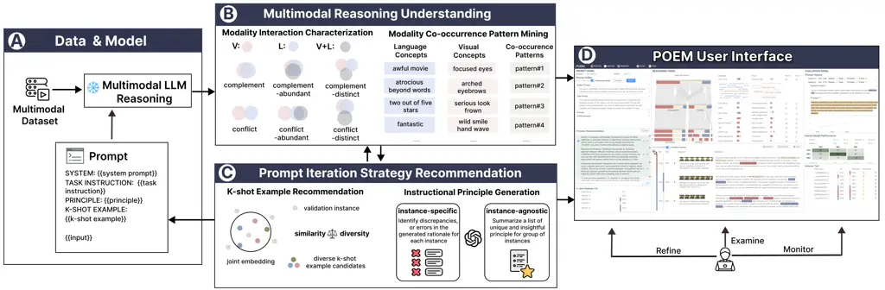
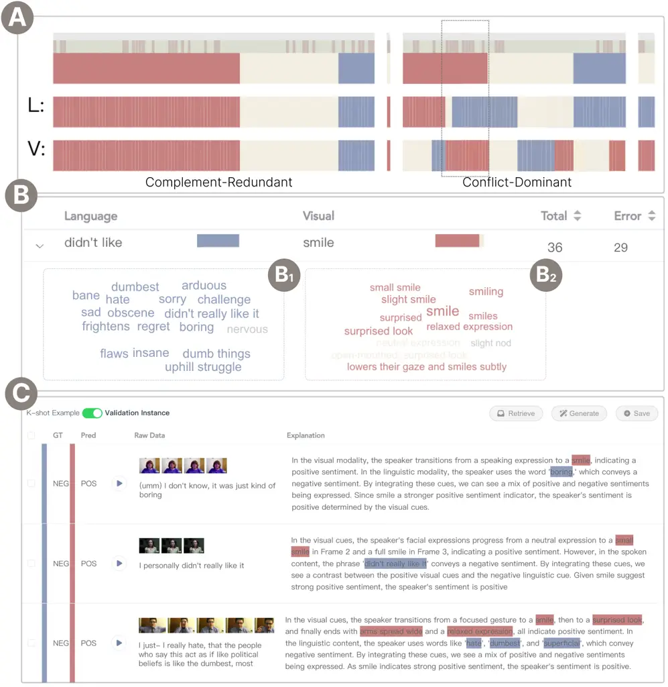
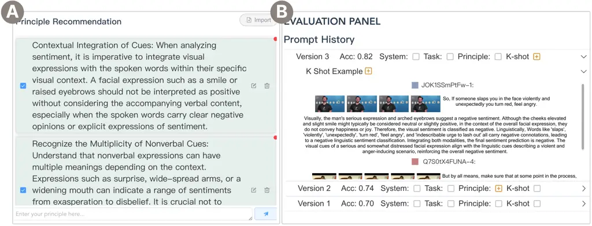
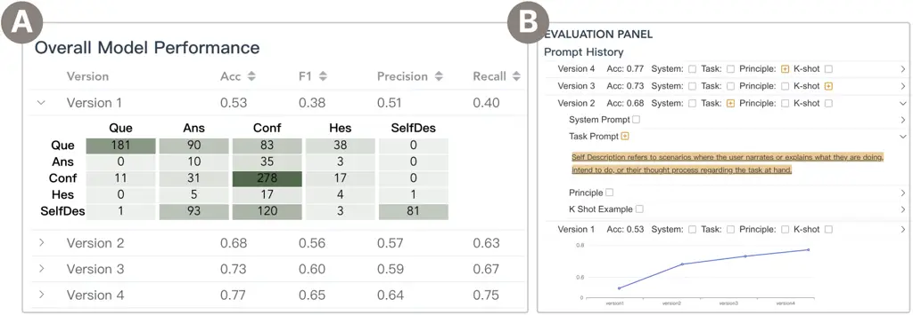
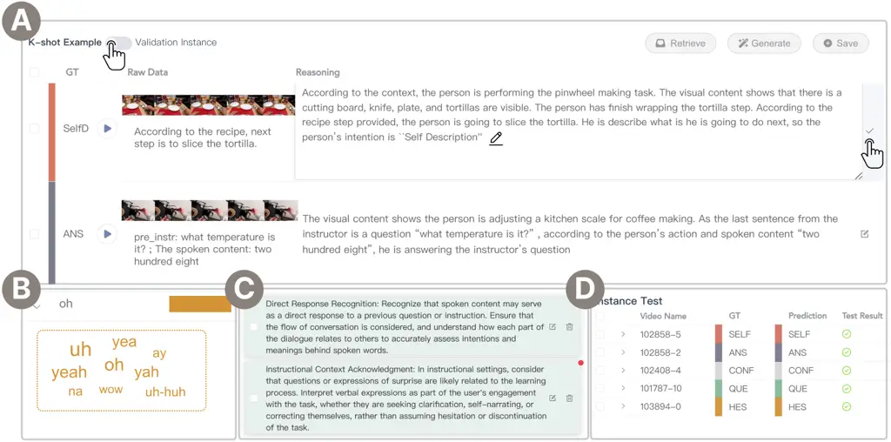

\authorfooter\teaser![[Uncaptioned
image]](arxiv-2406-03843v3--89f64d0187c9.figures/figure-1.webp)

The \nameinterface consists of three major panels. The Prompt Panel (A)
offers versatile operations for users to efficiently craft and edit
prompt content, such as importing various principles and demonstration
examples, to support an effortless prompt engineering experience. The
Reasoning Panel (B) facilitates a comprehensive multi-level
investigation of the model’s multimodal reasoning performance, ranging
from the global modality interaction level to the local instance level.
The Evaluation Panel (C) supports both global and local evaluation of
prompts, coupled with detailed documentation of modifications during
prompt iterations for continuous monitoring and comparison.

Introduction

# POEM: Interactive Prompt Optimization for Enhancing Multimodal Reasoning of Large Language Models

Jianben He    Xingbo Wang    Shiyi Liu    Guande Wu    Claudio Silva   
and Huamin Qu

###### Abstract

Large language models (LLMs) have exhibited impressive abilities for
multimodal content comprehension and reasoning with proper prompting in
zero- or few-shot settings. Despite the proliferation of interactive
systems developed to support prompt engineering for LLMs across various
tasks, most have primarily focused on textual or visual inputs, thus
neglecting the complex interplay between modalities within multimodal
inputs. This oversight hinders the development of effective prompts that
guide models’ multimodal reasoning processes by fully exploiting the
rich context provided by multiple modalities. In this paper, we present
\name, a visual analytics system to facilitate efficient prompt
engineering for steering the multimodal reasoning performance of LLMs.
The system enables users to explore the interaction patterns across
modalities at varying levels of detail for a comprehensive understanding
of the multimodal knowledge elicited by various prompts. Through diverse
recommendations of demonstration examples and instructional principles,
\namesupports users in iteratively crafting and refining prompts to
better align and enhance model knowledge with human insights. The
effectiveness and efficiency of our system are validated through two
case studies and interviews with experts.

###### keywords

prompt engineering, multimodal reasoning, multimodal large language
models

Large Language Models (LLMs), pre-trained on massive data with billions
of parameters, have become a cornerstone for natural language
processing. They encode extensive knowledge about the world in their
parameter space, exhibiting impressive capabilities in text
understanding, reasoning, and generation across various downstream tasks
\[8, 62\]. Building on the strength of LLMs, there are an increasing
number of works \[24, 70, 5, 15, 55, 55\] exploring their applications
in a wide spectrum of multimodal tasks (e.g., multimodal scene
understanding and question answering). By using text as the universal
representation, these works aim to leverage LLMs to integrate and
analyze knowledge distilled from diverse modalities (e.g., audio and
images) in text format and provide a holistic understanding of
multimodal content. These models are also known as multimodal LLMs \[65,
49\]. Comprehending multimodal content necessitates extensive multimodal
knowledge, where models not only need to understand the information
presented in each individual modality but also have to correctly infer
how the information combines to inform accurate reasoning \[63\].

Recently, prompting has emerged as a data-efficient and user-friendly
paradigm for steering and improving LLM’s performance on complex
reasoning tasks. Relying on extensive knowledge acquired during
pre-training, the models can instantly adapt to new downstream tasks in
the few-shot or even zero-shot settings without the need for model
retraining \[33\]. Moreover, the LLMs can be prompted to generate
free-text rationales emulating human thought processes in the
chain-of-thought (CoT) manner \[5\]. For example, they can provide
step-by-step derivations that lead to the final answer of a math problem
or substantiate their analysis process with supported evidence such as
emotive words for sentiment prediction \[73\]. These human-readable
rationales enhance the accuracy and transparency of the model’s
reasoning process \[39, 42\].

While multimodal LLMs exhibit remarkable performance in various tasks
with prompting, their reasoning performance is notably sensitive to
prompt variations. Moreover, inadequate or ill-designed prompts may
elicit erroneous knowledge, resulting in biased and unreliable
reasoning. Devising well-performing prompts that can guide and improve
the multimodal reasoning performance of LLMs remains a persistent
challenge. Prompting is inherently a process requiring expertise and
trial-and-error, where users need to meticulously craft prompts,
scrutinize the outputs to identify flaws requiring improvement, and
iteratively refine the prompts to reach the intended outcomes \[48,
12\]. During the process, users first face the challenge of
systematically understanding and examining the multimodal reasoning
performance of different prompts. Manually inspecting each instance is
not only time-consuming but also fails to provide a holistic
understanding. Therefore, summarizing and presenting generated
rationales at varying detail levels is non-trivial for users to fully
verify outputs and pinpoint problematic aspects. However, in the
multimodal context, the complex interplay among different modalities,
coupled with the unstructured and generative nature of free-text
rationales, makes interpreting multimodal LLMs’ reasoning process
particularly challenging. Furthermore, users also struggle to revise
their prompts in a way that effectively incorporates and elicits the
desired multimodal reasoning knowledge from the model \[21\].
Well-clarified task instructions (e.g., format, phrasing, and content)
and informative demonstration examples are both imperative for enabling
LLMs to grasp the intended input-output relationships and generate
consistent outputs with correct rationales \[43\]. Considering the huge
space of possible task instructions and the difficulty of selecting and
annotating demonstration examples from high-dimensional and
information-complex multimodal data, it is important yet challenging to
facilitate users to craft and refine prompts in an efficient manner.

To tackle the above challenges, we present \name, a visual analytics
approach designed to streamline the process of prompt engineering for
model practitioners, including model developers and model users, to
systematically probe and steer the multimodal reasoning performance of
LLMs for targeted downstream tasks. To build a comprehensive
understanding of LLMs’ knowledge and reasoning on multimodal tasks, we
develop computational methods to decompose and summarize cross-modal
interactions captured by LLMs in various levels of detail. At the
modality level, we adopt a three-layer augmented Sankey diagram to
contextualize model performance with complement and conflict
interactions between modalities. Then, drilling down into specific
interactions, we distill and summarize the linguistic and visual
evidence from individual instances to reflect model reasoning patterns.
These visualizations help align the model’s knowledge and reasoning
processes with the human understanding at scale. Based on the
multi-level model understanding, \name allows users to conduct both
top-down and bottom-up approaches to build and refine prompts that guide
LLM’s multimodal reasoning. Specifically, we employ an effective
sampling strategy for demonstration examples, ensuring a balance between
relevance and diversity to provide varied and informative input-output
mappings for inductive model learning. On the other side, drawing on
human innate capabilities for summarization and generalization, we
incorporate an LLM-assisted module that distills principles at both
instance-specific and agnostic levels. This approach facilitates users
to precisely articulate and apply their domain-specific knowledge and
expertise to guide the model deductively.

Our contributions are summarized as follows:

- •
  We propose an effective human-in-the-loop workflow that facilitates
  systematic investigation and guidance of the multimodal reasoning
  performance of LLMs.
- •
  We develop a visual analytics system \name, equipped with carefully
  designed visualizations and interactions to support efficient prompt
  engineering for multimodal reasoning tasks.
- •
  We conduct two case studies and expert interviews to demonstrate the
  usefulness and efficiency of \name.

## 1 Related works

The research studies related to the design of \name include prompt
engineering, multimodal reasoning, and visual analytics for model
understanding and steering.

### 1.1 Prompt Engineering

Equipped with extensive knowledge acquired during pre-training, LLMs
(e.g., GPT-\[8\] and LLaMA\[51\] series models) exhibit remarkable
adaptability to specialized downstream tasks such as question answering,
content retrieval, and complex reasoning, given precise instructions and
proper demonstration examples. This emerging paradigm, known as
prompting or prompt engineering, offers a user-friendly and
data-efficient way for non-expert users to interact and steer large
models. Prompting generally includes instruction-based and example-based
prompts \[4\]. Instruction-based prompts include system prompts that
provide general guidelines and task prompts that deliver direct and
task-specific instructions. Example-based prompts utilize a small set of
examples to showcase the desired input-output patterns for models to
follow. Numerous studies \[21, 69, 59\] have highlighted two major
challenges in prompting: the formulation of effective prompts, and the
assessment of prompt efficacy alongside strategies for enhancement.

Many studies have been conducted to address the prompting challenges.
Strobelt et al.introduced PromptIDE \[48\] as a tool for rapid
exploration and assessment of variations in prompt templates.
KnowledgeVis \[10\] compared multiple fill-in-the-blank prompts to probe
the input-output associations in BERT-based models. Beyond expediting
the wording and phrase structure refinement, ScatterShot \[59\] proposed
a slice-based sampling strategy to identify the most informative data
patterns for human annotation. PromptAid \[43\] combined multiple prompt
perturbation strategies to find satisfactory prompts for text
classification tasks. In addition, PromptChainer \[60\] and AI Chains
\[61\] have been developed to support more sophisticated tasks by
decomposing them into manageable sub-tasks, and supported prompt chain
prototyping and authoring to enhance controllability. Kimet al.proposed
EvaLM\[22\] for iterative prompt evaluation according to user-defined
criteria, while ContitutionMaker \[44\] converted users’ natural
language feedback into a principle for chatbot behavior customization.
Besides text-to-text generative tasks, several works facilitated prompt
refinement for text-to-image generation by keywords \[13\] and style
description recommendation \[7\], structured search of visual concepts
\[35\], and rubric-based adjustment for precise emotion expression
\[54\].

However, existing interactive prompt engineering systems are limited to
text-to-text or text-to-image generation tasks, failing to deal with the
complexity of multimodal inputs for more sophisticated reasoning tasks.
In this paper, we develop \nameto optimize the prompt engineering
process for adapting and steering the multimodal reasoning performance
of LLMs. \namefacilitates a comprehensive investigation of prompt
effects and provides diverse support for users to iterate prompts with
reduced cognitive burden and increased efficiency.

### 1.2 Multimodal Reasoning

Reasoning generally refers to the process of drawing on evidence to make
logical inferences based on existing knowledge for prediction and
decision-making \[49\]. In the multimodal context, it is imperative for
models to not only grasp evidence derived from single modalities but
also to comprehend how evidence from different modalities relates to
each other. This comprehension could lead to the generation of new
insights that the models must capture to achieve accurate reasoning.
Recently, LLMs have demonstrated the capability to generate coherent
rationales through Chain of Thought (CoT) prompting \[57\], where LLMs
provide the intermediate reasoning steps in natural language that lead
to the final answer \[73\]. These generated free-text rationales have
been increasingly explored for model interpretability, as they provide
an explicit and transparent way to communicate the decision-making
process of models to end-users in a human-like manner \[42\].

A growing number of benchmark datasets \[36, 68, 14\] have been proposed
to evaluate the capabilities of LLMs in multimodal reasoning tasks, with
a primary focus on visual content understanding like Visual Question
Answering ( i.e., answering text questions based solely on visual
content). However, the comprehension of how LLMs integrate and
coordinate information from various modalities (visual + language, or
additional modalities) in the given context for question answering and
reasoning remains under-explored. This includes tasks that necessitate a
nuanced understanding of multimodal contexts, such as multimodal scene
comprehension and multimodal sentiment analysis \[63\]. Moreover, the
metrics on these benchmarks fail to capture the detailed reasoning
process of models for in-depth model understanding and diagnosis.
Besides evaluation, many works \[37, 70, 46, 55\] have tried to steer
multimodal LLMs’ reasoning abilities. Compared with the labor-intensive
fine-tuning approaches involving curating specific datasets with
additional reasoning chain annotation, the training-free prompting-based
methods \[74, 71\] have become prevalent. However, these automatic
techniques fall short of providing fine-grained prompt evaluation and
flexible prompt refinement. Instead, we present a human-in-the-loop
approach where users can interactively examine, evaluate, and refine
prompts to guide and steer model performance in a more interpretable and
controllable manner.

### 1.3 Visual Analytics for model understanding and steering

Visual Analytics has proved to be an effective approach to help users
understand and steer machine learning models \[67, 62\]. Prior works
aimed to disclose the functionalities of neurons and layers of diverse
neural network models like RNNs \[41, 47, 17\]. Recently, many works
\[11, 25, 56, 18, 64, 20, 34\] have sought to elucidate the attention
mechanism to understand the inner workings of transformer-based models
in reasoning and decision-making process. Beyond visualizing model
internals, numerous studies \[58, 72, 52, 31, 9, 50, 26\] have tried to
probe model knowledge through analyzing post-hoc model behaviors with
input variations. For example, M2Lens \[52\] and MultiViz \[31\]
characterized intra- and inter-modal interactions with aggregated
feature importance for multimodal model diagnosis. The What-If Tool
\[58\] and SliceTeller \[72\] identified specific data slices to
understand model failures. Integrated tools \[50, 9, 26\] have also been
developed for unified language model evaluation.

Beyond mere understanding, recent works \[6, 19, 16, 53\] have
progressed to align model behavior with human knowledge, thereby
adapting and steering models to generate desired outcomes for specific
tasks. SharedInterest \[6\] designed quantitative metrics using saliency
methods to compare human and model reasoning for identifying recurring
model behavior patterns. Hoqueet al. \[19\] and Heet al. \[16\] employed
data programming concepts to inject human knowledge at scale for model
improvement. CommonsenseVis \[53\] constructed knowledge graphs with
external knowledge bases to contextualize model reasoning behaviors and
allow interactive model editing to enhance specific knowledge for poorly
behaved areas. Our work expands on these ideas to examine post-hoc model
behaviors with varied prompt inputs for comprehending how different
prompts affect model performance. It further enables model practitioners
to provide feedback and align model performance with their knowledge and
expertise through iterative prompting.

## 2 Design Requirements

Figure 1: The \namesystem framework comprises four primary modules. (A)
The visual and language modality information from the multimodal video
dataset is processed by expert models, which are then fused and fed into
multimodal LLMs. (B) The multimodal reasoning understanding module
summarized the nuanced modality interactions and patterns at global and
group levels. (C) The prompt iteration strategy recommendation panel
provides diverse support for prompt refinement with semi-automatic
k-shot example construction and instructional principle generation. (D)
The \nameinterface facilitates efficient prompt performance examination,
prompt refinement assistance, and prompt monitoring and comparison. sys

Our goal is to develop a visual analytics approach that streamlines
prompt engineering, empowering model practitioners to efficiently adapt
and steer the multimodal reasoning performance of LLMs for targeted
downstream tasks. By systematically understanding how models integrate
multimodal information for reasoning, users can evaluate and enhance
knowledge in underperforming areas through proper prompt design informed
by domain expertise. To better understand users’ requirements for system
design, we worked closely with four experts in NLP and multimodal
machine learning (E1-E4, E1 is the coauthor). E1 is a researcher
specializing in developing interactive systems for NLP and multimodal
model analysis. E2 is an industry researcher responsible for applying
and developing multimodal models for real-world applications. E3 and E4
are Ph.D. candidates with multiple top conference publications in the
areas of multimodal machine learning and multimodal LLMs.

All experts concurred that there is a lack of tools for systematically
analyzing the multimodal reasoning performance of LLMs. The current
practice typically begins with observing the model’s overall performance
metrics, followed by randomly sampling instances to examine reasoning
correctness. While few datasets \[36, 27\] provide expert-written
rationales as ground truth, the intricate interplay across modalities
and extensive variability in free-text expressions makes it challenging
to systematically understand the knowledge models use for reasoning and
pinpoint their weaknesses. Moreover, crafting and refining prompts to
effectively elicit the desired knowledge from models for specific tasks
often require labor-intensive and tedious prompt iterations.
Consequently, an integrated tool is desired to facilitate systematic
investigation of model behaviors at various levels and support
well-informed prompt iterations with less cognitive effort. The design
requirements are summarized as follows:

1.  R1
    Summarize the impact of prompts on multimodal reasoning performance
    across varying levels of detail When evaluating the reasoning
    performance of different prompts, users focus not only on overall
    statistics but also on how well the model’s reasoning aligns with
    established knowledge at group and instance level. Therefore, it is
    crucial for the system to support multi-level and multi-faceted
    investigation of the model’s multimodal reasoning performance.
    Initially, the system should present a global overview of model
    performance. As E1 noted, “understanding how different modalities
    interact is crucial for interpreting the model’s behavior in the
    context of multimodal reasoning.” Users need to recognize the
    modalities the model relies on for its decisions and how the model
    behaves when different modalities present complementary or
    contradictory information. After gaining a global understanding,
    users also need insights into how evidence from distinct modalities
    and their combinations influence the model. For example, E3
    expressed interest in identifying which types of visual cues or
    spoken words the model interprets as key indicators during
    reasoning. Besides, users need to inspect the model’s output at the
    instance level to intuitively understand and verify the alignment of
    rationales with the original data.
2.  R2
    Provide comparative analysis of different prompt performance
    Multiple aspects of prompts influence model reasoning performance,
    including the structure and content of task-specific instructions,
    as well as the choice and order of demonstration examples.
    Navigating and exploring the evolving dynamics of prompts is
    necessary for users to “identify influential factors for
    improvement”, as E2 commented. Therefore, it is imperative for the
    system to document prompt alternations, support streamlined prompt
    testing, and assist users in tracking and comparing the effects of
    diverse prompt modifications throughout the refinement process. This
    process facilitates an understanding of how different modifications
    impact model reasoning performance, thereby offering valuable
    insights for users to provide appropriate feedback and make informed
    decisions regarding subsequent iterations.
3.  R3
    Facilitate effective prompt refinement in diverse and efficient
    manner After pinpointing areas of underperformance, users can align
    and elicit model knowledge through refining prompts. This refinement
    includes providing more precise task and scenario descriptions,
    clear outlining principles for the model to follow, and
    supplementing with informative demonstration examples that help the
    model grasp the intended relationships. However, given the vast
    range of potential feedback options, it imposes a huge cognitive
    burden on users to manually revise task articulation, formulate
    principles from scratch, and source the most informative examples
    for learning. Furthermore, since the feedback users intend to
    provide often stems from their intuition and expertise, encompassing
    both inductive and deductive reasoning \[44\], the system ought to
    assist in translating these intuitive insights into concrete prompt
    content in an efficient and user-friendly manner. For instance, E4
    suggested providing diverse prompt templates for easy selection. E1
    emphasized the need for a feature that converts users’ fragmented
    feedback into systematic principles for the model to follow, while
    E3 highlighted the importance of automatically sourcing informative
    examples to provide high-quality rationales for knowledge alignment.

## 3 System & Methods

We designed \namebased on the distilled design requirements in
Section 2. In this section, we first introduce the overall system
framework. Then we illustrate the methods for data processing,
multimodal rationale understanding, and prompt iteration strategy
recommendation.

### 3.1 System Framework

Figure 1 demonstrates the overarching workflow of the system. The
multimodal video dataset, processed into image frames (visual modality)
with spoken narratives (language modality), along with the prompt,
serves as input for the multimodal LLM. The multimodal LLM then performs
reasoning and generates free-text answers for each input instance.
(Fig. 1A). Subsequently, the Multimodal Reasoning Understanding module
(Fig. 1B) provides a multi-level analysis of the generated free-text
answers for a systematic understanding of the model’s reasoning
behavior. Initially, it characterizes different interaction types
between modalities. Then, a multimodal reasoning pattern mining
algorithm is employed to identify intricate and fine-grained reasoning
patterns. Concurrently, the Prompt Iteration Strategy Recommendation
module (Fig. 1C) offers varied support, including bottom-up k-shot
example recommendations that balance similarity and diversity, and
top-down instructional principle summarization at both instance-specific
and agnostics levels aided by an auxiliary LLM. This module is designed
to facilitate efficient prompt refinement, aiming to elicit and enhance
specific knowledge to guide and improve model performance

In the \nameinterface (Fig. 1D), users have the option to either input
their own prompts or choose from available templates in the Prompt
Panel. Subsequently, they can inspect the model’s multimodal reasoning
performance from different levels of detail. Specifically, at a global
level, users can inspect the model’s overall performance in the
Evaluation Panel and the interaction between and within modalities in
the Reasoning Panel. At the group level, users are able to scrutinize
the model’s reasoning patterns concerning different concepts spanning
across modalities. At the instance level, users can examine individual
instances in detail for verification. Users can then revise and
incorporate principles and/or k-shot examples into prompts based on
automatic recommendations and insights obtained from the current model
and prompt performance examinations. The refined prompt can then be sent
to the model for evaluation in the Prompt Panel. In the Evaluation
Panel, users can evaluate and compare the effect of each prompt
iteration on both global model performance and individual instances.
Additionally, they can monitor and track detailed changes across various
prompt versions and iteratively refine the prompt to achieve
satisfactory multimodal reasoning performance.

### 3.2 Dataset and Model

We demonstrate the effectiveness of our system on two different datasets
for multimodal content comprehension tasks: CMU-MOSEI \[2\] for
multimodal sentiment analysis, and WTaG \[3\] for user intent
understanding. The CMU-MOSEI \[2\] dataset consists of monologue video
clips in which speakers express their sentiments about a specific topic.
The WTaG dataset \[3\] comprises egocentric video clips of users
performing cooking tasks under the guidance of an instructor within an
augmented reality setting. The videos within both datasets contain
information from two primary modalities: the language modality,
represented by spoken content, and the visual modality, characterized by
the scenes and user behaviors depicted in the videos. Both datasets
include ground-truth labels for evaluation. Following the practice in
prior works \[43, 59\], we split each dataset into three subsets: a
validation set, a demonstration example set, and a test set. In the
splitting process, we ensure that the label distribution remains
consistent across these subsets. The validation set serves the purpose
of prompt iteration evaluation. The demonstration example set
facilitates the construction of k-shot examples, and the test set
provides additional instances beyond the validation set for a more
comprehensive assessment of prompt efficacy. The size of the validation
set needs to be moderate so that users can get timely feedback during
the prompt iteration while also covering diverse data patterns for
comprehensive model reasoning performance diagnosis. Based on our
preliminary experiment, we maintain a distribution ratio of 1:2:1 for
the validation, demonstration, and test sets, respectively. We also
implemented batch processing to improve the system’s response speed.

Regarding the model setting, we employ the LLaVA \[32\] and
GPT-4V(ision) ¹¹ 1 https://openai.com/index/gpt-4v-system-card/ model to
perform multimodal reasoning considering their strong reasoning and
instruction-following abilities. We specifically utilize the
“llava-v1.5-13b” and “gpt-4-vision-preview” version. It’s important to
note that our approach is designed to be model-agnostic, meaning other
multimodal LLMs that support multimodal content reasoning, such as
Gemini ²² 2 https://deepmind.google/technologies/gemini/ and LLaMA
series \[51\], can be easily integrated into the system. For each video
clip, we followed the commonly adopted practice \[14, 63\], sampling
frames per second to compose an image sequence from the visual modality,
which is then combined with the corresponding spoken content from the
language modality as input of the multimodal LLM.

The input prompt for the multimodal LLM reasoning follows the general
prompt structure $`(I,\left\{x_{i},y_{i}\right\}_{i=1}^{k},x_{t})`$
\[22, 57, 60\]. Here, $`I`$ is the task-specific instructions
elaborating on the targeted scenarios, tasks to be finished, and
expected output structure (e.g., return your answer in a JSON object).
To propel the LLM to perform CoT reasoning, The prompt could include
instructions like “Please provide a step-by-step analysis”.
$`\left\{x_{i},y_{i}\right\}_{i=1}^{k}`$ is the demonstration example
set. Each demonstration example includes input $`x_{i}`$ and output
$`y_{i}`$, where $`x_{i}`$ follows the same format as the validation set
and $`y_{i}`$ includes the correct rational and final answer as provided
by the ground-truth labels. We also support the zero-shot setting where
demonstration examples are not provided. Finally, for each test input
$`x_{t}`$, the LLM is expected to generate the output $`y_{t}`$,
containing a free-text rationale and a final answer.

### 3.3 Multimodal Rationale Understanding

#### 3.3.1 Modality Interaction Characterization

Understanding how multimodal models utilize information from distinct
modalities and integrate it to make cross-modal inferences is crucial
for gaining insight into the model’s reasoning performance. Several
works \[52, 31\] have tried to characterize the interaction between
different modalities based on aggregated feature attribution values
\[45, 38\]. There are also works \[28, 29, 30, 66\] trying to quantify
the degree of interactions between modalities with a partial information
decomposition framework. Building on the foundation of these works, we
characterize the modality interaction in the context of our targeted
multimodal reasoning tasks as follows:

Considering the labeled multimodal dataset with two modality
$`\mathcal{X}_{1}`$ and $`\mathcal{X}_{2}`$, the unimodal data
$`\mathcal{D}_{i}=\left\{\left(x_{i},y\right):\mathcal{X}_{i}\times\mathcal{Y}\right\}`$
where $`i\in\{1,2\}`$ , and the multimodal data
$`\mathcal{D}_{M}=\left\{\left(x_{1},x_{2},y\right):\mathcal{X}_{1}\times\mathcal{X}_{2}\times\mathcal{Y}\right\}`$.
When performing chain-of-thought reasoning, for each input data point,
the output of the multimodal LLM includes a free-text rationale and a
final answer. Here, we denote the sample space where the multimodal LLM
performs reasoning using information from a single modality as
$`f_{i}:\mathcal{X}_{i}\rightarrow\Delta\mathcal{Y}_{i}`$ and the sample
space where the multimodal LLM performs reasoning with information from
both modalities as
$`f_{M}:\mathcal{X}_{1}\times\mathcal{X}_{2}\rightarrow\Delta\mathcal{Y}_{M}`$.
where $`\Delta\mathcal{Y}`$ denotes the probability simplex of final
output answer. For $`f_{a}`$ and $`f_{b}`$ where $`a,b\in\{1,2,M\}`$,
The distance function can be defined as
$`d\left(f_{a},f_{b}\right)=\left\|\Delta_{a}-\Delta_{b}\right\|`$ to
measure the distance between $`f_{a}`$ and $`f_{b}`$. Based on the
distance function, we can define two basic interaction types between two
modalities. When $`d\left(f_{1},f_{2}\right)<\theta`$, where $`\theta`$
is a pre-defined threshold, the interaction type is complement,
indicating these two modalities contribute to the final answer in the
same direction. Conversely, when $`d\left(f_{1},f_{2}\right)>\theta`$,
the interaction type is conflict, indicating these two modalities
provide discrepant information for reasoning. By further considering how
the final answer will change when analyzing information from each
modality independently, and combining information from two modalities
jointly for reasoning, i.e., the distance function
$`d\left(f_{1},f_{M}\right)`$ and $`d\left(f_{2},f_{M}\right)`$, we can
define subdivided interaction type \[28, 30\] as shown in Figure 1B:

- •
  Complement-Redundant: when $`f_{M}`$ aligns with $`f_{1}`$ and
  $`f_{2}`$, where $`d\left(f_{1},f_{M}\right)<\theta`$, and
  $`d\left(f_{2},f_{M}\right)<\theta`$
- •
  Complement-Distinct: when $`f_{M}`$ distinct from $`f_{1}`$ and
  $`f_{2}`$, where $`d\left(f_{1},f_{M}\right)>\theta`$, and
  $`d\left(f_{2},f_{M}\right)>\theta`$
- •
  Conflict-Dominant: when $`f_{M}`$ aligns with $`f_{1}`$ or $`f_{2}`$,
  where $`d\left(f_{1},f_{M}\right)<\theta`$ and
  $`d\left(f_{2},f_{M}\right)>\theta`$ or switch the $`f_{1}`$ and
  $`f_{2}`$
- •
  Conflict-Distinct: when $`f_{M}`$ distinct from $`f_{1}`$ or
  $`f_{2}`$, where $`d\left(f_{1},f_{M}\right)<\theta`$, and
  $`d\left(f_{2},f_{M}\right)<\theta`$

In this paper, we primarily focus on the visual and language modalities,
which are the main subjects of investigation in current multimodal LLM
research. For more modalities, the interaction characterization
framework can be extended by pairwise comparison.

#### 3.3.2 Multimodal Reasoning Pattern Mining

Upon gaining insight into the model’s reasoning process at the modality
interaction level, it becomes crucial to identify the specific concepts
or their combinations within and across individual modalities the model
utilizes for reasoning. As shown in Fig. 1B, we parse the generated
rationale into a list of intermediate evidence along with their
associated inferences that contribute to the final answer. For example,
within a free-text rationale generated by the LLM, “The serious
expression suggests a neutral sentiment, while in the spoken content,
the phrase ’incredible command’ conveys a positive sentiment. The visual
evidence “serious expression” infers “neutral” sentiment and the
language evidence “incredible command” implies “positive” sentiment.
Given the LLM’s generative characteristics resulting in the variability
of evidence across different rationales, we employed the
text-embedding-3-small³³ 3
https://platform.openai.com/docs/guides/embeddings model to calculate
embeddings for all extracted evidence (e.g., ”serious expression” and
”incredible command” et al). Subsequently, we utilized the HDBSCAN
algorithm \[40\] to cluster visual and language evidence respectively.
We identified the evidence located closest to the cluster’s centroid as
the representative concept for each cluster. Subsequently, we utilized
the Apriori \[1\] algorithm to identify frequent patterns of concept
co-occurrence within and across different modalities in the generated
rationales for validation set. This approach enables users to conduct a
more structured and comprehensive analysis of the patterns within the
generated rationales, allowing them to identify potential recurring
biases or errors made by the model.

### 3.4 Prompt Iteration Strategy Recommendation

As mentioned in Section 1, the content and phrasing of task
instructions, along with the choice of demonstration examples, can
greatly influence the model’s reasoning performance. Our preliminary
experiment and expert interview results suggested that the instruction
content (e.g., task specifications) and the choice of demonstration
examples exert a more pronounced effect on model performance than the
precise wording used for our targeted multimodal reasoning tasks.
Therefore, in this paper, we mainly focus on facilitating users in
instruction content refinement and demonstration example construction.

#### 3.4.1 K-shot Example Recommendation

Few-shot prompting has been a data-efficient strategy to adapt LLMs for
specific downstream tasks using merely a handful of illustrative
input-output pairs. However, the effectiveness heavily relies on the
choice of examples to inform the model about the desired mapping \[59,
21\]. Identifying informative examples for effectively guiding the model
can be challenging for users. Moreover, beyond simply pairing inputs
with final answers, reasoning necessitates providing a rationale for
each example, which is equally difficult for users to craft on their
own.

To enhance the efficiency of sourcing the demonstration example set, we
first employed the k-nearest neighbors algorithm to sample the candidate
k-shot example set considering both relevancy and diversity. For each
instance in both the validation set and demonstration example sets, we
computed embeddings for the visual (images) and language (text
transcript) modalities separately and then concatenated these embeddings
to represent each instance. Specifically, we utilized the pre-trained
CLIP⁴⁴ 4 https://huggingface.co/sentence-transformers/clip-ViT-B-16
model, which maps text and images to a shared vector space for embedding
computation. Further details are provided in the supplementary material.
For each validation instance, we identified its k-nearest neighbors as
potential candidates based on their embedding cosine similarity. These
candidates were then ranked in descending order of similarity. To select
the final k-shot examples, we prioritized both ranking and label
diversity, ensuring the inclusion of all possible labels in the final
set to prevent model bias. To streamline the process of crafting
rationales for users, we integrated the gpt-4-turbo model ⁵⁵ 5
https://platform.openai.com/docs/models/gpt-4-turbo-and-gpt-4 to
automatically generate structured rationales for each demonstration
example based on its ground truth labels. This approach offers users a
preliminary basis for refinement, sparing them the need to begin from
scratch. Furthermore, we utilized the refinements operated by users to
iteratively enhance the quality of the generated rationales. These
demonstration examples are then combined into the
sequence$`\left\{x_{i},y_{i}\right\}_{i=1}^{k}`$ for inclusion in the
prompt, where $`y_{i}`$ is the rationale and final answer provided by
users for $`x_{i}`$ (Figure 1C).

#### 3.4.2 Instructional Principle Generation

While k-shot examples aim to inductively teach the model the correct
mappings between input-output pairs, providing explicit principles
regarding proper practices or clarifying potential errors has also
proven to be an effective strategy for drawing out desired knowledge and
guiding model performance \[71, 44\]. Humans generally formulate
principles in two ways. One involves directly leveraging their existing
knowledge. For example, the principle for identifying sarcasm could be
to “pay attention to the inconsistency between a word’s literal
interpretation and its contextual meaning.” The other is that
individuals derive lessons from specific instances and subsequently
aggregate these instance-level insights into higher-level principles in
a bottom-up manner. However, users may find it difficult to immediately
generate principles from scratch, derive insights by manually examining
instances one at a time, and fully articulate their principles
considering the complexity of multimodal reasoning. For this purpose, we
employed an auxiliary LLM to facilitate the summarization and
recommendation of principles. We selected the gpt-4-turbo model for its
strong capabilities in text understanding and summarization, and it can
be replaced by more advanced models in the future.

Specifically, we instructed the gpt-4-turbo model to produce principles
at both instance-specific and instance-agnostic levels (Figure 1C). At
the instance-specific level, the model is tasked with analyzing
discrepancies between generated reasoning and ground truth answers for
each instance, summarizing potential error causes, and further deriving
principles to avoid similar mistakes. At the instance-agnostic level, We
instruct the model to condense the generated instance-specific
principles into more generic principles tailored to the specific
targeted task. It is important to acknowledge that the generated
principles may not always be accurate and should not be treated as
golden rules. Their primary purpose is to provoke thought and inspire
users to conceive new ideas or enhance existing ones rather than
initiate from zero. Thus, users are empowered to either input and create
their principles or choose to amend and revise principles that have
already been generated according to their preferences. Details regarding
the prompt used for principle generation are provided in the
supplementary material.

## 4 Interface Design

The \nameinterface (POEM: Interactive Prompt Optimization for Enhancing
Multimodal Reasoning of Large Language Models) consists of three
coordinated views to assist users in seamlessly evaluating the impact of
different prompts, refining prompts through semi-automatic suggestions,
and conducting iterative testing of prompts. In this section, we
introduce the design of each view and the interactions that connect them
in detail.

### 4.1 Prompt Panel

The Prompt Panel (POEM: Interactive Prompt Optimization for Enhancing
Multimodal Reasoning of Large Language ModelsA) provides flexible prompt
operations to support smooth prompt engineering experience (R3). Upon
selecting the dataset and model, users can craft the prompt on their own
or initiate by selecting from a list of prompt templates collected from
state-of-the-art benchmarks \[63, 14\] in the Prompt Editor (POEM:
Interactive Prompt Optimization for Enhancing Multimodal Reasoning of
Large Language ModelsA-1). The prompt is organized into distinct
sections, as introduced in Section 3.2, to facilitate a clear and
straightforward editing experience. Users can also switch to the plain
text editing mode for editing and format checking before submission. The
Principle Recommendation view (POEM: Interactive Prompt Optimization for
Enhancing Multimodal Reasoning of Large Language ModelsA-2) displays an
organized summary of principles for user validation. The generated
instance-specific and agnostic principles are differentiated by
background colors: gray for instance-specific principles and green for
instance-agnostic principles. Newly generated principles are marked with
red dots at the top right for highlighting. Users can modify any
existing principle by utilizing the editing function or articulate their
principles via the principle input box. Furthermore, users are allowed
to delete any principles deemed inappropriate or redundant.
Subsequently, upon selecting the desired principles, users can integrate
them into the current prompt within the prompt editor by clicking the
“Import ![[Uncaptioned
image]](arxiv-2406-03843v3--89f64d0187c9.figures/figure-3.webp) ”
button. The K-shot Example List (POEM: Interactive Prompt Optimization
for Enhancing Multimodal Reasoning of Large Language ModelsA-3) below
provides a concise summary of K-shot examples with user-annotated
rationales, waiting for further editing or inclusion into the prompt.

### 4.2 Reasoning Panel

The Reasoning Panel (POEM: Interactive Prompt Optimization for Enhancing
Multimodal Reasoning of Large Language ModelsB) facilitates a thorough
investigation of the model’s multimodal reasoning behaviors, from global
and sub-group patterns down to specific individual instances (R1).

A three-layer Sankey diagram-based design (POEM: Interactive Prompt
Optimization for Enhancing Multimodal Reasoning of Large Language
ModelsB-1) is adopted to portray interactions among modalities at the
global level. The first layer demonstrates the overall distribution of
prediction classes and errors with two vertically stacked barcode
charts. The horizontal length encodes the number of instances, and the
color encodes the corresponding class and error. Instances belonging to
the same class are positioned close together to enable easy exploration
both within and between classes. The second intermediate layer
summarizes the conflict and complement relationship between visual and
language modalities and adopts the same encoding as the first layer. The
third layer delves into the fine-grained four types of modality
interactions. While retaining the same visual encoding for the
prediction class and error distribution in each interaction type, this
layer introduces two additional barcode charts to delineate the
prediction result of the single visual and language modality, thus
illustrating the detailed distributions of the two modalities across
various types of interactions. Besides, two adjacent layers are
interconnected through flows, the width of which is proportional to the
number of instances they encompass. Hovering over the flows will
highlight the related instances across all three layers. Users can also
brush the barcode chart in each layer to select an interested group of
instances for further investigation. The selected instances will be
highlighted with a grey background. The corresponding mined patterns and
instances will be displayed on the right and below respectively.

After selecting the interested group of instances, the multimodal
reasoning pattern mining algorithm in Section 3.3 is applied, with the
extracted patterns displayed in the table on the right (POEM:
Interactive Prompt Optimization for Enhancing Multimodal Reasoning of
Large Language ModelsB-2). Each row exhibits one distinct pattern with
its representative visual and language concepts, support (i.e.,
contained instance numbers), and error statistics. They can sort and
filter the patterns based on these statistics by clicking on the
corresponding column. The representative language and visual concepts
are shown for intuitive pattern understanding by users. Adjacent to each
concept, a stacked bar chart presents the distribution of its associated
class. Users can expand each row to view the detailed distribution of
evidence in a word cloud, where each phrase’s size represents its
frequency of occurrence and its color denotes the proportion of
associated classes. Users can select patterns or evidence of interest by
clicking, and the corresponding instances will be displayed in the
instance view below.

The instance view below (POEM: Interactive Prompt Optimization for
Enhancing Multimodal Reasoning of Large Language ModelsB-3) is designed
to expedite the examination and verification of individual instances by
showcasing the original multimodal video content along with its detailed
reasoning. The raw data column exhibits the video’s keyframe image
sequence and spoken content to enable quick visual and language content
digestion and validation. Users can hover over these frames for an
enlarged view and playback the original video for rapid verification.
Subsequent columns present the ground truth labels, the model’s
predictions, and the generated free-text rationales. To enhance
readability and quick text comprehension, evidence is highlighted with
the corresponding color of its associated class. The ground truth and
prediction columns are also colored for easy comparison. Users can
select instances for principle generation by clicking the “Generate ”
button, after which the generated principles will be listed in the
Principle Recommendation view. In addition to displaying selected
validation instances for review, users can toggle to the K-shot Example
Mode( Figure 5A). Within this mode, the interface presents the ranked
list of k-shot examples recommended by the proposed sampling strategy in
Section 3.4. For each example, the interface details its raw data (i.e.,
keyframe sequence and spoken narratives in the raw video), its ground
truth, and the rationales. Users can modify the content in the
corresponding column directly to provide high-quality rationales.
Moreover, users can source more k-shot examples by clicking the
“Retrieve ” button and save the selected ones to the K-shot Example List
with the “Save ” button.

### 4.3 Evaluation Panel

The Evaluation Panel (POEM: Interactive Prompt Optimization for
Enhancing Multimodal Reasoning of Large Language ModelsC) offers
comprehensive insights into both global and local performance of
prompts, along with the prompt iteration history for efficient
monitoring and comparison of prompt performance (R2).

The Prompt History view (POEM: Interactive Prompt Optimization for
Enhancing Multimodal Reasoning of Large Language ModelsC-1) archives
previous prompts regarding their content and performance. Each row
represents a prompt version with its accuracy and modifications are
summarized using intuitive icons. This design enables users to easily
compare performance and trace alterations in different sections of the
prompts. Users can expand and collapse each row for a hierarchical
examination of modifications within each prompt section. Detailed
additions and deletions in the content are distinctly marked and
highlighted through varied colors and line styles. The line chart below
shows the model accuracy change. The Overall Model Performance view
(POEM: Interactive Prompt Optimization for Enhancing Multimodal
Reasoning of Large Language ModelsC-2) records the global performance
statistics of each prompt iteration. Users can expand each row to
inspect the detailed confusion matrix. The Instance Test view (POEM:
Interactive Prompt Optimization for Enhancing Multimodal Reasoning of
Large Language ModelsC-3) exhibits the performance of prompts on
individual instances that are of particular interest to users. Users can
select instances from Reasoning Panel and save them to observe their
performance change during prompt iterations with the “Save ” button.
They can also source additional unseen test instances with the “Retrieve
” function.

## 5 Evaluation

In this section, we showcase the efficacy and efficiency of \namevia two
case studies and feedback gathered from expert interviews. The primary
objective of the two case studies is to help users obtain
well-performing prompts utilizing their domain expertise and knowledge
to guide LLM’s multimodal reasoning performance with minimal effort.

### 5.1 Case One: Improving multimodal sentiment reasoning with CMU-MOSEI dataset

E5, a sentiment analysis expert, seeks to generate effective prompts for
steering LLM’s multimodal sentiment reasoning performance with the
CMU-MOSEI dataset. The LLM is tasked with interpreting the speakers’
verbal and visual signals to determine their sentiment as “positive”,
“negative”, or “neutral”.

After loading the dataset and model, E5 initially selected and submitted
a provided prompt template in the Prompt Panel to evaluate its
performance (R2), which yielded an accuracy of 70%. To gain an overview
of the interactions between the visual and language modalities in the
LLM’s reasoning process (R1), E5 began by examining the Sankey diagram
in the Reasoning Panel. Through observing the length and error
distribution of the barcode charts in the first and second layers, E5
noticed that the model tended to interpret sentiments as “neutral” or
“positive” rather than “negative”. Furthermore, in a large proportion of
instances, the visual and language modalities provided complementary
information, while in others, they presented conflicting information
with increased errors. E5 was particularly interested in how the LLM
reasoned in scenarios where the two modalities presented conflicting
information and how errors occurred. So, she explored the third layer
for a more fine-grained examination. At the third layer, she identified
a dense cluster of errors within the conflict-dominant relationship
(Fig. 2A), where the visual modality implied a positive influence, while
the language modality suggested a negative one. The ultimate combined
effect was positive, indicating that the visual modality dominated the
reasoning process.

Following this, E5 brushed this group of instances to further inspect
their contained reasoning patterns in the table on the right. When going
through the patterns sorted in descending order of error rate, E5
discovered the combination of the language concept “didn’t like” with
the visual concept “smile” yielded high error rates (Fig. 2B). The
adjacent bar charts, predominantly colored in blue for “didn’t like” and
red for “smile”, indicated that the LLM consistently interpreted
language evidence concluded with “didn’t like” as a negative signal and
visual evidence featuring “smile” as positive during the reasoning
process. She further explored this pattern by unfolding the row, where
evidence under the language concept “didn’t like” included phrases like
“arduous”, “boring”, and “hate” highlighted in blue (Fig. 2B-1), while
the visual concept “smile” comprised instances such as “small smile”,
“slight smile”, and “smiling” marked in red (Fig. 2B-2). E5 thought
these inferences for each modality reasonable but wondered how the
correctly deduced evidence led to the final error. Therefore, she
proceeded to inspect the detailed reasonings of individual instances
exhibiting this pattern in the instance view below (Fig. 2C). Upon
examining the raw data and the rationales generated by the LLM, E5
figured out that the model correctly reasoned about individual modality,
as in these instances, the speakers had explicitly stated their negative
opinions verbally while showing mild positive facial expressions like
gentle smiles. However, the LLM was biased by the positive visual cues,
allowing them to overshadow and dominate its reasoning, despite the
explicit negative sentiment conveyed through language.

Figure 2: (A) Identified dense error areas in conflict-dominant modality
interaction. (B) The multimodal pattern “didn’t like” and “smile” and
their associated evidence group. (C) The error cases where “smile”
predominated and biased the reasoning process.

Following this discovery, E5 decided to derive principles from these
erroneous cases to guide the LLM toward correct reasoning in this
situation (R3). Therefore, E5 selected these instances and clicked the
“Generate ” button to generate principles. She also saved these
instances of interest to the right test panel for further validation. In
the Principle Recommendation View, E5 reviewed the generated principles
and identified well-articulated general principles that underscored the
importance of interpreting visual cues alongside the corresponding
verbal content with careful consideration of specific context (Fig. 3A).
To ensure generalizability and avoid introducing new bias, E5 revised
the last sentence as “It is crucial to avoid overemphasizing one
modality over another when the latter carries clear indications of
opinions or explicit expressions of sentiment.” Then, E5 imported this
principle into the prompt editor and submitted it for testing. In the
Model Performance View, she found a slight improvement in the overall
accuracy from 70% to 74%. Meanwhile, in the Test Panel View, she checked
the performance of the new prompt on previously saved instances, the
majority of which were now correctly reasoned (POEM: Interactive Prompt
Optimization for Enhancing Multimodal Reasoning of Large Language
ModelsC). This indicated that the incorporated principle had effectively
guided the LLM to use the correct knowledge for reasoning in this
scenario.

Subsequently, E5 sought to enhance the model’s reasoning stability and
its ability to recognize varied patterns in sentiment analysis by
incorporating some k-shot examples (R3). Thus, she switched to K-shot
Example Mode, where recommended K-shot examples with reasonings crafted
by the auxiliary LLM were listed. E5 selected the top three instances
spanning distinct classes and refined the provided reasoning leveraging
his knowledge and expertise. Upon completing the rationale annotations,
E5 appended these examples to the K-shot example list on the left side
and imported them into the prompt. After running the test, the overall
accuracy increased to 82% (Fig. 3B).

Figure 3: (A) The recommended principles for alleviating errors in case
one. (B) The recorded prompt iteration history in case one.

### 5.2 Case Two: Enhancing Multimodal User Intention Understanding with WTaG dataset

E6 is an engineer tasked with building an intelligent virtual assistant
to help users perform complex tasks within augmented reality
environments. Building such an assistant necessitates comprehending user
intentions. E6 thus wanted to steer the GPT-4V(ision) model using
\nameto finish this task. E6 experimented with the WTaG dataset \[3\],
where the video clips were recorded from the user’s egocentric
perspective. These clips included user-instructor dialogues captured by
microphones and visual context encompassing the scene and user behaviors
from head-mounted cameras. The multimodal LLM needs to deduce the user’s
intention based on this multimodal context and categorize it into one of
five classes: “Question”, “Answer”, “Confirmation”, “Hesitation” and
“Self Description”.

After initializing the dataset and model, E6 first chose to use the
prompt provided in the original dataset repository for validation (R2).
The Evaluation Panel revealed that this prompt achieved only 53%
accuracy in a zero-shot setting. While this result is higher than what
was reported in the paper using gpt-3.5-turbo model \[3\], it is still
insufficient for the task. E6 next examined the confusion matrix and
noticed that the model’s predictions were heavily biased towards the “
Confirmation” and “Answer” classes ( Figure 2A). Upon randomly
inspecting the model-generated rationales alongside the raw data
incorrectly classified in the Reasoning Panel, E6 observed that while
the model could adequately describe and analyze both visual and spoken
content, it struggled to comprehend the meaning of designated prediction
classes, especially “Self Description.” This resulted in scarce
predictions for this class and a bias towards more familiar classes such
as “Confirmation” and “Answer”.

Figure 4: (A) The confusion matrix showing the model’s prediction bias
towards the “Confirmation” and “Answer” classes. (B) The recorded prompt
iteration history in case two.

To address this problem, E6 decided to include more explicit rationales
of each prediction class within the prompt instructions to guide the
model. (R3). Thus, he revised the prompt to add the clarification such
as “Self Description refers to scenarios where the user narrates or
explains what they are doing, intend to do, or their thought process
regarding the task at hand.” While submitting this prompt for testing,
E6 also thought that, besides providing explicit rationales, he could
also include concrete k-shot examples to help the model learn (R3). He
navigated to the K-shot Example Mode in the Reasoning Panel and selected
five K-shot examples, each representing a distinct class from the top
recommended ones (Fig. 5A). E6 also noticed that the rationales
generated by the more advanced auxiliary LLM also contained errors for
the “Self Description” class, indicating that this category might be
challenging for LLMs to grasp and reason about, underscoring the need
for providing additional guidance in the prompt. Following the
refinement of rationales for the k-shot examples, E6 imported these
annotated examples and submitted this prompt version for testing. E6
then examined the updated test outcomes in the Evaluation Panel (R2).
The increased performance statistics proved that providing either
explicit explanations or k-shot examples can help improve the LLM’s
reasoning performance ( Figure 4).

Figure 5: (A) The selected and annotated k-shot examples from distinct
classes. (B) The “uh” pattern influenced the “Hesitation” class
reasoning. (C) The recommended principles to guide “Hesitation” class
reasoning. (D) The test results of added out-of-distribution instances.

E6 further explored the performance specifics of the latest prompt
version (enhanced with k-shot examples) in the Reasoning Panel (R1). He
identified a cluster of errors in the first layer of the Sankey diagram
associated with the predicted “Hesitation” class. The consistent yellow
color of the language modality and the overall prediction suggested that
language modality predominated the reasoning process, and all these
instances were misclassified as the “Hesitation” class. In the pattern
table on the right, he identified a frequent language pattern, “uh”,
associated with a high error rate, with its bar chart fully colored in
yellow (Fig. 5B). Upon expanding the row, he found it contained evidence
like “uh” and “oh” that indicated “Hesitation”. Therefore, E6 clicked
the row to examine the specific instances it included. He found that
whenever the spoken content contained modal words like “uh” and “oh”,
the model interpreted these as indicators of unwillingness to continue,
thereby predicting the user’s intention as “Hesitation” without
considering any other factors. Consequently, E6 selected these instances
for the auxiliary LLM to summarize principles for avoiding such error
(R3). He then refined and incorporated these principles (Fig. 5C) into
the prompt and saved these instances in the Instance Test view.
Additionally, he added multiple instances from his project into the
Instance Test view to evaluate the prompt robustness (R2). The test
results showed that the accuracy reached 77%, with the added test
instances correctly predicted (Fig. 5D). E6 was satisfied with this
result and planned to use the prompt for his project.

### 5.3 Expert Interviews

We further conducted semi-structured interviews with two academic
researchers and one industry research scientist (P1-P3) to verify the
effectiveness and usability of \name. All participants had experience in
prompt engineering and the training or adaption of multimodal LLMs for
downstream tasks, while none had previously tried the \namebefore the
interviews. Each interview began with the research background
introduction, followed by the system workflow and function demonstration
with examples. Experts were then invited to freely explore the system
using real datasets, voicing their thoughts in a think-aloud manner. We
also collected feedback from E5 and E6 during case studies. The gathered
feedback is summarized below:

System workflow All experts concurred that the workflow of \nameis
thoughtfully designed, significantly improving the efficiency of prompt
iteration compared to their current practices, which rely solely on
performance statistics for evaluating prompt effects and laborious
manual experiments to search for better-performing prompts. As P2 noted,
“I think \nameoffers a more systematic and comprehensive way to analyze
the model’s complex reasoning behaviors.” P1 highlighted that the varied
strategies and streamlined process provided by \namenotably “reduce the
pain for prompt writing and testing ” which are challenging tasks for
them. E5 commented that the recommended principles and K-shot examples
“serve as good starting points to bring new perspectives and inspire
thoughts”.

System designs and interactions All experts remarked that the visual and
interaction design of \nameis intuitive and easy to learn and use. P3
expressed particular favor for the Prompt History design, which makes it
effortless to track every detail of changes, “as I usually get lost
after several rounds of prompt iteration. Now I can start with any
version at ease.” P1 valued the convenient one-click generate and import
function, which saves tons of time in manually editing and formatting
the prompts. E5 appreciated the ability to examine and evaluate at the
instance level with reference to raw data, stating, “Since
hallucinations can happen inevitably, having access to instance-specific
details for validation significantly increased my trust for the system
and confidence in the prompts I developed”. Meanwhile, experts E6 and P2
mentioned that it took some time to understand and proficiently use the
Sankey diagram, yet they acknowledged that the complexity of multimodal
reasoning performance necessitates such a design.

Suggestions for improvement P1 proposed that the generated
instance-specific principles can be visually linked to their originating
instances to offer a more intuitive and comprehensible reference. P2
expressed a desire for a feature that allows the system to recommend
instances based on users’ high-level input criteria for further
evaluation or demonstration. E6 also thought it would be beneficial if
the system could help summarize users’ annotated rationales to identify
potential ambiguities and conflicts. P3 thought it would be interesting
and useful to enable comparisons across multiple LLMs. Besides,
step-by-step guides are wanted during real-time exploration to reduce
learning curve.

## 6 Discussion

In this section, we discuss the \nameregarding knowledge alignment with
principle, system generalizability, and scalability. We also pointed out
current limitations and potential directions for future work.

Human-AI knowledge alignment through principle Given the emerging
prompting paradigm that allows users to interact with LLMs through
natural language, there is a growing interest in harnessing explicitly
stated principles for evaluating and guiding model performance in
downstream applications. While previous studies have explored the
assessment of models using human-input criteria \[22\] and the alignment
of chatbot behaviors with user preferences through converting feedback
into principles \[44\], our research pioneers the use of data-derived
principles to direct and improve model multimodal reasoning performance.
Drawing on the innate human capacity for both inductive and deductive
reasoning, \nameproposed an LLM-assisted module condensing both
instance-specific and agnostic principles to encourage users to
efficiently express and externalize their domain-specific knowledge and
expertise for model steering. Despite the exhibited great potential for
eliciting desired knowledge, exploring how to design, manage, and apply
principles more effectively across varied tasks and contexts remains a
fertile area for research. As pointed out by prior works \[44, 71\],
there is no one-size-fits-all principle granularity, as the
effectiveness varies with task complexity, dataset diversity, and
principle quality. In our work, we provide both specific and universal
principles for balancing both uniqueness and generability. Identifying
and crafting an effective set of principles with suitable granularity
for different tasks remains an open question. Moreover, current users
can only articulate principles in natural language where more diverse
interactions (e.g., clicking in SAM \[23\]) can be integrated to enable
users to provide more nuanced and precise feedback. Meanwhile, managing
the accumulated principles is non-trivial due to conflict and forgetting
issues. Users may also struggle to grasp the influence of varying
principles on model performance. Utilizing LLMs to condense and
differentiate the patterns and impacts of principles could serve as a
potential solution. On the other side, while principles are most
effective for large models possessing robust instruction-following
capacities, they can also benefit smaller models by guiding dataset
retrieval and generation for model fine-tuning. Furthermore, as
demonstration examples and principles represent two distinct approaches
of injecting and eliciting knowledge for reasoning in a bottom-up and
top-down manner respectively, how to collocate k-shot examples with
principles to maximize information gain in prompt engineering remains a
compelling question.

System generalizability and scalability In this paper, we mainly focus
on the interaction between the two most-studied visual and language
modalities. However, our system can be extended to investigate the
interactions between multiple modalities by pair-wise comparison.
Besides the analysis tasks evaluated in this paper, the proposed
framework is readily to be utilized for other multimodal content
comprehension and reasoning tasks such as multimodal hate or sarcasm
recognition, and multimodal context question answering \[63\], where the
modality interaction relationship persistently exist. This
prompting-based system can also serve as a testing tool to uncover
weaknesses in model multimodal reasoning performance and identify
example types and principles to inform larger-scale data collection for
model fine-tuning. Moreover, the design of the system can be extended
for other applications. For example, the Reasoning Panel design can be
used for other tasks that necessitate summarizing relationships across
various information channels at multiple levels. The highlighted
difference design in Prompt History view can also help text
summarization and comparison tasks in a structured and intuitive way.
The system scalability is rooted in the algorithm and visual design. The
bottleneck of the algorithm part is the time cost of processing the
video dataset and LLM’s generation speed. Currently, we have implemented
batch processing to expedite the data processing and generation process
for a smooth prompting experience. However, this approach may not
suffice for handling the data scale of thousands of instances,
necessitating the exploration of strategies like parallel computing and
data sampling to ensure instant feedback. For the visual design, The
Sankey diagram design in Reasoning Panel may become visually cluttered
when dealing with a large number of prediction classes or complex
modalities. For this situation, we can consider adopting a hierarchical
visualization design coupled with interaction techniques to enhance
visual scalability.

Limitations & Future Work Current LLMs exhibit deficiencies in producing
hallucinated and inconsistent responses. Our system has tried to
mitigate this issue by fixing hyperparameters and providing a
multi-level systematic analysis of outputs regarding different prompts,
allowing users to easily examine and identify outlying responses. Future
efforts can be directed towards developing techniques for reducing
hallucination occurrence in model outputs. Moreover, considering the
potential information loss or inaccuracies introduced by expert models
across different modalities, we plan to integrate more advanced expert
models and visualize potential uncertainties to increase user trust. In
the future, we consider enabling comparison across multiple LLMs to
further investigate effective prompt engineering strategies for
different models and tasks. Additionally, we plan to extend our work to
study interaction involving more modalities in increasingly complex
scenarios and applications.

## 7 Conclusion

In this paper, we introduce \name, a novel visual analytics tool
designed to facilitate prompt engineering for enhancing multimodal
reasoning of LLMs with human insight and expertise. The system allows
users to thoroughly assess prompt effectiveness through well-summarized
multimodal reasoning patterns and offers varied strategies for prompt
revision, enabling users to apply their knowledge for efficient prompt
iteration. The system’s efficacy and efficiency are validated through
two case studies and positive feedback from experts.

## References

- \[1\] R. Agrawal, R. Srikant, et al. Fast algorithms for mining
  association rules. In Proc. VLDB, vol. 1215, pp. 487–499.
  Santiago, 1994.
- \[2\] A. Bagher Zadeh, P. P. Liang, S. Poria, E. Cambria, and L.-P.
  Morency. Multimodal language analysis in the wild: CMU-MOSEI dataset
  and interpretable dynamic fusion graph. In Proc. ACL (Volume 1: Long
  Papers), pp. 2236–2246. ACL, 2018. [doi:
  10.18653/v1/P18-1208](https://doi.org/10.18653/v1/P18-1208)
- \[3\] Y. Bao, K. Yu, Y. Zhang, S. Storks, I. Bar-Yossef, A. de la
  Iglesia, M. Su, X. Zheng, and J. Chai. Can foundation models watch,
  talk and guide you step by step to make a cake? In Findings of EMNLP,
  pp. 12325–12341. ACL, 2023. [doi:
  10.18653/v1/2023.findings-emnlp.824](https://doi.org/10.18653/v1/2023.findings-emnlp.824)
- \[4\] D. Bhattacharjya, J. Lee, D. J. Agravante, B. Ganesan, and R.
  Marinescu. Foundation model sherpas: Guiding foundation models through
  knowledge and reasoning, 2024. [doi:
  10.48550/arXiv.2402.01602](https://doi.org/10.48550/arXiv.2402.01602)
- \[5\] A. Bhattacharyya, Y. K. Singla, B. Krishnamurthy, R. R. Shah,
  and C. Chen. A video is worth 4096 tokens: Verbalize videos to
  understand them in zero shot. In Proc. EMNLP, pp. 9822–9839. ACL,
  Singapore, 2023. [doi:
  10.18653/v1/2023.emnlp-main.608](https://doi.org/10.18653/v1/2023.emnlp-main.608)
- \[6\] A. Boggust, B. Hoover, A. Satyanarayan, and H. Strobelt. Shared
  interest: Measuring human-ai alignment to identify recurring patterns
  in model behavior. In Proc. CHI, article no. 10, 17 pages. ACM, New
  York, 2022. [doi:
  10.1145/3491102.3501965](https://doi.org/10.1145/3491102.3501965)
- \[7\] S. Brade, B. Wang, M. Sousa, S. Oore, and T. Grossman.
  Promptify: Text-to-image generation through interactive prompt
  exploration with large language models. In Proc. UIST, article no. 96,
  14 pages. ACM, New York, 2023. [doi:
  10.1145/3586183.3606725](https://doi.org/10.1145/3586183.3606725)
- \[8\] T. Brown, B. Mann, N. Ryder, and et al. Language models are
  few-shot learners. In Proc. NeurIPS, vol. 33, pp. 1877–1901, 2020.
- \[9\] A. A. Cabrera, E. Fu, D. Bertucci, K. Holstein, A.
  Talwalkar, J. I. Hong, and A. Perer. Zeno: An interactive framework
  for behavioral evaluation of machine learning. In Proc. CHI, article
  no. 419, 14 pages. ACM, New York, 2023. [doi:
  10.1145/3544548.3581268](https://doi.org/10.1145/3544548.3581268)
- \[10\] A. Coscia and A. Endert. Knowledgevis: Interpreting language
  models by comparing fill-in-the-blank prompts. IEEE Transactions on
  Visualization and Computer Graphics, pp. 1–13, 2023. [doi:
  10.1109/TVCG.2023.3346713](https://doi.org/10.1109/TVCG.2023.3346713)
- \[11\] J. F. DeRose, J. Wang, and M. Berger. Attention flows:
  Analyzing and comparing attention mechanisms in language models. IEEE
  Transactions on Visualization and Computer Graphics,
  27(2):1160–1170, 2021. [doi:
  10.1109/TVCG.2020.3028976](https://doi.org/10.1109/TVCG.2020.3028976)
- \[12\] Q. Dong, L. Li, D. Dai, C. Zheng, Z. Wu, B. Chang, X. Sun, J.
  Xu, and Z. Sui. A survey for in-context learning. arXiv, 2022. [doi:
  10.48550/arXiv.2301.00234](https://doi.org/10.48550/arXiv.2301.00234)
- \[13\] Y. Feng, X. Wang, K. K. Wong, S. Wang, Y. Lu, M. Zhu, B. Wang,
  and W. Chen. Promptmagician: Interactive prompt engineering for
  text-to-image creation. IEEE Transactions on Visualization and
  Computer Graphics, 30(1):295–305, 2024. [doi:
  10.1109/TVCG.2023.3327168](https://doi.org/10.1109/TVCG.2023.3327168)
- \[14\] C. Fu, Y. Dai, Y. Luo, L. Li, S. Ren, R. Zhang, Z. Wang, C.
  Zhou, Y. Shen, M. Zhang, et al. Video-mme: The first-ever
  comprehensive evaluation benchmark of multi-modal llms in video
  analysis. arXiv preprint arXiv:2405.21075, 2024.
- \[15\] L. Hanu, A. L. Verő, and J. Thewlis. Language as the medium:
  Multimodal video classification through text only. arXiv, 2023. [doi:
  10.48550/arXiv.2309.10783](https://doi.org/10.48550/arXiv.2309.10783)
- \[16\] J. He, X. Wang, K. K. Wong, X. Huang, C. Chen, Z. Chen, F.
  Wang, M. Zhu, and H. Qu. Videopro: A visual analytics approach for
  interactive video programming. IEEE Transactions on Visualization and
  Computer Graphics, 30(1):87–97, 2024. [doi:
  10.1109/TVCG.2023.3326586](https://doi.org/10.1109/TVCG.2023.3326586)
- \[17\] F. Hohman, H. Park, C. Robinson, and D. H. Polo Chau. Summit:
  Scaling deep learning interpretability by visualizing activation and
  attribution summarizations. IEEE Transactions on Visualization and
  Computer Graphics, 26(1):1096–1106, 2020. [doi:
  10.1109/TVCG.2019.2934659](https://doi.org/10.1109/TVCG.2019.2934659)
- \[18\] B. Hoover, H. Strobelt, and S. Gehrmann. exBERT: A Visual
  Analysis Tool to Explore Learned Representations in Transformer
  Models. In Proc. ACL: System Demonstrations, pp. 187–196. ACL,
  Online, 2020. [doi:
  10.18653/v1/2020.acl-demos.22](https://doi.org/10.18653/v1/2020.acl-demos.22)
- \[19\] M. N. Hoque, W. He, A. K. Shekar, L. Gou, and L. Ren. Visual
  concept programming: A visual analytics approach to injecting human
  intelligence at scale. IEEE Transactions on Visualization and Computer
  Graphics, 29(1):74–83, 2023. [doi:
  10.1109/TVCG.2022.3209466](https://doi.org/10.1109/TVCG.2022.3209466)
- \[20\] T. Jaunet, C. Kervadec, R. Vuillemot, G. Antipov, M.
  Baccouche, and C. Wolf. Visqa: X-raying vision and language reasoning
  in transformers. IEEE Transactions on Visualization and Computer
  Graphics, 28(1):976–986, 2022. [doi:
  10.1109/TVCG.2021.3114683](https://doi.org/10.1109/TVCG.2021.3114683)
- \[21\] E. Jiang, K. Olson, E. Toh, A. Molina, A. Donsbach, M. Terry,
  and C. J. Cai. Promptmaker: Prompt-based prototyping with large
  language models. In Proc. CHI: Extended Abstracts, article no. 35, 8
  pages. ACM, New York, 2022. [doi:
  10.1145/3491101.3503564](https://doi.org/10.1145/3491101.3503564)
- \[22\] T. S. Kim, Y. Lee, J. Shin, Y.-H. Kim, and J. Kim. Evallm:
  Interactive evaluation of large language model prompts on user-defined
  criteria. In Proc. CHI, article no. 306, 21 pages. ACM, 2024.
- \[23\] A. Kirillov, E. Mintun, N. Ravi, H. Mao, C. Rolland, L.
  Gustafson, T. Xiao, S. Whitehead, A. C. Berg, W.-Y. Lo, P. Dollar,
  and R. Girshick. Segment anything. In Proc. ICCV, pp. 4015–4026. IEEE
  Computer Society, Los Alamitos, 2023.
- \[24\] J. Li, D. Li, S. Savarese, and S. Hoi. BLIP-2: Bootstrapping
  language-image pre-training with frozen image encoders and large
  language models. In Proc. ICML, vol. 202, pp. 19730–19742. PMLR, 2023.
- \[25\] R. Li, W. Xiao, L. Wang, H. Jang, and G. Carenini. T3-vis:
  visual analytic for training and fine-tuning transformers in NLP. In
  Proc. EMNLP: System Demonstrations, pp. 220–230. ACL, Singapore, 2021.
  [doi:
  10.18653/v1/2021.emnlp-demo.26](https://doi.org/10.18653/v1/2021.emnlp-demo.26)
- \[26\] Z. Li, X. Wang, W. Yang, J. Wu, Z. Zhang, Z. Liu, M. Sun, H.
  Zhang, and S. Liu. A unified understanding of deep nlp models for text
  classification. IEEE Transactions on Visualization and Computer
  Graphics, 28(12):4980–4994, 2022. [doi:
  10.1109/TVCG.2022.3184186](https://doi.org/10.1109/TVCG.2022.3184186)
- \[27\] Z. Lian, L. Sun, M. Xu, H. Sun, K. Xu, Z. Wen, S. Chen, B.
  Liu, and J. Tao. Explainable multimodal emotion reasoning.
  arXiv, 2023. [doi:
  10.48550/arXiv.2306.15401](https://doi.org/10.48550/arXiv.2306.15401)
- \[28\] P. P. Liang, Y. Cheng, X. Fan, C. K. Ling, S. Nie, R. Chen, Z.
  Deng, N. Allen, R. Auerbach, F. Mahmood, R. R. Salakhutdinov, and
  L.-P. Morency. Quantifying and modeling multimodal interactions: An
  information decomposition framework. In NeurIPS, vol. 36, pp.
  27351–27393, 2023.
- \[29\] P. P. Liang, Y. Cheng, R. Salakhutdinov, and L.-P. Morency.
  Multimodal fusion interactions: A study of human and automatic
  quantification. In Proc. ICMI, 11 pages, pp. 425––435. ACM, New
  York, 2023. [doi:
  10.1145/3577190.3614151](https://doi.org/10.1145/3577190.3614151)
- \[30\] P. P. Liang, C. K. Ling, Y. Cheng, A. Obolenskiy, Y. Liu, R.
  Pandey, A. Wilf, L.-P. Morency, and R. Salakhutdinov. Quantifying
  interactions in semi-supervised multimodal learning: Guarantees and
  applications. In ICLR, 2024.
- \[31\] P. P. Liang, Y. Lyu, G. Chhablani, N. Jain, Z. Deng, X. Wang,
  L.-P. Morency, and R. Salakhutdinov. Multiviz: Towards visualizing and
  understanding multimodal models. In ICLR, 2023.
- \[32\] H. Liu, C. Li, Q. Wu, and Y. J. Lee. Visual instruction
  tuning. In Proc. NeurIPS, vol. 36, pp. 34892–34916, 2023.
- \[33\] P. Liu, W. Yuan, J. Fu, Z. Jiang, H. Hayashi, and G. Neubig.
  Pre-train, prompt, and predict: A systematic survey of prompting
  methods in natural language processing. ACM Computing Surveys, 55(9),
  article no. 195, 35 pages, 2023. [doi:
  10.1145/3560815](https://doi.org/10.1145/3560815)
- \[34\] S. Liu, Z. Li, T. Li, V. Srikumar, V. Pascucci, and P.-T.
  Bremer. Nlize: A perturbation-driven visual interrogation tool for
  analyzing and interpreting natural language inference models. IEEE
  Transactions on Visualization and Computer Graphics,
  25(1):651–660, 2019. [doi:
  10.1109/TVCG.2018.2865230](https://doi.org/10.1109/TVCG.2018.2865230)
- \[35\] V. Liu, H. Qiao, and L. Chilton. Opal: Multimodal image
  generation for news illustration. In Proc. UIST, article no. 73, 17
  pages. ACM, New York, 2022. [doi:
  10.1145/3526113.3545621](https://doi.org/10.1145/3526113.3545621)
- \[36\] P. Lu, S. Mishra, T. Xia, L. Qiu, K.-W. Chang, S.-C. Zhu, O.
  Tafjord, P. Clark, and A. Kalyan. Learn to explain: Multimodal
  reasoning via thought chains for science question answering. In Proc.
  NeurIPS, vol. 35, pp. 2507–2521, 2022.
- \[37\] P. Lu, B. Peng, H. Cheng, M. Galley, K.-W. Chang, Y. N. Wu,
  S.-C. Zhu, and J. Gao. Chameleon: Plug-and-play compositional
  reasoning with large language models. In Proc. NeurIPS, vol. 36, pp.
  43447–43478, 2023.
- \[38\] S. M. Lundberg and S.-I. Lee. A unified approach to
  interpreting model predictions. In Proc. NeurIPS, 10 pages, p.
  4768–4777, 2017.
- \[39\] A. Madsen, S. Reddy, and S. Chandar. Post-hoc interpretability
  for neural nlp: A survey. ACM Computing Surveys, 55(8), article no.
  155, 42 pages, 2022. [doi:
  10.1145/3546577](https://doi.org/10.1145/3546577)
- \[40\] L. McInnes, J. Healy, S. Astels, et al. hdbscan: Hierarchical
  density based clustering. J. Open Source Softw., 2(11):205, 2017.
- \[41\] Y. Ming, S. Cao, R. Zhang, Z. Li, Y. Chen, Y. Song, and H. Qu.
  Understanding hidden memories of recurrent neural networks. In IEEE
  Conference on Visual Analytics Science and Technology (VAST), pp.
  13–24, 2017. [doi:
  10.1109/VAST.2017.8585721](https://doi.org/10.1109/VAST.2017.8585721)
- \[42\] A. Mishra, S. Rahman, H. Kim, K. Mitra, and E. Hruschka.
  Characterizing large language models as rationalizers of
  knowledge-intensive tasks. arXiv, 2023. [doi:
  10.48550/arXiv.2311.05085](https://doi.org/10.48550/arXiv.2311.05085)
- \[43\] A. Mishra, U. Soni, A. Arunkumar, J. Huang, B. C. Kwon, and C.
  Bryan. Promptaid: Prompt exploration, perturbation, testing and
  iteration using visual analytics for large language models.
  arXiv, 2023. [doi:
  10.48550/arXiv.2304.01964](https://doi.org/10.48550/arXiv.2304.01964)
- \[44\] S. Petridis, B. D. Wedin, J. Wexler, M. Pushkarna, A.
  Donsbach, N. Goyal, C. J. Cai, and M. Terry. Constitutionmaker:
  Interactively critiquing large language models by converting feedback
  into principles. In Proc. IUI, 16 pages, p. 853–868. ACM, 2024. [doi:
  10.1145/3640543.3645144](https://doi.org/10.1145/3640543.3645144)
- \[45\] M. Ribeiro, S. Singh, and C. Guestrin. “why should I trust
  you?”: Explaining the predictions of any classifier. In Proc. ACM
  SIGKDD, p. 1135–1144. ACM, New York, 2016. [doi:
  10.1145/2939672.2939778](https://doi.org/10.1145/2939672.2939778)
- \[46\] Z. Shao, Z. Yu, M. Wang, and J. Yu. Prompting large language
  models with answer heuristics for knowledge-based visual question
  answering. In Proc. CVPR, pp. 14974–14983, 2023.
- \[47\] H. Strobelt, S. Gehrmann, H. Pfister, and A. M. Rush. Lstmvis:
  A tool for visual analysis of hidden state dynamics in recurrent
  neural networks. IEEE Transactions on Visualization and Computer
  Graphics, 24(1):667–676, 2018. [doi:
  10.1109/TVCG.2017.2744158](https://doi.org/10.1109/TVCG.2017.2744158)
- \[48\] H. Strobelt, A. Webson, V. Sanh, B. Hoover, J. Beyer, H.
  Pfister, and A. M. Rush. Interactive and visual prompt engineering for
  ad-hoc task adaptation with large language models. IEEE Transactions
  on Visualization and Computer Graphics, 29(1):1146–1156, 2023. [doi:
  10.1109/TVCG.2022.3209479](https://doi.org/10.1109/TVCG.2022.3209479)
- \[49\] J. Sun, C. Zheng, E. Xie, Z. Liu, R. Chu, J. Qiu, J. Xu, M.
  Ding, H. Li, M. Geng, et al. A survey of reasoning with foundation
  models. arXiv, 2023. [doi:
  10.48550/arXiv.2312.11562](https://doi.org/10.48550/arXiv.2312.11562)
- \[50\] I. Tenney, J. Wexler, J. Bastings, T. Bolukbasi, A. Coenen, S.
  Gehrmann, E. Jiang, M. Pushkarna, C. Radebaugh, E. Reif, and A. Yuan.
  The language interpretability tool: Extensible, interactive
  visualizations and analysis for NLP models. In Proc. EMNLP: System
  Demonstrations, pp. 107–118. ACL, Online, 2020. [doi:
  10.18653/v1/2020.emnlp-demos.15](https://doi.org/10.18653/v1/2020.emnlp-demos.15)
- \[51\] H. Touvron, T. Lavril, G. Izacard, X. Martinet, M.-A.
  Lachaux, T. Lacroix, B. Rozière, N. Goyal, E. Hambro, F. Azhar, et al.
  Llama: Open and efficient foundation language models. arXiv, 2023.
  [doi:
  10.48550/arXiv.2302.13971](https://doi.org/10.48550/arXiv.2302.13971)
- \[52\] X. Wang, J. He, Z. Jin, M. Yang, Y. Wang, and H. Qu. M2lens:
  Visualizing and explaining multimodal models for sentiment analysis.
  IEEE Transactions on Visualization and Computer Graphics,
  28(1):802–812, 2022. [doi:
  10.1109/TVCG.2021.3114794](https://doi.org/10.1109/TVCG.2021.3114794)
- \[53\] X. Wang, R. Huang, Z. Jin, T. Fang, and H. Qu. Commonsensevis:
  Visualizing and understanding commonsense reasoning capabilities of
  natural language models. IEEE Transactions on Visualization and
  Computer Graphics, 30(01):273–283, 2024. [doi:
  10.1109/TVCG.2023.3327153](https://doi.org/10.1109/TVCG.2023.3327153)
- \[54\] Y. Wang, S. Shen, and B. Y. Lim. Reprompt: Automatic prompt
  editing to refine ai-generative art towards precise expressions. In
  Proc. CHI, article no. 22, p. 29. ACM, New York, 2023. [doi:
  10.1145/3544548.3581402](https://doi.org/10.1145/3544548.3581402)
- \[55\] Z. Wang, M. Li, R. Xu, L. Zhou, J. Lei, X. Lin, S. Wang, Z.
  Yang, C. Zhu, D. Hoiem, S.-F. Chang, M. Bansal, and H. Ji. Language
  models with image descriptors are strong few-shot video-language
  learners. In Proc. NeurIPS, vol. 35, pp. 8483–8497, 2022.
- \[56\] Z. J. Wang, R. Turko, and D. H. Chau. Dodrio: Exploring
  transformer models with interactive visualization. In Proc.ACL: System
  Demonstrations, pp. 132–141. ACL, Online, 2021. [doi:
  10.18653/v1/2021.acl-demo.16](https://doi.org/10.18653/v1/2021.acl-demo.16)
- \[57\] J. Wei, X. Wang, D. Schuurmans, M. Bosma, b. ichter, F.
  Xia, E. Chi, Q. V. Le, and D. Zhou. Chain-of-thought prompting elicits
  reasoning in large language models. In Proc. NeurIPS, vol. 35, pp.
  24824–24837, 2022.
- \[58\] J. Wexler, M. Pushkarna, T. Bolukbasi, M. Wattenberg, F.
  Viégas, and J. Wilson. The what-if tool: Interactive probing of
  machine learning models. IEEE Transactions on Visualization and
  Computer Graphics, 26(1):56–65, 2020. [doi:
  10.1109/TVCG.2019.2934619](https://doi.org/10.1109/TVCG.2019.2934619)
- \[59\] S. Wu, H. Shen, D. S. Weld, J. Heer, and M. T. Ribeiro.
  Scattershot: Interactive in-context example curation for text
  transformation. In Proc. UIST, p. 353–367. ACM, 2023. [doi:
  10.1145/3581641.3584059](https://doi.org/10.1145/3581641.3584059)
- \[60\] T. Wu, E. Jiang, A. Donsbach, J. Gray, A. Molina, M. Terry,
  and C. J. Cai. Promptchainer: Chaining large language model prompts
  through visual programming. In Proc. CHI: Extended Abstracts, article
  no. 359, 10 pages. ACM, New York, 2022.
- \[61\] T. Wu, M. Terry, and C. J. Cai. Ai chains: Transparent and
  controllable human-ai interaction by chaining large language model
  prompts. In Proc. CHI, p. 385. ACM, New York, 2022. [doi:
  10.1145/3491102.3517582](https://doi.org/10.1145/3491102.3517582)
- \[62\] W. Yang, M. Liu, Z. Wang, and S. Liu. Foundation models meet
  visualizations: Challenges and opportunities. Comp.Visual Media, 2024.
  [doi:
  10.1007/s41095-023-0393-x](https://doi.org/10.1007/s41095-023-0393-x)
- \[63\] X. Yang, W. Wu, S. Feng, M. Wang, D. Wang, Y. Li, Q. Sun, Y.
  Zhang, X. Fu, and S. Poria. Mm-bigbench: Evaluating multimodal models
  on multimodal content comprehension tasks. arXiv, 2023. [doi:
  10.48550/arXiv.2310.09036](https://doi.org/10.48550/arXiv.2310.09036)
- \[64\] C. Yeh, Y. Chen, A. Wu, C. Chen, F. Viegas, and M. Wattenberg.
  Attentionviz: A global view of transformer attention. IEEE
  Transactions on Visualization and Computer Graphics,
  30(01):262–272, 2024. [doi:
  10.1109/TVCG.2023.3327163](https://doi.org/10.1109/TVCG.2023.3327163)
- \[65\] S. Yin, C. Fu, S. Zhao, K. Li, X. Sun, T. Xu, and E. Chen. A
  survey on multimodal large language models. arXiv, 2023. [doi:
  10.48550/arXiv.2306.13549](https://doi.org/10.48550/arXiv.2306.13549)
- \[66\] H. Yu, P. P. Liang, R. Salakhutdinov, and L.-P. Morency.
  Mixture of multimodal interaction experts. In UniReps: the First
  Workshop on Unifying Representations in Neural Models, 2023.
- \[67\] J. Yuan, C. Chen, W. Yang, M. Liu, J. Xia, and S. Liu. A
  survey of visual analytics techniques for machine learning.
  Computational Visual Media, 7(1):2, 2021. [doi:
  10.1007/s41095-020-0191-7](https://doi.org/10.1007/s41095-020-0191-7)
- \[68\] X. Yue, Y. Ni, K. Zhang, T. Zheng, R. Liu, G. Zhang, S.
  Stevens, D. Jiang, W. Ren, Y. Sun, et al. Mmmu: A massive
  multi-discipline multimodal understanding and reasoning benchmark for
  expert agi. In Proc. CVPR, pp. 9556–9567, 2024.
- \[69\] J. Zamfirescu-Pereira, R. Y. Wong, B. Hartmann, and Q. Yang.
  Why johnny can’t prompt: How non-ai experts try (and fail) to design
  llm prompts. In Proc. CHI, article no. 437. ACM, 2023. [doi:
  10.1145/3544548.3581388](https://doi.org/10.1145/3544548.3581388)
- \[70\] A. Zeng, M. Attarian, brian ichter, K. M. Choromanski, A.
  Wong, S. Welker, F. Tombari, A. Purohit, M. S. Ryoo, V. Sindhwani, J.
  Lee, V. Vanhoucke, and P. Florence. Socratic models: Composing
  zero-shot multimodal reasoning with language. In ICLR, 2023.
- \[71\] T. Zhang, A. Madaan, L. Gao, S. Zhang, S. Mishra, Y. Yang, N.
  Tandon, and U. Alon. In-context principle learning from mistakes. In
  ICML 2024 Workshop on In-Context Learning, 2024.
- \[72\] X. Zhang, J. P. Ono, H. Song, L. Gou, K.-L. Ma, and L. Ren.
  Sliceteller: A data slice-driven approach for machine learning model
  validation. IEEE Transactions on Visualization and Computer Graphics,
  29(1):842–852, 2023. [doi:
  10.1109/TVCG.2022.3209465](https://doi.org/10.1109/TVCG.2022.3209465)
- \[73\] H. Zhao, H. Chen, F. Yang, N. Liu, H. Deng, H. Cai, S.
  Wang, D. Yin, and M. Du. Explainability for large language models: A
  survey. ACM Transactions on Intelligent Systems and Technology,
  15(2):1–38, 2024. [doi:
  10.1145/3639372](https://doi.org/10.1145/3639372)
- \[74\] G. Zheng, B. Yang, J. Tang, H.-Y. Zhou, and S. Yang. Ddcot:
  Duty-distinct chain-of-thought prompting for multimodal reasoning in
  language models. In Proc. NeurIPS, vol. 36, pp. 5168–5191, 2023.
