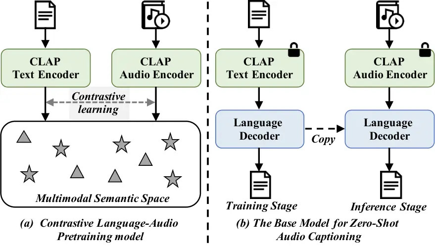
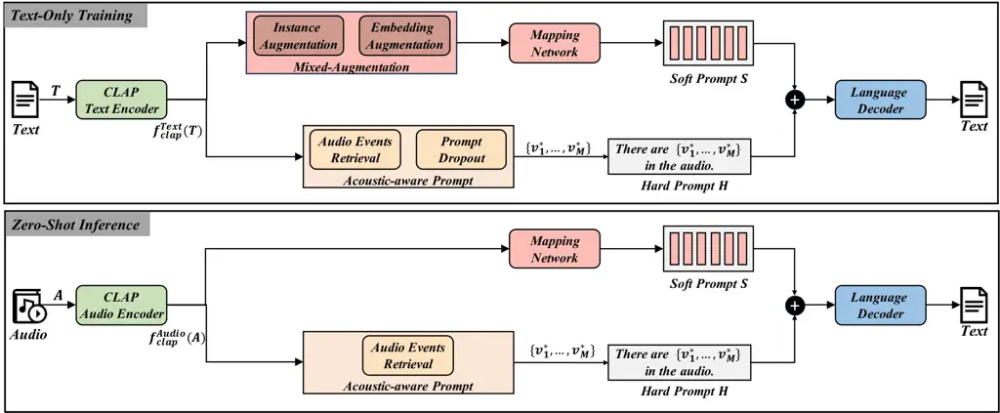

# Zero-Shot Audio Captioning Using Soft and Hard PromptsThanks: Y. Zhang, R. Du, D. Yuan, and Z. Ma are with the Pattern Recognition and Intelligent System Laboratory, School of Artificial Intelligence, Beijing University of Posts and Telecommunications, Beijing 100876, China. E-mail: {zhangyiming, duruoyi, mazhanyu, yuandong}@bupt.edu.cn.Thanks: X. Xu is with the Department of Computer Science and Engineering, Shanghai Jiao Tong University, Shanghai, 200240, China. Email: wsntxxn@sjtu.edu.cn.Thanks: Z.-H. Tan is with the Department of Electronic Systems, Aalborg University, Aalborg 9220, Denmark. E-mail: zt@es.aau.dk.Thanks: H. Liu, W. Wang is with the Centre for Vision, Speech and Signal Processing, University of Surrey, Guildford, GU2 7XH, United Kingdom. E-mail: {haohe.liu, w.wang}@surrey.ac.uk.Thanks: (Corresponding author: Zhanyu Ma)

Yiming Zhang    Xuenan Xu    Ruoyi Du    Haohe Liu    Yuan Dong   
Zheng-Hua Tan Affiliation: Wenwu Wang, , Zhanyu Ma,

###### Abstract

In traditional audio captioning methods, a model is usually trained in a
fully supervised manner using a human-annotated dataset containing
audio-text pairs and then evaluated on the test sets from the same
dataset. Such methods have two limitations. First, these methods are
often data-hungry and require time-consuming and expensive human
annotations to obtain audio-text pairs. Second, these models often
suffer from performance degradation in cross-domain scenarios, i.e.,
when the input audio comes from a different domain than the training
set, which, however, has received little attention. We propose an
effective audio captioning method based on the contrastive
language-audio pre-training (CLAP) model to address these issues. Our
proposed method requires only textual data for training, enabling the
model to generate text from the textual feature in the cross-modal
semantic space. In the inference stage, the model generates the
descriptive text for the given audio from the audio feature by
leveraging the audio-text alignment from CLAP. We devise two strategies
to mitigate the discrepancy between text and audio embeddings: a
mixed-augmentation-based soft prompt and a retrieval-based
acoustic-aware hard prompt. These approaches are designed to enhance the
generalization performance of our proposed model, facilitating the model
to generate captions more robustly and accurately. Extensive experiments
on AudioCaps and Clotho benchmarks show the effectiveness of our
proposed method, which outperforms other zero-shot audio captioning
approaches for in-domain scenarios and outperforms the compared methods
for cross-domain scenarios, underscoring the generalization ability of
our method.

###### Index Terms: 

Audio captioning, zero-shot, contrastive language-audio pre-training,
prompt engineering

## I Introduction

Audio captioning is a sophisticated audio-to-text cross-modal
translation task where a model is built to analyse the contents of an
audio clip and articulate it using natural language \[1, 2, 3, 4, 5\].
The generated captions encompass not only basic descriptions of sound
events and scenes but also high-level semantic information, such as the
relationships among events and physical properties of sounds. This
complex integration enables a deeper contextual interpretation of audio
data. Audio captioning holds significant potential applications across
diverse fields, including assistance for the hard of hearing, subtitles
for television programs, and audio-text cross-modal retrieval.

Recent advancements in audio captioning have significantly elevated the
state-of-the-art. However, most existing methods rely on fully
supervised training, employing an audio-encoder coupled with a
language-decoder framework. Therefore these approaches are data-hungry
and rely on large amounts of human-annotated audio description data for
training. Yet, data scarcity is a substantial challenge for audio
captioning. The predominant audio captioning benchmark datasets,
Clotho \[2\] and AudioCaps \[3\] contain only $`19`$k and $`49`$k
audio-caption pairs in their training sets, respectively. These numbers
pale in comparison to the vast datasets available for visual captioning
(e.g., about $`414`$K paired data in the COCO Caption dataset \[6\]).



Fig. 1: (a) The structure of the CLAP model. Through contrast learning,
CLAP maps the audio and text into the same semantic space. Grey
triangles and pentagons represent audio and text embeddings,
respectively. (b) The structure of the base zero-shot audio captioning
model, where a language decoder is trained for text reconstruction using
text data based on the CLAP text encoder. The CLAP audio encoder is
combined with the language decoder to generate captions during
inference.

The underlying reason for this predicament lies in the complex and
costly process of annotating audio captioning datasets. The audio is
time-series data and has ambiguous properties, necessitating annotators
to thoroughly attend it and conduct complex analyses to ensure accurate
descriptions \[7\]. To alleviate the challenges of data annotation,
researchers \[3, 8, 9, 10\] have employed supplementary information
(e.g., visual cues, and audio category details) or data augmentation
techniques (e.g., text mixing, and large language model (LLM)). While
these approaches expand the dataset scale, they introduce biases and
noise that potentially impact dataset quality \[8\].

In addition, most existing studies typically evaluate the model
performance solely in in-domain scenarios, where the training and test
sets come from the same source.

Accordingly, cross-domain scenarios where the training and test sets
come from different sources receive little attention, although they
happen more commonly in real-world applications. These existing methods
are often trained using limited in-domain data, which can result in
model overfitting. Consequently, they can suffer from significant
performance degradation in cross-domain scenarios and fail to describe
out-of-domain audio clips accurately.

To address this issue, we propose a zero-shot audio captioning method to
alleviate the reliance of the model on audio-text paired data and
improve its generalization performance. We adopt the contrastive
language-audio pre-training model (CLAP) \[10\], which constructs an
implicit audio-text multimodal semantic space based on contrastive
learning, as the backbone of the encoder which is shown in Fig. 1.(a).
We only use textual data for training, making the training possible in
scenarios where audio-text pairs are missing. Captions can be generated
by replacing the CLAP text encoder with the CLAP audio encoder during
inference. However, the CLAP model struggles to construct a well-aligned
multimodal semantic space and still exhibits a Modality Gap \[11\],
which renders simply replacing the encoder during the inference stage
ineffective. To bridge the modality gap of the CLAP model, We devise a
mixed-augmentation strategy, which contains instance replacement and
embedding augmentation, to improve the robustness and performance of the
proposed model. Meanwhile, to further improve the generalization
performance of the model, we introduce the retrieval-based
acoustic-aware prompt strategy, which provides explicit acoustic
information.

Overall, our main contributions are as follows.

- 1.  Focusing on zero-shot audio captioning, we propose a simple yet
      effective method that uses only textual data to train the model and
      then generate captions for given audio clips during inference.
- 2.  We devise the mixed-augmentation-based soft prompt to bridge the gap
      between the training and inference and introduce the acoustic-aware
      hard prompt to enhance the generalization of the proposed model.
- 3.  Through extensive experimentation, we demonstrate the superior
      performance of our proposed method as compared with previous zero-shot
      audio captioning methods for in-domain scenarios, and fully supervised
      and zero-shot audio captioning methods for cross-domain scenarios.

## II Related Work

In this section, we first give a brief overview of CLAP, whose
multimodal semantic space provides the foundation of our proposed
method. Then, we introduce traditional fully supervised audio captioning
methods and recent zero-shot audio captioning methods.

### II-A Contrastive Language-Audio Pre-training (CLAP)

CLAP \[10, 9, 12, 13\] utilizes contrastive learning to pre-train
language-audio models, which map both audio and text into the same
semantic space on large-scale audio-text pairs. CLAP contains two
encoders: an audio encoder and a text encoder. The audio encoder
$`f_{clap}^{Audio}(\cdot)`$ often uses well-performed audio
classification models, which can be convolution neural networks \[14\]
or Transformers \[15\], as the backbone.

The text encoder $`f_{clap}^{Text}(\cdot)`$ is usually a pre-trained
masked language model (e.g., BERT \[16\], RoBERTa \[17\]). CLAP utilizes
noisy pairwise data for training based on the InfoNCE loss \[18\],
learning the alignment between text and audio embeddings in a multimodal
semantic space.

In this work, we use CLAP text encoder $`f_{clap}^{Text}(\cdot)`$ for
text reconstruction in the training stage. In the inference stage,
$`f_{clap}^{Text}(\cdot)`$ is replaced with the audio encoder
$`f_{clap}^{Audio}(\cdot)`$ to generate the descriptive text for a given
audio.

### II-B Fully Supervised Audio Captioning

With the success of DCASE challenges \[4\], fully supervised audio
captioning has seen significant advancements. Most research on audio
captioning utilizes an audio encoder-language decoder framework trained
on human-annotated audio-text paired data. These studies employed the
audio encoder to extract embeddings of the input audio clip $`A`$, which
are then fed into the language decoder to generate corresponding
descriptive caption $`T`$. Mei *et al.* \[19\] proposed a full
Transformer-based audio captioning method to improve the capability of
modelling global and fine-grained temporal information. Ye _et al._
 \[20\] proposed a fully supervised audio captioning model based on the
multi-modal attention module, which utilizes acoustic and semantic
information to generate captions. Xu *et al.* \[21\] pre-trained the
audio encoder on text-audio retrieval tasks, enhancing the
representation capability of the audio encoder for audio captioning. Kim
*et al.* \[22\] used a pre-trained language model (GPT-2) as the decoder
to ensure text generation capability, with global and temporal
information from the input audio as the prefix to guide the output of
the decoder. Koh *et al.* \[23\] introduced the reconstruction latent
space similarity regularisation to regulate model training in audio
captioning. Zhang *et al.* \[7\] proposed a two-stage audio captioning
approach to mitigate the effects of semantic disparity among the audio
captions by incorporating feature space regularisation and improving the
accuracy of the model-generated description text. Ghosh *et al.* \[24\]
proposed a retrieval-augmented audio captioning method that uses the
CLAP encoder to retrieve captions similar to the input audio from the
external database and then the retrieved captions are used as extra
guidance for the decoder to generate descriptive text.

However, the high cost of collecting audio-text paired data has limited
the applicability of these methods. Therefore, reducing the dependency
of audio captioning models on paired data has emerged as a prominent
research focus in audio captioning.



Fig. 2: The overall architecture of our proposed method. Specifically,
in the training stage, we reconstruct the input text based on
acoustic-aware prompts and soft prompts with only textual data, so
training does not require any paired data. During inference, we replace
the CLAP text encoder $`f_{clap}^{Text}(\cdot)`$ with the CLAP audio
encoder $`f_{clap}^{Audio}(\cdot)`$ to generate the descriptive text of
the input audio.

### II-C Zero-Shot Audio Captioning

To further reduce the cost of paired data collection, zero-shot audio
captioning aims to generate audio captions without prior training for
this task \[25\]. Audio Flamingo \[26\] used a large-scale weakly
aligned audio-text pair dataset to train the audio language model and
evaluated the model on the Audiocaps benchmark without fine-tuning. Some
works conducted zero-shot audio captioning by combining pre-trained
audio-text models and large language models. We categorize these studies
into decoder-guided and encoder-guided methods based on where the
acoustic information was introduced. In the decoder-guided methods, the
acoustic information is injected after the word probabilities are
predicted by the language decoder. Shaharabany *et al.* \[25\] designed
a classifier-guided zero-shot approach in which only audio data is used
to optimize the hidden states of the language model to generate
descriptive text with audibility. Salewski *et al.* \[27\] proposed a
similar approach, where audio data is not used to optimize the hidden
states, but to reweight the probability of output words. However,
decoder-guided approaches usually achieve poor performance, cannot
achieve satisfactory zero-shot capability and the generated captions
fail to describe the audio content accurately. Compared to
decoder-guided methods, encoder-guided methods rely more on the
multimodal modelling capabilities provided by a pre-trained text-audio
model (e.g. CLAP), and the acoustic information is taken as input to the
language decoder. To mitigate the Modality Gap \[11\], Deshmukh *et
al.* \[28\] injected random variables into the text-only training. In
contrast, Kouzelis *et al.* \[29\] mapped the input CLAP audio
embeddings to text embeddings in the inference stage to generate
descriptive text. Although these encoder-guided methods can perform
better in in-domain situations, they often overlook cross-domain
scenarios.

In comparison to these methods, we propose an encoder-guided zero-shot
audio captioning method, in which the mixed augmentation strategy is
integrated to alleviate the problem of Modality Gap and the
auditory-aware prompt strategy is used to further enhance the accuracy
of the generation by providing explicitly the external acoustic
knowledge.

## III Proposed Method

In this work, we propose a zero-shot audio captioning method to
alleviate the reliance of the model on audio-text paired data in
traditional fully supervised audio captioning methods. The overall
architecture of our proposed method is illustrated in Fig. 2. In the
training stage, we use the CLAP text encoder to extract the embedding of
the input text, and then the soft prompt and acoustic-aware hard prompt
are fed to the language decoder to reconstruct the given text. In the
inference stage, we shift from text-to-text generation to audio-to-text
generation by replacing the CLAP text encoder with the CLAP audio
encoder.

### III-A The Soft Prompt based on Mixed-augmentations

An intuitive method for the zero-shot audio captioning task is shown in
Fig 1 (b). During training, for a given input text $`T`$ from the corpus
$`\mathcal{T}`$, the language decoder is trained using the CLAP model to
reconstruct the input text. During inference, only the text encoder
needs to be replaced with an audio encoder to generate descriptive text
for the input audio clip. However, due to the modality gap in the CLAP
model, the model trained in this way can be limited in its
generalization ability. To address this issue, we employ a
mixed-augmentations strategy, which includes instance replacement and
embedding augmentation, to enable the model to learn more robust latent
representations.

Instance Replacement: First, we retrieve $`N`$ captions in the text
corpus $`\mathcal{T}`$ that are semantically similar to the input text
$`T`$ as a semantic candidate set $`\mathcal{C}_{N}`$:

```math
\mathcal{C}_{N}=\left\{\underset{T^{*}_{n}\in\mathcal{T}}{\mathrm{argmax}_{N}}\frac{f_{{clap}}^{{Text}}(T)\cdot f_{{clap}}^{{Text}}(T^{*}_{n})}{\|f_{{clap}}^{{Text}}(T)\|\cdot\|f_{{clap}}^{{Text}}(T^{*}_{n})\|}\right\}, \tag{1}
```

where $`\mathrm{argmax}_{N}`$ select text embeddings with top-$`N`$
highest similarities, $`f_{clap}^{Text}(T)`$ is the CLAP text embedding
of the input text $`T`$, $`\|\cdot\|`$ represents the norm of the
embedding, $`T^{*}_{n}`$ is the $`n`$-th candidate text, and
$`n\leq N`$.

Then, $`f_{{clap}}^{{Text}}(T^{*}_{n})`$ is randomly selected from the
candidate text embeddings set $`\mathcal{C}_{N}`$ to replace the
original text embedding $`f_{{clap}}^{{Text}}(T)`$.

Embedding Augmentation: To encourage the model to learn more robust
latent representations, we insert a Gaussian noise
$`\epsilon\sim\mathcal{N}(0`$, $`\sigma)`$ into the candidate text
embedding $`f_{{clap}}^{{Text}}(T^{*}_{n})`$ to obtain the noisy text
embedding $`f_{{clap}}^{{Text}}(T^{*}_{n})+\epsilon`$, where $`\sigma`$
is the standard deviation.

Then, the noisy text embedding is fed into the mapping network
$`\mathcal{M}(\cdot)`$ to get the soft prompt $`S`$ for the language
decoder,

```math
S=\mathcal{M}\left(f_{{clap}}^{{Text}}(T^{*}_{n})+\epsilon\right), \tag{2}
```

where $`S=\left\{s_{1},\dots,s_{K}\right\}`$, $`s_{k}`$ is the $`k`$-th
soft prompt embedding, and $`K`$ is the total length of the soft prompts
$`S`$.

### III-B Acoustic-aware Prompt based on Retrieval

Acoustic labels are well-defined representations of the content and
characteristics of the audio signal. For example, the audio label
(“gunshots”) indicates that the audio clip has sharp, high-decibel, and
loud pops. Therefore, acoustic labels provide explicit guidance for the
audio clip contents and improve the generalization performance. In
addition to soft prompts, we provide additional explicit acoustic-aware
prompts for decoding.

Acoustic-aware Prompt: Firstly, we need to build the vocabulary of audio
events $`\mathcal{V}`$. We use the labels of AudioSet \[30\], a
prevalent benchmark dataset for the audio tagging task. AudioSet
contains 527 audio categories and covers various human and animal
sounds, musical instruments and genres, and environmental sounds.
Therefore, the audio events vocabulary $`\mathcal{V}`$ is a set of
$`527`$ audio event labels $`\left\{v_{1},\dots,v_{527}\right\}`$, where
$`v`$ represents the audio event category.

Given the text embedding $`f_{{clap}}^{{Text}}(T)`$, we retrieve $`M`$
audio events that are most similar to $`f_{{clap}}^{{Text}}(T)`$ from
the vocabulary $`\mathcal{V}`$ based on the cosine similarity of CLAP
embeddings:

```math
\left\{v^{*}_{1},\dots,v^{*}_{M}\right\}=\left\{\underset{v^{*}_{m}\in\mathcal{V}}{\mathrm{argmax}_{M}}\frac{f_{{clap}}^{{Text}}(T)\cdot f_{{clap}}^{{Text}}(v^{*}_{m})}{\|f_{{clap}}^{{Text}}(T)\|\cdot\|f_{{clap}}^{{Text}}(v^{*}_{m})\|}\right\}, \tag{3}
```

where $`v^{*}_{m}`$ is the $`m`$-th audio event. Therefore, the
retrieved audio events are used to construct the hard prompt $`H=`$
“There are $`\left\{v^{*}_{1},\dots,v^{*}_{M}\right\}`$ in the audio.”.

We concatenate the hard prompts $`H`$ and the soft prompts $`S`$ along
the sequence and feed them into the language decoder to reconstruct the
input original text $`T`$ in an auto-regressive manner. The model is
trained using the cross-entropy loss:

```math
\mathcal{L}=-\frac{1}{\left|T\right|}\sum_{i=1}^{\left|T\right|}\log p_{\theta}(t_{i}|T_{\textless i},H,S) \tag{4}
```

where $`\left|T\right|`$ is the length of input $`T`$, $`t_{i}`$ is
$`i`$-th word token of $`T`$, $`T_{\textless i}`$ includes all tokens
from the start of $`T`$ up to just before the $`i`$-th token.
$`p_{\theta}(\cdot)`$ is the distribution of the output token and
$`\theta`$ represents all parameters of the model.

Prompt Dropout: To make the model robust to retrieval errors and
diminish the effect of the modality gap in retrieval, we propose a
simple but effective prompt dropout strategy, in which we randomly drop
some audio categories in the hard prompts with dropout rate $`\beta`$
during training. In this way, the model is trained to avoid simply
concatenating audio events from hard prompts $`H`$ to generate the
caption while ignoring the information in soft prompts $`S`$.

Zero-shot Inference: For an input audio clip $`A`$, we use the CLAP
audio encoder to replace the text encoder for extracting its audio
embedding $`f_{clap}^{Audio}(A)`$. Following Kouzelis *et al.* \[29\],
we process the embedding $`f_{clap}^{Audio}(A)`$ in a similar way to get
its soft prompts and hard prompts, excluding the mixed-augmentation and
the prompt dropout strategy. Next concatenated prompts are fed into the
language decoder auto-regressively to generate the predicted descriptive
caption $`T`$.

## IV Experimental Settings

This section introduces the experimental settings, including model
architectures, datasets, baselines and metrics, and implementation
details.

### IV-A Model Architectures

CLAP Encoder: In this work, we use the CLAP model¹¹ 1
[https://drive.google.com/drive/folders/1MeTBren6LaLWiZI8_phZvHvzz4r9QeCD](https://drive.google.com/drive/folders/1MeTBren6LaLWiZI8_phZvHvzz4r9QeCD)
as our encoder which is only trained on WavCaps \[10\], which does not
contain any human-annotated data. The CLAP audio encoder is an
HTSAT \[15\] and the text encoder is a RoBERTa \[17\]. All audio clips
are randomly cropped or padded to $`10`$ seconds and sampled at a
$`32`$k sampling rate. We use a $`64`$-dimensional log-Mel spectrogram
extracted from a $`1024`$ point Hanning window with a hop size of
$`320`$ as the input audio feature. The dimension of the CLAP embedding
is $`1024`$, and all parameters in the CLAP encoder are frozen.

Mapping Network and Language Decoder: The mapping network transforms the
CLAP embedding $`f_{clap}(\cdot)`$ into soft prompts $`S`$. This work
employs a simple but effective mapping network containing only two
linear layers. For the language decoder, we use the pre-trained
GPT2-base²² 2
[https://huggingface.co/openai-community/gpt2](https://huggingface.co/openai-community/gpt2) \[31\]
to generate text. The dimension of hidden states is $`768`$, and all
model parameters except the CLAP encoder are trainable.

### IV-B Datasets

We conduct our experiments on audio captioning benchmark datasets,
AudioCaps \[3\] and Clotho \[2\]. AudioCaps is the largest
human-annotated audio captioning dataset and contains $`51`$K audio
clips with one caption per audio clip in the training set and five
captions per audio clip in the evaluation set. People annotated audio
clips with the aid of visual information. Clotho is the official
benchmark in the DCASE challenge. Clotho contains about $`3.8`$K audio
clips and each audio clip has five captions. The annotator uses the
audio signals only for annotation and no additional signal is provided.

### IV-C Baselines

Fully Supervised Audio Captioning: We compare our method with fully
supervised audio captioning methods: ACT \[19\], MAAC \[20\], Xu et
al. \[21\], Prefix AAC \[22\], RLSSR \[23\], RECAP \[24\], and
ACTUAL \[7\]. All of which are open source and not trained with
additional data.

Method BLEU₁ BLEU₄ ROUGE\_(L) CIDEr METEOR SPICE SPIDEr Fully Supervised
Audio Captioning Prefix AAC \[22\] $`\dagger`$ 71.3 30.9 50.3 73.3 24.0
17.7 45.5 RECAP  \[24\] $`\dagger`$ 72.8 31.7 52.1 75.0 25.2 $`18.3`$
47.2 ACT \[19\] 68.4 $`\pm`$ 0.44 25.2 $`\pm`$ 0.99 48.0 $`\pm`$ 0.35
67.5 $`\pm`$ 1.90 22.8 $`\pm`$ 0.27 16.9 $`\pm`$ 0.51 42.2 $`\pm`$ 1.09
MAAC \[20\] 64.0 $`\pm`$ 0.60 24.3 $`\pm`$ 0.55 44.7 $`\pm`$ 0.25 59.3
$`\pm`$ 1.05 21.0 $`\pm`$ 0.15 14.4 $`\pm`$ 0.38 36.9 $`\pm`$ 0.54 Xu et
al. \[21\] 67.6 $`\pm`$ 0.21 27.2 $`\pm`$ 0.33 49.7 $`\pm`$ 0.17 73.8
$`\pm`$ 1.21 24.7 $`\pm`$ 0.06 18.4 $`\pm`$ 0.06 46.1 $`\pm`$ 0.62
Zero-Shot Audio Captioning Audio Flamingo \[26\] $`\dagger`$ $`-`$ $`-`$
$`-`$ $`50.2`$ $`-`$ $`-`$ $`-`$ Shaharabany et al. \[25\] $`\dagger`$
$`-`$ 9.8 8.2 9.2 8.6 $`-`$ $`-`$ ZerAuCap \[27\] $`\dagger`$ $`-`$ 6.8
$`33.1`$ $`28.1`$ $`12.3`$ $`8.6`$ $`18.3`$ NoAudioCaptioning \[28\]
59.2 $`\pm`$ 1.43 15.0 $`\pm`$ 0.66 40.4 $`\pm`$ 0.37 42.4 $`\pm`$ 1.58
19.6 $`\pm`$ 0.69 13.6 $`\pm`$ 0.51 28.0 $`\pm`$ 0.96 WSAC \[29\] 61.1
$`\pm`$ 0.48 17.1 $`\pm`$ 0.28 43.5 $`\pm`$ 0.36 56.4 $`\pm`$ 0.44 23.2
$`\pm`$ 0.09 16.3 $`\pm`$ 0.29 36.3 $`\pm`$ 0.31 Ours 66.0 $`\pm`$ 0.15
21.3 $`\pm`$ 0.48 45.7 $`\pm`$ 0.18 64.4 $`\pm`$ 0.61 22.0 $`\pm`$ 0.23
15.6 $`\pm`$ 0.23 40.0 $`\pm`$ 0.33

- $`\dagger`$
  We use the original results listed in the paper since these works
  include results for in-domain and cross-domain scenarios.

TABLE I: Experimental results for in-domain scenarios on AudioCaps.

Method BLEU₁ BLEU₄ ROUGE\_(L) CIDEr METEOR SPICE SPIDEr Fully Supervised
Audio Captioning Prefix AAC \[22\] $`\dagger`$ 56.0 16.0 37.8 39.2 17.0
11.8 25.5 RECAP  \[24\] $`\dagger`$ 56.3 16.5 38.3 39.8 17.9 12.2 21.4
ACTUAL \[7\] $`\dagger`$ 56.6 16.1 37.5 40.9 17.6 12.1 26.5 RLSSR \[23\]
$`\dagger`$ 55.1 16.8 37.3 38.0 16.5 11.1 24.6 ACT \[19\] 58.4 $`\pm`$
0.21 16.9 $`\pm`$ 0.30 38.5 $`\pm`$ 0.30 41.6 $`\pm`$ 0.46 17.8 $`\pm`$
0.08 12.1 $`\pm`$ 0.14 26.9 $`\pm`$ 0.26 MAAC \[20\] 57.0 $`\pm`$ 0.53
16.0 $`\pm`$ 0.40 37.7 $`\pm`$ 0.37 41.3 $`\pm`$ 0.56 17.7 $`\pm`$ 0.22
12.3 $`\pm`$ 0.13 26.8 $`\pm`$ 0.32 Xu et al. \[21\] 56.9 $`\pm`$ 0.15
16.0 $`\pm`$ 0.39 37.9 $`\pm`$ 0.33 41.8 $`\pm`$ 0.69 17.9 $`\pm`$ 0.15
12.7 $`\pm`$ 0.07 27.3 $`\pm`$ 0.34 Zero-Shot Audio Captioning
ZerAuCap \[27\] $`\dagger`$ $`-`$ 2.9 25.4 14.0 9.4 5.3 9.7
NoAudioCaptioning \[28\] 51.8 $`\pm`$ 1.02 11.3 $`\pm`$ 0.80 34.7
$`\pm`$ 0.87 29.2 $`\pm`$ 1.25 15.6 $`\pm`$ 0.38 10.3 $`\pm`$ 0.24 19.7
$`\pm`$ 0.66 WSAC \[29\] 54.5 $`\pm`$ 0.05 12.6 $`\pm`$ 0.14 35.9
$`\pm`$ 0.04 35.7 $`\pm`$ 0.33 16.9 $`\pm`$ 0.02 11.8 $`\pm`$ 0.01 23.8
$`\pm`$ 0.17 Ours 56.4 $`\pm`$ 0.24 15.6 $`\pm`$ 0.22 37.5 $`\pm`$ 0.17
40.3 $`\pm`$ 0.47 17.3 $`\pm`$ 0.17 11.9 $`\pm`$ 0.19 26.1 $`\pm`$ 0.27

- $`\dagger`$
  We use the original results listed in the paper since these works
  include results for in-domain and cross-domain scenarios.

TABLE II: The experimental results for in-domain scenarios on the Clotho
dataset

Zero-Shot Audio Captioning: We further compare our method with zero-shot
audio captioning methods: Audio Flamingo \[26\], Shaharabany et
al. \[25\], ZerAuCap \[27\], NoAudioCaptioning \[28\], and WSAC \[29\].
Audio Flamingo \[26\] is a large audio language model and achieves SOTA
in several audio understanding tasks. Shaharabany et al. \[25\] and
ZerAuCap \[27\] are decoder-guided zero-shot audio captioning methods.
NoAudioCaptioning \[28\] and WSAC \[29\] are encoder-guided zero-shot
audio captioning methods.

### IV-D Metrics

Similar to other audio captioning works, we use common captioning
metrics, including BLEU*(n) \[32\], ROUGE*(L) \[33\], METEOR \[34\],
CIDEr \[35\], SPICE \[36\], and SPIDEr \[37\] for evaluation. For all
metrics, higher scores indicate better performance.

### IV-E Implementation Details

In our work, we train the network using the AdamW optimizer with a
weight decay of $`0.02`$, an initial learning rate of
$`1\times 10^{-5}`$, a batch size of 32, a warm-up iteration of 3000 and
a total training iteration of $`15000`$. The model is trained on a
$`2080`$Ti GPU. We construct the hyperparameter tuning experiments and
set $`N=5`$, $`M=4`$, $`\sigma=0.1`$, $`K=10`$, and $`\beta=0.6`$ for
both AudioCaps and Clotho dataset. We use beam search with a beam size
of $`3`$ to generate captions during inference.

## V Results and Discussion

This section shows results followed by discussions of comparative
experiments. In all tables, the bold font represents the best result for
each metric in the same setting. Some works do not provide cross-domain
results so we re-train these models using five different random seeds
and report the mean and standard deviation of metrics.

### V-A In-domain Audio Captioning

Tables I and II compare our proposed method and baselines for in-domain
scenarios, where the training and test sets come from the same benchmark
dataset. It should be specially noted that the zero-shot methods only
use textual data from the training set for training, while the fully
supervised methods use the audio-text paired data. To make a fair
comparison, we re-implement baseline zero-shot audio captioning methods
using the same CLAP.

We have the following observations from the results for in-domain
scenarios in the Clotho and AudioCaps datasets: 1) The fully supervised
audio captioning methods tend to achieve better experimental performance
than the zero-shot audio captioning methods. This is expected as the
fully supervised methods are trained using audio-text pairs, and the
models learn the “audio-to-text” conversion ability well. The zero-shot
methods suffer from the need to migrate from “text-to-text” in training
to “audio-to-text” in inference, thus the discrepancy between training
and inference results in worse in-domain performance. 2) Our proposed
method outperforms other zero-shot audio captioning methods in most
metrics. We attribute this to the use of mixed augmentations and
acoustic-aware prompts in model training, thereby mitigating the
modality gap and improving the model’s in-domain performance. 3) Our
proposed method, which does not utilize any paired data, achieves 86% of
the performance of the fully-supervised state-of-the-art method
RECAP \[24\], which obtains a CIDEr score of 75.0 on the AudioCaps
dataset, and 95% of the performance of the performance of Xu et
al. \[21\], which attains a CIDEr score 41.8. This proves the
effectiveness and practicality of our method.

Method AudioCaps $`\Longrightarrow`$ Clotho Clotho $`\Longrightarrow`$
AudioCaps ROUGE*(L) CIDEr METEOR SPICE ROUGE*(L) CIDEr METEOR SPICE
Fully Supervised Audio Captioning Prefix AAC \[22\] $`\dagger`$ 27.6
19.2 11.2 7.4 33.0 21.1 14.4 8.3 RECAP  \[24\] $`\dagger`$ 27.6 19.5
11.0 8.4 28.1 19.1 11.2 13.6 ACT \[19\] 26.1 $`\pm`$ 0.44 13.4 $`\pm`$
0.68 10.2 $`\pm`$ 0.25 5.5 $`\pm`$ 0.39 35.2 $`\pm`$ 0.22 23.7 $`\pm`$
0.87 16.4 $`\pm`$ 0.17 10.7 $`\pm`$ 0.31 MAAC \[20\] 24.8 $`\pm`$ 0.83
16.4 $`\pm`$ 1.28 10.3 $`\pm`$ 0.35 5.8 $`\pm`$ 0.10 35.9 $`\pm`$ 0.20
25.4 $`\pm`$ 0.45 17.1 $`\pm`$ 0.23 10.9 $`\pm`$ 0.18 Xu et al. \[21\]
29.2 $`\pm`$ 0.04 22.8 $`\pm`$ 0.51 12.8 $`\pm`$ 0.07 8.5 $`\pm`$ 0.22
35.8 $`\pm`$ 0.29 25.6 $`\pm`$ 0.85 16.7 $`\pm`$ 0.30 11.1 $`\pm`$ 0.20
Zero-shot Audio Captioning NoAudioCaptioning \[28\] 26.6 $`\pm`$ 0.45
17.5 $`\pm`$ 2.00 11.1 $`\pm`$ 0.59 7.4 $`\pm`$ 0.60 34.1 $`\pm`$ 1.18
23.3 $`\pm`$ 1.68 16.7 $`\pm`$ 0.36 10.6 $`\pm`$ 0.34 WSAC \[29\] 26.6
$`\pm`$ 0.34 20.6 $`\pm`$ 0.31 12.0 $`\pm`$ 0.11 8.2 $`\pm`$ 0.08 35.5
$`\pm`$ 0.15 25.6 $`\pm`$ 0.22 17.3 $`\pm`$ 0.10 12.0 $`\pm`$ 0.08 Ours
29.8 $`\pm`$ 0.55 24.8 $`\pm`$ 0.55 13.2 $`\pm`$ 0.46 9.3 $`\pm`$ 0.44
36.1 $`\pm`$ 0.51 33.8 $`\pm`$ 0.93 18.0 $`\pm`$ 0.28 12.3 $`\pm`$ 0.18

- $`\dagger`$
  We use the original results listed in the paper since these works
  include results for in-domain and cross-domain scenarios.

TABLE III: The experimental results for Cross-domain scenarios on the
AudioCaps and Clotho dataset

### V-B Cross-domain Audio Captioning

Cross-domain scenarios are where the training and test sets come from
different benchmark datasets. The model is trained using only data from
the Source benchmark, and any data from the training set of the Target
benchmark is prohibited. In the real world, the audio in Target domain
is often agnostic, so the cross-domain performance can better represent
the effectiveness of the model in real-world applications.

Table III shows the experimental results of ours and baseline methods in
cross-domain scenarios, where the
“$`\textit{Source}\Longrightarrow\textit{Target}`$” refers to the
scenario where the model is trained on the training set of the Source
dataset and evaluated on the test set of the Target dataset. It is
important to note that neither the training nor the validation set of
the Target dataset is used in model training and selection. From the
experimental results, we find the following: 1) Both fully supervised
and zero-shot methods show some degree of degradation in the
cross-domain scenarios compared to the in-domain scenarios. 2)
Interestingly, the fully supervised methods do not exhibit significant
superiority and achieve comparable results to zero-shot methods. We
speculate that this might be because the strategies in the zero-shot
methods help address the gap, improve model generalization, and reduce
the risk of model over-fitting. 3) Our proposed model outperforms
baselines across all metrics, including both fully supervised and
zero-shot methods.

Source Dataset Size Source Dataset $`\Longrightarrow`$ Clotho Source
Dataset $`\Longrightarrow`$ AudioCaps ROUGE*(L) CIDEr METEOR SPICE
ROUGE*(L) CIDEr METEOR SPICE ChatGPT³ 31K 25.5 $`\pm`$ 0.31 16.3 $`\pm`$
0.62 10.6 $`\pm`$ 0.19 6.3 $`\pm`$ 0.11 27.3 $`\pm`$ 0.27 15.5 $`\pm`$
0.39 11.7 $`\pm`$ 0.17 7.1 $`\pm`$ 0.22 Freesound⁴ 84K 30.4 $`\pm`$ 0.20
22.0 $`\pm`$ 0.84 12.6 $`\pm`$ 0.20 7.8 $`\pm`$ 0.15 28.6 $`\pm`$ 0.42
22.3 $`\pm`$ 0.94 12.3 $`\pm`$ 0.34 6.7 $`\pm`$ 0.21 WavCaps \[10\] 190K
30.6 $`\pm`$ 0.36 22.1 $`\pm`$ 0.86 12.6 $`\pm`$ 0.22 7.9 $`\pm`$ 0.20
33.4 $`\pm`$ 1.21 31.6 $`\pm`$ 1.96 15.5 $`\pm`$ 0.61 9.1 $`\pm`$ 0.59
COCO Captions \[6\] 414K 25.9 $`\pm`$ 0.24 10.0 $`\pm`$ 0.55 8.9 $`\pm`$
0.28 5.1 $`\pm`$ 0.44 27.8 $`\pm`$ 0.53 10.6 $`\pm`$ 1.11 10.6 $`\pm`$
0.55 6.2 $`\pm`$ 0.69 MusicCaps \[38\] 13K 21.1 $`\pm`$ 1.34 6.6 $`\pm`$
0.90 8.8 $`\pm`$ 0.19 4.5 $`\pm`$ 0.42 20.4 $`\pm`$ 1.84 9.6 $`\pm`$
0.42 9.8 $`\pm`$ 0.13 6.3 $`\pm`$ 0.89 LP-MusicCaps MSD \[39\] 526K 15.9
$`\pm`$ 0.72 0.9 $`\pm`$ 0.10 6.1 $`\pm`$ 0.11 1.0 $`\pm`$ 0.16 15.0
$`\pm`$ 0.56 0.8 $`\pm`$ 0.08 6.2 $`\pm`$ 0.24 0.9 $`\pm`$ 0.13

TABLE IV: The experimental results under textual data from different
fields

Table IV shows the cross-domain performance of our proposed method
trained on textual data from different fields and evaluated on Clotho
and AudioCaps. We use the textual data from three fields for training:
audio captioning corpus (ChatGPT³³ 3
[https://chat.openai.com/](https://chat.openai.com/), FreeSound⁴⁴ 4
[https://freesound.org/](https://freesound.org/), WavCaps \[10\]),
visual captioning corpus (COCO Captions \[6\]), and music captioning
corpus (MusicCaps \[38\], LP-MusicCaps MSD \[39\]). For the text from
ChatGPT, we used GPT-3.5 to generate 31K text based on in-text learning.
Specifically, we provide example captions from Clotho or AudioCaps and
ask ChatGPT to generate similarly styled audio descriptions based on the
examples. The text data in FreeSound comes from the subset of WavCaps,
collected through an online collaborative sound-sharing site.
WavCaps \[10\] is a large-scale weakly-labeled audio captioning dataset
that collects audio clips and their raw descriptions from web sources
and uses ChatGPT to filter and clean noisy descriptions. COCO
Captions \[6\] is a human-annotated benchmark dataset in visual
captioning. For the music captioning corpus, MusicCaps \[38\] is
annotated by ten professional musicians and LP-MusicCaps MSD \[39\] is a
large language model based pseudo music caption dataset.

From the results shown in Table IV, we have the following findings. 1)
For the audio caption corpus generated by LLMs, the cross-domain
performance on both Clotho and AudioCaps are improved by increasing the
amount of textual data. 2) Compared to the results of the other methods
shown in Table IV, our proposed method trained on weakly-labeled WavCaps
achieves comparable cross-domain performance on Clotho and superior
performance on AudioCaps, indicating the effectiveness of our proposed
method. 3) The model trained on visual and music caption data exhibits
worse cross-domain performance. This may be because CLAP is trained on
weakly-labelled audio-caption paired data and cannot reconstruct the
original caption from the other fields using its CLAP feature.

Setting Components In-Domain Scenarios Cross-Domain Scenarios IA EA AP
ROUGE*(L) CIDEr METEOR SPICE ROUGE*(L) CIDEr METEOR SPICE Base Model a).
29.9 $`\pm`$ 0.82 15.7 $`\pm`$ 0.37 13.1 $`\pm`$ 0.52 7.5 $`\pm`$ 0.62
29.8 $`\pm`$ 1.00 13.8 $`\pm`$ 0.71 14.1 $`\pm`$ 0.62 7.8 $`\pm`$ 0.67
b). ✓ 33.0 $`\pm`$ 0.66 25.9 $`\pm`$ 0.97 15.0 $`\pm`$ 0.30 9.6 $`\pm`$
0.34 31.9 $`\pm`$ 0.28 18.2 $`\pm`$ 0.79 14.8 $`\pm`$ 0.30 7.8 $`\pm`$
0.49 c). ✓ 34.7 $`\pm`$ 0.30 30.4 $`\pm`$ 0.89 15.7 $`\pm`$ 0.14 10.5
$`\pm`$ 0.32 33.4 $`\pm`$ 0.21 20.6 $`\pm`$ 0.48 15.3 $`\pm`$ 0.05 9.2
$`\pm`$ 0.15 d). ✓ 35.0 $`\pm`$ 0.44 31.9 $`\pm`$ 0.93 16.1 $`\pm`$ 0.17
10.2 $`\pm`$ 0.18 34.1 $`\pm`$ 0.52 25.9 $`\pm`$ 0.88 16.6 $`\pm`$ 0.37
10.6 $`\pm`$ 0.45 e). ✓ ✓ 36.0 $`\pm`$ 0.27 32.6 $`\pm`$ 0.46 16.1
$`\pm`$ 0.19 11.0 $`\pm`$ 0.29 32.9 $`\pm`$ 0.35 19.6 $`\pm`$ 0.76 15.3
$`\pm`$ 0.19 9.2 $`\pm`$ 0.17 Full Model f). ✓ ✓ ✓ 37.5 $`\pm`$ 0.17
40.3 $`\pm`$ 0.47 17.3 $`\pm`$ 0.17 11.9 $`\pm`$ 0.19 36.1 $`\pm`$ 0.51
33.8 $`\pm`$ 0.93 18.0 $`\pm`$ 0.28 12.3 $`\pm`$ 0.18

TABLE V: The ablation experiment results of different components.

### V-C Ablation Studies

In this section, we conduct ablation experiments for in-domain and
cross-domain scenarios by training the models on Clotho. The results are
shown in Table V, where ‘IA’, ‘EA’, and ‘AP’ are abbreviations for the
instance augmentation, embedding augmentation, and acoustic-aware
prompt, respectively. The base model does not use any components and its
model structure only contains the CLAP encoder, the mapping network, and
the language decoder. The audio features are extracted using the CLAP
audio encoder and fed into the trained mapping network and language
decoder to generate the caption of the given audio during the inference
stage. The model structure is shown in Fig. 1 (b). The settings (b, c,
d) show that the components we proposed can improve the model
performance in all metrics compared to the base model in setting a. In
particular, the settings (b, c) show that both instance replacement and
embedding augmentation can significantly improve the in-domain
performance of the model. These strategies reduce the modality gap
between audio and text data, enhance the robustness of the model and
improve the performance of zero-shot audio captioning. Acoustic-aware
prompts (setting d) provide explicit guidance to the language decoder
through hard prompts for audio events, thus enabling the model to
achieve a better cross-domain generalization performance compared to the
setting e, with comparable in-domain performance. Our full model in the
setting f achieves significant improvements in all metrics (especially
in the CIDEr metric) in both in-domain and cross-domain scenarios,
indicating the effectiveness of our proposed model.

### V-D Analysis on Hyper-parameters

In the following, we conduct hyper-parameter tuning experiments to
investigate and discuss the effects of different hyper-parameters on the
model performance. We fix the other hyper-parameters in the full model
in each tuning experiment.

#### V-D1 The number of candidates $`N`$ in instance replacement

$`N`$ ROUGE\_(L) CIDEr METEOR SPICE 1 36.5 $`\pm`$ 0.17 35.8 $`\pm`$ 0.51
16.6 $`\pm`$ 0.11 11.2 $`\pm`$ 0.15 3 37.0 $`\pm`$ 0.15 36.8 $`\pm`$
0.36 16.9 $`\pm`$ 0.10 11.7 $`\pm`$ 0.18 5 37.1 $`\pm`$ 0.10 36.9
$`\pm`$ 0.36 16.9 $`\pm`$ 0.10 11.7 $`\pm`$ 0.10 7 37.0 $`\pm`$ 0.18
36.6 $`\pm`$ 0.49 16.8 $`\pm`$ 0.09 11.5 $`\pm`$ 0.14 10 37.2 $`\pm`$
0.22 36.1 $`\pm`$ 0.70 16.8 $`\pm`$ 0.11 11.4 $`\pm`$ 0.13

TABLE VI: The number of candidates $`N`$ in instance replacement

We first show the effect of the number of candidates $`N`$ in the
instance replacement. We select the number of candidates $`N`$ from
values {1, 3, 5, 7, 10}. The results are shown in Table VI. When $`N`$
is 5, the model performs better in most metrics. As $`N`$ continues to
increase, the model performance starts to deteriorate since augmented
text samples contain texts that are far away from the original text for
the model to learn an accurate “text-to-text” conversion.

#### V-D2 The variance $`\sigma^{2}`$ of noise in embedding augmentation

$`\sigma^{2}`$ ROUGE\_(L) CIDEr METEOR SPICE $`1\times 10^{-4}`$ 34.8
$`\pm`$ 0.72 31.0 $`\pm`$ 1.83 16.0 $`\pm`$ 0.43 10.1 $`\pm`$ 0.43
$`1\times 10^{-3}`$ 35.4 $`\pm`$ 0.35 33.7 $`\pm`$ 0.58 16.3 $`\pm`$
0.13 10.6 $`\pm`$ 0.18 $`1\times 10^{-2}`$ 36.1 $`\pm`$ 0.31 36.8
$`\pm`$ 0.45 16.5 $`\pm`$ 0.09 11.0 $`\pm`$ 0.12 $`1\times 10^{-1}`$
34.2 $`\pm`$ 0.17 32.1 $`\pm`$ 0.53 15.2 $`\pm`$ 0.11 9.7 $`\pm`$ 0.14
$`1`$ 34.4 $`\pm`$ 0.23 32.5 $`\pm`$ 0.75 15.3 $`\pm`$ 0.15 10.0 $`\pm`$
0.21

TABLE VII: The variance $`\sigma^{2}`$ of noise in embedding
augmentation

In Table VII, we present the results under different variances. We find
that the model performance is sensitive to the variance scale. As the
variance increases, the model performance improves progressively,
suggesting that appropriate noise applied to the text embedding can
significantly enhance the generalization ability of the model and weaken
the effect of the modality gap. However, when the variance exceeds
$`1\times 10^{-2}`$, the model performance decreases rapidly due to
excessive noise.

#### V-D3 The length $`K`$ of soft prompt

We select the number of length $`K`$ from values {1, 5, 10, 15, 20}.
Table VIII shows the experimental results under different lengths $`K`$.
We can find that the best performance is achieved in almost all metrics
when $`K`$ is 10. When $`K`$ is 1, the inferior results are achieved
because of the limited expressiveness of the model.

$`K`$ ROUGE\_(L) CIDEr METEOR SPICE 1 35.7 $`\pm`$ 0.29 35.5 $`\pm`$ 0.42
16.2 $`\pm`$ 0.11 10.5 $`\pm`$ 0.12 5 36.8 $`\pm`$ 0.04 39.2 $`\pm`$
0.09 16.9 $`\pm`$ 0.04 11.4 $`\pm`$ 0.00 10 37.5 $`\pm`$ 0.17 40.3
$`\pm`$ 0.47 17.3 $`\pm`$ 0.17 11.9 $`\pm`$ 0.19 15 37.2 $`\pm`$ 0.11
40.2 $`\pm`$ 0.78 17.3 $`\pm`$ 0.19 11.6 $`\pm`$ 0.21 20 37.1 $`\pm`$
0.40 39.3 $`\pm`$ 2.40 17.2 $`\pm`$ 0.35 11.4 $`\pm`$ 0.12

TABLE VIII: The length $`K`$ of soft prompt

#### V-D4 The number of audio events $`M`$ in hard prompt

Table IX presents experimental results using different audio event
numbers $`M`$. The model performance is the best when we set $`M`$ to 4
or 5. When $`M`$ is less than 4, the model performance improves with
increasing $`M`$ due to more acoustic explicit information guidance.
However, when $`M`$ is greater than 5, the performance of the model
decreases due to the increase in the irrelevance of the retrieved sound
events.

$`M`$ ROUGE\_(L) CIDEr METEOR SPICE 1 33.8 $`\pm`$ 0.37 27.6 $`\pm`$ 0.98
15.0 $`\pm`$ 0.16 8.4 $`\pm`$ 1.70 2 33.6 $`\pm`$ 0.64 28.3 $`\pm`$ 0.47
15.3 $`\pm`$ 0.22 9.9 $`\pm`$ 0.15 3 33.9 $`\pm`$ 0.69 30.5 $`\pm`$ 1.56
15.7 $`\pm`$ 0.33 10.1 $`\pm`$ 0.38 4 35.3 $`\pm`$ 0.27 34.3 $`\pm`$
0.71 16.1 $`\pm`$ 0.13 10.4 $`\pm`$ 0.21 5 35.2 $`\pm`$ 0.29 34.1
$`\pm`$ 0.67 16.3 $`\pm`$ 0.18 10.5 $`\pm`$ 0.21 7 34.8 $`\pm`$ 0.76
32.3 $`\pm`$ 1.22 15.8 $`\pm`$ 0.30 10.3 $`\pm`$ 0.33 10 34.1 $`\pm`$
0.20 31.5 $`\pm`$ 0.59 15.3 $`\pm`$ 0.27 10.1 $`\pm`$ 0.14

TABLE IX: The number of audio events $`M`$ in the hard prompt

#### V-D5 The Rate $`\beta`$ of prompt dropout

$`\beta`$ ROUGE\_(L) CIDEr METEOR SPICE 0 36.3 $`\pm`$ 0.64 34.7 $`\pm`$
0.21 16.9 $`\pm`$ 0.38 11.4 $`\pm`$ 0.20 0.2 36.7 $`\pm`$ 0.24 36.0
$`\pm`$ 0.68 17.1 $`\pm`$ 0.11 11.6 $`\pm`$ 0.25 0.4 37.3 $`\pm`$ 0.12
39.9 $`\pm`$ 0.21 17.2 $`\pm`$ 0.08 11.7 $`\pm`$ 0.18 0.6 37.5 $`\pm`$
0.17 40.3 $`\pm`$ 0.47 17.3 $`\pm`$ 0.17 11.7 $`\pm`$ 0.19 0.8 36.7
$`\pm`$ 0.56 37.5 $`\pm`$ 0.74 17.2 $`\pm`$ 0.29 11.6 $`\pm`$ 0.42 1
36.1 $`\pm`$ 0.41 35.4 $`\pm`$ 0.56 16.3 $`\pm`$ 0.19 11.2 $`\pm`$ 0.16

TABLE X: The Rate $`\beta`$ of prompt dropout

Table X demonstrates the effect of different dropout rate $`\beta`$ on
the performance. We can see that the CIDEr score gradually increases as
$`\beta`$ increases, indicating that dropout can prevent the model from
relying heavily on the audio events and avoid the effects of retrieval
errors and modality gaps. When $`\beta`$ exceeds 0.6, the model
performance decreases as useful audio events information is discarded so
the model cannot leverage the explicit guidance.

### V-E Multilingual Audio Captioning

In addition, since only text is involved in the training stage, we can
more easily use advanced language-based tools to investigate the
potential applications of our proposed method, such as multilingual
audio captioning, multi-styled audio captioning (literary style,
children’s style, etc.)

For example, when it comes to multilingual captioning systems, we use
the Mistral \[40\] large language model, which is a multilingual
pre-trained text generation model with 7 billion parameters⁵⁵ 5
[https://huggingface.co/mistralai/Mistral-7B-v0.1](https://huggingface.co/mistralai/Mistral-7B-v0.1),
to replace the GPT-2 as a language decoder for multilingual audio
captioning. We use the DeepL⁶⁶ 6
[https://www.deepl.com/](https://www.deepl.com/) to translate the Clotho
English text data into different languages (Chinese, French). The
additional language token $`L`$ (e.g., $`<`$en$`>`$, $`<`$fr$`>`$) is
fed into the language decoder with hard prompts $`H`$ and soft prompts
$`S`$ to generate language-specific audio captions.

Setting English French Chinese ROUGE*(L) CIDEr METEOR ROUGE*(L) CIDEr
METEOR ROUGE\_(L) CIDEr METEOR Supervised Model 37.9 $`\pm`$ 0.28 41.8
$`\pm`$ 1.31 17.6 $`\pm`$ 0.21 29.8 $`\pm`$ 2.81 29.3 $`\pm`$ 2.76 13.4
$`\pm`$ 1.22 28.2 $`\pm`$ 0.94 20.6 $`\pm`$ 1.58 14.6 $`\pm`$ 0.33
ZS-Base Model 32.3 $`\pm`$ 0.82 24.4 $`\pm`$ 1.18 14.3 $`\pm`$ 0.51 26.0
$`\pm`$ 0.56 18.5 $`\pm`$ 1.46 12.4 $`\pm`$ 0.35 25.5 $`\pm`$ 1.06 15.7
$`\pm`$ 2.34 13.9 $`\pm`$ 0.36 ZS-Full Model 37.7 $`\pm`$ 0.44 42.1
$`\pm`$ 0.50 17.6 $`\pm`$ 0.13 29.6 $`\pm`$ 2.84 28.6 $`\pm`$ 3.25 13.5
$`\pm`$ 1.29 27.9 $`\pm`$ 0.52 20.4 $`\pm`$ 0.34 14.3 $`\pm`$ 0.19

TABLE XI: The in-domain experimental results on multilingual audio
captioning

The results are shown in Table XI, where ‘ZS’ is the abbreviation for
zero-shot. Our proposed method, the ZS-Full Model, achieves comparable
results with the fully supervised method in most metrics and even
achieves better results in English compared to the experimental results
in Table II. We believe that Mistral has more powerful text generation
capabilities compared to GPT-2, and therefore can exploit multimodal
semantic information and generate descriptive text more accurately. In
addition, the ZS-Base Model still achieves inferior performance in all
the metrics compared to our proposed method, the ZS-Full Model, which
demonstrates that our proposed mixed-augmentation-based soft prompt
strategy and the retrieval-based acoustic-aware hard prompt strategy can
also improve the generalization performance of zero-shot audio
captioning in the multi-lingual scenario.

### V-F Qualitative Analysis

#### V-F1 In-domain Audio Captioning

Sample AudioCaps Clotho YqeSl7YZAfs4.wav YonBZOH88OYs.wav t34t
trafik\[1\].wav Ronda - The Old Shrine - La antigua Ermita.wav Ground
Truth faucet running and a man speaks repeated bursts of spray car horns
honk in traffic and people shout in the background birds are singing
while people talk in the background Prediction a man is speaking and
water is running from a faucet spraying and hissing cars are honking
their horns and people are talking in the background birds are chirping
and people are talking in the background Audio Events water tap, faucet,
sink (filling or washing), bathtub (filling or washing), male speech,
man speaking spray, hiss, air brake, steam vehicle horn, car horn,
honking, honk, air horn, truck horn, traffic noise, roadway noise
country, bird, field recording, noise

TABLE XII: The sample results of the in-domain audio captioning

Table XII shows the visualization results for the AudioCaps and Clotho
datasets in the in-domain setting, where red and blue are the sound
events objects and their actions behavior, respectively. The last row is
the retrieved audio events in the acoustic-aware prompts. We can find
that benefiting from the explicit guidance provided by the
acoustic-aware prompt and from the bridge to close the modality gap in
the multimodal semantic space provided by the mixed-augmentation
strategy, our proposed zero-shot method does not use any paired
audio-text data for training, but can still accurately recognize the
audio events and describe the contents of the audio clip during
inference. In addition, the prompt dropout can mitigate the
over-reliance of the model on explicit prompts: in the fourth sample,
the retrieved sound events provide irrelevant information (‘country’,
‘field recording’, and ‘noise’), but the model manages to generate
accurate descriptions, overcoming the interference of noisy guidance.

#### V-F2 Cross-domain Audio Captioning

Sample Clotho $`\Longrightarrow`$ AudioCaps AudioCaps
$`\Longrightarrow`$ Clotho ChatGPT $`\Longrightarrow`$ AudioCaps WavCaps
$`\Longrightarrow`$ Clotho YfBYDJWChe5c.wav Blade Big.wav
YwoadpeAGHUQ.wav steam train 05.wav Ground Truth a person snoring metal
sliding together such as swords or knives an emergency siren blaring
steadily a person talks on board a train while it rattles along the
tracks Prediction a person is snoring clanking and clanking an ambulance
siren wails urgently, demanding attention from its passengers a train is
moving on a track with a clickety-clack sound Audio Events snoring,
snort, babbling, groan dishes, pots, and pans, cutlery, silverware,
scrape, heavy metal fire engine, fire truck (siren), emergency vehicle,
ambulance (siren) train, railroad car, train wagon, clickety-clack

TABLE XIII: The sample results of the cross-domain audio captioning

We also present the ground truth captions and the generated captions of
our proposed method in the cross-domain setting, shown in Table XIII. We
can observe that the training corpus has a tremendous impact on the
style of the generated text. For instance, in the second sample, the
training set of AudioCaps contains lots of short, generalized text,
which results in concise captions. In the third sample, the text
generated by ChatGPT results in speculative descriptions “demanding
attention from its passengers”.

#### V-F3 Multilingual Audio Captioning

Sample enoesque-Thunder and Rain 1.wav Pencil Writing.wav Ground Truth
rain starts pouring down and thunder makes a boom a person writes
several words on a chalkboard English thunder is rumbling and rain is
falling a person is writing on a chalkboard with chalk French la pluie
tombe sur le sol à un rythme régul. quelqu’un écrit sur un tableau
Chinese 大雨倾盆而下 有人在黑板上写字

TABLE XIV: The sample results of the multilingual audio captioning

Table XIV shows the samples of English, French, and Chinese audio
captions generated by our proposed model. Our method can generate
descriptive text for the corresponding audio in an end-to-end process,
regardless of the language, providing a solid basis for applying the
multilingual audio captioning method.

## VI Conclusion and Feature Works

We have presented a novel zero-shot audio captioning method that does
not employ human-labeled audio-text paired data but only uses the text
corpus for model training. Our proposed method avoids the reliance on
highly costly paired data. To bridge the modality gap of multimodal
semantic space and to enhance the generalization performance of the
model, we devise a mixed-augmentation strategy and a retrieval-based
acoustic-aware prompt strategy. Extensive experiments were conducted on
AudioCaps and Clotho to demonstrate the effectiveness of our proposed
method. Our proposed method performs better on most metrics for the
in-domain setting than other zero-shot audio captioning methods. In the
cross-domain setting, our proposed method outperforms the compared
methods in all metrics, both fully supervised and zero-shot audio
captioning methods. Moreover, our proposed method shows the potential of
multilingual audio captioning. Experimental results show that our method
can generate multilingual descriptive text for input audio in an
end-to-end style.

For future work, we plan to explore the effectiveness of our proposed
method in other audio-text multimodal tasks, such as Music Captioning
and Audio Question Answering tasks. Moreover, we plan to perform further
research on multilingual and multi-styled audio captioning methods to
promote the democratization of audio captioning.

## References

- \[1\] K. Drossos, S. Adavanne, and T. Virtanen, “Automated audio
  captioning with recurrent neural networks,” in _2017 IEEE Workshop on
  Applications of Signal Processing to Audio and Acoustics (WASPAA)_,
  2017, pp. 374–378.
- \[2\] K. Drossos, S. Lipping, and T. Virtanen, “Clotho: An audio
  captioning dataset,” in _IEEE International Conference on Acoustics,
  Speech and Signal Processing (ICASSP)_, 2020, pp. 736–740.
- \[3\] C. D. Kim, B. Kim, H. Lee, and G. Kim, “AudioCaps: Generating
  captions for audios in the wild,” in _Proceedings of the 2019
  Conference of the North American Chapter of the Association for
  Computational Linguistics: Human Language Technologies, Volume 1 (Long
  and Short Papers)_, 2019, pp. 119–132.
- \[4\] S. Lipping, K. Drossos, and T. Virtanen, “Crowdsourcing a
  dataset of audio captions,” in _Acoustic Scenes and Events 2019
  Workshop (DCASE2019)_, 2019, p. 139.
- \[5\] X. Xu, Z. Xie, M. Wu, and K. Yu, “Beyond the status quo: A
  contemporary survey of advances and challenges in audio captioning,”
  _IEEE/ACM Transactions on Audio, Speech, and Language
  Processing_, 2023.
- \[6\] X. Chen, H. Fang, T.-Y. Lin, R. Vedantam, S. Gupta, P. Dollár,
  and C. L. Zitnick, “Microsoft COCO Captions: Data collection and
  evaluation server,” _arXiv preprint arXiv:1504.00325_, 2015.
- \[7\] Y. Zhang, H. Yu, R. Du, Z.-H. Tan, W. Wang, Z. Ma, and Y. Dong,
  “ACTUAL: Audio captioning with caption feature space regularization,”
  _IEEE/ACM Transactions on Audio, Speech, and Language
  Processing_, 2023.
- \[8\] I. M. Morato and A. Mesaros, “Diversity and bias in audio
  captioning datasets,” in _Detection and Classication of Acoustic
  Scenes and Events_, 2021, pp. 90–94.
- \[9\] Y. Wu, K. Chen, T. Zhang, Y. Hui, T. Berg-Kirkpatrick, and
  S. Dubnov, “Large-scale contrastive language-audio pretraining with
  feature fusion and keyword-to-caption augmentation,” in _ICASSP
  2023-2023 IEEE International Conference on Acoustics, Speech and
  Signal Processing (ICASSP)_. IEEE, 2023, pp. 1–5.
- \[10\] X. Mei, C. Meng, H. Liu, Q. Kong, T. Ko, C. Zhao, M. D.
  Plumbley, Y. Zou, and W. Wang, “WavCaps: A chatgpt-assisted
  weakly-labelled audio captioning dataset for audio-language multimodal
  research,” _arXiv preprint arXiv:2303.17395_, 2023.
- \[11\] V. W. Liang, Y. Zhang, Y. Kwon, S. Yeung, and J. Y. Zou, “Mind
  the gap: Understanding the modality gap in multi-modal contrastive
  representation learning,” _Advances in Neural Information Processing
  Systems_, vol. 35, pp. 17 612–17 625, 2022.
- \[12\] B. Elizalde, S. Deshmukh, M. A. Ismail, and H. Wang, “Clap
  learning audio concepts from natural language supervision,” in _ICASSP
  2023 - 2023 IEEE International Conference on Acoustics, Speech and
  Signal Processing (ICASSP)_, 2023, pp. 1–5.
- \[13\] B. Elizalde, S. Deshmukh, and H. Wang, “Natural language
  supervision for general-purpose audio representations,” in _ICASSP
  2024-2024 IEEE International Conference on Acoustics, Speech and
  Signal Processing (ICASSP)_. IEEE, 2024, pp. 336–340.
- \[14\] Q. Kong, Y. Cao, T. Iqbal, Y. Wang, W. Wang, and M. D.
  Plumbley, “PANNs: Large-scale pretrained audio neural networks for
  audio pattern recognition,” _IEEE/ACM Transactions on Audio, Speech,
  and Language Processing_, vol. 28, pp. 2880–2894, 2020.
- \[15\] K. Chen, X. Du, B. Zhu, Z. Ma, T. Berg-Kirkpatrick, and
  S. Dubnov, “HTS-AT: A hierarchical token-semantic audio transformer
  for sound classification and detection,” in _ICASSP 2022-2022 IEEE
  International Conference on Acoustics, Speech and Signal Processing
  (ICASSP)_. IEEE, 2022, pp. 646–650.
- \[16\] J. Devlin, M.-W. Chang, K. Lee, and K. Toutanova, “BERT:
  Pre-training of deep bidirectional transformers for language
  understanding,” _arXiv preprint arXiv:1810.04805_, 2018.
- \[17\] Y. Liu, M. Ott, N. Goyal, J. Du, M. Joshi, D. Chen, O. Levy,
  M. Lewis, L. Zettlemoyer, and V. Stoyanov, “ROBERTA: A robustly
  optimized bert pretraining approach,” _arXiv preprint
  arXiv:1907.11692_, 2019.
- \[18\] A. v. d. Oord, Y. Li, and O. Vinyals, “Representation learning
  with contrastive predictive coding,” _arXiv preprint
  arXiv:1807.03748_, 2018.
- \[19\] X. Mei, X. Liu, Q. Huang, M. D. Plumbley, and W. Wang, “Audio
  captioning transformer,” _arXiv preprint arXiv:2107.09817_, 2021.
- \[20\] Z. Ye, H. Wang, D. Yang, and Y. Zou, “Improving the performance
  of automated audio captioning via integrating the acoustic and
  semantic information,” _arXiv preprint arXiv:2110.06100_, 2021.
- \[21\] X. Xu, Z. Xie, M. Wu, and K. Yu, “The SJTU system for dcase2022
  challenge task 6: Audio captioning with audio-text retrieval
  pre-training,” _DCASE 2022 Challenge, Tech. Rep._, 2022.
- \[22\] M. Kim, K. Sung-Bin, and T.-H. Oh, “Prefix tuning for automated
  audio captioning,” in _IEEE International Conference on Acoustics,
  Speech and Signal Processing (ICASSP)_, 2023.
- \[23\] A. Koh, X. Fuzhao, and C. E. Siong, “Automated audio captioning
  using transfer learning and reconstruction latent space similarity
  regularization,” in _IEEE International Conference on Acoustics,
  Speech and Signal Processing (ICASSP)_, 2022, pp. 7722–7726.
- \[24\] S. Ghosh, S. Kumar, C. K. R. Evuru, R. Duraiswami, and
  D. Manocha, “RECAP: retrieval-augmented audio captioning,” in _ICASSP
  2024-2024 IEEE International Conference on Acoustics, Speech and
  Signal Processing (ICASSP)_. IEEE, 2024, pp. 1161–1165.
- \[25\] T. Shaharabany, A. Shaulov, and L. Wolf, “Zero-shot audio
  captioning via audibility guidance,” _arXiv preprint
  arXiv:2309.03884_, 2023.
- \[26\] Z. Kong, A. Goel, R. Badlani, W. Ping, R. Valle, and
  B. Catanzaro, “Audio Flamingo: A novel audio language model with
  few-shot learning and dialogue abilities,” _arXiv preprint
  arXiv:2402.01831_, 2024.
- \[27\] L. Salewski, S. Fauth, A. Koepke, and Z. Akata, “Zero-shot
  audio captioning with audio-language model guidance and audio context
  keywords,” _arXiv preprint arXiv:2311.08396_, 2023.
- \[28\] S. Deshmukh, B. Elizalde, D. Emmanouilidou, B. Raj, R. Singh,
  and H. Wang, “Training audio captioning models without audio,” in
  _ICASSP 2024-2024 IEEE International Conference on Acoustics, Speech
  and Signal Processing (ICASSP)_. IEEE, 2024, pp. 371–375.
- \[29\] T. Kouzelis and V. Katsouros, “Weakly-supervised automated
  audio captioning via text only training,” _arXiv preprint
  arXiv:2309.12242_, 2023.
- \[30\] J. F. Gemmeke, D. P. Ellis, D. Freedman, A. Jansen,
  W. Lawrence, R. C. Moore, M. Plakal, and M. Ritter, “AudioSet: An
  ontology and human-labeled dataset for audio events,” in _2017 IEEE
  international conference on acoustics, speech and signal processing
  (ICASSP)_. IEEE, 2017, pp. 776–780.
- \[31\] A. Radford, J. Wu, R. Child, D. Luan, D. Amodei, I. Sutskever
  _et al._, “Language models are unsupervised multitask learners,”
  _OpenAI blog_, vol. 1, no. 8, p. 9, 2019.
- \[32\] K. Papineni, S. Roukos, T. Ward, and W.-J. Zhu, “BLEU: a method
  for automatic evaluation of machine translation,” in _Proceedings of
  the 40th annual meeting of the Association for Computational
  Linguistics_, 2002, pp. 311–318.
- \[33\] C.-Y. Lin, “ROUGE: A package for automatic evaluation of
  summaries,” in _Text summarization branches out_, 2004, pp. 74–81.
- \[34\] S. Banerjee and A. Lavie, “METEOR: An automatic metric for mt
  evaluation with improved correlation with human judgments,” in
  _Proceedings of the acl workshop on intrinsic and extrinsic evaluation
  measures for machine translation and/or summarization_, 2005, pp.
  65–72.
- \[35\] R. Vedantam, C. Lawrence Zitnick, and D. Parikh, “CIDER:
  Consensus-based image description evaluation,” in _Proceedings of the
  IEEE conference on computer vision and pattern recognition_, 2015, pp.
  4566–4575.
- \[36\] P. Anderson, B. Fernando, M. Johnson, and S. Gould, “SPICE:
  Semantic propositional image caption evaluation,” in _European
  conference on computer vision_. Springer, 2016, pp. 382–398.
- \[37\] S. Liu, Z. Zhu, N. Ye, S. Guadarrama, and K. Murphy, “Improved
  image captioning via policy gradient optimization of spider,” in
  _Proceedings of the IEEE international conference on computer vision_,
  2017, pp. 873–881.
- \[38\] A. Agostinelli, T. I. Denk, Z. Borsos, J. Engel, M. Verzetti,
  A. Caillon, Q. Huang, A. Jansen, A. Roberts, M. Tagliasacchi _et al._,
  “MusicLM: Generating music from text,” _arXiv preprint
  arXiv:2301.11325_, 2023.
- \[39\] S. Doh, K. Choi, J. Lee, and J. Nam, “LP-MusicCaps: Llm-based
  pseudo music captioning,” _arXiv preprint arXiv:2307.16372_, 2023.
- \[40\] A. Q. Jiang, A. Sablayrolles, A. Mensch, C. Bamford, D. S.
  Chaplot, D. d. l. Casas, F. Bressand, G. Lengyel, G. Lample,
  L. Saulnier _et al._, “Mistral 7b,” _arXiv preprint
  arXiv:2310.06825_, 2023.
