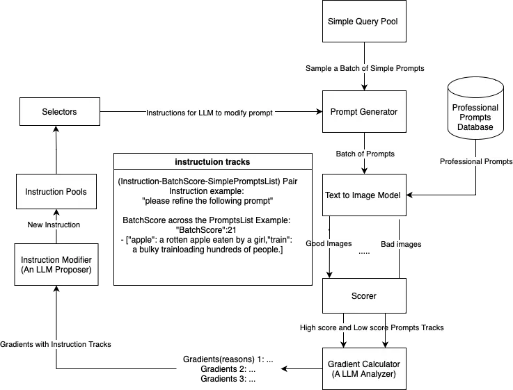
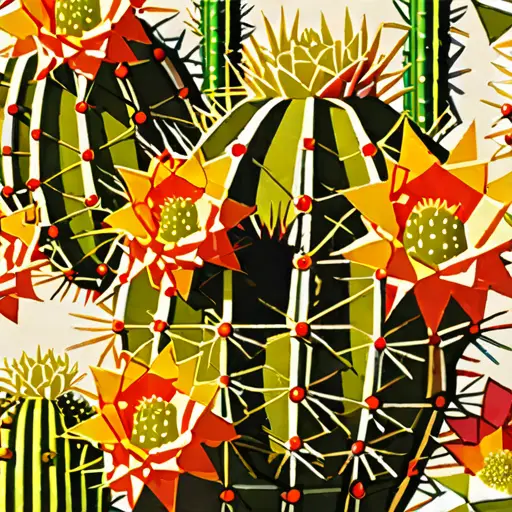

# Batch-Instructed Gradient for Prompt Evolution: Systematic Prompt Optimization for Enhanced Text-to-Image Synthesis

Xinrui Yang Affiliation: University College London
Email: <xinrui.yang.20@ucl.ac.uk>    Zhuohan Wang
Affiliation: University College London
Email: <zhuohan.wang.23@ucl.ac.uk>    Anthony Hu Affiliation: University
College London Email: <anthony.hu.19@ucl.ac.uk>

###### Abstract

Text-to-image models have shown remarkable progress in generating
high-quality images from user-provided prompts. Despite this, the
quality of these images varies due to the models’ sensitivity to human
language nuances. With advancements in large language models (LLMs),
there are new opportunities to enhance prompt design for image
generation tasks. Existing research primarily focuses on optimizing
prompts for direct interaction, while less attention is given to
scenarios involving intermediary agents, like the Stable Diffusion
model. This study proposes a Multi-Agent framework to optimize input
prompts for text-to-image generation models. Central to this framework
is a prompt generation mechanism that refines initial queries using
dynamic instructions, which evolve through iterative performance
feedback. High-quality prompts are then fed into a state-of-the-art
text-to-image model. A professional prompts database serves as a
benchmark to guide the instruction modifier towards generating
high-caliber prompts. A scoring system evaluates the generated images,
and an LLM generates new instructions based on calculated gradients.
This iterative process is managed by the Upper Confidence Bound (UCB)
algorithm and assessed using the Human Preference Score v2 (HPSv2).
Preliminary ablation studies highlight the effectiveness of various
system components and suggest areas for future improvements.

## 1 Introduction

In recent years, text-to-image models (Ramesh et al., 2021; Ramesh
et al., 2022; Pryzant et al., 2023; Nichol et al., 2021) have
demonstrated the ability to generate high-quality images from
user-provided prompts. However, the quality of these images can vary
significantly due to the models’ sensitivity to the nuances of human
language. With the rapid advancement of text generation models,
particularly large language models (LLMs), we now have the tools to
enhance prompt design for these image generation tasks. While existing
research has extensively validated the capabilities of LLMs in
optimizing prompts for direct interactionYang et al. (2024), less
attention has been given to scenarios involving an intermediary agent,
such as the Stable Diffusion model, where the prompt optimisation does
not directly instruct the LLM but rather aims to improve the output of
another system.

Previous studies have largely focused on optimizing "weight-accessible"
language models using gradient descent Pryzant et al. (2023), an
approach that, while effective, is both memory-intensive and
time-consuming. Conversely, the most advanced LLMs are often
"weight-inaccessible," accessible only via APIs, which presents unique
challenges and opportunities for prompt optimisation.

In this study, we propose a Multi-Agent framework to enhance the
capabilities of text-to-image generation models through the optimization
of input prompts. Central to our framework is a prompt generation
mechanism that intelligently crafts prompts from a repository of initial
simple queries. These queries are selectively refined using a set of
dynamic instructions, which are systematically evolved based on
iterative performance feedback, refined iteratively by dedicated agents.
Our iterative loop commences with a single initial instruction, which is
employed by an instruction modifier, tasked with transforming initial
prompts into sophisticated queries likely to yield higher-quality
images. The resulting refined prompts are fed into a state-of-the-art
text-to-image model to produce visual outputs.

To ensure the generation of high-fidelity images, we integrate a
professional prompts database, an extensive collection of high-caliber
prompts. This database functions as a benchmark, guiding the instruction
modifier towards the quality of prompts that are proven to produce
professional-grade images.

Subsequent to the image generation, a scoring system evaluates the
outputs, separating the high-quality images from the subpar ones.
Inspired by the Automatic Prompt Optimization (APO) method Pryzant
et al. (2023), the scores derived from this system are analyzed by a
gradient calculator to ascertain the factors contributing to the
prompt’s success or failure. In a novel twist, we deploy another LLM to
generate a variety of new instructions based on these calculated
gradients. This introduces a breadth of potential modifications,
ensuring that our instruction pool remains rich and versatile.

The feedback obtained from this scoring and generation cycle is used to
update the instruction tracks, thus refining the instruction pool in a
feedback loop. Additionally, to manage the instruction list size and to
balance exploitation with exploration, we employ the Upper Confidence
Bound (UCB) algorithm(Kuleshov and Precup, 2014).

The entire process is informed by a sophisticated scoring function to
accurately assess the quality of the generated images. We leverage the
Human Preference Score v2 (HPSv2) (Wu et al., 2023a) as our scorer,
which is claimed to be state-of-the-art in the field, trained on a
substantial dataset of human preference data. Through this rigorous and
methodical approach to prompt optimization, our framework seeks to
foster a more nuanced interaction between the linguistic understanding
of LLMs and the visual creation capacity of image synthesis models. The
objective is to evolve the system to a point where it can autonomously
refine prompts to consistently produce images that rival professional
standards, effectively narrowing the gap between human linguistic input
and AI-generated visual content.

Figure 1: An Overview of the our Optimizing System

Due to time constraints within the scope of this study, we conducted a
preliminary ablation study focusing on several pivotal components of our
system. We scrutinized the selection method, the size of the query
batch, and the influence of integrating a professional prompts database
to assess their individual and collective impact on the image generation
process. Our findings provide initial insights into the effectiveness of
these components and highlight their respective contributions to the
system’s performance. In parallel, we identified potential weaknesses
inherent in the current configuration, offering opportunities for future
enhancements. These insights pave the way for subsequent, more in-depth
research to further refine the system and maximize the quality of the
AI-generated images, ensuring that our prompt optimization framework
remains at the forefront of innovation in the field of text-to-image
synthesis.

## 2 Literature Review

### 2.1 Introduction to Current Text-to-Image Models and Prompt Optimisation

Recent advancements in text-to-image models like Stable Diffusion XL
(Podell et al., 2023) and Generative Adversarial Networks (GANs) have
revolutionised the capability of generating high-quality images from
textual prompts. These models often rely on nuanced prompt design to
interpret human language effectively and produce relevant images. Large
language models (LLMs) such as GPT and Llama are now extensively used to
refine these prompts, thereby enhancing the quality of outputs. This
literature review is going to discuss and compare different
text-to-image generation approaches and how researchers use language
models to optimize prompts and in turn improve image generation quality.

### 2.2 Techniques of Prompt optimisation and Their Comparative Analysis

#### 2.2.1 Reinforcement Learning and Supervised Fine-Tuning:

The paper by Hao et al. (2024) explores a hybrid approach. The approach
is defined that initial prompt templates are refined using supervised
learning to create a baseline which captures the intended stylistic and
content-specific requirements of the images. They then utilised
reinforcement learning algorithms adjust these prompts based on user
feedback and model performance. The algorithm iteratively optimizes
prompts to enhance both the aesthetic quality and relevance of the
generated images. This method is particularly effective in scenarios
where direct manipulation of model weights is not possible, offering a
flexible and responsive approach to prompt optimisation. Our approach in
this report has adapted this method since the weights of GPT are not
accessible.

#### 2.2.2 Optimisation by Prompting (OPRO)

Yang et al. (2024) study provides a novel use of LLMs as dynamic
optimizers. LLMs refine prompts repeatedly, taking into account feedback
from previous iterations This strategy, known as Optimisation by
Prompting (OPRO), improves task accuracy dramatically by leveraging
LLMs’ natural language interpretation and generating skills. The
iterative method is assessing the efficacy of a particular prompt,
modifying it based on performance indicators, and returning the modified
prompt into the system. This feedback loop enables continuous
enhancement and adaptability. This increases the system’s responsiveness
to the intricacies of user input as well as the specialised requirements
of text-to-image operations. The research demonstrates that this
approach not only enhances image quality but also aligns more closely
with user intentions. It in turn optimizes the interaction between human
inputs and automated image generation systems.

#### 2.2.3 LLM-based Prompt Optimisations

Ma et al. (2024) critically evaluate the operational issues associated
with utilising LLMs to optimize prompts for text-to-image generation in
their investigation of prompt optimisation with LLMs. They notice a key
difficulty with LLMs’ initial prompt outputs. The problem is these
outputs are linguistically consistent but they are frequently
ineffective in practical applications due to the stochastic nature of
the model answers. To resolve these inconsistencies, the researchers
propose a unique optimisation approach called "Automatic Behaviour
Optimisation" (ABO). This method turns the focus away from typical
prompt refinement and towards influencing the model’s interpretative and
generative processes. ABO aims to give a more steady and controlled
method of optimising prompts, which is especially useful in applications
that need accuracy and reliability. The application of ABO has
demonstrated encouraging outcomes in terms of lowering output
unpredictability and raising the produced prompts’ usefulness, greatly
enhancing the relationship between LLMs and subsequent text-to-image
tasks.

#### 2.2.4 State-of-the-art Scoring Model

The Human Preference Score version 2 (HPSv2) Wu et al. (2023a) is a
cutting-edge benchmarking tool for determining human preferences for
images created via text-to-image synthesis. HPSv2 is based on the CLIP
model and fine-tuned using a big human preference dataset. It
outperforms earlier approaches including HPSv1 (Wu et al., 2023b),
ImageReward (Xu et al., 2024), and PickScore (Kirstain et al., 2024) for
predicting which pictures people would like. It stands out for its
excellent accuracy, which reached 83.3% on the HPD v2 dataset. This
implies that it can accurately replicate human judgement in judging
synthetic pictures. The strength of HPSv2 is its strong training and
ability to generalise across diverse types of pictures, making it the
gold standard for evaluating image generating models.

### 2.3 Inspirations to our project

The methodologies discussed in these papers are directly related to the
research question of how to optimize prompts for text-to-image tasks
using LLMs without direct weight manipulation. Each method offers a
unique perspective on managing the complexities of LLMs that are
weight-inaccessible, providing various strategies from adversarial
learning to reinforcement learning and textual gradients. These
approaches are crucial for understanding how to effectively use LLMs as
Prompt Modifiers, which can refine instructions given to another system,
such as a text-to-image model, to enhance output quality.

The reviewed literature gives a detailed overview of several techniques
for optimising prompts in text-to-image generation tasks. These
strategies not only improve the direct outputs of such models, but they
also widen the possible uses of LLMs in digital media development. By
comparing diverse techniques, this review focuses on how academics are
addressing the issues related with weight-inaccessible LLMs, opening the
door for more advanced and accessible digital media tools.

## 3 Methodology

### 3.1 prompt optimization for image generation

In this project, we optimize the instruction of Generator, guiding it
refine a naive prompt says $`X`$ to the output $`Y`$ which is an
elaborate and refined prompt with detailed description in scene, color,
style, quality, succeeding in generating image correlating with original
object and intention but more human preference fulfilling.

The architecture of the system is composed of three distinct language
model agents operationalized via the GPT-3.5 Turbo, accessed through the
OpenAI Assistant API. These agents are:

- •
  The Generator ($`\mathcal{G}`$), responsible for refine naive prompts,
  transforming them into detailed prompts suitable for generating
  high-fidelity images. The input to $`\mathcal{G}`$ is represented by
  the tuple $`(I,X)`$, where: The output of $`\mathcal{G}`$ is the
  refined prompt follows instruction.
  - –
    $`I`$ is the instruction undergoing optimization to enhance the
    capability of prompt generation.
  - –
    $`X`$ is the naive prompt subject to refinement.

- •
  The Instruction Modifier ($`\mathcal{I}_{\text{mod}}`$), which tasked
  with the modification and enhancement of the extant instructions. Its
  purpose is to incorporate specific improvements proposed by the
  Gradient Calculator ($`\mathcal{GC}`$) to elevate the quality and
  performance of generated prompts.

  The operation of $`\mathcal{IM}`$ is characterized by the input tuple
  $`(\text{Impr},\text{Instr})`$, where:
  - –
    Impr denotes the set of suggested improvements for the instruction,
    as determined by $`\mathcal{GC}`$.
  - –
    Instr is the instruction that is currently yielding the least
    satisfactory results and is thereby targeted for refinement.

  Upon receiving its inputs, $`\mathcal{IM}`$ yields an output of $`n`$
  new instructions, each corresponding to $`n`$ distinct improvements.
  Formally, this process is defined by the mapping
  $`\mathcal{IM}:(\text{Impr},\text{Instr})\mapsto\{\text{New\_Instr}_{1},\text{New\_Instr}_{2},\ldots,\text{New\_Instr}_{n}\}`$,
  where $`\{\text{New\_Instr}_{i}\}_{i=1}^{n}`$ represent the series of
  refined instructions.

- •
  The Gradient Calculator ($`\mathcal{G}_{\text{calc}}`$), whose primary
  function is to deduce the incremental enhancements necessary for the
  Generator’s instruction set. The rationale behind $`\mathcal{GC}`$ is
  to analyze the differential in performance between prompts yielding
  lower scores and those with the highest scores within a given batch,
  which pertains to the same object—detailed further in the appendix.

  The input for $`\mathcal{GC}`$ is given by the triplet
  $`(\text{Instr},\text{Low\_score\_prompt},\text{High\_score\_prompt})`$,
  where:
  - –
    Instr represents the current instruction correlated with the
    generation of the lowest average score prompts in the instruction
    list.
  - –
    Low_score_prompt is the set of prompts that, under the governance of
    Instr, have resulted in the lowest average scores.
  - –
    High_score_prompt signifies the prompt evaluated as most
    human-preferred image in the prompts pool.

  The output of $`\mathcal{GC}`$ is a series of suggestions intended to
  refine the instruction, analogous to a gradient utilized in the
  iterative generation of new instructions.

Complementing these agents is HPS v2, a text-to-image evaluation model
that gauges the affinity of generated images to human preferences. The
model, symbolized by $`\mathcal{H}`$, assigns scores to images crafted
from diversified refined prompts, all stemming from the identical naive
prompt $`X`$. The mathematical representation of the scoring function is
given by $`S:\mathcal{H}\times\mathcal{P}\rightarrow\mathbb{R}`$, where
$`\mathcal{P}`$ represents the set of prompts, and $`\mathbb{R}`$
denotes the real number scoring domain. Feedback from $`S`$ informs
subsequent refinements, ensuring adherence to a stringent criterion of
aesthetic and pertinence in the generated images.

1: Input:
$`G(\text{Instr}_{i},x_{i}),GC(\text{Instr}_{i},\text{low}_{s}\text{Prompt}_{i},\text{High}_{s}\text{Prompt}_{i}),`$

2:   
$`IM(\text{Improvement}_{i},\text{Instr}_{i}),S(\text{prompt},\text{image})`$

3: where $`G=\text{Generator},GC=\text{Gradient Calculator},`$

4:    $`IM=\text{Instruction Modifier},S=\text{Scorer}`$

5: Initialization: $`\text{instruction\_list}\leftarrow[]`$,
$`\text{prompt\_pool}\leftarrow\{\}`$

6: for $`\text{iter}\in\text{iterations}`$ do

7:   if instruction_list is empty then

8:    instruction_list.append(init_instr)

9:   end if

10:
  $`\text{querys}\leftarrow\text{sample}(\text{batch\_size naive prompts as querys})`$

11:   $`\triangleright`$ generate prompts based on existing instruction

12:   for $`\text{instruction}\in\text{instruction\_list}`$ do

13:    $`\text{batch\_loss}\leftarrow 0`$

14:    for $`\text{query}\in\text{querys}`$ do

15:
     $`\text{generated\_prompt}\leftarrow G.\text{output}(\text{instruction},\text{query})`$

16:      $`\triangleright`$ add generated prompt to prompt pool

17:      $`\text{generated\_prompt }\to\text{prompts\_pool}`$;

18:
     $`\text{loss}\leftarrow S(\text{query}\text{sdx\_turbo}(\text{generated\_prompt}))`$

19:      $`\text{batch\_loss}\leftarrow\text{batch\_loss}+\text{loss}`$

20:    end for

21:    $`\triangleright`$ add instruction and its loss to list

22:
   $`\text{instruction\_list}[\text{instruction}]\leftarrow(\text{Avg}(\text{batch\_loss}),\text{generated\_prompt\_list})`$

23:   end for

24:   for $`\text{query}\in\text{querys}`$ do

25:    $`\triangleright`$ add lexica_prompts to prompt_pool

26:
   $`\text{lexica\_prompts}\leftarrow\text{fetch\_prompts\_from\_lexica}(\text{query})`$

27:   end for

28:   epsilon_greedy_instr_selection()

29:
  $`\text{instr\_to\_modify}\leftarrow\text{find\_lowest\_instruction}()`$

30:
  $`\text{improvement}\leftarrow GC(\text{instr\_to\_modify},X,\text{high\_score\_prompt})`$

31:   $`\triangleright`$ add new_instr to instruction_list

32:
  $`\text{new\_instr}\leftarrow IM(\text{improvement},\text{instr\_to\_modify})`$

33:   $`\text{new\_instr}\to\text{instruction\_list}`$;

34:   $`\triangleright`$ next iteration

35: end for

Algorithm 1 Algorithm of Generator prompt optimisation

### 3.2 Batch Query Sampling

To ensure our prompt Modifier generalizes across a wide range of user
prompts, we adopt a strategy akin to batch gradient descent. In each
iteration, we uniformly sample a batch of queries $`Q`$ from the pool of
simple prompts. The objective is to minimize the expected loss across
all possible prompts, aiming for a Modifier that performs well on the
average case rather than overfitting to specific instances.

Mathematically, we express this as optimizing the expected loss
$`\mathbb{E}_{q\sim P}[L(f_{\theta}(q),y)]`$, where $`\theta`$ denotes
the Modifier’s parameters, $`L`$ the loss function, $`f_{\theta}`$ the
Modifier function, $`q`$ a sampled query, and $`y`$ the target output.

By updating $`\theta`$ based on the empirical loss from the batch, we
regularize the training process to prevent overfitting, ensuring the
Modifier’s broad applicability.

### 3.3 Selector

In our methodology, the Selector component plays a critical role in
maintaining a constant length of the instruction list, a challenge akin
to the well-known Multi-Armed Bandit Problem. The reward metric in our
context is the batch loss associated with each instruction in the
tracks, providing a direct measure of instruction efficacy.

Our initial intention was to utilize the Upper Confidence Bound (UCB)
algorithm, renowned for its balance between exploration of new
strategies and exploitation of known rewarding actions. To validate this
choice, we conducted comparative analyses with other prevalent selection
strategies, including a greedy approach that consistently favors the
instruction with the lowest batch loss, and an epsilon-greedy method,
which introduces a probability of selecting a suboptimal instruction to
allow for exploration beyond the immediately rewarding options.

## 4 Results

For witnessing the increase of quality of image generated using the
optimized prompt of Generator, we set the baseline by using the normal
instruction for prompt refinement and textimage generation which is
"This is the original prompt that you need to carefully refine, Prompt
or subject to refine :{query}", the lexica prompt directed generated
image and our optimised Generator instruction"Integrate exercises that
challenge writers to distill their descriptions to the most essential
elements while effectively evoking the desired emotions, reinforcing the
lesson on brevity and precision in storytelling. Emphasize the use of
impactful language and imagery to succinctly capture the essence of a
scene and immerse the reader in a cohesive narrative that evokes awe,
wonder, and exploration, ultimately igniting feelings of exhilaration
and reverence for the boundless beauty and possibilities within the
depicted setting,Prompt or subject to refine is : {query}"

(a) Baseline image generated using GPT-3.5’s initial instruction

(b) Image generated on Lexica’s prompt

(c) Optimized image using UCB selection method

Figure 2: Comparison of images generated from the same input "cactus"
using different methods.

The results of experiments are shown below in Table 1.

| Batch size | Selection Method | initial Score | Last Iteration Score |
| ---------- | ---------------- | ------------- | -------------------- |
| 1          | UCB              | 25.54         | 28.78                |
| 3          | UCB              | 28.3          | 27.69                |
| 5          | UCB              | 27.61         | 27.88                |
| 3          | greedy           | 27.62         | 28.02                |
| 3          | epsilon_greedy   | 27.98         | 28.72                |

Table 1: Results of experiments in different selection method and batch
size.

| Method          | Score |
| --------------- | ----- |
| GPT3.5 Baseline | 26.34 |
| Lexica Baseline | 26.14 |
| Our method      | 26.72 |

Table 2: Comparison with GPT3.5 and lexica Baseline

able 1 reveals outcomes from testing different batch sizes and selection
methods on image generation across 10 iterations. Using the Upper
Confidence Bounds (UCB) method with a batch size of 1, scores improved
from 25.54 to 28.78. However, a batch size of 3 with UCB saw a slight
decrease from 28.3 to 27.69, while increasing to batch size 5 led to a
small increase from 27.61 to 27.88. The greedy method with batch size 3
raised the score from 27.62 to 28.02, and the epsilon-greedy method
increased it more significantly from 27.98 to 28.72.

These results indicate that smaller batch sizes with UCB showed the most
significant improvement, whereas larger sizes under the same method
slightly decreased or marginally improved. Conversely, both greedy and
epsilon-greedy methods with a batch size of 3 enhanced scores,
demonstrating how different strategies impact image generation efficacy.

Additionally, baseline comparisons 2 were conducted to evaluate our
method against the GPT-3.5 baseline, where GPT-3.5 served as a prompt
modifier, and Lexica, which acted as a human professional baseline by
sourcing corresponding prompts based on queries. For fairness, 10 simple
prompts were sampled, and average scores were extracted for each system.
Results indicated that our method outperformed each baseline approach.

### 4.1 Meaningful suggestion given by Gradient calculator

The following are example outputs of the Gradient calculator, showcasing
the low score and high score prompt group, followed by the inferred
insights and proposed improvements for the instruction,guiding it to
generate the structure and content approach high score prompts :

- •
  Low Score Object 0: Aquarium with sharks
  - –
    Low Score Generated Prompt 0: A captivating aquarium display
    featuring powerful sharks, offering a glimpse into the mysterious
    world of these majestic creatures in a controlled and mesmerizing
    environment.
  - –
    Score: 27.587890625

- •
  Low Score Object 1: Farm with windmill
  - –
    Low Score Generated Prompt 1: Enhanced Prompt: Immerse yourself in
    the idyllic charm of a countryside farm, where a majestic windmill
    towers over lush fields of swaying wheat and vibrant sunflowers…
  - –
    Score: 26.3671875

- •
  High Score Object 0: Aquarium with sharks
  - –
    High Score Prompt 0: An aquarium exhibit featuring majestic sharks
    gliding effortlessly through the water, their sleek bodies cutting
    through the vibrant underwater environment…
  - –
    Score: 28.5400390625

- •
  High Score Object 1: Farm with windmill
  - –
    High Score Prompt 1: Refined Prompt: A serene farm landscape
    featuring a classic windmill set against a backdrop of rolling
    fields, depicting the timeless charm of rural life and agricultural
    tradition.
  - –
    Score: 27.2705078125

### Inferences and Improvements

- •
  Inference 0: The low score prompts lack depth and fail to evoke a
  sense of intrigue or engagement, missing opportunities to add layers
  of complexity or emotion to the scenes described.
- •
  Inference 1: The low score prompts tend to be overly elaborate and
  excessively detailed, which can overwhelm the reader and detract from
  the core message of the prompt.
- •
  Improvement 0: Emphasize the importance of creativity and originality
  in prompt generation, encouraging writers to think outside the box and
  incorporate unexpected elements to pique the reader’s interest.
- •
  Improvement 1: Encourage writers to strike a balance between detailed
  descriptions and concise communication in their prompts, ensuring that
  every detail adds value to the overall visualization without
  overwhelming the reader.

## 5 Discussion

The analysis presents a clear distinction in image quality when
comparing outputs generated from initial and optimized instructions. The
images crafted with our optimization methods demonstrably align more
closely with human aesthetic preferences. This enhancement is reflected
in our results table, where scores for images from the final iteration
surpass those from the initial round, with the singular exception of the
batch size three UCB experiment. The deviation in this instance is
likely attributed to the exploratory component of the UCB algorithm,
necessitating additional iterations to attain conclusive evidence of
convergence and ultimate performance efficacy.

Adjustments to the batch size have revealed a correlation with the rate
of convergence towards optimal instruction refinement, offering broader
improvements across batches of prompts. However, this comes at the
increased expense of input and output tokens for each iteration,
indicating a trade-off between the rate of improvement and computational
resource allocation.

Further, the study indicates that image quality is contingent upon the
chosen diffusion model and the depicted object. For example, the
SDX_turbo model employed within our experiments demonstrates the
capacity to generate visually appealing images with high scores, even
from simpler, naive prompts. This observation is consistent across
representations of specific subjects such as ’flaming Phoenix’ and
’luxury yacht’, where complex, detailed prompts do not necessarily yield
a commensurate increase in image quality. These variations suggest that
the perceived improvements in image scores from the last iteration of
experiments may be less pronounced under certain conditions.

## 6 Limitation

The restrictions of this work are classified into three categories: time
limits, computational resource limitations, and the unpredictability
inherent in diffusion models.

The project’s short plan prevented thorough experimentation with a
variety of concepts. As a result, engaging with sophisticated models
such as Llama or GPT-4 was not practical. Furthermore, model training
was limited to 10 iterations at most, which is a significant constraint.
Given the significant time and processing power necessary to fully train
such models, the limited number of iterations most certainly hampered
the models’ capacity to achieve optimal convergence, as evidenced by the
minor improvements seen in our studies.

Second, the exploratory scope of diffusion models was restricted.
Diffusion models’ performance can vary greatly—some models may create
superior pictures with simple instructions, while others may require
complex, comprehensive inputs to obtain equivalent results. As a result,
a more in-depth examination into alternative diffusion models may have
provided a more complete grasp of their possibilities.

For future goals, if greater computer resources become available, the
number of training iterations should be significantly increased.
Furthermore, doing a comparison analysis across a range of diffusion
models is likely to broaden and deepen the findings.

## 7 Code

The github link is given here, please click on it to reach our
repository :
[Group20-MAAI-Code](https://github.com/slark-prime/MAAI_Optimizer)

## Appendix A Example Instructions

| Prompt Design              |                                                                                                                                                                                                                                                                                                                                                                                                                                                                                                                                                                                                                                                                                                                                                                                                                                                                                                                                                      |
| -------------------------- | ---------------------------------------------------------------------------------------------------------------------------------------------------------------------------------------------------------------------------------------------------------------------------------------------------------------------------------------------------------------------------------------------------------------------------------------------------------------------------------------------------------------------------------------------------------------------------------------------------------------------------------------------------------------------------------------------------------------------------------------------------------------------------------------------------------------------------------------------------------------------------------------------------------------------------------------------------- |
| Demonstration              |                                                                                                                                                                                                                                                                                                                                                                                                                                                                                                                                                                                                                                                                                                                                                                                                                                                                                                                                                      |
| Gradient Calculator Input  | Analyze the following low score and high score batch, each prompt with corresponding scores. And infer what’s wrong with the instruction generating low score batch prompt to suggest the improvement of the instruction:For your answer use the format: Inference 1: your inference_1 Inference 2: your inference_2 Inference n: your inference_n… Improvement 1: you suggested improvement correspond to inference 1 Improvement 2: you suggested improvement correspond to Inference 2 Improvement n: you suggested improvement correspond to inference n… This is the generator instruction:{instruction} and first corresponding generated low score prompts group: low_score_object{i}:{obj_i}, low_score_generated_prompt: {low_score_prompt_i},score:{low_score_i} below is high score prompts group: high_score_object{i}:{obj_i}, high_score_prompt: {high_score_prompt_i},score: {high_score_i}"                                          |
| Gradient Calculator Output | analyze_and_propose: Summary of Reasons for Scores: Inference 1: The low score prompts may have focused too much on describing the hot air balloon and the view, while not incorporating the feeling of exhilaration and awe effectively. Inference 2: The low score prompts may have lacked creativity in conveying the emotions of exhilaration and awe through the scene described. Improvement 1: Encourage writers to not only describe the setting but also focus on capturing the emotions of exhilaration and awe experienced by the passengers in the hot air balloon. Improvement 2: Provide examples or suggestions on how to infuse more creativity and emotional depth into the description of the panoramic view, making it more evocative of exhilaration and awe. Improvement 3: Include guidance on using vibrant language and sensory details to intensify the reader’s experience of exhilaration and awe in the scene described. |

Table 3: Examples of Gradient Calculator Input and Output

## References

- Hao et al. \[2024\] Yaru Hao, Zewen Chi, Li Dong, and Furu Wei.
  Optimizing prompts for text-to-image generation. _Advances in Neural
  Information Processing Systems_, 36, 2024.
- Kirstain et al. \[2024\] Yuval Kirstain, Adam Polyak, Uriel Singer,
  Shahbuland Matiana, Joe Penna, and Omer Levy. Pick-a-pic: An open
  dataset of user preferences for text-to-image generation. _Advances in
  Neural Information Processing Systems_, 36, 2024.
- Kuleshov and Precup \[2014\] Volodymyr Kuleshov and Doina Precup.
  Algorithms for multi-armed bandit problems. _arXiv preprint
  arXiv:1402.6028_, 2014.
- Ma et al. \[2024\] Ruotian Ma, Xiaolei Wang, Xin Zhou, Jian Li, Nan
  Du, Tao Gui, Qi Zhang, and Xuanjing Huang. Are large language models
  good prompt optimizers?, 2024.
- Nichol et al. \[2021\] Alex Nichol, Prafulla Dhariwal, Aditya Ramesh,
  Pranav Shyam, Pamela Mishkin, Bob McGrew, Ilya Sutskever, and Mark
  Chen. Glide: Towards photorealistic image generation and editing with
  text-guided diffusion models. _arXiv preprint arXiv:2112.10741_, 2021.
- Podell et al. \[2023\] Dustin Podell, Zion English, Kyle Lacey,
  Andreas Blattmann, Tim Dockhorn, Jonas Müller, Joe Penna, and Robin
  Rombach. Sdxl: Improving latent diffusion models for high-resolution
  image synthesis, 2023.
- Pryzant et al. \[2023\] Reid Pryzant, Dan Iter, Jerry Li, Yin Tat Lee,
  Chenguang Zhu, and Michael Zeng. Automatic prompt optimization with
  "gradient descent" and beam search, 2023.
- Ramesh et al. \[2021\] Aditya Ramesh, Mikhail Pavlov, Gabriel Goh,
  Scott Gray, Chelsea Voss, Alec Radford, Mark Chen, and Ilya Sutskever.
  Zero-shot text-to-image generation. In _International conference on
  machine learning_, pages 8821–8831. Pmlr, 2021.
- Ramesh et al. \[2022\] Aditya Ramesh, Prafulla Dhariwal, Alex Nichol,
  Casey Chu, and Mark Chen. Hierarchical text-conditional image
  generation with clip latents. _arXiv preprint arXiv:2204.06125_,
  1(2):3, 2022.
- Wu et al. \[2023a\] Xiaoshi Wu, Yiming Hao, Keqiang Sun, Yixiong Chen,
  Feng Zhu, Rui Zhao, and Hongsheng Li. Human preference score v2: A
  solid benchmark for evaluating human preferences of text-to-image
  synthesis, 2023a.
- Wu et al. \[2023b\] Xiaoshi Wu, Keqiang Sun, Feng Zhu, Rui Zhao, and
  Hongsheng Li. Human preference score: Better aligning text-to-image
  models with human preference, 2023b.
- Xu et al. \[2024\] Jiazheng Xu, Xiao Liu, Yuchen Wu, Yuxuan Tong,
  Qinkai Li, Ming Ding, Jie Tang, and Yuxiao Dong. Imagereward: Learning
  and evaluating human preferences for text-to-image generation.
  _Advances in Neural Information Processing Systems_, 36, 2024.
- Yang et al. \[2024\] Chengrun Yang, Xuezhi Wang, Yifeng Lu, Hanxiao
  Liu, Quoc V. Le, Denny Zhou, and Xinyun Chen. Large language models as
  optimizers, 2024.
