# Generative AI-based Prompt Evolution Engineering Design Optimization With Vision-Language Model

Melvin Wong¹, Thiago Rios², Stefan Menzel², Yew Soon Ong¹ Affiliation: 
Affiliation: ¹College of Computing & Data Science (CCDS), Nanyang
Technological University (NTU), Singapore  
²Honda Research Institute Europe (HRI-EU), Offenbach am Main, Germany

{wong1357, asysong}@ntu.edu.sg, {thiago.rios, stefan.menzel}@honda-ri.de

###### Abstract

Engineering design optimization requires an efficient combination of a
3D shape representation, an optimization algorithm, and a design
performance evaluation method, which is often computationally expensive.
We present a prompt evolution design optimization (PEDO) framework
contextualized in a vehicle design scenario that leverages a
vision-language model for penalizing impractical car designs synthesized
by a generative model. The backbone of our framework is an evolutionary
strategy coupled with an optimization objective function that comprises
a physics-based solver and a vision-language model for practical or
functional guidance in the generated car designs. In the prompt
evolutionary search, the optimizer iteratively generates a population of
text prompts, which embed user specifications on the aerodynamic
performance and visual preferences of the 3D car designs. Then, in
addition to the computational fluid dynamics simulations, the
pre-trained vision-language model is used to penalize impractical
designs and, thus, foster the evolutionary algorithm to seek more viable
designs. Our investigations on a car design optimization problem show a
wide spread of potential car designs generated at the early phase of the
search, which indicates a good diversity of designs in the initial
populations, and an increase of over 20% in the probability of
generating practical designs compared to a baseline framework without
using a vision-language model. Visual inspection of the designs against
the performance results demonstrates prompt evolution as a very
promising paradigm for finding novel designs with good optimization
performance while providing ease of use in specifying design
specifications and preferences via a natural language interface.

###### Index Terms: 

prompt evolution, vision-language model, large language models,
generative AI, text-to-3D, evolutionary optimization, engineering design
optimization

## I Introduction

Generative artificial intelligence (GenAI) and large language models
(LLMs) are currently contributing to major advances in a variety of
fields, such as text and image-based content generation, dialog-based
systems, knowledge retrieval and management, and co-programming, among
others. The intuitive interaction through natural language processing
(NLP) using text prompts allows non-experts to access domain knowledge
and execute domain-specific processes in a cooperative fashion. In the
field of product development, human users strive for the generation of
novel and realizable designs, i.e., images, and 3D shapes, which fulfill
pre-defined specifications and ideally perform well in a variety of
environment conditions. For image or video synthesis from text prompts,
there exists a portfolio of tools, e.g. OpenAI’s Dall-E 3 \[1\], stable
diffusion \[2\], Midjourney and Lumiere \[3\], which provides
high-quality visual results taken into account user ideas, constraints,
style requests, and further context.

Differently, 3D shape synthesis through prompt-based data-driven
generative models is still very challenging. In the field of geometric
deep learning \[4\], there are several successful attempts to utilize
generative models, such as autoencoders, to learn 3D design data and
perform geometric operations based on the learned latent representations
\[5, 6, 7\]. However, while image-generative models rely on a massive
amount of (annotated) data, the number of publically available annotated
data sets containing 3D objects represented as watertight and non-skewed
meshes for training text-to-3D models is much lower. In addition,
generating 3D design data with high variability and corresponding
performance as annotation, e.g. vehicle aerodynamic drag, requires high
manual and computational effort, which hinders the development of new
data sets for GenAI applications in industrial settings. Despite the
challenges, with the advance of LLMs, OpenAI recently released Point-E
\[8\] and Shap-E \[9\], which allow users to generate 3D shapes from
text prompts.

The ease of using text-to-_X_ generative models as black-box to obtain a
diverse set of designs quickly has garnered significant interest in the
computation engineering design optimization domain. Although the
interfaces allow the users to express design specifications in a natural
way, the practicality of novel designs synthesized by such generative
models needs to be carefully treated and assessed, particularly for the
design variations synthesized throughout a design optimization task.
Since generative models learn the distribution of the representation of
various objects, it is unclear which variety of shapes can be combined
or interpolated to generate practical novel designs. Additionally,
generative models tend to “hallucinate” designs, especially for prompts
with multiple concepts or preferences, which potentially fit the
description in the input prompt but can be impractical for engineering
design. For example, the prompt “a fast car in the shape of a wing”
should lead a text-to-3D model to generate a vehicle-like geometry that
resembles the shape of a wing (Fig. 1 (a)) but some of the generated
models might be ill-defined designs that still resemble a car (Fig. 1
(b)). Hence, the stochasticity of text-to-_X_ models can significantly
impact the evolution process of a fully automated evolutionary design
optimization framework by leading the global search to regions with many
optimal yet impractical designs.

|                                                             |                                                             |
| ----------------------------------------------------------- | ----------------------------------------------------------- |
| 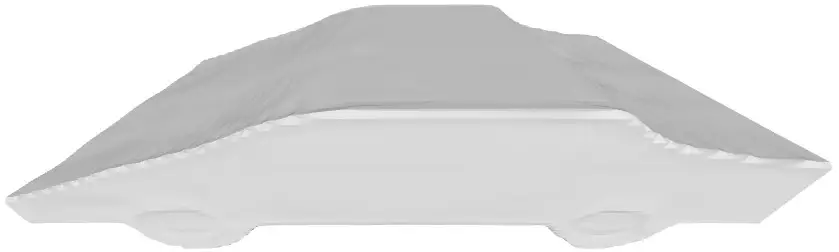 | 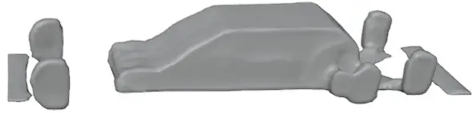 |
| \(a\) Practical Car Design                                  | \(b\) Impractical Car Design                                |

Fig. 1: Text-to-3D model, Shape-E \[9\], using the prompt ”a fast car in
the shape of a wing” can synthesize practical novel car designs (Fig. 1
(a)). However, it sometimes “hallucinates”, resulting in a car design
(Fig. 1 (b)) that still resembles a “car” but bears a malformed shape
and has disconnected geometries, rendering such design impractical for
engineering design.

To mitigate the generation of “hallucinated” designs, in the present
paper, we propose a fully automated prompt evolution design optimization
(PREDO) framework based on an evolutionary design optimization process,
introduced in \[10\], with a pre-trained vision-language model that
identifies impractical designs synthesized by generative models. Through
this novel extension, we improve the optimization by penalizing the
fitness of impractical designs that are identified by the
vision-language model and, thus, have a lower rank than practical
designs during scoring and selection. Hence, due to the clearer
detection of viable designs, we expect the deployed evolutionary
algorithm to construct prompts more likely to yield practical designs.
In our experiments, we utilize different vision-language models and
evaluate our PREDO framework by comparing the optimization performance
with respect to corresponding unconstrained cases, which allows us to
identify the contribution of the penalization to the objective function
and impact of the vision-language model in the optimization process.

In summary, our contributions are as follows:

- •
  A prompt evolutionary design optimization (PREDO) framework that
  incorporates two language-based AI models, (1) a generative text-to-3D
  model for shape synthesis and (2) a vision-language model to rank
  practical designs higher than impractical ones, allowing more viable
  designs to be found.
- •
  An optimization objective function that employs a physics solver and a
  vision-language model for physical and visual guidance, working in
  harmony during the evolutionary process to find novel and practical
  designs.

The remainder of this paper is organized as follows: In Section II, we
discuss notable works in the literature related to 3D generative models
for design optimization and prompt tuning applied to text-to-_X_ models.
Section III provides an overview of our proposed fully automated
evolutionary design optimization PREDO framework, highlighting various
strategies for constructing the text prompt during the evolution process
and detailing how vision-language models can be integrated into the
framework. Section IV presents the application of our proposed method in
design optimization for minimizing aerodynamics or projected frontal
area of car designs and provides a comprehensive analysis of our
experiments. We conclude this paper in Section V and highlight potential
future research directions.

## II Literature Review

The recent advances in hardware and software technologies, e.g. new
powerful graphic cards (GPUs) and dedicated libraries for GPU-based
computation, enabled the development of more sophisticated machine
learning architectures, such as geometric deep learning \[4\] techniques
for training 3D shape-generative models. In the context of engineering
tasks, promising results have been achieved with the learning-based
representation of 3D shapes, such as for car aerodynamic design and
optimization \[6, 11\], as well as surrogate modeling for performance
prediction \[12, 13\]. In these cases, as the latent variables are
learned from large design data sets, e.g. ShapeNetCore \[14\], the
latent space potentially provides the optimization algorithm a broader
range of solutions than typical design variables selected by a human
user. However, the representations learned by these models lack
interpretability, which hinders the application of more specific
geometric design constraints in optimization or manual modification of
the designs.

Recently, novel text-based generative models have been proposed, which
allow the user to specify the design preferences using natural language
explicitly. Point-E \[8\] and Shap-E \[9\], proposed by OpenAI, were the
first models that generate 3D objects from text prompts. While Point-E
was an initial model based on 3D point cloud representations, Shap-E
provides more advanced features, such as a differentiable implementation
of the marching cubes 33 algorithm to generate output shapes as
polygonal meshes, which are often required for rendering objects in
computer graphics or for simulation-based applications in engineering.

Shap-E was recently integrated into a vehicle aerodynamic drag
minimization problem and showed that Shap-E is a suitable generative
model for engineering optimization \[10\]. In that work, the authors
proposed a fully automated evolutionary design optimization framework
incorporating evolutionary strategy and performance-based guidance to
find novel 3D car designs. Nevertheless, the authors also claim that the
design search in the text-prompt space is still challenging, even more
so as Shap-E was not trained specifically on a data set of car shapes,
potentially leading to many ill-defined designs.

Lately, some work has been done to generate annotated data sets focused
on design modifications through text prompts \[15\], which improves the
control over the design modifications but the available data are still
limited to a small number of object classes. However, a more promising
approach to improve the performance of design optimizations based on
text prompts is to add prompt tuning mechanisms, which avoid the
generation of prompts that yield ill-defined meshes or designs, unlike
car shapes.

Arechiga et al. train a dedicated surrogate model to provide
physics-based guidance into the denoising process of a diffusion model
\[16\], opening up new possibilities for optimizing 2D car designs with
respect to a performance metric during the generation process. However,
such an approach requires an extensive collection of training datasets,
which is not applicable in most engineering design optimization
scenarios.

The recently conceptualized prompt evolution paradigm for GenAI \[17\]
demonstrated the feasibility of leveraging the evolutionary process and
a vision-language model as the black-box preference guidance to
synthesize multiple outputs that best satisfy target preferences
inferred by the text prompt. In this work, examples showed how the
target preferences are served via a natural language interface to the
CLIP model \[18\] for assessing the probability of generated images
satisfying the target preferences. Using such pre-trained
vision-language models \[18, 19\] avoids the need to train a dedicated
model and can also provide ease of use in specifying the design
specifications and preferences with good generalizability and accuracy.
Hence, in the present work, we combine the benefits of learning-based
representations, the prompt evolution paradigm, and visual-based and
physics-based guidances to propose a novel framework for solving
engineering design optimization problems.

## III Methods

Evolutionary design optimization is widely used in real-world
engineering applications where performance objective gradients are
inaccessible or incomputable. In contrast to traditional numerical
design encodings, we rely in this paper on a language-model-based
representation following \[10\] and improve the generation of valid car
designs by including a vision-language model. To this end, we conceptual
the idea that we define as follows:

###### Definition 1 (Prompt Evolutionary Design Optimization).

_Prompt Evolutionary Design Optimization (PREDO) imparts evolutionary
variation to the prompt that best satisfy the design objective(s), with
the aim of guiding generative AI to synthesize practical designs. ._

Our proposed prompt evolutionary design optimization (PREDO) framework
comprises four key components: (1) a derivative-free evolutionary
optimizer, (2) a text-to-3D generative model, (3) a novel integration of
vision-language models, and (4) a physics-based solver to evaluate car
design performance.

### III-A Overview

Our framework begins with the optimizer sampling a population of $`N`$
set of words where each word is selected based on a distance function
between a reference word and its corresponding sample word (Fig. 2).
Each set of words is then used to instantiate the prompt template
containing the immutable specifications expressed in free-form natural
language. The $`N`$ text prompts are provided to the text-to-3D
generative model, which synthesizes $`N`$ designs, with each design
represented as 3D polygonal meshes that best satisfy the prompt. The
synthesized 3D designs are then post-processed for the physics-based
solver to evaluate the design performance. The design performance
$`s_{design}`$ is then computed and normalized using the following
equation to serve as the fitness scores for the optimizer.

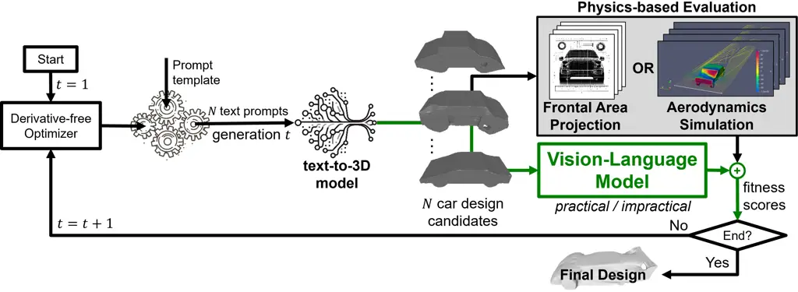

Fig. 2: Building upon the fully automated evolutionary optimization
framework \[10\], the vision-language model is introduced into the
prompt evolutionary design optimization (PREDO) framework, guiding the
optimizer to find more viable designs.

```math
f_{score}=\frac{s_{design}}{max(s_{base})-min(s_{base)}} \tag{1}
```

Here, $`s_{base}`$ is the baseline design performance of a reasonably
large population of design of interest generated using the text-to-3D
generative model.

The design optimization objective is then:

```math
\min f_{score} \tag{2}
```

Based on the convergence criteria, such as maximum generations or
minimal improvement gained, the optimization iteration either terminates
and presents the last generation designs for user selection or applies
the selected evolutionary selection pressure strategy and repeats the
evolution process for the next generation.

### III-B Strategies for Constructing the Prompt

In the framework from the reference work, the authors proposed two
strategies for constructing the prompt \[10\]. The first strategy
employs the Wordnet \[20\] vocabulary set as bag-of-words (BoW), which
the optimizer will sample pairs of $`<`$_adjective_$`>`$ and
$`<`$_noun_$`>`$ to instantiate the following prompt template

A $`<`$_adjective_$`>`$ car in the shape of $`<`$_noun_$`>`$.

The optimizer will select the sample words using Wu & Palmer (WUP)
similarity metric \[21\] with respect to the reference
$`<`$_adjective_$`>`$ and $`<`$_noun_$`>`$ words.

On the other hand, the second strategy deploys the following prompt
template

A car in the shape of $`<`$_string_$`>`$,

where the $`<`$_string_$`>`$ comprises of the most common words in
vocabulary. Here, the evolutionary optimizer will sample the common
words from a normal distribution.

As an unconstrained optimization problem, the synthetic generation of
the prompts may force the model to sample out of the learned
distribution and generate ill-defined designs \[10\]. Albeit ill-defined
designs are impractical in the real world, e.g., flat car designs
without space for passengers, some of the geometries yield better
aerodynamic performance than the other individuals in the population and
are selected as parents to generate new offspring. Consequently, the
optimization can foster the generation of prompts that lead to other
impractical high-performance designs that do not meet the user
requirements. Therefore, we propose adding a soft constraint using a
vision-language model to avoid generating ill-defined designs during the
optimization.

### III-C Prompt Evolutionary Design Optimization with Vision-Language Model

In this section, we propose a technique that addresses the generation of
ill-defined designs by a text-to-3D model as candidates in the evolution
process, which we seamlessly integrate into the framework discussed in
Section III A and B.

#### III-C1 Vision-Language Model as Soft Constraint

A straightforward way is to employ a black-box solver to identify
ill-defined car designs based on the expected design performance range
and remove or penalize such designs. However, such a solver is
computationally expensive. Furthermore, removing impractical car designs
as a post-processing step complicates the mutation and selection
pressure processes. In addition to that, a larger population size is
required to ensure enough solutions can make it to the selection
process. However, synthesizing large batches of designs using
text-to-_X_ models is also computationally expensive. As such, a better
alternative is identifying and penalizing ill-defined car designs based
on its visual preferences using a vision-language model. Given a model
$`g`$, we compute the penalty score as follows

```math
s_{penalty}=-log\left(g(\textbf{x},\textbf{p}_{target})\right), \tag{3}
```

where x is a single viewpoint image of the 3D design synthesized using
the text-to-3d model, $`\textbf{p}_{target}`$ is the encoded text prompt
of visual preferences and $`s_{penalty}>0`$. Here, we assume the model
yields a high degree of practicality (close to one) for designs that
satisfy the text prompt and a low degree of practicality score (close to
zero) for designs otherwise.

#### III-C2 Engineering Design Optimization

Without loss of generality, as illustrated in Fig. 2, we introduce the
penalized term in Equation 1 and 2, resulting in the following
optimization objective

```math
\min\hat{f}_{score}=\frac{s_{design}}{max(s_{base})-min(s_{base})}+\alpha s_{penalty}, \tag{4}
```

where $`\alpha>0`$ is the penalty weight that controls the contribution
of the penalized term. Notice that when the design is deemed viable,
$`\hat{f}_{score}\approx f_{score}`$ as $`s_{penalty}`$ will be
infinitesimal. On the other hand, when the design is identified as
impractical visually, $`\hat{f}_{score}>f_{score}`$. Hence, this
optimization objective reorders the generated 3D designs such that
practical designs are ranked higher than impractical ones.

## IV Experiments and Discussion

We present our experiments and analysis to demonstrate the performance
of the baseline framework and our proposed method.

### IV-A Experiment Settings

Following \[10\], we employ the Shape-E model \[9\] as text-to-3D model,
and the derandomized evolution strategy with covariance matrix
adaptation (CMA-ES) \[22\] as derivative-free evolutionary optimizer
with the same hyperparameters for population size $`\lambda=10`$, number
of parents $`\mu=3`$ and a maximum number of generations set to 100.
CMA-ES has shown high efficiency for problems with comparably small
populations and limited allowed numbers of function evaluations, which
is typical for engineering design optimization applications.

In addition, we obtained the baseline performance of a car design that
the Shape-E model will generate based on 300 car designs synthesized by
the model using the prompt “A car”. As such, we obtained a similar mean
normalized drag coefficient range as observed in \[10\]. Furthermore, to
demonstrate the efficacy of using a vision-language model, we employ two
vision-language models to compare the performance, BLIP-2 \[19\], and
CLIP \[18\], set the penalty weight for both models $`\alpha=1.0`$. In
addition, for consistency, all our experiments use the same random seed.
Finally, as highlighted in \[10\], the projected frontal area has the
most significant impact on the aerodynamics of the car designs. As such,
we used this metric as the design performance to compare with the
normalized drag coefficient of the car.

We performed the optimization and simulations in parallel on a single
shared compute node with two different configurations. One configuration
comprises Intel Xeon Silver 64 CPU cores, clocked at 2.10 GHz, 128GB of
RAM, and equipped with 3 Nvidia Quadro GV100 GPUs (32 GB each). The
other configuration includes AMD Ryzen Threadripper PRO 5965WX with 24
CPU cores, clocked at 2.34 GHz, 512GB of RAM, and equipped with 2 Nvidia
RTX A6000 GPUs (48 GB each). The GPUs are used by the Shape-E text-to-3D
model and the aforesaid vision-language models to generate new design
candidates and assess the feasibility of the design with respect to the
text prompt “a car”.

We adopt the following approaches to setup the strategies discussed in
Section III-B for constructing the prompts:

#### IV-A1 Select reference words in BoW strategy

We chose the same reference $`<`$adjective$`>`$ and $`<`$noun$`>`$ words
used in \[10\] experiments,

A _fast_ car in the shape of _wing_.

These reference words are expected to yield low drag coefficients. Our
proposed method computes WUP similarities between these reference and
the WordNet words, which are then used to select the WordNet words with
the smallest difference between a WUP similarity and the continuous
variable provided by the CMA-ES.

#### IV-A2 Constructing the $`<`$string$`>`$ in the tokenization strategy

We adopt the following approach to select the most common words in
vocabulary. Let $`\mathcal{X}\subset\mathbb{R}^{D}`$ denote a space of
latent variables of $`D`$ dimensions. We use a linear model
$`h(\textbf{z}):\mathbb{R}^{D}\rightarrow[0,1]^{V}`$ to select a token
out of $`V`$ tokens in GPT-4 \[23\] vocabulary. Given $`N`$ population
of $`M`$ length text prompts $`\textbf{x}^{[i,j]}\in\mathcal{X}`$ where
$`i\in\{1,...,N\}`$ and $`j\in\{1,...,M\}`$, we sample the tokens in the
vocabulary using the following equations:

```math
\begin{split}\textbf{z}_{[j]}\sim N(\mu,\Sigma),\\
\textbf{z}\subset\mathbb{R}^{D\times N}\end{split} \tag{5}
```

```math
\begin{split}h(\textbf{z}_{[j]})=\arg\max\left(sigmoid(\textbf{z}_{[j]}^{\textrm{T}}\textbf{W})\right),\\
\textbf{W}\subset\mathbb{R}^{D\times V},\end{split} \tag{6}
```

where W is the weights of the linear model, and $`\mu=3`$ and
$`\Sigma=0.2`$ are the parameters of CMA-ES. Here, constructing $`N`$
population of text prompts requires initializing the prompt template by
first having CMA-ES generate $`M`$ latent variables that we provide to
the linear model $`h(\textbf{z})`$ to select $`M`$ tokens for the
$`<`$string$`>`$.

### IV-B Experiment Results and Discussion

We evaluate our proposed method against the baseline framework on two
strategies discussed in Section IV-A1 and IV-A2. During optimization, we
deploy CMA-ES to optimize 3D car designs by evolving the prompt template
following the aforementioned approaches.

|                  |                            |                        |                                        |
| ---------------- | -------------------------- | ---------------------- | -------------------------------------- |
| Design Objective | Method                     | Gen. 100 Avg. Accuracy | Overall Avg. Acc.$`\pm`$Std. Dev.      |
| Projected        | Baseline                   | $`30.00\%`$            | $`28.10\pm 0.0171\%`$                  |
| Frontal          | $`\textrm{PREDO}_{clip}`$  | 70.00%                 | $`\textbf{59.60}\pm\textbf{0.0218\%}`$ |
| Area             | $`\textrm{PREDO}_{blip2}`$ | $`50.00\%`$            | $`58.90\pm 0.0275\%`$                  |
| Normalized       | Baseline                   | $`30.00\%`$            | $`53.00\pm 0.0245\%`$                  |
| Drag             | $`\textrm{PREDO}_{clip}`$  | 60.00%                 | $`\textbf{59.70}\pm\textbf{0.0205\%}`$ |
| Coefficiency     | $`\textrm{PREDO}_{blip2}`$ | $`60.00\%`$            | $`57.60\pm 0.0289\%`$                  |

TABLE I: Comparing between PREDO variants and its baseline in finding
viable car design using the Bag-of-Words strategy

In the experiments conducted using the projected car frontal area as the
design performance objective as presented in Table I and Table II, we
observed a significant improvement of more than $`20\%`$ in finding
practical car designs when the vision-language model is introduced.
Notice that in Table I, when the design performance objective is
switched to the normalized drag coefficient in the BoW strategy, our
proposed variants achieve within the same average accuracy range,
indicating the peak performance attainable by such a strategy.
Furthermore, we observed that the tokenization strategy performs better
in general than the BoW strategy (see Table II). When this strategy
adopts our proposed method, we observed the peak average accuracy
reaches $`95.30\%`$, and 9 out of 10 candidates (or 90.00%) in the
sampled population found in the last 100th generation are practical car
designs. These results demonstrate the superior performance of our
proposed technique in finding viable car designs.

|                  |                            |                        |                                        |
| ---------------- | -------------------------- | ---------------------- | -------------------------------------- |
| Design Objective | Method                     | Gen. 100 Avg. Accuracy | Overall Avg. Acc.$`\pm`$Std. Dev.      |
| Projected        | Baseline                   | $`60.00\%`$            | $`49.20\pm 0.0236\%`$                  |
| Frontal          | $`\textrm{PREDO}_{clip}`$  | $`80.00\%`$            | $`77.00\pm 0.0274\%`$                  |
| Area             | $`\textrm{PREDO}_{blip2}`$ | 90.00%                 | $`\textbf{95.30}\pm\textbf{0.0049}\%`$ |
| Normalized       | Baseline                   | $`60.00\%`$            | $`64.10\pm 0.0200\%`$                  |
| Drag             | $`\textrm{PREDO}_{clip}`$  | $`80.00\%`$            | $`83.30\pm 0.0107\%`$                  |
| Coefficient      | $`\textrm{PREDO}_{blip2}`$ | 90.00%                 | $`\textbf{94.60}\pm\textbf{0.0051\%}`$ |

TABLE II: Comparing between PREDO variants and its baseline in finding
viable car design using the tokenization strategy

We conducted several ablation studies to investigate the performance of
our proposed technique. We observed in Fig. 3 (a) that using our
proposed method, majority of practical designs found in each generation
are viable and can maintain a high degree of accuracy throughout the
generations. In contrast, the baseline method is unable to obtain such
performance. This demonstrates the need for physical and visual guidance
to achieve superior performance. In addition to that, we also observed
that the employed text-to-3D model initially found a diverse set of
novel designs where the majority are impractical car designs (see Fig.
3(b) and (c)), indicating the undesirable effects of “hallucination”
impacted the generative model as a consequence of evolving the text
prompt to seek novel designs. This is where visual guidance is required
to maintain visual preferences by imposing heavy penalties on these
impractical designs during this phase. The resulting outcome effectively
minimizes these “hallucination” undesirable effects, allowing the
evolution algorithm to converge toward practical designs. This
demonstrates the importance of harmonizing the synchronous contribution
of physics and visual guidance to facilitate the evolution algorithm in
finding novel practical designs in a fully automated design evolutionary
optimization framework such as ours.

|                                                                 |
| --------------------------------------------------------------- |
| 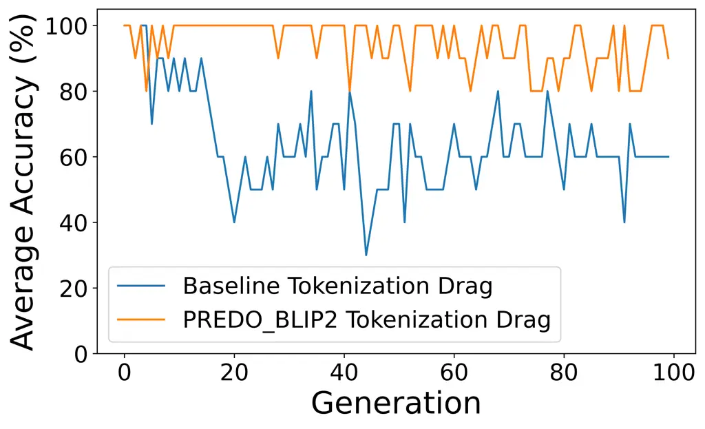     |
| (a) Average accuracy maintained through evolution process       |
| 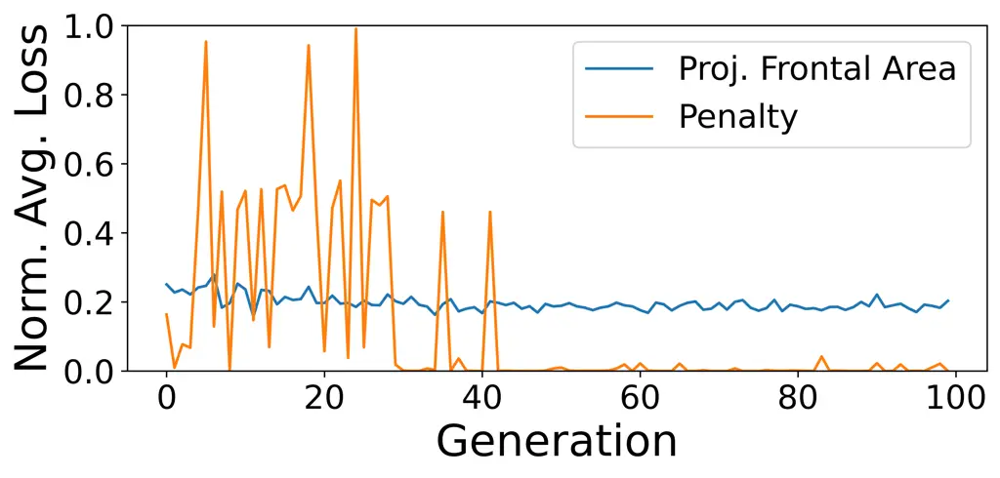     |
| (b) Loss Components contributions during optimization           |
| 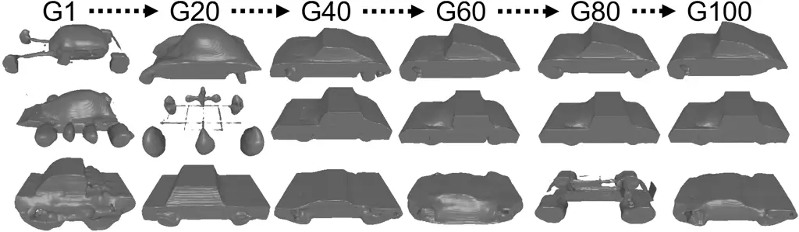     |
| (c) Corresponding designs found during prompt evolution process |

Fig. 3: Our proposed technique is able to maintain the majority of
designs found are practical throughout the evolution process as
presented in Fig. 3. Furthermore, the initial prompt evolution process
found many impractical design candidates, as shown in Fig. 3 (b),
resulting in heavy penalties imposed during this stage (Fig. 3 (c)). As
a result, the evolutionary strategy is able to move into regions having
more viable designs in the later stage.

On the other hand, we examined the penalty imposed by CLIP and BLIP2
models. As shown in Fig. 4, both models penalize practical designs the
least as compared to impractical ones. These intended penalty outcomes
allow the selection pressure to deprioritize impractical designs and
encourage the selection of viable designs as parents for the next
generation. Furthermore, the CLIP model exhibited the ideal scenario
where no penalty is given to viable designs, conforming the designs to
the physics specifications as intended. On a separate observation, we
noticed that the penalty computation using Eq. 3 with the BLIP2
vision-language model tends to assign higher values than the CLIP model
for the generated designs. Hence, further investigation of using the
penalty weight $`\alpha`$ hyperparameter is necessary to study the
effects of the penalty contribution. It is also worth highlighting that
these vision-language models are pre-trained on different large data
corpora. Hence, the prediction precision varies widely across different
image-text pairs, and careful calibration is required to ensure the
effectiveness of such models.

|                                                             |                                                              |
| ----------------------------------------------------------- | ------------------------------------------------------------ |
| 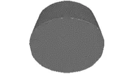 | 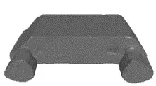  |
| (a) Impractical Design 1                                    | (a) Impractical Design 2                                     |
| BLIP2 penalty=1.9355                                        | BLIP2 penalty=1.8894                                         |
| CLIP penalty=1.0670                                         | CLIP penalty=0.1468                                          |
| 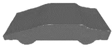 | 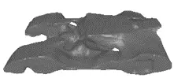 |
| (c) Practical Design 1                                      | (d) Practical Design 2                                       |
| BLIP2 penalty=0.8431                                        | BLIP2 penalty=0.7305                                         |
| CLIP penalty=0.0000                                         | CLIP penalty=0.0000                                          |

Fig. 4: BLIP2 vision-language model tends to assign higher penalty than
CLIP across designs.

It is also worth highlighting that during our examination of the
frequency and variety of tokens used in constructing the prompt in the
tokenization strategy, we found that a small percentage of tokens in
GPT-4 vocabulary are used in the construction, mainly concentrated in a
small region. We also observed that most constructed prompts have full
prompt length, much longer than the prompt used in the BoW strategy.
This suggests that the prompt length directly impacts the prompt
evolution performance, and further investigation in this area will be
beneficial.

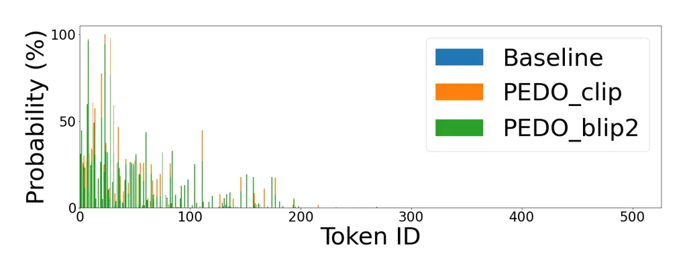

Fig. 5: The tokenization strategy sampled the first 525 tokens in GPT-4
vocabulary during optimization to construct the text prompts, covering
0.52% of the entire vocabulary space.

Last but not least, we conducted visual inspections of the generated car
designs across the generations and compared them against the performance
results presented in Table I and Table II. Interestingly, we observed
design candidates that yield the least projected car frontal area design
performance score generally are, in fact, ill-defined designs. Our
proposed technique that uses a vision-language model can minimize the
likelihood of the derivative-free optimizer finding such ill-defined
designs as shown in Fig. 6 (b), (c) and (f). In contrast, as illustrated
in Fig. 7, using the normalized drag coefficient as the design
performance yields the best car design candidates and indicates a better
association between the geometric structure of the car and the text
prompt used to generate these designs. We also examined the designs
found during the prompt evolution process in Fig. 8 and noticed that
once the framework can disincentivize substantial ill-defined designs,
the evolution of the geometric structure is more natural, resulting in
more car-like designs found (see Fig. 8 (h), Fig. 8 (j) and Fig. 8 (l)).

The experimental results and analysis presented in this paper highlight
that prompt evolution is a promising paradigm for finding novel designs
with a high degree of accuracy maintained throughout the evolutionary
process while providing ease of use in specifying design specifications
and preferences via a natural language interface. Highlighted in \[17\],
prompt evolution can exert evolutionary selection pressure and variation
to the generated outputs and other forms of guidance and hidden states.
In this paper, we have demonstrated this possibility in the form of text
prompts. Given such flexibility within this emerging paradigm, prompt
evolution presents abundant research opportunities in generative AI for
evolutionary engineering design optimization.

## V Conclusion and Outlook

In this paper, we proposed a novel evolutionary design optimization
framework (PREDO) that employs the prompt evolution paradigm and
incorporates a vision-language model to penalize impractical designs and
rank practical ones higher than others. We also introduced a design
optimization objective that employs a physics solver and a
vision-language model for practical or functional guidance in the
generated designs. With these contributions, we address the challenge
faced in an earlier study \[10\] that has ill-defined generated designs
served as parents for the next-generation offspring, resulting in
reduced performance of the framework.

Our experiment results and ablation studies demonstrated the
effectiveness of our proposed technique and the superior performance
achieved in the presented car design optimization example. This
solidifies the possibility of using the prompt evolution paradigm in a
fully automated evolutionary design optimization framework as an
alternative to traditional engineering design optimization.

Nevertheless, further investigations into the prompt evolution paradigm
and the framework are necessary to fully exploit the capability of
evolutionary algorithms in such a setting. One particular area
highlighted is to study the impact of prompt length on the prompt
evolution performance. In addition, it is necessary to investigate the
effects of the penalty contribution in relation to different penalty
weights. Another area of investigation is the exploration of the
proposed methods to other types of engineering design applications, e.g.
with respect to other aero-/fluiddynamic domains (planes, boats) or
computationally-costly physics modalities as structural optimization
including finite-element solvers. Lastly, a noteworthy research area is
to study the relationship between the geometric difference and textual
descriptions in the prompt on prompt evolution performance.

## Acknowledgment

The authors would like to express our deep gratitude to individuals,
especially Dr. Jiao Liu, for their expertise and valuable critiques in
this research work. This research is partly supported by the Honda
Research Institute Europe (HRIEU) and the College of Computing & Data
Science (CCDS), Nanyang Technological University (NTU).

## References

- \[1\] J. Betker, G. Goh, L. Jing, T. Brooks, J. Wang, L. Li,
  L. Ouyang, J. Zhuang, J. Lee, Y. Guo, W. Manassra, P. Dhariwal,
  C. Chu, Y. Jiao, and A. Ramesh, “Improving image generation with
  better captions,” 2023. \[Online\]. Available:
  https://cdn.openai.com/papers/dall-e-3.pdf
- \[2\] R. Rombach, A. Blattmann, D. Lorenz, P. Esser, and B. Ommer,
  “High-resolution image synthesis with latent diffusion models,” in
  _CVPR_, 2022, pp. 10 684––10 695.
- \[3\] O. Bar-Tal, H. Chefer, O. Tov, C. Herrmann, R. Paiss, S. Zada,
  A. Ephrat, J. Hur, Y. Li, T. Michaeli, O. Wang, D. Sun, T. Dekel, and
  I. Mosseri, “Lumiere: A space-time diffusion model for video
  generation,” _arXiv preprint arXiv:2401.12945_, 2024.
- \[4\] M. M. Bronstein, J. Bruna, Y. LeCun, A. Szlam, and
  P. Vandergheynst, “Geometric Deep Learning: Going beyond Euclidean
  Data,” _IEEE Signal Processing Magazine_, vol. 34, no. 4, pp.
  18–42, 2017.
- \[5\] P. Achlioptas, O. Diamanti, I. Mitliagkas, and L. Guibas,
  “Learning Representations and Generative Models for 3D Point Clouds,”
  in _Proceedings of the 35th International Conference on Machine
  Learning_, ser. Proceedings of Machine Learning Research, J. Dy and
  A. Krause, Eds., vol. 80. PMLR, 10–15 Jul 2018, pp. 40–49. \[Online\].
  Available: http://proceedings.mlr.press/v80/achlioptas18a.html
- \[6\] N. Umetani, “Exploring generative 3d shapes using autoencoder
  networks,” in _SIGGRAPH Asia 2017 Technical Briefs_, ser. SA ’17. New
  York, NY, USA: Association for Computing Machinery, 2017. \[Online\].
  Available: https://doi.org/10.1145/3145749.3145758
- \[7\] L. Gao, J. Yang, T. Wu, Y.-J. Yuan, H. Fu, Y.-K. Lai, and
  H. Zhang, “Sdm-net: deep generative network for structured deformable
  mesh,” _ACM Trans. Graph._, vol. 38, no. 6, nov 2019. \[Online\].
  Available: https://doi.org/10.1145/3355089.3356488
- \[8\] A. Nichol, H. Jun, P. Dhariwal, P. Mishkin, and M. Chen,
  “Point-e: A system for generating 3d point clouds from complex
  prompts,” 2022.
- \[9\] H. Jun and A. Nichol, “Shap-E: Generating Conditional 3D
  Implicit Functions,” _arXiv preprint arXiv:2305.02463_, 2023.
  \[Online\]. Available: https://arxiv.org/abs/2305.02463
- \[10\] T. Rios, S. Menzel, and B. Sendhoff, “Large language and
  text-to-3d models for engineering design optimization,” in _2023 IEEE
  Symposium Series on Computational Intelligence (SSCI)_, 2023, pp.
  1704–1711.
- \[11\] T. Rios, B. Van Stein, T. Bäck, B. Sendhoff, and S. Menzel,
  “Point2FFD: Learning Shape Representations of Simulation-Ready 3D
  Models for Engineering Design Optimization,” in _2021 International
  Conference on 3D Vision (3DV)_, 2021, pp. 1024–1033.
- \[12\] P. Wollstadt, M. Bujny, S. Ramnath, J. Shah, D. Detwiler, and
  S. Menzel, “Carhoods10k: An industry-grade data set for representation
  learning and design optimization in engineering applications,” _IEEE
  Transactions on Evolutionary Computation Special Issue on Benchmarking
  Sampling-Based Optimization Heuristics: Methodology and Software
  (BENCH)_, January 2022.
- \[13\] S. Saha, T. Rios, L. L. Minku, B. V. Stein, P. Wollstadt,
  X. Yao, T. Bäck, B. Sendhoff, and S. Menzel, “Exploiting Generative
  Models for Performance Predictions of 3D Car Designs,” in _2021 IEEE
  Symposium Series on Computational Intelligence (SSCI)_, 2021, pp. 1–9.
- \[14\] A. X. Chang, T. Funkhouser, L. Guibas, P. Hanrahan, Q. Huang,
  Z. Li, S. Savarese, M. Savva, S. Song, H. Su, J. Xiao, L. Yi, and
  F. Yu, “ShapeNet: An Information-Rich 3D Model Repository,” Stanford
  University — Princeton University — Toyota Technological Institute at
  Chicago, Tech. Rep. arXiv:1512.03012 \[cs.GR\], 2015.
- \[15\] P. Achlioptas, I. Huang, M. Sung, S. Tulyakov, and L. Guibas,
  “ShapeTalk: A Language Dataset and Framework for 3D Shape Edits and
  Deformations,” in _Conference on Computer Vision and Pattern
  Recognition (CVPR)_, 2023.
- \[16\] N. Arechiga, F. Permenter, B. Song, and C. Yuan, “Drag-guided
  diffusion models for vehicle image generation,” _arXiv preprint
  arXiv:2306.09935_, 2023.
- \[17\] M. Wong, Y. Ong, A. Gupta, K. Bali, and C. Chen, “Prompt
  evolution for generative ai: A classifier-guided approach,” in _2023
  IEEE Conference on Artificial Intelligence (CAI)_. IEEE Computer
  Society, 2023, pp. 226–229. \[Online\]. Available:
  https://doi.ieeecomputersociety.org/10.1109/CAI54212.2023.00105
- \[18\] A. Radford, J. W. Kim, C. Hallacy, A. Ramesh, G. Goh,
  S. Agarwal, G. Sastry, A. Askell, P. Mishkin, J. Clark, G. Krueger,
  and I. Sutskever, “Learning transferable visual models from natural
  language supervision,” in _Proceedings of the 38th International
  Conference on Machine Learning_, ser. Proceedings of Machine Learning
  Research, M. Meila and T. Zhang, Eds., vol. 139. PMLR, 18–24 Jul 2021,
  pp. 8748–8763. \[Online\]. Available:
  https://proceedings.mlr.press/v139/radford21a.html
- \[19\] J. Li, D. Li, S. Savarese, and S. Hoi, “Blip-2: Bootstrapping
  language-image pre-training with frozen image encoders and large
  language models,” _arXiv preprint arXiv:2301.12597_, 2023.
- \[20\] C. Fellbaum, Ed., _WordNet: An Electronic Lexical
  Database_. Cambridge, MA: MIT Press, 1998.
- \[21\] Z. Wu and M. Palmer, “Verb semantics and lexical selection,”
  _arXiv preprint cmp-lg/9406033_, 1994.
- \[22\] N. Hansen and A. Ostermeier, “Completely derandomized
  self-adaptation in evolution strategies,” _Evolutionary Computation_,
  vol. 9, no. 2, pp. 159–195, 2001.
- \[23\] J. Achiam, S. Adler, S. Agarwal, L. Ahmad, I. Akkaya, F. L.
  Aleman, D. Almeida, J. Altenschmidt, S. Altman, S. Anadkat _et al._,
  “Gpt-4 technical report,” _arXiv preprint arXiv:2303.08774_, 2023.

[TABLE]

Fig. 6: With the projected frontal area as the design performance
objective, the worst car design candidates generated in the last 100th
generation generally have lower objective scores than the corresponding
best car designs. These candidates are likely to have ill-defined shapes
that coincidentally lead to a smaller area than the best car designs.
Our proposed technique greatly reduces the likelihood of generating a
non-car-like design compared to the baseline framework.

[TABLE]

Fig. 7: Normalized drag coefficient as the design performance objective
has the better association between the geometric structure and the text
prompt used to synthesize the designs, yielding the best design
candidates with the least objective scores as observed in the
terminating 100th generation.

|                                                                               |                                                                                    |
| ----------------------------------------------------------------------------- | ---------------------------------------------------------------------------------- |
| 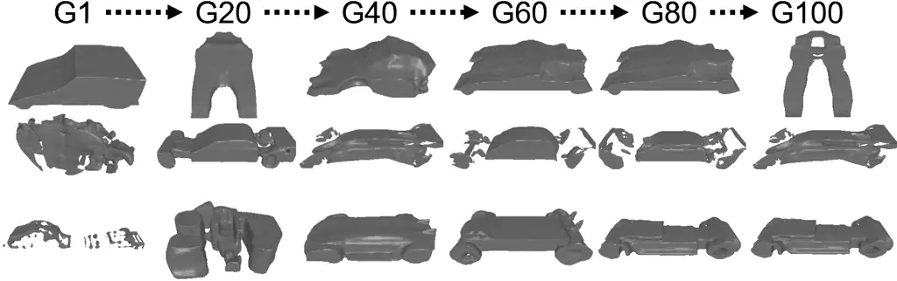                  | 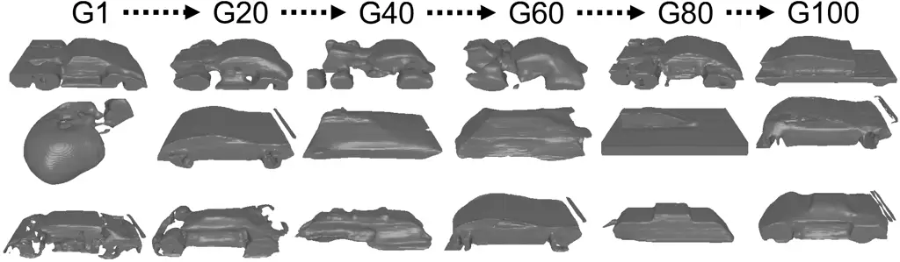                       |
| (a) Baseline, Bag-of-Words Strategy, Projected Frontal Area                   | (b) Baseline, Bag-of-Words Strategy, Normalized Drag Coefficient                   |
| 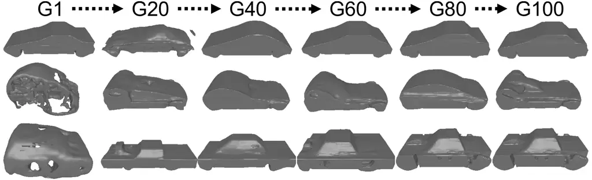                  | 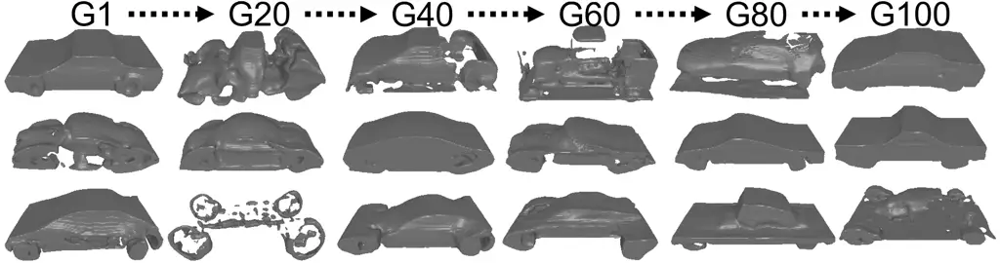                       |
| (c) $`\textrm{PREDO}_{clip}`$, Bag-of-Words Strategy, Projected Frontal Area  | (d) $`\textrm{PREDO}_{clip}`$, Bag-of-Words Strategy, Normalized Drag Coefficient  |
| 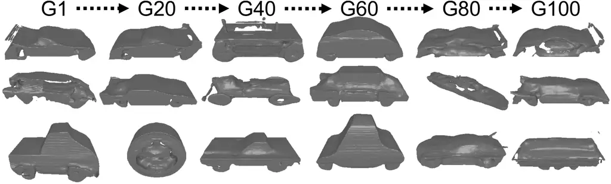                  | 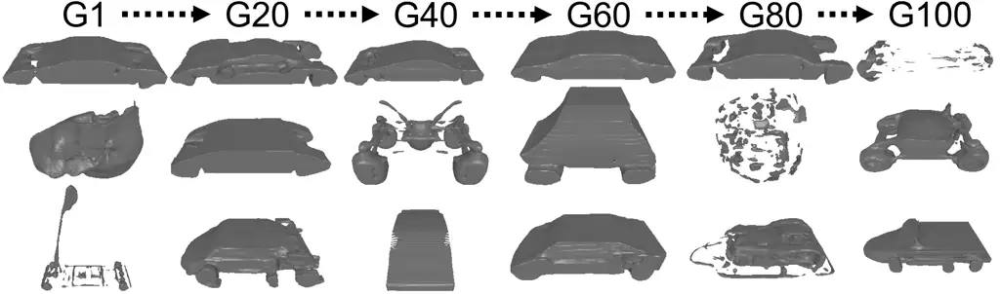                       |
| (e) $`\textrm{PREDO}_{blip2}`$, Bag-of-Words Strategy, Projected Frontal Area | (f) $`\textrm{PREDO}_{blip2}`$, Bag-of-Words Strategy, Normalized Drag Coefficien  |
| 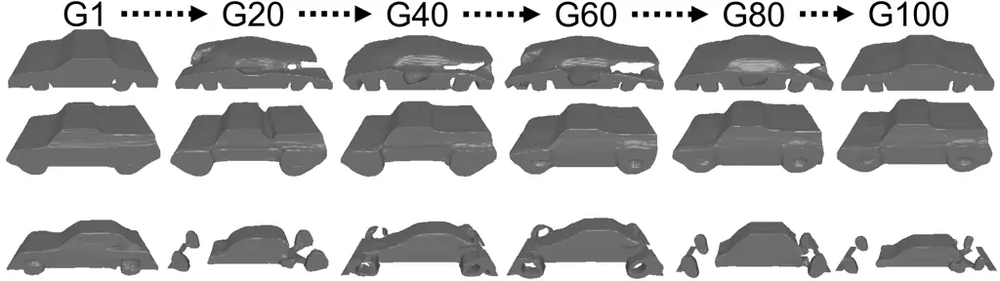                  | 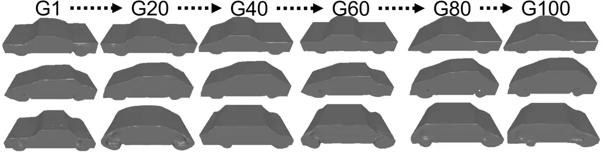                       |
| (g) Baseline, Tokenization Strategy, Projected Frontal Area                   | (h) Baseline, Tokenization Strategy, Normalized Drag Coefficient                   |
| 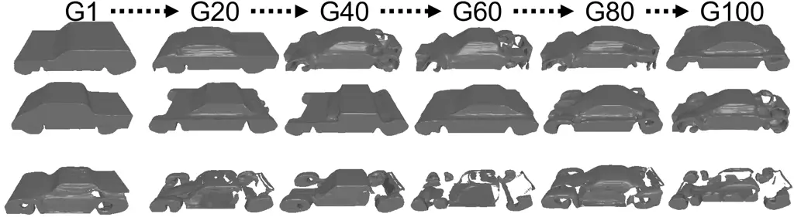                  | 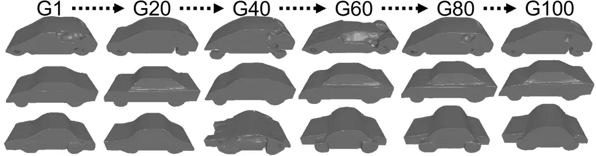                       |
| (i) $`\textrm{PREDO}_{clip}`$, Tokenization Strategy, Projected Frontal Area  | (j) $`\textrm{PREDO}_{clip}`$, Tokenization Strategy, Normalized Drag Coefficientt |
| 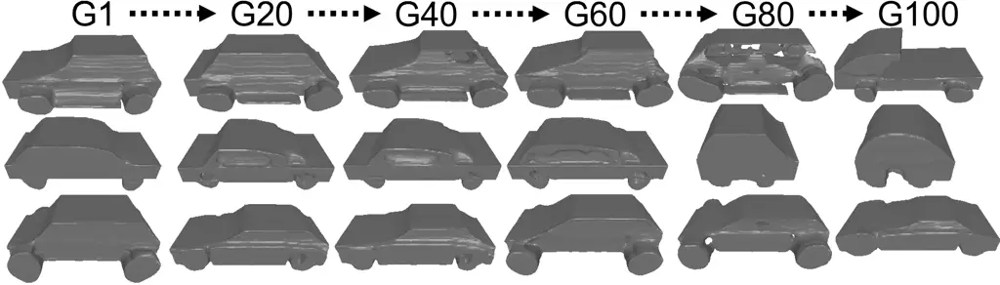                  | 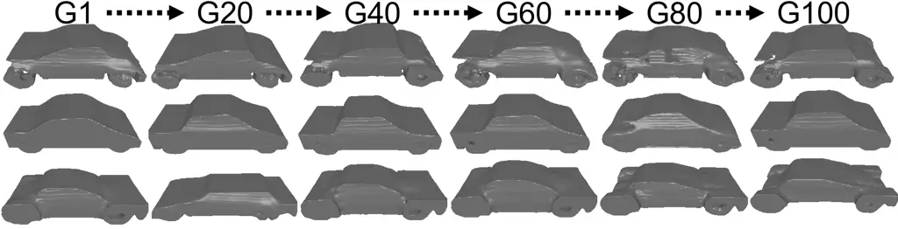                       |
| (k) $`\textrm{PREDO}_{blip2}`$, Tokenization Strategy, Projected Frontal Area | (l) $`\textrm{PREDO}_{blip2}`$, Tokenization Strategy, Normalized Drag Coefficient |

Fig. 8: Car design candidates generated by text-to-3D model during the
prompt evolution process, from generation 1 (G1) to maximum generation
100 (G100), have demonstrated that our proposed technique facilitates
the natural evolution of car geometric structure, especially to the
tokenization strategy with normalized drag coefficient as design
performance (see Fig. 8 (h), Fig. 8 (j) and Fig. 8 (l)), leading to more
car-like designs to be found during the prompt evolution process.
