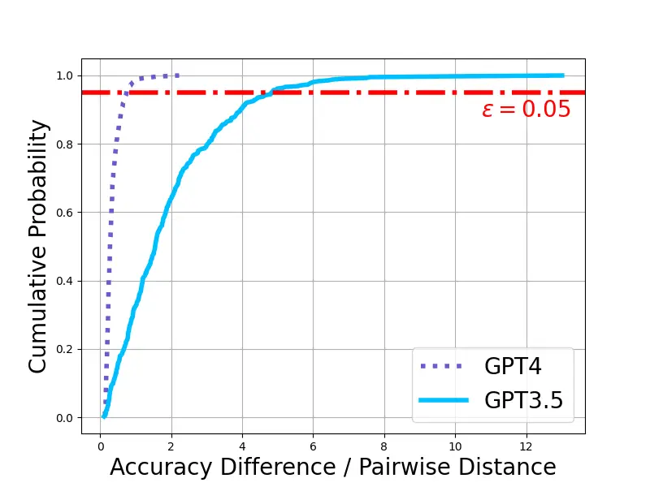
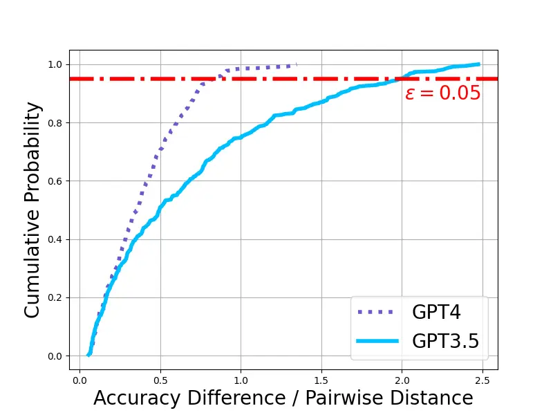
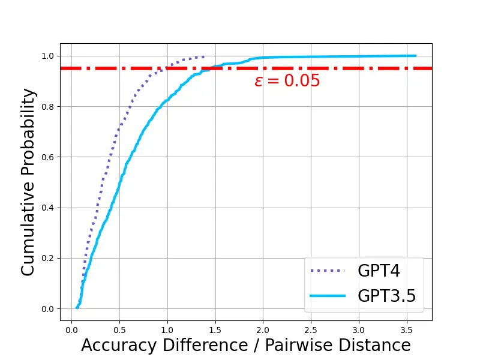
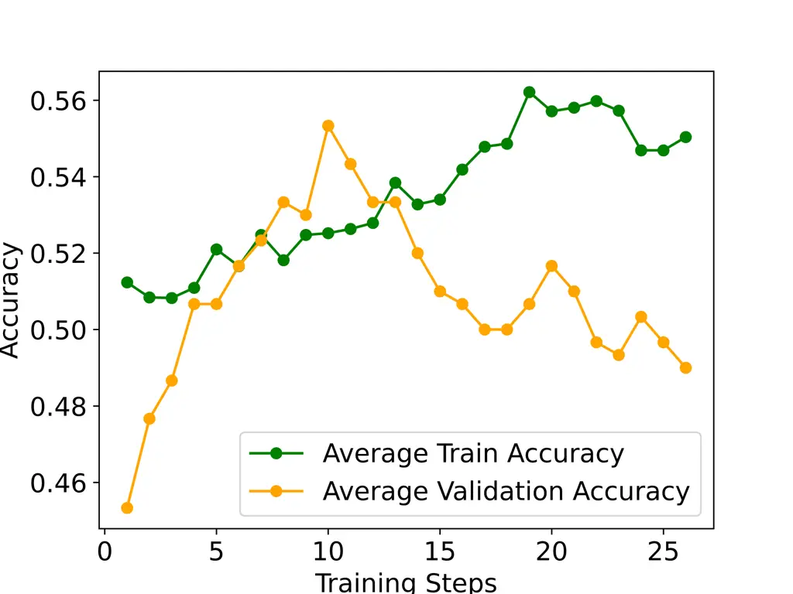
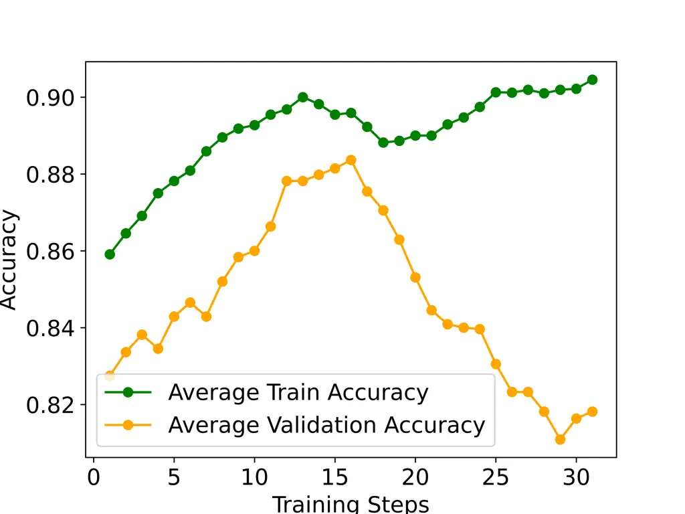
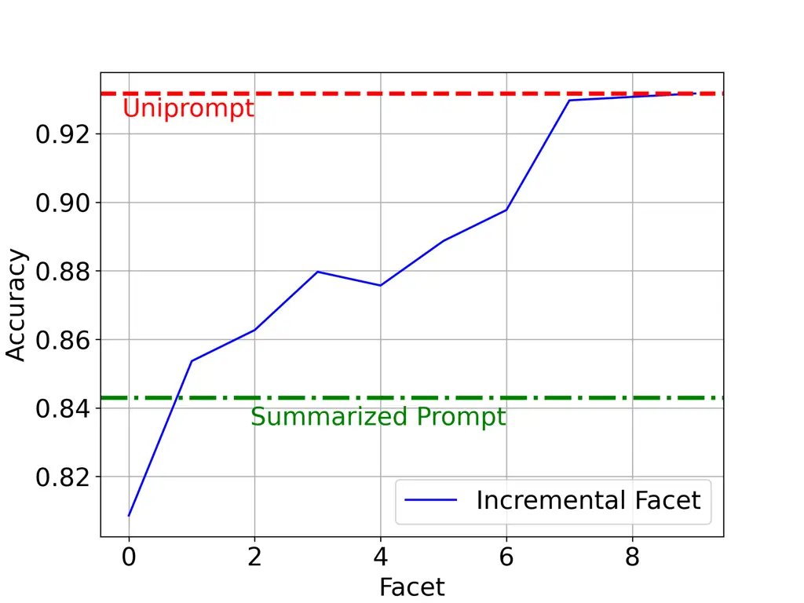

# Task Facet Learning: A Structured Approach To Prompt Optimization

Gurusha Juneja Affiliation: UC Santa Barbara    Gautam Jajoo
Affiliation: BITS Pilani    Nagarajan Natarajan Affiliation: Microsoft
Research    Hua Li Affiliation: Microsoft Bing Ads^(\*)These authors
contributed equally to this work.    Jian Jiao Affiliation: Microsoft
Bing Ads^(\*)These authors contributed equally to this work.    Amit
Sharma Affiliation: Microsoft Research Affiliation: Corresponding
author: [amshar@microsoft.com](mailto:amshar@microsoft.com)

###### Abstract

Given a task in the form of a basic description and its training
examples, prompt optimization is the problem of synthesizing the given
information into a text prompt for a large language model. Humans solve
this problem by also considering the different facets that define a task
(e.g., counter-examples, explanations, analogies) and including them in
the prompt. However, it is unclear whether existing algorithmic
approaches, based on iteratively editing a given prompt or automatically
selecting a few in-context examples, can cover the multiple facets
required to solve a complex task. In this work, we view prompt
optimization as that of learning multiple facets of a task from a set of
training examples. We exploit structure in the prompt optimization
problem and break down a prompt into loosely coupled semantic sections.
The proposed algorithm, UniPrompt, (1) clusters the input space and uses
clustered batches so that each batch likely corresponds to a different
facet of the task, and (2) utilizes a feedback mechanism to propose
adding, editing or deleting a section, which in turn is aggregated over
a batch to capture generalizable facets. Empirical evaluation on
multiple datasets and a real-world task shows that prompts generated
using UniPrompt obtain higher accuracy than human-tuned prompts and
those from state-of-the-art methods. In particular, our algorithm can
generate long, complex prompts that existing methods are unable to
generate. Code for UniPrompt is available at https://aka.ms/uniprompt.

⁵⁵footnotetext: To appear in ACL Findings 2025.

## 1 Introduction

Given a task, choosing an input prompt is a key part of optimizing Large
Language Model’s (LLM) performance (Kojima et al., 2024; Yang et al.,
2023). Minor changes in prompt can lead to performance gains or losses,
necessitating prompt engineering (Liu et al., 2023). Typically,
manually-developed prompts combine task description with a few
in-context examples, along with modifiers like chain-of-thought (Kojima
et al., 2024). For greater accuracy, human prompt engineers spend
considerable time to identify errors with a current prompt, consider the
different facets of a task (e.g., counter-examples, explanations,
analogies) that may fix those errors, and include them in the prompt.
For instance, for a hate speech classification task, in addition to the
definition, it may be helpful to specify the facets that lead to hate
speech: the context of conversation, identifying intent, and
differentiating hate speech from opinions or closely-related concepts
such as vulgarity and profanity.  
To avoid the above cumbersome manual process, recent work aims to
automate the process of generating natural language prompts that are
also interpretable. Since language tokens are discrete, this leads to a
challenging discrete optimization problem with a combinatorial space of
possible outputs. Techniques for prompt optimization can be divided in
two categories: non-directional, e.g., random search (Zhou et al., 2022;
Zhang et al., 2023) and genetic algorithms (Yang et al., 2023; Guo
et al., 2023), where the sampling of new input is “random” and does not
explicitly aim to reduce error on a train set; and directional, where
the sampling of new input depends on some error measure on a
representative train sample. Recently, more complex methods have been
proposed in the second category including RL (Zhang et al., 2022; Deng
et al., 2022), updating prompts using feedback from auxiliary LLMs (Hu
et al., 2024; Pryzant et al., 2023), and optimizing the input to a small
LM that generates the prompt (Lin et al., 2024b; Chen et al., 2024).
While these techniques focus on editing parts of a given prompt, they
are developed with the goal of obtaining a concise description of the
task. None of these focus on ensuring multiple facets of a task are
added to the prompt.  
In this paper, we propose UniPrompt, a prompt optimization method to
cover diverse, multiple facets of a task and improve overall accuracy.
To simulate the manual prompt engineering process, we propose that
prompts be constructed from individual sections, where each section may
correspond to a different facet that humans may consider for the task.
Prompt editing proceeds at a section-level: we can add, edit or delete a
section from the prompt. Similar to Pryzant et al. (2023); Hu et al.
(2024), prompt edits are based on an auxiliary LLM’s feedback about
example predictions with the current prompt. We contribute two key
insights in this feedback-based optimization process. First, we find
that the feedback on a single example or a randomly selected batch of
examples does not yield generalizable facet descriptions. Instead, we
propose clustering the inputs and creating mini-batches such that each
mini-batch is sourced from a single cluster. Second, even with clustered
batches, the feedback tends to overfit to specific examples or their
properties. To generate a prompt edit that conveys a generalizable
concept relevant to the task, we propose generating edits at a
mini-batch level and then aggregating them at the batch level to yield
the final edit (Figure 1). While the two insights may appear simple, we
show that they significantly improve extracting diverse task facets.

We evaluate UniPrompt on several benchmarks where it consistently
achieves higher accuracy than existing prompt optimization methods. On
Ethos, a hate speech dataset, UniPrompt obtains 94% accuracy whereas the
next best method obtains 82%. Even though UniPrompt focuses only on the
instruction and does not include any in-context examples, we find that
its instruction-only accuracy is often higher than methods such as
DSPy (Khattab et al., 2024) that optimize both. In the few-shot setting,
we also compare UniPrompt to MedPrompt (Nori et al., 2023), a
state-of-the-art prompt composition method. We find that UniPrompt,
requiring only one LLM call at inference time, obtains the same accuracy
as MedPrompt that requires five calls. If we allow multiple calls to
UniPrompt, we obtain over 4% accuracy gains. Finally, we also evaluate
UniPrompt on a real-world semantic matching task in a web search engine.
Compared to the best manual prompt, the prompt generated from UniPrompt
leads to over 5% increase in accuracy on the rare class and nearly 2%
accuracy increase overall.

Figure 1: Existing prompt optimization methods (left) versus UniPrompt
(right) on the Ethos dataset: \[Left\] State-of-the-art prompt
optimization methods like ProTeGi  (Pryzant et al., 2023) sample from
the questions wrongly answered by the current prompt, and use an expert
LLM (e.g., GPT-4) to obtain feedback on the mistakes. This approach
tends to give very general edits or overfits to specific examples.
\[Right\] In contrast, UniPrompt identifies key task facets by: (1)
clustering examples with similar task facets, and (2) employing a
two-tier feedback-based update strategy. The resulting prompt updates
extract generalizable concepts from the specific examples.

## 2 Related Work

Here, we highlight relevant work that are not addressed in the
manuscript otherwise. Deng et al. (2022) present a discrete prompt
optimization method, RLPrompt, using reinforcement learning, where a
policy network learns to generate effective prompts through reward-based
training, with an emphasis on enhancing training efficiency through
effective reward stabilization techniques. A drawback of such automatic
prompt optimization approaches (Pryzant et al., 2023; Zhou et al., 2022;
Deng et al., 2022; Yang et al., 2023) is that the prompts generated tend
to be short, often comprising only one or two sentences, which may not
fully encapsulate the complexity of the task at hand.

Another recent line of work leverages human feedback. Automated Prompt
Optimization with Human Feedback  (Lin et al., 2024a) optimizes prompts
for black-box LLMs using human preference feedback. Besides the obvious
overhead, it might also introduce potential biases.

Prior research (Wei et al., 2023; Wei et al., 2024) has highlighted the
significance of specific sections within prompts. However, existing
methods do not specifically target the optimization of individual
sections and their respective contents within the prompts. Hsieh et al.
(2023) investigate the use of greedy and genetic algorithms to edit
lengthy prompts. Their method focuses on paraphrasing one line at a time
starting from an existing prompt, compared to our goal of learning
facets of a task from scratch. Another orthogonal line of work explores
algorithmic selection of in-context examples (Min et al., 2022; Gupta
et al., 2023; Wu et al., 2023; Srivastava et al., 2024; Sun et al.,
2024).

## 3 UniPrompt: Capturing Task Facets

State-of-the-art prompt optimization methods such as ProTeGi (Pryzant
et al., 2023) and TextGrad (Hou et al., 2023) iteratively optimize the
prompt for a given task. At a high-level, they proceed as follows: (1)
start with an initial prompt and a training dataset of
$`\langle`$question, answer$`\rangle`$ pairs for the task, (2) randomly
sample from the questions wrongly answered by the current prompt to form
a batch, (3) use an expert LLM to obtain feedback on the random batch,
(4) apply the feedback to the prompt. This procedure is illustrated in
Figure 1 \[Left\]. Our work is motivated by three key observations.

1. Larger models are more amenable to prompt optimization. We observe
   that the change in the objective function (i.e., loss on a validation
   set for a given prompt) per change in input is relatively more stable
   for larger models like GPT-4 (Figure 2) than for GPT-3.5 (analysis in
   Appendix A.1).
2. Clustered-batching improves the quality of text gradients (i.e.,
   feedback), as against the standard random batching adopted in
   state-of-the-art prompt optimization methods (Section 5.1).
3. Two-tier feedback helps learn generalizable facets. Collecting
   feedback from an expert LLM over mini-batches, and then summarizing the
   individual feedback texts via a second step (Section 5.1) helps learn
   generalizable task concepts in prompts.

The proposed method UniPrompt, in Figure 1 \[Right\], makes two
contributions. First, we follow a two-tier setup of synthesizing
feedback for a batch of training examples. We break up a batch into
mini-batches, collect feedback on each of the mini-batches and then use
a separate prompt to aggregate the different feedback texts into a
generalizable concept. Second, to increase chances that a mini-batch
corresponds to a coherent facet, we periodically (re)cluster the
training data and ensure that each mini-batch consists of examples from
the same cluster.  
Algorithm 1 receives as input a one-line task description and a train
set $`D_{t}`$ of $`N`$ $`\langle`$question $`q_{i}`$, answer
$`a_{i}\rangle`$ demonstrations. It extracts key concepts or facets
relevant to the task and updates prompt sections using them, with the
goal of increasing accuracy on the validation set $`D_{v}`$. We assume
access to an “expert LLM” such as GPT-4.

### 3.1 Task facet learning using examples

Extracting task-relevant concepts from a set of examples to refine a
prompt is a complex problem comprising multiple steps. Given a set of
incorrect predictions, one needs to analyze what went wrong in each
prediction, form hypotheses, aggregate the hypotheses to identify
specific concepts that are relevant for the task. Then, for each
concept, one needs to attribute which facet/section of the current
prompt needs to be edited to incorporate the concept. These operations
are highly model-specific and are difficult to execute reliably.
Therefore, we exclusively rely on an expert LLM.  
First, we prompt the expert LLM to diagnose mistakes (feedback) in each
example given the answer and chain-of-thought reasoning produced by the
solver LLM. Subsequently, we use this feedback to generate precise edits
for the prompt that may fix the error. These individual edits are then
aggregated over a mini-batch and fed back into the same LLM, which then
identifies a few major edits to be applied to the current prompt. To aid
in identifying major edits that correspond to generalizable facets, we
propose to cluster the examples as a preprocessing step and create
clustered batches, such that each cluster shares some common facet of
the task.

#### 3.1.1 Clustering for identifying facets

We explore two approaches for clustering: topic-based clustering, and
feedback-based clustering.  
Topic-Based Clustering. Given a set of examples, we identify $`l`$
topics spanning the entire train set. This type of clustering is
motivated by the observation that solver LLM may make similar mistakes
on examples from the same topic. Hence, for such examples, a common edit
to the prompt could improve predictions for all the examples. To obtain
the clusters, the expert LLM is prompted (for prompt see Appendix A.10)
to provide a broad sub-topic $`t_{i}`$ for each question. Then the
resultant list of sub-topics $`\{t_{1},t_{2},\dots,t_{N}\}`$ is again
clustered into $`k`$ topics
$`\{t^{\prime}_{1},t^{\prime}_{2},\dots,t^{\prime}_{l}\}`$ by prompting
the expert LLM. Based on this clustering, each example $`{q_{i},a_{i}}`$
is assigned a cluster $`t^{\prime}_{j}`$ corresponding to $`t_{i}`$.  
Feedback-Based Clustering. Examples that receive similar feedback based
on a prompt’s predictions can help identify task facets. Consider a
physics-based task where two examples from different topics obtain the
same feedback from the expert LLM to edit the “Rules” section of the
prompt to include the statement, “Draw all forces on each body before
writing the equations”. We argue that such examples can be clustered.
This type of clustering makes the broad edit identification step easier.
To obtain the clusters, we first evaluate all training examples against
the current best prompt and store the feedback $`f_{i}`$ from the expert
LLM, corresponding to each incorrectly answered example
$`{q_{i},a_{i}}`$ (all the correctly answered questions form one
cluster). We then prompt the expert LLM to cluster these feedbacks
$`\{f_{1},f_{2},\dots,f_{N}\}`$ into $`l`$ clusters (see Appendix A.11).
For each cluster, we create a batch $`{q_{i},a_{i}}`$ corresponding to
feedbacks in that cluster.

#### 3.1.2 Obtaining generalizable prompt edits

Two-tier Feedback. To encourage generalizable feedback from the expert
LLM, we obtain feedback at two levels: mini-batch and batch. Given a
batch (created using clustering discussed above), we break it up into
mini-batches.  
For each mini-batch $`m`$, we construct a prompt consisting of
incorrectly-answered questions in $`m`$, the chain-of-thought produced
by the solver LLM, their incorrect predictions and the ground-truth
answers. We ask the expert to provide one feedback for the mini batch
(prompt is provided in Appendix A.12). The expert can suggest the
following edits: add a section or subsection, delete a section or
subsection, and edit a section or subsection.  
Given the different edits for mini-batches within a batch $`b`$, we
invoke the expert LLM again to summarize these edits into a single
section update. This combination ensures some degree of smoothness at
every update which helps stabilize training. To make sure that the
expert is able to generate generalizable edits, we additionally provide
a random set of incorrect examples that are not in the current batch and
ask it to suggest an edit based on the existing edits that can correct
the errors. As before, the class of edits allowed is the same.  
History for effective exploration. To ensure comprehensive,
non-repetitive exploration of prompts, we also provide the batch-level
history of edits (Hu et al., 2024; Yang et al., 2023) in the
mini-batch-level prompt. History $`H[b]`$ is presented as
$`\{e_{i},acc_{i}-acc_{i-1}\}`$ where $`e_{i}`$ is the edit proposed at
the $`i^{th}`$ update and $`acc_{i}`$ is the accuracy of the $`i^{th}`$
updated prompt (See Appendix A.12 for the prompt).

Input: Train set $`D_{t}`$, validation set $`D_{v}`$, initial prompt for
the task $`p_{0}`$, one-line task description $`T`$

Output: Optimized prompt $`P^{*}`$ for the given task

1 $`C\leftarrow`$ cluster($`D_{t},p_{0}`$), initialize history
$`H\leftarrow\{\}`$, and validation accuracies $`V\leftarrow`$ \[\];

2 Initialize a beam of size 2 with the initial prompt:
$`p_{1}\leftarrow p_{0}`$ and $`p_{2}\leftarrow p_{0}`$

3 for _epoch $`e`$ and each cluster c in C_ do

    4 for _each batch $`b\in\texttt{batches}(`$C$`)`$_ do

       5 $`F\leftarrow[]`$

       6 for _each mini-batch $`m\in\texttt{mini-batches}(`$b$`)`$_ do

          7 Evaluate the best prompt on mini-batch: $`a_{m}\leftarrow`$
LLM($`m,p_{1}`$)

          8 Get expert feedback: $`f\leftarrow`$ Feedback($`T`$,
$`a_{m}`$, $`H[m]`$)

          9 $`F`$.insert($`f`$)

       10 Combine feedbacks over a batch: $`F_{b}\leftarrow`$
Combine($`F`$)

       11 Apply feedback to get updated prompts: $`q_{1}\leftarrow`$
apply($`F_{b}`$, $`p_{1}`$); $`q_{2}\leftarrow`$ apply($`F_{b}`$,
$`p_{2}`$)

       12 Update the beam: if not($`p_{1}`$ = $`p_{0}`$) then
$`p_{2}\leftarrow`$ second-high-acc(\[$`p_{1}`$, $`p_{2}`$, $`q_{1}`$,
$`q_{2}`$\], b)

       13 $`p_{1}\leftarrow`$ highest-acc(\[$`p_{1}`$, $`q_{1}`$,
$`q_{2}`$\], b)

    14 Evaluate the best prompt on validation set: $`acc_{v}\leftarrow`$
evaluate($`p_{1}`$, $`D_{v}`$)

    15 $`V\leftarrow V`$.append($`acc_{v}`$)

    16 if early-stop-criteria ($`V`$) then break

    17 if recluster($`e`$) then $`C\leftarrow`$ cluster($`D_{t},p_{1}`$)

18 return _$`p_{1}`$ as $`P^{_}`$\*;

Algorithm 1 UniPrompt

#### 3.1.3 Editing the prompt

Once the final set of edits is received for a batch, we use the expert
LLM to apply edits to the current prompt (See Appendix A.13 for the
prompt). An edit is accepted only if it increases the validation
accuracy (Greedy). Alternatively, we maintain a beam of 2 best
performing prompts based on validation accuracy, apply the edit to the
two prompts, and update the beam to retain the top 2 performing prompts
(Beam). To avoid overfitting on the train examples (or adding
unnecessary information to the prompt), we employ early stopping in the
optimization process (more details in Section 4).

### 3.2 Prompt Initialization

We use two types of initialization: (1) task description, i.e.,
$`p_{0}`$ has a single section titled Introduction containing the input
task description. (2) finetune Llama2-13B model to generate a prompt
with sections such as Introduction, Tricks, and Corner Cases, similar to
the initial prompt that a human prompt engineer may produce. To
finetune, we use GPT-4 generated data consisting of (task description,
section title, section contents) triples. Details and examples are in
Appendices A.4 and A.7.

##### Computational Complexity:

The complexity of clustering and of getting mini-batch and batch-level
feedbacks per epoch is $`O(N)`$ expert LLM queries, where $`N`$ is the
number of training examples. Details are in Appendix A.3.

## 4 Experiments Setup

Datasets: We perform comprehensive evaluation on five standard datasets:
(1) Ethos (Mollas et al., 2020), (2) ARC (Clark et al., 2018), (3) MedQA
(Jin et al., 2021), (4) GSM8K (Cobbe et al., 2021), and (5) BBH (Suzgun
et al., 2022). Ethos, ARC, and MedQA contain multiple choice questions,
and GSM8K contains questions with integer answers. BBH is a subset of 10
tasks, spanning 4 main categories, from the challenging BIG-Bench
benchmark that requires multi-step reasoning. In addition, we also
evaluate UniPrompt on the medical QnA datasets used in the MedPrompt
(Nori et al., 2023) work; as well as two popular code generation
datasets, HumanEval (Chen et al., 2021) and MBPP (Austin et al.,
2021).  
Implementation details: We set the initial prompt $`p_{0}`$ for each
task as the one-line task description. We use 200 examples as the train
set, 200 examples as the test set, and 100 examples as the validation
set for all the compared methods. We use GPT-3.5-Turbo as the solver
model. For Feedback and Combine in UniPrompt, we use GPT-4 as the expert
(see ablation in Section 5.5). We maintain a beam size of 2. Mini-batch
sizes (and batch sizes) are constrained by the context length of GPT-4.
We find that mini-batch sizes 3 to 5 and batch sizes 5 to 7 work the
best for our datasets. The temperature of the LLMs for our method is set
to 0 for reproducibility. We employ early stopping at batch-level in
UniPrompt.  
Baselines: We compare UniPrompt with the following techniques and
baselines: (1) Task Description: prompt is the one line task description
that we use to initialize UniPrompt; (2) Chain-Of-Thought (or CoT)
prompting (Kojima et al., 2024); (3) Expert Prompt: the prompt optimized
by humans taken from prior works (Nori et al., 2023); (4) OPRO (Yang
et al., 2023), that uses LLMs for discrete optimization over text
prompts; (5) ProTeGi (Pryzant et al., 2023) that proposes textual
gradients and selects edits to prompts using bandit techniques; (6)
Evoke (Hu et al., 2024) that uses two instances of LLM, one that scores
the current prompt, and the other that edits the prompt; (7) EvoPrompt
(Guo et al., 2023) that uses genetic algorithms to search through the
space of prompts; (8) TextGrad (Hou et al., 2023), state-of-the-art
framework for automatic differentiation of prompts via text; (9) DSPy
(Khattab et al., 2024), a recent programming model for optimizing LLM
prompts; and (10) MedPrompt (Nori et al., 2023), a state-of-the-art
prompt composition method.

## 5 Results and Analysis

We present detailed quantitative and qualitative results, along with key
ablations.

### 5.1 Performance of UniPrompt

We start with the zero-shot setting, where we do not include labeled
examples in the prompt for any of the compared methods. We report
results for two versions of our method in Table 1, which differ in the
combining strategy (from Section 3.1.3)—beam search vs greedy.  
UniPrompt variants significantly outperform the baselines including CoT
and the state-of-the-art prompt optimization techniques like ProTeGi
that crucially leverage LLMs for performing iterative prompt edits.
UniPrompt is the best performing method on three out of four datasets.
It achieves maximum gains on the Ethos dataset with a $`18.2\%`$
increase in accuracy over the expert prompt. Further, we see accuracy
increases of $`4.0\%`$ on MedQA, $`3.5\%`$ on GSM8k, and $`7.6\%`$ on
ARC-Challenge datasets. We show UniPrompt training behavior in Appendix
A.19.  
We also present comparisons to state-of-the-art DSPy method in the
few-shot setting (8 bootstrapped_demos) using two optimization settings
provided by their framework. The last two rows of Table 1 show that
UniPrompt in the zero-shot setting convincingly outperforms DSPy in the
few-shot setting, on three out of four datasets.

| Method                                       | Ethos | ARC  | MedQA  | GSM8K |
| -------------------------------------------- | ----- | ---- | ------ | ----- |
| Task Description                             | 76.8  | 79.7 | 52.7   | 59.4  |
| Expert Prompt                                | 74.1  | 78.4 | 53.1   | 78.9  |
| Llama Prompt (Section 3.2)                   | 74.0  | 89.7 | 52.6   | 79.5  |
| CoT                                          | 72.0  | 79.4 | 50.3   | 76.3  |
| OPRO                                         | 65.4  | 79.1 | 53.3   | 77.1  |
| ProTeGi                                      | 76.0  | 78.8 | 52.9   | 77.3  |
| Evoke                                        | 63.5  | 89.0 | 52.8   | 81.0  |
| EvoPrompt                                    | 81.6  | 89.9 | 50.3   | 81.4  |
| DSPy (MIPRO v2, zero-shot)                   | 79.7  | 82.8 | 61.9   | 77.3  |
| TextGrad                                     | 79.5  | 76.5 | 50.6   | 81.6  |
| UniPrompt (Init = Task Description) + Beam   | 92.3  | 86.0 | 57.1   | 82.4  |
| UniPrompt (Init = Task Description) + Greedy | 93.7  | 90.5 | 55.5   | 82.3  |
| DSPy (BootstrapFewShotWithRandomSearch)      | 86.6  | 87.5 | \*68.5 | 74.3  |
| DSPy (MIPRO v2, few-shot)                    | 84.0  | 86.0 | 62.9   | 79.7  |

Table 1: Test accuracies (%) of the compared methods with GPT-3.5-Turbo
as the solver model in the zero-shot setting (best in bold; second best
underlined). The two UniPrompt rows are our proposed method. We compare
with few-shot methods in the last two rows (DSPy variants); \*best in
bold to distinguish the few-shot setting.

Qualitative Analysis: ProTeGi and TextGrad also adopt batching by
randomly sampling from training examples where the solver LLM made
mistakes. In the early iterations of optimization, there can be many
such examples. So, do our key observations and hypotheses (beginning of
Section 3) hold empirically? We give some evidence below.

1. Employing clustering to create batches (Section 3.1): An example
   feedback obtained on the Ethos dataset using UniPrompt is shown below:

> The instruction should include..potential harm or violence implied, as
> well as any discriminatory or derogatory language used…towards a
> particular religious group.
>
> The instruction should include …think about the impact of the
> statement on the targeted individual or group.
>
> The instruction should…language that prompts hatred or discrimination
> towards a particular gender.

To contrast, we employ random batching as in the standard prompt
optimization techniques, on the same dataset. The feedback obtained,
given below, is relevant for the task, but fails to identify specific
concepts.

> The instruction should include a clear definition of hate speech…
>
> The instruction should include examples of hate speech, guidance on
> identifying hate speech…

The former feedback (UniPrompt) captures the facet of measuring impact
on the targeted entity whereas the latter only captures religious and
harm-based aspect of hate speech. The same expert LLM is able to
identify different facets due to clustered batches.  
2. Employing two-tier feedback: In Section 3, we argued that employing
two-tier feedback strategy to aggregate the feedback texts encourages
the expert LLM to propose edits that are generalizable. The following
feedback is received on the Ethos dataset after the aggregation:

> The instruction should…consider whether the statement contains
> discriminatory, derogatory, or violent language that promotes hatred
> or harm towards a particular group, such as based on religion and
> gender.

We see that two-tier feedback helps in distilling important aspects of
the task implicit in the examples, rather than directly using or
rephrasing the (limited) examples.  
Results on BBH: From Table 2, it is evident that UniPrompt shows a
significant improvement over OPRO (that also evaluates on these tasks in
their paper) for a majority of tasks. It achieves significantly higher
accuracy in Boolean Expression (92.37% vs. 78.74%), Date Understanding
(81.96% vs. 52.59%), and Navigate (77.16% vs. 51.74%).

|                                        |       |       |           |
| -------------------------------------- | ----- | ----- | --------- |
| Task                                   | Init  | OPRO  | UniPrompt |
| Algo & Multi-Step Arithmetic Reasoning |       |       |           |
| Bool Exp.                              | 83.64 | 78.74 | 92.37     |
| Logical Ded.                           | 29.53 | 38.97 | 39.62     |
| Navigate                               | 60.95 | 51.74 | 77.16     |
| Natural Language Understanding         |       |       |           |
| Snarks                                 | 67.00 | 67.88 | 74.30     |
| Disamb. QA                             | 53.30 | 57.43 | 67.05     |
| Fallacies                              | 57.60 | 53.14 | 57.90     |
| Use of World Knowledge                 |       |       |           |
| Causal Judg.                           | 54.29 | 57.24 | 59.37     |
| Movie Rec.                             | 58.04 | 77.81 | 71.80     |
| Dates                                  | 74.21 | 52.59 | 81.96     |
| Multilingual Knowledge & Reasoning     |       |       |           |
| Salient Trans.                         | 42.59 | 50.61 | 50.77     |

Table 2: Test accuracies (%) on BBH dataset with GPT-3.5-Turbo as the
solver model

### 5.2 Comparison with MedPrompt

MedPrompt (Nori et al., 2023) is a recent, competitive prompting
technique without any training component. It employs three key
ingredients: (1) few-shot prompting, where five relevant examples are
selected using k-nearest neighbors (kNN); (2) CoT reasoning on the
selected examples; and (3) self-consistency and ensembling with option
shuffling at inference time. They evaluate on 4 medical datasets (that
none of the competing methods in Table 1 evaluate on) using GPT-4 as the
solver model. So, we compare UniPrompt in the same setting in Table 8
(in Appendix A.8). UniPrompt (first row), which requires only one call
at inference time, performs almost as well as MedPrompt (last row),
which requires five calls, on three out of four datasets. As we
incrementally add kNN few-shot, CoT, and ensembling to our prompt, we
see a significant increase in accuracy of $`4.35\%`$ on average across
all datasets.

### 5.3 Performance on generation tasks

Our evaluations so far have been on multiple-choice QnA, math, and
classification datasets. We now evaluate UniPrompt on generating code
given a natural language specification. We use HumanEval (Chen et al., 2021) and MBPP (Austin et al., 2021) datasets consisting of Python
coding problems. We initialize with a simple prompt, “You are a software
engineer. You are given a function signature and a description of the
function. You have to complete the function.” We use GPT-4-Turbo as both
the solver and the expert LLM.  
HumanEval does not have train or validation sets. So, we take random 100
examples from MBPP as train. Similarly, for MBPP, we take random 50
examples from HumanEval as train. We evaluate the final prompts on
HumanEval and MBPP test sets. The results are given in Table 4 (in
Appendix A.8). The metric is % of solved coding problems (evaluated
using the provided test cases) in the datasets. The prompts produced by
UniPrompt outperform standard prompting of LLMs.

### 5.4 Results on a Real-world Task

The task of inferring if two search queries share identical intent or
not arises in search and recommendation pipelines. It is challenging
because it requires domain knowledge (e.g., brands and product
categories), and depends on cultural and geographical biases (e.g.,
“cricket” in UK vs. “cricket game” in the US). So, examples are crucial
for engineering a prompt that generalizes well.  
We sample 200 train, 50 validation, and a separate 2527 test user
queries from a real proprietary application. More details on the dataset
and the one-line initial prompt are provided in Appendix A.5.  
The prompt obtained using UniPrompt improves over the best manual prompt
by 5.77% on the negative (rare) class, by 0.23% on the positive class,
and by 1.86% overall on the test set. The learnt prompt captures the
following task facets: (1) recognizing variations in names and
abbreviations, and how they do not change the context; (2) recognizing
brand specificity, and how even minor variations do change the context;
and (3) recognizing the specificity of terms in queries, and how lack of
specific terms can indicate departure of intent.

### 5.5 Ablations

Impact of Clustering, Inclusion of History, and Greedy Update: The
results are shown in Table 6 (in Appendix A.8). We see that clustering
as well as edit history components (Section 3.1) are critical for
performance of UniPrompt in all the datasets. We see a major drop of
$`14.8\%`$ in accuracy in the Ethos dataset when clustering is removed,
and a $`4.3\%`$ drop when history component is removed. In all the
datasets except GSM8K, we find clustering is more important than
history. This can attributed to limited variability of question types
(all grade-8 arithmetic) in GSM8K than in others.  
We also find that the greedy update rule (Section 3.1.3) proves to be
superior or competitive compared to beam search in relatively easier
datasets — where even less exploration produces good results, greedy
proves to be a more effective update rule. On the other hand, in more
complex datasets like MedQA, greedy appears to be a bad strategy. We
also see that clustering examples based on feedback (“Fb Clustering”) is
a better strategy than clustering based on topics, except for the Ethos
dataset.  
Impact of Mini-batch size and Number of Clusters:

| Hyperparameter     | Value | Accuracy |
| ------------------ | ----- | -------- |
| Mini-batch Size    | 2     | 84.90%   |
|                    | 5     | 90.36%   |
|                    | 8     | 91.15%   |
| Number of Clusters | 2     | 85.81%   |
|                    | 5     | 90.36%   |
|                    | 10    | 87.82%   |

Table 3: Impact of UniPrompt’s key hyperparameters

First, we vary mini-batch size in UniPrompt. The results for the ARC
dataset are shown in Table 3 (in Appendix A.8). With an increase in
mini-batch size, we observe an increase in accuracy. That said, it is a
hyperparameter, hence there will be an optimal number for each dataset.
The mini-batch size affects the feedback based on the wrong examples
that are obtained in each round. Next, we vary the number of clusters in
UniPrompt. We find that the parameter has a clear impact on performance.
We use the default choice of 5 clusters in all our experiments, which
provides concise and generalizable feedback.  
Impact of initial prompt and Expert model capacity: In Table 7 (Appendix
A.8), we find that one-line task description initialization for
UniPrompt achieves the best accuracy on three out of four datasets. On
ARC, initializing with the prompt generated by the Llama2-13B model
gives significant improvement over other initializations. In Table 5
(Appendix A.8), we show UniPrompt improves prompts for more capable
solver LLMs while using less capable expert LLMs.

## 6 Conclusions

We presented a method inspired by the human prompt engineering process
to generate complex prompts from scratch that include different facets
of a task. Our algorithm provides significant improvements over baseline
prompt generation methods on multiple standard datasets. Just like
in-context learning (Ji et al., 2024), task facet learning could also
benefit from connections to submodular optimization (Krause and Golovin,
2014). We leave this as future work.

## 7 Limitations

We provide an analysis of the impact of model size on the amenability to
prompt optimization in Appendix A.1. However, in our evaluation, we only
use GPT-3.5 (and in some cases GPT-4) as the solver LLM. We want to
leave extensive evaluations of using open-source LLMs as solver LLMs,
and perhaps even as expert LLMs, to future work. Further, we also want
to evaluate on other generative tasks, besides the code generation task
we study in the paper.

## References

- Austin et al. (2021) Jacob Austin, Augustus Odena, Maxwell Nye,
  Maarten Bosma, Henryk Michalewski, David Dohan, Ellen Jiang, Carrie
  Cai, Michael Terry, Quoc Le, et al. 2021. Program synthesis with large
  language models. _arXiv preprint arXiv:2108.07732_.
- Chen et al. (2024) Lichang Chen, Jiuhai Chen, Tom Goldstein, Heng
  Huang, and Tianyi Zhou. 2024. Instructzero: Efficient instruction
  optimization for black-box large language models. In _Forty-first
  International Conference on Machine Learning_.
- Chen et al. (2021) Mark Chen, Jerry Tworek, Heewoo Jun, Qiming Yuan,
  Henrique Ponde de Oliveira Pinto, Jared Kaplan, Harri Edwards, Yuri
  Burda, Nicholas Joseph, Greg Brockman, Alex Ray, Raul Puri, Gretchen
  Krueger, Michael Petrov, Heidy Khlaaf, Girish Sastry, Pamela Mishkin,
  Brooke Chan, Scott Gray, Nick Ryder, Mikhail Pavlov, Alethea Power,
  Lukasz Kaiser, Mohammad Bavarian, Clemens Winter, Philippe Tillet,
  Felipe Petroski Such, Dave Cummings, Matthias Plappert, Fotios
  Chantzis, Elizabeth Barnes, Ariel Herbert-Voss, William Hebgen Guss,
  Alex Nichol, Alex Paino, Nikolas Tezak, Jie Tang, Igor Babuschkin,
  Suchir Balaji, Shantanu Jain, William Saunders, Christopher Hesse,
  Andrew N. Carr, Jan Leike, Josh Achiam, Vedant Misra, Evan Morikawa,
  Alec Radford, Matthew Knight, Miles Brundage, Mira Murati, Katie
  Mayer, Peter Welinder, Bob McGrew, Dario Amodei, Sam McCandlish, Ilya
  Sutskever, and Wojciech Zaremba. 2021. [Evaluating large language
  models trained on code](https://arxiv.org/abs/2107.03374).
- Clark et al. (2018) Peter Clark, Isaac Cowhey, Oren Etzioni, Tushar
  Khot, Ashish Sabharwal, Carissa Schoenick, and Oyvind Tafjord. 2018.
  [Think you have solved question answering? try arc, the ai2 reasoning
  challenge](https://api.semanticscholar.org/CorpusID:3922816). _ArXiv_,
  abs/1803.05457.
- Cobbe et al. (2021) Karl Cobbe, Vineet Kosaraju, Mohammad Bavarian,
  Mark Chen, Heewoo Jun, Lukasz Kaiser, Matthias Plappert, Jerry Tworek,
  Jacob Hilton, Reiichiro Nakano, Christopher Hesse, and John
  Schulman. 2021. Training verifiers to solve math word problems. _arXiv
  preprint arXiv:2110.14168_.
- Deng et al. (2022) Mingkai Deng, Jianyu Wang, Cheng-Ping Hsieh, Yihan
  Wang, Han Guo, Tianmin Shu, Meng Song, Eric Xing, and Zhiting
  Hu. 2022. [RLPrompt: Optimizing discrete text prompts with
  reinforcement
  learning](https://doi.org/10.18653/v1/2022.emnlp-main.222). In
  _Proceedings of the 2022 Conference on Empirical Methods in Natural
  Language Processing_, pages 3369–3391, Abu Dhabi, United Arab
  Emirates. Association for Computational Linguistics.
- Guo et al. (2023) Qingyan Guo, Rui Wang, Junliang Guo, Bei Li, Kaitao
  Song, Xu Tan, Guoqing Liu, Jiang Bian, and Yujiu Yang. 2023.
  Connecting large language models with evolutionary algorithms yields
  powerful prompt optimizers. _arXiv preprint arXiv:2309.08532_.
- Gupta et al. (2023) Shivanshu Gupta, Matt Gardner, and Sameer
  Singh. 2023. [Coverage-based example selection for in-context
  learning](https://doi.org/10.18653/v1/2023.findings-emnlp.930). In
  _Findings of the Association for Computational Linguistics: EMNLP
  2023_, pages 13924–13950, Singapore. Association for Computational
  Linguistics.
- Hou et al. (2023) Bairu Hou, Jinghan Jia, Yihua Zhang, Guanhua Zhang,
  Yang Zhang, Sijia Liu, and Shiyu Chang. 2023. Textgrad: Advancing
  robustness evaluation in nlp by gradient-driven optimization. In _The
  Eleventh International Conference on Learning Representations_.
- Hsieh et al. (2023) Cho-Jui Hsieh, Si Si, Felix X. Yu, and Inderjit S.
  Dhillon. 2023. [Automatic engineering of long
  prompts](https://api.semanticscholar.org/CorpusID:265281606). _ArXiv_,
  abs/2311.10117.
- Hu et al. (2024) Xinyu Hu, Pengfei Tang, Simiao Zuo, Zihan Wang, Qiang
  Lou, Jian Jiao, and Denis Charles. 2024. Evoke: Evoking critical
  thinking abilities in llms via reviewer-author prompt editing. In
  _ICLR 2024_.
- Ji et al. (2024) Baijun Ji, Xiangyu Duan, Zhenyu Qiu, Tong Zhang,
  Junhui Li, Hao Yang, and Min Zhang. 2024. Submodular-based in-context
  example selection for llms-based machine translation. In _Proceedings
  of the 2024 Joint International Conference on Computational
  Linguistics, Language Resources and Evaluation (LREC-COLING 2024)_,
  pages 15398–15409.
- Jin et al. (2021) Di Jin, Eileen Pan, Nassim Oufattole, Wei-Hung Weng,
  Hanyi Fang, and Peter Szolovits. 2021. What disease does this patient
  have? a large-scale open domain question answering dataset from
  medical exams. _Applied Sciences_, 11(14):6421.
- Khattab et al. (2024) Omar Khattab, Arnav Singhvi, Paridhi Maheshwari,
  Zhiyuan Zhang, Keshav Santhanam, Saiful Haq, Ashutosh Sharma, Thomas T
  Joshi, Hanna Moazam, Heather Miller, et al. 2024. Dspy: Compiling
  declarative language model calls into state-of-the-art pipelines. In
  _The Twelfth International Conference on Learning Representations_.
- Kojima et al. (2024) Takeshi Kojima, Shixiang Shane Gu, Machel Reid,
  Yutaka Matsuo, and Yusuke Iwasawa. 2024. Large language models are
  zero-shot reasoners. In _Proceedings of the 36th International
  Conference on Neural Information Processing Systems_, NIPS ’22, Red
  Hook, NY, USA. Curran Associates Inc.
- Krause and Golovin (2014) Andreas Krause and Daniel Golovin. 2014.
  Submodular function maximization. _Tractability_, 3(71-104):3.
- Lin et al. (2024a) Xiaoqiang Lin, Zhongxiang Dai, Arun Verma,
  See-Kiong Ng, Patrick Jaillet, and Bryan Kian Hsiang Low. 2024a.
  [Prompt optimization with human
  feedback](https://openreview.net/forum?id=344O51eTPN). In _ICML 2024
  Workshop on Models of Human Feedback for AI Alignment_.
- Lin et al. (2024b) Xiaoqiang Lin, Zhaoxuan Wu, Zhongxiang Dai, Wenyang
  Hu, Yao Shu, See-Kiong Ng, Patrick Jaillet, and Bryan Kian Hsiang Low.
  2024b. Use your instinct: Instruction optimization for llms using
  neural bandits coupled with transformers. In _Forty-first
  International Conference on Machine Learning_.
- Liu et al. (2023) Pengfei Liu, Weizhe Yuan, Jinlan Fu, Zhengbao Jiang,
  Hiroaki Hayashi, and Graham Neubig. 2023. [Pre-train, prompt, and
  predict: A systematic survey of prompting methods in natural language
  processing](https://doi.org/10.1145/3560815). _ACM Comput. Surv._,
  55(9).
- Malherbe and Vayatis (2017) Cédric Malherbe and Nicolas Vayatis. 2017.
  Global optimization of lipschitz functions. In _International
  Conference on Machine Learning_, pages 2314–2323. PMLR.
- Mangal et al. (2020) Ravi Mangal, Kartik Sarangmath, Aditya V Nori,
  and Alessandro Orso. 2020. Probabilistic lipschitz analysis of neural
  networks. In _International Static Analysis Symposium_, pages 274–309.
  Springer.
- Min et al. (2022) Sewon Min, Xinxi Lyu, Ari Holtzman, Mikel Artetxe,
  Mike Lewis, Hannaneh Hajishirzi, and Luke Zettlemoyer. 2022.
  [Rethinking the role of demonstrations: What makes in-context learning
  work?](https://doi.org/10.18653/v1/2022.emnlp-main.759) In
  _Proceedings of the 2022 Conference on Empirical Methods in Natural
  Language Processing_, pages 11048–11064, Abu Dhabi, United Arab
  Emirates. Association for Computational Linguistics.
- Mollas et al. (2020) Ioannis Mollas, Zoe Chrysopoulou, Stamatis
  Karlos, and Grigorios Tsoumakas. 2020. [Ethos: a multi-label hate
  speech detection
  dataset](https://api.semanticscholar.org/CorpusID:219687112). _Complex
  & Intelligent Systems_, pages 1–16.
- Nori et al. (2023) Harsha Nori, Yin Tat Lee, Sheng Zhang, Dean
  Carignan, Richard Edgar, Nicolo Fusi, Nicholas King, Jonathan Larson,
  Yuanzhi Li, Weishung Liu, et al. 2023. Can generalist foundation
  models outcompete special-purpose tuning? case study in medicine.
  _Medicine_, 84(88.3):77–3.
- OpenAI et al. (2023) OpenAI, :, Josh Achiam, Steven Adler, Sandhini
  Agarwal, Lama Ahmad, Ilge Akkaya, Florencia Leoni Aleman, Diogo
  Almeida, Janko Altenschmidt, Sam Altman, Shyamal Anadkat, Red Avila,
  Igor Babuschkin, Suchir Balaji, Valerie Balcom, Paul Baltescu, Haiming
  Bao, Mo Bavarian, Jeff Belgum, Irwan Bello, Jake Berdine, Gabriel
  Bernadett-Shapiro, Christopher Berner, Lenny Bogdonoff, Oleg Boiko,
  Madelaine Boyd, Anna-Luisa Brakman, Greg Brockman, Tim Brooks, Miles
  Brundage, Kevin Button, Trevor Cai, Rosie Campbell, Andrew Cann,
  Brittany Carey, Chelsea Carlson, Rory Carmichael, Brooke Chan, Che
  Chang, Fotis Chantzis, Derek Chen, Sully Chen, Ruby Chen, Jason Chen,
  Mark Chen, Ben Chess, Chester Cho, Casey Chu, Hyung Won Chung, Dave
  Cummings, Jeremiah Currier, Yunxing Dai, Cory Decareaux, Thomas Degry,
  Noah Deutsch, Damien Deville, Arka Dhar, David Dohan, Steve Dowling,
  Sheila Dunning, Adrien Ecoffet, Atty Eleti, Tyna Eloundou, David
  Farhi, Liam Fedus, Niko Felix, Simón Posada Fishman, Juston Forte,
  Isabella Fulford, Leo Gao, Elie Georges, Christian Gibson, Vik Goel,
  Tarun Gogineni, Gabriel Goh, Rapha Gontijo-Lopes, Jonathan Gordon,
  Morgan Grafstein, Scott Gray, Ryan Greene, Joshua Gross,
  Shixiang Shane Gu, Yufei Guo, Chris Hallacy, Jesse Han, Jeff Harris,
  Yuchen He, Mike Heaton, Johannes Heidecke, Chris Hesse, Alan Hickey,
  Wade Hickey, Peter Hoeschele, Brandon Houghton, Kenny Hsu, Shengli Hu,
  Xin Hu, Joost Huizinga, Shantanu Jain, Shawn Jain, Joanne Jang, Angela
  Jiang, Roger Jiang, Haozhun Jin, Denny Jin, Shino Jomoto, Billie Jonn,
  Heewoo Jun, Tomer Kaftan, Łukasz Kaiser, Ali Kamali, Ingmar
  Kanitscheider, Nitish Shirish Keskar, Tabarak Khan, Logan Kilpatrick,
  Jong Wook Kim, Christina Kim, Yongjik Kim, Hendrik Kirchner, Jamie
  Kiros, Matt Knight, Daniel Kokotajlo, Łukasz Kondraciuk, Andrew
  Kondrich, Aris Konstantinidis, Kyle Kosic, Gretchen Krueger, Vishal
  Kuo, Michael Lampe, Ikai Lan, Teddy Lee, Jan Leike, Jade Leung, Daniel
  Levy, Chak Ming Li, Rachel Lim, Molly Lin, Stephanie Lin, Mateusz
  Litwin, Theresa Lopez, Ryan Lowe, Patricia Lue, Anna Makanju, Kim
  Malfacini, Sam Manning, Todor Markov, Yaniv Markovski, Bianca Martin,
  Katie Mayer, Andrew Mayne, Bob McGrew, Scott Mayer McKinney, Christine
  McLeavey, Paul McMillan, Jake McNeil, David Medina, Aalok Mehta, Jacob
  Menick, Luke Metz, Andrey Mishchenko, Pamela Mishkin, Vinnie Monaco,
  Evan Morikawa, Daniel Mossing, Tong Mu, Mira Murati, Oleg Murk, David
  Mély, Ashvin Nair, Reiichiro Nakano, Rajeev Nayak, Arvind Neelakantan,
  Richard Ngo, Hyeonwoo Noh, Long Ouyang, Cullen O’Keefe, Jakub
  Pachocki, Alex Paino, Joe Palermo, Ashley Pantuliano, Giambattista
  Parascandolo, Joel Parish, Emy Parparita, Alex Passos, Mikhail Pavlov,
  Andrew Peng, Adam Perelman, Filipe de Avila Belbute Peres, Michael
  Petrov, Henrique Ponde de Oliveira Pinto, Michael, Pokorny, Michelle
  Pokrass, Vitchyr Pong, Tolly Powell, Alethea Power, Boris Power,
  Elizabeth Proehl, Raul Puri, Alec Radford, Jack Rae, Aditya Ramesh,
  Cameron Raymond, Francis Real, Kendra Rimbach, Carl Ross, Bob Rotsted,
  Henri Roussez, Nick Ryder, Mario Saltarelli, Ted Sanders, Shibani
  Santurkar, Girish Sastry, Heather Schmidt, David Schnurr, John
  Schulman, Daniel Selsam, Kyla Sheppard, Toki Sherbakov, Jessica Shieh,
  Sarah Shoker, Pranav Shyam, Szymon Sidor, Eric Sigler, Maddie Simens,
  Jordan Sitkin, Katarina Slama, Ian Sohl, Benjamin Sokolowsky, Yang
  Song, Natalie Staudacher, Felipe Petroski Such, Natalie Summers, Ilya
  Sutskever, Jie Tang, Nikolas Tezak, Madeleine Thompson, Phil Tillet,
  Amin Tootoonchian, Elizabeth Tseng, Preston Tuggle, Nick Turley, Jerry
  Tworek, Juan Felipe Cerón Uribe, Andrea Vallone, Arun Vijayvergiya,
  Chelsea Voss, Carroll Wainwright, Justin Jay Wang, Alvin Wang, Ben
  Wang, Jonathan Ward, Jason Wei, CJ Weinmann, Akila Welihinda, Peter
  Welinder, Jiayi Weng, Lilian Weng, Matt Wiethoff, Dave Willner,
  Clemens Winter, Samuel Wolrich, Hannah Wong, Lauren Workman, Sherwin
  Wu, Jeff Wu, Michael Wu, Kai Xiao, Tao Xu, Sarah Yoo, Kevin Yu, Qiming
  Yuan, Wojciech Zaremba, Rowan Zellers, Chong Zhang, Marvin Zhang,
  Shengjia Zhao, Tianhao Zheng, Juntang Zhuang, William Zhuk, and Barret
  Zoph. 2023. [Gpt-4 technical
  report](https://arxiv.org/abs/2303.08774). _Preprint_,
  arXiv:2303.08774.
- Pryzant et al. (2023) Reid Pryzant, Dan Iter, Jerry Li, Yin Tat Lee,
  Chenguang Zhu, and Michael Zeng. 2023. Automatic prompt optimization
  with "gradient descent" and beam search. In _The 2023 Conference on
  Empirical Methods in Natural Language Processing_.
- Sileo (2023) Damien Sileo. 2023. [tasksource: Structured dataset
  preprocessing annotations for frictionless extreme multi-task learning
  and evaluation](https://arxiv.org/abs/2301.05948). _arXiv preprint
  arXiv:2301.05948_.
- Srivastava et al. (2024) Pragya Srivastava, Satvik Golechha, Amit
  Deshpande, and Amit Sharma. 2024. [Nice: To optimize in-context
  examples or not?](https://arxiv.org/abs/2402.06733) _Preprint_,
  arXiv:2402.06733.
- Sun et al. (2024) ZhongXiang Sun, Kepu Zhang, Haoyu Wang, Xiao Zhang,
  and Jun Xu. 2024. [Effective in-context example selection through data
  compression](https://api.semanticscholar.org/CorpusID:269921588).
- Suzgun et al. (2022) Mirac Suzgun, Nathan Scales, Nathanael Schärli,
  Sebastian Gehrmann, Yi Tay, Hyung Won Chung, Aakanksha Chowdhery,
  Quoc V. Le, Ed H. Chi, Denny Zhou, and Jason Wei. 2022. [Challenging
  big-bench tasks and whether chain-of-thought can solve
  them](https://arxiv.org/abs/2210.09261). _Preprint_, arXiv:2210.09261.
- Wei et al. (2023) Jason Wei, Xuezhi Wang, Dale Schuurmans, Maarten
  Bosma, Brian Ichter, Fei Xia, Ed Chi, Quoc Le, and Denny Zhou. 2023.
  [Chain-of-thought prompting elicits reasoning in large language
  models](https://arxiv.org/abs/2201.11903). _Preprint_,
  arXiv:2201.11903.
- Wei et al. (2024) Jason Wei, Xuezhi Wang, Dale Schuurmans, Maarten
  Bosma, Brian Ichter, Fei Xia, Ed H. Chi, Quoc V. Le, and Denny
  Zhou. 2024. Chain-of-thought prompting elicits reasoning in large
  language models. In _Proceedings of the 36th International Conference
  on Neural Information Processing Systems_, NIPS ’22, Red Hook, NY,
  USA. Curran Associates Inc.
- Wu et al. (2023) Zhiyong Wu, Yaoxiang Wang, Jiacheng Ye, and Lingpeng
  Kong. 2023. [Self-adaptive in-context learning: An information
  compression perspective for in-context example selection and
  ordering](https://doi.org/10.18653/v1/2023.acl-long.79). In
  _Proceedings of the 61st Annual Meeting of the Association for
  Computational Linguistics (Volume 1: Long Papers)_, pages 1423–1436,
  Toronto, Canada. Association for Computational Linguistics.
- Yang et al. (2023) Chengrun Yang, Xuezhi Wang, Yifeng Lu, Hanxiao Liu,
  Quoc V. Le, Denny Zhou, and Xinyun Chen. 2023. [Large language models
  as optimizers](https://arxiv.org/abs/2309.03409).
- Zhang et al. (2022) Tianjun Zhang, Xuezhi Wang, Denny Zhou, Dale
  Schuurmans, and Joseph E Gonzalez. 2022. Tempera: Test-time prompting
  via reinforcement learning. _arXiv preprint arXiv:2211.11890_.
- Zhang et al. (2023) Zhihan Zhang, Shuohang Wang, Wenhao Yu, Yichong
  Xu, Dan Iter, Qingkai Zeng, Yang Liu, Chenguang Zhu, and Meng
  Jiang. 2023. [Auto-instruct: Automatic instruction generation and
  ranking for black-box language
  models](https://arxiv.org/abs/2310.13127). _Preprint_,
  arXiv:2310.13127.
- Zhou et al. (2022) Yongchao Zhou, Andrei Ioan Muresanu, Ziwen Han,
  Keiran Paster, Silviu Pitis, Harris Chan, and Jimmy Ba. 2022. [Large
  language models are human-level prompt
  engineers](https://arxiv.org/abs/2211.01910).
- Zhuo et al. (2023) Terry Yue Zhuo, Zhuang Li, Yujin Huang, Fatemeh
  Shiri, Weiqing Wang, Gholamreza Haffari, and Yuan-Fang Li. 2023. On
  robustness of prompt-based semantic parsing with large pre-trained
  language model: An empirical study on codex. _arXiv preprint
  arXiv:2301.12868_.

## Appendix A Appendix

### A.1 When is directional text optimization feasible?







Figure 2: Estimating (probabilistic) Lipschitz constant of models
(Definition 1) on (left) Ethos (middle) GSM8K and (right) MedQA datasets
for GPT-4 and GPT-3.5 models.

Consider the class of sequential algorithms like ProTeGi (Pryzant
et al., 2023) and TextGrad (Hou et al., 2023) . The objective is to
improve the accuracy of a given (black-box) solver LLM
$`f:\mathcal{X}\rightarrow\mathbb{R}`$ that takes as input a prompt
$`\mathbf{x}\in\mathcal{X}`$ and outputs the average accuracy on a
validation set $`D_{v}`$. Since the set of prompts is combinatorially
large, we assume that all prompts can be embedded in a vector space such
that distance between two prompts in the space correspond to their
semantic similarity. The prompt optimization problem can be written as
$`\arg\max_{\mathbf{x}\in\mathcal{X}}f(\mathbf{x};D_{v})`$.

Previous work has shown that LLMs can be brittle to their input:
changing the prompt slightly can create a significant difference in
performance (Zhuo et al., 2023). We want to understand if the
optimization problem is well-conditioned. Typically, conditioning can be
determined by the Hessian. However, since $`f`$ is black-box, we
approximate it by measuring sensitivity, or more specifically, Lipschitz
continuity near the optimal solution. Based on prior work on defining
continuity of neural networks (Mangal et al., 2020), we use a
probabilistic notion.

###### Definition 1 (Probabilistic Lipschitz Continuity (Mangal et al., 2020)).

Given a probability distribution over inputs $`\mathcal{X}`$,
$`r\geq 0`$, and a distance measure $`d`$ such as $`\ell_{1}`$ or
$`\ell_{2}`$ norm, a function $`f:\mathcal{X}\rightarrow\mathbb{R}`$ is
$`(L,\epsilon)`$-probabilistically Lipschitz with constant $`L\geq 0`$,
if

```math
\displaystyle\Pr_{\mathbf{x},\mathbf{x}^{\prime}\sim\mathcal{X}}[ \displaystyle\operatorname{d}(f(\mathbf{x}),f(\mathbf{x}^{\prime}))\leq L\cdot\operatorname{d}(\mathbf{x},\mathbf{x}^{\prime})
```

```math
\displaystyle|\ \operatorname{d}(\mathbf{x},\mathbf{x}^{\prime})\leq r]\geq 1-\epsilon. \tag{1}
```

Note the focus on small changes in input through the parameter $`r`$.
Intuitively, the Lipschitz property bounds the maximum change in $`f`$
given a small change in input prompt. Typically, the lower bound of
error for any sequential optimization algorithm over $`f`$ is directly
proportional to the Lipschitz constant $`L`$ (Malherbe and Vayatis,
2017). Therefore, for faster convergence, it is desirable to have a low
$`L`$, especially near the optimal solution.

Empirically, we estimate $`L`$ by sampling task-relevant prompts so that
they are close to the optimal solution. Then we make small changes to
the prompt such that the semantic meaning stays the same and measure the
change in $`f`$ (See Appendix A.2 for experimental details). We show the
change in $`f`$ per change in input for GPT4 and GPT3.5 models in
Figure 2 for the Ethos, GSM8K and MedQA datasets. Assuming
$`\epsilon=0.05`$, probabilistic Lipschitz constant $`L`$ for GPT4 is
$`<1`$, whereas it is higher for GPT3.5. Thus, as the model sizes
increases, the probabilistic Lipschitz constant decreases. So, larger
models are more amenable to prompt optimization.

### A.2 Details on estimation of Lipschitz constant $`L`$

TO calculate the Lipschitz constant for a given LLM and task, we take a
human written promp and generate it’s paraphrases using GPT-4. We prompt
GPT-4 with the following text: “You are given a sentence, you have to
generate 30 paraphrases of the sentence, make sure that the core content
of each paraphrase is same, you can use add, subtract or change words".
These paraphrases are then evaluated on the validation set $`D_{v}`$.
For a measure of distance between two prompts, we take the cosine
similarity between the embeddings of two prompts. We use text-ada-002
for generating the text embeddings for prompts.

### A.3 Computational Complexity

We now consider the compute complexity of UniPrompt in terms of the
number of expert or solver LLM calls per epoch, stage-wise.  
Clustering: First, we evaluate all the training examples using the
current prompt. Second, for every wrongly predicted example, we obtain
feedback from the expert LLM. Third, for the given set of feedbacks, we
use a single call to cluster it into $`l`$ clusters. Each of the above
steps incurs $`O(N)`$ queries, so the total query complexity of the
clustering stage is $`O(N)`$. Finally, for each example, i.e.,
(question, answer) pair, we simply map it to the $`l`$ clusters (no LLM
calls).  
Mini-batch feedback and Batch-level aggregation: At a given epoch, we
evaluate every question in the mini-batch using the current prompt and
the solver LLM ($`N`$ queries overall). Next, we obtain one feedback
over all the wrong questions in the mini-batch $`m`$ ($`N/|m|`$
queries). We use one call to aggregate these feedbacks. For prompt
selection, we evaluate $`4`$ prompts on the batch $`b`$ (2 per beam), so
$`O(4|b|)`$ queries per batch. Hence overall query complexity is
$`N+N/|m|+4N+1`$ or $`O(N)`$.  
With LLM throughput of 0.5 qps, a training + validation set of 300
examples, 10 clusters, and 20 epochs, it takes under 7 hours to train.

### A.4 SLM Training Details

To induce the ability of structured prompt generation in a smaller
language model, we curate a section-wise dataset of around 12,000
task-prompt pairs. The tasks for training dataset creation were taken
from tasksource library (Sileo, 2023) that contains around five hundred
classification tasks. We extract the task description from
tasksource-instruct, which contains tasksource dataset recasted with
instructions. For instance, the task description for BIG-bench Entailed
Polarity task is, "Given a fact, answer the following question with a
yes or a no". The dataset provides diverse tasks and their short
description, but not the human-generated prompts for each task. To
approximate human-generated prompts, we use GPT-4 as a teacher model.

By prompting GPT-4 with the task description and section description, we
ask it to generate the contents of the section. To ensure that the
generated section-wise prompts are concise and relevant, we prompt GPT-4
to not generate more than five lines of content for each section. We use
LLAMA2-13B model, which we finetune using LoRA adapters as the auxiliary
LM that generates sections.

### A.5 Data Set Creation of Real-World Task

We sample real user queries from a proprietary application, rewrite them
using ML models, and ask expert judges to label the query-pairs as
identical or otherwise based on prescribed guidelines. We use a set of
200 examples as training data, and an additional 50 examples as
validation set, to learn a prompt using UniPrompt, starting from the
one-line description: Tell if query A and query B have same intent or
not. The dataset is heavily biased towards positive samples, so the
metric of success is improvement in accuracy, over the best
manually-engineered prompt, on the positive and negative classes
individually. For testing, we use a separate labelled set of 2527
examples from two geographies — one where the training data was sampled
from, and the other unseen.

### A.6 Prompt to Llama2-13B for fine-tuning

> ```ltx_verbatim
> ### Instruction:
> You are a prompt engineer, you have
> to write a structured prompt.
> For the given task description,
> examples and section description,
> write the contents of the section
> that align with
> section description.
>
> ### Task Description:
> {data_point[’task_description’]}
>
> ### Section Description:
> {data_point[’section’]}:
> {section_descriptions\
> [data_point[’section’]]}
>
> ### Response:
> {data_point[’prompt’]}
> ```

### A.7 Prompt Initialization

One line task descriptions:

1.  1.  Ethos: In this task, you have to determine whether a given text is
        hate speech or not.
2.  2.  ARC: You have to solve the following science question.
3.  3.  GSM8K: In this task, you are given a math question. You have to
        solve the question.
4.  4.  MedQA: In this task, you are given a medical question. You have to
        solve the question.

### A.8 Additional Results

| Method      | HumanEval | MBPP |
| ----------- | --------- | ---- |
| GPT-4       | 67.0      | 87.5 |
| GPT-4-Turbo | 87.1      | 90.9 |
| GPT-4o      | 90.2      | 92.4 |
| UniPrompt   | 93.8      | 92.5 |

Table 4: Performance (% solved problems) of UniPrompt (GPT-4-Turbo
solver) on code generation datasets, compared to GPT-4 (OpenAI et al., 2023) and newer models.

| Expert LLM | Solver LLM | Init | Final |
| ---------- | ---------- | ---- | ----- |
| GPT-3.5-T  | GPT-3.5-T  | 76.8 | 82.4  |
| GPT-4      | GPT-3.5-T  | 76.8 | 92.3  |
| GPT-3.5-T  | GPT-4      | 89.8 | 91.4  |
| GPT-4      | GPT-4      | 89.8 | 94.3  |

Table 5: Ablation of LLM choices for UniPrompt on the Ethos dataset.
‘Init’ and ‘Final’ denote initial (i.e., task description) and final
prompt accuracies.

|                               | Ethos | ARC  | MedQA | GSM8K |
| ----------------------------- | ----- | ---- | ----- | ----- |
| UniPrompt $`-`$ History       | 88.0  | 84.6 | 55.3  | 80.8  |
| UniPrompt $`-`$ Clustering    | 77.5  | 82.0 | 54.1  | 81.5  |
| UniPrompt                     | 92.3  | 86.0 | 57.1  | 82.4  |
| UniPrompt $`+`$ Greedy        | 93.7  | 90.5 | 55.5  | 82.3  |
| UniPrompt $`+`$ Fb Clustering | 87.2  | 91.2 | 58.3  | 82.5  |

Table 6: Ablation of design choices in UniPrompt with GPT-3.5-Turbo as
the solver model.

| Init Prompt      | Ethos | ARC  | MedQA | GSM8K |
| ---------------- | ----- | ---- | ----- | ----- |
| Expert Prompt    | 84.0  | 86.0 | 52.3  | 82.4  |
| Llama Prompt     | 92.0  | 90.5 | 55.5  | 81.5  |
| Task Description | 92.3  | 86.0 | 57.1  | 82.4  |

Table 7: Ablation on the initial prompt for UniPrompt (best test
accuracy in bold).

|                            | MedQA | PubMedQA | MedMCQA | MMLU MG |
| -------------------------- | ----- | -------- | ------- | ------- |
| Ours                       | 80.9  | 70.3     | 79.2    | 78.0    |
| Ours + kNN                 | 81.0  | 72.2     | 81.4    | 94.0    |
| Ours + kNN + CoT           | 83.9  | 74.7     | 82.6    | 96.0    |
| Ours + kNN+ CoT + Ensemble | 87.0  | 75.6     | 84.5    | 99.0    |
| MedPrompt                  | 80.6  | 71.2     | 79.1    | 98.0    |

Table 8: Comparison of UniPrompt (“Ours”) with MedPrompt, with GPT-4 as
the solver model.

An example of sectioned initialization prompt generated using finetuned
Llama Model

```ltx_verbatim
Introduction:
Assume the role of a science expert and answer the given question by selecting one
of the options A, B, C or D.
     1. Understand and solve science questions by selecting the best answer
     from a given list of options.
     2. Identify the logic behind the choices provided and make an informed decision.
     3. Use contextual clues to choose the most accurate answer.
     4. Be aware of the differences between science and everyday language.

Task Description:
          Scientific inquiry: Science is the systematic study of
          the structure and behavior of the physical and natural
          world through observation and experiment. The
          scientific method is a process for acquiring knowledge
          that has been improved upon since its inception in the
          17th century. It involves making observations,
          formulating hypotheses as to their causes, and
          experimenting with them to support or refute the
          hypotheses.

Real-life Application:
1. Assisting Students in Science Classes:
    In the context of science education, the ability to solve
    science questions can help students to better understand and
    internalize the concepts. By familiarizing themselves with
    the basic principles of science, students can develop a
    stronger foundation of knowledge.
2. Improving Scientific Literacy:
    Scientific literacy is a critical skill in today’s world,
    where scientific knowledge is increasingly important. By
    solving science questions, individuals can improve their
    understanding of scientific concepts and be more informed
    about scientific developments.
3. Scientific Questions:
    In daily life, there are many questions that require
    scientific knowledge to answer. For example, understanding
    the science behind certain phenomena, such as why a magnet
    sticks to a refrigerator door, can help us in our day-to-day
    life.
4. Increased Awareness:
    By answering scientific questions, we can develop a deeper
    understanding of the world around us and increase our
    awareness of scientific phenomena. This can help us in our
    daily lives and make us more knowledgeable individuals.


Background Knowledge:
    1. Understanding of the basic concepts of science and
    physics, such as the difference between heat, temperature
    and friction.
    2. Basic knowledge of the different types of skin surfaces,
    such as dry, wet, rough, smooth, etc.
    3. Familiarity with the different types of magnets and their
    properties.
    4. Understanding of the different factors that affect the
    adhesion of magnets to different surfaces.
    5. Knowledge of the different types of sedimentary rocks and
    their properties.

Challenges:
1. Ambiguity in the question:
    The question might be ambiguous in nature, and it can be
    difficult to understand the exact meaning of the question.
    In such cases, it is important to read the question
    carefully and identify the key concepts or keywords. This
    can help in arriving at the correct answer.
2. Scientific terms or concepts:
    The question might contain scientific terms or concepts that
    are unfamiliar to the user. In such cases, it is important
    to understand the meaning of these terms or concepts and
    their relationship with the question.
3. Difficulty in understanding the question:
    Sometimes, the question might be complex or abstract, making
    it difficult to understand or interpret.
4. Misleading statements or information:
    The question might contain misleading or false information,
    making it difficult to determine the correct answer.
5. Contradiction:
    The answer can be in conflict with well-known scientific
    facts or principles. In such cases, it is important to make
    a careful analysis of the evidence and choose the answer
    that is most consistent with the available

Simplification:
1. Identify the key elements in the question:
    Ask yourself, "What is the main question in the question?"
    Identify the key elements and focus on them to solve the
    problem.
2. Understand the context:
    Understand the context of the question and the background
    knowledge you need to answer it.
3. Identify the answer choice:
    Identify the answer choice that best fits the context and
    background knowledge.
4. Eliminate the distractors:
    Eliminate the distractors that don’t fit

Tricks:
1. Read the question carefully: Understand the question and its
context. This will help in understanding the information and
concepts needed to solve the question.
2. Identify the key concepts: Identify the key concepts and
keywords in the question. This will help in understanding the
main idea and focus on the relevant information.
3. Understand the question structure: Understand the structure
of the question. This will help in identifying the appropriate
answer option and avoiding distractions.
4. Look for clues: Look for clues in the question and the
answer options
```

#### A.8.1 Examples of training dataset

```ltx_verbatim
Task: super glue boolq
Task Description: With no explanation, label the following with
either False or True.
Section: description
Prompt:  As a prompt engineer, your task is to create a prompt
that accurately labels statements as either True or False
without providing any explanations. The statements may involve
general knowledge, trivia, or facts about events, places,
people, or objects. Ensure you have a strong understanding of
the subject matter and write a concise and specific task
description related to the given statements.

===================================================

Task: glue qnli

Task Description: With no explanation, label A to B with either
entailment or not entailment

Section: background

Prompt: 1. Entailment means that the information in statement B
can be inferred directly from statement A.

2. Not entailment means that the information in statement B
cannot be inferred directly from statement A or is unrelated.

3. Understanding the context and relationship between the two
statements is crucial for accurate classification.

==================================================

Task: bigbench undo permutation

Task Description: In the following sentences with shuffled
words, find the correct order of word swaps to unscramble the
sentence.

Section: tricks

Prompt: 1. Identify the key words or phrases in the task to
understand the context of the sentence. Look for nouns, verbs,
and adjectives that seem related or could logically fit together.

2. Start by solving the problem step by step and focus on one
swap at a time. Breaking the problem into smaller sub-problems
will make it easier to manage.

3. To make the task more manageable, first focus on swapping the
words that are clearly out of place, such as words that should
be at the beginning or end of the sentence.
```

### A.9 Prompt for identifying important facets

```ltx_verbatim
you are given a task, along with it’s description, some examples
of how to solve the task and section descriptions.
What do you think would be the most important sections to
include for the given task.
## Task
{task}
## Task Descirption
{tas_description}
## Examples
{Examples_string}
## Section Descriptions
{sections}
```

### A.10 Clustering Type 1

```ltx_verbatim
You are given a science question, you need to tell which broad
topic is this question from.
Question: {train_questions_new[ij]}
Answer: {answer}
Give your answer as a single word, between <Answer></Answer>
tags like: <Answer>Thermodynmics</Answer> or
<Answer>Botany</Answer>.
Subtopic:
```

### A.11 Clustering Type 2

```ltx_verbatim
You are given a set of feedbacks, you need to cluster them into
five groups based on similarity, and then provide a summary of
each group. You can use the following feedbacks to cluster: \n
{feedback}

provide each cluster explnation within the following tags:
<Cluster></Cluster>


You are given a feedback and a set of clusters, you need to tell
which cluster this feedback belongs to.

The clusters are: \n {string_of_clusters}

The feedback is: {feedback}

give your final answer as the number of the correct cluster
between <Answer></Answer> tags like: <Answer>1</Answer>.’’’
```

### A.12 Feedback Prompts

Feedback over mini-batch

```ltx_verbatim
You are a teacher and you have to give feedback to your
students on their answers.

You are teaching how to solve math problems to your students.
You are given a question, it’s true answer and answer given by
student. You are also given the explanations written by your
students while solving the questions.

The questions are answered wrong by the students.
You have to tell why is the solution wrong and what information
is can be added to the in the Background Knowledge part that
would have helped the student to write better explanations.

## IMPORTANT: You are also given a history of changes you made
to the background knowledge part and the change in student’s
accuracy after making the change. You have to use this history
to make your feedback.

Be explicit and tell the exact information that can be added
without further modification / addition.

### IMPORTANT: Give feedback in form of instructions like  add a
section, add a subsection, set the content of a section, set the
content of a subsection, delete a section or delete a subsection
in the background knowledge part.

Give very granular feedbacks, like if the student has made a
mistake in the calculation, then tell what is the mistake in the
calculation and how to correct it, if the student has made a
mistake in the concept, then tell what is the mistake in the
concept and how to correct it.

## Background Knowledge
     {current_prompt}

## History
    {history_string}


Now, it is your turn to give feedbacks to the students.
You can only provide a one line feedback.
```

========================================  
Feedback over batch

```ltx_verbatim
You are given a set of feedbacks for some problems. The set
feedbacks for each problem separated by =========== symbol.
You have to summarize the feedbacks into a final feedback.
You are also given a set of wrong questions. You need to tell
which edit can be applied to aid the student in solving the
wrong question.

To achieve your task, try to follow the following steps;
1. Identify the general problem that is being solved by all the
feedbacks.
2. Once you have identified the problem, try to make a new
feedback that covers most of the
feedbacks given.
Let’s say the problem in the first feedback is the absence of
methods to solve linear equation and in the second feedback it
is the method to inverse a matrix.
You know that both of these problems can be caused by adding how
to solve convert a matrix  into row rediced echolon form. So,
add that.
3. Try and validate your feedback. Once, you have a feedback try
to see if it covers every
feedback, if it does not cover any feedback, add that to your
new feedback.
4. See the wrong questions and try to identify what is the
problem in the question.
If the problem is not covered by your feedback, add that to your
feedback.
5. You can add specifics like examples, definitions etc make
sure that the feedback is enough to be directly added without
any modification.

You may use the following function templates-

add_section(sectioname)
add_subsection(section_name, subsection_name)
set_section_content(section_name, new_content)
set_subsection_content(section_name, subsection_name, new_content)
delete_section(section_name)
delete_subsection(section_name, subsection_name)

Your summary cannot include more than four functions.
Make sure that the content is useful,
not just a very general statement. Something specific.

Instructions:
{edits}

Wrong Questions:
{wrong_examples_string}

Summary:
```

### A.13 Editing Prompt

```ltx_verbatim
You are given an input prompt and a feedback, you have to
incorporate the feedback into the input prompt and output the
final prompt.
An example of the task is given below

### Input Prompt
Introduction: In this task you have to answer the given question.

### Feedback
The background knowledge is incomplete, it does not include what
are the factors that affect the water usage and how many water
sources are there.
\\add_subsection("Background Knowledge")
\\add_subsection_content(water usage depends on the population,
climate, economic development, and availability of water
sources. There are two sources of water, surface water and
groundwater.)

### Final Prompt
Introduction: In this task you have to answer the given question.
Background Knowledge: water usage depends on the population,
climate, economic development, and availability of water
sources. There are two sources of water, surface water and
groundwater.

Only output the final prompt nothing else.

### INPUT PROMPT
{current_prompt}

### FEEDBACK
{edits}


### FINAL PROMPT
```

### A.14 Example of prompt evolution using our method

See example in Figure 3.

Figure 3: Evolution of prompts through iterations of UniPrompt on the
Ethos dataset. Starting from a simple one-line prompt having an accuracy
of $`82\%`$, UniPrompt adds background knowledge, corner cases, and
additional sub-sections yielding a prompt with accuracy $`88\%`$. After
further iterations, our algorithm converges to a detailed, human-like
longform prompt that achieves accuracy of $`92\%`$.

### A.15 Comparision of our method with existing methods

See Figure 4.


Figure 4: Comparison of human-written Prompt and prompt produced by
UniPrompt on MedQA dataset.


Figure 5: Comparison of prompt produced by the state-of-the-art ORPO
(Yang et al., 2023) and by UniPrompt on the GSM8K dataset.

### A.16 Effect of length on performance of prompt

Here we answer the question: How much does only length contribute to
UniPrompt’s success?. To answer this, we replace the prompt with
in-context examples of the same context length and compare the
accuracies in Table 9. We also compare the case where we include only
the examples that the solver LLM gives incorrect prediction on, denoted
as “Wrong ICL” row in the table. We see that there is a slight increase
in accuracy when wrong examples are included in the prompt over randomly
including examples. But, overall, UniPrompt performs much better than
including in-context examples. This shows that length is not the only
factor contributing to UniPrompt’s success.

|                   | Ethos | ARC  | GSM8K |
| ----------------- | ----- | ---- | ----- |
| UniPrompt         | 93.7  | 90.5 | 82.4  |
| ICL Prompt        | 63.0  | 86.7 | 76.3  |
| Wrong ICL         | 70.4  | 87.1 | 78.2  |
| Summarized Prompt | 84.3  | 85.5 | 66.0  |

Table 9: Analysis of the effect of length and contents on the
performance of UniPrompt

### A.17 Do diverse task facets organized as sections really help?

We want to empirically validate if all the diverse task facets that
UniPrompt learns indeed contribute to the performance gains that we
observe in Table 1. We consider two ablations:

1. We successively remove each facet (i.e., sections) in the learnt
   prompt for the task and report the performances of the prompts with
   fewer facets. In Figure 6, for the Ethos dataset, we see that almost
   every additional facet contributes to non-trivial gains in accuracy.

2. Could we have captured the information differently and retained the
   performance? We do a simple experiment – we summarize all the facets
   (i.e., learnt prompt) and evaluate the resulting prompt. In Figure 6
   (right) (green line), we see that the summarized prompt has a
   significant accuracy drop.

|                                       |               |
| ------------------------------------- | ------------- |
| Expert LLM Prompt for UniPrompt       | Test Accuracy |
| Simple prompt for mini-batch feedback | 83.5          |
| Simple prompt for batch feedback      | 91.0          |
| Detailed prompts (Appendix A.12)      | 93.7          |

Table 10: Sensitivity of UniPrompt to expert LLM prompts, on the Ethos
dataset.

### A.18 Sensitivity to prompts used for expert LLMs in UniPrompt

The prompts used for expert LLMs in our algorithm, i.e., for clustering,
feedback over batches and mini-batches, and editing, do matter for
obtaining good performance. However, note that the prompts are
task-agnostic and can be used as-is for new tasks. Moreover, prompts for
clustering and editing are very simple and involved minimal human
effort. Further, to study the reliance of UniPrompt on the quality of
feedback prompts, we run an ablation study, where we replace the
engineered prompts for feedback at batch and mini-batch levels with
simpler prompts. The results are given in Table 10 for the Ethos
dataset. We observe that the performance of UniPrompt depends heavily on
the prompt used for obtaining feedback at mini-batch level; whereas
simplifying prompt for feedback at the batch level has much less impact
on the final accuracy.

### A.19 UniPrompt training behavior

An example of evolution of prompts using our algorithm is given in
Appendix 3. It starts with a simple description of task and adds
important facets like differentiating between hate speech and rudeness.
In contrast, ProTeGi (Pryzant et al., 2023) yields a rather terse prompt
on the same dataset: “Does the following text contain language that
targets a group of people based on their religion, gender, or other
personal characteristics?”.







Figure 6: Training curves for MedQA (left) and ARC (middle) datasets
when UniPrompt is initialized with (published) state-of-the-art prompts;
(right) ablation of facets on Ethos.

The training curves in Figure 6 show that our method initially performs
edits on the prompt that simultaneously increase the train as well as
the validation accuracy. After about 10 or 15 iterations (each batch
update is an iteration), validation accuracy decreases while train
accuracy continues increasing, indicating overfitting; which we overcome
using early stopping.
