# Concentrate Attention: Towards Domain-Generalizable Prompt Optimization for Language Models

Chengzhengxu Li Email: [czx.li@stu.xjtu.edu.cn](mailto:)    Xiaoming Liu
Email: [lcoder@stu.xjtu.edu.cn](mailto:)    Zhaohan Zhang
Email: [xm.liu@xjtu.edu.cn](mailto:)    Yichen Wang
Email: [ylan2020@xjtu.edu.cn](mailto:)    Chen Liu
Email: [chaoshen@xjtu.edu.cn](mailto:)    Yu Lan
Email: [zhaohan.zhang@qmul.ac.uk](mailto:)    Chao Shen
Email: [yichenzw@uchicago.edu](mailto:) Affiliation: Faculty of
Electronic and Information Engineering, Xi’an Jiaotong University
Affiliation: Queen Mary University of London, London, UK
Affiliation: University of Chicago Affiliation:  Corresponding author

###### Abstract

Recent advances in prompt optimization have notably enhanced the
performance of pre-trained language models (PLMs) on downstream tasks.
However, the potential of optimized prompts on domain generalization has
been under-explored. To explore the nature of prompt generalization on
unknown domains, we conduct pilot experiments and find that (i) Prompts
gaining more attention weight from PLMs’ deep layers are more
generalizable and (ii) Prompts with more stable attention distributions
in PLMs’ deep layers are more generalizable. Thus, we offer a fresh
objective towards domain-generalizable prompts optimization named
“Concentration”, which represents the “lookback” attention from the
current decoding token to the prompt tokens, to increase the attention
strength on prompts and reduce the fluctuation of attention
distribution. We adapt this new objective to popular soft prompt and
hard prompt optimization methods, respectively. Extensive experiments
demonstrate that our idea improves comparison prompt optimization
methods by 1.42% for soft prompt generalization and 2.16% for hard
prompt generalization in accuracy on the multi-source domain
generalization setting, while maintaining satisfying in-domain
performance. The promising results validate the effectiveness of our
proposed prompt optimization objective and provide key insights into
domain-generalizable prompts. Our codes are available at
[https://github.com/czx-li/Concentrate-Attention](https://github.com/czx-li/Concentrate-Attention)

## 1 Introduction

Prompt optimization has emerged as a novel paradigm to effectively
fine-tune pre-trained language models (PLMs), demonstrating impressive
performance in natural language processing (NLP) tasks, especially under
the few-shot setting Schick and Schütze (2020a); Schick and Schütze
(2020b); Liu et al. (2023a). Unlike traditional fine-tuning methods
requiring training and saving entire model parameters Devlin et al.
(2018), prompt optimization aims to explore well-performed prompts
automatically in discrete or continuous space as a context for model
input, which boosts model performance on downstream tasks. The
mainstream prompt optimization paradigms fall into two categories: hard
prompt optimization and soft prompt optimization. Hard prompt
optimization relies on selecting well-performed prompts from a
pre-constructed prompt set by filtering Jiang et al. (2020); Haviv
et al. (2021); Davison et al. (2019) or gradient-free optimization
method Li et al. (2024); Sun et al. (2023); Prasad et al. (2022).
Meanwhile, soft prompt optimization searches continuous embedding as
prompts via gradient information guided by task-specific loss function
Vu et al. (2021); Li and Liang (2021).

However, while prompt optimization methods are becoming the mainstream
of finetuning PLMs, the domain generalization ability of trained prompts
still lacks exploration. Previous works Wu and Shi (2022); Zhao et al.
(2022); Ge et al. (2023); Guo et al. (2022) attempt to employ domain
adaptation methods to address these challenges. These works are based on
the assumption of target domain availability. They align the source
domain and target domain by unsupervised feature learning. The data
reliance on these methods becomes a serious limitation for broader
applications because models are frequently exposed to unknown domains.
Another branch to enhance the versatility of prompts is pre-training. Gu
et al. (2021) pre-trains prompts with 10 GB textual data. Vu et al.
(2021) uses three tasks across eight datasets for pre-training to obtain
transferable prompts. As reported by Liu et al. (2024), it requires
25-30 hours for pre-training prompts with Roberta-base on a single
NVIDIA A100. The inefficiency and high computational cost remain a
stumbling block for these methods to be widely used. More importantly,
the aforementioned methods are parameterized and not applicable to hard
prompt optimization, showing low readability. More studies refer to
Appendix A.

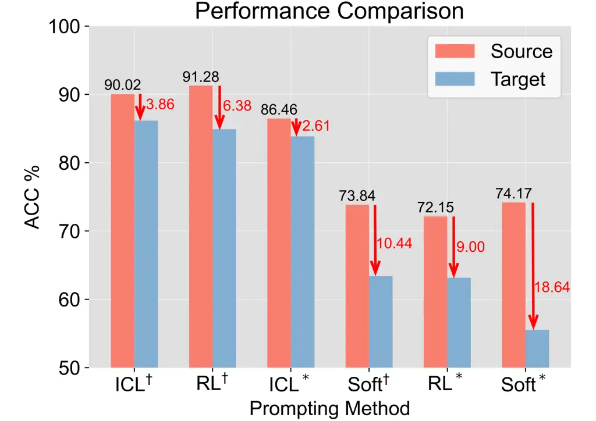

Figure 1: Domain generalization capabilities across various prompting
methods (ICL Brown et al. (2020), RL Deng et al. (2022), Soft Lester
et al. (2021)) in sentiment classification tasks.

Recognizing the problems mentioned above, we focus on improving the
domain generalization ability of prompts with three constraints: (i) do
so with no knowledge about the target domain, (ii) do so with little
training cost, (iii) do so with easy adaptation on both soft prompt and
hard prompt optimization. To get started, we test the popular prompt
optimization methods on cross-domain setting (_i.e._, training prompts
on one domain and testing them on out-of-distribution target domain¹¹ 1
The ^(∗) represents using CR Hu and Liu (2004) as the source domain and
the ^(†) represents using SST-2 Socher et al. (2013) as the source
domain. All results shown use MR Pang and Lee (2005) as the target
domain.) and show the results in Figure 1. Interestingly, these
optimized prompts exhibit (i) great performance drop in general (by an
average of 8.49%) on target domain, validating the existence of research
gap mentioned above, (ii) different domain generalization ability in
particular (Acc. drops by 2.61% in best case and by 18.64% in worst
case), indicating the existence of distinct prompt “nature” that
contributes to its generalizability.

Since prompts are functional in the model inference stage in which the
model looks up contexts to generate new tokens through the attention
mechanism, we probe the attention pattern on prompts during forward
propagation with the question “what nature do well-generalized prompts
have?” and get the following findings ($`\mathcal{F}`$) via pilot
experiments (§3):


Hence, we propose the idea of Concentration, representing the capability
of prompts to get the attention stably from PLMs. We suggest that the
concentration indicates the domain generalization ability for prompts,
which can be a forebode ahead of the downstream tests.

With the principle of concentration §3, we propose two algorithms that
could piggyback upon popular prompt optimization methods for both hard
and soft prompts to improve the domain generalization ability of
prompts. In the parameterized optimization process of soft prompt §4.1,
where the loss function acts as objective, we introduce the
concentration-reweighting loss. It minimizes the attention weight on the
original input sequence, so as to make the model concentrate on prompts
stably for different inputs. In the non-parameterized optimization
process of hard prompt §4.2, where the prompt set is first filtered and
matched with different inputs by trained agents, we propose the
concentration-oriented metric and reward. They aim to filter out and
match the input with concentration-worthy hard prompts. Experiments show
that our method respectively improves the target domain accuracy by
1.42% and 2.16% over the soft prompt and hard prompt optimized
comparison methods, while maintaining in-domain capability.

## 2 Preliminary

This section briefly introduces definitions of the Multi-source Few-shot
Domain Generalization (MFDG) problem, which is the primary application
scenario of our work.

MFDG Setting. A text classification task, _e.g._, sentiment
classification, is defined as $`\mathcal{T}:\mathcal{X}\to\mathcal{Y}`$,
where $`\mathcal{Y}`$ is the task’s label space and $`\mathcal{X}`$ is
the feature space. We denote $`M(X)`$ to be the marginal distribution
over $`\mathcal{X}`$, and $`P(Y)`$ to be the prior distribution over
$`\mathcal{Y}`$. The domain is then defined by
$`\mathcal{D}_{\mathcal{T}}=\left\{\mathcal{X},M(X),P(Y),P(Y|X)\right\}`$.
Under the domain generalization setting, the source task is the same as
the target task, _i.e._, $`\mathcal{T}_{s}`$ equals to
$`\mathcal{T}_{t}`$. But for the source domain
$`\mathcal{D}_{\mathcal{T}_{s}}`$ and target domain
$`\mathcal{D}_{\mathcal{T}_{t}}`$, at least one of the underlying
probability distribution, _i.e._, $`M(X)`$, $`P(Y)`$, or $`P(Y|X)`$, is
different.

In our MFDG problem, the training set is sampled from $`N`$ source
domains
$`\mathcal{D}_{\text{train}}\sim\left\{\mathcal{D}_{\mathcal{T}_{s}}^{n}\right\}_{n=1}^{N}`$
and the model is tested on an unknown target domain
$`\mathcal{D}_{\text{test}}\sim\mathcal{D}_{\mathcal{T}_{t}}`$. Also, we
follow Perez et al. (2021) to simulate the few-shot learning setting,
which means
$`|\mathcal{D}_{\text{test}}|\gg|\mathcal{D}_{\text{train}}|`$.

MFDG Objective. Traditional prompting methods often rely on a crucial
assumption that the training and testing sets come from the same
underlying distribution
$`\mathcal{D}_{\text{train}},\mathcal{D}_{\text{test}}\sim\mathcal{D}_{\mathcal{T}_{t}}`$.
In this context, the objective of prompting is to optimize high-quality
prompt $`z^{*}`$ that maximizes the expected metric of the prediction on
the target domain $`\mathcal{D}_{\mathcal{T}_{t}}`$:

```math
\displaystyle z^{*}=\arg\max_{z}\mathbb{E}_{(x,y)\sim\mathcal{D}_{\mathcal{T}_{t}}}\left[r(y,p_{\textrm{LM}}(z\oplus x))\right], \tag{1}
```

where $`r`$ is a function that evaluates the quality of the predicted
answers when using the prompts $`z`$. For MFDG, the optimization
objective is:

```math
z^{*}=\arg\max_{z}\mathbb{E}_{\mathcal{D}_{\mathcal{T}_{t}}\in\mathcal{G}}\left[\mathbb{E}_{(x,y)\sim\mathcal{D}_{\mathcal{T}_{t}}}\left[r(y,p_{\mathrm{LM}}(z\oplus x))\right]\right], \tag{2}
```

where $`\mathcal{G}`$ is the set of unknown target domains. In a
nutshell, Eq. 1 searches the prompts well-performed within the known
domain, while Eq. 2 explores the prompts that perform well across
unknown domains.

## 3 Concentration Benefits Generalization

In this section, we present pilot experiments to analyze the correlation
between domain generalizability and attention concentration of prompts
using RoBERTa-Large Liu et al. (2019) as the backbone. Appendix C.1
shows the specific form of prompts used in the pilot experiment. From
the effect of prompts in forward propagation, we analyze (i) how much
each prompt is concentrated by the LM, and (ii) how stable the
concentration is to formulate the correspondence.

Background. Attention mechanisms are widely studied for PLM
interpretability Wang et al. (2022); Clark et al. (2019); Lin et al.
(2019); Htut et al. (2019). As for prompt optimization, Wang et al.
(2023) provide insights that label words in in-context learning
aggregate most of the attention weights in deep layers of PLM, which
majorly determine the final prediction. Inspired by this, we further
explore the attention weight on the whole prompt sequence and its impact
on prompt generalizability from a global perspective.

Definition 3.1. Let $`z=(z_{1},z_{2},...,z_{L})`$ and
$`x=(e_{1},e_{2},...,e_{T})`$ be prompt and original input with
$`z,x\in S`$, where $`S`$ is the set of all possible textual sequences
over the vocabulary. Let $`f_{\theta_{l}}`$ be the attention block²² 2
The attention block refers to key-query attention mechanism which is
broadly used in transformers-based models. The normalized, inner product
of “keys” $`k`$ and “queries” $`q`$ is computed in the forward pass
activations of attention block. in layer $`l`$ of a PLM parameterized by
$`\theta_{l}`$. Then concentration is a function
$`\text{Concentration}:S\rightarrow\mathbb{R}^{+}`$

```math
\displaystyle\text{Concentration}(z\oplus x;\theta_{l})=\sum_{z_{i}\in z}f_{\theta_{l}}(z_{i}\oplus x). \tag{3}
```

Heuristicly, concentration represents the “lookback” attention from
current decoding token to prompt tokens, as shown in Figure 2.

Figure 2: Illustration of Concentration. The tokens in the blue square
are prompt, and those in yellow are input sequences. Concentration
represents the model’s attention on prompt tokens in forward pass when
decoding \<mask\> token.

Definition 3.2. Let $`z=(z_{1},z_{2},...,z_{L})`$ and
$`x=(e_{1},e_{2},...,e_{T})`$ be prompt and original input with
$`z,x\in S`$, where $`S`$ is the set of all possible textual sequences
over the vocabulary. Let $`\mathcal{D}=(x_{1},x_{2},...,x_{M})`$ be the
input dataset. Let $`f_{\theta_{l}}`$ be the attention block in layer
$`l`$ of a PLM. Then concentration strength is a function
$`\text{Strength}:\mathcal{D}\rightarrow\mathbb{R}^{+}`$

```math
\displaystyle\text{Strength}((z,\mathcal{D});\theta_{l})=\frac{1}{|\mathcal{D}|}\sum_{x_{i}\in\mathcal{D}}\text{Concentration}(z\oplus x_{i};\theta_{l}). \tag{4}
```

Concentration strength represents the average concentration across the
input dataset.

Definition 3.3. Let $`\mathcal{D}={(x_{1},x_{2},...,x_{M})}`$ be the set
of textual sequences sampled from target domain
$`\mathcal{\mathcal{D}}_{\mathcal{T}_{t}}`$, where $`x_{i}\in S`$. Then
the concentration fluctuation is a function
$`\text{Fluctuation}:\mathcal{D}\rightarrow\mathbb{R}^{+}`$

```math
\displaystyle\text{Fluctuation}((z,\mathcal{D});\theta_{l})=\sqrt{\frac{1}{|{\mathcal{D}}|}\sum_{x_{i}\in\mathcal{D}}\left[\text{Concentration}(z\oplus x_{i};\theta_{l}))-\text{Strength}((z,\mathcal{D});\theta_{l})\right]^{2}}. \tag{5}
```

Concentration fluctuation demonstrates the variance of concentration
strength for different inputs.

Figure 3: Left: concentration strength of various prompting methods in
the last 5 layers (layers 19 to 23). Right: boxplots of the
concentration strength in the last layer. Overall, prompts that exhibit
good domain generalization gain higher concentration strength and lower
concentration fluctuation. The concentration strength of each layer is
shown in Appendix C.2.

Our pilot experiment unveils following insights: (i) Prompts with larger
Concentration Strength achieve better performance in domain
generalization. For instance, Figure 3(left) shows that tokens of
$`\text{ICL}^{\dagger}`$, the best-performed method, gain more than 0.8
of Concentration Strength at the 21st layer and over 0.7 at the 23rd
layer. (ii) Prompts with lower Concentration Fluctuation tend to
generalize to target domain better. As shown in Figure 3(right),
$`\text{Soft}^{\dagger}`$ and $`\text{ICL}^{*}`$ are concentrated at a
similar level, but $`\text{ICL}^{*}`$ generalizes better while its
stability is better. (iii) High Concentration Strength and low
Concentration Fluctuation together contribute most to prompt
generalizability. The best-performed $`\text{ICL}^{\dagger}`$ has most
Concentration Strength and lowest Concentration Fluctuation across all
comparison prompts. These discoveries inspire us to adjust the objective
for soft prompt§4.1 and hard prompt§4.2 optimization towards increasing
Concentration Strength while decreasing Concentration Fluctuation.

## 4 Concentrative Prompt Optimization

### 4.1 Concentrative Soft Prompt Optimization

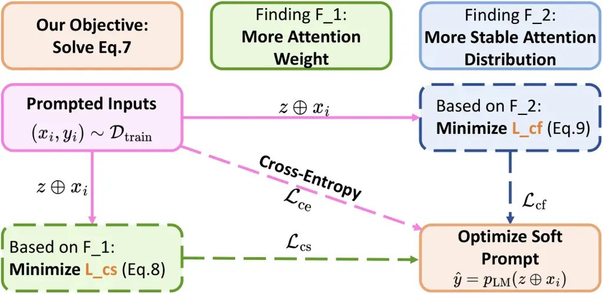

Figure 4: Framework for Soft Prompt Optimization.

To devise soft prompt optimization with the guidance of concentration,
we first visit the optimization objective of mainstream methods (_e.g._,
prompt tuning Lester et al. (2021), prefix tuning Li and Liang (2021),
p-tuning v2 Liu et al. (2021)).

These methods optimize follow log-likelihood objective given a trainable
prompt $`z`$ and a fixed PLM parameterized by $`\theta`$ for the input
$`x`$:

```math
\displaystyle\max_{z}\text{log}P(y|(z\oplus x);\theta). \tag{6}
```

According to our findings in §3, domain-generalizable prompts should be
high in concentration strength and low in concentration fluctuation.
Thus, we reformulate Eq. 6 to get the objective for domain-generalizable
prompts:

```math
\displaystyle\max_{z}(\text{log}P(y|(z\oplus x);\theta)+\text{Strength}((z,\mathcal{D}_{\text{train}});\theta))\quad s.t.\ \min_{z}\text{Fluctuation}((z,\mathcal{D}_{\text{train}});\theta). \tag{7}
```

Towards the reformulated objective above, we propose the
concentration-reweighting loss for soft prompt optimization methods. The
framework for soft prompt optimization is shown in Figure 4. First, we
minimize the concentration strength on input $`x`$ to improve
concentration strength on prompt $`z`$ by designing loss function
$`\mathcal{L}_{\text{cs}}`$ as:

```math
\displaystyle\mathcal{L}_{\text{cs}}=1-\text{Strength}((z,\mathcal{D}_{\text{train}});\theta). \tag{8}
```

In addition, to reduce concentration fluctuation of prompts, we propose
to use every token’s concentration strength as hidden state feature of
prompts, denoted as $`\mathbb{C}_{i}=(c_{1},c_{2},...,c_{L})`$ where
$`L`$ is the length of prompts. We design a contrastive loss to cluster
$`\mathbb{C}`$ with same label together to reduce concentration
fluctuation:

```math
\displaystyle\mathcal{L}_{\text{cf}}=\sum_{i=1}^{\left|\mathcal{D}_{\text{train}}\right|}\frac{-1}{P(i)}\sum_{p\in P(i)}\log\frac{\exp(sim(\mathbb{C}_{i},\mathbb{C}_{p})/\tau)}{{\textstyle\sum_{j=1}^{\left|\mathcal{D}_{\text{train}}\right|}\mathbf{1}_{i\neq j}\exp(sim(\mathbb{C}_{i},\mathbb{C}_{j})/\tau)}}, \tag{9}
```

where $`P(j)`$ represents the input with the same label as the $`j`$-th
input in the dataset $`\mathcal{D}_{\text{train}}`$, $`sim(.)`$ is used
to calculate the cosine similarity between feature embeddings,
$`\mathbf{1}_{i\neq j}`$ is an indicator function, _i.e._,
$`\mathbf{1}_{i\neq j}\in{\left\{0,1\right\}}=1`$ if and only if
$`i\neq j`$, and $`\tau`$ is a temperature parameter used to adjust the
scale of the similarity score.

Also, we utilize the cross-entropy classification loss
$`\mathcal{L}_{\text{ce}}`$ Mao et al. (2023). The
concentration-reweighting loss for soft prompt optimization is
formulated as:

```math
\displaystyle\mathcal{L_{\text{cr}}}=\lambda_{\text{ce}}\mathcal{L}_{\text{ce}}+\lambda_{\text{cs}}\mathcal{L}_{\text{cs}}+\lambda_{\text{cf}}\mathcal{L}_{\text{cf}}, \tag{10}
```

where $`\lambda_{\text{ce}}`$, $`\lambda_{\text{cs}}`$ and
$`\lambda_{\text{cf}}`$ weights different losses in training process.
More details are in Appendix D.

### 4.2 Concentrative Hard Prompt Optimization

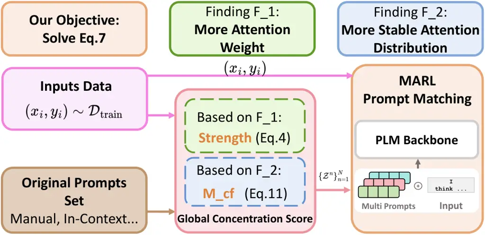

Figure 5: Framework for Hard Prompt Optimization.

In contrast to soft prompt optimization, hard prompt optimization
searches suitable prompt in discrete space in a non-parameterized
fashion. Previous hard prompt optimization searches can be divided into
distribution-level Prasad et al. (2022); Deng et al. (2022) and
input-level Li et al. (2024); Lu et al. (2022). Although
distribution-level prompt optimization can generally improve reasoning
ability, motivated by the fact that no prompt is perfect for all inputs
Sun et al. (2023), we focus on improving the generalization ability of
input-level optimization methods. Generally, the mainstream of
input-level optimization technique for hard prompts could be
encapsulated as: filter (by metric) and match (by RL agents). The
findings of concentration could be applied to this optimization process
by adjusting filter metric and agent reward. We illustrate the framework
for hard prompt optimization in Figure 5.

Filter Metric. For previous filter metric only considering the overall
accuracy on training set, we introduce a new metric called Global
Concentration Score (GCS), which involves our ideas of concentration
strength and concentration fluctuation.

Towards optimization objective Eq.7, we use concentration strength as
first metric to filter out prompts which cannot get much concentration
from model. Metric for reducing concentration fluctuation could be
regarded as minimizing Kullback-Leibler (KL) divergence between the
concentration features $`\mathbb{C}_{i}`$ of input with same label and
the average of $`\mathbb{C}_{i}`$ on whole inputs set
$`\mathcal{D}_{\text{train}}`$:

```math
\displaystyle M_{\textrm{cf}}(z,\mathcal{D}_{\text{train}})=\sum_{y\in\mathcal{Y}}\sum_{i\in\mathcal{D}_{\text{train}}(y)}\text{KL}(\text{Softmax}(\mathbb{C}_{i})\parallel\text{Softmax}(\mathbb{C}_{\text{avg}}^{y})), \tag{11}
```

where $`\mathcal{Y}`$ is label space and
$`\mathcal{D}_{\text{train}}(y)`$ is the input set labeled $`y`$ in data
set $`\mathcal{D}_{\text{train}}`$. Also, we follow the setting of Li
et al. (2024) calculating the difference of the probability $`p_{LM}`$
that the $`x_{i}`$ is correctly labeled $`y_{\text{ture}}`$ and wrongly
labeled as $`y_{\text{false}}`$ by a base PLM to improve the overall
accuracy:

```math
\displaystyle M_{\textrm{acc}}(z,\mathcal{D}_{\text{train}})=\sum_{x_{i}\in{\mathcal{D}_{\text{train}}}}(p_{\textrm{LM}}(y_{\text{ture}}|z\oplus x_{i})-p_{\textrm{LM}}(y_{\text{false}}|z\oplus x_{i})). \tag{12}
```

Finally, we combine the above three metrics as one comprehensive metric,
_i.e._, Global Concentration Score (GCS), to assess the quality of
prompts:

```math
\displaystyle\mathrm{GCS}(z,\mathcal{D}_{\text{train}})=\alpha_{\textrm{acc}}M_{\textrm{acc}}(z,\mathcal{D}_{\text{train}})+\alpha_{\textrm{cs}}\text{Strength}((z,\mathcal{D}_{\text{train}});\theta)+\alpha_{\textrm{cf}}M_{\textrm{cf}}(z,\mathcal{D}_{\text{train}}), \tag{13}
```

where $`\alpha_{\textrm{acc}}`$, $`\alpha_{\textrm{cs}}`$ and
$`\alpha_{\textrm{cf}}`$ are the weights that balance accuracy,
concentration strength, and concentration fluctuation, respectively.

Prompt Matching. Previous methods mostly use a single RL agent to match
appropriate prompts for each input Li et al. (2024); Lu et al. (2022);
Sun et al. (2023). Due to the large prompt space, the effective
exploration of reinforcement learning agents is limited Dulac-Arnold
et al. (2019). Furthermore, in the MFDG setting, inputs from different
domains often have different state spaces, action spaces, and reward
scales, then using a single agent often leads to the strategy converging
to sub-optimality. To overcome these challenges, we redefine the
discrete prompt matching problem in the MFDG setting as a multi-agent
reinforcement learning (MARL) problem and propose a new matching
algorithm.

We build our matching algorithm based on the Multi-Agent Proximal Policy
Optimization (MAPPO) algorithm Yu et al. (2022). Specifically, we
configure one reinforcement learning (RL) agent for each source domain,
collectively forming a multi-agent ensemble
$`\mathcal{N}=\{1,2,\ldots,N\}`$. In order to effectively share learning
experience in different domains, all agents share the same value network
$`v_{\phi}(.)`$ while having independent strategy networks
$`\left\{\pi_{\omega_{n}}(.)\right\}_{n=1}^{N}`$, where $`\phi`$ and
$`\omega_{n}`$ are the learnable parameters. Also, we define a set of
prompts $`\mathcal{Z}^{n}`$ for each source domain, which serves as the
action space for the corresponding RL agent. These prompts can come in
various forms, including manual prompts Bach et al. (2022), original
training inputs Brown et al. (2020); Dong et al. (2022), or
LLM-generated Li et al. (2024); Lu et al. (2021). Here, an action
$`a^{n}`$ implies that agent $`n`$ selects a specific prompt $`z^{n}`$
from its designated prompt set $`\mathcal{Z}^{n}`$.

At each step $`t`$ of the training phase, given a state
$`s_{t}^{n}=\mathrm{PLM}(x_{t})`$, which is the last hidden layer
embedding of input $`x_{t}`$, the $`n`$-th agent selects an action
$`a_{t}^{n}`$ by policy $`\pi_{\omega_{n}}(a_{t}^{n}|s_{t}^{n})`$. This
action corresponds to choosing prompt $`z_{t}^{n}`$. We combine
$`x_{t}`$ and $`z_{t}^{n}`$, feed them into the PLM for downstream
tasks, and calculate the reward $`r_{t}^{n}`$. The agent’s parameters
are then optimized based on $`r_{t}^{n}`$.

The rewards received by the RL agent are used as feedback to directly
guide the optimization direction of the strategy. In this work, we aim
to ensure that the prompts selected by the RL agent have good
generalization capabilities. Therefore, we reuse
$`\text{Strength}(.;\theta)`$ as a part of our reward function,
specifically $`r_{t}^{n}`$ is defined as:

```math
\displaystyle r_{t}^{n}=\alpha_{\textrm{acc}}M_{\textrm{acc}}(z_{t}^{n},\left\{x_{t}\right\})+\alpha_{\textrm{cs}}\text{Strength}(z,\left\{x_{t}\right\};\theta). \tag{14}
```

In the testing phase, we use an ensemble decision-making approach to
apply the prompts. The prompts selected by each agent are input into the
PLM to perform downstream tasks, and the results are combined. For a
given input $`x`$ and its corresponding selected prompts
$`\left\{z^{n}\right\}_{n=1}^{N}`$, the final prediction obtained by PLM
for label $`y`$ can be expressed as:

```math
\displaystyle P(y|x)=\mathrm{softmax}(\sum_{n=1}^{N}p_{\mathrm{LM}}(y|x,z^{n})). \tag{15}
```

Our intention is to divide the action space of agents into smaller, more
manageable subspaces and make it easier for agents to make the best
decisions. The detailed training and testing processes, along with
specific agent settings, are presented in Appendix E.

## 5 Experiments

To demonstrate the effectiveness of our findings for domain
generalization, we conduct extensive experiments on tasks of sentiment
classification and natural language inference (NLI). We select the SST-2
Socher et al. (2013), MR Pang and Lee (2005), and CR Hu and Liu (2004)
datasets for sentiment classification, and the WNLI, QNLI, and RTE
datasets from GLUE Wang et al. (2018) for NLI tasks³³ 3 For simplicity,
these datasets are denoted by their initial letters (S, M, C, W, Q, and
R respectively).. Each task involves designating one dataset as the
target domain and the others as source domains. Detailed descriptions of
the datasets and domain divisions are provided in Appendix B.1.

We choose RoBERTa-largeLiu et al. (2019) for all downstream tasks for
our hardware resources, and it has been widely used in previous prompt
optimization works Li et al. (2024); Deng et al. (2022); Zhang et al.
(2022). Admittedly, at the time of writing this article, various efforts
to optimize prompts have surfaced. However, our goal is not to build a
better training method based on previous problems, but to pose a new
problem, _e.g._, learning prompts with strong domain generalization
ability. We therefore select three of the most well-known methods as
baseline in the fields of soft prompt optimization and hard prompt
optimization respectively. In addition, in order to more comprehensively
demonstrate the performance of our method, we also select two
distribution-level discrete prompt optimization methods as comparison
methods. The baseline methods and their implementations are described in
Appendix B.2 and B.3.

|                                                |                                           |                             |                             |                             |                             |                             |                             |
| ---------------------------------------------- | ----------------------------------------- | --------------------------- | --------------------------- | --------------------------- | --------------------------- | --------------------------- | --------------------------- |
|                                                |                                           | Sentiment                   |                             |                             | NLI                         |                             |                             |
| Paradigms                                      | Methods                                   | S+M$`\rightarrow`$C         | C+M$`\rightarrow`$S         | S+C$`\rightarrow`$M         | Q+R$`\rightarrow`$W         | W+R$`\rightarrow`$Q         | Q+W$`\rightarrow`$R         |
| Prompt Tuning Lester et al. (2021)             | Vanilla PT                                | 64.73$`{}_{\text{3.82}}`$   | 65.51$`{}_{\text{2.65}}`$   | 65.12$`{}_{\text{3.85}}`$   | 41.20$`{}_{\text{1.55}}`$   | 49.83$`{}_{\text{1.47}}`$   | 49.66$`{}_{\text{1.67}}`$   |
|                                                | PT with $`\mathcal{L}_{cs}`$              | 65.83$`{}_{\text{3.83}}`$   | 66.38$`{}_{\text{2.42}}`$   | 65.33$`{}_{\text{2.37}}`$   | 41.53$`{}_{\text{1.56}}`$   | 49.60$`{}_{\text{2.37}}`$   | 49.43$`{}_{\text{1.41}}`$   |
|                                                | PT with $`\mathcal{L}_{cf}`$              | 65.09$`{}_{\text{3.72}}`$   | 67.40$`{}_{\text{2.43}}`$   | 65.40$`{}_{\text{2.33}}`$   | 42.17$`{}_{\text{2.03}}`$   | 49.22$`{}_{\text{1.59}}`$   | 49.73$`{}_{\text{1.31}}`$   |
|                                                | PT with both                              | 66.19$`{}_{\text{{3.69}}}`$ | 69.54$`{}_{\text{{2.52}}}`$ | 65.89$`{}_{\text{{2.32}}}`$ | 42.48$`{}_{\text{{1.72}}}`$ | 50.31$`{}_{\text{{1.33}}}`$ | 50.42$`{}_{\text{{1.34}}}`$ |
| Prefix Tuning Li and Liang (2021)              | Vanilla Prefix                            | 65.91$`{}_{\text{3.24}}`$   | 83.25$`{}_{\text{0.41}}`$   | 75.51$`{}_{\text{0.91}}`$   | 50.26$`{}_{\text{0.31}}`$   | 51.88$`{}_{\text{0.29}}`$   | 50.02$`{}_{\text{0.28}}`$   |
|                                                | Prefix with $`\mathcal{L}_{cs}`$          | 66.23$`{}_{\text{3.37}}`$   | 84.32$`{}_{\text{0.48}}`$   | 76.58$`{}_{\text{0.82}}`$   | 50.69$`{}_{\text{0.33}}`$   | 51.44$`{}_{\text{0.28}}`$   | 49.77$`{}_{\text{0.22}}`$   |
|                                                | Prefix with $`\mathcal{L}_{cf}`$          | 66.82$`{}_{\text{3.19}}`$   | 83.70$`{}_{\text{0.39}}`$   | 77.17$`{}_{\text{0.75}}`$   | 51.73$`{}_{\text{0.32}}`$   | 52.12$`{}_{\text{0.28}}`$   | 50.73$`{}_{\text{0.26}}`$   |
|                                                | Prefix with both                          | 68.29$`{}_{\text{{2.97}}}`$ | 85.07$`{}_{\text{{0.42}}}`$ | 77.53$`{}_{\text{{0.43}}}`$ | 52.05$`{}_{\text{{0.30}}}`$ | 53.32$`{}_{\text{{0.25}}}`$ | 51.26$`{}_{\text{{0.27}}}`$ |
| P-Tuning v2 Liu et al. (2021)                  | Vanilla Pv2                               | 65.92$`{}_{\text{1.61}}`$   | 83.84$`{}_{\text{1.69}}`$   | 75.89$`{}_{\text{0.36}}`$   | 50.63$`{}_{\text{0.31}}`$   | 52.76$`{}_{\text{1.01}}`$   | 51.31$`{}_{\text{1.37}}`$   |
|                                                | Pv2 with $`\mathcal{L}_{cs}`$             | 66.06$`{}_{\text{1.77}}`$   | 83.32$`{}_{\text{1.59}}`$   | 75.07$`{}_{\text{0.35}}`$   | 51.37$`{}_{\text{0.37}}`$   | 50.93$`{}_{\text{0.92}}`$   | 50.20$`{}_{\text{1.30}}`$   |
|                                                | Pv2 with $`\mathcal{L}_{cf}`$             | 66.72$`{}_{\text{1.62}}`$   | 84.12$`{}_{\text{1.51}}`$   | 76.41$`{}_{\text{0.33}}`$   | 51.32$`{}_{\text{0.38}}`$   | 52.64$`{}_{\text{1.04}}`$   | 51.28$`{}_{\text{1.22}}`$   |
|                                                | Pv2 with both                             | 67.07$`{}_{\text{{1.53}}}`$ | 84.86$`{}_{\text{{1.42}}}`$ | 77.26$`{}_{\text{{0.37}}}`$ | 51.87$`{}_{\text{{0.28}}}`$ | 53.83$`{}_{\text{{0.95}}}`$ | 51.57$`{}_{\text{{1.16}}}`$ |
| GrIPS Prasad et al. (2022)                     | -                                         | 80.07$`{}_{\text{2.57}}`$   | 84.28$`{}_{\text{1.38}}`$   | 85.19$`{}_{\text{1.12}}`$   | 54.37$`{}_{\text{2.40}}`$   | 52.77$`{}_{\text{1.73}}`$   | 53.52$`{}_{\text{1.66}}`$   |
| RLPrompt Deng et al. (2022)                    | \-                                        | 86.05$`{}_{\text{1.32}}`$   | 89.36$`{}_{\text{0.91}}`$   | 85.95$`{}_{\text{1.90}}`$   | 52.77$`{}_{\text{2.82}}`$   | 53.82$`{}_{\text{2.34}}`$   | 54.63$`{}_{\text{1.39}}`$   |
| Manual Prompt Bach et al. (2022)               | Vanilla MP                                | 52.73$`{}_{\text{4.43}}`$   | 55.81$`{}_{\text{3.31}}`$   | 50.85$`{}_{\text{1.58}}`$   | 41.70$`{}_{\text{1.17}}`$   | 50.80$`{}_{\text{0.84}}`$   | 51.60$`{}_{\text{1.50}}`$   |
|                                                | MP with MARL                              | 56.37$`{}_{\text{1.18}}`$   | 58.42$`{}_{\text{0.46}}`$   | 52.15$`{}_{\text{0.49}}`$   | 44.27$`{}_{\text{1.02}}`$   | 51.36$`{}_{\text{0.84}}`$   | 52.18$`{}_{\text{1.23}}`$   |
|                                                | MP with Metric                            | 54.63$`{}_{\text{2.12}}`$   | 57.84$`{}_{\text{1.65}}`$   | 51.79$`{}_{\text{1.75}}`$   | 42.86$`{}\_{\text{0.94      |
| }}`$                                           | 51.02$`{}_{\text{0.68}}`$                 | 52.03$`{}_{\text{1.14}}`$   |
|                                                | MP with both                              | 56.76$`{}_{\text{{0.40}}}`$ | 59.44$`{}_{\text{{0.32}}}`$ | 53.15$`{}_{\text{{0.35}}}`$ | 45.05$`{}_{\text{{0.28}}}`$ | 52.03$`{}_{\text{{0.25}}}`$ | 52.46$`{}_{\text{{1.24}}}`$ |
| In-Context Demo Brown et al. (2020)            | Vanilla IC                                | 84.33$`{}_{\text{2.15}}`$   | 84.81$`{}_{\text{1.39}}`$   | 80.21$`{}_{\text{2.17}}`$   | 50.86$`{}_{\text{1.28}}`$   | 52.63$`{}_{\text{0.94}}`$   | 58.04$`{}_{\text{2.23}}`$   |
|                                                | IC with MARL                              | 85.33$`{}_{\text{5.03}}`$   | 87.02$`{}_{\text{2.74}}`$   | 82.14$`{}_{\text{1.65}}`$   | 52.82$`{}_{\text{3.29}}`$   | 53.75$`{}_{\text{1.32}}`$   | 59.87$`{}_{\text{2.07}}`$   |
|                                                | IC with Metric                            | 84.70$`{}_{\text{3.17}}`$   | 85.10$`{}_{\text{2.12}}`$   | 82.60$`{}_{\text{4.91}}`$   | 51.19$`{}_{\text{4.80}}`$   | 52.72$`{}_{\text{4.31}}`$   | 59.46$`{}_{\text{4.64}}`$   |
|                                                | IC with both                              | 87.29$`{}_{\text{{2.72}}}`$ | 88.49$`{}_{\text{{1.52}}}`$ | 83.52$`{}_{\text{{0.98}}}`$ | 52.94$`{}_{\text{{1.59}}}`$ | 54.24$`{}_{\text{{0.73}}}`$ | 60.32$`{}_{\text{{1.20}}}`$ |
| $`\textsc{DP}_{2}\textsc{O}`$ Li et al. (2024) | Vanilla $`\textsc{DP}_{2}\textsc{O}`$     | 89.06$`{}_{\text{0.76}}`$   | 90.75$`{}_{\text{0.91}}`$   | 86.53$`{}_{\text{0.80}}`$   | 54.84$`{}_{\text{0.62}}`$   | 54.85$`{}_{\text{0.37}}`$   | 59.78$`{}_{\text{0.79}}`$   |
|                                                | $`\textsc{DP}_{2}\textsc{O}`$ with MARL   | 87.36$`{}_{\text{3.17}}`$   | 91.60$`{}_{\text{2.39}}`$   | 86.03$`{}_{\text{4.03}}`$   | 54.71$`{}_{\text{2.21}}`$   | 53.13$`{}_{\text{1.97}}`$   | 60.62$`{}_{\text{3.47}}`$   |
|                                                | $`\textsc{DP}_{2}\textsc{O}`$ with Metric | 86.79$`{}_{\text{1.32}}`$   | 90.13$`{}_{\text{1.07}}`$   | 86.60$`{}_{\text{0.83}}`$   | 53.21$`{}_{\text{1.16}}`$   | 54.02$`{}_{\text{0.79}}`$   | 60.54$`{}_{\text{1.47}}`$   |
|                                                | $`\textsc{DP}_{2}\textsc{O}`$ with both   | 89.63$`{}_{\text{{0.52}}}`$ | 92.87$`{}_{\text{{0.33}}}`$ | 87.85$`{}_{\text{{0.47}}}`$ | 56.42$`{}_{\text{{0.36}}}`$ | 55.32$`{}_{\text{{0.33}}}`$ | 61.27$`{}_{\text{{0.81}}}`$ |

Table 1: Performance comparison of text classification tasks in accuracy
with MFDG setting. We use double horizontal lines to separate soft
prompt optimization and hard prompt optimization methods. “-” denotes
the distribution-level discrete prompt optimization methods which are
not considered in our concentrative hard prompt optimization method, as
stated in §4.2.

### 5.1 Out-of-domain Performance Comparison

Domain Generalization Result for Soft Prompt. As shown in Table 1, the
concentration strength loss $`\mathcal{L}_{\text{cs}}`$ and the
concentration fluctuation loss $`\mathcal{L}_{\text{cf}}`$, in most
experimental settings, enhance the domain generalization of three soft
prompt optimization methods. And, the combination of
$`\mathcal{L}_{\text{cs}}`$ and $`\mathcal{L}_{\text{cf}}`$, _i.e._, the
concentration-reweighting loss $`\mathcal{L_{\text{cr}}}`$, further
improves the domain generalization ability of soft prompts, achieving
the best results in all experimental settings. Specifically,
$`\mathcal{L_{\text{ar}}}`$ (both) boosts the average accuracy of Prompt
Tuning, Prefix Tuning, and P-Tuning v2 by 1.47%, 1.78%, and 1.02%,
respectively, highlighting its effectiveness in promoting the learning
of domain-invariant properties in soft prompts. In addition, using only
$`\mathcal{L}_{\text{cs}}`$ or $`\mathcal{L}_{\text{cf}}`$ alone may
sometimes impair the performance of soft prompts, such as Prompt Tuning
and P-Tuning v2 methods when QNLI data is used as the target domain.
This indicates that concentration strength and concentration fluctuation
are both indispensable for domain generalization ability of the prompts,
and enhancing only one aspect may be harmful to the domain
generalization performance of the prompts.

To more comprehensively illustrate the utility of the
concentration-reweighting loss, we delve into Appendix D for complete
concentrative soft prompt optimization algorithm, extensive exploration
on performance stability to prompt initialization and utility to
decoder-only models of our method. Additionally, we provide quantitative
analysis and visual representation to illustrate the impact of
concentration-reweighting loss $`\mathcal{L_{\text{cr}}}`$ on soft
prompts.

Domain Generalization Result for Hard Prompt. As shown in Table 1, with
the introduction of filtering metric and prompt matching framework, our
approach effectively enhances the domain generalization capabilities of
various existing methods. Among them, the improvements to the
$`\textsc{DP}_{2}\textsc{O}`$ method achieved the best performance in
all experimental setups. Compared to the original
$`\textsc{DP}_{2}\textsc{O}`$, our method improve the average accuracy
on sentiment classification and NLI tasks by 1.34% and 0.85%
respectively. These results demonstrate the effectiveness of our
proposed filtering metrics and surrogate rewards in selecting universal
prompts from a pre-constructed set of prompts. Additionally, we find
that compared to filtering metrics, the prompt matching framework brings
a higher performance improvement to discrete prompts. This is because
our reward function design adeptly guides the agent to match inputs with
prompts that have strong cross-domain capabilities, even when faced with
an unfiltered set of prompts. We also analyze our method from multiple
aspects in Appendix E.

Overall Comparison. In the MFDG setting, hard prompts generally
outperform soft prompts. As illustrated in Table 1, the best-performed
hard prompt optimization method achieves a significant average accuracy
of 73.88%, compared to only 64.61% for the best soft prompts. We
hypnosis that hard prompts embed discrete tokens into the model input,
providing precise guidance during testing and making it easy for PLMs to
associate semantics fo input text sequence with the task. And soft
prompts rely on indirectly influencing model inference by searching in
continuous space with only the guidance of objective function, which
might cause overfitting on source domain.

### 5.2 In-domain Performance Comparison

|                               |                                         |                           |                           |                           |       |                           |                           |                           |       |         |
| ----------------------------- | --------------------------------------- | ------------------------- | ------------------------- | ------------------------- | ----- | ------------------------- | ------------------------- | ------------------------- | ----- | ------- |
|                               |                                         | Sentiment                 |                           |                           |       | NLI                       |                           |                           |       |         |
| Paradigms                     | Methods                                 | SST-2                     | CR                        | MR                        | Avg.  | WNLI                      | QNLI                      | RTE                       | Avg.  | Avg Gap |
| Prompt Tuning                 | Vanilla PT                              | 73.84$`{}_{\text{3.52}}`$ | 75.89$`{}_{\text{1.72}}`$ | 74.17$`{}_{\text{2.32}}`$ | 74.63 | 47.64$`{}_{\text{1.02}}`$ | 49.71$`{}_{\text{0.93}}`$ | 54.73$`{}_{\text{1.72}}`$ | 50.69 | +6.66   |
|                               | PT with both                            | 72.61$`{}_{\text{2.72}}`$ | 76.07$`{}_{\text{2.24}}`$ | 74.37$`{}_{\text{2.12}}`$ | 74.35 | 46.79$`{}_{\text{1.52}}`$ | 49.50$`{}_{\text{0.98}}`$ | 54.21$`{}_{\text{1.49}}`$ | 50.17 | +4.71   |
| Prefix Tuning                 | Vanilla Prefix                          | 87.39$`{}_{\text{2.98}}`$ | 77.37$`{}_{\text{0.79}}`$ | 82.65$`{}_{\text{0.65}}`$ | 82.47 | 55.88$`{}_{\text{0.37}}`$ | 60.27$`{}_{\text{0.44}}`$ | 54.82$`{}_{\text{0.31}}`$ | 56.99 | +6.93   |
|                               | Prefix with both                        | 87.29$`{}_{\text{3.12}}`$ | 76.73$`{}_{\text{1.28}}`$ | 83.32$`{}_{\text{0.83}}`$ | 82.45 | 56.18$`{}_{\text{0.35}}`$ | 59.74$`{}_{\text{0.32}}`$ | 55.38$`{}_{\text{0.42}}`$ | 57.10 | +5.19   |
| P-Tuning v2                   | Vanilla Pv2                             | 86.71$`{}_{\text{1.57}}`$ | 77.65$`{}_{\text{1.49}}`$ | 82.27$`{}_{\text{0.42}}`$ | 82.21 | 55.57$`{}_{\text{0.73}}`$ | 60.73$`{}_{\text{1.64}}`$ | 55.16$`{}_{\text{1.83}}`$ | 57.15 | +6.29   |
|                               | Pv2 with both                           | 87.03$`{}_{\text{1.32}}`$ | 77.71$`{}_{\text{1.50}}`$ | 82.05$`{}_{\text{0.54}}`$ | 82.08 | 56.31$`{}_{\text{0.69}}`$ | 60.46$`{}_{\text{1.37}}`$ | 55.20$`{}_{\text{1.69}}`$ | 57.32 | +5.38   |
| Manual Prompt                 | Vanilla MP                              | 61.62$`{}_{\text{3.42}}`$ | 57.75$`{}_{\text{2.92}}`$ | 53.13$`{}_{\text{2.33}}`$ | 57.50 | 44.27$`{}_{\text{2.80}}`$ | 53.42$`{}_{\text{0.98}}`$ | 52.63$`{}_{\text{0.60}}`$ | 50.11 | +3.22   |
|                               | MP with both                            | 61.33$`{}_{\text{2.32}}`$ | 56.07$`{}_{\text{1.61}}`$ | 53.47$`{}_{\text{0.42}}`$ | 56.96 | 44.05$`{}_{\text{0.89}}`$ | 53.77$`{}_{\text{1.35}}`$ | 52.60$`{}_{\text{0.39}}`$ | 50.14 | +0.40   |
| In-Context Demo               | Vanilla IC                              | 85.91$`{}_{\text{1.42}}`$ | 85.57$`{}_{\text{0.92}}`$ | 83.75$`{}_{\text{1.39}}`$ | 85.08 | 52.37$`{}_{\text{1.45}}`$ | 53.42$`{}_{\text{0.72}}`$ | 59.73$`{}_{\text{0.81}}`$ | 55.17 | +1.65   |
|                               | IC with both                            | 86.33$`{}_{\text{1.34}}`$ | 85.14$`{}_{\text{0.87}}`$ | 84.31$`{}_{\text{2.12}}`$ | 85.26 | 52.25$`{}_{\text{1.62}}`$ | 52.96$`{}_{\text{0.49}}`$ | 59.36$`{}_{\text{0.73}}`$ | 54.86 | +0.93   |
| $`\textsc{DP}_{2}\textsc{O}`$ | Vanilla $`\textsc{DP}_{2}\textsc{O}`$   | 93.62$`{}_{\text{0.72}}`$ | 90.76$`{}_{\text{0.50}}`$ | 88.58$`{}_{\text{0.91}}`$ | 90.99 | 55.26$`{}_{\text{1.02}}`$ | 55.13$`{}_{\text{0.39}}`$ | 61.07$`{}_{\text{0.81}}`$ | 57.15 | +1.44   |
|                               | $`\textsc{DP}_{2}\textsc{O}`$ with both | 93.20$`{}_{\text{0.81}}`$ | 90.38$`{}_{\text{0.47}}`$ | 88.37$`{}_{\text{2.12}}`$ | 90.65 | 56.47$`{}_{\text{0.41}}`$ | 55.42$`{}_{\text{0.79}}`$ | 61.29$`{}_{\text{0.63}}`$ | 57.73 | +0.37   |

Table 2: In-domain comparison. The last column shows the average gap
between test performance on in-domain and out-of-domain data.

We also compare the in-domain performance between our proposed
optimization objective and traditional training objective. And we report
not only model performance tested on in-domain dataset, but also the
average gap between performance on in-domain and out-of-domain data. As
shown in Table 2, our method shows comparable accuracy with prompt
optimization methods aiming only at maximizing log probability on
correct label, demonstrating that taking concentration into
consideration does not compromise on model performance on in-domain
data. Moreover, prompts optimized by concentration-driven objective
shows better consistency when tested on both in-domain and out-of-domain
data. Especially, for hard prompt optimization which searches for
suitable prompts in a limited discrete space, the average performance
gap is less than 1%, indicating our method always matches input sequence
with proper prompts even if the prompts are not initially designed on
target domain.

### 5.3 Applicability to Larger Models and Other Tasks:

We also attempt to extend our method to larger models and more complex
tasks. We validate the effectiveness of our method on Llama-2-7b-chat
Touvron et al. (2023), Vicuna-7b-v1.5 Zheng et al. (2023), and
Alpaca-7b-wdiff Taori et al. (2023) models for improving domain
generalization ability of Prefix Tuning and In-Context Demo on
question-answering tasks. We evaluate our method on ROC, SCT, and COPA
datasets from the TRAM Benchmark Wang and Zhao (2023) (referred as R, S,
and C for simplicity), covering multiple choice question answering
(MCQA) in reading comprehension and commonsense reasoning. The result is
shown in Table 3.

|                 |                  |                           |                           |                           |       |         |
| --------------- | ---------------- | ------------------------- | ------------------------- | ------------------------- | ----- | ------- |
|                 |                  | MCQA                      |                           |                           |       |         |
| Models          | Methods          | S + C $`\rightarrow`$ R   | C + R $`\rightarrow`$ S   | R + S $`\rightarrow`$ C   | Avg.  | Acc Gap |
| Llama-2-7b-chat | Vanilla Prefix   | 62.32$`{}_{\text{2.15}}`$ | 66.30$`{}_{\text{2.30}}`$ | 73.15$`{}_{\text{2.53}}`$ | 67.26 | —       |
|                 | Prefix with both | 63.70$`{}_{\text{1.96}}`$ | 68.47$`{}_{\text{0.97}}`$ | 75.32$`{}_{\text{1.09}}`$ | 69.16 | +1.90   |
|                 | Vanilla IC       | 63.13$`{}_{\text{1.25}}`$ | 65.50$`{}_{\text{1.98}}`$ | 77.59$`{}_{\text{1.14}}`$ | 68.74 | —       |
|                 | IC with both     | 65.13$`{}_{\text{1.03}}`$ | 68.33$`{}_{\text{2.13}}`$ | 79.83$`{}_{\text{0.88}}`$ | 70.10 | +1.36   |
| Vicuna-7b-v1.5  | Vanilla Prefix   | 67.72$`{}_{\text{1.79}}`$ | 81.09$`{}_{\text{2.17}}`$ | 88.97$`{}_{\text{2.64}}`$ | 79.26 | —       |
|                 | Prefix with both | 68.75$`{}_{\text{1.04}}`$ | 83.93$`{}_{\text{1.79}}`$ | 89.76$`{}_{\text{2.60}}`$ | 80.81 | +1.55   |
|                 | Vanilla IC       | 68.37$`{}_{\text{2.24}}`$ | 83.23$`{}_{\text{4.12}}`$ | 90.98$`{}_{\text{1.99}}`$ | 80.86 | —       |
|                 | IC with both     | 69.67$`{}_{\text{1.58}}`$ | 85.50$`{}_{\text{5.06}}`$ | 93.39$`{}_{\text{1.23}}`$ | 82.85 | +1.99   |
| Alpaca-7b-wdiff | Vanilla Prefix   | 61.52$`{}_{\text{3.79}}`$ | 70.03$`{}_{\text{2.88}}`$ | 87.91$`{}_{\text{2.73}}`$ | 73.15 | —       |
|                 | Prefix with both | 63.89$`{}_{\text{2.93}}`$ | 72.15$`{}_{\text{2.07}}`$ | 89.58$`{}_{\text{2.81}}`$ | 75.21 | +2.06   |
|                 | Vanilla IC       | 60.81$`{}_{\text{1.14}}`$ | 69.11$`{}_{\text{2.46}}`$ | 89.66$`{}_{\text{2.37}}`$ | 73.19 | —       |
|                 | IC with both     | 63.16$`{}_{\text{1.56}}`$ | 70.57$`{}_{\text{1.95}}`$ | 91.19$`{}_{\text{2.00}}`$ | 74.97 | +1.78   |

Table 3: Performance comparison of large models on MCQA task accuracy.
The last column shows the average gap between test performance on
vanilla method and our method.

Experimental results show that our method significantly improves the
performance of large models on question-answering tasks across multiple
domain generalization settings. For instance, for the Llama-7b model,
our method improved the average accuracy of soft prompt generalization
and hard prompt generalization comparisons by 1.90% and 1.36%,
respectively; similar improvements were observed for Vicuna-7b and
Alpaca-7b models, ranging from 1.55% to 1.99% and 2.06% to 1.78%
respectively.

Additionally, we would also like to discuss "why our method works well
for large generative language models?". In Appendix F, we present the
Concentration Strength Distribution of prompts using In-Context Demo
across three 7B-sized language models (Llama, Vicuna, Alpaca) on three
different tasks (SA, NLI, MCQA). We observe that all three LLMs exhibit
stronger concentration strength in deeper layers compared to shallower
layers when confront with prompts for different tasks. We find that this
phenomenon occurs earlier in larger models (7B) compared to smaller
models like Roberta-large. We speculate that this behavior is related to
the alignment stage in pre-training of large models during Supervised
Fine Tuning with a large number of prompts.

## 6 Conclusion

In this paper, we explore the nature of prompts with good domain
generalization ability. By conducting experiments on model concentration
on prompts and concentration pattern stability, we find that
well-generalized prompt attract more attention weights at deeper layers
of pre-trained language models (PLMs) and this pattern stably exists to
different inputs. Inspired by these new findings, we propose
optimization methods for soft prompt and hard prompt, respectively. For
soft prompts, we design a concentration-reweighting loss to search for
prompts with strong domain generalization ability in continuous space.
For hard prompts, we develop an attention-weighted filter-then-match
framework. This framework first apply a novel metric which takes model
concentration and pattern stability into consideration to filter out
low-quality prompts in candidate set. Then a multi-agent reinforcement
learning method is used to match each input with optimized hard prompts
from each source domain. Our extensive experiment on multiple datasets
in different tasks demonstrates the superiority of our methods over
existing comparison prompt optimization methods in terms of MFDG
setting.

## 7 Limitations

In this study, we primarily focused on the performance of
domain-generalizable prompt optimization. Despite this, our research
still faces limitations in some practical application scenarios.
Firstly, our pilot experiments only covered a limited variety of
prompts. In future studies, we plan to extend to more diverse types of
prompts. Secondly, the current research mainly focuses on the prompt
domain generalization capabilities in a small-sample environment; next,
we will conduct more comprehensive performance evaluations on complete
datasets. Additionally, our current discrete prompt optimization method
is primarily applicable at the input-level; in the future, we plan to
explore its potential applications at the distribution-level. Finally,
although our method is designed to enhance the performance of PLMs in
classification tasks, these methods cannot be directly applied to
open-ended generation tasks.

## Acknowledgements

We thank all the reviewers and the area chair for their helpful
feedback, which aided us in greatly improving the paper. This work is
supported by National Natural Science Foundation of China (62272371,
62103323, U21B2018), Initiative Postdocs Supporting Program (BX20190275,
BX20200270), China Postdoctoral Science Foundation (2019M663723,
2021M692565), Fundamental Research Funds for the Central Universities
under grant (xzy012024144), and Shaanxi Province Key Industry Innovation
Program (2021ZDLGY01-02).

## References

- An et al. \[2022\] S. An, Y. Li, Z. Lin, Q. Liu, B. Chen, Q. Fu,
  W. Chen, N. Zheng, and J.-G. Lou. Input-tuning: Adapting unfamiliar
  inputs to frozen pretrained models. _arXiv preprint
  arXiv:2203.03131_, 2022.
- Bach et al. \[2022\] S. H. Bach, V. Sanh, Z.-X. Yong, A. Webson,
  C. Raffel, N. V. Nayak, A. Sharma, T. Kim, M. S. Bari, T. Fevry,
  Z. Alyafeai, M. Dey, A. Santilli, Z. Sun, S. Ben-David, C. Xu,
  G. Chhablani, H. Wang, J. A. Fries, M. S. Al-shaibani, S. Sharma,
  U. Thakker, K. Almubarak, X. Tang, X. Tang, M. T.-J. Jiang, and A. M.
  Rush. Promptsource: An integrated development environment and
  repository for natural language prompts, 2022.
- Brown et al. \[2020\] T. Brown, B. Mann, N. Ryder, M. Subbiah, J. D.
  Kaplan, P. Dhariwal, A. Neelakantan, P. Shyam, G. Sastry, A. Askell,
  et al. Language models are few-shot learners. _Advances in neural
  information processing systems_, 33:1877–1901, 2020.
- Chen et al. \[2024\] H. Chen, X. Han, Z. Wu, and Y.-G. Jiang.
  Multi-prompt alignment for multi-source unsupervised domain
  adaptation. _Advances in Neural Information Processing Systems_,
  36, 2024.
- Clark et al. \[2019\] K. Clark, U. Khandelwal, O. Levy, and C. D.
  Manning. What does bert look at? an analysis of bert’s attention.
  _arXiv preprint arXiv:1906.04341_, 2019.
- Davison et al. \[2019\] J. Davison, J. Feldman, and A. M. Rush.
  Commonsense knowledge mining from pretrained models. In _Proceedings
  of the 2019 conference on empirical methods in natural language
  processing and the 9th international joint conference on natural
  language processing (EMNLP-IJCNLP)_, pages 1173–1178, 2019.
- Deng et al. \[2022\] M. Deng, J. Wang, C.-P. Hsieh, Y. Wang, H. Guo,
  T. Shu, M. Song, E. P. Xing, and Z. Hu. Rlprompt: Optimizing discrete
  text prompts with reinforcement learning. _arXiv preprint
  arXiv:2205.12548_, 2022.
- Devlin et al. \[2018\] J. Devlin, M.-W. Chang, K. Lee, and
  K. Toutanova. Bert: Pre-training of deep bidirectional transformers
  for language understanding. _arXiv preprint arXiv:1810.04805_, 2018.
- Dong et al. \[2022\] Q. Dong, L. Li, D. Dai, C. Zheng, Z. Wu,
  B. Chang, X. Sun, J. Xu, and Z. Sui. A survey on in-context learning.
  _arXiv preprint arXiv:2301.00234_, 2022.
- Dulac-Arnold et al. \[2019\] G. Dulac-Arnold, D. Mankowitz, and
  T. Hester. Challenges of real-world reinforcement learning. _arXiv
  preprint arXiv:1904.12901_, 2019.
- Gao et al. \[2020\] T. Gao, A. Fisch, and D. Chen. Making pre-trained
  language models better few-shot learners. _arXiv preprint
  arXiv:2012.15723_, 2020.
- Ge et al. \[2023\] C. Ge, R. Huang, M. Xie, Z. Lai, S. Song, S. Li,
  and G. Huang. Domain adaptation via prompt learning. _IEEE
  Transactions on Neural Networks and Learning Systems_, 2023.
- Gu et al. \[2021\] Y. Gu, X. Han, Z. Liu, and M. Huang. Ppt:
  Pre-trained prompt tuning for few-shot learning. _arXiv preprint
  arXiv:2109.04332_, 2021.
- Guo et al. \[2022\] X. Guo, B. Li, and H. Yu. Improving the sample
  efficiency of prompt tuning with domain adaptation. _arXiv preprint
  arXiv:2210.02952_, 2022.
- Haviv et al. \[2021\] A. Haviv, J. Berant, and A. Globerson. Bertese:
  Learning to speak to bert. _arXiv preprint arXiv:2103.05327_, 2021.
- Htut et al. \[2019\] P. M. Htut, J. Phang, S. Bordia, and S. R.
  Bowman. Do attention heads in bert track syntactic dependencies?
  _arXiv preprint arXiv:1911.12246_, 2019.
- Hu and Liu \[2004\] M. Hu and B. Liu. Mining and summarizing customer
  reviews. In _Proceedings of the tenth ACM SIGKDD international
  conference on Knowledge discovery and data mining_, pages
  168–177, 2004.
- Jiang et al. \[2020\] Z. Jiang, F. F. Xu, J. Araki, and G. Neubig. How
  can we know what language models know? _Transactions of the
  Association for Computational Linguistics_, 8:423–438, 2020.
- Lester et al. \[2021\] B. Lester, R. Al-Rfou, and N. Constant. The
  power of scale for parameter-efficient prompt tuning. _arXiv preprint
  arXiv:2104.08691_, 2021.
- Li et al. \[2024\] C. Li, X. Liu, Y. Wang, D. Li, Y. Lan, and C. Shen.
  Dialogue for prompting: A policy-gradient-based discrete prompt
  generation for few-shot learning. In _Proceedings of the AAAI
  Conference on Artificial Intelligence_, volume 38, pages
  18481–18489, 2024.
- Li and Liang \[2021\] X. L. Li and P. Liang. Prefix-tuning: Optimizing
  continuous prompts for generation. _arXiv preprint
  arXiv:2101.00190_, 2021.
- Lin et al. \[2019\] Y. Lin, Y. C. Tan, and R. Frank. Open sesame:
  Getting inside bert’s linguistic knowledge. _arXiv preprint
  arXiv:1906.01698_, 2019.
- Liu et al. \[2022\] J. Liu, J. Xiao, H. Ma, X. Li, Z. Qi, X. Meng, and
  L. Meng. Prompt learning with cross-modal feature alignment for visual
  domain adaptation. In _CAAI International Conference on Artificial
  Intelligence_, pages 416–428. Springer, 2022.
- Liu et al. \[2023a\] P. Liu, W. Yuan, J. Fu, Z. Jiang, H. Hayashi, and
  G. Neubig. Pre-train, prompt, and predict: A systematic survey of
  prompting methods in natural language processing. _ACM Computing
  Surveys_, 55(9):1–35, 2023a.
- Liu et al. \[2021\] X. Liu, K. Ji, Y. Fu, W. L. Tam, Z. Du, Z. Yang,
  and J. Tang. P-tuning v2: Prompt tuning can be comparable to
  fine-tuning universally across scales and tasks. _arXiv preprint
  arXiv:2110.07602_, 2021.
- Liu et al. \[2023b\] X. Liu, Y. Zheng, Z. Du, M. Ding, Y. Qian,
  Z. Yang, and J. Tang. Gpt understands, too. _AI Open_, 2023b.
- Liu et al. \[2024\] X. Liu, C. Liu, Z. Zhang, C. Li, L. Wang, Y. Lan,
  and C. Shen. Stablept: Towards stable prompting for few-shot learning
  via input separation. _arXiv preprint arXiv:2404.19335_, 2024.
- Liu et al. \[2019\] Y. Liu, M. Ott, N. Goyal, J. Du, M. Joshi,
  D. Chen, O. Levy, M. Lewis, L. Zettlemoyer, and V. Stoyanov. Roberta:
  A robustly optimized bert pretraining approach. _arXiv preprint
  arXiv:1907.11692_, 2019.
- Loshchilov and Hutter \[2017\] I. Loshchilov and F. Hutter. Decoupled
  weight decay regularization. _arXiv preprint arXiv:1711.05101_, 2017.
- Lu et al. \[2022\] P. Lu, L. Qiu, K.-W. Chang, Y. N. Wu, S.-C. Zhu,
  T. Rajpurohit, P. Clark, and A. Kalyan. Dynamic prompt learning via
  policy gradient for semi-structured mathematical reasoning. _arXiv
  preprint arXiv:2209.14610_, 2022.
- Lu et al. \[2021\] Y. Lu, M. Bartolo, A. Moore, S. Riedel, and
  P. Stenetorp. Fantastically ordered prompts and where to find them:
  Overcoming few-shot prompt order sensitivity. _arXiv preprint
  arXiv:2104.08786_, 2021.
- Mao et al. \[2023\] A. Mao, M. Mohri, and Y. Zhong. Cross-entropy loss
  functions: Theoretical analysis and applications. In _International
  Conference on Machine Learning_, pages 23803–23828. PMLR, 2023.
- OpenAI \[2023\] OpenAI. Gpt-4 technical report. _ArXiv_,
  abs/2303.08774, 2023.
- Pang and Lee \[2005\] B. Pang and L. Lee. Seeing stars: Exploiting
  class relationships for sentiment categorization with respect to
  rating scales. _arXiv preprint cs/0506075_, 2005.
- Perez et al. \[2021\] E. Perez, D. Kiela, and K. Cho. True few-shot
  learning with language models. _Advances in neural information
  processing systems_, 34:11054–11070, 2021.
- Prasad et al. \[2022\] A. Prasad, P. Hase, X. Zhou, and M. Bansal.
  Grips: Gradient-free, edit-based instruction search for prompting
  large language models. _arXiv preprint arXiv:2203.07281_, 2022.
- Qian et al. \[2022\] J. Qian, L. Dong, Y. Shen, F. Wei, and W. Chen.
  Controllable natural language generation with contrastive prefixes.
  _arXiv preprint arXiv:2202.13257_, 2022.
- Radford et al. \[2019\] A. Radford, J. Wu, R. Child, D. Luan,
  D. Amodei, I. Sutskever, et al. Language models are unsupervised
  multitask learners. _OpenAI blog_, 1(8):9, 2019.
- Schick and Schütze \[2020a\] T. Schick and H. Schütze. Exploiting
  cloze questions for few shot text classification and natural language
  inference. _arXiv preprint arXiv:2001.07676_, 2020a.
- Schick and Schütze \[2020b\] T. Schick and H. Schütze. It’s not just
  size that matters: Small language models are also few-shot learners.
  _arXiv preprint arXiv:2009.07118_, 2020b.
- Socher et al. \[2013\] R. Socher, A. Perelygin, J. Wu, J. Chuang,
  C. D. Manning, A. Y. Ng, and C. Potts. Recursive deep models for
  semantic compositionality over a sentiment treebank. In _Proceedings
  of the 2013 conference on empirical methods in natural language
  processing_, pages 1631–1642, 2013.
- Sun et al. \[2023\] H. Sun, A. Hüyük, and M. van der Schaar.
  Query-dependent prompt evaluation and optimization with offline
  inverse rl. In _The Twelfth International Conference on Learning
  Representations_, 2023.
- Taori et al. \[2023\] R. Taori, I. Gulrajani, T. Zhang, Y. Dubois,
  X. Li, C. Guestrin, P. Liang, and T. B. Hashimoto. Stanford alpaca: An
  instruction-following llama model.
  [https://github.com/tatsu-lab/stanford_alpaca](https://github.com/tatsu-lab/stanford_alpaca), 2023.
- Touvron et al. \[2023\] H. Touvron, T. Lavril, G. Izacard,
  X. Martinet, M.-A. Lachaux, T. Lacroix, B. Rozière, N. Goyal,
  E. Hambro, F. Azhar, et al. Llama: Open and efficient foundation
  language models. _arXiv preprint arXiv:2302.13971_, 2023.
- Vig \[2019\] J. Vig. A multiscale visualization of attention in the
  transformer model. In _Proceedings of the 57th Annual Meeting of the
  Association for Computational Linguistics: System Demonstrations_,
  pages 37–42, Florence, Italy, July 2019. Association for Computational
  Linguistics. doi: 10.18653/v1/P19-3007. URL
  [https://www.aclweb.org/anthology/P19-3007](https://www.aclweb.org/anthology/P19-3007).
- Vu et al. \[2021\] T. Vu, B. Lester, N. Constant, R. Al-Rfou, and
  D. Cer. Spot: Better frozen model adaptation through soft prompt
  transfer. _arXiv preprint arXiv:2110.07904_, 2021.
- Wang et al. \[2018\] A. Wang, A. Singh, J. Michael, F. Hill, O. Levy,
  and S. R. Bowman. Glue: A multi-task benchmark and analysis platform
  for natural language understanding. _arXiv preprint
  arXiv:1804.07461_, 2018.
- Wang et al. \[2023\] L. Wang, L. Li, D. Dai, D. Chen, H. Zhou,
  F. Meng, J. Zhou, and X. Sun. Label words are anchors: An information
  flow perspective for understanding in-context learning. In _The 2023
  Conference on Empirical Methods in Natural Language Processing_, 2023.
- Wang et al. \[2022\] S. Wang, Z. Chen, Z. Ren, H. Liang, Q. Yan, and
  P. Ren. Paying more attention to self-attention: Improving pre-trained
  language models via attention guiding. _arXiv preprint
  arXiv:2204.02922_, 2022.
- Wang and Zhao \[2023\] Y. Wang and Y. Zhao. Tram: Benchmarking
  temporal reasoning for large language models. _arXiv preprint
  arXiv:2310.00835_, 2023.
- Wu and Shi \[2022\] H. Wu and X. Shi. Adversarial soft prompt tuning
  for cross-domain sentiment analysis. In _Proceedings of the 60th
  Annual Meeting of the Association for Computational Linguistics
  (Volume 1: Long Papers)_, pages 2438–2447, 2022.
- Xu et al. \[2023\] Z. Xu, C. Wang, M. Qiu, F. Luo, R. Xu, S. Huang,
  and J. Huang. Making pre-trained language models end-to-end few-shot
  learners with contrastive prompt tuning. In _Proceedings of the
  Sixteenth ACM International Conference on Web Search and Data Mining_,
  pages 438–446, 2023.
- Yu et al. \[2022\] C. Yu, A. Velu, E. Vinitsky, J. Gao, Y. Wang,
  A. Bayen, and Y. Wu. The surprising effectiveness of ppo in
  cooperative multi-agent games. _Advances in Neural Information
  Processing Systems_, 35:24611–24624, 2022.
- Zhang et al. \[2022\] T. Zhang, X. Wang, D. Zhou, D. Schuurmans, and
  J. E. Gonzalez. Tempera: Test-time prompting via reinforcement
  learning. _arXiv preprint arXiv:2211.11890_, 2022.
- Zhao et al. \[2022\] L. Zhao, F. Zheng, W. Zeng, K. He, R. Geng,
  H. Jiang, W. Wu, and W. Xu. Adpl: Adversarial prompt-based domain
  adaptation for dialogue summarization with knowledge disentanglement.
  In _Proceedings of the 45th International ACM SIGIR Conference on
  Research and Development in Information Retrieval_, pages
  245–255, 2022.
- Zheng et al. \[2023\] L. Zheng, W.-L. Chiang, Y. Sheng, S. Zhuang,
  Z. Wu, Y. Zhuang, Z. Lin, Z. Li, D. Li, E. Xing, et al. Judging
  llm-as-a-judge with mt-bench and chatbot arena. _Advances in Neural
  Information Processing Systems_, 36:46595–46623, 2023.

## Appendix

## Appendix A Related Work

Prompting for Few-shot Learning. Recent studies indicate that with
pre-trained language models (PLMs) developing, prompt-based methods
demonstrate significant competitiveness in downstream tasks with
few-shot settings. For example, Schick and Schütze \[2020a\], Schick and
Schütze \[2020b\] propose a semi-supervised training method that
converts the text classification task into a cloze task through word
masking. Meanwhile, Brown et al. \[2020\], Gao et al. \[2020\], Liu
et al. \[2023b\] find that manual prompts can guide large machines to
perform NLP tasks without any training. Vu et al. \[2021\], Li and Liang
\[2021\], An et al. \[2022\], Qian et al. \[2022\] tune soft prompts
using gradient descent with continuous embeddings instead of discrete
prompts and achieve performance comparable to fine-tuning in few-shot
setting. Although these methods have demonstrated impressive
performance, they often rely on a critical assumption, _i.e._, the
training and testing sets come from the same underlying distribution.
Unfortunately, this assumption frequently does not hold in real-world
scenarios.

Domain Adaptation Prompting. To address the out-of-domain challenges,
many studies employ domain adaptation (DA) methods to acquire prompts
that are effective in the target domain Ge et al. \[2023\], Guo et al.
\[2022\], Liu et al. \[2022\], Chen et al. \[2024\]. For example, Wu and
Shi \[2022\] propose a novel domain adversarial training strategy to
learn domain-invariant representations between each source domain and
the target domain. Zhao et al. \[2022\] introduce three kinds of prompts
learning task, source domain, and target domain features separately.
However, these methods still need the involvement of unlabeled target
domain samples during training. In contrast to current research, our
method expands the exploration of prompt optimization to the domain
generalization problem where the target domain is entirely unknown
during training.

## Appendix B Experiment Setting Details

### B.1 Datasets

In Table 4, we provide details of the original datasets used in the main
experiments, including type, domain, and label words, for tasks of
sentiment analysis and natural language inference (NLI).

|                    |          |               |       |                   |
| ------------------ | -------- | ------------- | ----- | ----------------- |
| Type               | Datasets | Domain        | Class | Label words       |
| Sentiment Analysis | SST-2    | Movie Reviews | 2     | positive/negative |
|                    | MR       | Movie Reviews | 2     | positive/negative |
|                    | CR       | Product       | 2     | positive/negative |
| NLI                | RTE      | News          | 2     | Clearly/Yet       |
|                    | QNLI     | Wikipedia     | 2     | Okay/Nonetheless  |
|                    | WNLI     | Fiction Books | 2     | Rather/Alas       |

Table 4: Datasets in the main experiments.

Table 5 shows our specific division of the source and target domain
under various settings of MFDG, as well as the sizes of the training and
test set.

|                    |                         |             |        |                          |          |
| ------------------ | ----------------------- | ----------- | ------ | ------------------------ | -------- |
| Type               | Setting                 | Source      | Target | \|Train\|/\|Validation\| | \|Test\| |
| Sentiment Analysis | S + M $`\rightarrow`$ C | SST-2 & MR  | CR     | 64                       | 2K       |
|                    | C + M $`\rightarrow`$ S | CR & MR     | SST-2  | 64                       | 1.8k     |
|                    | S + C $`\rightarrow`$ M | SST-2 & CR  | MR     | 64                       | 2k       |
| NLI                | Q + R $`\rightarrow`$ W | QNLI & RTE  | WNLI   | 64                       | 0.7k     |
|                    | W + R $`\rightarrow`$ Q | WNLI & RTE  | QNLI   | 64                       | 5.4k     |
|                    | Q + W $`\rightarrow`$ R | QNLI & WNLI | RTE    | 64                       | 3K       |

Table 5: MFDG setting for the main experiments.

### B.2 Baselines

We conduct extensive experiments, comparing 10 main competitors,
including representative soft and hard prompting methods.

For the soft prompt optimization methods: Soft Prompt Tuning Lester
et al. \[2021\] replaces discrete prompt tokens with learnable
embedding, and optimizes prompt through gradient information of PLMs.
Prefix Tuning Li and Liang \[2021\] reparametrizes networks for soft
prompts and integrates and adjusts soft prompts at every layer of the
PLM. P-Tuning v2 Liu et al. \[2021\] is an improved version of Prefix
Tuning, which has the option to reparameterize the network and use
classification headers to adjust the soft prompts of each layer of PLM.

For the hard prompt optimization methods: Manual Prompt applies the
prompt set designs of Bach et al. \[2022\], randomly combines the prompt
with the input for downstream tasks. In-Context Demo Brown et al.
\[2020\] randomly selects training data as examples to prompt PLMs to
process subsequent inputs. $`\textsc{DP}_{2}\textsc{O}`$ Li et al.
\[2024\] utilizes GPT-4 OpenAI \[2023\] to generation a in-context
prompt set and uses the reinforcement learning agent for prompt
matching. GrIPS Prasad et al. \[2022\] optimizes distribution-level hard
prompts by editing on basic prompts, _i.e._, substitution, deletion, and
swapping, etc. RLPrompt Deng et al. \[2022\] uses reinforcement learning
techniques to individually train partial parameters of PLMs to generate
distribution-level discrete prompts for PLMs on downstream tasks.

### B.3 Implementation Details

We provide experimental details for all baseline methods in the main
experiment here. We choose RoBERTa-Large Liu et al. \[2019\] as our
backbone model. We propose a variant setting of the vanilla few-shot
learning Perez et al. \[2021\]. For all tasks, we randomly select 32
samples from each source domain as the training set to simulate MFDG
setting. We use the same approach to build the validation set and ensure
that the number of labels in the training and validation sets is
balanced. For Soft Prompt Tuning, we replace the Manual Prompt tokens
with five soft tokens in the same positions, and optimize them using
AdamW Loshchilov and Hutter \[2017\] optimizer with learning rate 2×10⁻⁵
and batch size 32 for 300 epochs. For Prefix Tuning and P-Tuning v2, we
apply the AdamW optimizer with a learning rate of 2×10⁻⁴ and train for
100 epochs. The mini batch size is 8 and prompt length is set as 10. The
setting of hard prompt optimization baselines (In-Context Demo,
$`\textsc{DP}_{2}\textsc{O}`$, GrIPS and RLPrompt) follows Li et al.
\[2024\]. All experimental results are the average results of 10
different random seeds on a single NVIDIA A100 GPU.

### B.4 Training Details

In this subsection, we provide additional details for reproducing our
method. In prompt matching framework, each agent’s policy network
consists of two fully connected layers,
$`\omega_{n}^{1}\in\mathbb{R}^{1024\times 600}`$ and
$`\omega_{n}^{2}\in\mathbb{R}^{600\times 15}`$. The shared value network
included three fully connected layers, sized
$`\phi^{1}\in\mathbb{R}^{1024\times 600}`$,
$`\phi^{2}\in\mathbb{R}^{600\times 600}`$ and
$`\phi^{3}\in\mathbb{R}^{600\times 1}`$. We use AdamW with eps of
0.00001 during training of 2000 epochs. The learning rate is 0.001, and
mini-batch size is 32. Also, in Table 7 and Table 7, we provide the
balance weight settings of the soft prompt and hard prompt methods
respectively.

|                  |                         |                         |                         |
| ---------------- | ----------------------- | ----------------------- | ----------------------- |
| Method           | $`\lambda_{\text{ce}}`$ | $`\lambda_{\text{cs}}`$ | $`\lambda_{\text{cf}}`$ |
| PT with both     | 1                       | 0.3                     | 0.3                     |
| Prefix with both | 0.3                     | 0.5                     | 0.15                    |
| Pv2 with both    | 0.5                     | 0.5                     | 0.15                    |

Table 6: Weights for soft prompting methods.

|                                         |                        |                        |                        |
| --------------------------------------- | ---------------------- | ---------------------- | ---------------------- |
| Method                                  | $`\alpha_{\text{ce}}`$ | $`\alpha_{\text{cs}}`$ | $`\alpha_{\text{cf}}`$ |
| MP with both                            | 10                     | 7                      | 7.5                    |
| IC with both                            | 7.5                    | 7.5                    | 0.15                   |
| $`\textsc{DP}_{2}\textsc{O}`$ with both | 10                     | 6.5                    | 6.5                    |

Table 7: Weights for hard prompting methods.

## Appendix C Pilot Experiments

|                            |                                                                                                                                                                                                                                                         |
| -------------------------- | ------------------------------------------------------------------------------------------------------------------------------------------------------------------------------------------------------------------------------------------------------- |
| $`\text{ICL}^{\dagger}`$:  | Review: the script is smart and dark - hallelujah for small favors. Sentiment: negative. Review: Good times to be found here if you love Rockabilly music. I’ll definitely be be back here soon! Sentiment: positive. Review: \<s\> Sentiment: \<mask\> |
| Method:                    | In-Context Demo Brown et al. \[2020\]                                                                                                                                                                                                                   |
| $`\text{ICL}^{*}`$:        | Review: it ś just not very smart . Sentiment: negative. Review: extraordinary debut from josh koury. Sentiment: positive. Review: \<s\> Sentiment: \<mask\>                                                                                             |
| Method:                    | In-Context Demo Brown et al. \[2020\]                                                                                                                                                                                                                   |
| $`\text{RL}^{\dagger}`$:   | \<s\> AgentMediaGradeOfficials Grade \<mask\>                                                                                                                                                                                                           |
| Method:                    | RLPrompt Deng et al. \[2022\]                                                                                                                                                                                                                           |
| $`\text{RL}^{*}`$:         | \<s\> absoluteliterally absolute downright downright \<mask\>                                                                                                                                                                                           |
| Method:                    | RLPrompt Deng et al. \[2022\]                                                                                                                                                                                                                           |
| $`\text{Soft}^{\dagger}`$: | \<s\> \<soft\> \<soft\> \<soft\> \<soft\> \<soft\> \<mask\>.                                                                                                                                                                                            |
| Method:                    | Soft Prompt Tuning Lester et al. \[2021\]                                                                                                                                                                                                               |
| $`\text{Soft}^{*}`$:       | \<s\> \<soft\> \<soft\> \<soft\> \<soft\> \<soft\> \<mask\>.                                                                                                                                                                                            |
| Method:                    | Soft Prompt Tuning Lester et al. \[2021\]                                                                                                                                                                                                               |

Table 8: Prompt details of the pilot experiment in §3.

### C.1 Pilot Details

To ensure a fair comparison between prompts of different lengths, we
only select the top four tokens with the highest concentration strength
in each prompt for experiment. We randomly select 1000 inputs from the
target domain MR dataset for calculation. Results in Figure 3 reflect
averages from ten random seeds. In Table 8, we show the specific methods
and forms of the experimental comparison prompts in §3.

### C.2 Attention Distribution Measurement

Figure 15 shows the distribution of concentration strength of various
hints in each layer of the Robert-Large model in the pilot experiment.
We can find that in PLMs, the concentration strength of almost all
prompts is stronger in deep layers than in shallow layers, but there is
a clear difference in their maximum values. These findings prompt us to
further investigate the properties of concentration strength.

Figure 6: Distribution of concentration strength of various prompts in
each layer of RoBERTa-Large.

## Appendix D Details for Concentrative Soft Prompt Optimization

### D.1 Optimization Process

Algorithm 1 shows the detailed process of concentrative soft prompt
optimization in §4.1. It also reveals that our method can be widely
applied to different soft prompt optimization methods to improve their
domain generalization capabilities.

1: Input: fixed PLM parameterized by $`\theta`$, training dataset
$`\mathcal{D}_{\text{train}}`$, learning rate $`\eta`$, loss weight
$`\lambda_{\text{cs}}`$, $`\lambda_{\text{cf}}`$ and
$`\lambda_{\text{ce}}`$

2: Initialize soft prompts $`z_{\text{soft}}`$ with random values

3: while not converged do

4:   for each input $`(x_{i},y_{i})`$ in $`\mathcal{D}_{\text{train}}`$
do

5:    Construct input sequence $`(z\oplus x_{i})`$

6:    Get final prediction $`P(\hat{y_{i}}|(z\oplus x_{i});\theta)`$

7:    Compute loss $`\mathcal{L}_{\text{cs}}`$ by Eq. (8)

8:    Compute loss $`\mathcal{L}_{\text{cf}}`$ by Eq. (9)

9:    Compute loss $`\mathcal{L}_{\text{ce}}`$ by cross-entropy
classification loss Mao et al. \[2023\]

10:    Compute final loss by Eq. (10)

11:    Compute gradients
$`\nabla z_{\text{soft}}=\frac{\partial L}{\partial z_{\text{soft}}}`$

12:    Update prompts
$`z_{\text{soft}}\leftarrow z_{\text{soft}}-\eta\nabla z_{\text{soft}}`$

13:   end for

14: end while

15: Output: Trained domain-generalizable soft prompt $`z_{\text{soft}}`$

Algorithm 1 Concentrative Soft Prompt Optimization

### D.2 Stability to Soft Prompt Initialization

We adopt five different soft prompt initialization strategies Gu et al.
\[2021\] to test the stability of our method. “Random” indicates that we
randomly initialize the embedding of soft prompt. “Label” indicates that
we use the embeddings of the label words. “Vocab” indicates that we
randomly sample words from the vocabulary. “Top-1k” indicates that we
randomly sample words from the most frequent 1000 words in the
pre-training corpus. “Task” indicates that we randomly sample words from
the downstream data.

As shown in Table 9, the results validate that our method enhances the
stability of soft prompts under various initialization strategies. The
standard deviations of our method on target domain SST-2 and QNLI are
1.11 and 0.37 lower than those of the vanilla soft prompt tuning, and
the performance is better compared with the vanilla soft prompt tuning.

|         |              |               |              |               |
| ------- | ------------ | ------------- | ------------ | ------------- |
|         | SST-2        |               | QNLI         |               |
| Methods | PT with both | Prompt Tuning | PT with both | Prompt Tuning |
| Random  | 69.36        | 65.51         | 50.31        | 49.60         |
| Label   | 68.67        | 64.21         | 50.84        | 49.33         |
| Vocab   | 66.88        | 62.03         | 51.20        | 50.45         |
| Top-1k  | 67.03        | 62.15         | 50.05        | 49.45         |
| Task    | 68.92        | 67.29         | 50.10        | 48.04         |
| Std.    | 1.14         | 2.25          | 0.50         | 0.87          |

Table 9: Comparison of stability to soft prompt initialization. The best
result across different templates is bold and the worst is double
underline.

### D.3 Extension to Decoder-only PLMs.

We explore the effectiveness of our approach on decoder-only PLMs.
Keeping other experimental conditions unchanged, we replace the
RoBERTa-Large with the GPT-2-Samll Radford et al. \[2019\] and perform
the corresponding experiments.

|               |              |                           |                           |                           |                           |                            |                           |
| ------------- | ------------ | ------------------------- | ------------------------- | ------------------------- | ------------------------- | -------------------------- | ------------------------- |
|               |              | Sentiment                 |                           |                           | NLI                       |                            |                           |
| Paradigms     | Methods      | S + M $`\rightarrow`$ C   | C + M $`\rightarrow`$ S   | S + C $`\rightarrow`$ M   | Q+R$`\rightarrow`$ W      | W+R$`\rightarrow`$ Q       | Q+W$`\rightarrow`$ R      |
| Prompt Tuning | Vanilla PT   | 56.29$`{}_{\text{1.03}}`$ | 67.57$`{}_{\text{2.74}}`$ | 58.50$`{}_{\text{2.31}}`$ | 42.64$`{}_{\text{1.87}}`$ | 49.71 $`{}_{\text{1.57}}`$ | 49.48$`{}_{\text{0.63}}`$ |
|               | PT with both | 57.85$`{}_{\text{0.91}}`$ | 68.52$`{}_{\text{2.77}}`$ | 59.73$`{}_{\text{2.63}}`$ | 42.79$`{}_{\text{1.21}}`$ | 50.27$`{}_{\text{1.13}}`$  | 51.10$`{}_{\text{0.57}}`$ |

Table 10: Decoder-only PLM (GPT-2-Samll) backbone tests in accuracy.

The results in Table 10 show that our method works well on the
decoder-only PLMs backbone and successfully outperforms representative
soft prompt tuning.

### D.4 Attention Visualization

We show in Table 11 the concentration strength (CS) and concentration
fluctuation (CF) obtained in the last layer of RoBERTa-Large before and
after soft prompt are optimized using our method. The results indicate
that in the SST-2 target domain, our method not only significantly
enhances the concentration strength of soft prompt, but also effectively
reduces the concentration fluctuation, thereby achieving significant
performance improvements in the SST-2 target domain. However, in the
QNLI target domain, the concentration fluctuation of soft prompt
increases slightly, resulting in a limited improvement in accuracy. This
suggests that concentration strength and concentration fluctuation
jointly affect the generalization ability of prompts, which is
consistent with observations from our pilot experiments in §3.

|        |               |       |       |       |
| ------ | ------------- | ----- | ----- | ----- |
| Target | Method        | CS    | CF    | ACC%  |
| SST-2  | Prompt Tuning | 0.523 | 0.062 | 65.51 |
|        | PT with both  | 0.578 | 0.054 | 69.36 |
| QNLI   | Prompt Tuning | 0.505 | 0.061 | 49.83 |
|        | PT with both  | 0.537 | 0.062 | 50.31 |

Table 11: Accuracy affected by concentration strength (the larger the
better) and concentration fluctuation (the smaller the better) before
and after using concentrative soft prompt optimization.

In addition, we also use bertviz Vig \[2019\] to visually display the
continuous prompts before and after using concentrative soft prompt
optimization. In Figure 7 to Figure 10, we show the attention
distribution of vanilla soft prompt (left) and soft prompt trained with
our method (right) on the same inputs at the last layer of the
RoBERTa-Large model. It can be observed that concentrative soft prompt
optimization improves the attention concentration and stability to soft
prompts at predicted locations.

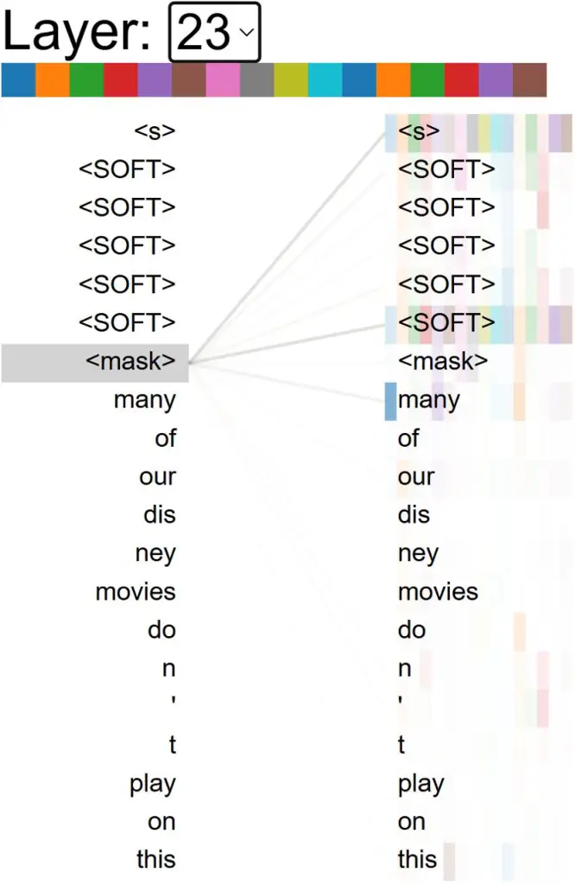

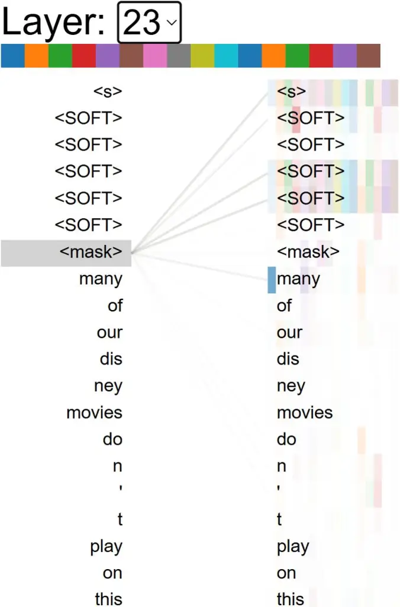

Figure 7: Case 1 for attention comparison visualization for soft prompt.

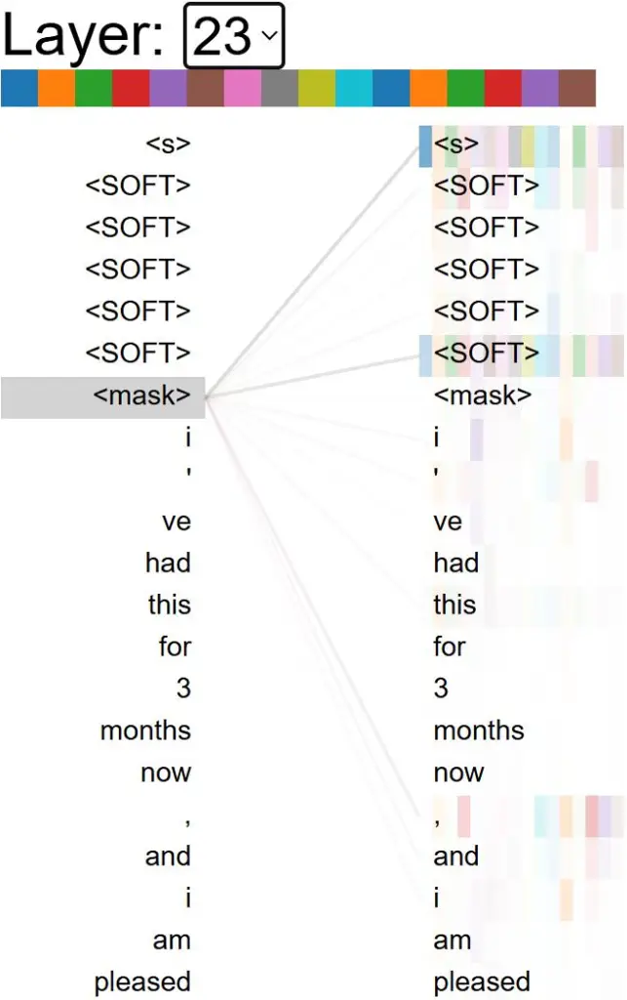

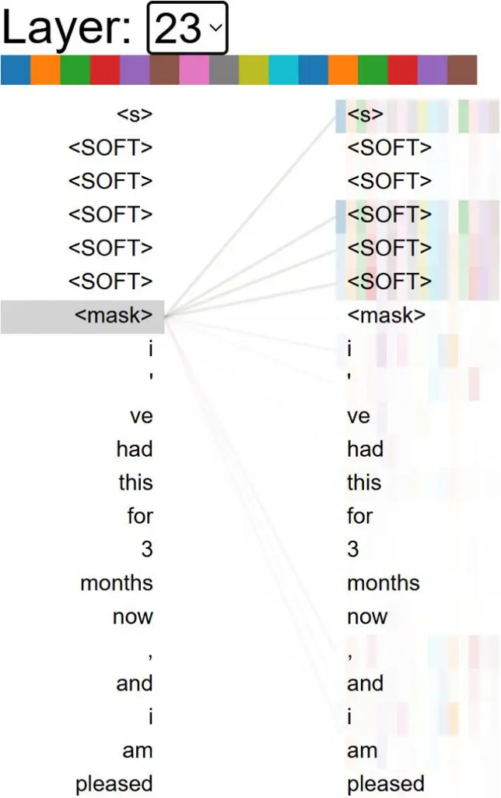

Figure 8: Case 2 for attention comparison visualization for soft prompt.

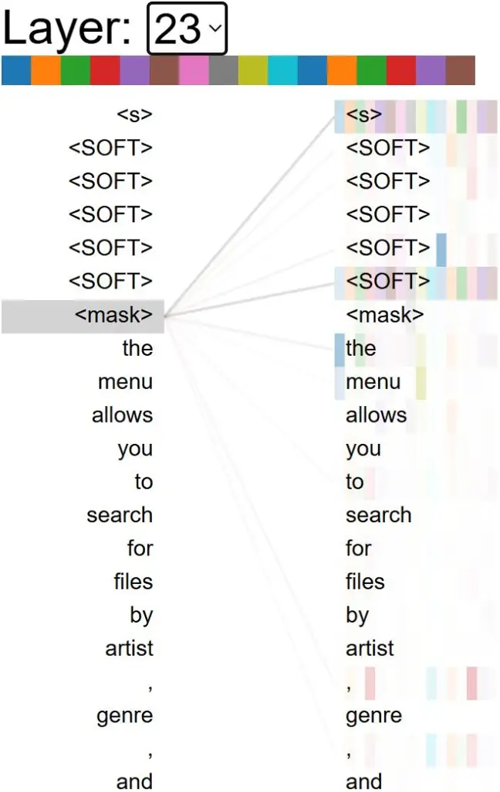

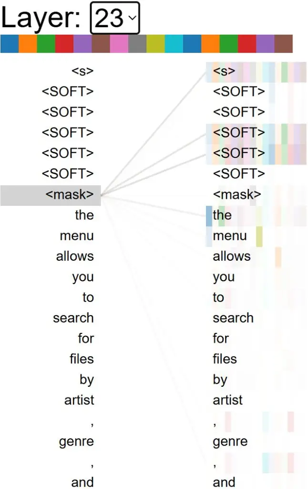

Figure 9: Case 3 for attention comparison visualization for soft prompt.

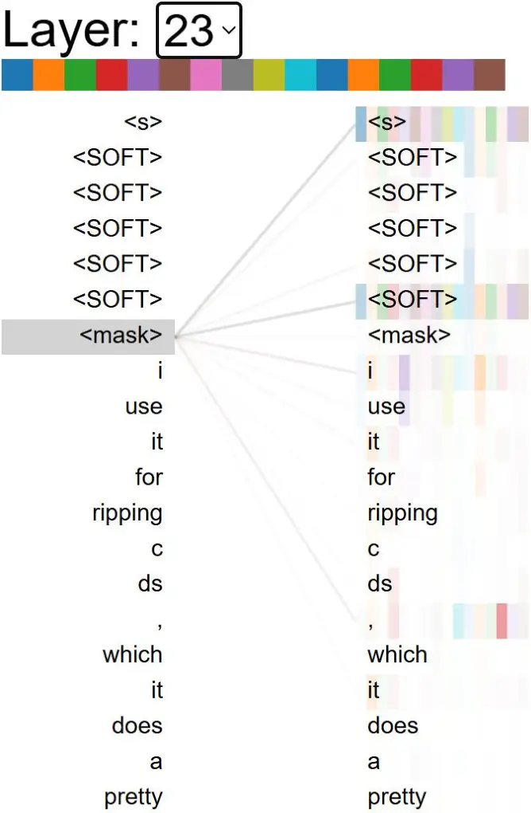

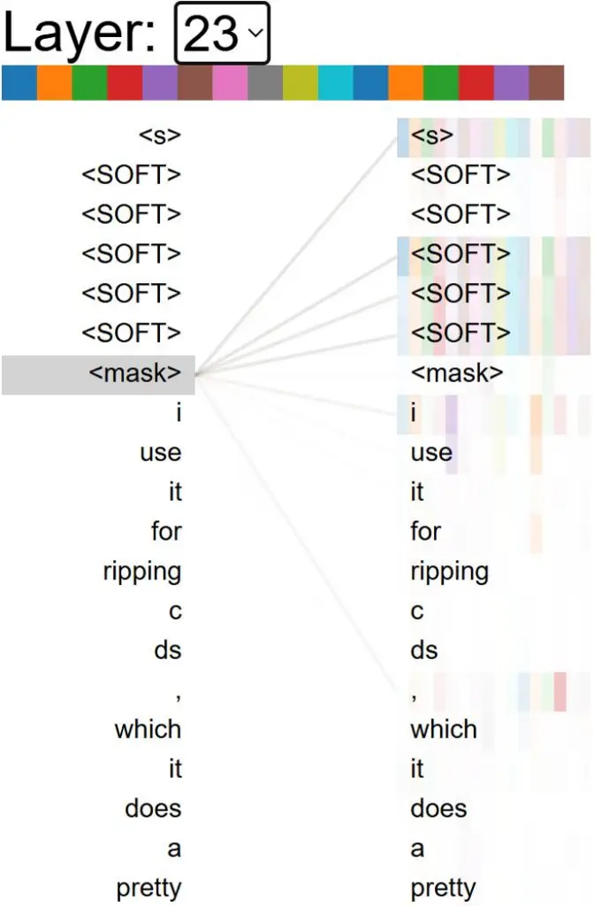

Figure 10: Case 4 for attention comparison visualization for soft
prompt.

## Appendix E Details for Concentrative Hard Prompt Optimization

### E.1 Optimization Process

We define the prompt matching problem under MFDG setting as a
multi-agent reinforcement learning (MARL) problem, as shown in Algorithm 2.

1: Input: Training set $`\mathcal{D}_{\text{train}}`$ of size $`T`$,
testing set $`\mathcal{D}_{\text{test}}`$, fixed PLM parameterized by
$`\theta`$, the prompt sets $`\left\{\mathcal{Z}^{n}\right\}_{n=1}^{N}`$
filtered by GCS 13, number of agents $`N`$. \*\*\*\* training the
multi-agent RL model \*\*\*\*

2: Initialize policy networks
$`\pi_{\omega_{1}},\dots,\pi_{\omega_{N}}`$ for each agent with
parameters $`\omega_{1},\dots,\omega_{N}`$ and $`epoch\leftarrow 0`$.

3: while $`epoch<epoch_{max}`$ do

4:   for step $`t`$ in $`[1,...,T]`$ do

5:    for each agent $`n`$ in $`[1,...,N]`$ do

6:       Get state $`s_{t}^{n}\leftarrow\mathrm{PLM}(x_{t})`$ for agent
$`n`$.

7:       Run policy network $`\pi_{\omega_{n}}(a_{t}^{n}|s_{t}^{n})`$ to
take an action $`a_{t}^{n}`$ to select a prompt $`z_{t}^{n}`$ from
$`\mathcal{Z}^{n}`$.

8:       Calculate reward for agent $`n`$, _i.e._, Eq. 14.

9:       Add $`(s_{t}^{n},a_{t}^{n},r_{t}^{n})`$ transition to agent
$`n`$’s replay buffer.

10:    end for

11:    Update of parameters $`\omega_{1},\dots,\omega_{N}`$ using the
MAPPO algorithm Yu et al. \[2022\].

12:   end for

13: end while \*\*\*\* testing phase begins \*\*\*\*

14: for each input $`(x_{i},y_{i})`$ in $`\mathcal{D}_{\text{train}}`$
do

15:   for each agent $`n`$ in $`[1,...,N]`$ do

16:    Get state $`s^{n}\leftarrow\mathrm{PLM}(x_{i})`$.

17:    Run policy network $`\pi_{\omega_{n}}(a^{n}|s^{n})`$ to take an
action $`a^{n}`$ to select a prompt $`z^{n}`$ from $`\mathcal{Z}^{n}`$.

18:   end for

19:   Get final prediction according to Eq. 15.

20: end for

21: Output: A trained policy network
$`\pi_{\omega_{1}},\dots,\pi_{\omega_{N}}`$, predictions for test
inputs.

Algorithm 2 Concentrative Hard Prompt Optimization

### E.2 Attention Visualization

We utilize bertviz Vig \[2019\] to visualize the attention distribution
in the final layer of the RoBERTa-Large model when processing different
inputs with hard prompts filtered by GCS. As illustrated in Figure 11 to
Figure 12, the filtered hard prompts demonstrate high attention
concentration and stability at the predicted positions.

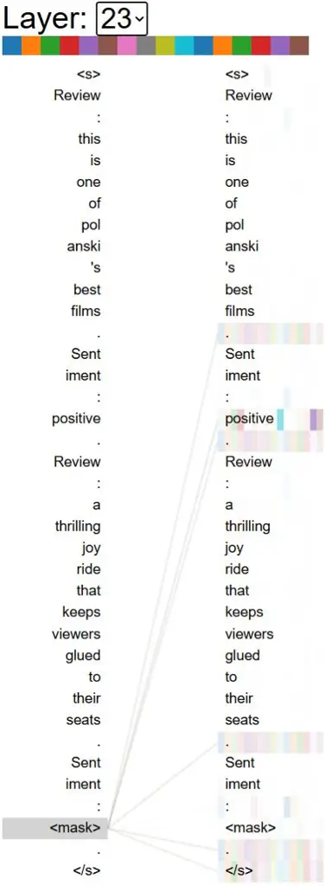

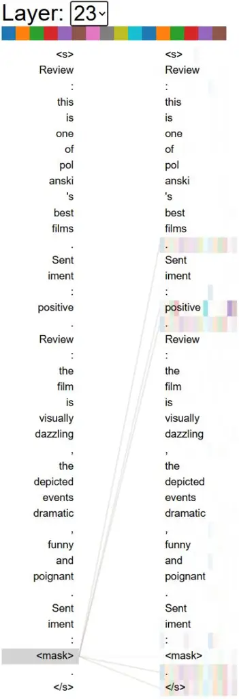

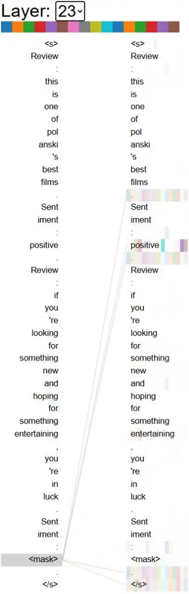

Figure 11: Case 1 for attention visualization of three filtered hard
prompts.

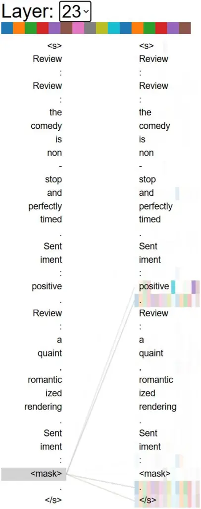

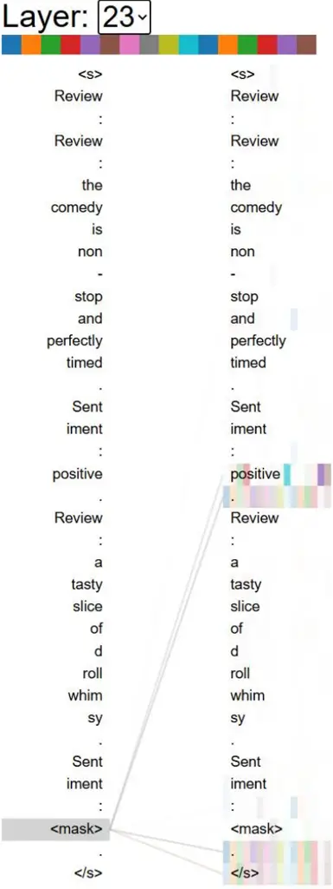

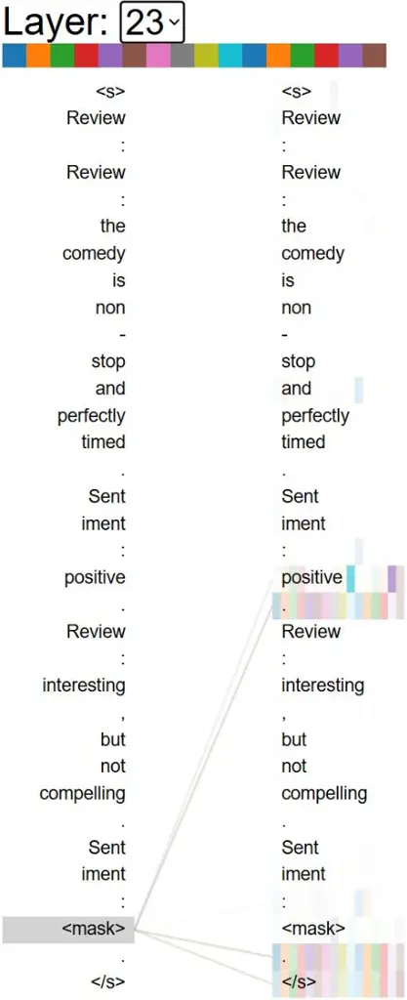

Figure 12: Case 2 for attention visualization of three filtered hard
prompts.

### E.3 Stability to Hard Prompt Verbalizer Selection

Prompt-based methods require mapping the probabilities generated by PLMs
to the label space needed for downstream tasks. Thus, the selection of a
verbalizer significantly impacts the performance of PLMs Liu et al.
\[2023b\]. Previous research Xu et al. \[2023\] explores the
identification of appropriate verbalizers for these models. The
experimental results in Table 12 show that our method achieves the
highest accuracy under different verbalizers settings, which shows that
our method can improve the robustness of existing methods for
verbalizers selection.

|                   |                           |                           |                               |                                         |
| ----------------- | ------------------------- | ------------------------- | ----------------------------- | --------------------------------------- |
| Verbalizer        | In -Contex Demo           | IC with both              | $`\textsc{DP}_{2}\textsc{O}`$ | $`\textsc{DP}_{2}\textsc{O}`$ with both |
| bad/good          | 81.67$`{}_{\text{1.12}}`$ | 84.16$`{}_{\text{1.02}}`$ | 89.36$`{}_{\text{0.41}}`$     | 91.73$`{}_{\text{0.43}}`$               |
| negative/positive | 84.81$`{}_{\text{1.39}}`$ | 88.49$`{}_{\text{1.55}}`$ | 90.75$`{}_{\text{0.87}}`$     | 92.87$`{}_{\text{0.33}}`$               |
| terrible/great    | 83.32$`{}_{\text{1.77}}`$ | 87.72$`{}_{\text{0.88}}`$ | 90.58$`{}_{\text{0.62}}`$     | 92.13$`{}_{\text{0.91}}`$               |

Table 12: Analysis on stability to verbalizers.

### E.4 Sensitivity to Number of Agents

We analyze the impact of the number of agents in a cue-matching
framework. As shown in Figure 13, the experimental results reveal that
when the number of agents is small, adding agents can significantly
improve the classification accuracy of the target domain. However, as
the number of agents continues to increase, the accuracy gradually
stabilizes. This suggests that as the number of prompts provided to the
input gradually increases, the results of the ensemble decision will
become more stable, and increasing or decreasing a prompt alone will
have less impact on the overall performance of the prompt matching
framework.

Figure 13: Performance for the model with different number of agents.

## Appendix F Distribution of Concentration Strength on Larger Language Models

As shown in Figure 14 to Figure 16, we present the concentration
strength distribution of three prominent open-source LLMs:
Llama-2-7b-chat, Vicuna-7b-v1.5, and Alpaca-7b-wdiff. Our findings
reveal that almost all three LLMs demonstrate higher concentration
strength in deeper layers compared to shallower ones when processing
prompts from different tasks. Moreover, larger models exhibit this
concentration phenomenon earlier than smaller models.

Figure 14: Concentration strength distribution of each layer of Llama in
various tasks.

Figure 15: Concentration strength distribution of each layer of Vicuna
in various tasks.

Figure 16: Concentration strength distribution of each layer of Alpaca
in various tasks.
