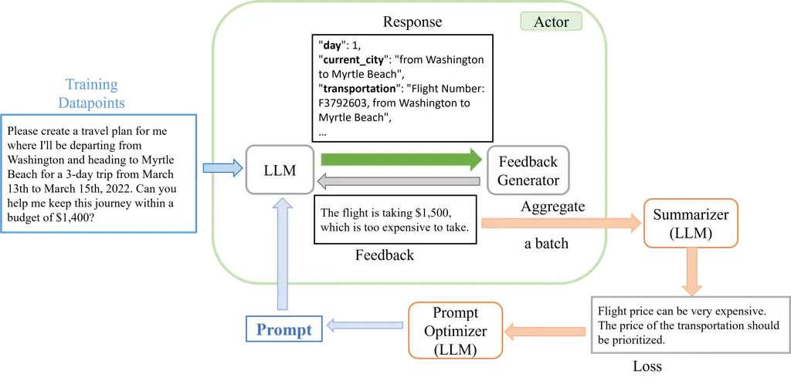

# RePrompt: Planning by Automatic Prompt Engineering for Large Language Models Agents

Weizhe Chen    Sven Koenig    Bistra Dilkina Affiliation: University of
Southern California Affiliation: {weizhech, skoenig, dilkina}@usc.edu

###### Abstract

In the past year, large language models (LLMs) have had remarkable
success in domains outside the traditional natural language processing,
and their capacity is further expanded into the so-called LLM agents
when connected with external tools. In all domains, the prompt to the
LLMs has been shown to make a big difference in what the LLM would
generate and thus affect the performance of the LLM agents. Therefore,
automatic prompt engineering (APE) has become an important question for
many researchers and users of LLMs. However, previous works in APE rely
on a final checker to evaluate the performance of the given prompt – a
requirement that is hard to meet in the case of LLM agents, where
intermediate feedback is easier to obtain, and the final evaluation
could be expensive, inaccurate, or even missing. In this paper, we
propose a novel method, RePrompt, which does a “gradient descent"-like
approach to optimize the step-by-step instructions in the prompts given
to LLM agents, based on the chat history obtained from interactions and
reflections with LLM agents. By leveraging intermediate feedback,
RePrompt can optimize the prompt without the need for a final solution
checker. We evaluate our approach on PDDL generation, TravelPlanner, and
Meeting Planning to show that our method could generally improve
performance for different reasoning tasks.

## 1 Introduction

Large language models (LLMs) have won significant success since the
release of ChatGPT (OpenAI, 2022). In addition to traditional natural
language tasks like summarization and sentiment analysis, LLMs have been
shown to be effective in many domains that are closer to applications
like code generation (Chen et al., 2023; Roziere et al., 2023),
human-computer interaction (Li et al., 2023) and math problem solving
(Wei et al., 2022; Yu et al., 2024). While pure LLMs are limited in
their reasoning capability (Sun et al., 2023; Valmeekam et al., 2023;
Chen et al., 2024a), researchers have introduced tool-use to LLMs and
built integrated systems, namely LLM agents, to enable the use of LLM in
even more general domains (Wang et al., 2023a; Mao\* et al., 2023; Xie
et al., 2024).

Prompts play a crucial role in these successes, as variations in prompt
design can lead to dramatically different success rates (Wei et al.,
2022). Consequently, prompt engineering is often necessary for
task-specific optimization. However, manual prompt engineering is both
challenging and time intensive, motivating the development of automatic
prompt engineering (APE), where LLMs generate prompts in their preferred
natural language (Zhou et al., 2023). With some trials, APE can
efficiently converge to a robust prompt, outperforming the original
prompts that are often simple (Zhou et al., 2023; Zhang et al., 2023).

However, in complex LLM-agent tasks such as reasoning, APE is still
under-studied, and most users still use primitive prompts or carefully
hand-crafted prompts in their LLM. On the one hand, this is because LLM
agents normally have high constraints on the output format, and previous
APE methods can easily break the format requirement. On the other hand,
existing APE methods rely highly on trying different prompts, checking
the performance of each one, and finding the best one. However, there
are numerous cases where an accurate final evaluator is highly costly,
making it impractical for most people to use the evaluator frequently
during training or, in our case, while optimizing the prompt. This is
especially common in high-specialization domains that demand extensive
domain knowledge, such as physics, chemistry, and other scientific
disciplines. There are also scenarios where a final evaluation might be
entirely absent, as seen in applications like ChatGPT, and particularly
in GPT’s tools. In these situations, users interact with the
application, sometimes providing intermediate feedback, but often
leaving without clarifying whether they received a satisfactory response
or abandoning the interaction due to dissatisfaction with the model’s
ability to assist further. Without cheap prompt performance evaluators,
existing APE methods cannot be applied to these scenarios.

In this paper, we focus on a scenario where there is a specific
reasoning task one wants to use LLMs for, while there is no ground-truth
checker to check the correctness of the outputs. One example is the
OpenAI GPTs tool in ChatGPT (OpenAI, 2023b) to plan their travel or help
in writing a code. In these domains, LLMs typically use a
Chain-of-Thought (CoT) prompt with interactive procedures like ReAct
(Yao et al., 2023b) and Reflexion (Shinn et al., 2023) to improve their
performance. We propose a novel automatic prompt engineering method
called RePrompt, which takes the common practices of using CoT and ReAct
into consideration and uses the dialogue history from these results as
the information for each prompt update. By summarizing the dialogue
history and then analyzing how to improve the prompt step-by-step, we
optimize the prompt based on past history while not overfitting to
corner cases. An overview of our proposed framework is shown in
Figure 1.

We benchmark our approach on Planning Domain Definition Language (PDDL)
generation (Guan et al., 2023), TravelPlanner (Xie et al., 2024), and
Meeting Planning Zheng et al. (2024) to show that our methods can
achieve a higher first-round success rate, and our methods can be
combined with different types of feedback generator.

In conclusion, our contributions are:

1.  1.  Propose to use “gradient-based"-like prompt optimization in LLM
        agents.
2.  2.  Propose a summarization-based prompt optimization that focuses on
        optimizing steps in the prompt, and demonstrate that optimizing the
        steps is an efficient way of prompt optimization in LLM agents.
3.  3.  Our proposed method does not require a solution checker, and can be
        used in LLM-agents scenarios where such a checker is not available.

.

Figure 1: The workflow of our method RePrompt.

## 2 Related Works

Our work lies at the intersection of prompt optimization and LLM for
reasoning.

In prompt optimization, many works have proposed to optimize the prompt
using differentiable tuning on soft prompts (Lester et al., 2021; Qin
and Eisner, 2021), train auxiliary models as the optimizer (Hao et al.,
2023; Deng et al., 2022; Zhou et al., 2023), or directly train the
prompter themselves (Wang et al., 2023b). This line of work requires
access to the model weights of the language models and is not generally
applicable in the current era of using LLMs like GPT-4 (OpenAI, 2023a)
and Claude-3 (Anthropic, 2024) through APIs. Another line of work
chooses to use machine learning models to provide approximate guidance
on which prompt is better, either by using reinforcement learning (Shin
et al., 2020; Zhang et al., 2023; Chen et al., 2024b) or by discrete
manipulation with LLM feedbacks (Guo et al., 2023). There are also some
other works in prompt optimization that propose a relatively general
solution, such as using beam search or Monte Carlo tree search as the
"gradient descent" optimizer (Pryzant et al., 2023; Tang et al., 2024;
Wang et al., 2024). Our work is very close to the second group of works,
and can be seen as a generalization of the current methods to reasoning
domains. Importantly, in our settings, we do not require ground-truth
feedback that checks the general performance of the current prompt,
which is more aligned with the applications of prompting for LLM agents
in scenarios like GPTs OpenAI (2023b).

In LLM for reasoning, a key challenge identified by researchers is how
to correctly use prompts to guide the LLM to generate useful auxiliary
output that leads to a good final solution. Chain-of-Thought (CoT) (Wei
et al., 2022) is the most commonly used prompt that can improve the
performance of LLMs that consists of simply adding a fixed sentence,
such as "Let’s think step by step.". More recently, Tree-of-thought (Yao
et al., 2023a) and Graph-of-Thoughts (Besta et al., 2024) were also
proposed as an extension of the simple line-based architecture of
auxiliary output to tree and graph-structured output. Orthogonally,
researchers have also found that utilizing the interaction capability of
LLMs could also improve their performance. Yao et al. (2023b) proposed
ReAct by letting the LLMs list some thoughts before proposing the actual
actions. Reflexion (Shinn et al., 2023) prompts an LLM agent to reflect
on the actions, and save the reflections in the memory to improve
efficiency. There are extensive other works like self-refine (Madaan
et al., 2023), RCI (Kim et al., 2023), and self-debugging (Chen et al., 2023) that use similar ideas of providing feedback as guidance in the
reasoning-related task and strategically adapt the idea to fit the needs
of specific domains. Furthermore, recently, o1-like models Jaech et al.
(2024) naturally integrate this self-correction process into the
generation procedure. Our approach uses this iterative workflow that
incorporates feedback before finalizing the answer, optimizing the
prompt based on the provided interaction history. This process mitigates
early-stage errors and, more importantly, reduces the inherent
randomness seen in methods like ReAct and Reflexion, where certain
scenarios may lack sufficient feedback. By summarizing recurring issues
— such as budget balancing — our method, RePrmopt, ensures these
concerns are systematically addressed within the prompt. This allows
ReAct and Reflexion to focus on case-specific challenges, such as
unexpected price surges for hotels in particular cities on specific days
in the case of solving a TravelPlanner task.

## 3 Methods

### 3.1 Background on LLM agents

In this paper, we consider the problem of LLM agents for reasoning
tasks. For LLM agents to focus on reasoning, the Chain-of-Thoughts (CoT)
Wei et al. (2022) is one of the most popular methods used in LLMs. By
adding a simple sentence of "Let’s do it step-by-step," LLMs will
automatically outputting auxiliary steps before generating the final
answer. Based on this, there has also been recent success in OpenAI o1
Jaech et al. (2024) and Deepseek-R1 et al. (2025) which further
demonstrate that by introducing more steps before the answer, LLMs can
solve harder problems.

Because LLM might not be correct in the first shot, prior approaches
have proposed allowing a few interactions before the final answer is
given by the LLM (Yao et al., 2023b; Shinn et al., 2023). In these
cases, users provide the LLMs with some feedback and let the LLMs try
again with the additional information. This information does not
necessarily provide any hint about the final solution, but can be an
error message about why the current solution is not correct. For
example, this information could be a Python runtime error message in
code generation tasks. How to use specific prompts with error messages
would mainly depend on each specific task. For example, in the widely
used ReAct (Yao et al., 2023b), LLMs are required to provide thoughts on
the current results before doing the next round, and these thoughts are
often not a concrete error but may also include a short analysis that
reaches a conclusion that the current action is good. However, due to
the difficulty of LLM agent’s tasks, checking how good a given prompt is
could be expensive and unsuitable for regular in the prompt optimization
process. As we mentioned earlier, this could be either very expensive in
domains that require high intelligence like physics, or completely
infeasible in applications like the web version of GPTs.

### 3.2 RePrompt

#### 3.2.1 Overview

In LLM agents for reasoning tasks, we consider the task planning part of
LLM agents with prompt optimization, where the tasks of the agents are
known ahead of time, and the final solution checker is not available due
to its cost.

As shown in Fig. 1, our method, RePrompt, is a prompt optimizer that is
based on the interaction-based action-generating process. Our prompt
optimization method is similar to a machine learning training loop,
which iterates between getting the output based on the current
parameters, calculating the loss based on the output, and optimizing the
parameters based on the loss. But in our case, the parameters to be
trained are the prompts to be fed into the LLM model, the model forward
pass is replaced by the complete interaction-based action-generating
process, which includes the feedback generator, and final components of
RePrompt are the loss and optimizer, which are both LLMs instead of
numerical calculation for the distance and the gradients.

Given a specific small dataset of reasoning tasks used for training, we
first let the LLMs generate their responses using the current prompt.
This process needs to include some interaction schemes with some kind of
feedback generator like ReAct or Reflexion, but we do not put any
constraint on how this part should be done, or how accurate the feedback
is. We call this process the Actor.

We then wait until a complete batch of chat histories has been
collected, at which point we input the entire batch into another large
language model, which we call the summarizer, to summarize the primary
focus point. This focus point might be a recurring issue that frequently
prolongs iterations or specific suggestions (or “thoughts” in the case
of ReAct) that have proven effective in producing high-quality
responses. Typically, the essential information is already present in
the chat history and does not require further analysis or summarization.
Our summarizer is designed to capture key insights across various
scenarios, omitting scenario-specific details and recommendations while
avoiding overly broad summaries that would demand additional reasoning
steps. Due to space constraints, we provide the prompt for this
summarizer in Appendix D.

With the summarized typical errors identified, we leverage another LLM,
the Prompt Optimizer, to refine the prompt accordingly. This optimizer
LLM is instructed to adhere to the following rules:

1.  1.  The refinement process should prioritize the common structural
        components of the prompt rather than scenario-specific elements that
        vary across data points. For instance, in the task of PDDL
        formulation generation, a frequent suggestion is to include
        additional details about the specific domain the LLM is targeting,
        along with more comprehensive background knowledge. However, since
        our goal is to construct a generalizable prompt capable of handling
        diverse PDDL formulation tasks, incorporating such domain-specific
        details would reduce its applicability and should therefore be
        avoided.
2.  2.  The improvement should prefer to identify whether the specific
        problem does occur in the given scenario. For example, suppose there
        is a certain budget one wants the solution provided by LLMs to
        satisfy, and the previous history shows that this budget constraint
        could be one of the main problems that lead to a wrong solution. In
        that case, the cost of a typical plan should first be approximated.
        If it breaks the constraint, it could prioritize the budget
        constraint when getting a solution; otherwise, it should ignore this
        problem.

Based on the above rules, we ask the LLM to do the following
step-by-step, as detailed in Appendix D:

1.  1.  Propose a few potential solutions to the problem.
2.  2.  Analyze the solutions one by one to see which one meets the rules
        better.
3.  3.  Choose the single solution that is the best. Unlike some of the
        existing work (Zhou et al., 2023; Deng et al., 2022), we do not ask
        the LLM to give a concrete number as the value of the prompt
        sentence.
4.  4.  Analyze the original steps in the original prompts, check whether
        the chosen solution should be inserted before the current step or
        the solution is a more concrete detail on the step, and the prompt
        on the current step should be replaced by the solution. If it is the
        step, add the prompt here.
5.  5.  Output the final prompt that combines the original prompt and the
        updated prompt.

To initialize the training process, we start with the original prompt.
Although not all original prompts include detailed step-by-step
instructions that our optimizer can leverage, we introduce an auxiliary
checker (excluded from the main workflow for simplicity) to convert
prompts into a structured, step-by-step format when needed.
Specifically, we first use a language model to assess whether the
current prompt already contains such instructions. If it does not, we
manually append a standardized sequence of steps to the prompt, placing
it just before any examples. This sequence comprises two primary steps:
a brief problem analysis followed by the solution. This structure is
functionally similar to a single "Chain of Thought" (CoT) prompt (Wei
et al., 2022), “let’s think step-by-step” in most reasoning tasks by
encouraging essential analysis without introducing domain-specific
knowledge.

We integrate the specific rules and procedural steps mentioned above
into our Optimizer prompt, detailed in the Appendix D due to the page
limit. To assist the optimizer in handling common challenges, we have
pre-encoded several frequently used solutions directly within the
optimizer prompt. While these solutions could be discovered over
multiple iterations, providing them upfront minimizes the number of
iterations required for prompt refinement, accelerating the optimization
process.

After the steps, we will get an updated prompt, and we can continue to
do more iterations, which can also be seen as more epochs as an analogy
to training ML models, until the prompt has converged and does not
change with more iterations. This converged prompt will help improve the
generated result in the first round, and also help assure common
problems that can be fixed by the feedback generator to be resolved as
early as possible. During test time, we only need to use the converged
updated prompt and test it on the new test set. During the test, we do
not require the exact same process to generate the response, e.g., the
feedback generator can be removed completely from the Actor procedure if
it is quite expensive.

Note that in the optimization process, RePrompt only changes the
step-by-step instruction phase rather than any other problem description
or format requirement specified in the prompt. This brings us to two
possible formats of prompts that the algorithm will end up with:

1.  1.  If the current prompt is ReAct-like, or o1-like Jaech et al. (2024),
        which already includes a step-by-step instruction that gives a
        specific step, like Thought in ReAct, to include all the potential
        analysis, our prompt will converge to always update this thinking
        step by adding more and more hints on what to do to it. Our method
        becomes an algorithm that gives a more specific hint on what part
        the analysis should focus on compared to other prompt engineering
        work that introduces hints dynamically.
2.  2.  For step-by-step prompts, such as those involving mathematical or
        logical problem-solving, our algorithm progressively refines the
        generated procedure by incrementally adding steps. This iterative
        expansion enhances the concreteness of the planning process,
        providing a more structured pathway for the model to explore. By
        guiding the LLM toward the correct final answer, our approach
        effectively decomposes high-level tasks into granular substeps,
        improving both reasoning accuracy and interpretability.

While we understand that in-context learning is very important for
reasoning, we found it extremely challenging to update the examples to
follow our instructions step-by-step perfectly all the time. And
therefore, we choose not to change the examples at all. In most cases,
the examples serve as a hint to the LLM on the output format and the
related capabilities rather than a concrete guide on how to follow the
step-by-step instructions, and we currently do not see any empirical
drawback by not updating them.

## 4 Experiments

### 4.1 Experiment Settings

To test the capability of our algorithm in different scenarios, we
choose three environments, PDDL generation (Guan et al., 2023),
TravelPlanner (Xie et al., 2024), and Meeting Planning from Natural Plan
Zheng et al. (2024). The first two tasks are selected because their
feedback generator is already included in the paper, and the reality is
that both datasets are hard to conduct iterations with feedback
generators. The Meeting Planning task is selected as another LLM agent
task that differs from the existing ones.

The PDDL generation task provides accurate but expensive feedback and
challenges the exact translation capability of the LLMs, which is
necessary for LLMs to be further able to write correct code. The
TravelPlanner environment, on the other hand, provides cheap but not
accurate feedback through Reflexion without knowing ground-truth
information. TravelPlanner also provides tools to be used to query the
cost information in the database and challenges the reasoning capability
by asking for direct generating solutions. Furthermore, in
TravelPlanner, we are testing RePrompt with Reflexion, which further
includes the thought-action-observation steps rather than a standard
step-by-step instruction in the PDDL where each step is an intermediate
step that could be helpful for guiding the generation for final results.
For Natural Plan, we test the performance of deepseek-R1 et al. (2025),
an open-source model that provides its complete long chain-of-thought,
and we directly use its own thinking part in the output as the feedback
as recent models like deepseek-R1 already included self-evaluation and
self-correction in its outputs. Given the different types of feedback,
the purpose of our RePrompt also change: in PDDL, our RePrompt serves to
improve the generation performance without any iteration between the LLM
actor and the feedback generator that is used to reduce the cost of
generating feedback; in TravelPlanner, RePrompt is used to help guide
the LLM to take all the important steps of concern in all scenarios and
reduce the potential failures; in Meeting Planning, RePrompt is used to
reduce the unnecessary trail happens in the thinking process of the LLM,
and also reduce the randomness on the steps in the thoughts.

In the experiments, the stopping criteria and other hyperparameter
settings for each domain will be the same as in the original
environments. For PDDL generation and TravelPlanner, we use a
temperature $`=0`$, a seed of $`42`$, and results are tested on
GPT-4-turbo-1106-preview. To help reproducibility, we provide all the
optimized prompts generated by RePrompt in Appendix E.

### 4.2 PDDL Generation

|                    |                         |           |           |                    |           |           |
| ------------------ | ----------------------- | --------- | --------- | ------------------ | --------- | --------- |
|                    | \# of Incorrect Actions |           |           | Total \# of Errors |           |           |
|                    | TyreWorld               | Logistics | Household | TyreWorld          | Logistics | Household |
| Dataset Size       | 13                      | 6         | 22        | INF                | INF       | INF       |
| Guan et al. (2023) | 3                       | 1         | 19        | 6                  | 1         | 52        |
| RePrompt           | 3                       | 0         | 12        | 4                  | 0         | 23        |

Table 1: The results on generating PDDL instances correctly without any
additional domain expert help. The number of actions is the number of
tests provided to the LLMs, and each action can have as many errors as
it wants, annotated by human experts. Our method, RePrompt, is trained
for only 1-epoch with only the annotations used to evaluate the original
results, and without additional annotation from human experts in
training.

We first test the Planning Domain Definition Language (PDDL) generation
task (Guan et al., 2023). Given a natural language description of a PDDL
instance, the job is to define the precondition and the effects of the
actions in PDDL. Specifically, we consider the very first step of
constructing the model and do not further consider the later correction
phase and PDDL translation phase. ¹¹ 1 At the time of submission of our
paper, the evaluation phase is missing in the official Github
repository, and we are not able to compare the success rate in those
phases in a fair manner. After generating the preconditions and effects
of the actions, human domain experts are introduced to check whether the
generation is correct. In this paper, we not only have human domain
experts but also use another LLM as a separate checker to verify whether
any of the errors that appear in the results given by the prompt in the
original paper (Guan et al., 2023), which are released together with the
code of it, have also appeared in our result.

In this experiment, we use the generated result and the annotation from
human experts of the prompt from the previous paper Guan et al. (2023)
in “Tyreworld" as the chat history used in the RePrompt training set,
and update it for one epoch to get the updated prompt. Here, because the
feedback is provided by domain experts, it is accurate but expensive, so
multiple rounds of iterations are not feasible, and so we choose to only
train RePrompt for one epoch and greatly reduce the need for extra
annotations. As shown in Table. 1, the prompt we get from RePrompt not
only outperforms in the set that we are training on, i.e., the Tyreworld
domain, but also generalizes to other related domains and improves the
success rate there. Interestingly, we found that after changing the
prompt, the prompt does not introduce any new errors, i.e., the errors
the new prompt made are a subset of the errors made by the prompt in the
original paper. With this subset of errors, fewer domain experts will be
needed to give annotations, and make the whole PDDL translation process
much faster.

Among the remaining errors, some stem from the omission of common
knowledge explicitly stated in the description. For instance, in the
action "Empty a Vacuum Cleaner," the description includes the sentence:
"The trash can should be opened if it’s openable." While this is a
commonsense statement with no new information, in the given context, it
implicitly defines a necessary precondition. However, the LLM-generated
PDDL precondition fails to capture this, leading to errors. Similar
issues occur multiple times, collectively accounting for a significant
portion of the observed errors, which can be categorized under this
broader pattern.

### 4.3 TravelPlanner

Next, we test on the sole-planning setting in TravelPlanner benchmark
(Xie et al., 2024). In this benchmark, the LLMs are required to provide
a concrete day-to-day plan, including where they should stay, eat, and
how they should travel, and satisfying both commonsense constraints like
reasonable city routes and budget constraints. While there are some
breakdowns of what specific kind of constraints the plan does not
satisfy, the primary metric that is used for comparing different methods
is the final pass rate. It needs to be addressed that in this benchmark,
the evaluation is done after the act loop is done, separately with a
ground-truth checker rather than directly to the feedback loop in
Reflexion, and thus, the feedback in the chat history used by RePrompt
does not actually involve any human interference or oracles on what is
the correct answer and what is the list of constraints. This allows us
to train on a subset of the test set without worrying about leaking any
extra oracle information to the model. Because of this, we choose to
report results on the validation set of 180 data points instead of
results on the larger test set in order to save API costs. And because
RePrompt is based on further collecting data, we choose a subset of 10
data points in the validation set as our training dataset. We report the
same group of metrics defined in the original paper.

[TABLE]

Table 2: Results on TravelPlanner Benchmark. The best results are marked
in bold. The delivery rate, commonsense pass rate, and hard constraint
pass rate overall contribute to the final pass rate, which is the main
metric in this table. Because we are “training" on part of the data, but
not using any additional ground-truth information, we split the results
into overall final pass rate and training set final pass rate. All the
metrics in the table are better when the numbers are larger.

As shown in Table. 2, the prompt generated by 5 epochs of training of
RePrompt is better than the pure Reflexion Shinn et al. (2023) result in
the final pass rate, and also outperform PromptAgent Wang et al. (2024)
as an example of previous automatic prompt engineering work that was
primarily designed for single-round question-answering task ²² 2 Because
their design was not suitable for Travelplanner, we have made necessary
adaptations to make it testable in this case. We provide more details in
Appendix B. . In the optimization procedure, unlike the PDDL
environment, the optimized prompt after one epoch does not show any
benefit. This is because, as we discussed earlier, the prompt after the
first epoch will only include one additional suggestion, which is about
looking into the budget constraint in this case. No matter what this
round of updates is, it is something summarized from the thoughts
provided by the ReAct scheme and something the iteration loop of
generating a final plan has often already noticed and addressed. The
optimized prompt after 5 epochs helps LLMs perform better in both the
data set we used for training and the other data not included in the
optimization process. This shows the generalizability of the prompt we
get through the process. We observe that our baseline, PromptAgent,
tends to change an extensive amount on the original prompt, and became
even worse on the final test.

To better understand the source of our improvement in final pass rate,
we analyzed its impact on macro commonsense pass rate—a key bottleneck
in leveraging LLMs for TravelPlanner. As shown in Table 2, our method
substantially enhances performance in this metric. Further analysis
reveals that our prompt significantly improves the pass rate for the
so-called "reasonable city route" constraint, a critical aspect tested
by TravelPlanner (though not explicitly shown in Table 2). This common
sense is to ensure “Changes in cities during the trip must be
reasonable". This represents a commonsense constraint that LLMs can
recognize during the process. However, while such constraints
occasionally appear in the feedback loop’s reasoning, they are not
consistently addressed. Our RePrompt framework successfully identifies
and integrates this constraint into the prompt, ensuring that it is
accounted for in most iterations. We believe this is one example that
our algorithm has addressed the challenge of “Agents struggle to align
their actions with their reasoning." mentioned in the original paper Xie
et al. (2024). However, for our baseline PromptAgent, the extensive
changes have made the LLMs fail to follow the desired format, leading to
more useless steps and more failures.

Surprisingly, our method does not mitigate the issue of agents producing
hallucinations due to information confusion. Specifically, our agents
continue to generate incorrect flight numbers—assigning them to the
wrong flight leg or erroneously using the same flight number for both
departure and return flights. While, in theory, such errors could be
corrected by the feedback generator, we observe that this feedback is
rarely generated or incorporated into the prompt optimization loop.
Moreover, our RePrompt training loop fails to detect these errors.
Moving forward, we aim to explore how our RePrompt framework can serve
as an additional verification layer for simple hallucination errors. One
potential approach is incorporating scenario-specific information and
chat history when computing the “loss."

### 4.4 Ablation Study

|                     |                 |
| ------------------- | --------------- |
| \# Training Samples | Final Pass Rate |
| 1                   | 1.22            |
| 2                   | 2.44            |
| 5                   | 3.44            |
| 10                  | 3.89            |
| 25                  | 2.00            |

Table 3: Number of Training Samples and Final Pass Rate for RePrompt on
TravelPlanner.

Next, we provide an ablation study on the sampling size and the number
of iterations. To fix the total budget spent on training the same, we
fix a multiplication of the number of training samples times training
epoch to 50. So, with more training samples, one will have fewer
training epochs, which might lead to returning a prompt before its
convergence. As a special case, when training samples are equal to 1,
our method is a vanilla prompt optimizer without a summarizer that is
done per scenario. We show our results in Table. 3. We found that
selecting an appropriate number of training samples—balancing diversity
with the number of epochs- can significantly enhance the performance of
RePrompt. This aligns with our intuition, as RePrompt can be viewed as a
form of gradient descent.

### 4.5 Meeting Planning

| \# Prompt | Final Pass Rate (%) |
| --------- | ------------------- |
| Original  | 21.00               |
| RePrompt  | 26.00               |

Table 4: Results on Meeting Planning from Natural Plan benchmark.
Results are based on Deepseek-R1.

Lastly, we evaluate our algorithm on the Meeting Planning task, which
involves scheduling meetings with friends while considering availability
and travel-time constraints, aiming to maximize the total number of
successful meetings. A key challenge of this task is that not every
meeting can be scheduled for every problem instance, making it
impossible to determine whether an optimal solution has been achieved.
In real-world applications, this uncertainty complicates the feedback
loop, as accurate assessments of solution quality are inherently
difficult. Our approach leverages the think section of DeepSeek-R1,
presenting a unique challenge for RePrompt: effectively extracting
useful insights from long and unstructured chat histories. To ensure
compatibility with the R1 model, we made specific modifications to the
dataset, detailed in Appendix B. For training, we use the first nine
data points, applying a batch size of three, and further evaluate
performance on the first 100 data points. ³³ 3 We do not use the
complete dataset mainly due to the limited availability of the
Deepseek-R1 when the experiment is conducted.

The results, presented in Table 4, show that despite the presence of
highly noisy thinking logs, RePrompt still improves the original prompt.
This demonstrates RePrompt’s adaptability to the latest models,
highlighting its ability to improve performance without relying on a
specific type of feedback information.

## 5 Error Analysis

In our experiments, our automatic prompt optimization process does not
guarantee the successful generation of an improved prompt. In this
section, we outline common errors that arise and describe the ad-hoc
strategies we employ to mitigate them. While these methods are neither
universally necessary nor broadly applicable across domains, we include
them here as pragmatic solutions to specific issues. We anticipate that
as LLMs’ instruction-following capabilities continue to advance, these
ad-hoc interventions will become obsolete and can be seamlessly
eliminated.

### 5.1 Incomplete Prompt

You are defining the preconditions and effects (represented in PDDL
format) of an AI agent’s actions. Information about the AI agent will be
provided … Before defining the preconditions for an action, consider the
implications of the action within the given domain. Here are two
examples from the classical BlocksWorld domain to demonstrate the output
format. $`<`$Examples from the original prompt$`>`$ Here is the task.
Domain information: {domain_desc} Action:

Figure 2: An example output of the optimizer LLM that outputs a prompt
template instead of a complete prompt. While it is technically correct
and successfully added the additional instruction shown in blue, this
output is not acceptable since it includes a template holder for
examples marked in red, and this output still needs post-processing with
the original prompt to complete the prompt. For simplicity, we have
omitted the parts of the original prompt that are not changed, marked in
green, and this part of the prompt can be found in the original paper
(Guan et al., 2023).

The prompt optimizer occasionally fails to generate a complete prompt.
As detailed in Appendix D, we have incorporated explicit instructions to
ensure completeness; however, as shown in Fig. 2, LLMs sometimes produce
prompt templates that require manual copy-pasting by users to finalize
the prompt. This issue arises in both our algorithm, RePrompt, and our
baseline, PromptAgent. We observed that this failure is more frequent
when the initial prompt is relatively long, likely because LLMs are
trained to generate concise responses whenever possible, despite our
instructions to output a fully formed prompt. To address this, we
introduce an additional LLM to automatically complete the prompt
template. This approach enables us to generate fully structured prompts
in the TravelPlanner domain. We opted against a rule-based fixer, as the
generated templates use a variety of delimiters—including but not
limited to $`<>`$ and —making it impractical to manually define
exhaustive replacement rules. Instead, we rely on the LLM’s ability to
recognize and complete these templates autonomously, reducing manual
intervention and improving efficiency.

### 5.2 Incorrect Change by Accident

In some domains, the output format can be similar to a more commonly
used domain, and LLMs are misled to correct the prompt in certain parts.
For example, in our PDDL domains, we ask the LLM to generate the
preconditions of the actions rather than the actual PDDL file. In our
experiments, we found that even though our prompt has explicitly
required the LLM not to change the output format part of the prompt
text, the updated prompt still sometimes changes the output format by
mistake, specifically, changing the output of “Preconditions" in capital
into “precondition" in smaller cases. To solve this problem, we leverage
the feedback of the syntax checker. While the generated results could
have some errors, the results should always be complete, and have the
required syntax. And if our syntax parser that extracts the answer from
the LLM output cannot find the word “Precondition", we know the prompt
used is not correct, then we re-run RePrompt on the same step to
generate a correct one. Because the fail rate with our current code is
empirically less than $`10\%`$, this ad-hoc solution is enough.

## 6 Conclusion

In this paper, we have focused on optimizing the prompts used in LLM
agents. We propose a new automatic prompt optimizer, RePrompt, which is
based on the summarization of the interaction between LLM agents and
feedback generators and optimizes the step instructions in the prompt.
Although the performance is still limited by the natural capability of
the feedback generation loop, our experiments across three challenging
reasoning tasks show that LLM agents could benefit from an updated
prompt, regardless of the type of feedback provided and without the need
for a ground-truth checker to be included in the procedure.

## Impact Statement

This paper presents work whose goal is to advance the field of Machine
Learning. There are many potential societal consequences of our work,
none of which we feel must be specifically highlighted here.

## Acknowledgments

The National Science Foundation (NSF) supported the research under grant
number 2112533: "NSF Artificial Intelligence Research Institute for
Advances in Optimization (AI4OPT)".

## References

- Anthropic (2024) Anthropic. Introducing the next generation of
  claude, 2024. URL
  [https://www.anthropic.com/news/claude-3-family](https://www.anthropic.com/news/claude-3-family).
- Besta et al. (2024) Maciej Besta, Nils Blach, Ales Kubicek, Robert
  Gerstenberger, Michal Podstawski, Lukas Gianinazzi, Joanna Gajda,
  Tomasz Lehmann, Hubert Niewiadomski, Piotr Nyczyk, et al. Graph of
  thoughts: Solving elaborate problems with large language models. In
  _AAAI Conference on Artificial Intelligence_, pages 17682–17690, 2024.
- Chen et al. (2024a) Weizhe Chen, Sven Koenig, and Bistra Dilkina. Why
  solving multi-agent path finding with large language model has not
  succeeded yet. _arXiv preprint arXiv:2401.03630_, 2024a.
- Chen et al. (2023) Xinyun Chen, Maxwell Lin, Nathanael Schärli, and
  Denny Zhou. Teaching large language models to self-debug. _arXiv
  preprint arXiv:2304.05128_, 2023.
- Chen et al. (2024b) Yongchao Chen, Jacob Arkin, Yilun Hao, Yang Zhang,
  Nicholas Roy, and Chuchu Fan. Prompt optimization in multi-step tasks
  (promst): Integrating human feedback and heuristic-based sampling. In
  _Proceedings of the 2024 Conference on Empirical Methods in Natural
  Language Processing_, pages 3859–3920, 2024b.
- Deng et al. (2022) Mingkai Deng, Jianyu Wang, Cheng-Ping Hsieh, Yihan
  Wang, Han Guo, Tianmin Shu, Meng Song, Eric P. Xing, and Zhiting Hu.
  RLPrompt: Optimizing discrete text prompts with reinforcement
  learning. In _Conference on Empirical Methods in Natural Language
  Processing (EMNLP)_, pages 3369–3391, 2022. URL
  [https://doi.org/10.18653/v1/2022.emnlp-main.222](https://doi.org/10.18653/v1/2022.emnlp-main.222).
- et al. (2025) DeepSeek-AI et al. Deepseek-r1: Incentivizing reasoning
  capability in llms via reinforcement learning, 2025. URL
  [https://arxiv.org/abs/2501.12948](https://arxiv.org/abs/2501.12948).
- Guan et al. (2023) Lin Guan, Karthik Valmeekam, Sarath Sreedharan, and
  Subbarao Kambhampati. Leveraging pre-trained large language models to
  construct and utilize world models for model-based task planning.
  _Advances in Neural Information Processing Systems (NeurIPS)_, 2023.
- Guo et al. (2023) Yiduo Guo, Yaobo Liang, Chenfei Wu, Wenshan Wu,
  Dongyan Zhao, and Nan Duan. Learning to program with natural language.
  _arXiv preprint arXiv:2304.10464_, 2023.
- Hao et al. (2023) Yaru Hao, Zewen Chi, Li Dong, and Furu Wei.
  Optimizing prompts for text-to-image generation. _Advances in Neural
  Information Processing Systems (NeurIPS)_, 36, 2023.
- Jaech et al. (2024) Aaron Jaech, Adam Kalai, Adam Lerer, Adam
  Richardson, Ahmed El-Kishky, Aiden Low, Alec Helyar, Aleksander Madry,
  Alex Beutel, Alex Carney, et al. Openai o1 system card. _arXiv
  preprint arXiv:2412.16720_, 2024.
- Kim et al. (2023) Geunwoo Kim, Pierre Baldi, and Stephen McAleer.
  Language models can solve computer tasks. _Advances in Neural
  Information Processing Systems (NeurIPS)_, 2023.
- Lester et al. (2021) Brian Lester, Rami Al-Rfou, and Noah Constant.
  The power of scale for parameter-efficient prompt tuning. In
  Marie-Francine Moens, Xuanjing Huang, Lucia Specia, and Scott Wen-tau
  Yih, editors, _Conference on Empirical Methods in Natural Language
  Processing (EMNLP)_, 2021. URL
  [https://doi.org/10.18653/v1/2021.emnlp-main.243](https://doi.org/10.18653/v1/2021.emnlp-main.243).
- Li et al. (2023) Guohao Li, Hasan Hammoud, Hani Itani, Dmitrii
  Khizbullin, and Bernard Ghanem. CAMEL: communicative agents for "mind"
  exploration of large language model society. In _Advances in Neural
  Information Processing Systems (NeurIPS)_, 2023. URL
  [http://papers.nips.cc/paper_files/paper/2023/hash/a3621ee907def47c1b952ade25c67698-Abstract-Conference.html](http://papers.nips.cc/paper_files/paper/2023/hash/a3621ee907def47c1b952ade25c67698-Abstract-Conference.html).
- Madaan et al. (2023) Aman Madaan, Niket Tandon, Prakhar Gupta, Skyler
  Hallinan, Luyu Gao, Sarah Wiegreffe, Uri Alon, Nouha Dziri, Shrimai
  Prabhumoye, Yiming Yang, et al. Self-refine: Iterative refinement with
  self-feedback. In _Advances in Neural Information Processing Systems
  (NeurIPS)_, 2023.
- Mao\* et al. (2023) Jiageng Mao\*, Junjie Ye\*, Yuxi Qian, Marco
  Pavone, and Yue Wang. A language agent for autonomous driving. _arXiv
  preprint arXiv:2311.10813_, 2023.
- OpenAI (2022) OpenAI. Introducing chatgpt, 2022. URL
  [https://openai.com/index/chatgpt/](https://openai.com/index/chatgpt/).
- OpenAI (2023a) OpenAI. Gpt-4, 2023a. URL
  [https://openai.com/index/gpt-4-research/](https://openai.com/index/gpt-4-research/).
- OpenAI (2023b) OpenAI. Introducing gpts, 2023b. URL
  [https://openai.com/index/introducing-gpts/](https://openai.com/index/introducing-gpts/).
- Pryzant et al. (2023) Reid Pryzant, Dan Iter, Jerry Li, Yin Lee,
  Chenguang Zhu, and Michael Zeng. Automatic prompt optimization with
  “gradient descent” and beam search. In _Conference on Empirical
  Methods in Natural Language Processing (EMNLP)_, pages
  7957–7968, 2023.
- Qin and Eisner (2021) Guanghui Qin and Jason Eisner. Learning how to
  ask: Querying lms with mixtures of soft prompts. In _Conference of the
  North American Chapter of the Association for Computational
  Linguistics: Human Language Technologies (NAACL-HLT)_. Association for
  Computational Linguistics, 2021. URL
  [https://doi.org/10.18653/v1/2021.naacl-main.410](https://doi.org/10.18653/v1/2021.naacl-main.410).
- Roziere et al. (2023) Baptiste Roziere, Jonas Gehring, Fabian
  Gloeckle, Sten Sootla, Itai Gat, Xiaoqing Ellen Tan, Yossi Adi, Jingyu
  Liu, Tal Remez, Jérémy Rapin, et al. Code llama: Open foundation
  models for code. _arXiv preprint arXiv:2308.12950_, 2023.
- Shin et al. (2020) Taylor Shin, Yasaman Razeghi, Robert L. Logan IV,
  Eric Wallace, and Sameer Singh. Autoprompt: Eliciting knowledge from
  language models with automatically generated prompts. In _Conference
  on Empirical Methods in Natural Language Processing (EMNLP)_.
  Association for Computational Linguistics, 2020. URL
  [https://doi.org/10.18653/v1/2020.emnlp-main.346](https://doi.org/10.18653/v1/2020.emnlp-main.346).
- Shinn et al. (2023) Noah Shinn, Federico Cassano, Ashwin Gopinath,
  Karthik Narasimhan, and Shunyu Yao. Reflexion: language agents with
  verbal reinforcement learning. In _Advances in Neural Information
  Processing Systems (NeurIPS)_, 2023. URL
  [https://papers.nips.cc/paper_files/paper/2023/file/1b44b878bb782e6954cd888628510e90-Paper-Conference.pdf](https://papers.nips.cc/paper_files/paper/2023/file/1b44b878bb782e6954cd888628510e90-Paper-Conference.pdf).
- Sun et al. (2023) Jiankai Sun, Chuanyang Zheng, Enze Xie, Zhengying
  Liu, Ruihang Chu, Jianing Qiu, Jiaqi Xu, Mingyu Ding, Hongyang Li,
  Mengzhe Geng, et al. A survey of reasoning with foundation models.
  _arXiv preprint arXiv:2312.11562_, 2023.
- Tang et al. (2024) Xinyu Tang, Xiaolei Wang, Wayne Xin Zhao, Siyuan
  Lu, Yaliang Li, and Ji-Rong Wen. Unleashing the potential of large
  language models as prompt optimizers: An analogical analysis with
  gradient-based model optimizers. _arXiv preprint
  arXiv:2402.17564_, 2024.
- Valmeekam et al. (2023) Karthik Valmeekam, Matthew Marquez, Alberto
  Olmo, Sarath Sreedharan, and Subbarao Kambhampati. Planbench: An
  extensible benchmark for evaluating large language models on planning
  and reasoning about change. _Advances in Neural Information Processing
  Systems (NeurIPS)_, 2023.
- Wang et al. (2024) Xinyuan Wang, Chenxi Li, Zhen Wang, Fan Bai,
  Haotian Luo, Jiayou Zhang, Nebojsa Jojic, Eric P. Xing, and Zhiting
  Hu. Promptagent: Strategic planning with language models enables
  expert-level prompt optimization. In _The Twelfth International
  Conference on Learning Representations, ICLR 2024, Vienna, Austria,
  May 7-11, 2024_. OpenReview.net, 2024. URL
  [https://openreview.net/forum?id=22pyNMuIoa](https://openreview.net/forum?id=22pyNMuIoa).
- Wang et al. (2023a) Yen-Jen Wang, Bike Zhang, Jianyu Chen, and Koushil
  Sreenath. Prompt a robot to walk with large language models. _arXiv
  preprint arXiv:2309.09969_, 2023a.
- Wang et al. (2023b) Yizhong Wang, Yeganeh Kordi, Swaroop Mishra, Alisa
  Liu, Noah A. Smith, Daniel Khashabi, and Hannaneh Hajishirzi.
  Self-instruct: Aligning language models with self-generated
  instructions. In _Annual Meeting of the Association for Computational
  Linguistics (ACL)_, pages 13484–13508. Association for Computational
  Linguistics, 2023b. URL
  [https://doi.org/10.18653/v1/2023.acl-long.754](https://doi.org/10.18653/v1/2023.acl-long.754).
- Wei et al. (2022) Jason Wei, Xuezhi Wang, Dale Schuurmans, Maarten
  Bosma, Brian Ichter, Fei Xia, Ed H. Chi, Quoc V. Le, and Denny Zhou.
  Chain-of-thought prompting elicits reasoning in large language models.
  In _NeurIPS_, 2022.
- Xie et al. (2024) Jian Xie, Kai Zhang, Jiangjie Chen, Tinghui Zhu,
  Renze Lou, Yuandong Tian, Yanghua Xiao, and Yu Su. Travelplanner: A
  benchmark for real-world planning with language agents. _arXiv
  preprint arXiv:2402.01622_, 2024.
- Yao et al. (2023a) Shunyu Yao, Dian Yu, Jeffrey Zhao, Izhak Shafran,
  Tom Griffiths, Yuan Cao, and Karthik Narasimhan. Tree of thoughts:
  Deliberate problem solving with large language models. _Advances in
  Neural Information Processing Systems_, 2023a.
- Yao et al. (2023b) Shunyu Yao, Jeffrey Zhao, Dian Yu, Nan Du, Izhak
  Shafran, Karthik R. Narasimhan, and Yuan Cao. ReAct: Synergizing
  reasoning and acting in language models. In _International Conference
  on Learning Representations (ICLR)_, 2023b. URL
  [https://openreview.net/pdf?id=WE_vluYUL-X](https://openreview.net/pdf?id=WE_vluYUL-X).
- Yu et al. (2024) Longhui Yu, Weisen Jiang, Han Shi, Jincheng Yu,
  Zhengying Liu, Yu Zhang, James T Kwok, Zhenguo Li, Adrian Weller, and
  Weiyang Liu. Metamath: Bootstrap your own mathematical questions for
  large language models. In _International Conference on Learning
  Representations, (ICLR)_, 2024. URL
  [https://openreview.net/pdf?id=N8N0hgNDRt](https://openreview.net/pdf?id=N8N0hgNDRt).
- Zhang et al. (2023) Tianjun Zhang, Xuezhi Wang, Denny Zhou, Dale
  Schuurmans, and Joseph E. Gonzalez. TEMPERA: test-time prompt editing
  via reinforcement learning. In _International Conference on Learning
  Representations (ICLR)_, 2023. URL
  [https://openreview.net/pdf?id=gSHyqBijPFO](https://openreview.net/pdf?id=gSHyqBijPFO).
- Zheng et al. (2024) Huaixiu Steven Zheng, Swaroop Mishra, Hugh Zhang,
  Xinyun Chen, Minmin Chen, Azade Nova, Le Hou, Heng-Tze Cheng, Quoc V
  Le, Ed H Chi, et al. Natural plan: Benchmarking llms on natural
  language planning. _arXiv preprint arXiv:2406.04520_, 2024.
- Zhou et al. (2023) Yongchao Zhou, Andrei Ioan Muresanu, Ziwen Han,
  Keiran Paster, Silviu Pitis, Harris Chan, and Jimmy Ba. Large language
  models are human-level prompt engineers. In _International Conference
  on Learning Representations, (ICLR)_, 2023. URL
  [https://openreview.net/pdf?id=92gvk82DE-](https://openreview.net/pdf?id=92gvk82DE-).

## Appendix A Limitations

It is important to discuss the limitations of our proposed method
RePrompt. First of all, as the prompt is optimized similarly to
fine-tuning, our generated prompts are also limited to the training data
and harm the generalizability of LLMs to a certain degree, i.e., if the
training data demonstrate unique challenges to LLMs that only occur in
those training scenarios but not general cases, our optimized prompts
may even be less efficient compared to the original prompts.

Next, our prompts rely on comprehensive tools available to the LLM
agents. Because the optimized methods are provided directly from LLMs
rather than processed with a search-based method, RePrompt can propose
to use some statistic tools that are not available in the actual given
settings. We leave the possibility of letting LLM code the extra,
not-available, but commonly used tools themselves to future works.

Furthermore, sometimes, the feedback generator, which we do not have and
put any control on, can generate useless or even wrong and misleading
results. While RePrompt is based on summarization, RePrompt will take
such feedback into the prompt if such a mistake is often made. And
because we do not consider removing useless steps in the prompt in this
paper, such a mistake will only increase the total number of tokens
used, not contributing to better results. Future work could add a
search-based mechanism to identify such a mistake and potentially fix
it, but this will potentially require more ground-truth feedback from
the environment and can lead to a more constraint in applicable domains.

Last but not least, our proposed method is doing the planning in the
prompt phase, and thus, if the LLM agents are proposed for very general
domains that need completely different procedures in different
scenarios, e.g., LLM agents for solving math problems, our proposed
method will not work at all. However, if the LLM agents are proposed for
specific tasks, like using LLM agents to solve high-school geometry
problems, our proposed method could help learn the planning very
efficiently, as shown above in the experiments.

## Appendix B Implementation Details

### B.1 PromptAgent Baseline

PromptAgent Wang et al. \[2024\] was initially proposed as an APE
algorithm for question-answering tasks, which made its design mostly use
the fact of ground-truth feedback generator which tells at least whether
the final prediction is correct or not. In our TravelPlanner settings,
the environment does not even provide this boolean checker during the
APE process.

To adapt the PromptAgent framework to our settings, we created an
LLM-based checker, which provided exactly the same input as the plan
generator and the plan just generated. The checker is called after the
reflection is finished and submitted a plan, i.e., each node in the MCTS
tree of PromptAgent is now a complete reflection run. We provide the
prompt of the checker in Fig. 4. During testing, we compared the
performance of the LLM-based checker with a ground-truth checker, which
is only available under specific dataset test conditions. The accuracy
of the LLM-based checker is 89%. Although the 89% accuracy might seem
reasonable, it’s important to note that the success rate of a plan is
less than 5%. This means that even a checker that consistently marks
plans as incorrect would achieve better performance overall. We observe
the same type of hallucinations as the ones in the plan generation,
which is one of the main reasons that there are many false negatives in
this checker. Meanwhile, we have briefly tested 5 of the false negatives
with the latest GPT-4o, and we found that, surprisingly, they are all
correct. However, to make a fair comparison and for the consistent of
models used in the experiment, we are still using GPT-4-turbo as the
model for the checker.

Additionally, we have made some necessary changes to the gradient
descent prompt template to remove the requirement of labels, also known
as the ground-truth answers, which in our case is also not provided.

To make the comparison between Reprompt and PromptAgent fair, we use the
Lite version of PromptAgent to limit the number of iterations. However,
even with PromptAgent-Lite, it is still about twice as expensive
compared to RePrompt, which shows another advantage of our algorithm.

### B.2 Meeting Planning Dataset

You are a format transformer. You will be provided with a meeting plan,
your job is to transform it into a more strict output format that start
with word "You" and then to more detailed activity. Here are some
examples: You start at Russian Hill at 9:00AM. You travel to Marina
District in 7 minutes and arrive at 9:07AM. You wait until 3:45PM. You
meet James for 75 minutes from 3:45PM to 5:00PM. Try to change only the
location, time, and name in your output for the above examples. Begin
your final answer with: "The formatted output is: ". ==== Here is the
solution you need to transform: Solution

Figure 3: The prompt used to transform the output from Deepseek-R1 from
0-shot prompt to the desired format. The prompt should be fed into an
LLM, which in the experiment is Deepseek-V3 to transform the output to
meet the desired format of Natural Plan.

The dataset is provided in the format of directly providing prompts in
both 0-shot settings and 5-shot settings. However, the checker from the
original repository only support a specific output format, that is
inferred only in the 5-shot version of the prompt. Nevertheless, the
official guideline of Deepseek-R1 has instructed users to always use
0-shot settings et al. \[2025\] as few-shot prompts always significantly
degrade the performance. Considering all of these, we use the 0-shot
prompt as the initial prompt, collect the results, and use Deepseek-v3
to transform the collected solution to the desired output format. It
need to be noticed that this additional process may introduce certain
responses that should be correct to go wrong. We provide the prompt of
this transformation in Fig. 3.

## Appendix C Pseudo Code for RePrompt

While in the main paper, we only provided the workflow of our paper,
here we provide actual pseudo code. While RePrompt can be an analogy to
fine-tuning on the prompt space, the code is very similar to a typical
ML training loop as shown in Alg. 1.

1:  function Train()

2:  $`Prompt\leftarrow\text{Initial Prompt}`$

3:  for (batch, x) in Dataloader do

4:   $`Response\leftarrow\textsc{Act}(Prompt,x)`$

5:   $`Loss\leftarrow\textsc{Summarize}(Response,x,Prompt)`$

6:   $`Prompt\leftarrow\textsc{Optimizer}(Loss,Prompt)`$

7:  end for

8:  return $`Prompt`$

9:  end function

Algorithm 1 RePrompt Train Loop

## Appendix D Prompts for RePrompt

You are an AI assistant. Your job is to determine whether a specific
travel plan meets the constraints of both commonsense constraints like
reasonable route and hard constraints like budgets. The constraints are
provided below. You will be provided with some information about the
candidate trip contents, a specific query, and a proposed solution to
the query. Please analyze the query and evaluate whether the query is
correct or not. Note that all the information in the plan should be
derived from the provided data, and do not do any additional estimation
or approximation. Put your final judgment of "Correct" or "Wrong" in a
\bbox{}.

==== Given information: {information} Query: {query} The generated plan
is: {plan}

Figure 4: The checker prompt for PromptAgent. The prompt should be fed
into an LLM, which in this paper is GPT4-turbo, to get the judgement of
whether the current result is correct or wrong.

System Prompt You are a summarizer. You wil be provided with a chat
history from an AI assistant and the user. Please choose one of the
following that you believe is the case, and summarize the focus point as
instructed: a). You can summarize the main reason for failures that led
to this length of discussion. You only need to summarize the reason that
has appeared, but not further summarize and infer the reason behind all
the reasons. Make sure you choose only one reason at a time. b). There
is a specific thought or a list of similar thoughts that is very helpful
to getting the correct answer. In this case, try to generalize the
thought and make it does not involve detail information like concrete
numbers, but as a high-level thought of what aspect should be
highlighted and focus on. c). There is no general reason that leads to a
failure. It is case-by-case errors that is inevitable. First, do some
short analysis, and then finish your conclusion in one single line,
starting with: "In conclusion, the main focus point should be: " User
Prompt Here is the chat history, please follow the instructions above
and tell me what is the main focus point should be in the required
format: $`<`$Chat History$`>`$

Figure 5: The loss summarize prompt. The prompt should be fed into an
LLM, which in this paper is GPT4-turbo, to get the loss used to optimize
the prompt.

You are a template replacer. You will be provided with an original
prompt, and an optimized prompt. Part of the new optimized prompt is a
placeholder that needs to be replaced with the original prompt. Your job
is to replace the placeholder with the original prompt. One example of
the placeholder is: “ $`\langle`$ Original Prompt Start $`\rangle`$ ”.
You need to replace this placeholder with the original prompt. Another
exmpale is $`<`$Examples from the original prompt$`>`$. You need to
replace this placeholder with the examples from the original prompt.
Output directly the new prompt with the placeholder replaced. Do not
provide any additional note or analysis.

Figure 6: The prompt to fix the place holders in the optimized prompt.

System Prompt You are a prompt optimizer. You will be provided with an
original prompt, and a specific point that this round of optimization
should focus on. Your job is to update the prompt based on the provided
focus point. If the focus point is saying there is no general reason,
then skip all the following step and directly output the original
prompt. In the process, do the following steps one by one: 1. List a
few different options that could address the given focus point. 2.
Choose the solution that you think is the most promising. Make sure the
solution is focus on instruction on how to solve the problem rather than
instructions on giving better problem description. The solution should
not be too general and should bring in actual insights. 3. Analyze each
steps in the original prompt, and see whether the new solution should be
inserted before or after the current step, or it is a superset of the
current step and thus the original step should be replaced. 4. Finish
your output with your final prompt, in the format of: "Based on the
above analysis, the improved prompt is: ". A few common solutions for
specific problems are: - If some details are missed, a sentence by
sentence check ahead of time could be helpful. - If some requirement
are not meet, then a first analysis on that constraint could be helpful,
or keep satisfying that requirement in mind when giving the solution
could be useful. - If it is already a thought, then a check on whether
the thought is still workable in the given scenario is very helpful. For
example, if it is about a speicific requirement need to be meet, then
maybe also make sure to check it in every step. However, make sure this
does not limit what the feedback can provide, and using words like
“specifically" to remind such a check. During the process, make sure
that you focus on optimizing the prompt for the given focus point, and
do not provide any additional information. Do not change any other part
of the prompt. Only focus on the step-by-step instructions. Especially,
do not change the examples and the format requirement. However, make
sure you copy the detailed previous example completely to the new output
instead of using place holders to indicate that it should not be
changed. Do not worry about the output length caused by the examples.
Please provide a detailed and complete response without omitting any
information or use “…" or “\[…\]"to replace any part of the prompt.
Again, ensure that no information is omitted or summarized.

Figure 7: The prompt optimizer prompt. The prompt should be fed into an
LLM to update the prompt for problem solving.

Here, we provide all the prompts used in our paper. The prompt used to
summarize the loss is provided in Fig. 5, the prompt used to optimize
the prompt is provided in Fig. 7, and the prompt used to replace the
placeholders that could be accidently included, which is discussed in
Sec. 5, is provided in Fig. 6.

## Appendix E Optimized Prompt from RePrompt

Here, to help reproducibility, we provide all the optimized prompts that
leads to the results shown in Table. 1 and Table. 2. It needs to be
addressed that even if the prompt, the temperature, the model used, and
the seed are the same, OpenAI APIs still do not guarantee that the
generated output will be exactly the same every time. This will greatly
affect the final results in our case, given that Reflexion \[Shinn
et al., 2023\] is used to provide the feedback, and a small change on
the earlier reflection can lead to completely different results in the
end. Due to unknown reasons, we found that the reflection module in
Reflexion \[Shinn et al., 2023\] can provide completely useless and even
wrong suggestions to the LLM and lead to very bad results. If this
happens, we suggest rerunning the baseline model without RePrompt to
make sure the OpenAI is providing correct feedbacks. However, the final
conclusion, especially the relatively superior of our model, is always
found to be true in our experiments. And for a fair comparison and to
match the results from the TravelPlanner paper, all the results reported
in the paper are the best among the 3 trials over time (Best-of-3).

In Fig. 8, we provide the optimized prompt for PDDL action generation.
In Fig. 9 and Fig. 11, we provide the optimized prompt for the
TravelPlanner environment \[Xie et al., 2024\]. In Fig. 10, we provide
the optimized prompt for Meeting Planning task. In Fig. 12, we provide
the optimized prompt generated by PromptAgent Wang et al. \[2024\] for
TravelPlanner environment.

You are defining the preconditions and effects (represented in PDDL
format) of an AI agent’s actions. Information about the AI agent will be
provided in the domain description. Note that individual conditions in
preconditions and effects should be listed separately. For example,
"object_1 is washed and heated" should be considered as two separate
conditions "object_1 is washed" and "object_1 is heated". Also, in PDDL,
two predicates cannot have the same name even if they have different
parameters. Each predicate in PDDL must have a unique name, and its
parameters must be explicitly defined in the predicate definition. It is
recommended to define predicate names in an intuitive and readable way.
Here are two examples from the classical BlocksWorld domain for
demonstrating the output format. $`<`$Examples from the original
prompt$`>`$ Before defining the preconditions for an action, consider
the implications of the action within the given domain. Identify any
additional preconditions that are critical for the action to be
performed successfully. Ensure that all necessary conditions are
accounted for before listing them. Here is the task. Domain information:
{domain_desc} Action:

Figure 8: The optimized prompt for PDDL generation. The main changes are
highlighted in blue.

You are a proficient planner. Based on the provided information and
query, please give me a detailed plan, including specifics such as
flight numbers (e.g., F0123456), restaurant names, and hotel names. Note
that all the information in your plan should be derived from the
provided data. You must adhere to the format given in the example.
Additionally, all details should align with common sense. Attraction
visits and meals are expected to be diverse. The symbol ’-’ indicates
that information is unnecessary. For example, in the provided sample,
you do not need to plan after returning to the departure city. When you
travel to two cities in one day, you should note it in the ’Current
City’ section as in the example (i.e., from A to B). Before starting the
planning process, establish a budget breakdown for each category
(transportation, meals, attractions, accommodation) to ensure that the
total cost does not exceed the provided budget. Solve this task by
alternating between Thought, Action, and Observation steps. The
’Thought’ phase involves reasoning about the current situation and
specifically the budget constraints. The ’Action’ phase can be of two
types: (1) CostEnquiry\[Sub Plan\]: This function calculates the cost of
a detailed sub plan, which you need to input the people number and plan
in JSON format. The sub plan should encompass a complete one-day plan.
An example will be provided for reference. (2) Finish\[Final Plan\]: Use
this function to indicate the completion of the task. You must submit a
final, complete plan as an argument. \*\*\*\*\* Example \*\*\*\*\*
$`<`$Examples$`>`$ \*\*\*\*\* Example Ends \*\*\*\*\* {reflections} You
must use Finish to indict you have finished the task. And each action
only calls one function once. Given information: {text} Query:
{query}{scratchpad}

Figure 9: The prompt of TravelPlanner optimized after 1 epoch of
Reprompt. The main changes are highlighted in blue.

You are visiting San Francisco for the day and want to meet as many
friends as possible. Solve the problem by considering various different
schedules and picking the best one to optimize your goals. 1.
\*\*Identify mandatory time constraints\*\*: Start by listing all fixed
commitments (e.g., travel to/from the city, meal breaks, pre-scheduled
events). Calculate total time consumed by these. 2. \*\*Maximize
flexible availability\*\*: Subtract mandatory time from your total
available hours. This remaining time will be used for friend meetings. 3. \*\*Evaluate scheduling options\*\*: a. \*\*Identify friend
clusters\*\*: - \*\*First analyze proximity efficiency factors\*\*:
•Evaluate mandatory commitments’ locations \*\*and time windows\*\*
•Identify transit corridors/routes connecting multiple commitments •Map
time-sensitive opportunities (e.g., friends available during/after
nearby commitments) - Form initial clusters by: •Grouping friends within
15-minute transit of \*\*any mandatory commitment location or transit
corridor\*\* •Prioritizing clusters that align with commitment time
windows (e.g., friends near lunch spot during meal break) - Then map
remaining friends into geographic clusters based on density - Calculate
transit time between all clusters and to/from mandatory commitments b.
Prioritize clusters that: - \*\*Use a scoring system\*\*: •Calculate
cluster scores by combining: - \*\*Proximity score\*\*: - 8 points if
$`\leq`$10min transit to nearest commitment/corridor - 5 points if
11-20min - 2 points if 21-30min - 0 points if \>30min - \*\*Density
score\*\*: (Number of friends in cluster) × (3 ÷ cluster radius in
miles) - Example: 6 friends in 0.6-mile radius = 6 × (3/0.6) = 30 points
•Prioritize clusters with the highest combined scores first
•\*\*Re-evaluate scores after completing each mandatory commitment\*\*
to account for new proximity opportunities - \*\*Structure clusters
to\*\*: •Start with clusters \*\*adjacent to early mandatory
commitments\*\* to establish proximity early •\*\*After completing any
mandatory commitment, remain in its cluster\*\* to meet nearby friends
and avoid backtracking •Sequence clusters \*\*along transit corridors in
one direction\*\* (e.g., north-to-south) to minimize crisscrossing
•Place clusters scoring $`\geq`$35 total points \*\*immediately after
mandatory commitments\*\* when time windows allow extended stays -
Enable efficient sequential visitation with minimal internal transit
time c. Compare scenarios where you: - Start early vs. late - Sequence
clusters by proximity to mandatory commitments first - Adjust meeting
durations within clusters 4. \*\*Select the optimal schedule\*\*: Choose
the option that maximizes the number of friends met while respecting all
constraints. query Your response should start with ’SOLUTION:’.

Figure 10: The prompt of Meeting Planning optimized after 5 epoch of
Reprompt. The main changes are highlighted in blue.

You are a proficient planner. Based on the provided information and
query, please give me a detailed plan, including specifics such as
flight numbers (e.g., F0123456), restaurant names, and hotel names.
Before you start planning, conduct a preliminary budget analysis to
understand the cost constraints for each category (transportation,
accommodation, meals, and attractions). Ensure that the accommodation
information is formatted according to the predefined template compatible
with the cost calculation environment. After setting the preliminary
budget, conduct a comparative analysis of transportation options to
select the most cost-effective one, research meal options to find the
best value that fits dietary preferences and proximity requirements, and
compare accommodation choices based on cost, location, amenities, and
reviews. Set specific budget limits for meals and accommodations to
ensure the overall expenses do not exceed the budget while maintaining a
satisfactory experience. Ensure that each choice of transportation,
accommodation, meal, and attraction is tailored to the specific
preferences and requirements provided in the query, making iterative
adjustments to the plan as necessary to stay within budget constraints.
Note that all the information in your plan should be derived from the
provided data. You must adhere to the format given in the example.
Additionally, all details should align with common sense. Attraction
visits and meals are expected to be diverse. The symbol ’-’ indicates
that information is unnecessary. For example, in the provided sample,
you do not need to plan after returning to the departure city. When you
travel to two cities in one day, you should note it in the ’Current
City’ section as in the example (i.e., from A to B). Before starting the
planning process, establish a budget breakdown for each category
(transportation, meals, attractions, accommodation) to ensure that the
total cost does not exceed the provided budget. Solve this task by
alternating between Thought, Action, and Observation steps. The
’Thought’ phase involves reasoning about the current situation and
specifically the budget constraints. The ’Action’ phase can be of two
types: (1) CostEnquiry\[Sub Plan\]: This function calculates the cost of
a detailed sub plan, which you need to input the people number and plan
in JSON format. The sub plan should encompass a complete one-day plan.
An example will be provided for reference. (2) Finish\[Final Plan\]: Use
this function to indicate the completion of the task. You must submit a
final, complete plan as an argument. \*\*\*\*\* Example \*\*\*\*\*
$`<`$Examples$`>`$ \*\*\*\*\* Example Ends \*\*\*\*\* {reflections} You
must use Finish to indict you have finished the task. And each action
only calls one function once. Given information: {text} Query:
{query}{scratchpad}

Figure 11: The prompt of TravelPlanner optimized after 5 epochs of
Reprompt. The main changes are highlighted in blue.

You are a proficient planner with a keen eye for detail and
practicality. Your task is to create a comprehensive travel plan that
adheres to the provided budget and timeframe, ensuring a diverse and
enjoyable experience. The plan should include specific flight numbers,
restaurant names, hotel names, and attraction details, all of which must
be derived from the provided data. Follow the format shown in the
example, and ensure that all details are sensible and feasible. When
planning, consider the following guidelines: - Ensure meal diversity by
not repeating restaurant choices for different meals. - Select
transportation options that are practical and feasible, considering the
distance and geography. - Provide complete information, including all
meals for each day and any in-city transportation if necessary. -
Adhere to the budget, allocating funds across flights, accommodations,
meals, and attractions. - Check for any minimum stay requirements or
house rules for accommodations. - Use the symbol ’-’ to indicate when
information is unnecessary, such as after returning to the departure
city or when no transportation is needed within the current city. Your
planning process should consist of alternating Thought, Action, and
Observation steps: - Thought: Reason about the current situation and
what needs to be planned next. - Action: Perform one of two types of
actions: (1) CostEnquiry\[Sub Plan\]: Calculate the cost of a detailed
sub-plan for a complete one-day plan. Input the number of people and the
plan in JSON format. (2) Finish\[Final Plan\]: Indicate the completion
of the task by submitting a final, complete plan as an argument. -
Observation: Reflect on the information received from the actions and
adjust the plan accordingly. Remember, each action should only call one
function once, and you must use Finish to indicate you have finished the
task. Here is an example for reference: \*\*\*\*\* Example \*\*\*\*\*
{Example content} \*\*\*\*\* Example Ends \*\*\*\*\* Now, let’s begin
planning based on the given information and query. Keep in mind that the
plan should be logical, feasible, and within the specified constraints.
Good luck! {reflections} Given information: {text} Query:
{query}{scratchpad}

Figure 12: The prompt of TravelPlanner optimized by PromptAgent. Unlike
Reprompt, majority prompt has been changed and thus we do not do further
highlight.
