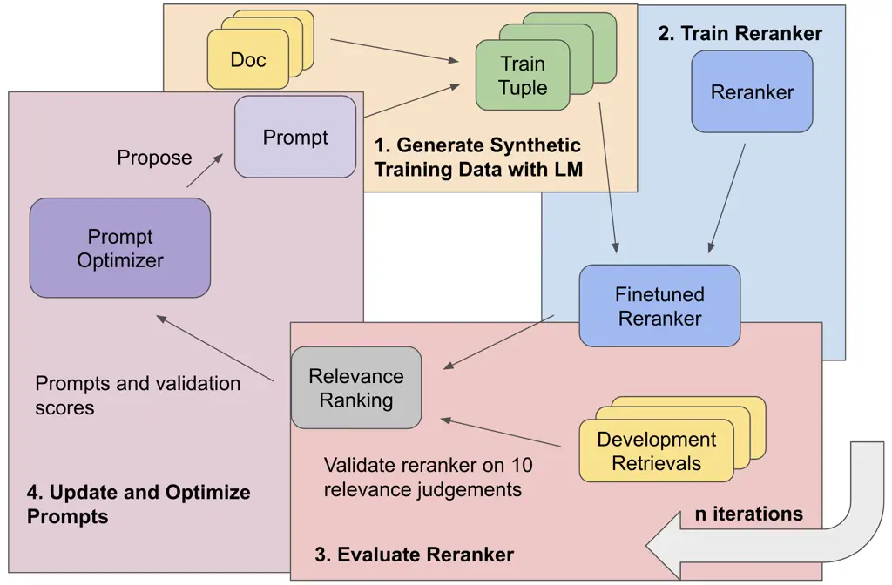
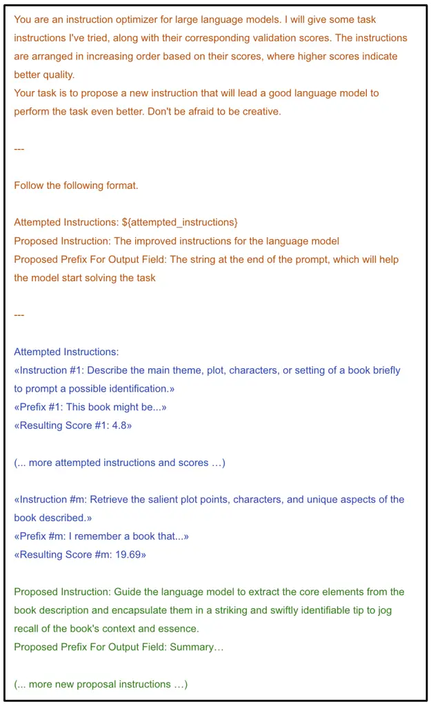

# Prompts as Auto-Optimized Training Hyperparameters: Training Best-in-Class IR Models from Scratch with 10 Gold Labels

Jasper Xian Affiliation: University of Waterloo    Saron Samuel
Affiliation: Stanford University    Faraz Khoubsirat
Affiliation: University of Waterloo    Ronak Pradeep
Affiliation: University of Waterloo    Md Arafat Sultan Affiliation: IBM
Research AI    Radu Florian Affiliation: IBM Research AI    Salim Roukos
Affiliation: IBM Research AI    Avirup Sil Affiliation: IBM Research AI
   Christopher Potts Affiliation: Stanford University    Omar Khattab
Affiliation: Stanford University

###### Abstract

We develop a method for training small-scale (under 100M parameter)
neural information retrieval models with as few as 10 gold relevance
labels. The method depends on generating synthetic queries for documents
using a language model (LM), and the key step is that we automatically
optimize the LM prompt that is used to generate these queries based on
training quality. In experiments with the BIRCO benchmark, we find that
models trained with our method outperform RankZephyr and are competitive
with RankLLama, both of which are 7B parameter models trained on over
100K labels. These findings point to the power of automatic prompt
optimization for synthetic dataset generation.

## 1 Introduction

The past few years have witnessed massive improvements in information
retrieval (IR) quality, thanks to many ways of applying and supervising
pretrained language models (LMs) for IR. However, almost all current IR
models, especially those known to generalize well to new long-tail
domains, are trained on hundreds of thousands or even millions of
queries and relevance judgments. From a scientific perspective, it is
unclear if this magnitude of data is necessary for optimizing LMs for
tasks like IR. At the same time, from an engineering standpoint, it
remains unclear how to best train IR models for extremely long-tail
domains or languages for which labeled IR data is scarce.

Motivated by these questions, we study the difficult problem of training
an IR system from scratch, given nothing but a text corpus of passages
$`C`$ and as few as 10 relevance judgments. To study this problem with
limited confounders, we train only pretrained LMs that have under 100M
parameters and have not been explicitly trained on labeled IR datasets
like MS MARCO Bajaj et al. (2016) or undergone any similar supervision
to the best of our knowledge.

An increasingly common paradigm to tackle the lack of IR data in a given
domain is to use LMs to synthesize hypothetical search queries $`q`$
that are derived from passages $`p`$ in a corpus $`C`$. For example,
Promptagator Dai et al. (2023) and UDAPDR Saad-Falcon et al. (2023) use
LMs like GPT-3 and Flan-T5 Chung et al. (2024) to generate queries. Each
query–passage pair $`\langle q,p\rangle`$ becomes a relevant training
item, negative passages are sampled from $`C`$, and the resulting
dataset is used to train an IR model.

However, such work either uses static prompts for LMs (Promptagator) or
constructs prompts in automatic but static ways (UDAPDR). As a result,
the LM-based data generation process receives no feedback from the IR
model trained. This is a substantial limitation; many IR tasks, like
those in BIRCO Wang et al. (2024) such as ArguAna Wachsmuth et al.
(2018), have nuanced notions of relevance, so simply relying on the
priors of an LM for synthesizing queries may not suffice.



Figure 1: An overview of the PATH pipeline for training a reranker with
synthetic queries. A user only needs to input a prompt with the task
description and as few as 10 relevance judgements to achieve strong
results.

To overcome this, we propose PATH, for Prompts as Auto-optimized
Training Hyperparameters, to optimize the prompt used to generate
synthetic queries. Figure 1 provides an overview of PATH. Steps 1–3
represent a typical pipeline for training IR models on synthetic data
generated by an LM. Step 4 is the crucial addition: the prompt to the LM
is updated using feedback from the reranker evaluation. In this paper,
we adopt the simple strategy of having the LM generate candidate
modifications of our initial instruction and choosing the one that
ultimately leads to the best reranker.

We express PATH in the DSPy programming model Khattab et al. (2024),
which allows us to treat the prompt responsible for synthesizing the
queries as a parameter to learn. For optimization, DSPy requires a
scalar metric. For the first time, we propose the metric of using the
generated outputs of the prompt, i.e., the synthetic queries, to train
an IR model and then returning the average quality of the resulting IR
model directly as the score. This scoring can use as few as 10 gold
labels.

We evaluate this idea using DeBERTa He et al. (2021) and MiniLM Wang
et al. (2020) on the BIRCO benchmark for difficult and non-traditional
IR tasks. We leverage gpt-3.5-turbo for query generation and prompt
optimization. We find that applying PATH with 10 positive labels
performs very competitively. In particular, averaged in NDCG@10 across
tasks and LMs, it outperforms BM25 by 6.0 points, fine-tuned LMs on the
10 positive labels by 6.5 points, and hand-prompting GPT-3.5 for
synthetic query generation by 4.5 percentage points. Moreover, our
approach performs roughly at the same level of quality as directly
training on all available training triples for each task and are
competitive with the best available off-the-shelf cross-encoders like
MonoT5 and RankLLaMA, which are orders of magnitude larger in both
parameter count and training set size.

## 2 Preliminaries

Given a large corpus of documents
$`\mathcal{D}=\{d_{1},d_{2},\ldots,d_{n}\}`$ and a query $`q`$, a
_retriever_ is a model that can find an ordered set $`\mathcal{S}`$ of
$`k\ll|\mathcal{D}|`$ documents that are most relevant to $`q`$, as
measured using some metric(s) of relevance such as nDCG or recall. We
focus on the downstream task of reranking the documents in
$`\mathcal{S}`$ into a more accurate ordering. In particular, we are
interested in training Transformer encoder models as point-wise
rerankers, i.e. a model $`\mathcal{R}`$ that can take the query and each
document $`d_{i}\in\mathcal{S}`$ in isolation, $`\mathcal{R}(q,d_{i})`$,
and output a scalar score that can be used for re-ordering
$`\mathcal{S}`$ to achieve higher relevance.

When only few labeled query-document pairs are available, synthetic data
generation can augment the training dataset of a reranker Dai et al.
(2023); Bonifacio et al. (2022). Canonically, this often involves
sampling a subset of the documents in $`\mathcal{D}`$ randomly and, with
some prompt template $`\mathcal{P}`$, asking an LM to generate a
relevant query $`q_{s}`$ for each $`d=d^{+}`$ in our sample. Each
synthetic query is then paired with its source document to create a
$`(q_{s},d^{+})`$ positive tuple, which is then augmented by producing a
set of $`m`$ hard negatives $`(d^{-}_{1},d^{-}_{2},\ldots,d^{-}_{m})`$,
sampled from the non-positive top results of an existing retriever. This
process outputs a set of tuples
$`(q_{s},d^{+},d^{-}_{1},d^{-}_{2},\ldots,d^{-}_{m})`$ and uses them to
train the reranker.

1: Input: Large Autoregressive Language Model $`\mathbf{LM}`$

2: Input: Small Pretrained Encoder Model $`\mathbf{Enc}`$

3: Input: Document Corpus $`\mathcal{D}`$

4: Input: Number of Trials $`M`$, number of negatives $`m`$

5: Input: Relevance Judgments
$`\mathcal{J}=\{\langle q_{i},d_{i},r_{i}\rangle:i\in[N]\}`$

6: Input: Initial Prompt Instructions $`\mathcal{I}_{0}`$ for query
generation

7:

8: function TrainReranker(Prompt Template $`P`$)

9:   Sample a random subset
$`\mathcal{D}^{\prime}\subseteq\mathcal{D}`$, where
$`|\mathcal{D}^{\prime}|=1000`$

10:   Triplets $`\mathcal{T}\leftarrow\{\}`$

11:   for $`d^{+}\in\mathcal{D}`$ do

12:    Synthetic Query
$`q\leftarrow\mathbf{LM}`$.generate($`P`$.format($`d`$))

13:    Negatives $`d^{-}_{1},\ldots,d^{-}_{m}\leftarrow`$
SampleNegatives($`\mathcal{D}`$, $`q`$, $`d^{+}`$)

14:    Extend $`\mathcal{T}`$ with
$`\{\langle q,d^{+},d^{-}_{j}\rangle:j\in[m]\}`$

15:   end for

16:   Reranker
$`\mathcal{R}\leftarrow\mathbf{Enc}`$.trainOnTriplets($`\mathcal{T}`$)

17:   return $`\mathcal{R}`$

18: end function

19:

20: function AvgNDCG($`\mathcal{R}`$, $`\mathcal{J}`$)

21:   T = { $`\mathcal{R}`$.rerank($`q_{i}`$, BM25.retrieve($`q_{i}`$))
: $`q_{i}\in\mathcal{J}`$.queries() }

22:   return $`\frac{1}{N}\sum_{i=1}^{N}`$ NDCG(T\_(i), $`\mathcal{R}`$)

23: end function

24:

25: Initialize Attempts List $`\mathcal{A}\leftarrow\{\}`$

26: while i in \[$`M`$\] do

27:
  $`\mathcal{P}_{i}\leftarrow\textsc{proposeNewPrompt}(\mathcal{I}_{0},\mathcal{A})`$
$`\triangleright`$ See Sec 3 for how

28:
  $`\mathcal{R}_{i}\leftarrow\textsc{TrainReranker}(\mathcal{P}_{i})`$

29:   Validation Score
$`s\leftarrow\text{AvgNDCG}(\mathcal{R}_{i},\mathcal{J})`$

30:   Extend $`\mathcal{A}`$ with
$`(s,\mathcal{R}_{i},\mathcal{P}_{i})`$

31: end while

32:

33: Let the selected reranker be the best-scoring $`\mathcal{R}_{i}`$

Algorithm 1 PATH for training a reranker with a small number, $`N`$, of
relevance judgments.

## 3 PATH: Training Rerankers With Optimized Data-Generation Prompts

Algorithm 1 describes our method for training rerankers using a very
small number of task-specific relevance labels. Our goal is to train
reranker $`\hat{\mathcal{R}}`$ that would have high quality on the
(unseen) underlying distribution of $`\mathcal{J}`$. Unfortunately,
simply training on the labels in (the very few labels in)
$`\mathcal{J}`$ will result in drastic overfitting (Sec 4). Our
algorithm resolves that as follows.

We require access to (i) a large, autoregressive $`\mathbf{LM}`$ for
prompting and (ii) a small pretrained encoder model $`\mathbf{Enc}`$
that we will finetune as a reranker. The algorithm takes as input two
task-specific human inputs. (1) A small set, like 10 labels, of
relevance judgments $`\mathcal{J}`$, each indicating a realistic query
and a document that is assigned some relevance grade like 0 (irrelevant)
or 3 (perfectly relevant).¹¹ 1 For simplicity, we assume the provided
judgments are all positive, i.e. $`r\geq 1`$. These relevance scores
enable relevance metrics like NDCG@10 to assign a score to the ranking
$`\mathcal{S}`$ established by a reranker on a given query, relative to
the ideal ranking which places the documents assigned the largest
relevance grades first. (2) An initial instruction $`\mathcal{I}_{0}`$,
which may be task-aware, for the $`\mathbf{LM}`$ generating queries,
e.g. “Given a passage, return a question a user may ask that is answered
by this passage”.

The core of the algorithm is TrainReranker, a pipeline for generating
synthetic queries (Line 11) and building triples (Lines 12–13) to train
a point-wise Transformer encoder as a reranker $`\mathcal{R}`$ (Line
15). Crucially, the training of $`\mathcal{R}`$ depends on a prompt
template $`\mathcal{P}`$, responsible for instructing the
$`\mathbf{LM}`$ on the nature of the queries it must synthesize. Our
central contribution is that we seek to automate the construction of a
prompt template $`\hat{\mathcal{P}}`$ that maximizes the quality of the
resulting $`\mathcal{R}`$.

```math
\hat{\mathcal{P}}=\argmax_{\mathcal{P}}\,\textsc{AvgNDCG}(\textsc{TrainReranker}(\mathcal{P}),\mathcal{J})
```

This is essentially the problem of automatic hyperparameter
optimization: automatically tuning $`\mathcal{P}`$ so that training
$`\mathcal{R}`$ with gradient descent achieves a high score. However, we
uniquely have a string template as a hyperparameter. Optimizing a string
prompt is a difficult problem that has been studied extensively in the
past few years. We do not propose a new prompt optimization algorithm
nor do we claim that a specific optimizer works best. Instead, we show
that very simple choices about prompt optimization are sufficient to
find a prompt $`\hat{\mathcal{P}}`$ that allows us to produce very high
quality $`\hat{\mathcal{R}}`$.

To this end, we express Algorithm 1 in the DSPy framework Khattab et al.
(2024), which provides a suite of tools to algorithmically optimize LM
prompts and weights in the context of larger programs. These tools can
be thought of as instantiating the abstract ProposeNewPrompt in
Algorithm 1. Concretely, we express TrainReranker as a DSPy program with
one Chain-of-Thought  Wei et al. (2022) layer, which takes in each
sampled passage and outputs a syntheized query. We use one of DSPy’s
simplest prompt optimizers, CA-OPRO,²² 2 This is an extension of the
OPRO algorithm Yang et al. (2023), which generalizes it via Coordinate
Ascent (CA) so it can apply to multi-prompt programs as well as to
scenarios in which quality is measured via a reward metric, like
AvgNDCG, rather than a pre-defined correct output. which iteratively
refines the initial instruction $`\mathcal{I}_{0}`$ using suggestions by
the $`\mathbf{LM}`$.

In our primary experiments, we set CA-OPRO’s $`\texttt{depth}=1`$, which
reduces ProposeNewPrompt (Line 26) to simply feeding the $`\mathbf{LM}`$
our initial instruction $`\mathcal{I}_{0}`$ and asking it to produce a
new proposed instruction that leads to higher accuracy. In this simplest
instantiation of Lines 24–30, our algorithm simply tries $`M=10`$
different (automatic) prompt variants, executing TrainReranker to
synthesize queries and train a new reranker each time. This process is
quick since we use very small encoders $`\mathbf{Enc}`$, trained on
small synthetic sets. The reranker $`\hat{\mathcal{R}}`$ that scores
highest on AvgNDCG is then selected for deployment and returned for
held-out evaluation (Sec 4). In the appendix, we report the
before-and-after prompts (Table 3).

Many other optimizer choices are possible. For example, in the appendix
(Table 2), we report successful application of CA-OPRO’s
$`\texttt{depth}=2`$ (Figure 2), which allows richer feedback to flow
back to the $`\mathbf{LM}`$ proposing instructions. In particular,
ProposeNewPrompt (Line 26) will now see the prompts it generated earlier
and how well they performed on AvgNDCG, essentially creating momentum in
the right prompting direction. Other optimizers in DSPy work by crafting
examples (e.g., of queries that have been effective) instead of
instructions or even by updating the weights of $`\mathbf{LM}`$. These
all suggest straightforward extensions of our method but we leave them
for future work.

## 4 Evaluation

|                                                                |       |        |      |       |      |      |
| -------------------------------------------------------------- | ----- | ------ | ---- | ----- | ---- | ---- |
|                                                                | ArguA | CTrial | DMAE | Relic | WTB  | AVG  |
| \(0\) BM25                                                     | 35.0  | 9.9    | 52.6 | 10.1  | 16.5 | 24.8 |
| \(1\) Training directly using $`N=10`$ judgments               |       |        |      |       |      |      |
| DeBERTA-v3 (86M)                                               | 34.8  | 7.3    | 45.5 | 14.1  | 16.3 | 23.6 |
| MiniLM-L12 (33M)                                               | 44.2  | 6.0    | 46.0 | 11.8  | 17.8 | 25.2 |
| \(2\) Manual Prompting for Synthetic Queries                   |       |        |      |       |      |      |
| DeBERTA-v3 (86M)                                               | 41.6  | 14.7   | 48.0 | 12.2  | 16.9 | 26.7 |
| MiniLM-L12 (33M)                                               | 38.0  | 13.2   | 50.5 | 9.2   | 19.3 | 26.0 |
| \(3\) Unoptimized DSPy Synthetic Queries                       |       |        |      |       |      |      |
| DeBERTA-v3 (86M)                                               | 40.5  | 15.5   | 55.5 | 14.0  | 18.0 | 28.7 |
| MiniLM-L12 (33M)                                               | 33.9  | 15.2   | 54.6 | 11.5  | 19.7 | 27.0 |
| \(4\) PATH: Optimized with DSPy CA-OPRO via $`N=10`$ judgments |       |        |      |       |      |      |
| DeBERTA-v3 (86M)                                               | 49.7  | 14.3   | 57.1 | 15.3  | 23.4 | 32.0 |
| MiniLM-L12 (33M)                                               | 40.6  | 14.9   | 55.5 | 12.4  | 25.3 | 29.7 |
| (5) Reference Rerankers, trained on massive data like MS MARCO |       |        |      |       |      |      |
| monoT5 (220M)                                                  | 25.7  | 15.3   | 53.6 | 12.7  | 18.3 | 25.1 |
| monoT5 (3B)                                                    | 39.8  | 17.6   | 61.2 | 11.2  | 30.8 | 32.1 |
| RankZephyr (7B)                                                | 35.2  | 15.7   | 65.9 | 10.4  | 29.4 | 31.3 |
| RankLlama (7B)                                                 | 41.6  | 13.7   | 66.8 | 15.0  | 35.7 | 34.6 |

Table 1: nDCG@10 on BIRCO with CA-OPRO, other baselines, and various
rerankers. All rerankers are pointwise except RankZephyr which is
listwise. We use a window size of 20 and a step size of 10 for
RankZephyr. In any setting that we use 10 positive labels, we average
nDCG@10 over 7 different samples and runs. The best results overall are
underlined, and the best results with DeBERTA and MiniLM are bolded.

We use the BIRCO benchmark for information retrieval, a collection of
five complex QA tasks, each with a development dataset and a test
dataset. All final results shown are on the full held-out test set. For
Algorithm 1, we sample $`|\mathcal{J}|`$ positive relevance judgments,
which in our primary experiments are $`N=10`$, for prompt optimization.
We use gpt-3.5-turbo as the $`\mathbf{LM}`$. Each passage is used to
generate one synthetic query, which is used to mine $`m=19`$ hard
negatives randomly sampled from the top 20 to 100 hits retrieved by
BM25.

For our $`\mathbf{Enc}`$ encoder models, we choose
MiniLM-L12-H384-uncased (33M backbone parameters) and DeBERTA-v3-base
(86M backbone parameters), both known for strong performance relative to
parameter size. We train each on the synthesized triples (Line 16) using
LCE cross-entropy loss Gao et al. (2021) over 2 epochs, validating
AvgNDCG on $`\mathcal{J}`$ every half-epoch. As our goal is to evaluate
rerankers trained without large collections like MS MARCO, we use BM25
as our initial retriever. All methods rerank the top-50 BM25 document
retrievals.

We consider several baselines. Baseline (1) evaluates the idea of using
the $`N=10`$ available positive judgments to create training triplets
equivalently to Lines 10–16 of Algorithm 1 but using only the real
positive queries from $`\mathcal{J}`$ instead of generating any
synthetic queries (Line 12).³³ 3 In all settings in which we train
directly on top of judgments, we train for 2000 steps, mirroring the
number of training tuples seen during each iteration of training within
PATH. In cases where the development dataset is very small (i.e., 2000
training steps is greater than 10 epochs of training), we limit training
to 10 epochs. Baseline (2) shows a more standard approach for training
in low-data regimes, which is to manually prompt our $`\mathbf{LM}`$ to
produce synthetic queries, i.e. the TrainReranker algorithm invoked with
a manual prompt template $`\mathcal{P}`$. Baseline (3) shows a simple
variant of that, which uses an (unoptimized) version of the
TrainReranker algorithm expressed with a DSPy Chain-Of-Thought pipeline,
but receiving no feedback from the IR model. Finally, we also include
Baseline (5) which is a collection of large, popular reference rerankers
that we evaluate on BIRCO. These models are given access to much more IR
data for training, so their role here is to serve as reference points
for high-quality out-of-the-box performance.

## 5 Results & Discussion

Table 1 reports our primary results. Methods (1) and (4) involve
sampling $`N=10`$ judgments, so we re-sample and re-run for a total of 7
times and report the average score in each cell. With only 10 labels,
PATH leads to training a reranker that performs an average of 4.5
nDCG@10 points better than manually-written prompts and 3.0 points
better than DSPy unoptimized queries across all datasets. The biggest
improvement came in ArguAna Wachsmuth et al. (2018) and DORIS-MAE Wang
et al. (2023), with improvements of almost 10.0 points each on DeBERTA.
We also see that, with only 10 labeled relevance judgements, it is far
better to use them with PATH as opposed to directly training with the
labels. Training directly with labels yields worse perfomance on average
(by 6.5 points) and on each dataset split, particularly
Clinical-Trial Koopman and Zuccon (2016).

Our small rerankers trained with PATH-generated tuples are also
competitive with current state-of-the-art LM rerankers trained on large
datasets such as MS MARCO Bajaj et al. (2016). For instance, with PATH
and 10 labels, a finetuned DeBERTA outperforms state-of-the-art models
on ArguAna and Relic Thai et al. (2022), which are relatively
complicated QA tasks. Notably, with DeBERTA we outperform
RankZephyr Pradeep et al. (2023) and RankLLama Ma et al. (2023), which
are 7B models trained on MS MARCO, on ArguAna by 14.5 and 8.1 points
respectively. We also outperform 3B models monoT5-3B Nogueira et al.
(2020) as well as UPR Sachan et al. (2022), whose reranker uses
T0_3B Sanh et al. (2021), by similar margins. In contrast, the stable of
billion-parameter rerankers perform well on DORIS MAE and
WhatsThatBook Lin et al. (2023), which are comparatively more
straightforward relevance tasks akin to the datasets they were trained
on.

## 6 Limitations

This work uses one possible set of many potential hyperparameters that
may affect the performance of PATH. We only ran full experiments with
one initial, human-written prompt per task, and it is unclear how
changing that will affect downstream performance. We also use a fixed
learning rate (5e-5) and warmup ratio (0.1), amongst other
hyperparameters, across each experiment. These are examples of potential
hyperparameters that can be optimized in future work. We also define an
arbitrary floor for “positive” relevance in the DORIS-MAE dataset Wang
et al. (2023), as DORIS-MAE has multi-level floating point relevance.
This floor has been manually tuned for Baseline (7) in Table 2, but not
for PATH. Different choices for defining positive relevance in DORIS-MAE
may yield differing results. We used Tesla-V100s and Titan-V GPUs for
our experiments. Our work is done with small, sub-100M parameter models,
and we encourage future work to extrapolate to larger, billion-parameter
models, which may achieve even higher quality.

## 7 Acknowledgements

We thank Jimmy Lin and Martin Franz for their valuable guidance and
feedback.

## References

- Bajaj et al. (2016) Payal Bajaj, Daniel Campos, Nick Craswell,
  Li Deng, Jianfeng Gao, Xiaodong Liu, Rangan Majumder, Andrew McNamara,
  Bhaskar Mitra, Tri Nguyen, Mir Rosenberg, Xia Song, Alina Stoica,
  Saurabh Tiwary, and Tong Wang. 2016. MS MARCO: A human generated
  machine reading comprehension dataset. _arXiv:arXiv:1611.09268v3_.
- Bonifacio et al. (2022) Luiz Bonifacio, Hugo Abonizio, Marzieh Fadaee,
  and Rodrigo Nogueira. 2022. [InPars: Unsupervised dataset generation
  for information retrieval](https://doi.org/10.1145/3477495.3531863).
  In _Proceedings of the 45th International ACM SIGIR Conference on
  Research and Development in Information Retrieval_, SIGIR ’22, page
  2387–2392, New York, NY, USA. Association for Computing Machinery.
- Chung et al. (2024) Hyung Won Chung, Le Hou, Shayne Longpre, Barret
  Zoph, Yi Tay, William Fedus, Yunxuan Li, Xuezhi Wang, Mostafa
  Dehghani, Siddhartha Brahma, Albert Webson, Shixiang Shane Gu, Zhuyun
  Dai, Mirac Suzgun, Xinyun Chen, Aakanksha Chowdhery, Alex Castro-Ros,
  Marie Pellat, Kevin Robinson, Dasha Valter, Sharan Narang, Gaurav
  Mishra, Adams Yu, Vincent Zhao, Yanping Huang, Andrew Dai, Hongkun Yu,
  Slav Petrov, Ed H. Chi, Jeff Dean, Jacob Devlin, Adam Roberts, Denny
  Zhou, Quoc V. Le, and Jason Wei. 2024. [Scaling instruction-finetuned
  language models](http://jmlr.org/papers/v25/23-0870.html). _Journal of
  Machine Learning Research_, 25(70):1–53.
- Dai et al. (2023) Zhuyun Dai, Vincent Y Zhao, Ji Ma, Yi Luan, Jianmo
  Ni, Jing Lu, Anton Bakalov, Kelvin Guu, Keith Hall, and Ming-Wei
  Chang. 2023. [Promptagator: Few-shot dense retrieval from 8
  examples](https://openreview.net/forum?id=gmL46YMpu2J). In _The
  Eleventh International Conference on Learning Representations_.
- Gao et al. (2021) Luyu Gao, Zhuyun Dai, and Jamie Callan. 2021.
  Rethink training of bert rerankers in multi-stage retrieval pipeline.
  In _The 43rd European Conference On Information Retrieval (ECIR)_.
- He et al. (2021) Pengcheng He, Xiaodong Liu, Jianfeng Gao, and Weizhu
  Chen. 2021. [Deberta: Decoding-enhanced bert with disentangled
  attention](https://openreview.net/forum?id=XPZIaotutsD). In
  _International Conference on Learning Representations_.
- Khattab et al. (2024) Omar Khattab, Arnav Singhvi, Paridhi Maheshwari,
  Zhiyuan Zhang, Keshav Santhanam, Sri Vardhamanan A, Saiful Haq,
  Ashutosh Sharma, Thomas T. Joshi, Hanna Moazam, Heather Miller, Matei
  Zaharia, and Christopher Potts. 2024. [DSPy: Compiling declarative
  language model calls into state-of-the-art
  pipelines](https://openreview.net/forum?id=sY5N0zY5Od). In _The
  Twelfth International Conference on Learning Representations_.
- Koopman and Zuccon (2016) Bevan Koopman and Guido Zuccon. 2016. [A
  test collection for matching patients to clinical
  trials](https://doi.org/10.1145/2911451.2914672). In _Proceedings of
  the 39th International ACM SIGIR Conference on Research and
  Development in Information Retrieval_, SIGIR ’16, page 669–672, New
  York, NY, USA. Association for Computing Machinery.
- Lin et al. (2023) Kevin Lin, Kyle Lo, Joseph E. Gonzalez, and Dan
  Klein. 2023. [Decomposing complex queries for tip-of-the-tongue
  retrieval](https://arxiv.org/abs/2305.15053). _Preprint_,
  arXiv:2305.15053.
- Ma et al. (2023) Xueguang Ma, Liang Wang, Nan Yang, Furu Wei, and
  Jimmy Lin. 2023. [Fine-tuning llama for multi-stage text
  retrieval](https://arxiv.org/abs/2310.08319). _Preprint_,
  arXiv:2310.08319.
- Nogueira et al. (2020) Rodrigo Nogueira, Zhiying Jiang, Ronak Pradeep,
  and Jimmy Lin. 2020. [Document ranking with a pretrained
  sequence-to-sequence
  model](https://doi.org/10.18653/v1/2020.findings-emnlp.63). In
  _Findings of the Association for Computational Linguistics: EMNLP
  2020_, pages 708–718, Online. Association for Computational
  Linguistics.
- Pradeep et al. (2023) Ronak Pradeep, Sahel Sharifymoghaddam, and Jimmy
  Lin. 2023. RankZephyr: Effective and robust zero-shot listwise
  reranking is a breeze! _arXiv:2312.02724_.
- Saad-Falcon et al. (2023) Jon Saad-Falcon, Omar Khattab, Keshav
  Santhanam, Radu Florian, Martin Franz, Salim Roukos, Avirup Sil,
  Md Arafat Sultan, and Christopher Potts. 2023. [UDAPDR: Unsupervised
  domain adaptation via LLM prompting and distillation of
  rerankers](https://openreview.net/forum?id=J9vgDEDjAw). In _The 2023
  Conference on Empirical Methods in Natural Language Processing_.
- Sachan et al. (2022) Devendra Singh Sachan, Mike Lewis, Mandar Joshi,
  Armen Aghajanyan, Wen-tau Yih, Joelle Pineau, and Luke
  Zettlemoyer. 2022. [Improving passage retrieval with zero-shot
  question generation](https://arxiv.org/abs/2204.07496).
- Sanh et al. (2021) Victor Sanh, Albert Webson, Colin Raffel,
  Stephen H. Bach, Lintang Sutawika, Zaid Alyafeai, Antoine Chaffin,
  Arnaud Stiegler, Teven Le Scao, Arun Raja, Manan Dey, M Saiful Bari,
  Canwen Xu, Urmish Thakker, Shanya Sharma Sharma, Eliza Szczechla,
  Taewoon Kim, Gunjan Chhablani, Nihal Nayak, Debajyoti Datta, Jonathan
  Chang, Mike Tian-Jian Jiang, Han Wang, Matteo Manica, Sheng Shen,
  Zheng Xin Yong, Harshit Pandey, Rachel Bawden, Thomas Wang, Trishala
  Neeraj, Jos Rozen, Abheesht Sharma, Andrea Santilli, Thibault Fevry,
  Jason Alan Fries, Ryan Teehan, Stella Biderman, Leo Gao, Tali Bers,
  Thomas Wolf, and Alexander M. Rush. 2021. [Multitask prompted training
  enables zero-shot task
  generalization](https://arxiv.org/abs/2110.08207). _Preprint_,
  arXiv:2110.08207.
- Thai et al. (2022) Katherine Thai, Yapei Chang, Kalpesh Krishna, and
  Mohit Iyyer. 2022. [RELiC: Retrieving evidence for literary
  claims](https://doi.org/10.18653/v1/2022.acl-long.517). In
  _Proceedings of the 60th Annual Meeting of the Association for
  Computational Linguistics (Volume 1: Long Papers)_, pages 7500–7518,
  Dublin, Ireland. Association for Computational Linguistics.
- Wachsmuth et al. (2018) Henning Wachsmuth, Shahbaz Syed, and Benno
  Stein. 2018. [Retrieval of the best counterargument without prior
  topic knowledge](https://doi.org/10.18653/v1/P18-1023). In
  _Proceedings of the 56th Annual Meeting of the Association for
  Computational Linguistics (Volume 1: Long Papers)_, pages 241–251,
  Melbourne, Australia. Association for Computational Linguistics.
- Wang et al. (2023) Jianyou Wang, Kaicheng Wang, Xiaoyue Wang,
  Prudhviraj Naidu, Leon Bergen, and Ramamohan Paturi. 2023. [Doris-mae:
  Scientific document retrieval using multi-level aspect-based
  queries](https://arxiv.org/abs/2310.04678). _Preprint_,
  arXiv:2310.04678.
- Wang et al. (2020) Wenhui Wang, Furu Wei, Li Dong, Hangbo Bao, Nan
  Yang, and Ming Zhou. 2020. [Minilm: Deep self-attention distillation
  for task-agnostic compression of pre-trained
  transformers](https://arxiv.org/abs/2002.10957). _Preprint_,
  arXiv:2002.10957.
- Wang et al. (2024) Xiaoyue Wang, Jianyou Wang, Weili Cao, Kaicheng
  Wang, Ramamohan Paturi, and Leon Bergen. 2024. [Birco: A benchmark of
  information retrieval tasks with complex
  objectives](https://arxiv.org/abs/2402.14151). _Preprint_,
  arXiv:2402.14151.
- Wei et al. (2022) Jason Wei, Xuezhi Wang, Dale Schuurmans, Maarten
  Bosma, brian ichter, Fei Xia, Ed H. Chi, Quoc V Le, and Denny
  Zhou. 2022. [Chain of thought prompting elicits reasoning in large
  language models](https://openreview.net/forum?id=_VjQlMeSB_J). In
  _Advances in Neural Information Processing Systems_.
- Yang et al. (2023) Chengrun Yang, Xuezhi Wang, Yifeng Lu, Hanxiao Liu,
  Quoc V Le, Denny Zhou, and Xinyun Chen. 2023. Large language models as
  optimizers. _arXiv preprint arXiv:2309.03409_.

## Appendix A PATH Results with Full Development Set

|                                                                      |       |        |      |       |      |      |
| -------------------------------------------------------------------- | ----- | ------ | ---- | ----- | ---- | ---- |
|                                                                      | ArguA | CTrial | DMAE | Relic | WTB  | AVG  |
| \(6\) Base Models                                                    |       |        |      |       |      |      |
| DeBERTA-v3-base (86M)                                                | 5.9   | 7.4    | 41.8 | 2.4   | 3.9  | 12.3 |
| MiniLM-L12 (33M)                                                     | 22.7  | 9.9    | 50.1 | 8.7   | 10.6 | 20.4 |
| \(7\) Training directly using all relevance judgements               |       |        |      |       |      |      |
| DeBERTA-v3-base (86M)                                                | 60.0  | 8.4    | 49.0 | 22.0  | 19.8 | 31.8 |
| MiniLM-L12 (33M)                                                     | 58.5  | 6.7    | 62.4 | 16.6  | 20.0 | 32.8 |
| \(8\) PATH: Optimized with DSPy CA-OPRO at depth=1 via all judgments |       |        |      |       |      |      |
| DeBERTA-v3-base (86M)                                                | 48.2  | 13.9   | 58.9 | 16.5  | 23.9 | 32.3 |
| MiniLM-L12 (33M)                                                     | 44.3  | 14.4   | 58.0 | 13.1  | 26.3 | 31.2 |
| \(9\) PATH: Optimized with DSPy CA-OPRO at depth=2 via all judgments |       |        |      |       |      |      |
| DeBERTA-v3-base (86M)                                                | 48.8  | 13.7   | 61.7 | 16.0  | 23.9 | 32.8 |
| MiniLM-L12 (33M)                                                     | 44.6  | 14.4   | 60.1 | 13.3  | 32.0 | 32.9 |

Table 2: nDCG@10 on BIRCO with PATH given access to the full development
sets.

Table 2 shows the performance of PATH given at various depths given
access to the entire BIRCO development set. On average, PATH at
$`\texttt{depth}=2`$ performs 0.5 points better than directly training
with the full development set.

## Appendix B Meta Prompting with CA-OPRO



Figure 2: An example of CA-OPRO’s meta-prompts for prompt optimization.
Orange text represents the meta-prompt, blue text represents attempted
trial instructions, and green text represents CA-OPRO’s new proposed
instructions.

Figure 2 shows an example of the meta-prompting strategy used by
CA-OPRO. The proposed optimal instructions are sent back through
TrainReranker and evaluated again by AvgNDCG. This interaction occurs
before each depth level \> 1, thereby repeating until ideally converging
on more optimal instructions.

## Appendix C Analysis of PATH Prompts

|        |                                                                                                                                                                                                                                                                                                                                 |                                                                                                                                                                                                                                                                                                    |                               |                     |
| ------ | ------------------------------------------------------------------------------------------------------------------------------------------------------------------------------------------------------------------------------------------------------------------------------------------------------------------------------- | -------------------------------------------------------------------------------------------------------------------------------------------------------------------------------------------------------------------------------------------------------------------------------------------------- | ----------------------------- | ------------------- |
| Task   | Initial Manual Prompt                                                                                                                                                                                                                                                                                                           | Final PATH-optimized Prompt                                                                                                                                                                                                                                                                        | Final PATH-optimized Suffix   | nDCG@10 Improvement |
| ArguA  | Given a passage with an argument, please return the best counterargument that refutes the input passage. The counterargument should be a few sentences long. Only return the counterargument; do not reason or explain.                                                                                                         | Generate a succinct counterargument that refutes the input passage.                                                                                                                                                                                                                                | Counterargument:              | 7.2                 |
| CTrial | Given a passage with the description of a clinical trial, return the a patient record that would match that of the required subjects for the input clinical trial. Please describe this patient record in a few sentences.                                                                                                      | Instruction \#11: Starting with the clinical trial description, create a comprehensive patient record containing demographic information, medical history, current medications, and any other pertinent details professionally arranged to capture the essence of the trial’s requirements.        | Comprehensive Patient Record: | -1.0                |
| DMAE   | Given a passage consisting of an abstract of a computer science paper, please return a complex, multiple-sentence research question that is best answered by the input abstract. Only return the question; do not reason or explain.                                                                                            | Given an abstract of a computer science paper, construct a multi-dimensional research question that delves deeply into the topic and explores new dimensions beyond the provided information. Integrate analysis of the main goals and contributions along with potential areas for further study. | Further Inquiry:              | 13.7                |
| Relic  | Given a literary quotation, return an excerpt of text that is most likely to include the input quotation within it. The output excerpt should include the token \[masked sentence(s)\] replacing the input quotation, as well as a few sentences before and after the token. Only return the excerpt; do not reason or explain. | Review several paragraphs surrounding the given literary quotation and intelligently formulate an excerpt that seamlessly integrates the quote. Ensure the generated text captures the essence and context of the input quotation authentically.                                                   | Literary Excerpt:             | 3.8                 |
| WTB    | Given the description of a book, please return a tip-of-the-tongue description that someone might use in order to try and identify the book the input describes. The output should be in first-person. Only return the tip-of-the-tongue description; do not reason or explain. Follow the following format.                    | Consider the key plots, characters, and themes of the book to generate a memorable and concise tip-of-the-tongue description reflecting its essence. Avoid using explicit titles or characters in the output to encourage creative thinking in forming the tip-of-the-tongue description.          | I’m thinking of a book that…  | 7.0                 |

Table 3: A comparison of initial manual prompts and final,
PATH-optimized prompts.

We visualize the effects of PATH in Table 3. The initial manual prompts
were used in Baselines (2) and (3) in Table 1, and the final PATH
prompts are drawn from training DeBERTA in Baseline (9) in Table 2.
