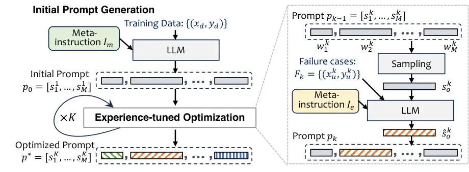

# Dual-Phase Accelerated Prompt Optimization

Muchen Yang Email: <muchen00@mail.ustc.edu.cn>    Moxin Li
^(†)^(†)thanks:  Corresponding Author Affiliation: University of Science
and Technology of China,  National University of Singapore
Email: <limoxin@u.nus.edu>    Yongle Li Affiliation: Institute of
Dataspace, Hefei Comprehensive National Science Center
Email: <liyongle999@gmail.com>    Zijun Chen Affiliation: Institute of
Dataspace, Hefei Comprehensive National Science Center
Email: <zijunchen248@gmail.com>    Chongming Gao¹¹footnotemark: 1
Email: <chongminggao@ustc.edu.cn>    Junqi Zhang
Email: <zhangjunqi@atomecho.xyz>    Yangyang Li Affiliation:  AtomEcho
Inc.,  Academy of Cyber Email: <liyangyang@live.com>    Fuli Feng
Affiliation: Institute of Dataspace, Hefei Comprehensive National
Science Center Email: <fulifeng93@gmail.com>

###### Abstract

Gradient-free prompt optimization methods have made significant strides
in enhancing the performance of closed-source Large Language Models
(LLMs) across a wide range of tasks. However, existing approaches make
light of the importance of high-quality prompt initialization and the
identification of effective optimization directions, thus resulting in
substantial optimization steps to obtain satisfactory performance. In
this light, we aim to accelerate prompt optimization process to tackle
the challenge of low convergence rate. We propose a dual-phase approach
which starts with generating high-quality initial prompts by adopting a
well-designed meta-instruction to delve into task-specific information,
and iteratively optimize the prompts at the sentence level, leveraging
previous tuning experience to expand prompt candidates and accept
effective ones. Extensive experiments on eight datasets demonstrate the
effectiveness of our proposed method, achieving a consistent accuracy
gain over baselines with less than five optimization steps.

## 1 Introduction

LLMs have demonstrated remarkable capabilities across a wide range of
natural language processing (NLP) tasks, including machine
translation Qin et al. (2024), summarization Goyal et al. (2022), and
question answering Zhang et al. (2023a). The dependency on prompt
quality has led to the emergence of prompt engineering Diao et al.
(2023b); White et al. (2023), aiming at crafting effective prompts to
elicit the desired responses from LLMs. As the need for efficient prompt
design becomes increasingly evident Liu et al. (2021b), automatic prompt
optimization has been introduced to streamline the prompt design
process, ensuring that LLMs are utilized to their full potential Gao
et al. (2021); Liu et al. (2021a); Reynolds and McDonell (2021).

Figure 1: Average accuracy improvement on eight datasets with _four_
optimization steps.

Automatic prompt optimization can be broadly categorized into
gradient-based and gradient-free methods. Gradient-based methods Shin
et al. (2020); Li and Liang (2021); Liu et al. (2021b); Liu et al.
(2022) are devised for open-source LLMs to enable the optimization of
prompts through adjustments based on model gradient. Gradient-free
methods have emerged as the predominant approach for closed-source LLMs,
which focuses on refining prompts without access to the model gradient
Prasad et al. (2022); Yang et al. (2023b); Guo et al. (2023). Starting
from initial prompts, these methods usually expand candidate prompts
using searching methods Pryzant et al. (2023); Wang et al. (2023) and
then accepting the more prominent ones in an iterative manner. This
paper focuses on gradient-free methods due to the distinguished
abilities of closed-source LLMs and the challenge of optimizing their
prompts with limited model information.

We argue that current gradient-free prompt optimization methods have not
adequately considered the rate of convergence. Typically, these methods
demand an excessive number of optimization steps to obtain satisfactory
prompts due to the limited access to model details, the vast discrete
search space, and the uncertain optimization directions Wang et al.
(2023); Pan et al. (2023); Yang et al. (2023b). Representative work such
as OPRO Yang et al. (2023b) even necessitates nearly 200 optimization
steps for some NLP tasks. This requirement for excessive optimization
steps makes existing methods impractical for real-world applications
since users are understandably reluctant to tolerate extensive
optimization steps to achieve satisfactory performance levels.
Therefore, we aim to achieve accelerated prompt optimization, obtaining
satisfactory performance via few optimization steps (_e.g.,_ $`<5`$).

To achieve accelerated prompt optimization, two crucial factors need to
be considered: high-quality initial prompts and effective optimization
directions. Firstly, the initialization of the prompt plays a crucial
role in determining the efficiency of the optimization process Ye et al.
(2023), whereas existing approaches pay insufficient attention to the
impact of initialization on subsequent optimization. Therefore, we aim
to obtain initial prompts of high quality, laying a solid foundation to
accelerate optimization process. Secondly, the accelerated prompt
optimization needs to identify the most effective optimization
directions in each step, streamlining efficient optimization from the
initial prompts. Thus, we aim to design a more refined expansion tuned
by experience and acceptance of candidate prompts enhanced by
examination of failure cases.

To this end, we propose a dual-phase approach to achieve the accelerated
gradient-free prompt optimization. Our approach consists of two phases:
high-quality initial prompt generation, and experience-tuned
optimization. Firstly, we utilize a well-designed meta-instruction to
guide the LLM in generating high-quality and structured initial prompts
that contain task-specific information, including task type and
description, output format and constraints, suggested reasoning process,
and professional tips. After that, we devise a sentence-level prompt
optimization strategy for efficiently optimization on the long initial
prompt, leveraging previous direction tuning experience, together with
failure cases, to select sentences in the initial prompt to be expanded
and accept effective prompt candidates. Extensive experiments (_cf._
Figure 1) on three LLMs across several datasets confirm the
effectiveness and superiority of our method. Our contributions are
threefold:

- •
  We reveal the issue of low convergence rate in gradient-free prompt
  optimization, and highlight the problem of accelerated prompt
  optimization.
- •
  We propose a dual-phase approach, achieving accelerated prompt
  optimization through high-quality initial prompt generation and
  experience-tuned optimization.
- •
  We conduct extensive experiments, demonstrating that the proposed
  method achieves satisfying performance within few optimization steps.

## 2 Related Work

The gradient-free prompt optimization for closed-source LLMs typically
contains two phases: initialization and iterative optimization steps,
where the optimization step consists of expansion and selection stages.

##### Initialization.

The prompt initialization for optimization can be achieved manually or
autonomously. Manual initialization often entails professional machine
learning engineers formulating prompts, as delineated in Pryzant et al.
(2023). Concurrently, works such as Guo et al. (2023), Pan et al.
(2023), and Wang et al. (2023) utilize existing manual prompts as the
foundational set to harness human creativity. In contrast, automated
initialization leverages the power of LLM generation, which is
exemplified by Zhang et al. (2023b), generating prompts from few-shot
exemplars and a rudimentary description, and Zhou et al. (2022),
fabricating prompts based on meta-prompts and illustrative input-output
examples. Our method belongs to the automated initialization, improving
the initial prompt generation for acceleration.

##### Optimization.

The optimization step is achieved by expanding prompt candidates by
modifying from the initial prompt and selecting the better candidates
for the next iteration. The expansion stage can be executed through
rephrasing, as in Zhou et al. (2022), where high-scoring prompts undergo
evolution akin to a Monte Carlo search methodology, or through heuristic
algorithms that automatically revise prompts, as in Guo et al. (2023)
and Pan et al. (2023). More complex regeneration strategies are employed
by works like Wang et al. (2023), where the optimizer LLM progressively
expands prompts based on task delineations and historical iterations.
The expansion can also be implemented leveraging an open-source LLM Lin
et al. (2023); Chen et al. (2023). Reinforcement learning-based methods
have also been adopted for prompt modification Diao et al. (2023a).
Moreover, the granularity of prompt modification exhibits variation
across studies. Heuristic-based methods and Hsieh et al. (2023) work
operate at the word/token granularity, while classical optimization
algorithms like Pryzant et al. (2023); Zhou et al. (2022) consider the
entire prompt. The selection stage generally utilized the performance of
the prompt on a held-out validation set Pryzant et al. (2023); Zhou
et al. (2022); Wang et al. (2023), while recent work also explores human
preference feedback Lin et al. (2024) or score feedback from other LLMs
Yang et al. (2024).



Figure 2: Illustration of the proposed method.

## 3 Problem Formulation

### 3.1 Gradient-Free Prompt Optimization

For a target NLP task $`\mathcal{T}`$ with input $`x`$, the
closed-source LLM predicts the output $`\hat{y}`$ given $`x`$
concatenated with the prompt $`p`$, where $`x,\hat{y}`$ and $`p`$ are
all word sequences. The aim for prompt optimization is to find an
optimal prompt $`p^{*}`$ that obtains the desired $`\hat{y}`$, which can
be evaluated by metrics such as accuracy with reference to the ground
truth $`y`$. The gradient-free prompt optimization contains an
initialization phase followed by $`K`$ iterative optimization steps. The
$`k`$-th optimization step starts from an initial prompt
$`p_{k-1},k\in[1,K]`$, and sequentially performs two stages: expansion
of prompt candidates, and acceptance of the prominent prompts as the
next initial prompts, as detailed below.

##### Expansion of Prompt Candidates.

At the $`k`$-th optimization step, The expansion stage search for new
prompt candidates with potential better performance starting from
$`p_{k-1}`$, with searching methods such as edit-based Prasad et al.
(2022) and LLM rewriting Pryzant et al. (2023). Formally, the expansion
function $`f_{E}(\cdot)`$ generates prompt candidate set
$`P^{c}_{k}=\{p^{c}_{k_{1}},\cdots,p^{c}_{k_{Q}}\}`$ with size $`Q`$.

```math
\displaystyle P^{c}_{k}=f_{E}(p_{k-1}). \tag{1}
```

##### Acceptance of Prominent Prompts.

The acceptance stage evaluates the performance of each prompt candidate
in $`P^{c}_{k}`$ to determine whether it should be continued for next
optimization step. This is usually achieved by evaluation on a held-out
validation set $`V=\{(x^{v},y^{v})\}`$, and accepting the top-performing
prompt candidates. Formally, with the evaluation function on LLM as
$`f_{S}(\cdot)`$,

```math
\displaystyle r^{k}_{i} \displaystyle=f_{S}(p^{c}_{k_{i}},V),i\in[1,\cdots,Q], \tag{2}
```

```math
\displaystyle p_{k} \displaystyle=p^{c}_{k_{j}},\text{where }j=\text{argmax}(\{r^{k}_{1},...,r^{k}_{Q}\}).
```

where $`\text{argmax}(\cdot)`$ denotes the index of the maximum value.
At the final optimization step, the top-performing prompt $`p_{K}`$ will
be accepted as the optimized prompt $`p^{*}`$.

### 3.2 Accelerated Prompt Optimization

Although current research on gradient-free prompt optimization can
achieve significant performance gains on multiple tasks, demands for a
great number of optimization steps hinder their practicability in
real-world scenarios. For instance, Yang et al. (2023b) does not
converge even after over 150 steps in some tasks; Wang et al. (2023)
finds a good solution in 50 to 75 steps. Therefore, we highlight the
problem of accelerated prompt optimization, _i.e.,_ obtaining $`p^{*}`$
with satisfactory performance in few optimization steps, _e.g.,_
$`K<5`$.

## 4 Proposed Method

### 4.1 Motivation

We believe that two factors are crucial for achieving accelerated prompt
optimization, which current gradient-free prompt optimization methods
fail to achieve. Firstly, the initial prompt $`p_{0}`$ plays a crucial
role in accelerating the prompt optimization process Ye et al. (2023),
where $`p_{0}`$ with better LLM performance makes the optimization
towards better prompts easier, preventing LLMs from excessively
exploring suboptimal prompt regions. This is generally overlooked by
existing research that utilizes uninformative initial prompts, _e.g.,_
Yang et al. (2023b). Therefore, we propose to devise high-quality
$`p_{0}`$ by crafting a novel initial prompt schema. Furthermore, a more
precise expansion and acceptance of prompt candidates ensure highly
efficient optimization direction and fewer optimization steps. Current
expansion and acceptance techniques optimize the prompt towards
improving the general task performance, where effective optimization
direction in each step is hard to ensure. To tackle this, we propose to
utilize the past failure cases from previous optimization steps to
further navigate the expansion and acceptance of prompt candidates. We
illustrate our dual-phase approach as follows (_cf._ Figure 2).

### 4.2 High-Quality Initial Prompt Generation

We think that a high-quality initial prompt that can elicit the desired
response from LLMs should be able to provide clear task instruction and
detailed task-related information. Specifically, it should 1) give a
clear definition of the task type and provide a detailed task
description, 2) define the output format and constraints, 3) provide
insights on the reasoning processes and professional tips. To achieve
such initial prompts, we are inspired by the step-back prompting Zheng
et al. (2023) which demonstrates LLM’s ability to derive high-level
concepts and principles from examples. Thus, following Zhou et al.
(2022), we design a meta-instruction $`I_{m}`$ (_cf._ Figure 3),
leveraging LLM’s ability to generate $`p_{0}`$ by observing the
input-output exemplars of the target task $`\mathcal{T}`$ and inferring
the above required information. Formally, defining input-output
exemplars as $`D=\{(x_{d},y_{d})\}`$,

```math
\displaystyle p_{0}=LLM(I_{m},D). \tag{3}
```

Figure 3: Meta-instruction used in our initialization phase to generate
high-quality initial prompts.

### 4.3 Experience-Tuned Optimization

In the optimization phase, it is necessary to tune the expansion and
acceptance of prompt candidates to quickly improve the task performance
as evaluated on the validation set $`V`$ and thus reduce optimization
steps. Inspired by previous research Pryzant et al. (2023), we intend to
make the best of past failure cases to generate promising prompt
candidates and filter out unnecessary optimization attempts. In each
optimization step, we maintain a failure case set
$`F_{k}=\{(x_{k}^{f},y_{k}^{f})\}`$ containing the examples from $`V`$
where the initial prompt $`p_{k-1}`$ fails to predict the ground truth
in the acceptance stage, _i.e.,_ $`\hat{y}_{k}^{f}\neq y_{k}^{f}`$.

##### Expansion.

In the expansion stage, since the initial prompts are long prompts with
at least four sentences, we aim to improve the expansion efficiency by
segmenting them into individual sentences for sentence-level expansion
following LongPO Hsieh et al. (2023). Moreover, since different
sentences in the initial prompts contain different task-related
information and may have different impacts on the task performance, we
devise sentence weights $`w^{k}`$ to estimate the impact of each
sentence on the performance improvement, which is updated leveraging the
past failure cases. We first split the initial prompt $`p_{0}`$ into
$`M`$ sentences, and initialize the weight $`w^{1}`$ for each sentence
as 1.

```math
\displaystyle p_{0} \displaystyle=[s^{1}_{1},s^{1}_{2},...,s^{1}_{M}], \tag{4}
```

```math
\displaystyle w^{1}_{t} \displaystyle=1,t\in[1,M].
```

In the $`k`$-th optimization step, we compute the acceptance probability
$`\text{Pr}^{k}`$ for each sentence:

```math
\displaystyle\text{Pr}^{k}_{i} \displaystyle=\frac{\exp(w^{k}_{i})}{\sum_{j=1}^{M}\exp(w^{k}_{j})}. \tag{5}
```

After that, we sample a sentence for expansion based on the probability
distribution
$`\text{Pr}^{k}=[\text{Pr}^{k}_{1},\cdots,\text{Pr}^{k}_{M}]`$, where
the sampled sentence is denoted as $`s^{k}_{o},o\in[1,M]`$. For
expansion of $`s^{k}_{o}`$, we design a meta-instruction $`I_{e}`$
(_cf._ Figure 4) to instruct LLM to generate a revised sentence
considering the past experience.

```math
\displaystyle\hat{s}^{k}_{o}=LLM(I_{e},p_{k-1},F_{k},s^{k}_{o}). \tag{6}
```

Before passing $`\hat{s}^{k}_{o}`$ to the acceptance stage, we design
additional strategies to further guarantee the effectiveness of the
generated sentence leveraging $`F_{k}`$. Firstly, to ensure
$`\hat{s}^{k}_{o}`$ can actually improve over $`s^{k}_{o}`$, we replace
$`s^{k}_{o}`$ in $`p_{k-1}`$ with $`\hat{s}^{k}_{o}`$, denoted as
$`\hat{p}_{k}`$, and evaluate whether $`\hat{p}_{k}`$ outperforms
$`p_{k-1}`$ on $`F_{k}`$. We accept $`\hat{s}^{k}_{o}`$ only when
$`\hat{p}_{k}`$ has improved the performance over $`p_{k-1}`$ larger
than a threshold $`H_{F}`$.

```math
\displaystyle f_{S}(\hat{p}_{k},F_{k})-f_{S}(p_{k-1},F_{k})>H_{F}. \tag{7}
```

Besides, to avoid repeatedly generating the same ineffective
$`\hat{s}^{k}_{o}`$, we build a collection $`\mathcal{G}`$ of undesired
sentence revisions and check whether $`\hat{s}^{k}_{o}`$ has appeared in
$`\mathcal{G}`$. If the above two criteria are not met, we abandon
$`\hat{s}^{k}_{o}`$ and regenerate starting from Eq. 6.

Figure 4: Meta-instruction used in the optimization phase.

##### Acceptance.

In addition to evaluating $`\hat{p}_{k}`$’s performance on the entire
failure case $`F_{k}`$, we also evaluate its performance on the
validation set $`V`$. We accept $`\hat{p}_{k}`$ as the next initial
prompt $`p_{k}`$ only when $`\hat{p}_{k}`$ has improved the performance
over $`p_{k-1}`$ larger than a threshold $`H_{V}`$. Otherwise, we
abandon $`\hat{p}^{k}`$ and restart from sampling $`s^{k}_{o}`$.

```math
\displaystyle f_{S}(\hat{p}_{k},V)-f_{S}(p_{k-1},V)>H_{V}. \tag{8}
```

If $`\hat{p}^{k}`$ is accepted, we update its sentence weights. We
calculate the mixed evaluation result $`f_{R}(\cdot)`$ and update the
$`w^{k+1}`$ as follows, where $`\alpha`$ and the learning rate $`\eta`$
are adjusting hyperparameters.

```math
\displaystyle f_{R}(\hat{p}_{k}) \displaystyle=\alpha f_{S}(\hat{p}_{k},V)+(1-\alpha)f_{S}(\hat{p}_{k},F_{k}). \tag{9}
```

```math
\displaystyle w^{k+1}_{i} \displaystyle=w^{k}_{i}\exp(\frac{\eta f_{R}(\hat{p}_{k})}{\text{Pr}^{k}_{i}M}).
```

When the number of times that Eq. 7 or Eq. 8 is not satisfied
accumulates to 5, we consider the algorithm to have converged.

The weight formula is designed to adaptively update the importance of
each sentence in the prompt based on its impact on overall performance
improvement. $`f_{R}(\hat{p}_{k})`$ modulates the magnitude of the
weight adjustment: a higher $`f_{R}(\hat{p}_{k})`$ leads to larger
updates. $`\text{Pr}^{k}_{i}`$ determines the weight’s contribution,
while $`M`$ is used for normalization to ensure balanced weight updates.
The learning rate $`\eta`$ controls the extent of weight adjustments
based on the evaluation feedback. Inspired by the EXP3 algorithm Auer
et al. (1995), these components facilitate a dynamic and adaptive
optimization process, tuned by empirical performance data. The who
process is summarized in Algorithm 1.

1: Input-output exemplars $`D`$, validation set $`V`$, meta-instruction
$`I_{m}`$ and $`I_{e}`$.

2: Optimized prompt $`p^{*}`$

3: Initialize $`p_{0}`$ (Eq. 3), derive failure case set $`F_{1}`$

4: Split $`p_{0}`$ into $`M`$ sentences
$`[s^{1}_{1},s^{1}_{2},\ldots,s^{1}_{M}]`$, initialize sentence weights
$`\{w^{1}_{i}\}_{i=1}^{M}\leftarrow 1`$, $`k\leftarrow 1`$

5: while not converged do

6:   $`\triangleright{\textit{{ Expansion}}}`$

7:   Sample a sentence $`s^{k}_{o}`$ based on $`\text{Pr}^{k}`$ (Eq. 5)

8:   Generate revised sentence $`\hat{s}^{k}_{o}`$ (Eq. 6)

9:   Replace $`s^{k}_{o}`$ in $`p_{k-1}`$ with $`\hat{s}^{k}_{o}`$ to
get $`\hat{p}_{k}`$

10:   if $`\hat{s}^{k}_{o}\in\mathcal{G}`$ or (Eq. 7) is not satisfied
then

11:    Add $`\hat{s}^{k}_{o}`$ to $`\mathcal{G}`$

12:    Regenerate $`\hat{s}^{k}_{o}`$ from line 8

13:   end if

14:   $`\triangleright{\textit{{ Acceptance}}}`$

15:   if (Eq. 8) is not satisfied then

16:    Restart from line 7

17:   end if

18:   $`p_{k}\leftarrow\hat{p}_{k}`$, update $`w^{k+1}_{i}`$,
$`k\leftarrow k+1`$

19:   Update $`F_{k}`$ with new failure cases

20: end while

21: return optimized prompt $`p^{*}=p_{k}`$

Algorithm 1  
Dual-Phase Accelerated Prompt Optimization

## 5 Experiments

In this section, we begin by detailing datasets, baselines, and the
implementation of the experiments. Following this, we conduct
comprehensive and controlled experiments on our method.

### 5.1 Experimental Settings

##### Datasets.

Our experiments are first conducted on general natural language
understanding tasks across four datasets to validate our method,
specifically focusing on sentiment classification (SST-2 Socher et al.
(2013)), topic classification (AG’s News Zhang et al. (2015), TREC
Voorhees and Tice (2000)) and subjectivity classification (Subj Pang and
Lee (2004)). Then we perform our approach to the challenging BBH tasks
Suzgun et al. (2022), which include manually provided few-shot
Chain-of-Thought (CoT) prompts containing task descriptions and
demonstrations.

##### Baselines.

We compare our method with three popular prompt optimization methods for
zero-shot black-box prompting and the well-crafted prompts manually
provided in BBH tasks: APO Pryzant et al. (2023): Generating natural
language “gradients” to criticize and improve the current prompts. APE
Zhou et al. (2022): Proposing both a naive and an iterative Monte Carlo
search methods to approximate the solution to the prompt optimization
problem. PromptAgent Wang et al. (2023): Automating expert-level prompt
generation by treating it as a strategic planning problem using Monte
Carlo tree search and error feedback to refine and optimize prompts.
Manual Prompt Suzgun et al. (2022): The few-shot CoT version of
human-designed prompts with teaching examples developed in BBH tasks.

##### Implementation Details.

In line with Wang et al. (2023), since BBH tasks lack an official
train-test split, we shuffle the data and allocate approximately half
for testing. The rest is used for training, prompt generation, and
optimization. For datasets with predefined test sets, we use those
directly.

Unless otherwise stated, we evaluate performance (_i.e.,_ accuracy) on
GPT-3.5-Turbo using the OpenAI API¹¹ 1
[https://chat.openai.com/](https://chat.openai.com/) (currently
gpt-3.5-turbo-0125) in a zero-shot prompt setting. The temperature is
set to 0 for prediction and 0.5 for prompt generation to enhance
diversity. To accelerate prompt optimization, we limit the maximum
optimization steps to four for all methods, while keeping other baseline
parameters and settings at default. At the beginning of prompt
initialization, eight exemplars are obtained by concatenating unique
input-output pairs from the shuffled training data until the desired
amount is reached, ensuring no duplicate inputs. Due to limited
computational resources, our approach generates and optimizes only one
initial prompt. By default, we set $`H_{F}=0.3`$, $`H_{V}=0.1`$,
$`\alpha=0.4`$, and $`\eta=0.055`$ in Algorithm  1 to accelerate the
optimization phase.

### 5.2 Main Results & Analysis

|                     |          |           |       |       |       |
| ------------------- | -------- | --------- | ----- | ----- | ----- |
|                     | Few-shot | Zero-shot |       |       |       |
| Task                | Manual   | APO       | APE   | PA    | Ours  |
| SST-2               | /        | 0.89      | 0.92  | 0.443 | 0.978 |
| AG’s News           | /        | 0.88      | 0.819 | 0.785 | 0.928 |
| TREC                | /        | 0.795     | 0.513 | 0.687 | 0.785 |
| Subj                | /        | 0.64      | 0.593 | 0.494 | 0.72  |
| Logical Five        | 0.388    | 0.392     | 0.404 | 0.443 | 0.48  |
| Hyperbaton          | 0.744    | 0.808     | 0.865 | 0.823 | 0.88  |
| Disambiguation      | 0.580    | 0.688     | 0.645 | 0.696 | 0.74  |
| Salient Translation | 0.544    | 0.456     | 0.538 | 0.468 | 0.548 |
| Avg.                | 0.564    | 0.694     | 0.662 | 0.605 | 0.757 |

Table 1: Accuracy on eight tasks on GPT-3.5-Turbo. PA indicates
PromptAgent. Bold and underlined text indicate the best and second-best
results, respectively.

Figure 5: Performance (accuracy) over 4 steps across 8 tasks on
GPT-3.5-Turbo.

##### Overall Results.

Table 1 demonstrates the effectiveness of our accelerated dual-phase
approach across 8 NLP tasks compared to classic prompt optimization
methods. Our method significantly outperforms all baselines, achieving
an average improvement of approximately 10.7% over APO, 16.4% over APE,
and 29.7% over PromptAgent across the given tasks.

Our method also surpasses few-shot CoT human-crafted prompts with an
approximately 17.6% average improvement on selected BBH tasks,
indicating its ability to produce high-quality prompts that enhance the
black-box LLM’s capabilities in logical deduction, grammar, language
understanding, and multilingual tasks without teaching examples.

##### Analysis.

To understand this result, we analyzed the prompt expansion and
acceptance processes: In prompt expansion, our method leverages past
experience, filters out unnecessary optimization attempts, and collects
undesired revisions. This contrasts with baseline methods that
inefficiently explore prompt space and underutilize past iterations. APE
lacks reflection on past iterations, slowing its Monte Carlo-based
search. APO uses error feedback to guide beam search but is slowed by
evaluating many paths. PromptAgent’s Monte Carlo Search Tree explores
prompt optimization through simulations, but limited steps lead to
suboptimal results.

In the acceptance process, inspired by the EXP3 algorithm, our method
uses weighted sentences and modifications to enhance prompt quality,
making it superior in identifying promising candidates and optimizing
directions.

##### Convergence Analysis.

To evaluate our method’s convergence within four steps compared to
others, we examine how quickly each method achieves peak performance
across datasets. Figure 5 shows the performance (accuracy) variation of
four prompt optimization methods across eight datasets, with each
subfigure representing a different dataset. While APO, APE, and
PromptAgent experience fluctuations or plateau at lower accuracy, our
method demonstrates the fastest convergence across most datasets, often
reaching near-peak performance within the first two steps. This rapid
convergence highlights our method’s efficiency in optimizing prompts
quickly and effectively, making it promising for tasks requiring prompt
optimization within a few steps.

### 5.3 Ablation Study

We conduct several ablation experiments to assess the efficacy of our
method.

Figure 6: Results on GPT-3.5-Turbo with different initial prompt
schemas.

Figure 7: Results on GPT-3.5-Turbo with different optimization learning
rates.

Figure 8: Accuracy over 4 steps across 8 tasks on Baichuan2-Turbo.

Figure 9: Accuracy over 4 steps across 8 tasks on GPT-4.

#### 5.3.1 Different Initial Prompt Schemas

Our method uses a meta-instruction to generate a prompt with four
components: a) task type and description, b) output format and
constraints, c) suggested reasoning process, and d) professional tips.
We define: _Schema 4_: All four components _Schema 3_: First three
components _Schema 2_: First two components _Schema 1_: Task type and
description only (common in current techniques). We vary the
meta-instructions for these schemas and conduct four-step prompt
optimization experiments on SST-2 and AG’s News to assess their impact
on optimization.

As shown in Figure 6, initial prompts from Schema 4 yield the highest
evaluation results. In contrast, Schema 1 has the lowest metrics and
often falls into suboptimal local minima, a common issue with current
methods. This comparison validates our meta-instruction design and
underscores that a high-quality initial prompt is crucial for quickly
identifying the optimal prompt.

#### 5.3.2 Sensitivity to Learning Rate

During the optimization phase, the learning rate $`\eta`$ controls the
extent of sentence weight updates after each round. A higher $`\eta`$
results in significant updates and responsiveness to recent performance
changes, while a lower $`\eta`$ promotes stability with gradual
adjustments. This balance is crucial for navigating the trade-off
between exploration and exploitation.

We conduct prompt optimization experiments on SST-2 and AG’s News within
four steps, testing $`\eta`$ values from 0.01 to 0.1. As shown in Figure
7, $`\eta=0.055`$ and $`\eta=0.07`$ are the most and second most
effective in accelerating optimization.

#### 5.3.3 Performance on Different LLMs

As Table 1 indicates, APO is the best baseline method. Therefore, we
compare our method with APO using Baichuan2 Yang et al. (2023a) and
GPT-4 accessed via the APIs. We conduct prompt optimization experiments
on eight NLP datasets across four optimization steps.

Figure 8 and 9 illustrate the performance variation of both methods
across different datasets as optimization steps progress. APO fails to
converge within four steps and shows greater performance volatility
compared to Baichuan2-Turbo and GPT-4. In contrast, our method
demonstrates rapid convergence and strong optimization acceleration.
Except for the generalizability to other models, we also find that
stronger LLM can achieve more effective prompt optimization with our
method.

#### 5.3.4 Performance on Specialized Domain-Specific Task

To evaluate our method performance on specialized tasks that require
domain knowledge, we conduct experiments on the Geometric Shapes task
Suzgun et al. (2022), which involves interpreting SVG paths to determine
the geometric figures they represent, a task that requires specific
domain knowledge.

|               |       |       |
| ------------- | ----- | ----- |
| Model         | APO   | Ours  |
| GPT-3.5-Turbo | 0.36  | 0.392 |
| GPT-4         | 0.448 | 0.488 |

Table 2: Accuracy on Geometric Shapes task on GPT-3.5-Turbo and GPT-4.

As shown in Table 2, our approach demonstrates consistent performance
improvement over the best baseline APO, revealing the effectiveness of
our method in specialized task.

#### 5.3.5 Results without Step Constraint

Figure 10: Accuracy over 20 steps on GPT-3.5-Turbo.

We report the results of prompt optimization with a maximum of 20 steps
on two general NLU tasks. As shown in Figure 10, the strongest baseline,
APO, converges on the SST-2 task with slightly lower accuracy than our
method. However, on the AG’s News task, APO’s performance fluctuates
significantly and lags behind our method. Thus, our method demonstrates
superior performance and faster convergence compared to existing
methods, even with fewer optimization steps.

#### 5.3.6 Computational Complexity

Since the running time is related to the number of API calls and may be
affected by the network condition, we mainly present the number of API
calls, which is an important metric for cost comparison on black-box
LLMs.

|                     |        |       |
| ------------------- | ------ | ----- |
| Task                | APO    | Ours  |
| SST-2               | 12,520 | 1,708 |
| AG’s News           | 12,733 | 2,089 |
| TREC                | 9,739  | 1,486 |
| Subj                | 12,790 | 1,848 |
| Logical Five        | 9,631  | 1,512 |
| Hyperbaton          | 9,934  | 1,626 |
| Disambiguation      | 9,471  | 1,187 |
| Salient Translation | 10,190 | 1,451 |
| Geometric Shapes    | 9,648  | 1,496 |
| Avg.                | 10,739 | 1,600 |

Table 3: API calls consumed on nine tasks on GPT-4.

We conduct our experiments with GPT-4 on nine tasks. As shown in
Table 3, our method requires approximately 1/7 of the number of API
calls compared to the strongest baseline method, APO.

## 6 Conclusion

In this paper, we addressed the issue of low convergence rates in
gradient-free prompt optimization methods for LLMs. Our proposed
dual-phase approach effectively accelerates prompt optimization by
generating high-quality initial prompts and leveraging tuning experience
to navigate the optimization process. Extensive experiments on several
LLMs across diverse datasets demonstrated the superiority of our method
in achieving satisfactory performance within few optimization steps. Our
approach not only enhances the efficiency of prompt optimization but
also improves the overall performance of LLMs in various NLP tasks.
Future work will focus on further refining the optimization strategies
and exploring their applications in more diverse and complex scenarios.

## Acknowledgements

This work is supported by the National Natural Science Foundation of
China (62272437,62402470), the University Synergy Innovation Program of
Anhui Province (GXXT-2023-071), and the Fundamental Research Funds for
the Central Universities of China (WK2100000053, PA2024GDSK0107). This
research is also supported by the advanced computing resources provided
by the Supercomputing Center of the USTC.

## Limitations

We acknowledge some limitations despite the promising results of our
research that could pave the way for future studies:

1\) Our experiments were limited to general NLP tasks and one
domain-specific task, more performance assessment on specialized tasks
remains to be included. 2) Our method relies on labeled task data for
prompt generation and evaluation, raising concerns about its robustness
in personalized or scenarios lacking labeled data. 3) Our experiments
were confined to GPT-3.5-Turbo, Baichuan2-Turbo and GPT-4, leaving the
effectiveness of our method on other large language models to be
validated in future studies.

Further study may be needed to address these limitations so as to
improve the generalizability and robustness of our approach in broader
and more complex real-world applications.

## References

- Auer et al. (1995) Peter Auer, Nicolò Cesa-Bianchi, Yoav Freund, and
  Robert E. Schapire. 1995. [Gambling in a rigged casino: The
  adversarial multi-arm bandit
  problem](https://api.semanticscholar.org/CorpusID:267915948). In _IEEE
  Annual Symposium on Foundations of Computer Science_.
- Chen et al. (2023) Lichang Chen, Jiuhai Chen, Tom Goldstein, Heng
  Huang, and Tianyi Zhou. 2023. [Instructzero: Efficient instruction
  optimization for black-box large language
  models](https://api.semanticscholar.org/CorpusID:259075794). _ArXiv_,
  abs/2306.03082.
- Diao et al. (2023a) Shizhe Diao, Zhichao Huang, Ruijia Xu, Xuechun Li,
  LIN Yong, Xiao Zhou, and Tong Zhang. 2023a. [Black-box prompt learning
  for pre-trained language
  models](https://openreview.net/forum?id=IvsGP7xRvm). _Transactions on
  Machine Learning Research_.
- Diao et al. (2023b) Shizhe Diao, Pengcheng Wang, Yong Lin, and Tong
  Zhang. 2023b. [Active prompting with chain-of-thought for large
  language models](https://api.semanticscholar.org/CorpusID:257102707).
  _ArXiv_, abs/2302.12246.
- Gao et al. (2021) Tianyu Gao, Adam Fisch, and Danqi Chen. 2021.
  [Making pre-trained language models better few-shot
  learners](https://api.semanticscholar.org/CorpusID:229923710). In
  _Annual Meeting of the Association for Computational Linguistics_.
- Goyal et al. (2022) Tanya Goyal, Junyi Jessy Li, and Greg
  Durrett. 2022. [News summarization and evaluation in the era of
  gpt-3](https://api.semanticscholar.org/CorpusID:252532176). _ArXiv_,
  abs/2209.12356.
- Guo et al. (2023) Qingyan Guo, Rui Wang, Junliang Guo, Bei Li, Kaitao
  Song, Xu Tan, Guoqing Liu, Jiang Bian, Yujiu Yang, Tsinghua
  University, and Microsoft Research. 2023. [Connecting large language
  models with evolutionary algorithms yields powerful prompt
  optimizers](https://api.semanticscholar.org/CorpusID:262012566).
  _ArXiv_, abs/2309.08532.
- Hsieh et al. (2023) Cho-Jui Hsieh, Si Si, Felix X. Yu, and Inderjit S.
  Dhillon. 2023. [Automatic engineering of long
  prompts](https://api.semanticscholar.org/CorpusID:265281606). _ArXiv_,
  abs/2311.10117.
- Li and Liang (2021) Xiang Lisa Li and Percy Liang. 2021.
  [Prefix-tuning: Optimizing continuous prompts for
  generation](https://api.semanticscholar.org/CorpusID:230433941).
  _Proceedings of the 59th Annual Meeting of the Association for
  Computational Linguistics and the 11th International Joint Conference
  on Natural Language Processing (Volume 1: Long Papers)_, pages
  4582–4597.
- Lin et al. (2024) Xiaoqiang Lin, Zhongxiang Dai, Arun Verma, See-Kiong
  Ng, Patrick Jaillet, and Kian Hsiang Low. 2024. [Prompt optimization
  with human
  feedback](https://api.semanticscholar.org/CorpusID:270063071).
  _ArXiv_, abs/2405.17346.
- Lin et al. (2023) Xiaoqiang Lin, Zhaoxuan Wu, Zhongxiang Dai, Wenyang
  Hu, Yao Shu, See-Kiong Ng, Patrick Jaillet, and Bryan Kian Hsiang
  Low. 2023. [Use your instinct: Instruction optimization using neural
  bandits coupled with
  transformers](https://api.semanticscholar.org/CorpusID:263620801).
  _ArXiv_, abs/2310.02905.
- Liu et al. (2021a) Pengfei Liu, Weizhe Yuan, Jinlan Fu, Zhengbao
  Jiang, Hiroaki Hayashi, and Graham Neubig. 2021a. [Pre-train, prompt,
  and predict: A systematic survey of prompting methods in natural
  language
  processing](https://api.semanticscholar.org/CorpusID:236493269). _ACM
  Computing Surveys_, 55:1 – 35.
- Liu et al. (2022) Xiao Liu, Kaixuan Ji, Yicheng Fu, Weng Lam Tam,
  Zhengxiao Du, Zhilin Yang, and Jie Tang. 2022. [P-tuning: Prompt
  tuning can be comparable to fine-tuning across scales and
  tasks](https://api.semanticscholar.org/CorpusID:248780177). In _Annual
  Meeting of the Association for Computational Linguistics_.
- Liu et al. (2021b) Xiao Liu, Yanan Zheng, Zhengxiao Du, Ming Ding,
  Yujie Qian, Zhilin Yang, and Jie Tang. 2021b. [Gpt understands,
  too](https://api.semanticscholar.org/CorpusID:232269696). _ArXiv_,
  abs/2103.10385.
- Pan et al. (2023) Rui Pan, Shuo Xing, Shizhe Diao, Xiang Liu, Kashun
  Shum, Jipeng Zhang, and Tong Zhang. 2023. [Plum: Prompt learning using
  metaheuristic](https://api.semanticscholar.org/CorpusID:265158095).
  _ArXiv_, abs/2311.08364.
- Pang and Lee (2004) Bo Pang and Lillian Lee. 2004. [A sentimental
  education: Sentiment analysis using subjectivity summarization based
  on minimum cuts](https://api.semanticscholar.org/CorpusID:388).
  _ArXiv_, cs.CL/0409058.
- Prasad et al. (2022) Archiki Prasad, Peter Hase, Xiang Zhou, and Mohit
  Bansal. 2022. [Grips: Gradient-free, edit-based instruction search for
  prompting large language
  models](https://api.semanticscholar.org/CorpusID:247447170). _ArXiv_,
  abs/2203.07281.
- Pryzant et al. (2023) Reid Pryzant, Dan Iter, Jerry Li, Yin Tat Lee,
  Chenguang Zhu, and Michael Zeng. 2023. [Automatic prompt optimization
  with "gradient descent" and beam
  search](https://api.semanticscholar.org/CorpusID:258546785). In
  _Conference on Empirical Methods in Natural Language Processing_.
- Qin et al. (2024) Libo Qin, Qiguang Chen, Xiachong Feng, Yang Wu,
  Yongheng Zhang, Yinghui Li, Min Li, Wanxiang Che, and Philip S.
  Yu. 2024. [Large language models meet nlp: A
  survey](https://api.semanticscholar.org/CorpusID:269930153). _ArXiv_,
  abs/2405.12819.
- Reynolds and McDonell (2021) Laria Reynolds and Kyle McDonell. 2021.
  [Prompt programming for large language models: Beyond the few-shot
  paradigm](https://api.semanticscholar.org/CorpusID:231925131).
  _Extended Abstracts of the 2021 CHI Conference on Human Factors in
  Computing Systems_.
- Shin et al. (2020) Taylor Shin, Yasaman Razeghi, Robert L Logan IV,
  Eric Wallace, and Sameer Singh. 2020. [Eliciting knowledge from
  language models using automatically generated
  prompts](https://api.semanticscholar.org/CorpusID:226222232). _ArXiv_,
  abs/2010.15980.
- Socher et al. (2013) Richard Socher, Alex Perelygin, Jean Wu, Jason
  Chuang, Christopher D. Manning, A. Ng, and Christopher Potts. 2013.
  [Recursive deep models for semantic compositionality over a sentiment
  treebank](https://api.semanticscholar.org/CorpusID:990233). In
  _Conference on Empirical Methods in Natural Language Processing_.
- Suzgun et al. (2022) Mirac Suzgun, Nathan Scales, Nathanael Scharli,
  Sebastian Gehrmann, Yi Tay, Hyung Won Chung, Aakanksha Chowdhery,
  Quoc V. Le, Ed Huai hsin Chi, Denny Zhou, and Jason Wei. 2022.
  [Challenging big-bench tasks and whether chain-of-thought can solve
  them](https://api.semanticscholar.org/CorpusID:252917648). In _Annual
  Meeting of the Association for Computational Linguistics_.
- Voorhees and Tice (2000) Ellen M. Voorhees and Dawn M. Tice. 2000.
  [Building a question answering test
  collection](https://api.semanticscholar.org/CorpusID:11465263). In
  _Annual International ACM SIGIR Conference on Research and Development
  in Information Retrieval_.
- Wang et al. (2023) Xinyuan Wang, Chenxi Li, Zhen Wang, Fan Bai,
  Haotian Luo, Jiayou Zhang, Nebojsa Jojic, Eric P. Xing, and Zhiting
  Hu. 2023. [Promptagent: Strategic planning with language models
  enables expert-level prompt
  optimization](https://api.semanticscholar.org/CorpusID:264451925).
  _ArXiv_, abs/2310.16427.
- White et al. (2023) Jules White, Quchen Fu, Sam Hays, Michael
  Sandborn, Carlos Olea, Henry Gilbert, Ashraf Elnashar, Jesse
  Spencer-Smith, and Douglas C. Schmidt. 2023. [A prompt pattern catalog
  to enhance prompt engineering with
  chatgpt](https://api.semanticscholar.org/CorpusID:257079092). _ArXiv_,
  abs/2302.11382.
- Yang et al. (2023a) Ai Ming Yang, Bin Xiao, Bingning Wang, Borong
  Zhang, Ce Bian, Chao Yin, Chenxu Lv, Da Pan, Dian Wang, Dong Yan, Fan
  Yang, Fei Deng, Feng Wang, Feng Liu, Guangwei Ai, Guosheng Dong, Hai
  Zhao, Hang Xu, Hao-Lun Sun, Hongda Zhang, Hui Liu, Jiaming Ji, Jian
  Xie, Juntao Dai, Kuncheng Fang, Lei Su, Liang Song, Lifeng Liu, Liyun
  Ru, Luyao Ma, Mang Wang, Mickel Liu, MingAn Lin, Nuolan Nie, Pei Guo,
  Ruiyang Sun, Zhang Tao, Tianpeng Li, Tianyu Li, Wei Cheng, Weipeng
  Chen, Xiangrong Zeng, Xiaochuan Wang, Xiaoxi Chen, Xin Men, Xin Yu,
  Xuehai Pan, Yan-Bin Shen, Yiding Wang, Yiyu Li, Youxin Jiang, Yuchen
  Gao, Yupeng Zhang, Zenan Zhou, and Zhiying Wu. 2023a. [Baichuan 2:
  Open large-scale language
  models](https://api.semanticscholar.org/CorpusID:261951743). _ArXiv_,
  abs/2309.10305.
- Yang et al. (2023b) Chengrun Yang, Xuezhi Wang, Yifeng Lu, Hanxiao
  Liu, Quoc V. Le, Denny Zhou, and Xinyun Chen. 2023b. [Large language
  models as
  optimizers](https://api.semanticscholar.org/CorpusID:261582296).
  _ArXiv_, abs/2309.03409.
- Yang et al. (2024) Chengrun Yang, Xuezhi Wang, Yifeng Lu, Hanxiao Liu,
  Quoc V Le, Denny Zhou, and Xinyun Chen. 2024. [Large language models
  as optimizers](https://openreview.net/forum?id=Bb4VGOWELI). In _The
  Twelfth International Conference on Learning Representations_.
- Ye et al. (2023) Qinyuan Ye, Maxamed Axmed, Reid Pryzant, and Fereshte
  Khani. 2023. [Prompt engineering a prompt
  engineer](https://api.semanticscholar.org/CorpusID:265128994).
  _ArXiv_, abs/2311.05661.
- Zhang et al. (2023a) Haopeng Zhang, Xiao Liu, and Jiawei Zhang. 2023a.
  [Extractive summarization via chatgpt for faithful summary
  generation](https://api.semanticscholar.org/CorpusID:258048787). In
  _Conference on Empirical Methods in Natural Language Processing_.
- Zhang et al. (2015) Xiang Zhang, Junbo Jake Zhao, and Yann
  LeCun. 2015. [Character-level convolutional networks for text
  classification](https://api.semanticscholar.org/CorpusID:368182). In
  _Neural Information Processing Systems_.
- Zhang et al. (2023b) Zhihan Zhang, Shuo Wang, W. Yu, Yichong Xu, Dan
  Iter, Qingkai Zeng, Yang Liu, Chenguang Zhu, and Meng Jiang. 2023b.
  [Auto-instruct: Automatic instruction generation and ranking for
  black-box language
  models](https://api.semanticscholar.org/CorpusID:264405621). In
  _Conference on Empirical Methods in Natural Language Processing_.
- Zheng et al. (2023) Huaixiu Steven Zheng, Swaroop Mishra, Xinyun Chen,
  Heng-Tze Cheng, Ed Huai hsin Chi, Quoc V. Le, and Denny Zhou. 2023.
  [Take a step back: Evoking reasoning via abstraction in large language
  models](https://api.semanticscholar.org/CorpusID:263830368). _ArXiv_,
  abs/2310.06117.
- Zhou et al. (2022) Yongchao Zhou, Andrei Ioan Muresanu, Ziwen Han,
  Keiran Paster, Silviu Pitis, Harris Chan, and Jimmy Ba. 2022. [Large
  language models are human-level prompt
  engineers](https://api.semanticscholar.org/CorpusID:253265328).
  _ArXiv_, abs/2211.01910.
