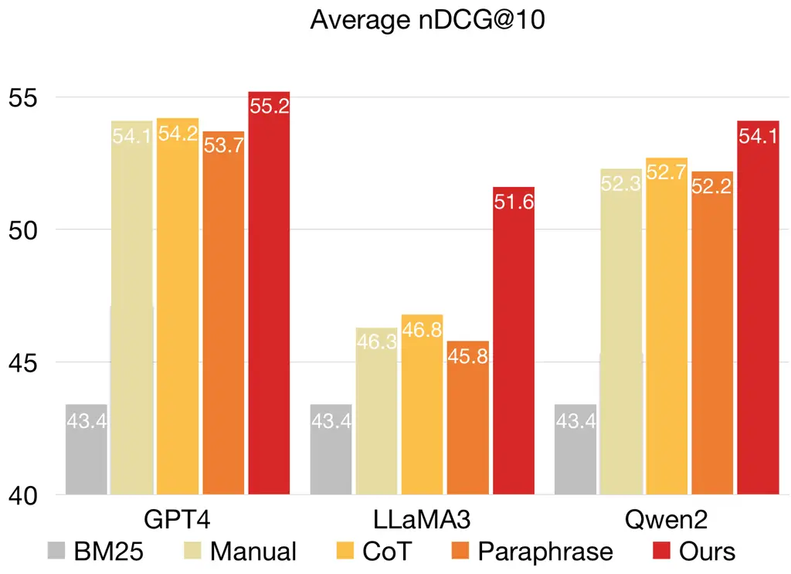
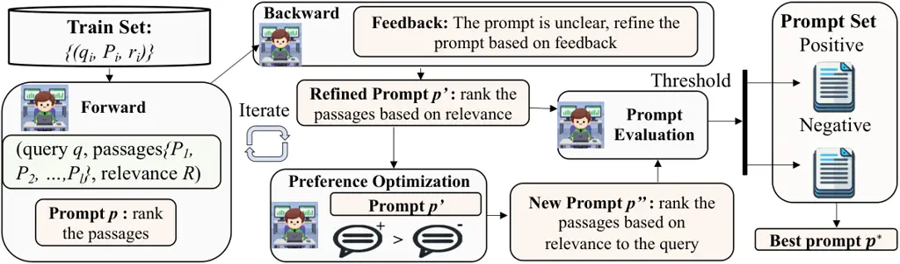

# APEER : Automatic Prompt Engineering Enhances Large Language Model Reranking

Conference: Companion Proceedings of the ACM Web Conference 2025; April
28-May 2, 2025; Sydney, NSW, AustraliaCompanion Proceedings of the ACM
Web Conference 2025 (WWW Companion ’25), April 28-May 2, 2025, Sydney,
NSW,
AustraliaDOI: [10.1145/3701716.3717574](https://doi.org/10.1145/3701716.3717574)ISBN: 979-8-4007-1331-6/2025/04CCS: Information
systems Information retrieval

Can Jin Note: Both authors contributed equally to this research. email:
<can.jin@rutgers.edu> Affiliation: Rutgers University, Piscataway, New
Jersey, USA , Hongwu Peng email: <hongwu.peng@uconn.edu>
Affiliation: University of Connecticut, Storrs, Connecticut, USA , Shiyu
Zhao email: <sz553@rutgers.edu> Affiliation: Rutgers University,
Piscataway, New Jersey, USA , Zhenting Wang email:
<zhenting.wang@rutgers.edu> Affiliation: Rutgers University, Piscataway,
New Jersey, USA , Wujiang Xu email: <wujiang.xu@rutgers.edu>
Affiliation: Rutgers University, Piscataway, New Jersey, USA , Ligong
Han email: <ligong.han@rutgers.edu> Affiliation: Rutgers University,
Piscataway, New Jersey, USA , Jiahui Zhao email: <jiahui.zhao@uconn.edu>
Affiliation: University of Connecticut, Storrs, Connecticut, USA , Kai
Zhong email: <kaizhong@gmail.com> Affiliation: Independent, Palo Alto,
California, USA , Sanguthevar Rajasekaran email:
<sanguthevar.rajasekaran@uconn.edu> Affiliation: University of
Connecticut, Storrs, Connecticut, USA and Dimitris N. Metaxas email:
<dnm@cs.rutgers.edu> Affiliation: Rutgers University, Piscataway, New
Jersey, USA

© cc

###### Abstract.

Large Language Models (LLMs) have significantly enhanced Information
Retrieval (IR) across various modules, such as reranking. Despite
impressive performance, current zero-shot relevance ranking with LLMs
heavily relies on human prompt engineering. Existing automatic prompt
engineering algorithms primarily focus on language modeling and
classification tasks, leaving the domain of IR, particularly reranking,
underexplored. Directly applying current prompt engineering algorithms
to relevance ranking is challenging due to the integration of query and
long passage pairs in the input, where the ranking complexity surpasses
classification tasks. To reduce human effort and unlock the potential of
prompt optimization in reranking, we introduce a novel automatic prompt
engineering algorithm named APEER . APEER iteratively generates refined
prompts through feedback and preference optimization. Extensive
experiments with four LLMs and ten datasets demonstrate the substantial
performance improvement of APEER over existing state-of-the-art (SoTA)
manual prompts. Furthermore, we find that the prompts generated by
APEER exhibit better transferability across diverse tasks and LLMs.

###### Keywords: 

Prompt engineering, Information Retrieval, Large Language Model,
ReRanking

^(†)^(†)cc-license: by

## 1. Introduction

Large Language Models (LLMs) have revolutionized the field of Natural
Language Processing (NLP), achieving success across a variety of tasks
(Achiam et al., 2023; Brown et al., 2020; Touvron et al., 2023; Lyu
et al., 2023). One of the most impactful applications of LLMs is in
Information Retrieval (IR), which focuses on efficiently retrieving
information relevant to user queries (Hou et al., 2024; Fan et al.,
2023; Xi et al., 2023). Due to their advanced linguistic understanding
and world knowledge, LLMs enhance IR systems in multiple modules,
thereby attracting increasing interest (Liang et al., 2022; Qin et al.,
2023; Sun et al., 2023).

Relevance ranking, which aims to rank a set of candidate passages by
their relevance to a given query, is the most critical problem in IR
(Fan et al., 2022). Recently, a series of works have explored manual
prompt approaches for LLM zero-shot reranking (Sun et al., 2023; Pradeep
et al., 2023; Ma et al., 2023). The key challenge in prompting lies in
the design of the prompt, which has emerged as a crucial technique known
as prompt engineering (Brown et al., 2020; Nye et al., 2022; Yao et al.,
2022; Prasad et al., 2023). Despite the impressive results in reranking,
manual prompt engineering typically requires substantial human effort
and expertise, with subjective and limited guidelines.



Figure 1. Performance overview of four prompting methods on GPT4,
LLaMA3 (AI@Meta, 2024) and Qwen2 (qwe, 2024) models and BEIR
datasets (Thakur et al., 2021). The manual prompt is RankGPT (Sun
et al., 2023). Modifying the manual prompt with CoT and paraphrasing
yields marginal gains.

Automatic prompt engineering can generate and select prompts
autonomously, thereby reducing the human effort involved in prompt
design and achieving impressive performance across various tasks such as
language modeling and classification (Pryzant et al., 2023; Zhou et al.,
2022; Guo et al., 2023; Liu et al., 2024c). However, the impact of
automatic prompt engineering in the IR domain, particularly for
zero-shot passage relevance ranking, has been less studied. Relevance
ranking, which integrates a group of long passages into the input,
presents unique challenges compared to language modeling and
classification, and current automatic prompt engineering methods are
sub-optimal in this field due to several reasons: ❶ The input-output
demonstrations for relevance ranking are more complex than those for
language modeling. The input consists of query and passage pairs, and
the output may not be unique, as various relevance ranks can serve as
answers for a group of passages. ❷ The optimization process for
relevance ranking is more challenging. It requires not only
comprehension of the query but also comparison and relevance ranking of
the passages. To this end, we aim to systematically address the
following problem:

How to design an automatic prompt optimization algorithm for passage
relevance ranking?

To answer the research question, we introduce APEER (Automatic Prompt
Engineering Enhances LLM Reranking), which iteratively refines prompts
through feedback generation and preference optimization.
APEER comparison with state-of-the-art (SoTA) manual prompts in
RankGPT Sun et al. (2023), chain-of-thought (CoT) prompting and
paraphrasing is given in Figure 1. Results shows that APEER demonstrates
significant improvement. In summary, our contributions are as follows:

- $`\star`$
  We investigate the effect of directly modifying current SoTA prompts
  using CoT and paraphrasing in relevance ranking and find their
  inefficacy in improving the performance of well-designed prompts.
- $`\star`$
  To reduce human efforts and unlock the potential of prompt
  optimization, we propose a novel automatic prompt engineering
  algorithm, termed APEER , which generates refined prompts through
  feedback optimization and preference optimization to address the
  aforementioned challenges.
- $`\star`$
  We conduct extensive experiments across diverse datasets and
  architectures, including newly released LLaMA3 and Qwen2. Empirical
  results consistently highlight the impressive performance advancements
  of APEER . For example, APEER achieves an average performance
  improvement of 5.29 (NDCG@10) on eight BEIR datasets compared to SoTA
  manual prompts on LLaMA3.
- $`\star`$
  More interestingly, we demonstrate that the prompts generated by
  APEER exhibit enhanced transferability across multiple benckmarks and
  architectures.

## 2. Related Works

### 2.1. Prompt Engineer

Prompting offers a natural and intuitive interface for humans to
interact with and utilize generalist models such as large language
models (LLMs). Due to its flexibility, prompting has been widely adopted
for various NLP tasks (Schick and Schütze, 2021; Brown et al., 2020;
Sanh et al., 2021; Jin et al., 2024a; Wang et al., 2023a; Liu et al.,
2025a; Liu et al., 2025b; Wang et al., 2024b; Wang et al., 2024a; Li
et al., 2024; Shi et al., 2025). The chain-of-thought (CoT) prompting
method was introduced to encourage LLMs to generate intermediate
reasoning steps before arriving at a final answer (Kojima et al., 2022;
Wei et al., 2022; Wang et al., 2022; Jin et al., 2024c). However, LLMs
require careful prompt engineering, whether manually (Reynolds and
McDonell, 2021; Jin et al., 2024b) or automatically (Pryzant et al.,
2023; Zhou et al., 2022; Peng et al., 2023), due to the model’s
sensitivity (Jiang et al., 2020; Zhao et al., 2021; Lu et al., 2022; Lyu
et al., 2022; Xu et al., 2024) and their inability to understand prompts
in the same way humans do (Webson and Pavlick, 2022; Lu et al., 2022;
Liu et al., 2024b). While many successful prompt tuning methods optimize
over a continuous space using gradient-based techniques (Liu et al.,
2023; Qin and Eisner, 2021; Lester et al., 2021; Jin et al., 2025a; Jin
et al., 2025b), this becomes less practical at scale, as computing
gradients becomes increasingly expensive and access to models shifts to
APIs that may not provide gradient access. Another line of work focuses
on discrete prompt search methods, such as prompt generation (Pryzant
et al., 2023; Zhou et al., 2022; Guo et al., 2023; Ye et al., 2023),
prompt scoring (Davison et al., 2019), and prompt paraphrasing (Jiang
et al., 2020; Yuan et al., 2021; Liu and Zhu, 2022), to optimize
instructions by searching directly in the natural language hypothesis
space. Prompt optimization for reranking has been less studied; Cho
et al. (2023) explores discrete prompt optimization for query generation
rather than relevance ranking for groups of passages. In this paper, we
follow the line of work in prompt generation and propose a novel
automatic prompt engineering algorithm for passage relevance ranking.

### 2.2. LLMs for Information Retrieval

IR is crucial for many knowledge-driven NLP applications (Zhu et al.,
2023; Karpukhin et al., 2020; Qu et al., 2021; Wu et al., 2017; Cao
et al., 2024; Zhang et al., 2024; Yu et al., 2024; Yu et al., 2025;
Huang et al., 2025; Liang et al., 2025). LLMs have demonstrated
remarkable efficacy in IR tasks (Zhu et al., 2023; Sun et al., 2023;
Pradeep et al., 2023; Yanhui et al., 2024; Zhao et al., 2023b; Zhao
et al., 2023a; Shi et al., 2024a; Shi et al., 2024b). IR typically
consists of an initial, cost-effective retriever followed by a
sophisticated reranker to refine the results (Ma et al., 2023; Craswell
et al., 2020; Nogueira et al., 2019; Liu et al., 2024a). Traditional
supervised reranking methods (Nogueira et al., 2020; Zhuang et al.,
2023; Pradeep et al., 2023) often rely on fine-tuning transformer-based
models with extensive training data, such as MS MARCO (Bajaj et al.,
2016). Recent research has explored zero-shot relevance ranking with
LLMs. These methods can be broadly categorized into synthetic data
generation and relevance ranking. For synthetic data generation,
Muennighoff (2022) generate text embeddings using GPT for dense
retrieval, while Gao et al. (2023); Wang et al. (2023b) generate
pseudo-documents for retrieval. In relevance ranking, RG (Liang et al., 2022) generates relevance proxy tokens for ranking, while PRP (Qin
et al., 2023) compares the relevancies of two documents for a given
query. RankGPT (Sun et al., 2023) employs a zero-shot permutation
generation method to reorder document relevance collectively and achieve
improvements than RG and PRP using GPT4.



Figure 2. Overview of APEER . APEER iteratively refines prompts through
two optimization steps. In Feedback Optimization, it refines the current
prompt $`p`$ and creates a refined prompt $`p^{\prime}`$ based on
feedback. In Preference Optimization, it further optimizes
$`p^{\prime}`$ by learning preferences from a set of positive and
negative prompt demonstrations.

## 3. Method

In APEER , we attain superior prompts through two main optimization
steps: ❶ Feedback optimization: we infer the current prompt, gather
feedback on how to refine it, and then create a refined prompt based on
the feedback. ❷ Preference optimization: we further optimize the refined
prompt by learning preferences through a set of positive and negative
prompt demonstrations. An overview of the training process of APEER is
presented in Figure 2.

### 3.1. Problem Formulation

IR is often implemented as a two-stage pipeline composed of a
first-stage retriever and a second-stage reranker (Craswell et al.,
2020). For a given query $`q`$ sampled from a query distribution
$`\mathcal{Q}`$, the retriever, such as BM25, efficiently returns a list
of $`l`$ candidate passages $`\mathcal{P}=\{P_{1},P_{2},\ldots,P_{l}\}`$
from the original corpus $`\mathcal{D}`$ that are most relevant to
$`q`$. The reranker then refines the relevance order of $`\mathcal{P}`$
to $`q`$ by further reranking the list of $`l`$ candidates according to
either the same or a different metric used by the retriever. In APEER ,
we focus on improving the second-stage reranking performance with a
fixed retriever, formulating the reranking optimization problem as:

```math
\text{max}\ \mathbb{E}_{(q,\mathcal{P},r)\in(\mathcal{Q},\mathcal{D},\mathcal{R})}\mathcal{M}(f([q,\mathcal{P}];p),r), \tag{1}
```

where $`\mathcal{R}`$ is the standard relevance mapping set,
$`r\in\mathcal{R}`$ indicates the standard relevance order between the
query $`q`$ and passages $`\mathcal{P}`$, $`f`$ is an LLM,
$`\mathcal{M}`$ is a predefined metric, and $`p`$ is the text prompt
that will be concatenated with $`q`$ and $`\mathcal{P}`$ during
inference. In our experiments, we choose normalized Discounted
Cumulative Gain (nDCG) as the default metric for $`\mathcal{M}`$.

### 3.2. Build Training Dataset

Corpus datasets in passage reranking are typically extremely large (see
Table 5 for corpus dataset information), with one corpus potentially
containing hundreds of millions of tokens. Thus, directly utilizing all
queries and corpus in current benchmarks as the training dataset would
be enormously expensive. To build the training dataset
$`\mathcal{D}_{train}`$, we first randomly sample a subset of queries
from the standard training split in current benchmarks, such as the MS
MARCO v1 training split (Bajaj et al., 2016). For each sampled query
$`q`$, using the standard relevance mapping set $`\mathcal{R}`$, we
identify up to 10 positively relevant passages with a relevance score
greater than zero and add them to the candidate passages set
$`\mathcal{P}`$ for query $`q`$. To find negatively relevant passages,
we use BM25 to retrieve the top 100 candidate passages most relevant to
$`q`$. We then select the top passages with a relevance score of zero to
$`q`$ and add them to $`\mathcal{P}`$. The final size of $`\mathcal{P}`$
for each query is 20. We then randomly shuffle the passage order in
$`\mathcal{P}`$ and record the relevance mapping $`r`$ between $`q`$ and
$`\mathcal{P}`$. Finally, $`(q,\mathcal{P},r)`$ is added to the training
dataset
$`\mathcal{D}_{train}=\{(q_{i},\mathcal{P}_{i},r_{i})\}_{i=1}^{n}`$.
Following the same procedure, we can build the validation dataset
$`\mathcal{D}_{val}=\{(q_{i},\mathcal{P}_{i},r_{i})\}_{i=1}^{m}`$.

### 3.3. Prompt Initialization

Due to the infinitely large search space, finding the optimal prompts
from scratch can be extremely difficult. In APEER , we construct two
initialized prompt sets to guide our optimization procedure: a positive
prompts set $`\mathcal{H}_{pos}`$ and a negative prompts set
$`\mathcal{H}_{neg}`$. The positive prompts serve as preferred examples,
while negative prompts serve as dispreferred examples in prompt
training.

Positive Prompt Initialization. A good choice is utilizing the current
SoTA manual prompt as the initial positive prompt $`p_{pos}`$. Various
manual prompts have been proposed in zero-shot passage reranking, such
as pointwise (Sachan et al., 2022; Liang et al., 2022), pairwise (Qin
et al., 2023), and listwise (Sun et al., 2023; Ma et al., 2023). In our
experiments, we choose the manual prompt from RankGPT (Sun et al., 2023)
as it has been proven to achieve superior performance compared to others
(Sun et al., 2023). Other methods for initialization include leveraging
the LLM $`f`$ to generate prompts and paraphrasing the manual prompt.

Negative Prompt Initialization. We leverage a pretrained LLM to generate
some prompt examples and choose the prompt that performs poorly on the
validation dataset $`\mathcal{D}_{val}`$ as the initial negative prompt
$`p_{neg}`$.

Both the positive prompt $`p_{pos}`$ and the negative prompt $`p_{neg}`$
are then evaluated on all queries in $`\mathcal{D}_{val}`$ to determine
their performance. The positive prompt is then initialized as the
current prompt $`p=p_{init}=p_{pos}`$. After initialization, we obtain
the following:

```math
\displaystyle\mathcal{H}_{pos}=\{p_{pos}\}, \tag{2}
```

```math
\displaystyle\mathcal{H}_{neg}=\{p_{neg}\},
```

### 3.4. Feedback Optimization

To update the current prompt $`p`$ and obtain refined prompts, we first
infer it on a batch of data
$`\mathcal{B}=\{(q_{i},\mathcal{P}_{i},r_{i})\}_{i=1}^{k}`$ using the
LLM $`f`$ and obtain the responses $`S=\{s_{i}\}_{i=1}^{k}`$, which
constitutes the ‘forward’ pass:

```math
s_{i}=f([q_{i},\mathcal{P}_{i}];p) \tag{3}
```

To attain the ‘gradient’ ( i.e., feedback) on $`\mathcal{B}`$, we
utilize the LLM $`f`$ to generate high-quality feedback on the current
prompt based on the queries, passages, responses, and the relevance
mapping:

```math
b_{i}=f([p,q_{i},\mathcal{P}_{i},s_{i},r_{i}];c_{fb}), \tag{4}
```

where $`b_{i}`$ is the feedback and $`c_{fb}`$ is the meta prompt for
feedback generation.

To apply the obtained gradients to the current prompt, we ‘backward’
$`p`$ by prompting the LLM to generate a refined prompt based on the
feedback:

```math
p^{\prime}=f([p,\{b_{i}\}_{i=1}^{k}];c_{g}), \tag{5}
```

where $`p^{\prime}`$ is the refined prompt and $`c_{g}`$ is the meta
prompt for prompt refinement.

The refined prompt $`p^{\prime}`$ is then evaluated on the validation
dataset $`\mathcal{D}_{val}`$. If it achieves higher performance than
$`p_{init}`$, it will be added to $`\mathcal{H}_{pos}`$; otherwise, it
will be added to $`\mathcal{H}_{neg}`$.

### 3.5. Preference Optimization

Direct Preference Optimization (Rafailov et al., 2024) and Reinforcement
Learning with Human Feedback (RLHF) (Ouyang et al., 2022) are prevalent
techniques for steering the model’s output towards the high-quality
(potentially infrequent) responses within its training dataset. Within
the framework of APEER , we have cataloged a collection of potential
positive and negative responses within $`\mathcal{H}_{pos}`$ and
$`\mathcal{H}_{neg}`$, respectively. Our objective is to refine the
prompt $`p^{\prime}`$ such that it is biased towards the optimal prompt
contained in $`\mathcal{H}_{pos}`$. To achieve this, we employ a
methodology where each refined prompt $`p^{\prime}`$ is aligned with a
high-quality prompt in $`\mathcal{H}_{pos}`$, utilizing pairs of
positive and negative prompts $`(p_{pos},p_{neg})`$ for demonstration
purposes. We meticulously choose the top $`t`$ positive prompts from
$`\mathcal{H}_{pos}`$ and the bottom $`t`$ prompts from
$`\mathcal{H}_{neg}`$ to serve as our demonstration pairs. This
procedure generates a new prompt $`p^{\prime\prime}`$ that exhibits a
preference for positive prompts while avoiding negative ones:

```math
p^{\prime\prime}=f([p^{\prime},\{(p_{pos},p_{neg})\}];c_{pre}), \tag{6}
```

where $`c_{pre}`$ denotes the meta prompt for optimizing prompt
preferences.

Subsequently, the performance of the newly generated prompt
$`p^{\prime\prime}`$ relative to the baseline initialization prompt
$`p_{init}`$ on the validation dataset $`\mathcal{D}_{val}`$ determines
its categorization into either the positive prompt set
$`\mathcal{H}_{pos}`$ or the negative prompt set $`\mathcal{H}_{neg}`$.
Ultimately, the generation of prompts through both feedback optimization
and preference optimization will maintain a balanced ratio of 1:1.

The algorithmic foundation of APEER is thoroughly outlined in Algorithm

1. Conceptually, the Feedback Optimization acts as a local optimizer for
   the current batch $`\mathcal{B}`$, whereas the Preference Optimization
   mechanism extends this local optimization by globally aligning the local
   optimized prompts towards superior global prompts, as identified in
   $`\mathcal{H}_{pos}`$, via preference learning from both positive and
   negative prompts across the dataset. The efficacy of Preference
   Optimization in enhancing the quality of prompts is evidenced by our
   ablation study, presented in Table 4.

 Input: LLM $`f`$, Training Dataset
$`\mathcal{D}_{train}=\{(q_{i},\mathcal{P}_{i},r_{i})\}_{i=1}^{n}`$,
Validation Dataset
$`\mathcal{D}_{val}=\{(q_{i},\mathcal{P}_{i},r_{i})\}_{i=1}^{m}`$,
$`p=p_{init}=p_{pos}`$, Positive Prompts History
$`\mathcal{H}_{pos}=\{p_{pos}\}`$, Negative Prompts History
$`\mathcal{H}_{neg}=\{p_{neg}\}`$, Meta Prompts $`c_{fb}`$, $`{c_{g}}`$,
$`c_{pre}`$.

 for $`e=1`$ to Epochs do

  Sample a batch of data $`\mathcal{B}\subset\mathcal{D}_{train}`$

  Initialization: $`p`$ is best prompt in $`\mathcal{H}_{pos}`$

  Feedback Optimization:  Forward: Response
$`s_{i}=f([q_{i},\mathcal{P}_{i}];p)`$  Backward:  Feedback
$`b_{i}=f([p,q_{i},\mathcal{P}_{i},s_{i},r_{i}];c_{fb})`$  $`p^{\prime}=f([p,\{b_{i}\}_{i=1}^{k}];c_{g})`$

  Evaluate and add $`p^{\prime}`$ to $`\mathcal{H}_{pos}`$ or
$`\mathcal{H}_{neg}`$

  Preference
Optimization: $`p^{\prime\prime}=f([p^{\prime},\{(p_{pos},p_{neg})\}];c_{pre})`$

  Evaluate and add $`p^{\prime\prime}`$ to $`\mathcal{H}_{pos}`$ or
$`\mathcal{H}_{neg}`$

 end for

 return The best prompt $`p^{*}\in\mathcal{H}_{pos}`$

Algorithm 1 APEER 

## 4. Experiments

To evaluate the effectiveness of APEER , we adhere to the standard
reranking evaluation methodology. Specifically, we assess the reranking
performance of the top 100 passages retrieved by a first-stage
retriever, such as BM25, using Pyserini¹¹ 1
[https://github.com/castorini/pyserini](https://github.com/castorini/pyserini).
Additionally, we conduct extensive experiments to: (1) demonstrate the
superior performance of APEER on in-domain tasks; (2) illustrate the
transferability of APEER prompts to out-of-domain tasks; and (3) exhibit
the transferability of APEER prompts across various architectures.
Furthermore, we perform in-depth ablation studies to evaluate the impact
of our novel preference optimization, as well as the effects of
different training dataset sizes in APEER .

### 4.1. Implementation Details

#### Models.

Our experiments utilize two closed-source models, GPT3.5-Turbo-0301 and
GPT4-0613 (Achiam et al., 2023), as well as two open-source models,
LLaMA3-70B (AI@Meta, 2024) and Qwen2-72B (qwe, 2024).

|        |            |           |       |       |           |       |       |
| ------ | ---------- | --------- | ----- | ----- | --------- | ----- | ----- |
| Model  | Dataset    | TREC-DL19 |       |       | TREC-DL20 |       |       |
|        | nDCG       | @1        | @5    | @10   | @1        | @5    | @10   |
|        | BM25       | 54.26     | 52.78 | 50.58 | 57.72     | 50.67 | 47.96 |
| GPT4   | Manual     | 80.62     | 77.83 | 74.89 | 79.73     | 73.15 | 70.14 |
|        | CoT        | 81.01     | 78.04 | 75.20 | 80.25     | 74.13 | 70.42 |
|        | Paraphrase | 81.01     | 78.47 | 74.76 | 80.13     | 74.23 | 70.01 |
|        | APEER      | 84.11     | 79.73 | 76.22 | 82.72     | 75.88 | 70.78 |
| LLaMA3 | Manual     | 76.35     | 74.86 | 71.89 | 79.11     | 70.53 | 67.37 |
|        | CoT        | 77.52     | 74.96 | 71.83 | 79.94     | 71.83 | 68.32 |
|        | Paraphrase | 74.81     | 74.60 | 71.79 | 78.09     | 69.73 | 66.84 |
|        | APEER      | 81.40     | 76.57 | 73.01 | 81.79     | 72.25 | 68.99 |
| Qwen2  | Manual     | 80.44     | 76.63 | 72.78 | 79.53     | 72.68 | 68.80 |
|        | CoT        | 81.01     | 78.29 | 73.92 | 79.94     | 73.03 | 69.18 |
|        | Paraphrase | 80.62     | 76.86 | 73.08 | 79.63     | 72.80 | 68.95 |
|        | APEER      | 83.33     | 79.21 | 75.11 | 81.17     | 73.43 | 69.78 |

Table 1. Performance overview (nDCG@{1,5,10}) of APEER and baseline
methods trained on GPT-4, LLaMA-3, and Qwen-2 with MS MARCO samples,
evaluated on TREC-DL19 and TREC-DL20. APEER consistently outperforms the
baselines. Manual refers to the RankGPT (Sun et al., 2023) baseline. The
best performance for each model is marked in bold, while the overall
best performance is highlighted in green.

| Model  | Dataset    | Covid | NFCorpus | Signal | News  | Robust04 | Touche | DBPedia | SciFact | BEIR (Average) |
| ------ | ---------- | ----- | -------- | ------ | ----- | -------- | ------ | ------- | ------- | -------------- |
|        | BM25       | 59.47 | 33.75    | 33.05  | 39.52 | 40.70    | 44.22  | 31.80   | 67.89   | 43.80          |
| GPT4   | Manual     | 83.98 | 38.83    | 33.90  | 52.82 | 59.74    | 40.72  | 47.12   | 75.61   | 54.09          |
|        | CoT        | 85.51 | 38.33    | 33.45  | 51.90 | 59.92    | 40.45  | 47.53   | 76.08   | 54.15          |
|        | Paraphrase | 84.15 | 38.76    | 33.60  | 50.46 | 59.35    | 40.72  | 47.19   | 75.26   | 53.69          |
|        | APEER      | 86.09 | 40.19    | 34.08  | 54.77 | 60.15    | 40.91  | 48.06   | 77.02   | 55.16          |
| LLaMA3 | Manual     | 76.15 | 34.95    | 33.29  | 42.11 | 47.38    | 30.54  | 45.40   | 60.72   | 46.32          |
|        | CoT        | 77.46 | 35.49    | 33.37  | 42.37 | 47.96    | 30.83  | 45.59   | 60.91   | 46.75          |
|        | Paraphrase | 74.54 | 34.59    | 33.12  | 41.63 | 47.04    | 29.23  | 45.26   | 60.56   | 45.75          |
|        | APEER      | 83.86 | 38.93    | 33.41  | 52.11 | 56.03    | 35.25  | 46.13   | 67.16   | 51.61          |
| Qwen2  | Manual     | 80.07 | 38.07    | 32.87  | 47.35 | 59.24    | 41.02  | 45.53   | 74.08   | 52.28          |
|        | CoT        | 81.45 | 38.19    | 32.96  | 47.61 | 59.42    | 41.22  | 45.80   | 74.55   | 52.65          |
|        | Paraphrase | 79.72 | 38.03    | 32.86  | 47.13 | 59.13    | 40.92  | 45.50   | 73.89   | 52.15          |
|        | APEER      | 85.07 | 39.30    | 33.06  | 50.83 | 59.61    | 41.61  | 46.88   | 76.56   | 54.12          |

Table 2. Performance overview (nDCG@10) of APEER trained on GPT4,
LLaMA3, and Qwen2 using MS MARCO samples, and evaluated on eight BEIR
datasets. APEER prompts consistently demonstrate superior performance
compared to baselines when transferred to BEIR datasets. Manual refers
to the RankGPT (Sun et al., 2023) baseline.

#### Benchmarks.

We evaluate the effectiveness of APEER on three benchmarks:
TREC (Craswell et al., 2020) and BEIR (Thakur et al., 2021), which
collectively include ten datasets. TREC is a widely adopted benchmark in
IR research. We use the test sets from the TREC-DL19 and TREC-DL20
competitions, both of which employed the MS MARCO v1 passage corpus.
BEIR encompasses diverse retrieval tasks and domains. We select the test
sets of eight tasks from BEIR to evaluate our approach: (i) Covid, which
retrieves scientific articles for COVID-19-related questions; (ii)
NFCorpus, a biomedical information retrieval dataset; (iii) Signal,
which retrieves relevant tweets for a given news title; (iv) News, which
retrieves relevant news articles for news headlines; (v) Robust04, which
evaluates poorly performing topics; (vi) Touche, an argument retrieval
dataset; (vii) DBPedia, which retrieves entities from the DBpedia
corpus; and (viii) SciFact, which retrieves evidence for scientific
claim verification.

#### Baselines.

We compare APEER to four baselines: (1) BM25 (Lin et al., 2021), which
serves as a fundamental sanity check by directly using the ranking
results from the first-stage retrieval; (2) Manual Prompt, where we
select the current state-of-the-art (SoTA) manual prompt, RankGPT (Sun
et al., 2023); (3) CoT, which uses the manual prompt concatenated with
"Let’s think step by step" as the CoT prompt; and (4) Paraphrase, where
we utilize the LLM to paraphrase the manual prompt to obtain a
paraphrased version. We choose listwise reranking as our default
reranking method, as it achieves superior performance compared to
pointwise and pairwise reranking (Sun et al., 2023; Qin et al., 2023).
The implementation details of baselines is shown in Appendix A.

#### Training and Evaluation.

We construct the training and validation datasets as described in
Section 3.2, using queries sampled from the standard MS MARCO v1
training split (Bajaj et al., 2016). The same dataset is utilized for
both training and validation, with the default number of queries set at 100. The initialization of the positive prompt is based on the SoTA
manual prompt from RankGPT Sun et al. (2023). The negative prompt
initialization is generated by the training models. Optimal
hyperparameters are determined through grid search. We evaluate
zero-shot performance using normalized Discounted Cumulative Gain (nDCG)
at rank cutoffs of {1,5,10} (nDCG@{1,5,10}) and the results are averaged
over three runs. It is important to note that we use the Azure API for
the GPT4-0613 model, which differs from the GPT4-0314 model used in
RankGPT (Sun et al., 2023). Additionally, RankGPT utilizes GPT4 to
rerank the top 30 passages initially reranked by GPT3.5 on BEIR. These
differences result in discrepancies between the RankGPT results in our
study and those reported in (Sun et al., 2023). Further implementation
details are available in Appendix A.

| Dataset                      | DL19  | DL20  | Covid | NFCorpus | Signal | News  | Robust04 | Touche | DBPedia | SciFact | BEIR (Average) |
| ---------------------------- | ----- | ----- | ----- | -------- | ------ | ----- | -------- | ------ | ------- | ------- | -------------- |
| BM25                         | 50.58 | 47.96 | 59.47 | 33.75    | 33.05  | 39.52 | 40.70    | 44.22  | 31.80   | 67.89   | 43.80          |
| GPT4 $`\rightarrow`$ GPT3.5  |       |       |       |          |        |       |          |        |         |         |                |
| Manual                       | 65.80 | 62.91 | 76.67 | 35.62    | 32.12  | 48.85 | 50.62    | 36.18  | 44.47   | 70.43   | 49.37          |
| CoT                          | 65.15 | 62.24 | 76.02 | 35.81    | 32.78  | 49.98 | 50.64    | 37.27  | 43.82   | 70.90   | 49.65          |
| Paraphrase                   | 64.86 | 61.74 | 74.28 | 35.16    | 31.08  | 48.60 | 50.34    | 37.11  | 43.42   | 70.11   | 48.76          |
| APEER                        | 67.47 | 63.29 | 81.57 | 37.56    | 32.98  | 50.44 | 52.77    | 39.48  | 44.67   | 72.87   | 51.54          |
| Qwen2 $`\rightarrow`$ LLaMA3 |       |       |       |          |        |       |          |        |         |         |                |
| Manual                       | 71.99 | 67.37 | 76.15 | 34.95    | 33.29  | 42.11 | 47.38    | 30.54  | 45.40   | 60.72   | 46.32          |
| CoT                          | 71.83 | 68.32 | 77.46 | 35.49    | 33.37  | 42.37 | 47.96    | 30.83  | 45.59   | 60.91   | 46.75          |
| Paraphrase                   | 71.87 | 67.43 | 75.11 | 35.08    | 33.01  | 41.89 | 47.36    | 29.79  | 45.59   | 60.75   | 46.07          |
| APEER                        | 72.65 | 68.79 | 80.28 | 38.85    | 33.62  | 46.66 | 55.71    | 36.02  | 46.08   | 68.06   | 50.66          |

Table 3. Performance overview (nDCG@10) of applying GPT4 and Qwen2
generated prompts on GPT3.5 and LLaMA3 models, and evaluated on two
TREC-DL datasets and eight BEIR datasets. APEER prompts consistently
demonstrate superior transferability across models, outperforming
baseline methods. Manual refers to the RankGPT (Sun et al., 2023)
baseline.

### 4.2. Superior Performance

#### In-domain Results.

To assess the effectiveness of APEER prompts on in-domain tasks, we
apply APEER to GPT4, LLaMA3, and Qwen2 training on MS MARCO samples. The
evaluation is conducted on TREC-DL19 and TREC-DL20, which also use the
MS MARCO corpus. Several positive observations can be drawn from the
results shown in Table 1: ❶ APEER is capable of generating superior
prompts compared to baselines across diverse architectures, effectively
enhancing the initialized manual prompts. For example, it achieves
{5.05, 1.71, 1.12} higher nDCG@{1, 5, 10} on LLaMA3 and DL19 than manual
prompts. While CoT can enhance the performance of manual prompts,
APEER consistently outperforms CoT across all models and datasets.
Moreover, direct paraphrasing of the manual prompts leads to inferior
performance, underscoring the importance of prompt training. ❷ With
APEER , a weaker model can sometimes achieve better performance than a
stronger model. For instance, Qwen2 with APEER achieves {2.71, 1.38,
0.22} higher nDCG@{1, 5, 10} than GPT4 with manual prompts, further
demonstrating the effectiveness of APEER . ❸ GPT4 with APEER achieves
the best performance across all prompting methods, models, and datasets.

#### Transferability Across Datasets.

Superior prompts should be generalizable across different datasets. To
investigate the transferability of APEER on out-of-domain tasks, we
conduct experiments using APEER trained on MS MARCO samples and evaluate
them on eight BEIR datasets, which feature more diverse types of queries
and corpora compared to TREC-DL and MS MARCO. The results, presented in
Table 2, reveal the following: ❶ APEER consistently achieves the best
performance across eight BEIR datasets and three model architectures.
Notably, APEER shows average nDCG@10 improvements of {1.07, 5.29, 1.84}
over manual prompts for GPT4, LLaMA3, and Qwen2, respectively. This
demonstrates the effectiveness of APEER prompts on out-of-domain
datasets. ❷ Simple application of CoT and paraphrased prompts does not
significantly improve over manual prompts, highlighting the superiority
of APEER prompt training. ❸ With APEER prompts, Qwen2 even achieves
higher performance than GPT4, further underscoring the significance of
our method. The transferability of APEER across diverse datasets
enhances its practicality in real-world applications.

#### Transferability Across Models.

We further investigate whether prompts trained on one model architecture
using APEER can be transferred to models with different architectures.
We apply the prompts obtained by APEER and baseline methods on GPT4 and
Qwen2 to GPT3.5 and LLaMA3 models, respectively. The results on two
TREC-DL datasets and four BEIR datasets are shown in Table 3. Several
positive observations can be drawn: ❶ Prompts trained on a strong model
can be transferred to a significantly weaker model. For example, when
applying APEER prompts from GPT4 to GPT3.5, they consistently achieve
better performance than all baselines on all TREC-DL and BEIR datasets.
❷ APEER prompts can transfer across models with comparable performance.
For instance, prompts trained on Qwen2 achieve significant performance
improvements over manual prompts when applied to LLaMA3. The
transferability of APEER across different architectures further enhances
its practical utility in real-world applications.

### 4.3. In-depth Dissection of APEER 

#### Preference Optimization.

In APEER , we propose a novel Preference Optimization method based on
preference learning from (positive prompt, negative prompt)
demonstrations. To investigate the impact of Preference Optimization in
APEER , we conduct experiments using LLaMA3 trained on MS MARCO samples,
with and without Preference Optimization, while keeping all other
configurations the same. We evaluate performance on two TREC datasets.
The results, shown in Table 4, reveal that: ❶ Preference Optimization is
effective in APEER , as APEER with Preference Optimization achieves
higher performance than APEER without it. ❷ APEER without Preference
Optimization still produces better prompts than baselines, further
indicating the overall effectiveness of APEER .

|               |           |       |       |           |       |       |
| ------------- | --------- | ----- | ----- | --------- | ----- | ----- |
| Dataset       | TREC-DL19 |       |       | TREC-DL20 |       |       |
| nDCG          | @1        | @5    | @10   | @1        | @5    | @10   |
| BM25          | 54.26     | 52.78 | 50.58 | 57.72     | 50.67 | 47.96 |
| Manual        | 76.35     | 74.86 | 71.99 | 79.11     | 70.53 | 67.37 |
| CoT           | 77.52     | 74.96 | 71.83 | 79.94     | 71.83 | 68.32 |
| Paraphrase    | 74.81     | 74.60 | 71.79 | 78.09     | 69.73 | 66.84 |
| APEER w.o. PO | 78.68     | 75.33 | 72.41 | 81.17     | 71.97 | 68.39 |
| APEER w. PO   | 81.40     | 76.57 | 73.01 | 81.79     | 72.25 | 68.99 |

Table 4. Ablation results of Preference Optimization in APEER . We train
APEER with and without Preference Optimization (denoted as APEER w. PO
and APEER w.o. PO, respectively) on MS MARCO samples using LLaMA3, and
evaluate on TREC-DL19 and TREC-DL20.

#### Impact of Training Dataset Size.

We conduct experiments to investigate the influence of training dataset
size on the performance of APEER . Following the procedure outlined in
Section 3.2, we construct training datasets with varying numbers of
queries. We then train the LLaMA3 model on these datasets using APEER ,
with the validation datasets being identical copies of the training
datasets. The results on the TREC datasets, shown in Figure 3, indicate
that as the training dataset size increases, APEER achieves better
performance. In our default setting, we utilize a training dataset size
of 100 to attain superior prompts while maintaining moderate training
costs. Further increasing the dataset size may improve performance, but
it will also escalate training costs.

Figure 3. Ablation results of training dataset size. We train LLaMA3
model on various training dataset sizes and evaluate on TREC-DL19 and
TREC-DL20.

#### Qualitative Analysis.

We provide qualitative examples of the training responses of APEER on
LLaMA3. The illustration is shown in Figure 4. During Feedback
Optimization, the LLM provides feedback on the quality of the original
prompt, such as noting "lack of specificity" and "ambiguity in format",
and refines the prompt based on this feedback. In Preference
Optimization, the LLM further refines the prompt based on preference
alignment with the positive prompt while disfavoring the negative one. A
new prompt that mutates the current prompt toward the positive prompt is
then generated.

Figure 4. Illustration of APEER training responses. In Feedback
Optimization, the LLM provides feedback on the original prompt and
refine it based on the feedback. In Preference Optimization, the LLM
mutate the refined prompt towards the positive prompt.

## 5. Conclusion

In this paper, we present a novel automatic prompt engineering algorithm
named APEER for passage relevance ranking. APEER aims to reduce human
effort in designing prompt for zero-shot LLM reranking and unlock the
potential of prompt optimization. It iteratively generates refined
prompts based on feedback optimization of current prompts and preference
optimization using positive and negative prompt demonstrations. A
comprehensive investigation using GPT4, GPT3.5, LLaMA3, and Qwen2, along
with the widely acknowledged TREC and BEIR benchmarks, consistently
demonstrates the performance improvements achieved by APEER . We further
illustrate the transferability of prompts generated by APEER across
diverse datasets and architectures. All investigations together indicate
the effectiveness of the novel prompt preference optimization introduced
in APEER .

## 6. Acknowledgments

This research is partially funded by research grants to Metaxas from
NSF: 2310966, AFOSR 23RT0630, and NIH 2R01HL127661.

## References

- qwe (2024) 2024. Qwen2 Technical Report. (2024).
- Achiam et al. (2023) Josh Achiam, Steven Adler, Sandhini Agarwal, Lama
  Ahmad, Ilge Akkaya, Florencia Leoni Aleman, Diogo Almeida, Janko
  Altenschmidt, Sam Altman, Shyamal Anadkat, et al. 2023. Gpt-4
  technical report. _arXiv preprint arXiv:2303.08774_ (2023).
- AI@Meta (2024) AI@Meta. 2024. Llama 3 Model Card. (2024).
  [https://github.com/meta-llama/llama3/blob/main/MODEL_CARD.md](https://github.com/meta-llama/llama3/blob/main/MODEL_CARD.md)
- Bajaj et al. (2016) Payal Bajaj, Daniel Campos, Nick Craswell, Li
  Deng, Jianfeng Gao, Xiaodong Liu, Rangan Majumder, Andrew McNamara,
  Bhaskar Mitra, Tri Nguyen, et al. 2016. Ms marco: A human generated
  machine reading comprehension dataset. _arXiv preprint
  arXiv:1611.09268_ (2016).
- Brown et al. (2020) Tom Brown, Benjamin Mann, Nick Ryder, Melanie
  Subbiah, Jared D Kaplan, Prafulla Dhariwal, Arvind Neelakantan, Pranav
  Shyam, Girish Sastry, Amanda Askell, et al. 2020. Language models are
  few-shot learners. _Advances in neural information processing systems_
  33 (2020), 1877–1901.
- Cao et al. (2024) Jin Cao, Yanhui, Jiang, Chang Yu, Feiwei Qin, and
  Zekun Jiang. 2024. Rough Set improved Therapy-Based Metaverse
  Assisting System. arXiv:2406.04465 \[cs.HC\]
- Cho et al. (2023) Sukmin Cho, Soyeong Jeong, Jeong yeon Seo, and
  Jong C Park. 2023. Discrete Prompt Optimization via Constrained
  Generation for Zero-shot Re-ranker. In _Findings of the Association
  for Computational Linguistics: ACL 2023_. 960–971.
- Craswell et al. (2020) Nick Craswell, Bhaskar Mitra, Emine Yilmaz,
  Daniel Campos, and Ellen M Voorhees. 2020. Overview of the TREC 2019
  deep learning track. _arXiv preprint arXiv:2003.07820_ (2020).
- Davison et al. (2019) Joe Davison, Joshua Feldman, and Alexander M
  Rush. 2019. Commonsense knowledge mining from pretrained models. In
  _Proceedings of the 2019 conference on empirical methods in natural
  language processing and the 9th international joint conference on
  natural language processing (EMNLP-IJCNLP)_. 1173–1178.
- Fan et al. (2023) Wenqi Fan, Zihuai Zhao, Jiatong Li, Yunqing Liu,
  Xiaowei Mei, Yiqi Wang, Jiliang Tang, and Qing Li. 2023. Recommender
  systems in the era of large language models (llms). _arXiv preprint
  arXiv:2307.02046_ (2023).
- Fan et al. (2022) Yixing Fan, Xiaohui Xie, Yinqiong Cai, Jia Chen,
  Xinyu Ma, Xiangsheng Li, Ruqing Zhang, and Jiafeng Guo. 2022.
  Pre-training Methods in Information Retrieval. _Foundations and
  Trends® in Information Retrieval_ 16, 3 (2022), 178–317.
- Gao et al. (2023) Luyu Gao, Xueguang Ma, Jimmy Lin, and Jamie
  Callan. 2023. Precise Zero-Shot Dense Retrieval without Relevance
  Labels. In _Proceedings of the 61st Annual Meeting of the Association
  for Computational Linguistics (Volume 1: Long Papers)_. 1762–1777.
- Guo et al. (2023) Qingyan Guo, Rui Wang, Junliang Guo, Bei Li, Kaitao
  Song, Xu Tan, Guoqing Liu, Jiang Bian, and Yujiu Yang. 2023.
  Connecting Large Language Models with Evolutionary Algorithms Yields
  Powerful Prompt Optimizers. In _The Twelfth International Conference
  on Learning Representations_.
- Hou et al. (2024) Yupeng Hou, Junjie Zhang, Zihan Lin, Hongyu Lu,
  Ruobing Xie, Julian McAuley, and Wayne Xin Zhao. 2024. Large language
  models are zero-shot rankers for recommender systems. In _European
  Conference on Information Retrieval_. Springer, 364–381.
- Huang et al. (2025) Wenke Huang, Jian Liang, Zekun Shi, Didi Zhu,
  Guancheng Wan, He Li, Bo Du, Dacheng Tao, and Mang Ye. 2025. Learn
  from Downstream and Be Yourself in Multimodal Large Language Model
  Fine-Tuning. In _ICML_.
- Jiang et al. (2020) Zhengbao Jiang, Frank F Xu, Jun Araki, and Graham
  Neubig. 2020. How Can We Know What Language Models Know? _Transactions
  of the Association for Computational Linguistics_ 8 (2020), 423–438.
- Jin et al. (2024a) Can Jin, Tong Che, Hongwu Peng, Yiyuan Li, Dimitris
  Metaxas, and Marco Pavone. 2024a. Learning from teaching
  regularization: Generalizable correlations should be easy to imitate.
  _Advances in Neural Information Processing Systems_ 37 (2024),
  966–994.
- Jin et al. (2025a) Can Jin, Tianjin Huang, Yihua Zhang, Mykola
  Pechenizkiy, Sijia Liu, Shiwei Liu, and Tianlong Chen. 2025a. Visual
  prompting upgrades neural network sparsification: A data-model
  perspective. In _Proceedings of the AAAI Conference on Artificial
  Intelligence_, Vol. 39. 4111–4119.
- Jin et al. (2025b) Can Jin, Ying Li, Mingyu Zhao, Shiyu Zhao, Zhenting
  Wang, Xiaoxiao He, Ligong Han, Tong Che, and Dimitris N. Metaxas.
  2025b. LoR-VP: Low-Rank Visual Prompting for Efficient Vision Model
  Adaptation. In _The Thirteenth International Conference on Learning
  Representations_.
  [https://openreview.net/forum?id=5btFIv2PNb](https://openreview.net/forum?id=5btFIv2PNb)
- Jin et al. (2024b) Mingyu Jin, Qinkai Yu, Jingyuan Huang, Qingcheng
  Zeng, Zhenting Wang, Wenyue Hua, Haiyan Zhao, Kai Mei, Yanda Meng,
  Kaize Ding, et al. 2024b. Exploring Concept Depth: How Large Language
  Models Acquire Knowledge at Different Layers? _arXiv preprint
  arXiv:2404.07066_ (2024).
- Jin et al. (2024c) Mingyu Jin, Qinkai Yu, Haiyan Zhao, Wenyue Hua,
  Yanda Meng, Yongfeng Zhang, Mengnan Du, et al. 2024c. The impact of
  reasoning step length on large language models. _arXiv preprint
  arXiv:2401.04925_ (2024).
- Karpukhin et al. (2020) Vladimir Karpukhin, Barlas Oguz, Sewon Min,
  Patrick Lewis, Ledell Wu, Sergey Edunov, Danqi Chen, and Wen-tau
  Yih. 2020. Dense Passage Retrieval for Open-Domain Question Answering.
  In _Proceedings of the 2020 Conference on Empirical Methods in Natural
  Language Processing (EMNLP)_. 6769–6781.
- Kojima et al. (2022) Takeshi Kojima, Shixiang Shane Gu, Machel Reid,
  Yutaka Matsuo, and Yusuke Iwasawa. 2022. Large language models are
  zero-shot reasoners. _Advances in neural information processing
  systems_ 35 (2022), 22199–22213.
- Lester et al. (2021) Brian Lester, Rami Al-Rfou, and Noah
  Constant. 2021. The Power of Scale for Parameter-Efficient Prompt
  Tuning. In _Proceedings of the 2021 Conference on Empirical Methods in
  Natural Language Processing_. 3045–3059.
- Li et al. (2024) Lei Li, Sen Jia, Wang Jianhao, Zhongyu Jiang, Feng
  Zhou, Ju Dai, Tianfang Zhang, Wu Zongkai, and Jenq-Neng Hwang. 2024.
  Human Motion Instruction Tuning. _arXiv preprint arXiv:2411.16805_
  (2024).
- Liang et al. (2025) Jian Liang, Wenke Huang, Guancheng Wan, Qu Yang,
  and Mang Ye. 2025. Lorasculpt: Sculpting lora for harmonizing general
  and specialized knowledge in multimodal large language models. In
  _CVPR_.
- Liang et al. (2022) Percy Liang, Rishi Bommasani, Tony Lee, Dimitris
  Tsipras, Dilara Soylu, Michihiro Yasunaga, Yian Zhang, Deepak
  Narayanan, Yuhuai Wu, Ananya Kumar, et al. 2022. Holistic evaluation
  of language models. _arXiv preprint arXiv:2211.09110_ (2022).
- Lin et al. (2021) Jimmy Lin, Xueguang Ma, Sheng-Chieh Lin, Jheng-Hong
  Yang, Ronak Pradeep, and Rodrigo Nogueira. 2021. Pyserini: A Python
  toolkit for reproducible information retrieval research with sparse
  and dense representations. In _Proceedings of the 44th International
  ACM SIGIR Conference on Research and Development in Information
  Retrieval_. 2356–2362.
- Liu et al. (2024c) Rui Liu, Xuanzhen Xu, Yuwei Shen, Armando Zhu,
  Chang Yu, Tianjian Chen, and Ye Zhang. 2024c. Enhanced Detection
  Classification via Clustering SVM for Various Robot Collaboration
  Task. _arXiv e-prints_ (2024), arXiv–2405.
- Liu and Zhu (2022) Shicheng Liu and Minghui Zhu. 2022. Distributed
  inverse constrained reinforcement learning for multi-agent systems.
  _Advances in Neural Information Processing Systems_ 35 (2022),
  33444–33456.
- Liu et al. (2024a) Tianrui Liu, Changxin Xu, Yuxin Qiao, Chufeng
  Jiang, and Weisheng Chen. 2024a. News Recommendation with Attention
  Mechanism. _Journal of Industrial Engineering and Applied Science_ 2,
  1 (2024), 21–26.
- Liu et al. (2024b) Tianrui Liu, Changxin Xu, Yuxin Qiao, Chufeng
  Jiang, and Jiqiang Yu. 2024b. Particle Filter SLAM for Vehicle
  Localization. _Journal of Industrial Engineering and Applied Science_
  2, 1 (2024), 27–31.
- Liu et al. (2023) Xiao Liu, Yanan Zheng, Zhengxiao Du, Ming Ding,
  Yujie Qian, Zhilin Yang, and Jie Tang. 2023. GPT understands, too. _AI
  Open_ (2023).
- Liu et al. (2025a) Yue Liu, Hongcheng Gao, Shengfang Zhai, Xia Jun,
  Tianyi Wu, Zhiwei Xue, Yulin Chen, Kenji Kawaguchi, Jiaheng Zhang, and
  Bryan Hooi. 2025a. GuardReasoner: Towards Reasoning-based LLM
  Safeguards. _arXiv preprint arXiv:2501.18492_ (2025).
- Liu et al. (2025b) Yue Liu, Jiaying Wu, Yufei He, Hongcheng Gao,
  Hongyu Chen, Baolong Bi, Jiaheng Zhang, Zhiqi Huang, and Bryan Hooi.
  2025b. Efficient Inference for Large Reasoning Models: A Survey.
  _arXiv preprint arXiv:2503.23077_ (2025).
- Lu et al. (2022) Yao Lu, Max Bartolo, Alastair Moore, Sebastian
  Riedel, and Pontus Stenetorp. 2022. Fantastically Ordered Prompts and
  Where to Find Them: Overcoming Few-Shot Prompt Order Sensitivity. In
  _Proceedings of the 60th Annual Meeting of the Association for
  Computational Linguistics (Volume 1: Long Papers)_. 8086–8098.
- Lyu et al. (2022) Weimin Lyu, Songzhu Zheng, Tengfei Ma, and Chao
  Chen. 2022. A Study of the Attention Abnormality in Trojaned BERTs. In
  _Proceedings of the 2022 Conference of the North American Chapter of
  the Association for Computational Linguistics: Human Language
  Technologies_. 4727–4741.
- Lyu et al. (2023) Weimin Lyu, Songzhu Zheng, Lu Pang, Haibin Ling, and
  Chao Chen. 2023. Attention-Enhancing Backdoor Attacks Against
  BERT-based Models. In _Findings of the Association for Computational
  Linguistics: EMNLP 2023_. 10672–10690.
- Ma et al. (2023) Xueguang Ma, Xinyu Zhang, Ronak Pradeep, and Jimmy
  Lin. 2023. Zero-shot listwise document reranking with a large language
  model. _arXiv preprint arXiv:2305.02156_ (2023).
- Muennighoff (2022) Niklas Muennighoff. 2022. Sgpt: Gpt sentence
  embeddings for semantic search. _arXiv preprint arXiv:2202.08904_
  (2022).
- Nogueira et al. (2020) Rodrigo Nogueira, Zhiying Jiang, Ronak Pradeep,
  and Jimmy Lin. 2020. Document Ranking with a Pretrained
  Sequence-to-Sequence Model. In _Findings of the Association for
  Computational Linguistics: EMNLP 2020_. 708–718.
- Nogueira et al. (2019) Rodrigo Nogueira, Wei Yang, Kyunghyun Cho, and
  Jimmy Lin. 2019. Multi-stage document ranking with BERT. _arXiv
  preprint arXiv:1910.14424_ (2019).
- Nye et al. (2022) Maxwell Nye, Anders Johan Andreassen, Guy Gur-Ari,
  Henryk Michalewski, Jacob Austin, David Bieber, David Dohan, Aitor
  Lewkowycz, Maarten Bosma, David Luan, et al. 2022. Show Your Work:
  Scratchpads for Intermediate Computation with Language Models. In
  _Deep Learning for Code Workshop_.
- Ouyang et al. (2022) Long Ouyang, Jeffrey Wu, Xu Jiang, Diogo Almeida,
  Carroll Wainwright, Pamela Mishkin, Chong Zhang, Sandhini Agarwal,
  Katarina Slama, Alex Ray, et al. 2022. Training language models to
  follow instructions with human feedback. _Advances in neural
  information processing systems_ 35 (2022), 27730–27744.
- Peng et al. (2023) Hongwu Peng, Shaoyi Huang, Tong Zhou, Yukui Luo,
  Chenghong Wang, Zigeng Wang, Jiahui Zhao, Xi Xie, Ang Li, Tony Geng,
  et al. 2023. Autorep: Automatic relu replacement for fast private
  network inference. In _Proceedings of the IEEE/CVF International
  Conference on Computer Vision_. 5178–5188.
- Pradeep et al. (2023) Ronak Pradeep, Sahel Sharifymoghaddam, and Jimmy
  Lin. 2023. RankZephyr: Effective and Robust Zero-Shot Listwise
  Reranking is a Breeze! _arXiv preprint arXiv:2312.02724_ (2023).
- Prasad et al. (2023) Archiki Prasad, Peter Hase, Xiang Zhou, and Mohit
  Bansal. 2023. GrIPS: Gradient-free, Edit-based Instruction Search for
  Prompting Large Language Models. In _Proceedings of the 17th
  Conference of the European Chapter of the Association for
  Computational Linguistics_. 3845–3864.
- Pryzant et al. (2023) Reid Pryzant, Dan Iter, Jerry Li, Yin Tat Lee,
  Chenguang Zhu, and Michael Zeng. 2023. Automatic Prompt Optimization
  with" Gradient Descent" and Beam Search. In _The 2023 Conference on
  Empirical Methods in Natural Language Processing_.
- Qin and Eisner (2021) Guanghui Qin and Jason Eisner. 2021. Learning
  How to Ask: Querying LMs with Mixtures of Soft Prompts. In
  _Proceedings of the 2021 Conference of the North American Chapter of
  the Association for Computational Linguistics: Human Language
  Technologies_. 5203–5212.
- Qin et al. (2023) Zhen Qin, Rolf Jagerman, Kai Hui, Honglei Zhuang,
  Junru Wu, Jiaming Shen, Tianqi Liu, Jialu Liu, Donald Metzler, Xuanhui
  Wang, et al. 2023. Large language models are effective text rankers
  with pairwise ranking prompting. _arXiv preprint arXiv:2306.17563_
  (2023).
- Qu et al. (2021) Yingqi Qu, Yuchen Ding, Jing Liu, Kai Liu, Ruiyang
  Ren, Wayne Xin Zhao, Daxiang Dong, Hua Wu, and Haifeng Wang. 2021.
  RocketQA: An Optimized Training Approach to Dense Passage Retrieval
  for Open-Domain Question Answering. In _Proceedings of the 2021
  Conference of the North American Chapter of the Association for
  Computational Linguistics: Human Language Technologies_. 5835–5847.
- Rafailov et al. (2024) Rafael Rafailov, Archit Sharma, Eric Mitchell,
  Christopher D Manning, Stefano Ermon, and Chelsea Finn. 2024. Direct
  preference optimization: Your language model is secretly a reward
  model. _Advances in Neural Information Processing Systems_ 36 (2024).
- Reynolds and McDonell (2021) Laria Reynolds and Kyle McDonell. 2021.
  Prompt programming for large language models: Beyond the few-shot
  paradigm. In _Extended Abstracts of the 2021 CHI Conference on Human
  Factors in Computing Systems_. 1–7.
- Sachan et al. (2022) Devendra Sachan, Mike Lewis, Mandar Joshi, Armen
  Aghajanyan, Wen-tau Yih, Joelle Pineau, and Luke Zettlemoyer. 2022.
  Improving Passage Retrieval with Zero-Shot Question Generation. In
  _Proceedings of the 2022 Conference on Empirical Methods in Natural
  Language Processing_. 3781–3797.
- Sanh et al. (2021) Victor Sanh, Albert Webson, Colin Raffel, Stephen
  Bach, Lintang Sutawika, Zaid Alyafeai, Antoine Chaffin, Arnaud
  Stiegler, Arun Raja, Manan Dey, et al. 2021. Multitask Prompted
  Training Enables Zero-Shot Task Generalization. In _International
  Conference on Learning Representations_.
- Schick and Schütze (2021) Timo Schick and Hinrich Schütze. 2021.
  Exploiting Cloze-Questions for Few-Shot Text Classification and
  Natural Language Inference. In _Proceedings of the 16th Conference of
  the European Chapter of the Association for Computational Linguistics:
  Main Volume_. 255–269.
- Shi et al. (2025) Jingzhe Shi, Qinwei Ma, Hongyi Liu, Hang Zhao,
  Jeng-Neng Hwang, Serge Belongie, and Lei Li. 2025. Explaining Context
  Length Scaling and Bounds for Language Models. _arXiv preprint
  arXiv:2502.01481_ (2025).
- Shi et al. (2024a) Yunxiao Shi, Min Xu, Haimin Zhang, Xing Zi, and
  Qiang Wu. 2024a. A Learnable Agent Collaboration Network Framework for
  Personalized Multimodal AI Search Engine. In _Proceedings of the 2nd
  International Workshop on Deep Multimodal Generation and Retrieval_
  (Melbourne VIC, Australia) _(MMGR ’24)_. Association for Computing
  Machinery, New York, NY, USA, 12–20.
  [doi:10.1145/3689091.3690087](https://doi.org/10.1145/3689091.3690087)
- Shi et al. (2024b) Yunxiao Shi, Xing Zi, Zijing Shi, Haimin Zhang,
  Qiang Wu, and Min Xu. 2024b. Enhancing Retrieval and Managing
  Retrieval: A Four-Module Synergy for Improved Quality and Efficiency
  in RAG Systems. In _ECAI 2024_. IOS Press, 2258–2265.
  [doi:10.3233/FAIA240748](https://doi.org/10.3233/FAIA240748)
- Sun et al. (2023) Weiwei Sun, Lingyong Yan, Xinyu Ma, Shuaiqiang Wang,
  Pengjie Ren, Zhumin Chen, Dawei Yin, and Zhaochun Ren. 2023. Is
  ChatGPT Good at Search? Investigating Large Language Models as
  Re-Ranking Agents. In _Proceedings of the 2023 Conference on Empirical
  Methods in Natural Language Processing_. 14918–14937.
- Thakur et al. (2021) Nandan Thakur, Nils Reimers, Andreas Rücklé,
  Abhishek Srivastava, and Iryna Gurevych. 2021. BEIR: A Heterogeneous
  Benchmark for Zero-shot Evaluation of Information Retrieval Models. In
  _Thirty-fifth Conference on Neural Information Processing Systems
  Datasets and Benchmarks Track (Round 2)_.
- Touvron et al. (2023) Hugo Touvron, Thibaut Lavril, Gautier Izacard,
  Xavier Martinet, Marie-Anne Lachaux, Timothée Lacroix, Baptiste
  Rozière, Naman Goyal, Eric Hambro, Faisal Azhar, et al. 2023. Llama:
  Open and efficient foundation language models. _arXiv preprint
  arXiv:2302.13971_ (2023).
- Wang et al. (2024a) Jiapu Wang, Zheng Cui, Boyue Wang, Shirui Pan,
  Junbin Gao, Baocai Yin, and Wen Gao. 2024a. IME: Integrating
  multi-curvature shared and specific embedding for temporal knowledge
  graph completion. In _Proceedings of the ACM Web Conference 2024_.
  1954–1962.
- Wang et al. (2024b) Jiapu Wang, Sun Kai, Linhao Luo, Wei Wei, Yongli
  Hu, Alan Wee-Chung Liew, Shirui Pan, and Baocai Yin. 2024b. Large
  language models-guided dynamic adaptation for temporal knowledge graph
  reasoning. _Advances in Neural Information Processing Systems_ 37
  (2024), 8384–8410.
- Wang et al. (2023a) Kun Wang, Yuxuan Liang, Xinglin Li, Guohao Li,
  Bernard Ghanem, Roger Zimmermann, Zhengyang Zhou, Huahui Yi, Yudong
  Zhang, and Yang Wang. 2023a. Brave the wind and the waves: Discovering
  robust and generalizable graph lottery tickets. _IEEE Transactions on
  Pattern Analysis and Machine Intelligence_ 46, 5 (2023), 3388–3405.
- Wang et al. (2023b) Liang Wang, Nan Yang, and Furu Wei. 2023b.
  Query2doc: Query Expansion with Large Language Models. In _Proceedings
  of the 2023 Conference on Empirical Methods in Natural Language
  Processing_. 9414–9423.
- Wang et al. (2022) Xuezhi Wang, Jason Wei, Dale Schuurmans, Quoc V Le,
  Ed H Chi, Sharan Narang, Aakanksha Chowdhery, and Denny Zhou. 2022.
  Self-Consistency Improves Chain of Thought Reasoning in Language
  Models. In _The Eleventh International Conference on Learning
  Representations_.
- Webson and Pavlick (2022) Albert Webson and Ellie Pavlick. 2022. Do
  Prompt-Based Models Really Understand the Meaning of Their Prompts?.
  In _Proceedings of the 2022 Conference of the North American Chapter
  of the Association for Computational Linguistics: Human Language
  Technologies_. 2300–2344.
- Wei et al. (2022) Jason Wei, Xuezhi Wang, Dale Schuurmans, Maarten
  Bosma, Fei Xia, Ed Chi, Quoc V Le, Denny Zhou, et al. 2022.
  Chain-of-thought prompting elicits reasoning in large language models.
  _Advances in Neural Information Processing Systems_ 35 (2022),
  24824–24837.
- Wu et al. (2017) Yu Wu, Wei Wu, Chen Xing, Ming Zhou, and Zhoujun
  Li. 2017. Sequential Matching Network: A New Architecture for
  Multi-turn Response Selection in Retrieval-Based Chatbots. In
  _Proceedings of the 55th Annual Meeting of the Association for
  Computational Linguistics (Volume 1: Long Papers)_. 496–505.
- Xi et al. (2023) Yunjia Xi, Weiwen Liu, Jianghao Lin, Jieming Zhu, Bo
  Chen, Ruiming Tang, Weinan Zhang, Rui Zhang, and Yong Yu. 2023.
  Towards open-world recommendation with knowledge augmentation from
  large language models. _arXiv preprint arXiv:2306.10933_ (2023).
- Xu et al. (2024) Wei Xu, Jianlong Chen, Zhicheng Ding, and Jinyin
  Wang. 2024. Text Sentiment Analysis and Classification Based on
  Bidirectional Gated Recurrent Units (GRUs) Model. arXiv:2404.17123
- Yanhui et al. (2024) Yanhui, Jiang, Jin Cao, and Chang Yu. 2024. Dog
  Heart Rate and Blood Oxygen Metaverse Monitoring System.
  arXiv:2406.04466 \[cs.HC\]
- Yao et al. (2022) Shunyu Yao, Jeffrey Zhao, Dian Yu, Nan Du, Izhak
  Shafran, Karthik R Narasimhan, and Yuan Cao. 2022. ReAct: Synergizing
  Reasoning and Acting in Language Models. In _The Eleventh
  International Conference on Learning Representations_.
- Ye et al. (2023) Qinyuan Ye, Maxamed Axmed, Reid Pryzant, and Fereshte
  Khani. 2023. Prompt engineering a prompt engineer. _arXiv preprint
  arXiv:2311.05661_ (2023).
- Yu et al. (2024) Yi Yu, Yufei Wang, Wenhan Yang, Lanqing Guo, Shijian
  Lu, Ling-Yu Duan, Yap-Peng Tan, and Alex C Kot. 2024. Robust and
  Transferable Backdoor Attacks Against Deep Image Compression With
  Selective Frequency Prior. _IEEE Transactions on Pattern Analysis and
  Machine Intelligence_ (2024).
- Yu et al. (2025) Yi Yu, Song Xia, Siyuan Yang, Chenqi Kong, Wenhan
  Yang, Shijian Lu, Yap-Peng Tan, and Alex Kot. 2025. MTL-UE: Learning
  to Learn Nothing for Multi-Task Learning. In _International Conference
  on Machine Learning_. PMLR.
- Yuan et al. (2021) Weizhe Yuan, Graham Neubig, and Pengfei Liu. 2021.
  Bartscore: Evaluating generated text as text generation. _Advances in
  Neural Information Processing Systems_ 34 (2021), 27263–27277.
- Zhang et al. (2024) Guibin Zhang, Yanwei Yue, Zhixun Li, Sukwon Yun,
  Guancheng Wan, Kun Wang, Dawei Cheng, Jeffrey Xu Yu, and Tianlong
  Chen. 2024. Cut the crap: An economical communication pipeline for
  llm-based multi-agent systems. _arXiv preprint arXiv:2410.02506_
  (2024).
- Zhao et al. (2023a) Chuang Zhao, Xinyu Li, Ming He, Hongke Zhao, and
  Jianping Fan. 2023a. Sequential Recommendation via an Adaptive
  Cross-domain Knowledge Decomposition. In _Proceedings of the 32nd ACM
  International Conference on Information and Knowledge Management_.
  3453–3463.
- Zhao et al. (2023b) Chuang Zhao, Hongke Zhao, Xiaomeng Li, Ming He,
  Jiahui Wang, and Jianping Fan. 2023b. Cross-domain recommendation via
  progressive structural alignment. _IEEE Transactions on Knowledge and
  Data Engineering_ (2023).
- Zhao et al. (2021) Zihao Zhao, Eric Wallace, Shi Feng, Dan Klein, and
  Sameer Singh. 2021. Calibrate before use: Improving few-shot
  performance of language models. In _International conference on
  machine learning_. PMLR, 12697–12706.
- Zhou et al. (2022) Yongchao Zhou, Andrei Ioan Muresanu, Ziwen Han,
  Keiran Paster, Silviu Pitis, Harris Chan, and Jimmy Ba. 2022. Large
  Language Models are Human-Level Prompt Engineers. In _The Eleventh
  International Conference on Learning Representations_.
- Zhu et al. (2023) Yutao Zhu, Huaying Yuan, Shuting Wang, Jiongnan Liu,
  Wenhan Liu, Chenlong Deng, Zhicheng Dou, and Ji-Rong Wen. 2023. Large
  language models for information retrieval: A survey. _arXiv preprint
  arXiv:2308.07107_ (2023).
- Zhuang et al. (2023) Honglei Zhuang, Zhen Qin, Rolf Jagerman, Kai Hui,
  Ji Ma, Jing Lu, Jianmo Ni, Xuanhui Wang, and Michael Bendersky. 2023.
  Rankt5: Fine-tuning t5 for text ranking with ranking losses. In
  _Proceedings of the 46th International ACM SIGIR Conference on
  Research and Development in Information Retrieval_. 2308–2313.

## Appendix A Implementation Details

#### Detailed Information of Benckmarks

More detailed information about the number of queries and corpus for the
test datasets is provided in Table 5.

| Benchmark | Dataset  | \#Queries | \#Corpus |
| --------- | -------- | --------- | -------- |
| TREC      | DL19     | 43        | 8.8M     |
|           | DL20     | 54        | 8.8M     |
| BEIR      | Covid    | 50        | 171K     |
|           | NFCorpus | 323       | 3.6K     |
|           | Signal   | 97        | 2.9M     |
|           | News     | 57        | 595K     |
|           | Robust04 | 249       | 528K     |
|           | Touche   | 49        | 382K     |
|           | DBPedia  | 400       | 4.6M     |
|           | SciFact  | 300       | 5K       |

Table 5. Test Datasets Information

#### Implementation Details of APEER .

We construct our training set by sampling 100 queries from the MS MARCO
v1 training split following Section 3.2. Our traning dataset is shared
in the supplemental materials. We train APEER for three epochs, the
batch size in Feedback Optimization is 1, and we utilzie the top 1
positive prompt and bottom 1 negative prompt in Preference Optimization.
