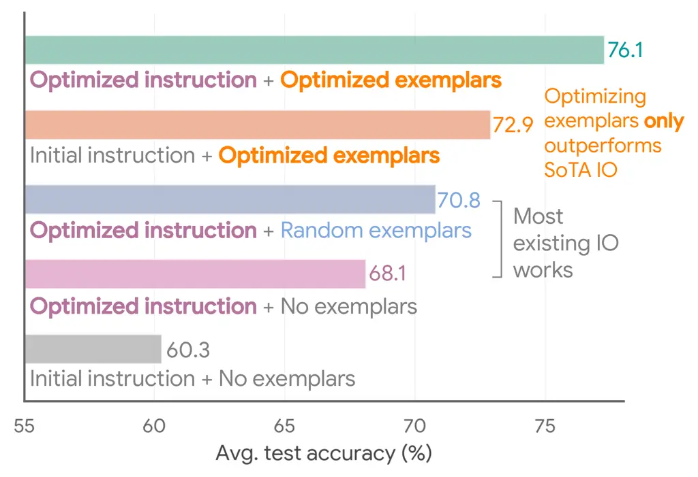
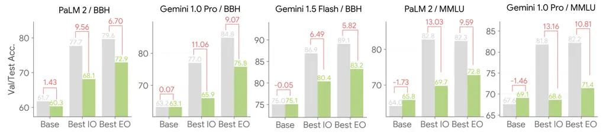
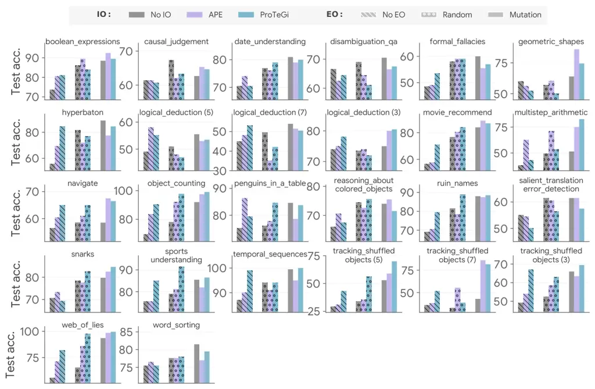
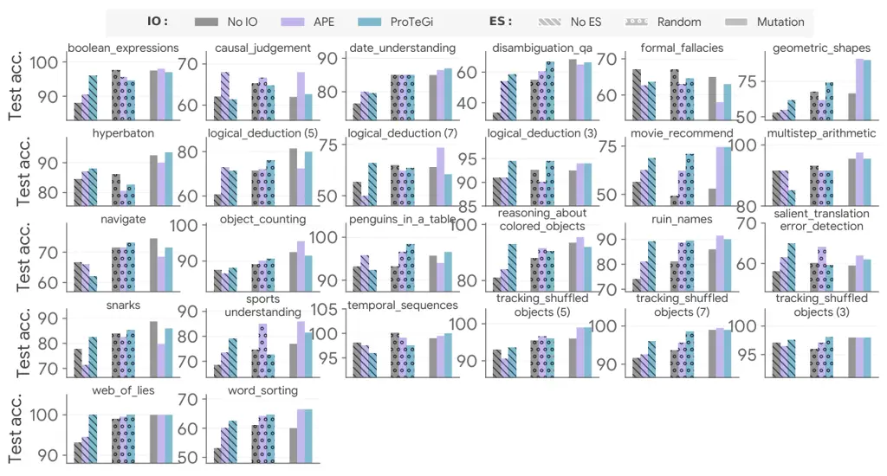
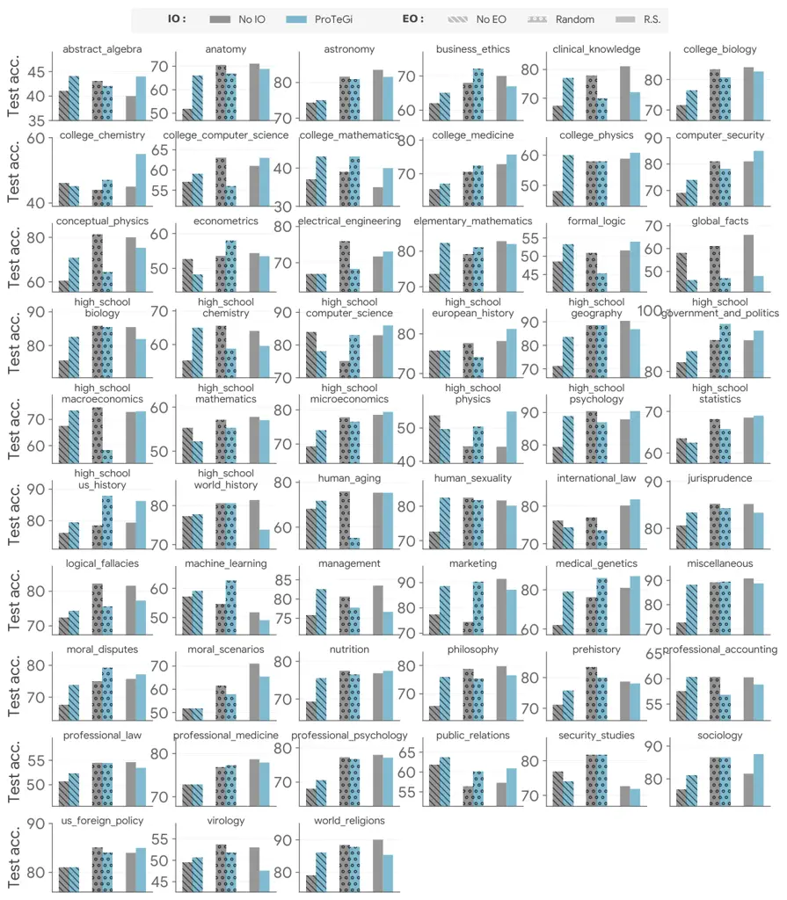

# Teach Better or Show Smarter? On Instructions and Exemplars in Automatic Prompt Optimization

Xingchen Wan Affiliation: Google Cloud AI Research    Ruoxi Sun
Affiliation: Google Cloud AI Research    Hootan Nakhost Affiliation:
Google Cloud AI Research    Sercan Ö. Arık Affiliation: Google Cloud AI
Research

###### Abstract

Large language models have demonstrated remarkable capabilities but
their performance is heavily reliant on effective prompt engineering.
Automatic prompt optimization (APO) methods are designed to automate
this and can be broadly categorized into those targeting instructions
(instruction optimization, IO) vs. those targeting exemplars (exemplar
optimization, EO). Despite their shared objective, these have evolved
rather independently, with IO receiving more research attention
recently. This paper seeks to bridge this gap by comprehensively
comparing the performance of representative IO and EO techniques both
isolation and combination on a diverse set of challenging tasks. Our
findings reveal that intelligently reusing model-generated input-output
pairs obtained from evaluating prompts on the validation set as
exemplars, consistently improves performance on top of IO methods but is
currently under-investigated. We also find that despite the recent focus
on IO, how we select exemplars can outweigh how we optimize
instructions, with EO strategies as simple as random search
outperforming state-of-the-art IO methods with seed instructions without
any optimization. Moreover, we observe a synergy between EO and IO, with
optimal combinations surpassing the individual contributions. We
conclude that studying exemplar optimization both as a standalone method
and its optimal combination with instruction optimization remain a
crucial aspect of APO and deserve greater consideration in future
research, even in the era of highly capable instruction-following
models.

## 1 Introduction



Figure 1: Average performance over \>20 tasks on PaLM 2 – We compare and
combine APO targeting exemplars and instructions, and find that how we
optimize exemplars (orange) can eclipse how we optimize instructions
despite current research favoring the latter (blue and purple), whereas
optimizing both is the best (cyan) within similar budget.

Significant advancements in large language models (LLMs) have
revolutionized various natural language processing tasks (Chowdhery et
al., 2023; Anil et al., 2023; Achiam et al., 2023; Gemini team et al.,
2023). One notable aspect of LLMs, however, is their sensitivity to the
input "prompts," which has given rise to the burgeoning field of prompt
engineering (Liu et al., 2023a; Sahoo et al., 2024). On black-box LLMs
where we can neither modify or access internal parameters, prompt
engineering involves crafting input prompts that effectively guide LLMs
to generate desired outputs. Starting from manual processes requiring
human expertise, the complexity and volume of prompts have necessitated
the development of automatic prompt optimization (APO) methods aiming to
streamline and automate prompt generation, thereby alleviating the
burden of manual intervention. Broadly, since prompts consist of
instructions and exemplars, we may roughly categorize APO into
instruction optimization (IO) and exemplar optimization (EO) approaches.
IO focuses on refining the textual instructions provided to LLMs that
contain task-specific information (i.e., to teach), whereas EO
emphasizes the selection of relevant examples to guide model behavior
(i.e., to show). Partially driven by the improved instruction-following
ability of LLMs, the research attention has increasingly shifted towards
IO, especially using LLMs themselves as optimizers (Zhou et al., 2023b;
Pryzant et al., 2023; Wang et al., 2024b).

While EO and IO approaches address the similar overarching problem, they
have evolved somewhat independently, with a few exceptions (Fernando et
al., 2023; Wang et al., 2024a). Indeed, as we elaborate in §2, EO
approaches are often based on simple, handcrafted templates without
explicit instruction optimization (Khattab et al., 2024; Wan et al.,
2023a), while IO methods seldom optimize exemplars and often rely on
random validation set samples (Pryzant et al., 2023), require additional
fixed exemplars on top of the validation set (Zhou et al., 2023b; Guo et
al., 2024), or consider the “zero-shot” setup with no exemplars at all
(Wang et al., 2024b). Whereas the lack of IO in EO methods is somewhat
understandable as many EO approaches predate instruction finetuning (Wei
et al., 2022a) and, subsequently, instruction-following models that are
sensitive to instructions, the inverse is much less so: concretely,
almost all existing IO approaches already require a labeled dataset as
the validation set, and are therefore, by definition, not “zero-shot”.
With the inputs, labels, and, if applicable, model-generated
intermediate outputs (e.g., reasoning steps) on the subset of the
validation set that the model has answered correctly, we already have a
set of exemplars as a free side-product whenever we perform IO,
independent from and on top to any additionally provided,
human-annotated exemplars. A common argument for not focusing on EO,
such as mentioned in Pryzant et al. (2023), is the goal to focus on one
objective at a time¹¹ 1 “The proposed algorithm is about optimizing the
language of prompts, as opposed to selecting the best examples for
few-shot learning.”. However, given the common practical goal of and the
interplay between EO and IO (Mizrahi et al., 2024), we argue they should
not be treated separately – it is instead critical to understand their
relative importance and combined impact, and, where necessary, optimize
them jointly for the best performance-cost balance.

This is, to our knowledge, where there is a gap in the literature that
we aim to bridge. To do so, on a diverse suite of challenging BIG-Bench
and MMLU tasks, we compare the performance gain brought by various
representative, state-of-the-art (SoTA) IO and EO methods on the
fairground with PaLM 2, Gemini (1.0/1.5) and GPT models to foster better
scientific understanding of different APO techniques. While IO
comfortably improves the baseline prompts before any instruction or
exemplar optimization, this, at best, portrays an incomplete picture.
Under the same setup, with simple yet effective EO methods on the
model-generated exemplars on the validation set, we show:

- •
  Intelligently incorporating exemplars generated by the target model
  itself on the validation set significantly and consistently improves
  performance on top of recently proposed IO methods;
- •
  The performance gains realized by choosing appropriate exemplars via
  methods as simple as random search can eclipse the improvements
  brought by SoTA instruction optimization. As a concrete example, as
  shown in Fig. 1, with a simple optimization routine on exemplars, seed
  instructions before any optimization outperform optimized instructions
  obtained with complex IO but with random exemplars most commonly used.
- •
  There exists a synergy between EO and IO, and optimally
  mixing-and-matching IO and EO is greater than the sum of its parts
  under a comparable computational budget.
- •
  SoTA IO might be itself implicitly generating exemplars, and these
  exemplars, while somewhat unintentional, contribute more to the
  performance than the rest of the instruction that IO methods are meant
  to optimize.
- •
  While arguably receiving less research attention recently, exemplar
  optimization remains a crucial design consideration in APO. Even in an
  era of highly capable instruction-following LLMs, the significance of
  exemplar optimization should not be relegated to an afterthought, and
  better exemplar optimization both as a standalone tool and as a
  combinable component with IO is crucial for APO.

## 2 Preliminaries

Prompts are natural language inputs to LLMs. Denoting an input task
query as $`x`$, a few-shot prompt $`P(x)`$ may be represented as
$`P(x)=[I,e_{1},...,e_{k},x]`$ where $`I`$ denotes an instruction and
$`\{e_{1},...,e_{k}\}`$ denote $`k`$ exemplars (or interchangeably,
demonstrations), each of which is a concatenation of other queries and
their outputs (including both the final answer and any possible
intermediate outputs) which resemble the current query $`x`$ or may
otherwise guide the LLM to better handle the current task, and we show a
common prompt template organizing these components in Fig. 2 – note that
not all components are required: e.g., zero-shot prompts feature no
exemplars.

Figure 2: An example prompt: instruction $`I`$ describes the task;
exemplars ($`e_{1},...,e_{k}`$, $`k=1`$ in the figure) provide
demonstrations and enable ICL; both are prepended to the query $`x`$
before receiving the LLM responses.

Automatic prompt optimization (APO) aims to automatically design
$`P(x)`$ via optimization. We broadly consider black-box API-only LLMs²²
2 i.e., only textual outputs are available; parameters, gradients, and
intermediate outputs like logits are neither modifiable or accessible –
as of June 2024, many SoTA models like Gemini (Gemini team et al., 2023;
Reid et al., 2024) and the most advanced variants of GPT-4 (Achiam et
al., 2023) fall into this category.. The proposed framework assumes a
validation dataset
$`\mathcal{D}_{\mathrm{val}}:=\{(x_{i},y_{i})\}_{i=1}^{n_{\mathrm{val}}}`$,
where $`x_{i}`$ and $`y_{i}`$ represent validation inputs and targets, a
performance metric (e.g., accuracy) $`g(\cdot,\cdot)`$, and aims to find
the optimal prompt $`P^{*}(x)`$ to be used at test time, which is
empirically the maximizer on $`\mathcal{D}_{\mathrm{val}}`$:

```math
P^{*}(x)=\arg\max_{P(\cdot)\sim\mathcal{P}}\mathbb{E}_{(x,y)\sim\mathcal{D}_{\mathrm{val}}}\Big[g\Big(f_{\mathrm{LLM}}\big(P(x)\big),y\Big)\Big], \tag{1}
```

where $`f_{\mathrm{LLM}}(\cdot)`$ denotes a textual LLM output given
input and $`\mathcal{P}`$ denotes the search space, whose definition
allows a broad categorization of APO methods into instruction
optimization methods targeting instructions in Fig. 2, exemplar
optimization methods targeting exemplars in Fig. 2 and approaches that
tackle both.

Exemplar optimization (EO). Efforts to optimize exemplars started soon
after the discovery of in-context learning (ICL) (Brown et al., 2020)
via retrieval-based approaches to identify the closest labeled examples
(Lu et al., 2022; Zhao et al., 2021; Wu et al., 2023; Zhou et al.,
2024b), influences and sensitivity (Nguyen & Wong, 2023; Chen et al.,
2022), and learning-based approaches (Zhang et al., 2022; Ye et al.,
2023a). Toolkits like DSPy (Khattab et al., 2024) adopt EO as the main
APO paradigm. Works (Wan et al., 2023a; Wan et al., 2023b; Zhang et al.,
2023b; Kim et al., 2022; Stanić et al., 2024; Zhang et al., 2024) have
also extended EO to model-generated exemplars in LLMs and multimodal
models. Lastly, by framing EO from an active learning angle, Margatina
et al. (2023) provide a comprehensive understanding and comparative
analyses. These works, however, principally analyze different EO
strategies only, nor do they analyze from the angle of APO. Many of
these works also primarily focus on and draw findings from earlier and
simpler tasks that are arguably less challenging to SoTA LLMs.

Instruction optimization (IO). On black-box LLMs, the origin of IO may
be traced to discrete prompt search (Deng et al., 2022; Shin et al.,
2020; Xu et al., 2022; Zhou et al., 2023a; Prasad et al., 2023) which
prepend optimized tokens, which can be viewed as a form of
“instructions”, to inputs. However, these approaches do not necessarily
yield interpretable prompts and most of them require output signals
(such as logits) beyond strictly black-box access. Thus, recent advances
have shifted towards utilizing an LLM itself to generate natural
language instructions for iterative optimization on
$`\mathcal{D}_{\mathrm{val}}`$ in Eq. 1. The seminal works is APE (Zhou
et al., 2023b), which employs the LLM to iteratively cull top-performing
instructions on $`\mathcal{D}_{\mathrm{val}}`$ and paraphrase them until
convergence. Similar evolutionary frameworks are widely used in
follow-up works (Guo et al., 2024; Hsieh et al., 2023; Zhou et al.,
2024a) and alternative formulations like Bayesian optimization (BO)
(Chen et al., 2023) and neural bandits (Lin et al., 2023) were also
used. Another line of works (Pryzant et al., 2023; Wang et al., 2024b;
Ye et al., 2023b; Sun et al., 2023) employ reflection, directing an LLM
to articulate reasons for errors to iteratively improve instructions.
Other approaches like OPRO and its variants (Yang et al., 2024; Liu et
al., 2023b), treat the LLM as a black-box optimizer, tasking it with
generating new instructions based on the trajectory of previously
evaluated instructions and their performances without explicit
meta-instructions.

Combining EO and IO. As discussed in §1, there is a relative dearth of
work combining EO and IO despite their shared objective. Specifically,
even when the labeled dataset $`\mathcal{D}_{\mathrm{val}}`$ is a
prerequisite of virtually all IO methods, it is primarily used to
estimate the expectation in Eq. 1 only rather than to construct
exemplars in a principled way: For instance, ProTeGi (Pryzant et al., 2023) randomly samples exemplars from $`\mathcal{D}_{\mathrm{val}}`$,
while OPRO (Yang et al., 2024) uses them only for instruction induction
(Honovich et al., 2023). Other works (Guo et al., 2024; Zhou et al.,
2023b; Wang et al., 2024b) either use no exemplars or fix exemplars and
only optimize the instructions – for challenging reasoning tasks, these
methods require human-annotated chain-of-thought (CoT) exemplars (Wei et
al., 2022b) in addition to $`\mathcal{D}_{\mathrm{val}}`$, which
arguably runs counter to the goal of automatically designing prompts
without human intervention in APO. A few exceptions exist: PromptBreeder
(Fernando et al., 2023) employs “context shuffling” to co-evolve
exemplars and instructions, while Mixture-of-Prompts (MoP) (Wang et al.,
2024a) aligns exemplars with multiple prompting “experts" for joint
optimization. However, these works still focus their optimization effort
on instructions: PromptBreeder emphasizes complex mutation operators for
IO while providing only basic EO frameworks, whereas MoP chiefly focuses
on IO with the bulk of its contribution being assigning optimized
instructions to different exemplar groups, rather than optimizing the
exemplars themselves. Other works (Do et al., 2023; Zhang et al., 2023a)
also include both exemplars and instructions in the search space, but
they require information beyond strictly black-box outputs to some
extent. Lastly, several works have analyzed the interplay between ICL
and instructions (Mizrahi et al., 2024) or prompt templates (Sclar et
al., 2023), but they mainly characterize the performance variation as an
issue deserving attention. We, however, consider the APO setup
specifically, and argue that such an interdependence presents an
opportunity through holistically considering instructions and exemplars.
Concurrent to our work, Agarwal et al. (2024a) and Opsahl-Ong et al.
(2024) also study the joint optimization of instructions and exemplars,
and in many cases reached conclusions corroborating our findings,
demonstrating the community’s growing awareness on the importance of the
subject of focal interest to this paper.

## 3 Understanding Instruction Optimization and Exemplar Optimization

While studying IO and EO independently has academic value, the practical
goal ultimately for both is to optimize the performance of LLMs. Hence,
IO and EO, as two dominant genres of APO methods, present practitioners
with the challenge of selecting or combining them to maximize
cost-performance benefits. We aim to meet this by evaluating EO and IO
in the context of APO by answering the following: 1) What is the
relative importance and performance impact of EO and IO, both in
isolation and when combined together? 2) How do we make the optimal use
of the limited data and computational budget under the current APO
framework?

### 3.1 Experimental Setup

We perform thorough experiments employing various EO and IO methods
individually and in combination. We use the PaLM 2 text-bison-002 (Anil
et al., 2023) and Gemini 1.0 Pro/1.5 Flash (gemini-1.0-pro-002 and
gemini-1.5-flash-001) (Gemini team et al., 2023; Reid et al., 2024) as
the target models, but we will also validate key findings on GPT-3.5
(gpt-3.5-turbo-0125. Modern IO methods often employ another, usually
more potent optimizer model for to generate and/or critique
instructions; we use PaLM 2 text-unicorn-001 (for text-bison target
model), Gemini 1.0 Ultra (for Gemini 1.0 Pro target model) or Gemini 1.5
Pro (gemini-1.5-pro-001) (for Gemini 1.5 Flash target model). We
evaluate on tasks selected from BIG-Bench Hard (BBH) (Suzgun et al.,
2022), a collection of diverse tasks considered to be challenging to
LLMs – the suite itself and datasets of similar task types are
frequently used in many recent APO works (Wang et al., 2024b; Yang et
al., 2024; Hsieh et al., 2023; Fernando et al., 2023, inter alia): the
tasks include numerical reasoning, commonsense problem-solving, logical
deduction, linguistic manipulation, machine translation, and tabular
reasoning, among others. For all tasks, we use 20% of data as validation
set and the remaining 80% for testing, the latter of which is held-out
and unavailable to the LLM at search time (see App. A for implementation
details). We also test some of our key findings on the MMLU benchmark
(Hendrycks et al., 2020), a set of 57 tasks frequently used to gauge the
general problem-solving abilities of LLMs – we use the official val and
test splits for validation and testing, respectively. We consider the
following IO strategies:

1.  1.  No IO: we use the seed instruction $`I_{0}`$ “Let’s think step by
        step.” (Kojima et al., 2022) without any optimization.
2.  2.  APE (Zhou et al., 2023b) is the seminal work for
        LLM-as-an-instruction-optimizer and uses an evolutionary algorithm
        design: at each iteration, we evaluate a population of instructions
        on the validation set and the optimizer is asked to generate a new
        population by paraphrasing the top-performing instructions. This
        process iterates until convergence.
3.  3.  ProTeGi (Pryzant et al., 2023) collects samples that the target LLM
        answers incorrectly on $`\mathcal{D}_{\mathrm{val}}`$ under the
        current instruction and directs the optimizer LLM to reflect and
        critique it. The optimizer model is then asked to update the
        instruction by summarizing and abstracting the feedback.
        Additionally, at each iteration, ProTeGi also paraphrases
        instructions similar to APE (referred to as “Monte Carlo sampling”)
        and uses beam search to identify the most promising instructions.
4.  4.  PromptAgent (Wang et al., 2024b) is similar to ProTeGi but it
        features a more advanced planning agent using Monte Carlo tree
        search (Coulom, 2006).
5.  5.  OPRO (Yang et al., 2024) implicitly optimizes instructions. Starting
        from the seed instruction, at each iteration, OPRO provides the
        optimizer model a concatenation of previously evaluated instructions
        and their validation scores. Instead of explicitly requesting
        paraphrasing or reflection, OPRO treats the optimizer LLM as a
        black-box optimizer and simply asks the optimizer model to “come up
        with a better instruction” given these information.

The above methods are selected as each of them represents the state of
the art of a genre of approaches as outlined in §2 and collectively
represents IO techniques as a whole. We initialize each method at the
seed instruction and ensure they consume the same amount of compute
measured by the number of prompt evaluations on
$`\mathcal{D}_{\mathrm{val}}`$ $`m`$ (we cap $`m=32`$ except for “No IO”
which requires no iteration). We also compare against PromptBreeder
(Fernando et al., 2023) in a later section, as it features a much more
expansive search space and requires significantly more than 32
iterations before convergence. After obtaining the optimized instruction
$`I^{*}`$ (or $`I_{0}`$ if no IO is performed), we perform EO. At this
point, we emphasize that our setup should not be confused with the
“few-shot” setup considered by some prior works (Zhou et al., 2023b; Guo
et al., 2024) which require additional human-annotated exemplars with
reasoning traces to elicit CoT behavior. We perform EO only from the
exemplars self-generated by the target model (also referred to as
“bootstrapped few-shot” in DSPy (Khattab et al., 2024) and “reinforced
ICL” in concurrent works like Agarwal et al. (2024b)) and do not assume
exemplars are given at the start of APO (i.e., we do not assume the
presence of initial $`\{e_{1},...,e_{k}`$} in $`P(x)`$). We consider the
following EO strategies:

1.  1.  No EO: no exemplars are used; this is typically referred to as
        “zero-shot” in the APO literature.
2.  2.  Random: we randomly sample $`k`$ input-output pairs from
        $`\mathcal{D}_{c}(I^{*})\subseteq\mathcal{D}_{\mathrm{val}}`$, the
        subset to the validation set that the target LLM predicted correctly
        under $`I^{*}`$ and the output in this case includes any
        intermediate output the LLM generates before the final answer.
3.  3.  Nearest: We use the same $`\mathcal{D}_{c}(I^{*})`$ as above, but
        instead of sampling randomly, we retrieve top-$`k`$ input-output
        pairs whose inputs are most similar to the current test input based
        on text embedding cosine similarity. We use the Gecko embedding (Lee
        et al., 2024).
4.  4.  Diversity: We use $`\mathcal{D}_{c}(I^{*})`$ but select the $`k`$
        input-output pairs closest to the centroids via $`k`$-means
        clustering, similar to the approach in Zhang et al. (2023b) to
        promote diversity in exemplars.
5.  5.  All exemplars (Gemini 1.5 target models only): With the advent of
        long-context models like Gemini 1.5, we may also fit the entire set
        of $`\mathcal{D}_{c}`$ into the context and perform no selection at
        all.

Figure 3: Appropriate EO improves over any or no IO: Task-specific BBH
performance with no instruction optimization (left) and with SoTA IO:
APE (middle) and ProTeGi (right) before and after applying exemplars
found via Mutation (§3.1) on PaLM 2. Dashed and solid lines denote the
average performance before and after exemplars, respectively. Task index
is determined by the ascending order of test accuracy under seed
instruction. Refer to additional visualization in App. B.3.

The above heuristic-based EO strategies do not use
$`\mathcal{D}_{\mathrm{val}}`$, whereas optimization-based EO can
utilize it similarly to IO. Instead of generating instructions, we
select the exemplar combinations with the highest validation accuracy
for testing Perez et al. (2021); Khattab et al. (2022); Khattab et al.
(2024). Unlike IO, which creates new instructions via an optimizer
model, EO selects from pre-generated outputs and does not require an
optimizer model. Formally, we focus on optimizing exemplars conditional
on $`I^{*}`$ from IO (or $`I_{0}`$ if no IO is involved)³³ 3 We
performed EO after IO to optimize the exemplars generated by the best
instruction; we also tested the inverted order (i.e., EO before IO) and
interleaved optimization (detailed in App. B.8) and found the results to
be largely robust to these design choices.:

```math
\begin{split}E^{*}&=\{e_{j}^{*}\}_{j=1}^{k}={\arg\max}_{e_{1},...,e_{k}\in\mathcal{E}}\mathbb{E}_{(x_{i},y_{i})\sim\mathcal{D}_{\mathrm{val}}}\Big[g\big(f_{\mathrm{LLM}}(I^{*},\{e_{j}\}_{j=1}^{k},x_{i}),y_{i}\big)\Big]\\
&\mathrm{s.t.}\,I^{*}=\arg\max_{I\in\mathcal{I}}\mathbb{E}_{(x_{i},y_{i})\sim\mathcal{D}_{\mathrm{val}}}\Big[g\big(f_{\mathrm{LLM}}(I,x_{i}),y_{i}\big)\Big].\end{split} \tag{2}
```

We include the following optimization-based EO methods that differ in
search strategy:

1.  6.  Random search: Following the EO procedure in DSPy (Khattab et al.,
        2024), we randomly sample $`m`$ combinations of $`k`$ exemplars:
        $`\{E_{1},...,E_{m}\}`$ where each
        $`E_{\ell}=\{e_{j}^{\ell}\}_{j=1}^{k}\,\forall\,\ell\in\{1,...,m\}`$.
        We evaluate each combination on the validation set and use the best
        for testing.
2.  7.  Mutation: We also implement a mutation-based baseline, initiating
        with a population of $`Q`$ combinations for $`T=m/Q`$ generations,
        where $`Q=8`$. Each generation starts with a randomly initialized
        first generation, similar to random search. For subsequent
        generations, we populate with $`Q`$ mutations of the best-performing
        combination from the previous generation, $`E^{*}_{\leq t}`$. Each
        mutation involves swapping one exemplar for another input-output
        pair from $`\mathcal{D}_{c}`$.

For all EO methods except for “All exemplars”, we use $`m=32,k=3`$ for
all main experiments, but we also test with $`k=\{1,3,5,10,20\}`$ in
App. B.4. Given the IO and EO strategies, we experiment on each of the
IO-EO combinations.

|                               |                           | Exemplar optimization (EO) |        |         |           |       |          | Max $`\Delta`$ |
| ----------------------------- | ------------------------- | -------------------------- | ------ | ------- | --------- | ----- | -------- | -------------- |
|                               |                           | No EO                      | Random | Nearest | Diversity | R.S.  | Mutation | over No EO     |
| Instruction Optimization (IO) | No IO                     | 60.30                      | 66.91  | 66.09   | 66.74     | 71.16 | 72.92    | +12.63         |
|                               | APE                       | 64.96                      | 69.11  | 69.01   | 70.81     | 75.88 | 76.25    | +11.28         |
|                               | ProTeGi                   | 68.13                      | 70.81  | 70.01   | 69.25     | 75.90 | 77.29    | +9.16          |
|                               | PromptAgent               | 65.66                      | 67.65  | 67.82   | 67.35     | 72.51 | 72.77    | +7.11          |
|                               | OPRO                      | 63.04                      | 68.50  | 68.33   | 67.57     | 73.02 | 73.06    | +10.01         |
|                               | Max $`\Delta`$ over No IO | +7.83                      | +3.89  | +3.92   | +4.07     | +4.74 | +4.37    | –              |

|               | No EO | Random | Nearest | Diversity | R.S.  | Mutation | $`\Delta`$ EO |
| ------------- | ----- | ------ | ------- | --------- | ----- | -------- | ------------- |
| No IO         | 63.14 | 71.12  | 69.19   | 67.82     | 75.77 | 75.77    | +12.63        |
| ProTeGi       | 65.91 | 72.72  | 72.13   | 72.64     | 78.27 | 79.01    | +13.10        |
| $`\Delta`$ IO | +2.77 | +1.60  | +2.94   | +4.83     | +2.50 | +2.52    | –             |

Table 2: Average BBH accuracy of seed instruction (No IO) and ProTeGi
(best IO strategy from Table 4) with different EO strategies using
Gemini 1.0 Pro target model and Gemini 1.0 Ultra optimizer model. Refer
to Table 4 for further explanations.

|               | No EO | Random | R.S.  | $`\Delta`$EO |
| ------------- | ----- | ------ | ----- | ------------ |
| No IO         | 65.77 | 72.06  | 72.75 | +6.98        |
| ProTeGi       | 69.73 | 70.82  | 72.31 | +2.58        |
| $`\Delta`$ IO | +3.96 | -1.24  | -0.44 | –            |

Table 3: Average MMLU accuracy of No IO and ProTeGi with different EO
strategies with text-bison target model and text-unicorn optimizer
model. See App B.2 for Gemini results.

|               | No EO | Random | Nearest | Diversity | All   | R.S.  | Mutation | $`\Delta`$EO |
| ------------- | ----- | ------ | ------- | --------- | ----- | ----- | -------- | ------------ |
| No IO         | 75.07 | 80.02  | 81.71   | 81.52     | 80.43 | 83.25 | 82.42    | +8.18        |
| APE           | 77.52 | 81.20  | 83.71   | 81.55     | 81.20 | 85.04 | 84.76    | +7.54        |
| ProTeGi       | 80.39 | 82.40  | 82.61   | 82.29     | 83.52 | 84.47 | 84.49    | +4.10        |
| $`\Delta`$ IO | +5.32 | +2.20  | +2.00   | +0.77     | +3.09 | +1.79 | +2.34    | –            |

Table 1: Average BBH accuracy of all 30 EO-IO combinations with PaLM 2
(text-bison-002) target model and PaLM 2 (text-unicorn-001) optimizer
model. The last row/column show the max improvement over the No IO
and/or No EO baseline of the respective row/column. The background
shades indicate cost in terms of \# prompt evaluations on
$`\mathcal{D}_{\mathrm{val}}`$ by the target model: gray cells requires
no evaluation on $`\mathcal{D}_{\mathrm{val}}`$ ($`m=0`$) ; blue cells
perform $`m=32`$ evaluations to iteratively optimize instructions or
exemplars; orange cells iteratively optimize exemplars $`m`$ times on
top of optimized instructions.

Table 4: Average BBH accuracy of seed instruction (No IO), APE and
ProTeGi (top 2 IO strategies from Table 4) with different EO strategies
using Gemini 1.5 Flash target model and Gemini 1.5 Pro optimizer model.
Refer to Table 4 for further explanations.

### 3.2 Results and Analyses

On BBH, we aggregate the results in Table 4 for PaLM 2 models. We also
experiment on Gemini models with no IO and with ProTeGi (best overall IO
technique from the PaLM 2 results) in Table 4 (Gemini 1.0) and Table 4
(Gemini 1.5). We also validate key findings in representative datasets
on GPT-3.5 (Table 14, App B). On MMLU, we present results in Table 4
(PaLM 2) and App. B.1 (Gemini). Below, we highlight and discuss the key
insights.


One of the immediate findings from the tables is that comparing the
first column against others, any EO consistently improves test
performance, with any or no instruction optimization. In Fig. 3, we
further show that the EO not only benefits at an aggregated level but
also leads to significant and almost unanimous improvements across
diverse tasks.

While exemplars improving performance may not seem surprising, it is
worth noting that as mentioned, in this case they are side-products of
evaluating instructions on $`\mathcal{D}_{\mathrm{val}}`$ with no
additional data costs. Thus, we argue that for practical purposes under
the framework of Eq. 1, barring unusual constraints like extreme
restrictions in context length, which This might restrict applicability
of IO methods too as many SoTA IO methods also generate long prompts,
and/or extreme long-context tasks where it is not possible to fit
exemplars in the context window, there is little incentive to consider
the “zero-shot” setup without exemplars and little incentive not to
perform EO, given that current APO setup requires
$`\mathcal{D}_{\mathrm{val}}`$ anyway, regardless of whether we use them
as exemplars. Thus, it is by definition, not “zero-shot” and is not
directly comparable to true zero-shot methods requiring no labeled data.
Furthermore, there is also the risk that “zero-shot” results neither
reflect nor accurately predict the full potential of the LLM, as what
performs well under zero-shot does not necessarily performs well when a
better EO strategy (e.g., PromptAgent in Table 4 and ProTeGi in Table 4)
is used. Lastly, since obtaining labeled data can be costly,
intelligently reusing them as exemplars also represents a more judicious
use of scarce resources compared to only using them to evaluate a metric
for optimization.


Exemplar optimization outweighs instruction optimization. Despite the
recent focus the community places on IO, we find that how we select
exemplars outweighs how we optimize instructions in the model-task
combinations we investigate. With reference to Tables 4 – 4 (and
task-specific breakdown in Fig. 5), we find that if we optimize
instructions _or_ exemplars (i.e., the blue cells) under a roughly
compute-matched budget, prompts without instruction optimization but
with optimized exemplars (e.g., the “No IO + Mutation” combination)
outperform prompts with SoTA instruction optimization but without
optimized exemplars (e.g., the “ProTeGi + Random” combinations) in an
overwhelming majority of cases. In fact, on a separate set of
experiments performed on the PaLM 2 models, we find this to be true even
after halving the evaluation budget of EO (see App. B.6), and
optimization on exemplars as naïve as random search can outperform IO
methods that are significantly more complicated and expensive. Further
substantiating this argument are that:

1. In isolation, EO boosts performance more effectively than IO: for
   example, with reference to Table 4, compared to the seed prompt, using
   the best EO strategy (Mutation, first row) alone increases the average
   performance by \>11%, compared to approximately 8% using the best IO
   strategy (ProTeGi, first column);
2. When combined, benefits of EO and IO stack up but are largely
   attributable to EO: under “Mutation” (last column), the best EO
   strategy, the performance gap between the best and worst IO strategies
   shrinks to less than 4%, suggesting that instructions might be less
   critical if the LLM is provided with good exemplars after all.

We observe similar conclusions for different models and task
combinations. In fact, on MMLU (Table 4) featuring much smaller
validation splits, we observe that judicious exemplar optimization
completely eliminates the performance gap caused by IO under zero-shot,
with No IO even surpassing SoTA IO. Interestingly, as we show in Fig. 4
where we further consider the difference between validation accuracy,
which is the empirical objective function in Eq. 1, and the test
accuracy, which is the reported metric that represents the
generalization power of the optimized prompt, optimized exemplars
generalize better than optimized instructions under all model-task
combinations considered. On MMLU tasks (two rightmost plots in Fig. 4),
IO even improves validation performance comparable to or better than EO,
but the validation improvement does not generalize to the test set.
These imply that the superior test performance of EO cannot be solely
attributed to a more effective search space $`\mathcal{P}`$ or
optimization strategy in Eq. 1, and the performance gap might not be
completely closed by advancing optimization only.



Figure 4: Optimized exemplars generalize better than optimized
instructions. Comparison of validation accuracy and test accuracy over
different model-task combinations. The generalization gap, which is the
difference between validation and test accuracy, is marked on each
figure. The better generalization of EO is exemplified by the smaller
generalization gaps in all cases studied.

Optimization-based EO outperforms heuristics. Between the different EO
strategies, we find that optimization-based EO vastly outperform the
alternatives: e.g. in all tables, ProTeGi with optimized exemplars
outperforms random exemplars, which is the default design in Pryzant et
al. (2023), by more than 6% in both Table 4 and 4 and more than 2% in
Table 4. Interestingly, as shown by the “All” column in Table 4 for
Gemini 1.5 and App. B.4 for Gemini 1.0, naïvely scaling the number of
exemplars may not be the most effective – the fact using the entire
$`\mathcal{D}_{c}`$ underperforms 3 optimized exemplars, which are a
subset of $`\mathcal{D}_{c}`$, highlights the relevance of EO even for
modern LLMs capable of handling long context windows. On the other hand,
heuristic-based selection like Diversity and Nearest do not consistently
outperform simple random baseline, echoing previous findings (Perez et
al., 2021).



Figure 5: Task-specific BBH performance of selected IO-EO combinations
with PaLM 2 (refer to App. B.3 for all other models). Note that 1)
Proper EO almost uniformly improves performance and 2) With appropriate
exemplars, seed instructions with no optimization (third bar from the
right) can often perform on par or better than SoTA IO but with standard
random exemplars or no exemplars commonly used in the literature (first
six bars in each figure).

Imitation of task-dependent winning patterns outweighs elaborate
descriptions. We further present representative prompts in Fig 6 and how
LLM responds to them in App. B.9: Generally, we find that even detailed
and task-specific instructions do not regulate the LLM’s behavior as
effectively as exemplars, which enable imitation. For example, for
challenging tasks like tracking_shuffled_objects and web_of_lies,
optimization-based EO discover “winning” templates that, when followed,
improve performance massively. Even when SoTA IO methods may often state
the answer steps equivalently in words, we find LLMs to simply respond
better to exemplars from which they can copy behaviors. On the other
hand, for tasks where CoT-style answering are known to be unhelpful
(e.g., snarks) (Suzgun et al., 2022), the optimized exemplars are
invariably those giving direct answers; when prepended to the test
queries, LLMs tend to prioritize exemplar imitation over instruction
following to answer directly despite triggers like “We should move
forward in stages”. These highly task-dependent “winning” patterns that
vary from elaborate step-to-step reasoning to direct answering may also
explain why heuristic-based EO fares worse to data-driven approaches,
since there might not be a single heuristic universally useful for all
tasks.

Figure 6: “Winning” exemplars that led to exceedingly high performance:
(a, b) LLM improves by almost 50% from imitating and chaining the
patterns in the optimal exemplars. (c) When CoT hurts performance,
optimal exemplars encourage LLMs to override instructions and answer
directly. Refer to App. B.9 for examples of LLM responses when these
exemplars are applied.

Concluding remarks. We argue that the findings are highly significant
for the future of APO. First, they point to a need of re-balancing:
without disparaging the value of IO, we argue that EO is at least
equally crucial and should not be relegated to an afterthought. Second,
we note that the EO strategies studied are in no way exhaustive. In
fact, in contrast to the sophisticated search and instruction generation
approaches adopted by IO methods, they can even be considered
elementary. Yet, they deliver comparable or more significant
improvements. Thus, we anticipate advanced methods that more effectively
optimize exemplars would yield even greater enhancements: some
techniques in IO may be adapted to EO with little-to-no modifications.
For example, many recent advances in IO adopt an evolutionary search
framework – while our “Mutation” baseline can be seen as an elementary
version of it in EO, it should be also straightforward to use more
advanced search strategies and operators or use techniques like
LLM-generated paraphrasing on top of selected exemplars. Other search
techniques, such as sample-efficient combinatorial BO (Baptista &
Poloczek, 2018; Wan et al., 2021; Daulton et al., 2022; Zhou et al.,
2024c), can be uniquely suitable for the EO setup, which is itself a
combinatorial optimization problem⁴⁴ 4 Wu et al. (2024), a concurrent
work, precisely explored a combinatorial BO solution.. Furthermore,
while we used a fixed set of exemplars (i.e., task-wise selection), it
might also be fruitful to further explore in the direction of
instance-wise selection (Wu et al., 2023; Rubin et al., 2022). Lastly,
as discussed, the presence of (often large) generalization gap also
suggests the importance to consider generalization alongside
optimization, which seems to be the chief focus thus far; it might be
promising to investigate analogies of well-tested in classical machine
learning like regularization and cross-validation in APO.


For most of the results obtained, we note that iteratively optimizing
both instructions and exemplars led to the best performance. This
naturally leads us to answer the second research question: whereas
experiments in Tables 4 and 4 expend additional cost by optimizing
exemplars on top of the optimized instructions, we show that 1) such a
combinable benefit does not simply root from the additional compute and 2) optimally mixing-and-matching IO and EO leads to significant
performance improvement with negligible additional overhead.

| PaLM 2 (text-bison-002)         |           |       |       |       |       |       |
| ------------------------------- | --------- | ----- | ----- | ----- | ----- | ----- |
| Eval. budget $`m`$              | 32        |       |       |       |       | 64    |
| IO Budget $`m_{\mathrm{IO}}`$   | 32        | 24    | 16    | 8     | 0     | 32    |
| EO Budget $`m_{\mathrm{EO}}`$   | 0         | 8     | 16    | 24    | 32    | 32    |
| Avg. test acc. (%) $`\uparrow`$ | 70.81^(†) | 73.26 | 74.49 | 76.14 | 72.92 | 76.25 |
| Avg. test rank $`\downarrow`$   | 4.50      | 3.63  | 3.44  | 2.88  | 3.60  | 2.94  |

| Gemini 1.5 Flash                |           |       |       |       |       |       |
| ------------------------------- | --------- | ----- | ----- | ----- | ----- | ----- |
| Eval. budget $`m`$              | 32        |       |       |       |       | 64    |
| IO Budget $`m_{\mathrm{IO}}`$   | 32        | 24    | 16    | 8     | 0     | 32    |
| EO Budget $`m_{\mathrm{EO}}`$   | 0         | 8     | 16    | 24    | 32    | 32    |
| Avg. test acc. (%) $`\uparrow`$ | 83.25^(†) | 84.90 | 85.17 | 84.82 | 83.71 | 85.04 |
| Avg. test rank $`\downarrow`$   | 4.04      | 3.65  | 3.29  | 3.00  | 3.58  | 3.44  |

Figure 7: Mixing-and-matching EO and IO outperforms either alone under a
similar budget. Top figure: Validation accuracy vs. \# evaluations on
$`\mathcal{D}_{\mathrm{val}}`$ with PaLM 2 in selected tasks if we
optimize instructions only (via APE), exemplars only (Mutation), or both
(first 8 evals for IO (purple shade) + remaining 24 for EO). Gray dashed
lines denote the performance of $`I_{0}`$. Bottom table: Test accuracy
averaged across all tasks for different IO/EO budget allocations for
PaLM 2 and Gemini 1.5. ^(†)Used best APE results without EO that incur
additional evaluations. Refer to App. B.7 for all per-task results and
additional results on Gemini 1.0 Pro and other instruction optimizers.

Concretely, we budget a total $`m=32`$ prompt evaluations on
$`\mathcal{D}_{\mathrm{val}}`$ where we use first
$`m_{\mathrm{IO}}`$={0,8,16,24,32} iterations optimizing instructions
and the remaining $`m_{\mathrm{EO}}`$ optimizing exemplars. We summarize
the results in Fig. 7, where we find that 1) any mix-and-match
outperforms IO or EO only (i.e., $`m_{\mathrm{IO}}`$=0 or 32), and 2)
the best allocation bridges the gap or almost bridges the gap compared
to the combination that uses twice as many prompt evaluations (last
column) – interestingly, in this case the optimal allocation also
roughly reflects the relative contribution of IO and EO to the overall
performance improvement in Table 4. We show in App. B.7 that the above
findings hold for other target models and instruction optimizers, and we
also give detailed examples and explanations of the mechanism leading to
this synergy. Additionally, in App. B.10, we compare this simple routine
against PromptBreeder (Fernando et al., 2023), which is one of the few
existing IO methods that supports EO via an optional “context shuffling”
routine. It, however, mutates the exemplars purely stochastically rather
than optimizing from the validation metric. We show that despite the
simplicity, our algorithm converges to comparable or better solutions
while incurring a fraction of the PromptBreeder cost, which often
requires hundreds of evaluations before convergence. Finally, we note
that the presented way to combine optimization-based IO and EO is a
proof of concept and room for future improvement can be vast and we
experiment several other alternative ways to combine them in App. B.8,
but we defer thorough investigations to a future work.


Beyond inspecting performance metrics only, we also examine the actual
instructions and exemplars discovered. While detailed prompts are
available in App. C, we highlight a key observation that adds a new
dimension to our discussion: SoTA IO strategies may inadvertently
utilize exemplars already. Despite IO methods not typically explicitly
focusing on exemplars, we find them to frequently generate texts
resembling exemplars within instructions through feedback and reflection
processes. For instance, PromptBreeder employs “Lamarckian mutation” to
reconstruct instructions from input-output pairs, while ProTeGi prompts
the optimizer model to analyze target model errors. These operators,
though varied, all involve taking actual validation exemplars as inputs
to optimizer models. As exemplified by Fig. 8, while the original
intention may have been to abstract task-level instructions, the model
occasionally incorporates these exemplars verbatim in the instructions.
Whereas these “quasi-exemplars” may seem unintentional, we observe that
they are surprisingly common in high-performing instructions and often
contribute more to the performance than the actual instructions
themselves.

Figure 8: The best instructions might actually be exemplars: Best
instruction discovered by ProTeGi on hyperbaton where spontaneously
discovered “quasi-exemplars” are highlighted. We also edit the
instructions to either remove or retain the higlighted parts and find
these quasi-exemplars, rather than the rest of the instruction, drive
the performance. See App. B.11 for more examples.

We argue that the findings here provide further evidence corroborating
our insights obtained so far and our suggestions advocating explicit EO.
Indeed, in contrast to explicit optimization of the exemplars, the
aforementioned mechanism of exemplar discovery via IO is entirely
opportunistic and, depending on interpretation, an unintentional
artifact. For example, the quasi-exemplars in Fig. 8 almost certainly
originate from the optimizer model in ProTeGi taking a convenient
shortcut by incorporating a critique into the instruction verbatim (note
the presence of traces like “Label: a Prediction: b” which suggests a
previous mistake by the target model), which should not happen if the
optimizer model perfectly executes the intended task of abstracting
these critiques. Thus, we argue that instead of relying on the
opportunistic exemplar generation via IO, explicitly optimizing for
exemplars can be more preferable, as shown throughout this study.

## 4 Conclusion

We present comprehensive evaluations on the SoTA IO and EO methods, both
individually and combined. We demonstrate that EO can be a potentially
more crucial element in APO, revealing a beneficial synergy through
joint optimization with IO. We also find that the high performance of
SoTA IO methods can themselves be driven by implicit yet spontaneous
exemplar discovery. Overall, we advocate for further research into EO,
both as an independent approach and in conjunction with IO, even for
highly-capable instruction-following modern models. One limitation is
that although the tasks we consider are fairly diverse and findings on
it are already of value given the widespread interest just on these
tasks only, they are not exhaustive, omitting tasks like open-ended
longer-form generation and metrics like safety & harmfulness which are
important for responsible use of LLMs. As is the case for any inductive
study deriving insights from experiments, there is also a possibility
that the findings may not fully generalize to other tasks and/or models.
Expanding to include these aspects would be important for future work.

## Acknowledgements

We thank all colleagues from Google Cloud AI Research for their
feedback. We would also like to thank the anonymous NeurIPS reviewers
and area chairs, whose valuable comments have helped to improve our
paper.

## References

- Achiam et al. (2023) Achiam, J., Adler, S., Agarwal, S., Ahmad, L.,
  Akkaya, I., Aleman, F. L., Almeida, D., Altenschmidt, J., Altman, S.,
  Anadkat, S., et al. GPT-4 technical report. _arXiv preprint
  arXiv:2303.08774_, 2023.
- Agarwal et al. (2024a) Agarwal, E., Dani, V., Ganu, T., and Nambi, A.
  Promptwizard: Task-aware agent-driven prompt optimization framework.
  _arXiv preprint arXiv:2405.18369_, 2024a.
- Agarwal et al. (2024b) Agarwal, R., Singh, A., Zhang, L. M., Bohnet,
  B., Chan, S., Anand, A., Abbas, Z., Nova, A., Co-Reyes, J. D., Chu,
  E., et al. Many-shot in-context learning. _arXiv preprint
  arXiv:2404.11018_, 2024b.
- Anil et al. (2023) Anil, R., Dai, A. M., Firat, O., Johnson, M.,
  Lepikhin, D., Passos, A., Shakeri, S., Taropa, E., Bailey, P., Chen,
  Z., et al. Palm 2 technical report. _arXiv preprint
  arXiv:2305.10403_, 2023.
- Baptista & Poloczek (2018) Baptista, R. and Poloczek, M. Bayesian
  optimization of combinatorial structures. In _International Conference
  on Machine Learning_, pp. 462–471. PMLR, 2018.
- Brown et al. (2020) Brown, T., Mann, B., Ryder, N., Subbiah, M.,
  Kaplan, J. D., Dhariwal, P., Neelakantan, A., Shyam, P., Sastry, G.,
  Askell, A., et al. Language models are few-shot learners. _Advances in
  neural information processing systems_, 33:1877–1901, 2020.
- Chen et al. (2023) Chen, L., Chen, J., Goldstein, T., Huang, H., and
  Zhou, T. Instructzero: Efficient instruction optimization for
  black-box large language models. _arXiv preprint
  arXiv:2306.03082_, 2023.
- Chen et al. (2022) Chen, Y., Zhao, C., Yu, Z., McKeown, K., and He, H.
  On the relation between sensitivity and accuracy in in-context
  learning. _arXiv preprint arXiv:2209.07661_, 2022.
- Chowdhery et al. (2023) Chowdhery, A., Narang, S., Devlin, J., Bosma,
  M., Mishra, G., Roberts, A., Barham, P., Chung, H. W., Sutton, C.,
  Gehrmann, S., et al. Palm: Scaling language modeling with pathways.
  _Journal of Machine Learning Research_, 24(240):1–113, 2023.
- Coulom (2006) Coulom, R. Efficient selectivity and backup operators in
  monte-carlo tree search. In _International conference on computers and
  games_, pp. 72–83. Springer, 2006.
- Daulton et al. (2022) Daulton, S., Wan, X., Eriksson, D., Balandat,
  M., Osborne, M. A., and Bakshy, E. Bayesian optimization over discrete
  and mixed spaces via probabilistic reparameterization. _Advances in
  Neural Information Processing Systems_, 35:12760–12774, 2022.
- Deng et al. (2022) Deng, M., Wang, J., Hsieh, C.-P., Wang, Y., Guo,
  H., Shu, T., Song, M., Xing, E., and Hu, Z. RLPrompt: Optimizing
  discrete text prompts with reinforcement learning. In Goldberg, Y.,
  Kozareva, Z., and Zhang, Y. (eds.), _Proceedings of the 2022
  Conference on Empirical Methods in Natural Language Processing_, pp.
  3369–3391, Abu Dhabi, United Arab Emirates, December 2022. Association
  for Computational Linguistics.
  [10.18653/v1/2022.emnlp-main.222](https://doi.org/10.18653/v1/2022.emnlp-main.222).
  URL
  [https://aclanthology.org/2022.emnlp-main.222](https://aclanthology.org/2022.emnlp-main.222).
- Do et al. (2023) Do, X. L., Zhao, Y., Brown, H., Xie, Y., Zhao, J. X.,
  Chen, N. F., Kawaguchi, K., Xie, M. Q., and He, J. Prompt optimization
  via adversarial in-context learning. _arXiv preprint
  arXiv:2312.02614_, 2023.
- Fernando et al. (2023) Fernando, C., Banarse, D., Michalewski, H.,
  Osindero, S., and Rocktäschel, T. Promptbreeder: Self-referential
  self-improvement via prompt evolution. _arXiv preprint
  arXiv:2309.16797_, 2023.
- Gemini team et al. (2023) Gemini team, Anil, R., Borgeaud, S., Wu, Y.,
  Alayrac, J.-B., Yu, J., Soricut, R., Schalkwyk, J., Dai, A. M., Hauth,
  A., et al. Gemini: a family of highly capable multimodal models.
  _arXiv preprint arXiv:2312.11805_, 2023.
- Guo et al. (2024) Guo, Q., Wang, R., Guo, J., Li, B., Song, K., Tan,
  X., Liu, G., Bian, J., and Yang, Y. Connecting large language models
  with evolutionary algorithms yields powerful prompt optimizers.
  _International Conference on Learning Representations_, 2024.
- Hendrycks et al. (2020) Hendrycks, D., Burns, C., Basart, S., Zou, A.,
  Mazeika, M., Song, D., and Steinhardt, J. Measuring massive multitask
  language understanding. _arXiv preprint arXiv:2009.03300_, 2020.
- Honovich et al. (2023) Honovich, O., Shaham, U., Bowman, S. R., and
  Levy, O. Instruction induction: From few examples to natural language
  task descriptions. In Rogers, A., Boyd-Graber, J., and Okazaki, N.
  (eds.), _Proceedings of the 61st Annual Meeting of the Association for
  Computational Linguistics (Volume 1: Long Papers)_, pp. 1935–1952,
  Toronto, Canada, July 2023. Association for Computational Linguistics.
  [10.18653/v1/2023.acl-long.108](https://doi.org/10.18653/v1/2023.acl-long.108).
  URL
  [https://aclanthology.org/2023.acl-long.108](https://aclanthology.org/2023.acl-long.108).
- Hsieh et al. (2023) Hsieh, C.-J., Si, S., Yu, F. X., and
  Dhillon, I. S. Automatic engineering of long prompts. _arXiv preprint
  arXiv:2311.10117_, 2023.
- Khattab et al. (2022) Khattab, O., Santhanam, K., Li, X. L., Hall, D.,
  Liang, P., Potts, C., and Zaharia, M. Demonstrate-search-predict:
  Composing retrieval and language models for knowledge-intensive nlp.
  _arXiv preprint arXiv:2212.14024_, 2022.
- Khattab et al. (2024) Khattab, O., Singhvi, A., Maheshwari, P., Zhang,
  Z., Santhanam, K., Vardhamanan, S., Haq, S., Sharma, A., Joshi, T. T.,
  Moazam, H., et al. DSPy: Compiling declarative language model calls
  into self-improving pipelines. _International Conference on Learning
  Representations_, 2024.
- Kim et al. (2022) Kim, H. J., Cho, H., Kim, J., Kim, T., Yoo, K. M.,
  and Lee, S.-g. Self-generated in-context learning: Leveraging
  auto-regressive language models as a demonstration generator. _arXiv
  preprint arXiv:2206.08082_, 2022.
- Kojima et al. (2022) Kojima, T., Gu, S. S., Reid, M., Matsuo, Y., and
  Iwasawa, Y. Large language models are zero-shot reasoners. _Advances
  in neural information processing systems_, 35:22199–22213, 2022.
- Lee et al. (2024) Lee, J., Dai, Z., Ren, X., Chen, B., Cer, D.,
  Cole, J. R., Hui, K., Boratko, M., Kapadia, R., Ding, W., et al.
  Gecko: Versatile text embeddings distilled from large language models.
  _arXiv preprint arXiv:2403.20327_, 2024.
- Lin et al. (2023) Lin, X., Wu, Z., Dai, Z., Hu, W., Shu, Y., Ng,
  S.-K., Jaillet, P., and Low, B. K. H. Use your instinct: Instruction
  optimization using neural bandits coupled with transformers. _arXiv
  preprint arXiv:2310.02905_, 2023.
- Liu et al. (2023a) Liu, P., Yuan, W., Fu, J., Jiang, Z., Hayashi, H.,
  and Neubig, G. Pre-train, prompt, and predict: A systematic survey of
  prompting methods in natural language processing. _ACM Computing
  Surveys_, 55(9):1–35, 2023a.
- Liu et al. (2023b) Liu, S., Chen, C., Qu, X., Tang, K., and Ong, Y.-S.
  Large language models as evolutionary optimizers. _arXiv preprint
  arXiv:2310.19046_, 2023b.
- Lu et al. (2022) Lu, Y., Bartolo, M., Moore, A., Riedel, S., and
  Stenetorp, P. Fantastically ordered prompts and where to find them:
  Overcoming few-shot prompt order sensitivity. In _Proceedings of the
  60th Annual Meeting of the Association for Computational Linguistics
  (Volume 1: Long Papers)_, pp. 8086–8098, 2022.
- Margatina et al. (2023) Margatina, K., Schick, T., Aletras, N., and
  Dwivedi-Yu, J. Active learning principles for in-context learning with
  large language models. In Bouamor, H., Pino, J., and Bali, K. (eds.),
  _Findings of the Association for Computational Linguistics: EMNLP
  2023_, pp. 5011–5034, Singapore, December 2023. Association for
  Computational Linguistics.
  [10.18653/v1/2023.findings-emnlp.334](https://doi.org/10.18653/v1/2023.findings-emnlp.334).
  URL
  [https://aclanthology.org/2023.findings-emnlp.334](https://aclanthology.org/2023.findings-emnlp.334).
- Mizrahi et al. (2024) Mizrahi, M., Kaplan, G., Malkin, D., Dror, R.,
  Shahaf, D., and Stanovsky, G. State of what art? a call for
  multi-prompt llm evaluation. _arXiv preprint arXiv:2401.00595_, 2024.
- Nguyen & Wong (2023) Nguyen, T. and Wong, E. In-context example
  selection with influences. _arXiv preprint arXiv:2302.11042_, 2023.
- Opsahl-Ong et al. (2024) Opsahl-Ong, K., Ryan, M. J., Purtell, J.,
  Broman, D., Potts, C., Zaharia, M., and Khattab, O. Optimizing
  instructions and demonstrations for multi-stage language model
  programs. _arXiv preprint arXiv:2406.11695_, 2024.
- Perez et al. (2021) Perez, E., Kiela, D., and Cho, K. True few-shot
  learning with language models. _Advances in neural information
  processing systems_, 34:11054–11070, 2021.
- Prasad et al. (2023) Prasad, A., Hase, P., Zhou, X., and Bansal, M.
  GrIPS: Gradient-free, edit-based instruction search for prompting
  large language models. In Vlachos, A. and Augenstein, I. (eds.),
  _Proceedings of the 17th Conference of the European Chapter of the
  Association for Computational Linguistics_, pp. 3845–3864, Dubrovnik,
  Croatia, May 2023. Association for Computational Linguistics.
  [10.18653/v1/2023.eacl-main.277](https://doi.org/10.18653/v1/2023.eacl-main.277).
  URL
  [https://aclanthology.org/2023.eacl-main.277](https://aclanthology.org/2023.eacl-main.277).
- Pryzant et al. (2023) Pryzant, R., Iter, D., Li, J., Lee, Y., Zhu, C.,
  and Zeng, M. Automatic prompt optimization with “gradient descent” and
  beam search. In Bouamor, H., Pino, J., and Bali, K. (eds.),
  _Proceedings of the 2023 Conference on Empirical Methods in Natural
  Language Processing_, pp. 7957–7968, Singapore, December 2023.
  Association for Computational Linguistics.
  [10.18653/v1/2023.emnlp-main.494](https://doi.org/10.18653/v1/2023.emnlp-main.494).
  URL
  [https://aclanthology.org/2023.emnlp-main.494](https://aclanthology.org/2023.emnlp-main.494).
- Reid et al. (2024) Reid, M., Savinov, N., Teplyashin, D., Lepikhin,
  D., Lillicrap, T., Alayrac, J.-b., Soricut, R., Lazaridou, A., Firat,
  O., Schrittwieser, J., et al. Gemini 1.5: Unlocking multimodal
  understanding across millions of tokens of context. _arXiv preprint
  arXiv:2403.05530_, 2024.
- Rubin et al. (2022) Rubin, O., Herzig, J., and Berant, J. Learning to
  retrieve prompts for in-context learning. In Carpuat, M., de Marneffe,
  M.-C., and Meza Ruiz, I. V. (eds.), _Proceedings of the 2022
  Conference of the North American Chapter of the Association for
  Computational Linguistics: Human Language Technologies_, pp.
  2655–2671, Seattle, United States, July 2022. Association for
  Computational Linguistics.
  [10.18653/v1/2022.naacl-main.191](https://doi.org/10.18653/v1/2022.naacl-main.191).
  URL
  [https://aclanthology.org/2022.naacl-main.191](https://aclanthology.org/2022.naacl-main.191).
- Sahoo et al. (2024) Sahoo, P., Singh, A. K., Saha, S., Jain, V.,
  Mondal, S., and Chadha, A. A systematic survey of prompt engineering
  in large language models: Techniques and applications. _arXiv preprint
  arXiv:2402.07927_, 2024.
- Sclar et al. (2023) Sclar, M., Choi, Y., Tsvetkov, Y., and Suhr, A.
  Quantifying language models’ sensitivity to spurious features in
  prompt design or: How i learned to start worrying about prompt
  formatting. _arXiv preprint arXiv:2310.11324_, 2023.
- Shin et al. (2020) Shin, T., Razeghi, Y., Logan IV, R. L., Wallace,
  E., and Singh, S. Autoprompt: Eliciting knowledge from language models
  with automatically generated prompts. In _Proceedings of the 2020
  Conference on Empirical Methods in Natural Language Processing
  (EMNLP)_, pp. 4222–4235, 2020.
- Stanić et al. (2024) Stanić, A., Caelles, S., and Tschannen, M.
  Towards truly zero-shot compositional visual reasoning with llms as
  programmers. _arXiv preprint arXiv:2401.01974_, 2024.
- Sun et al. (2023) Sun, H., Li, X., Xu, Y., Homma, Y., Cao, Q., Wu, M.,
  Jiao, J., and Charles, D. Autohint: Automatic prompt optimization with
  hint generation. _arXiv preprint arXiv:2307.07415_, 2023.
- Suzgun et al. (2022) Suzgun, M., Scales, N., Schärli, N., Gehrmann,
  S., Tay, Y., Chung, H. W., Chowdhery, A., Le, Q. V., Chi, E. H., Zhou,
  D., et al. Challenging big-bench tasks and whether chain-of-thought
  can solve them. _arXiv preprint arXiv:2210.09261_, 2022.
- Wan et al. (2021) Wan, X., Nguyen, V., Ha, H., Ru, B., Lu, C., and
  Osborne, M. A. Think global and act local: Bayesian optimisation over
  high-dimensional categorical and mixed search spaces. In
  _International Conference on Machine Learning_, pp. 10663–10674.
  PMLR, 2021.
- Wan et al. (2023a) Wan, X., Sun, R., Dai, H., Arik, S., and
  Pfister, T. Better zero-shot reasoning with self-adaptive prompting.
  In Rogers, A., Boyd-Graber, J., and Okazaki, N. (eds.), _Findings of
  the Association for Computational Linguistics: ACL 2023_, pp.
  3493–3514, Toronto, Canada, July 2023a. Association for Computational
  Linguistics.
  [10.18653/v1/2023.findings-acl.216](https://doi.org/10.18653/v1/2023.findings-acl.216).
  URL
  [https://aclanthology.org/2023.findings-acl.216](https://aclanthology.org/2023.findings-acl.216).
- Wan et al. (2023b) Wan, X., Sun, R., Nakhost, H., Dai, H.,
  Eisenschlos, J., Arik, S., and Pfister, T. Universal self-adaptive
  prompting. In Bouamor, H., Pino, J., and Bali, K. (eds.), _Proceedings
  of the 2023 Conference on Empirical Methods in Natural Language
  Processing_, pp. 7437–7462, Singapore, December 2023b. Association for
  Computational Linguistics.
  [10.18653/v1/2023.emnlp-main.461](https://doi.org/10.18653/v1/2023.emnlp-main.461).
  URL
  [https://aclanthology.org/2023.emnlp-main.461](https://aclanthology.org/2023.emnlp-main.461).
- Wang et al. (2024a) Wang, R., An, S., Cheng, M., Zhou, T., Hwang, S.
  J., and Hsieh, C.-J. Mixture-of-experts in prompt optimization.
  _International Conference on Machine Learning_, 2024a.
- Wang et al. (2024b) Wang, X., Li, C., Wang, Z., Bai, F., Luo, H.,
  Zhang, J., Jojic, N., Xing, E. P., and Hu, Z. Promptagent: Strategic
  planning with language models enables expert-level prompt
  optimization. _International Conference on Learning Representations_,
  2024b.
- Wei et al. (2022a) Wei, J., Bosma, M., Zhao, V., Guu, K., Yu, A. W.,
  Lester, B., Du, N., Dai, A. M., and Le, Q. V. Finetuned language
  models are zero-shot learners. In _International Conference on
  Learning Representations_, 2022a. URL
  [https://openreview.net/forum?id=gEZrGCozdqR](https://openreview.net/forum?id=gEZrGCozdqR).
- Wei et al. (2022b) Wei, J., Wang, X., Schuurmans, D., Bosma, M., Xia,
  F., Chi, E., Le, Q. V., Zhou, D., et al. Chain-of-thought prompting
  elicits reasoning in large language models. _Advances in neural
  information processing systems_, 35:24824–24837, 2022b.
- Wu et al. (2023) Wu, Z., Wang, Y., Ye, J., and Kong, L. Self-adaptive
  in-context learning: An information compression perspective for
  in-context example selection and ordering. In _Proceedings of the 61st
  Annual Meeting of the Association for Computational Linguistics
  (Volume 1: Long Papers)_, pp. 1423–1436, 2023.
- Wu et al. (2024) Wu, Z., Lin, X., Dai, Z., Hu, W., Shu, Y., Ng, S.-K.,
  Jaillet, P., and Low, B. K. H. Prompt optimization with ease?
  efficient ordering-aware automated selection of exemplars. _arXiv
  preprint arXiv:2405.16122_, 2024.
- Xu et al. (2022) Xu, H., Chen, Y., Du, Y., Shao, N., Wang, Y., Li, H.,
  and Yang, Z. Gps: Genetic prompt search for efficient few-shot
  learning. _arXiv preprint arXiv:2210.17041_, 2022.
- Yang et al. (2024) Yang, C., Wang, X., Lu, Y., Liu, H., Le, Q. V.,
  Zhou, D., and Chen, X. Large language models as optimizers. In
  _International Conference on Learning Representations_, 2024.
- Ye et al. (2023a) Ye, J., Wu, Z., Feng, J., Yu, T., and Kong, L.
  Compositional exemplars for in-context learning. In _International
  Conference on Machine Learning_, pp. 39818–39833. PMLR, 2023a.
- Ye et al. (2023b) Ye, Q., Axmed, M., Pryzant, R., and Khani, F. Prompt
  engineering a prompt engineer. _arXiv preprint arXiv:2311.05661_,
  2023b.
- Zhang et al. (2023a) Zhang, T., Wang, X., Zhou, D., Schuurmans, D.,
  and Gonzalez, J. E. Tempera: Test-time prompting via reinforcement
  learning. _International Conference on Learning Representations_,
  2023a.
- Zhang et al. (2022) Zhang, Y., Feng, S., and Tan, C. Active example
  selection for in-context learning. In Goldberg, Y., Kozareva, Z., and
  Zhang, Y. (eds.), _Proceedings of the 2022 Conference on Empirical
  Methods in Natural Language Processing_, pp. 9134–9148, Abu Dhabi,
  United Arab Emirates, December 2022. Association for Computational
  Linguistics.
  [10.18653/v1/2022.emnlp-main.622](https://doi.org/10.18653/v1/2022.emnlp-main.622).
  URL
  [https://aclanthology.org/2022.emnlp-main.622](https://aclanthology.org/2022.emnlp-main.622).
- Zhang et al. (2024) Zhang, Y., Zhou, K., and Liu, Z. What makes good
  examples for visual in-context learning? _Advances in Neural
  Information Processing Systems_, 36, 2024.
- Zhang et al. (2023b) Zhang, Z., Zhang, A., Li, M., and Smola, A.
  Automatic chain of thought prompting in large language models.
  _International Conference on Learning Representations_, 2023b.
- Zhao et al. (2021) Zhao, Z., Wallace, E., Feng, S., Klein, D., and
  Singh, S. Calibrate before use: Improving few-shot performance of
  language models. In _International conference on machine learning_,
  pp. 12697–12706. PMLR, 2021.
- Zhou et al. (2023a) Zhou, H., Wan, X., Vulić, I., and Korhonen, A.
  Survival of the most influential prompts: Efficient black-box prompt
  search via clustering and pruning. In Bouamor, H., Pino, J., and
  Bali, K. (eds.), _Findings of the Association for Computational
  Linguistics: EMNLP 2023_, pp. 13064–13077, Singapore, December 2023a.
  Association for Computational Linguistics.
  [10.18653/v1/2023.findings-emnlp.870](https://doi.org/10.18653/v1/2023.findings-emnlp.870).
  URL
  [https://aclanthology.org/2023.findings-emnlp.870](https://aclanthology.org/2023.findings-emnlp.870).
- Zhou et al. (2024a) Zhou, H., Wan, X., Liu, Y., Collier, N., Vulić,
  I., and Korhonen, A. Fairer preferences elicit improved human-aligned
  large language model judgments. _arXiv preprint arXiv:2406.11370_,
  2024a.
- Zhou et al. (2024b) Zhou, H., Wan, X., Proleev, L., Mincu, D., Chen,
  J., Heller, K., and Roy, S. Batch calibration: Rethinking calibration
  for in-context learning and prompt engineering. _International
  Conference on Learning Representations (ICLR)_, 2024b.
- Zhou et al. (2024c) Zhou, H., Wan, X., Vulić, I., and Korhonen, A.
  Autopeft: Automatic configuration search for parameter-efficient
  fine-tuning. _Transactions of the Association for Computational
  Linguistics_, 12:525–542, 2024c.
- Zhou et al. (2023b) Zhou, Y., Muresanu, A. I., Han, Z., Paster, K.,
  Pitis, S., Chan, H., and Ba, J. Large language models are human-level
  prompt engineers. In _The Eleventh International Conference on
  Learning Representations_, 2023b.

## Appendix

## Appendix A Implementation Details

#### Input prompt templates.

In this section, we outline the input prompt templates we used for all
experiments for reproducibility. For seed instruction (i.e., No IO), APE
and OPRO, we adopt the following template for all datasets.

1 Q: {{ QUERY_TEXT }}

2 {{ ANSWER_INSTRUCTION }}

3 A: {{ INSTRUCTION }} {{ llm() }}

In the template above, QUERY_TEXT denotes the input text; INSTRUCTION
denotes the instruction to be added, which is the principal optimizable
component of IO methods; llm() denotes the location where LLM is
prompted to generate an output. ANSWER_INSTRUCTION is a special,
task-specific sentence to ensure the LLM generates the final answer in a
format that can be easily parsed. Specifically, for all multiple-choice
questions-style tasks, it has the following content:

1 Show your final answer option bracketed between \<answer\> and
\<\\answer\>.

For all other tasks, the content is:

1 Show your final answer {{ TASK_SPECIFIC_CONSTRAINT }} bracketed
between \<answer\> and \<\\answer\>.

where the content of TASK_SPECIFIC_CONSTRAINT depends on the task:

- •
  boolean_expressions: (True or False only)
- •
  formal_fallacies: (valid or invalid only)
- •
  navigate, sports_understanding, causal_judgement, web_of_lies: (yes or
  no only)
- •
  word_sorting: (sorted words separated by spaces only)
- •
  all other tasks: None (empty string).

At test time, the final answer is extracted with the capturing pattern
\<answer\>...\<\answer\>. When exemplars are added, we use the following
template:

1 Q: {{ DEMO_1_QUERY_TEXT }}

2 {{ ANSWER_INSTRUCTION }}

3 A: {{ INSTRUCTION }} {{ DEMO_1_OUTPUT }}

4 ==

5

6 Q: {{ DEMO_2_QUERY_TEXT }}

7 {{ ANSWER_INSTRUCTION }}

8 A: {{ INSTRUCTION }} {{ DEMO_2_OUTPUT }}

9 ==

10 ...

11

12 Q: {{ QUERY_TEXT }}

13 {{ ANSWER_INSTRUCTION }}

14 A: {{ INSTRUCTION }} {{ llm() }}

where DEMO\_{i}\_OUTPUT contains the entire response from the LLM to the
corresponding input (not the final answer only). For ProTeGi and
PromptAgent, we follow the templates used in the respective original
papers with the format that puts the instruction and answer instruction
in front of the test query:

1 {{ INSTRUCTION }} {{ ANSWER_INSTRUCTION }}

2

3 {{ QUERY_TEXT }}

4 {{ llm() }}

Accordingly, we modify the template with exemplars to:

1 {{ INSTRUCTION }}

2 {{ DEMO_1_QUERY_TEXT }} {{ ANSWER_INSTRUCTION }}

3 {{ DEMO_1_OUTPUT }}

4 ==

5

6 {{ DEMO_2_QUERY_TEXT }} {{ ANSWER_INSTRUCTION }}

7 {{ DEMO_2_OUTPUT }}

8 ==

9 ...

10

11 {{ QUERY_TEXT }} {{ ANSWER_INSTRUCTION }}

12 {{ llm() }}

Noting that instruction is stated once at the beginning only rather than
repeated at each exemplar, in consistency to the original styles adopted
by these papers.

#### Implementation details of IO methods.

In this section, we describe the implementation details of the IO and EO
methods adopted. For all methods, we use greedy decoding (temperature = 0) for the PaLM 2 (text-bison-002) or Gemini target models. Whenever an
optimizer model is used, we use temperature = 1.0, top_k = 40 and top_p
= 0.8. For both PaLM 2 and Gemini models, we use the Google Cloud Vertex
AI API available at
[https://cloud.google.com/vertex-ai](https://cloud.google.com/vertex-ai).

- •
  APE: We adapt the official implementation available at
  [https://github.com/keirp/automatic_prompt_engineer](https://github.com/keirp/automatic_prompt_engineer).
  Instead of using “instruction induction” (Honovich et al., 2023) from
  exemplars which is the primary initialization method introduced in the
  original paper in §3.1, Forward Mode Generation or Reverse Mode
  Generation, we opt for the third option, Customized Prompts where we
  initialize APE at the seed prompt “Let’s think step by step”
  because 1) this ensures fairness in comparison with other methods
  and 2) we find initializing at the seed prompt actually leads to much
  better performance because it is well-known to induce step-by-step,
  CoT-style reasoning from the LLM. On the other hand, while the LLM
  induced initial instructions may describe the task better, the model
  often tends to utter the final answer without intermediate steps which
  we observe lead to much worse performance: on the BBH tasks selected
  for experimentation in this work, instruction induction using the
  meta-prompt provided by the APE paper only led to an average test
  accuracy of 56.7% on PaLM 2 (text-bison-002), which is even worse than
  using the seed prompt with no additional optimization. For APE, we use
  a population size of 8 and allow for 4 generations.
- •
  OPRO: we adapt the official implementation available at
  [https://github.com/google-deepmind/opro](https://github.com/google-deepmind/opro).
  At each optimization step, we follow the authors by asking the
  optimizer model to generate 8 candidate prompts and we budget for 4
  steps.
- •
  ProTeGi: We use the official implementation available at
  [https://github.com/microsoft/LMOps](https://github.com/microsoft/LMOps).
  We set the initial prompt to the seed prompt, and we always use the
  entire validation set to generate the “gradients” (i.e., we use no
  mini-batching). We set the number of newly proposed instructions per
  optimization step to 8, where half of them come from “gradients”
  (i.e., new instructions generated by using the optimizer model to
  critique past mistakes made by the target model) and the other half
  come from “Monte Carlo samples” which are paraphrased/rewritten
  variants of the past prompts by the optimizer model. We again allow
  for 4 generations of mutations.
- •
  PromptAgent: We use the official implementation at
  [https://github.com/XinyuanWangCS/PromptAgent](https://github.com/XinyuanWangCS/PromptAgent).
  We set the initial prompt to the seed prompt and use the default Monte
  Carlo Tree Search algorithm and set the number of maximum iterations
  to 32 to be consistent with the other methods described above.

#### Computational Resources.

All experiments conducted in this work are accessible via public APIs
where the underlying LLMs are hosted from the server side. There is no
computational resource requirement on the client machine except that one
can access Google Colab and run Python 3.10.

#### Datasets.

As discussed briefly in §3.1, we rely on existing assets to perform
experiments. Both the BIG-Bench Hard (BBH) dataset and the MMLU dataset
we used are licensed under the MIT License (BBH:
[https://github.com/suzgunmirac/BIG-Bench-Hard/blob/main/LICENSE](https://github.com/suzgunmirac/BIG-Bench-Hard/blob/main/LICENSE);
MMLU:
[https://github.com/hendrycks/test/blob/master/LICENSE](https://github.com/hendrycks/test/blob/master/LICENSE)).

## Appendix B Additional Experimental Results

### B.1 Detailed Results on BBH

In Tables 5 to 10, we show the per-task performance breakdown using the
PaLM 2 (text-bison-002) target model whose aggregated results are
presented in Table 4. In Table 11 and Table 12, we show the results
using the Gemini 1.0 Pro and Gemini 1.5 Flash target models whose
aggregated results are presented in Table 4 and Table 4, respectively.
The aggregated and task-specific breakdown results on the GPT-3.5
(gpt-3.5-turbo-0125) model are shown in Tables 14 and 14, respectively.

| EO method                               | No EO |       |       |         |             |
| --------------------------------------- | ----- | ----- | ----- | ------- | ----------- |
| IO method                               | No IO | OPRO  | APE   | ProTeGi | PromptAgent |
| boolean_expressions                     | 73.50 | 80.00 | 80.50 | 81.00   | 77.00       |
| causal_judgement                        | 61.33 | 58.67 | 61.33 | 60.67   | 65.33       |
| date_understanding                      | 70.50 | 67.00 | 74.00 | 70.50   | 66.00       |
| disambiguation_qa                       | 66.50 | 68.50 | 62.50 | 64.50   | 69.50       |
| formal_fallacies                        | 48.50 | 49.50 | 49.00 | 53.50   | 50.50       |
| geometric_shapes                        | 60.00 | 59.00 | 56.00 | 52.50   | 46.00       |
| hyperbaton                              | 55.50 | 79.00 | 69.50 | 84.50   | 86.50       |
| logical_deduction_five_objects          | 49.00 | 50.50 | 58.00 | 55.00   | 52.50       |
| logical_deduction_seven_objects         | 45.00 | 48.50 | 48.00 | 53.00   | 54.50       |
| logical_deduction_three_objects         | 74.00 | 70.00 | 75.00 | 78.00   | 76.50       |
| movie_recommendation                    | 56.50 | 67.00 | 57.50 | 71.00   | 82.00       |
| multistep_arithmetic_two                | 38.00 | 61.50 | 62.50 | 43.00   | 50.00       |
| navigate                                | 56.50 | 56.00 | 60.50 | 65.00   | 63.00       |
| object_counting                         | 69.50 | 81.50 | 83.50 | 90.50   | 81.50       |
| penguins_in_a_table                     | 75.21 | 80.34 | 86.32 | 79.49   | 78.63       |
| reasoning_about_colored_objects         | 66.00 | 67.50 | 70.50 | 67.50   | 65.50       |
| ruin_names                              | 69.00 | 73.50 | 70.50 | 79.50   | 74.00       |
| salient_translation_error_detection     | 55.00 | 53.50 | 54.50 | 50.00   | 53.00       |
| snarks                                  | 70.63 | 70.63 | 73.43 | 69.23   | 81.12       |
| sports_understanding                    | 75.50 | 76.00 | 75.50 | 85.00   | 73.50       |
| temporal_sequences                      | 87.00 | 86.50 | 90.00 | 99.00   | 90.00       |
| tracking_shuffled_objects_five_objects  | 29.00 | 40.50 | 31.00 | 43.00   | 38.50       |
| tracking_shuffled_objects_seven_objects | 36.00 | 37.00 | 38.00 | 51.50   | 33.50       |
| tracking_shuffled_objects_three_objects | 49.00 | 30.50 | 54.00 | 67.00   | 56.50       |
| web_of_lies                             | 55.50 | 53.50 | 71.00 | 82.00   | 70.00       |
| word_sorting                            | 75.50 | 73.00 | 76.50 | 75.50   | 72.00       |
| Average test accuracy (%) $`\uparrow`$  | 60.30 | 63.04 | 64.96 | 68.13   | 65.66       |

Table 5: Per-task test accuracy (%) of the PaLM-2 (text-bison-002)
target model without exemplar optimization (No EO).

| EO method                               | Random |       |       |         |             |
| --------------------------------------- | ------ | ----- | ----- | ------- | ----------- |
| IO method                               | No IO  | OPRO  | APE   | ProTeGi | PromptAgent |
| boolean_expressions                     | 86.00  | 88.00 | 89.50 | 84.00   | 86.50       |
| causal_judgement                        | 67.33  | 64.67 | 62.00 | 63.33   | 62.67       |
| date_understanding                      | 77.00  | 74.00 | 76.00 | 79.00   | 79.00       |
| disambiguation_qa                       | 69.00  | 68.50 | 64.50 | 61.00   | 72.50       |
| formal_fallacies                        | 58.00  | 56.50 | 59.00 | 59.00   | 58.00       |
| geometric_shapes                        | 57.00  | 57.00 | 60.50 | 50.00   | 46.50       |
| hyperbaton                              | 81.50  | 71.00 | 72.00 | 77.00   | 82.50       |
| logical_deduction_five_objects          | 51.00  | 50.00 | 48.00 | 47.00   | 45.00       |
| logical_deduction_seven_objects         | 49.50  | 54.00 | 35.00 | 42.00   | 52.00       |
| logical_deduction_three_objects         | 73.50  | 70.50 | 74.00 | 72.00   | 73.00       |
| movie_recommendation                    | 76.50  | 77.50 | 80.50 | 84.00   | 94.00       |
| multistep_arithmetic_two                | 49.50  | 76.50 | 71.00 | 53.50   | 53.00       |
| navigate                                | 58.50  | 61.00 | 61.00 | 65.00   | 54.00       |
| object_counting                         | 78.00  | 85.50 | 92.00 | 97.50   | 97.50       |
| penguins_in_a_table                     | 76.07  | 82.91 | 77.78 | 84.62   | 78.63       |
| reasoning_about_colored_objects         | 74.50  | 75.50 | 72.50 | 75.50   | 72.00       |
| ruin_names                              | 81.50  | 83.00 | 78.50 | 89.00   | 86.00       |
| salient_translation_error_detection     | 61.50  | 60.50 | 60.50 | 56.50   | 58.00       |
| snarks                                  | 78.32  | 79.02 | 77.62 | 82.52   | 82.52       |
| sports_understanding                    | 79.00  | 82.00 | 81.00 | 91.50   | 88.50       |
| temporal_sequences                      | 94.00  | 95.50 | 91.00 | 94.00   | 92.00       |
| tracking_shuffled_objects_five_objects  | 34.00  | 45.50 | 35.50 | 56.00   | 23.50       |
| tracking_shuffled_objects_seven_objects | 33.00  | 41.00 | 55.50 | 38.50   | 43.50       |
| tracking_shuffled_objects_three_objects | 52.50  | 33.00 | 58.50 | 63.00   | 56.00       |
| web_of_lies                             | 65.50  | 70.50 | 86.00 | 97.50   | 47.50       |
| word_sorting                            | 77.50  | 78.00 | 77.50 | 78.00   | 74.50       |
| Average test accuracy (%) $`\uparrow`$  | 66.91  | 68.50 | 69.11 | 70.81   | 67.65       |

Table 6: Per-task test accuracy (%) of the PaLM-2 (text-bison-002)
target model with random exemplar optimization (Random).

| EO method                               | Nearest |       |       |         |             |
| --------------------------------------- | ------- | ----- | ----- | ------- | ----------- |
| IO method                               | No IO   | OPRO  | APE   | ProTeGi | PromptAgent |
| boolean_expressions                     | 86.50   | 86.50 | 87.50 | 76.50   | 77.50       |
| causal_judgement                        | 68.00   | 62.67 | 67.33 | 66.67   | 65.33       |
| date_understanding                      | 81.50   | 77.50 | 78.50 | 77.50   | 78.00       |
| disambiguation_qa                       | 62.50   | 71.50 | 60.00 | 59.00   | 68.50       |
| formal_fallacies                        | 58.00   | 60.50 | 58.00 | 56.50   | 54.50       |
| geometric_shapes                        | 66.00   | 62.00 | 63.00 | 54.50   | 57.50       |
| hyperbaton                              | 76.50   | 68.50 | 71.50 | 80.00   | 82.00       |
| logical_deduction_five_objects          | 49.00   | 46.50 | 44.00 | 38.00   | 46.00       |
| logical_deduction_seven_objects         | 41.50   | 48.50 | 36.50 | 43.00   | 44.00       |
| logical_deduction_three_objects         | 68.50   | 72.50 | 71.50 | 72.50   | 76.00       |
| movie_recommendation                    | 80.00   | 81.00 | 81.50 | 86.50   | 90.00       |
| multistep_arithmetic_two                | 51.50   | 71.00 | 70.50 | 63.00   | 51.00       |
| navigate                                | 51.00   | 56.50 | 51.00 | 51.00   | 48.00       |
| object_counting                         | 80.50   | 84.50 | 92.50 | 92.00   | 96.00       |
| penguins_in_a_table                     | 80.34   | 84.62 | 84.62 | 82.05   | 76.07       |
| reasoning_about_colored_objects         | 73.50   | 75.50 | 77.00 | 69.00   | 71.50       |
| ruin_names                              | 77.00   | 84.50 | 80.00 | 86.50   | 78.00       |
| salient_translation_error_detection     | 58.50   | 58.00 | 58.50 | 58.00   | 61.00       |
| snarks                                  | 76.92   | 83.22 | 80.42 | 82.52   | 83.92       |
| sports_understanding                    | 82.50   | 83.00 | 82.00 | 89.50   | 83.00       |
| temporal_sequences                      | 93.50   | 94.50 | 85.50 | 97.50   | 94.00       |
| tracking_shuffled_objects_five_objects  | 24.50   | 51.00 | 29.00 | 49.50   | 31.50       |
| tracking_shuffled_objects_seven_objects | 34.00   | 41.00 | 52.00 | 63.00   | 42.00       |
| tracking_shuffled_objects_three_objects | 56.50   | 28.00 | 59.00 | 64.00   | 55.00       |
| web_of_lies                             | 60.00   | 62.00 | 91.50 | 82.50   | 75.00       |
| word_sorting                            | 80.00   | 81.50 | 81.50 | 79.50   | 78.00       |
| Average test accuracy (%) $`\uparrow`$  | 66.09   | 68.33 | 69.01 | 70.01   | 67.82       |

Table 7: Per-task test accuracy (%) of the PaLM-2 (text-bison-002)
target model with nearest exemplar optimization (Nearest).

| EO method                               | Diversity |       |       |         |             |
| --------------------------------------- | --------- | ----- | ----- | ------- | ----------- |
| IO method                               | No IO     | OPRO  | APE   | ProTeGi | PromptAgent |
| boolean_expressions                     | 82.00     | 93.00 | 88.50 | 86.50   | 84.00       |
| causal_judgement                        | 65.33     | 63.33 | 67.33 | 66.00   | 66.67       |
| date_understanding                      | 75.50     | 66.50 | 75.50 | 76.50   | 75.50       |
| disambiguation_qa                       | 68.50     | 69.50 | 65.50 | 60.50   | 69.00       |
| formal_fallacies                        | 56.00     | 56.50 | 55.50 | 55.50   | 54.50       |
| geometric_shapes                        | 53.00     | 59.50 | 57.00 | 56.50   | 41.00       |
| hyperbaton                              | 80.50     | 66.00 | 70.50 | 80.50   | 87.00       |
| logical_deduction_five_objects          | 48.50     | 59.00 | 46.00 | 34.50   | 51.50       |
| logical_deduction_seven_objects         | 57.50     | 58.50 | 38.00 | 46.00   | 50.00       |
| logical_deduction_three_objects         | 74.00     | 71.50 | 75.00 | 72.00   | 73.50       |
| movie_recommendation                    | 72.00     | 76.00 | 79.00 | 84.00   | 88.50       |
| multistep_arithmetic_two                | 55.00     | 72.00 | 72.00 | 64.50   | 54.00       |
| navigate                                | 50.00     | 63.50 | 64.00 | 60.50   | 49.50       |
| object_counting                         | 84.00     | 86.00 | 93.00 | 86.50   | 97.00       |
| penguins_in_a_table                     | 72.65     | 66.67 | 85.47 | 76.07   | 76.92       |
| reasoning_about_colored_objects         | 68.50     | 72.50 | 80.50 | 69.50   | 74.50       |
| ruin_names                              | 81.50     | 82.50 | 81.50 | 82.50   | 83.50       |
| salient_translation_error_detection     | 55.50     | 62.00 | 56.00 | 55.00   | 61.50       |
| snarks                                  | 79.72     | 83.22 | 83.22 | 86.01   | 83.92       |
| sports_understanding                    | 83.50     | 79.00 | 83.00 | 90.00   | 73.50       |
| temporal_sequences                      | 92.50     | 89.50 | 96.50 | 99.00   | 92.50       |
| tracking_shuffled_objects_five_objects  | 27.00     | 59.50 | 42.50 | 37.50   | 37.00       |
| tracking_shuffled_objects_seven_objects | 44.50     | 33.50 | 47.00 | 53.00   | 42.50       |
| tracking_shuffled_objects_three_objects | 68.00     | 33.50 | 62.50 | 60.50   | 57.00       |
| web_of_lies                             | 64.50     | 56.50 | 97.50 | 84.50   | 48.00       |
| word_sorting                            | 75.50     | 77.50 | 78.50 | 77.00   | 78.50       |
| Average test accuracy (%) $`\uparrow`$  | 66.74     | 67.57 | 70.81 | 69.25   | 67.35       |

Table 8: Per-task test accuracy (%) of the PaLM-2 (text-bison-002)
target model with diversity exemplar optimization (Diversity).

| EO method                               | Random Search ($`m=32`$) |       |       |         |             |
| --------------------------------------- | ------------------------ | ----- | ----- | ------- | ----------- |
| IO method                               | No IO                    | OPRO  | APE   | ProTeGi | PromptAgent |
| boolean_expressions                     | 85.50                    | 91.50 | 89.00 | 83.50   | 84.50       |
| causal_judgement                        | 68.67                    | 68.67 | 64.67 | 63.33   | 64.67       |
| date_understanding                      | 74.00                    | 79.00 | 78.00 | 80.00   | 81.00       |
| disambiguation_qa                       | 70.00                    | 65.50 | 66.50 | 68.00   | 72.00       |
| formal_fallacies                        | 56.00                    | 54.00 | 56.00 | 63.00   | 55.00       |
| geometric_shapes                        | 62.50                    | 59.00 | 88.50 | 67.50   | 65.50       |
| hyperbaton                              | 80.00                    | 83.00 | 82.50 | 85.00   | 90.50       |
| logical_deduction_five_objects          | 59.50                    | 62.50 | 50.50 | 47.50   | 51.00       |
| logical_deduction_seven_objects         | 45.00                    | 59.00 | 54.50 | 47.00   | 54.00       |
| logical_deduction_three_objects         | 84.50                    | 81.00 | 75.50 | 76.50   | 76.00       |
| movie_recommendation                    | 80.00                    | 87.50 | 87.00 | 85.50   | 93.50       |
| multistep_arithmetic_two                | 53.00                    | 73.50 | 75.00 | 75.00   | 54.00       |
| navigate                                | 65.50                    | 67.00 | 65.50 | 68.50   | 66.00       |
| object_counting                         | 94.50                    | 99.00 | 98.00 | 98.50   | 98.00       |
| penguins_in_a_table                     | 82.91                    | 87.18 | 89.74 | 82.91   | 83.76       |
| reasoning_about_colored_objects         | 73.00                    | 80.50 | 74.50 | 76.00   | 76.50       |
| ruin_names                              | 85.00                    | 87.00 | 86.50 | 85.00   | 87.00       |
| salient_translation_error_detection     | 56.00                    | 54.50 | 62.50 | 56.50   | 58.00       |
| snarks                                  | 82.52                    | 83.22 | 87.41 | 84.62   | 87.41       |
| sports_understanding                    | 78.50                    | 82.00 | 73.00 | 88.50   | 82.50       |
| temporal_sequences                      | 93.50                    | 92.00 | 95.50 | 98.50   | 96.50       |
| tracking_shuffled_objects_five_objects  | 49.50                    | 49.00 | 63.50 | 70.00   | 43.50       |
| tracking_shuffled_objects_seven_objects | 40.00                    | 48.50 | 63.50 | 70.50   | 39.50       |
| tracking_shuffled_objects_three_objects | 56.50                    | 28.50 | 66.00 | 74.00   | 55.00       |
| web_of_lies                             | 97.50                    | 97.00 | 99.50 | 98.00   | 95.00       |
| word_sorting                            | 76.50                    | 79.00 | 80.00 | 80.00   | 75.00       |
| Average test accuracy (%) $`\uparrow`$  | 71.16                    | 73.02 | 75.88 | 75.90   | 72.51       |

Table 9: Per-task test accuracy (%) of the PaLM-2 (text-bison-002)
target model with random search exemplar optimization (Random search)
with search budget $`m=32`$.

| EO method                               | Mutation ($`m=32`$) |       |       |         |             |
| --------------------------------------- | ------------------- | ----- | ----- | ------- | ----------- |
| IO method                               | No IO               | OPRO  | APE   | ProTeGi | PromptAgent |
| boolean_expressions                     | 88.50               | 95.00 | 92.50 | 89.50   | 88.50       |
| causal_judgement                        | 62.67               | 65.33 | 65.33 | 64.67   | 68.67       |
| date_understanding                      | 81.00               | 76.00 | 79.00 | 80.00   | 78.50       |
| disambiguation_qa                       | 70.50               | 69.00 | 66.50 | 67.50   | 71.50       |
| formal_fallacies                        | 60.00               | 50.50 | 55.50 | 57.00   | 57.50       |
| geometric_shapes                        | 64.00               | 64.00 | 86.00 | 74.50   | 54.50       |
| hyperbaton                              | 89.00               | 76.00 | 77.50 | 84.50   | 81.50       |
| logical_deduction_five_objects          | 55.50               | 55.00 | 53.00 | 53.50   | 62.50       |
| logical_deduction_seven_objects         | 54.00               | 62.50 | 51.50 | 50.50   | 51.00       |
| logical_deduction_three_objects         | 75.00               | 84.00 | 80.00 | 80.50   | 78.50       |
| movie_recommendation                    | 84.00               | 86.00 | 89.00 | 87.00   | 95.00       |
| multistep_arithmetic_two                | 51.50               | 75.00 | 75.00 | 82.50   | 55.50       |
| navigate                                | 58.50               | 67.50 | 67.50 | 66.50   | 68.50       |
| object_counting                         | 92.00               | 92.50 | 97.50 | 99.00   | 99.00       |
| penguins_in_a_table                     | 84.62               | 75.21 | 78.63 | 83.76   | 76.92       |
| reasoning_about_colored_objects         | 74.00               | 74.00 | 75.50 | 71.50   | 76.00       |
| ruin_names                              | 88.00               | 91.00 | 87.50 | 88.50   | 83.00       |
| salient_translation_error_detection     | 61.50               | 61.50 | 61.50 | 57.50   | 59.00       |
| snarks                                  | 79.72               | 80.42 | 82.52 | 84.62   | 85.31       |
| sports_understanding                    | 85.50               | 83.50 | 82.00 | 86.50   | 81.00       |
| temporal_sequences                      | 99.50               | 98.00 | 95.00 | 100.00  | 95.00       |
| tracking_shuffled_objects_five_objects  | 53.00               | 64.50 | 59.00 | 70.00   | 50.50       |
| tracking_shuffled_objects_seven_objects | 43.00               | 53.50 | 86.00 | 81.50   | 41.50       |
| tracking_shuffled_objects_three_objects | 66.00               | 26.00 | 63.50 | 69.50   | 58.00       |
| web_of_lies                             | 93.50               | 96.00 | 98.50 | 99.50   | 98.00       |
| word_sorting                            | 81.50               | 77.50 | 77.00 | 79.50   | 77.00       |
| Average test accuracy (%) $`\uparrow`$  | 72.92               | 73.06 | 76.25 | 77.29   | 72.77       |

Table 10: Per-task test accuracy (%) of the PaLM-2 (text-bison-002)
target model with mutation exemplar optimization (Mutation) with search
budget $`m=32`$.

| EO method                               | No EO |         | Random |         | Nearest |         | Diversity |         | Random Search |         | Mutation |         |
| --------------------------------------- | ----- | ------- | ------ | ------- | ------- | ------- | --------- | ------- | ------------- | ------- | -------- | ------- |
| IO method                               | No IO | ProTeGi | No IO  | ProTeGi | No IO   | ProTeGi | No IO     | ProTeGi | No IO         | ProTeGi | No IO    | ProTeGi |
| boolean_expressions                     | 81.50 | 82.50   | 88.00  | 88.50   | 90.50   | 87.50   | 90.50     | 87.00   | 91.00         | 91.50   | 87.50    | 92.50   |
| causal_judgement                        | 54.67 | 58.00   | 64.00  | 68.67   | 61.33   | 66.00   | 62.00     | 63.33   | 59.33         | 66.00   | 63.33    | 65.33   |
| date_understanding                      | 70.50 | 64.50   | 71.00  | 73.50   | 79.00   | 75.50   | 73.00     | 70.00   | 78.50         | 78.50   | 83.00    | 78.00   |
| disambiguation_qa                       | 53.50 | 66.50   | 58.00  | 68.00   | 63.00   | 56.00   | 67.50     | 69.00   | 69.00         | 70.50   | 67.00    | 73.50   |
| formal_fallacies                        | 56.50 | 54.00   | 60.50  | 59.00   | 52.00   | 58.00   | 57.00     | 61.50   | 59.50         | 57.00   | 57.50    | 54.00   |
| geometric_shapes                        | 36.50 | 37.50   | 39.00  | 56.50   | 50.50   | 77.00   | 37.50     | 47.50   | 71.00         | 81.50   | 77.00    | 87.00   |
| hyperbaton                              | 75.00 | 72.00   | 79.00  | 63.00   | 76.00   | 73.00   | 83.00     | 78.00   | 87.00         | 91.00   | 85.00    | 87.50   |
| logical_deduction_five_objects          | 52.00 | 53.00   | 44.50  | 48.50   | 48.50   | 51.50   | 59.50     | 52.50   | 51.00         | 49.00   | 64.00    | 57.00   |
| logical_deduction_seven_objects         | 44.50 | 48.00   | 49.50  | 50.00   | 42.50   | 49.00   | 44.50     | 46.00   | 50.00         | 51.50   | 53.50    | 49.50   |
| logical_deduction_three_objects         | 75.00 | 76.00   | 87.50  | 73.50   | 70.00   | 73.00   | 48.00     | 81.00   | 76.50         | 92.50   | 84.50    | 94.50   |
| movie_recommendation                    | 49.50 | 69.50   | 60.50  | 70.50   | 50.50   | 63.00   | 53.00     | 71.50   | 62.50         | 82.00   | 52.00    | 80.00   |
| multistep_arithmetic_two                | 61.00 | 62.50   | 72.00  | 81.50   | 65.50   | 65.00   | 73.50     | 85.00   | 84.00         | 75.00   | 73.50    | 84.00   |
| navigate                                | 70.50 | 61.00   | 78.00  | 77.00   | 76.50   | 67.50   | 76.00     | 69.50   | 85.50         | 78.00   | 82.00    | 80.00   |
| object_counting                         | 74.50 | 79.00   | 89.00  | 88.50   | 83.00   | 90.50   | 93.50     | 92.00   | 95.50         | 93.50   | 92.00    | 95.50   |
| penguins_in_a_table                     | 87.18 | 86.32   | 84.62  | 83.76   | 83.76   | 82.91   | 81.20     | 79.49   | 84.62         | 87.18   | 82.05    | 79.49   |
| reasoning_about_colored_objects         | 70.00 | 69.50   | 80.50  | 74.50   | 71.00   | 78.00   | 74.00     | 68.50   | 72.50         | 80.00   | 80.50    | 78.50   |
| ruin_names                              | 62.00 | 63.00   | 79.50  | 74.00   | 72.50   | 76.50   | 68.00     | 68.50   | 77.00         | 77.00   | 76.50    | 78.00   |
| salient_translation_error_detection     | 50.50 | 46.00   | 53.00  | 59.00   | 52.00   | 60.50   | 60.50     | 62.00   | 58.00         | 58.50   | 58.00    | 58.50   |
| snarks                                  | 81.82 | 76.92   | 82.52  | 79.72   | 83.92   | 76.92   | 82.52     | 80.42   | 86.01         | 83.22   | 86.01    | 83.92   |
| sports_understanding                    | 74.50 | 79.00   | 82.00  | 85.50   | 82.50   | 87.00   | 86.00     | 92.50   | 93.50         | 86.00   | 92.50    | 96.00   |
| temporal_sequences                      | 67.00 | 87.00   | 81.50  | 88.00   | 74.50   | 85.50   | 82.00     | 95.50   | 84.00         | 98.00   | 76.50    | 98.00   |
| tracking_shuffled_objects_five_objects  | 54.00 | 57.50   | 75.50  | 78.00   | 65.00   | 71.50   | 55.50     | 66.00   | 71.50         | 80.00   | 75.50    | 80.00   |
| tracking_shuffled_objects_seven_objects | 50.00 | 60.00   | 44.00  | 49.00   | 64.50   | 62.50   | 43.00     | 55.50   | 71.00         | 71.50   | 70.00    | 77.00   |
| tracking_shuffled_objects_three_objects | 70.00 | 70.50   | 83.00  | 86.50   | 81.00   | 81.00   | 66.50     | 80.50   | 86.50         | 85.50   | 82.50    | 83.50   |
| web_of_lies                             | 56.50 | 74.50   | 94.50  | 97.50   | 88.00   | 90.00   | 77.50     | 97.00   | 97.50         | 99.50   | 97.00    | 98.50   |
| word_sorting                            | 63.00 | 59.50   | 68.00  | 68.50   | 71.50   | 70.50   | 68.00     | 69.00   | 67.50         | 71.00   | 71.00    | 64.50   |
| Average test accuracy (%) $`\uparrow`$  | 63.14 | 65.91   | 71.12  | 72.72   | 69.19   | 72.13   | 67.82     | 72.64   | 75.77         | 78.27   | 75.77    | 79.01   |

Table 11: Per-task test accuracy (%) of the Gemini 1.0 Pro target model.

| EO method                               | No EO |       |         | Random |       |         | Nearest |       |         | Diversity |        |         | All exemplars |       |         | Random Search |        |         | Mutation |        |         |
| --------------------------------------- | ----- | ----- | ------- | ------ | ----- | ------- | ------- | ----- | ------- | --------- | ------ | ------- | ------------- | ----- | ------- | ------------- | ------ | ------- | -------- | ------ | ------- |
| IO method                               | No IO | APE   | ProTeGi | No IO  | APE   | ProTeGi | No IO   | APE   | ProTeGi | No IO     | APE    | ProTeGi | No IO         | APE   | ProTeGi | No IO         | APE    | ProTeGi | No IO    | APE    | ProTeGi |
| boolean_expressions                     | 88.00 | 90.50 | 96.00   | 97.50  | 95.50 | 94.50   | 96.50   | 94.50 | 92.50   | 97.00     | 96.50  | 94.00   | 96.00         | 98.50 | 96.50   | 99.50         | 96.00  | 95.00   | 97.50    | 98.00  | 97.00   |
| causal_judgement                        | 62.00 | 68.00 | 61.33   | 65.33  | 66.67 | 64.67   | 61.33   | 64.67 | 64.00   | 64.00     | 68.00  | 64.00   | 62.00         | 64.67 | 67.33   | 67.33         | 67.33  | 66.00   | 62.00    | 68.00  | 62.67   |
| date_understanding                      | 76.50 | 80.00 | 79.50   | 85.00  | 85.00 | 85.00   | 87.50   | 87.00 | 87.50   | 86.00     | 88.00  | 82.50   | 84.50         | 91.00 | 88.50   | 84.50         | 84.00  | 87.00   | 85.00    | 86.50  | 87.00   |
| disambiguation_qa                       | 33.50 | 54.00 | 58.50   | 55.00  | 60.50 | 67.00   | 54.00   | 63.00 | 63.50   | 52.00     | 69.00  | 68.00   | 66.00         | 69.50 | 70.50   | 65.00         | 61.50  | 61.00   | 68.50    | 65.00  | 66.50   |
| formal_fallacies                        | 67.00 | 62.50 | 63.50   | 67.00  | 63.00 | 64.50   | 69.50   | 69.50 | 67.00   | 65.50     | 66.00  | 64.50   | 66.50         | 63.00 | 64.50   | 65.00         | 62.50  | 63.00   | 65.00    | 58.00  | 63.00   |
| geometric_shapes                        | 52.50 | 54.50 | 61.50   | 67.50  | 61.50 | 74.00   | 76.00   | 80.50 | 77.00   | 76.00     | 58.00  | 56.50   | 83.50         | 57.00 | 73.00   | 82.00         | 90.50  | 93.00   | 66.50    | 91.00  | 90.00   |
| hyperbaton                              | 84.50 | 87.00 | 88.00   | 86.00  | 80.50 | 82.50   | 89.00   | 88.50 | 86.50   | 91.00     | 87.50  | 89.00   | 92.00         | 88.00 | 91.50   | 91.00         | 92.50  | 94.50   | 92.50    | 90.00  | 93.50   |
| logical_deduction_five_objects          | 60.50 | 73.00 | 71.50   | 71.50  | 72.00 | 76.00   | 77.00   | 78.50 | 72.50   | 75.00     | 67.50  | 73.50   | 70.00         | 70.00 | 70.00   | 76.50         | 78.50  | 75.00   | 81.50    | 72.50  | 80.00   |
| logical_deduction_seven_objects         | 56.50 | 50.00 | 66.00   | 65.00  | 62.00 | 63.50   | 71.00   | 58.50 | 60.50   | 72.50     | 59.00  | 67.00   | 66.00         | 61.50 | 61.50   | 70.00         | 80.50  | 71.00   | 64.00    | 73.50  | 60.50   |
| logical_deduction_three_objects         | 91.00 | 91.00 | 94.50   | 92.50  | 90.00 | 94.50   | 90.00   | 88.50 | 92.00   | 92.50     | 89.50  | 96.00   | 88.50         | 91.50 | 93.50   | 89.50         | 92.50  | 98.00   | 92.50    | 94.00  | 94.00   |
| movie_recommendation                    | 56.50 | 62.50 | 68.50   | 49.00  | 62.00 | 71.00   | 50.50   | 67.00 | 72.00   | 52.00     | 68.50  | 70.50   | 63.00         | 81.00 | 85.00   | 45.50         | 75.00  | 74.50   | 53.00    | 74.50  | 74.50   |
| multistep_arithmetic_two                | 91.50 | 91.50 | 85.00   | 93.00  | 91.50 | 91.50   | 95.00   | 96.00 | 93.50   | 93.50     | 96.00  | 95.00   | 91.50         | 94.00 | 90.50   | 91.50         | 92.50  | 99.00   | 95.50    | 97.50  | 95.50   |
| navigate                                | 66.50 | 66.00 | 62.00   | 71.50  | 71.50 | 73.00   | 74.50   | 74.00 | 75.00   | 71.50     | 69.00  | 72.50   | 67.50         | 71.00 | 71.50   | 69.00         | 74.00  | 68.00   | 74.50    | 68.50  | 71.50   |
| object_counting                         | 87.50 | 86.50 | 88.00   | 89.00  | 90.00 | 90.50   | 92.00   | 94.00 | 91.00   | 91.50     | 89.50  | 89.50   | 95.50         | 96.50 | 92.50   | 95.50         | 93.50  | 90.50   | 92.50    | 95.50  | 91.50   |
| penguins_in_a_table                     | 93.16 | 95.73 | 92.31   | 93.16  | 96.58 | 98.29   | 96.58   | 99.15 | 95.73   | 92.31     | 97.44  | 97.44   | 93.16         | 97.44 | 96.58   | 94.87         | 95.73  | 94.02   | 95.73    | 94.02  | 96.58   |
| reasoning_about_colored_objects         | 81.00 | 84.00 | 93.00   | 88.00  | 91.50 | 90.50   | 92.00   | 91.00 | 92.50   | 89.50     | 91.00  | 89.50   | 88.50         | 91.50 | 95.00   | 94.50         | 91.50  | 92.50   | 93.50    | 95.50  | 92.00   |
| ruin_names                              | 74.00 | 81.00 | 89.00   | 81.00  | 88.50 | 89.50   | 80.00   | 90.00 | 86.50   | 81.00     | 88.50  | 90.00   | 82.50         | 90.00 | 90.00   | 84.00         | 90.50  | 90.50   | 86.00    | 91.50  | 90.00   |
| salient_translation_error_detection     | 58.00 | 61.50 | 65.00   | 60.00  | 64.00 | 59.50   | 65.50   | 66.00 | 63.00   | 67.50     | 68.00  | 58.00   | 64.50         | 65.50 | 64.50   | 63.50         | 68.00  | 60.50   | 59.50    | 62.00  | 61.00   |
| snarks                                  | 77.62 | 71.33 | 82.52   | 83.92  | 82.52 | 85.31   | 83.92   | 83.22 | 86.01   | 86.71     | 74.83  | 83.22   | 87.41         | 79.02 | 84.62   | 87.41         | 83.92  | 81.82   | 88.81    | 79.72  | 86.01   |
| sports_understanding                    | 68.50 | 73.50 | 79.00   | 74.50  | 85.00 | 72.50   | 77.00   | 85.00 | 74.50   | 79.00     | 68.50  | 78.00   | 88.00         | 91.50 | 86.00   | 76.50         | 84.00  | 82.00   | 77.00    | 86.00  | 81.50   |
| temporal_sequences                      | 98.00 | 97.50 | 96.00   | 100.00 | 99.00 | 97.50   | 100.00  | 99.50 | 99.50   | 100.00    | 100.00 | 98.50   | 100.00        | 99.00 | 93.50   | 99.50         | 99.50  | 98.50   | 99.00    | 99.50  | 100.00  |
| tracking_shuffled_objects_five_objects  | 93.00 | 90.50 | 93.50   | 95.50  | 96.50 | 96.00   | 94.00   | 97.50 | 95.00   | 97.50     | 97.50  | 97.50   | 93.00         | 93.00 | 92.50   | 98.00         | 97.50  | 96.00   | 96.00    | 99.00  | 99.00   |
| tracking_shuffled_objects_seven_objects | 91.50 | 92.50 | 96.00   | 93.50  | 95.50 | 98.50   | 96.00   | 98.00 | 99.00   | 96.50     | 98.50  | 98.50   | 87.50         | 88.50 | 92.00   | 100.00        | 99.50  | 98.50   | 99.00    | 99.50  | 99.00   |
| tracking_shuffled_objects_three_objects | 97.00 | 96.50 | 97.50   | 96.00  | 97.00 | 98.00   | 98.00   | 96.50 | 96.50   | 96.00     | 97.00  | 99.00   | 98.00         | 98.00 | 96.00   | 100.00        | 93.50  | 98.00   | 98.00    | 98.00  | 98.00   |
| web_of_lies                             | 93.00 | 94.50 | 100.00  | 99.00  | 99.50 | 100.00  | 98.00   | 98.50 | 100.00  | 100.00    | 98.50  | 100.00  | 52.00         | 54.00 | 98.50   | 100.00        | 100.00 | 100.00  | 100.00   | 100.00 | 100.00  |
| word_sorting                            | 53.00 | 60.00 | 62.50   | 61.00  | 64.00 | 64.50   | 59.50   | 68.00 | 65.00   | 53.50     | 68.50  | 67.50   | 64.00         | 66.50 | 66.00   | 74.50         | 66.50  | 68.50   | 60.00    | 66.50  | 66.50   |
| Average test accuracy (%) $`\uparrow`$  | 75.07 | 77.52 | 80.39   | 80.02  | 81.20 | 82.40   | 81.71   | 83.71 | 82.61   | 81.52     | 81.55  | 82.29   | 80.43         | 81.20 | 83.52   | 83.25         | 85.04  | 84.47   | 82.42    | 84.76  | 84.49   |

Table 12: Per-task test accuracy (%) of the Gemini 1.5 Flash target
model.

|               | No EO | Random | R.S. | $`\Delta`$ EO |
| ------------- | ----- | ------ | ---- | ------------- |
| No IO         | 59.0  | 68.6   | 76.8 | +17.8         |
| APE           | 63.0  | 68.9   | 78.4 | +15.4         |
| ProTeGi       | 68.9  | 72.2   | 80.2 | +11.3         |
| $`\Delta`$ IO | +9.9  | +3.6   | +3.4 | –             |

Table 13: Average BBH accuracy (over 11 subtasks) of seed instruction
(No IO), APE and ProTeGi with different EO strategies using GPT-3.5
(gpt-3.5-turbo-0125) target model. Refer to Table 4 for further
explanations.

| EO method                              | No EO |       |         | Random |       |         | Random Search |       |         |
| -------------------------------------- | ----- | ----- | ------- | ------ | ----- | ------- | ------------- | ----- | ------- |
| IO method                              | No IO | APE   | ProTeGi | No IO  | APE   | ProTeGi | No IO         | APE   | ProTeGi |
| boolean_expressions                    | 78.50 | 79.50 | 83.50   | 90.50  | 91.50 | 86.00   | 88.00         | 93.50 | 85.00   |
| causal_judgement                       | 52.00 | 54.67 | 54.67   | 59.33  | 55.33 | 62.67   | 66.00         | 63.33 | 62.67   |
| date_understanding                     | 71.50 | 73.50 | 75.00   | 79.50  | 78.50 | 78.50   | 75.50         | 75.00 | 80.00   |
| geometric_shapes                       | 31.00 | 33.00 | 52.50   | 33.50  | 35.00 | 42.50   | 62.50         | 65.00 | 72.50   |
| logical_deduction_seven_objects        | 26.50 | 31.00 | 34.00   | 34.00  | 38.00 | 37.00   | 43.50         | 44.00 | 47.50   |
| logical_deduction_three_objects        | 52.00 | 49.00 | 70.00   | 74.00  | 79.00 | 68.50   | 73.00         | 83.50 | 73.50   |
| multistep_arithmetic_two               | 75.50 | 77.50 | 65.50   | 71.50  | 76.00 | 80.50   | 87.00         | 87.50 | 90.50   |
| navigate                               | 45.50 | 58.00 | 70.00   | 65.00  | 56.00 | 86.00   | 76.00         | 69.50 | 90.50   |
| object_counting                        | 76.50 | 78.50 | 79.50   | 76.00  | 74.50 | 83.00   | 96.00         | 94.00 | 94.50   |
| penguins_in_a_table                    | 76.92 | 78.63 | 87.18   | 84.62  | 88.03 | 88.89   | 87.18         | 88.03 | 89.74   |
| temporal_sequences                     | 63.00 | 79.50 | 86.00   | 86.50  | 86.00 | 81.00   | 90.00         | 99.50 | 95.50   |
| Average test accuracy (%) $`\uparrow`$ | 58.99 | 62.98 | 68.90   | 68.59  | 68.90 | 72.23   | 76.79         | 78.44 | 80.17   |

Table 14: Per-task test accuracy (%) of the GPT-3.5 target model.

### B.2 Detailed Per-task Results on MMLU

In Table 16, we show the per-task performance breakdown using the PaLM 2
(text-bison-002) target model whose aggregated results are presented in
Table 4. In Table 16, we show the MMLU results using the Gemini 1.0 Pro
target model.

| EO method                              | No EO |         | Random |         | Random Search |         |
| -------------------------------------- | ----- | ------- | ------ | ------- | ------------- | ------- |
| IO method                              | No IO | ProTeGi | No IO  | ProTeGi | No IO         | ProTeGi |
| abstract_algebra                       | 41.00 | 44.00   | 43.00  | 42.00   | 40.00         | 44.00   |
| anatomy                                | 51.85 | 65.93   | 70.37  | 66.67   | 71.11         | 68.89   |
| astronomy                              | 74.34 | 75.00   | 81.58  | 80.92   | 83.55         | 81.58   |
| business_ethics                        | 62.00 | 65.00   | 68.00  | 72.00   | 70.00         | 67.00   |
| clinical_knowledge                     | 67.17 | 76.98   | 77.74  | 69.81   | 81.13         | 72.08   |
| college_biology                        | 71.53 | 76.39   | 83.33  | 80.56   | 84.03         | 82.64   |
| college_chemistry                      | 46.00 | 45.00   | 44.00  | 47.00   | 45.00         | 55.00   |
| college_computer_science               | 57.00 | 59.00   | 63.00  | 56.00   | 61.00         | 63.00   |
| college_mathematics                    | 37.00 | 43.00   | 39.00  | 43.00   | 35.00         | 40.00   |
| college_medicine                       | 65.32 | 67.05   | 70.52  | 72.25   | 72.83         | 75.72   |
| college_physics                        | 48.04 | 59.80   | 57.84  | 57.84   | 58.82         | 60.78   |
| computer_security                      | 69.00 | 74.00   | 81.00  | 78.00   | 81.00         | 85.00   |
| conceptual_physics                     | 60.43 | 70.64   | 81.28  | 64.26   | 80.00         | 75.32   |
| econometrics                           | 52.63 | 48.25   | 53.51  | 57.89   | 54.39         | 53.51   |
| electrical_engineering                 | 66.90 | 66.90   | 75.86  | 68.28   | 71.72         | 73.10   |
| elementary_mathematics                 | 73.54 | 82.28   | 79.10  | 80.95   | 82.80         | 82.01   |
| formal_logic                           | 48.41 | 53.17   | 50.79  | 45.24   | 51.59         | 53.97   |
| global_facts                           | 58.00 | 46.00   | 61.00  | 47.00   | 66.00         | 48.00   |
| high_school_biology                    | 75.48 | 82.58   | 85.81  | 85.48   | 85.48         | 81.94   |
| high_school_chemistry                  | 55.17 | 65.02   | 65.52  | 58.62   | 64.04         | 59.61   |
| high_school_computer_science           | 84.00 | 78.00   | 75.00  | 83.00   | 83.00         | 86.00   |
| high_school_european_history           | 75.76 | 75.76   | 77.58  | 73.94   | 78.18         | 81.21   |
| high_school_geography                  | 71.21 | 83.33   | 88.38  | 88.38   | 90.40         | 86.87   |
| high_school_government_and_politics    | 82.90 | 86.53   | 90.16  | 95.34   | 90.16         | 93.26   |
| high_school_macroeconomics             | 67.44 | 73.33   | 74.36  | 58.21   | 72.82         | 73.08   |
| high_school_mathematics                | 55.19 | 52.22   | 57.04  | 55.19   | 57.78         | 57.04   |
| high_school_microeconomics             | 69.33 | 73.95   | 77.73  | 76.47   | 78.57         | 79.41   |
| high_school_physics                    | 53.64 | 49.67   | 44.37  | 50.33   | 44.37         | 54.97   |
| high_school_psychology                 | 79.27 | 88.81   | 90.28  | 86.97   | 87.89         | 90.46   |
| high_school_statistics                 | 63.43 | 62.50   | 68.06  | 65.74   | 68.52         | 68.98   |
| high_school_us_history                 | 75.98 | 79.41   | 78.43  | 87.75   | 79.41         | 86.27   |
| high_school_world_history              | 77.22 | 77.64   | 80.59  | 80.59   | 81.43         | 73.84   |
| human_aging                            | 68.16 | 71.75   | 75.78  | 55.16   | 75.34         | 75.34   |
| human_sexuality                        | 72.52 | 82.44   | 82.44  | 81.68   | 81.68         | 80.15   |
| international_law                      | 76.03 | 74.38   | 76.86  | 73.55   | 80.17         | 81.82   |
| jurisprudence                          | 80.56 | 83.33   | 85.19  | 84.26   | 85.19         | 83.33   |
| logical_fallacies                      | 72.39 | 74.23   | 82.21  | 75.46   | 81.60         | 77.30   |
| machine_learning                       | 57.14 | 58.93   | 54.46  | 62.50   | 51.79         | 49.11   |
| management                             | 75.73 | 82.52   | 80.58  | 77.67   | 83.50         | 76.70   |
| marketing                              | 77.35 | 88.46   | 74.36  | 90.17   | 91.45         | 87.18   |
| medical_genetics                       | 62.00 | 79.00   | 76.00  | 86.00   | 81.00         | 87.00   |
| miscellaneous                          | 72.54 | 87.99   | 89.14  | 89.27   | 90.80         | 88.76   |
| moral_disputes                         | 67.63 | 73.70   | 74.86  | 79.19   | 75.72         | 77.17   |
| moral_scenarios                        | 51.62 | 51.51   | 61.45  | 57.88   | 71.06         | 65.47   |
| nutrition                              | 69.28 | 75.49   | 77.45  | 76.47   | 76.80         | 77.45   |
| philosophy                             | 65.59 | 75.88   | 78.78  | 75.24   | 79.74         | 76.53   |
| prehistory                             | 70.99 | 75.62   | 83.33  | 79.94   | 78.70         | 78.09   |
| professional_accounting                | 57.45 | 60.28   | 60.28  | 56.74   | 60.28         | 58.87   |
| professional_law                       | 50.59 | 52.28   | 54.50  | 54.50   | 54.63         | 53.46   |
| professional_medicine                  | 72.79 | 72.79   | 76.84  | 77.21   | 78.68         | 77.94   |
| professional_psychology                | 67.97 | 70.59   | 77.12  | 76.63   | 77.94         | 77.12   |
| public_relations                       | 61.82 | 63.64   | 56.36  | 60.00   | 57.27         | 60.91   |
| security_studies                       | 76.73 | 73.88   | 81.63  | 81.63   | 72.65         | 71.84   |
| sociology                              | 76.62 | 81.09   | 86.57  | 86.57   | 81.59         | 87.56   |
| us_foreign_policy                      | 81.00 | 81.00   | 85.00  | 84.00   | 84.00         | 85.00   |
| virology                               | 49.40 | 50.60   | 53.61  | 51.81   | 53.01         | 47.59   |
| world_religions                        | 78.95 | 85.96   | 88.30  | 87.72   | 90.06         | 85.38   |
| Average test accuracy (%) $`\uparrow`$ | 65.77 | 69.73   | 72.06  | 70.82   | 72.75         | 72.31   |

Table 15: Per-task test accuracy (%) of the PaLM 2 target model on MMLU.

| EO method                              | No EO |         | Random |         | Random Search |         |
| -------------------------------------- | ----- | ------- | ------ | ------- | ------------- | ------- |
| IO method                              | No IO | ProTeGi | No IO  | ProTeGi | No IO         | ProTeGi |
| abstract_algebra                       | 42.00 | 42.00   | 42.00  | 51.00   | 46.00         | 43.00   |
| anatomy                                | 71.85 | 66.67   | 65.19  | 64.44   | 68.89         | 62.22   |
| astronomy                              | 78.29 | 74.34   | 82.89  | 77.63   | 79.61         | 80.26   |
| business_ethics                        | 65.00 | 65.00   | 65.00  | 71.00   | 67.00         | 71.00   |
| clinical_knowledge                     | 74.34 | 73.58   | 75.47  | 75.85   | 70.57         | 77.36   |
| college_biology                        | 80.56 | 81.25   | 86.81  | 86.11   | 83.33         | 86.81   |
| college_chemistry                      | 56.00 | 57.00   | 53.00  | 53.00   | 54.00         | 47.00   |
| college_computer_science               | 56.00 | 54.00   | 56.00  | 60.00   | 52.00         | 59.00   |
| college_mathematics                    | 44.00 | 39.00   | 37.00  | 39.00   | 41.00         | 41.00   |
| college_medicine                       | 67.63 | 66.47   | 66.47  | 70.52   | 71.68         | 64.16   |
| college_physics                        | 63.73 | 71.57   | 54.90  | 66.67   | 58.82         | 62.75   |
| computer_security                      | 77.00 | 69.00   | 75.00  | 73.00   | 70.00         | 74.00   |
| conceptual_physics                     | 72.77 | 68.94   | 71.06  | 66.81   | 71.49         | 74.89   |
| econometrics                           | 48.25 | 46.49   | 44.74  | 54.39   | 50.00         | 58.77   |
| electrical_engineering                 | 61.38 | 63.45   | 67.59  | 68.97   | 66.90         | 67.59   |
| elementary_mathematics                 | 81.22 | 82.54   | 85.71  | 82.54   | 84.39         | 82.28   |
| formal_logic                           | 37.30 | 38.89   | 46.83  | 45.24   | 46.83         | 48.41   |
| global_facts                           | 48.00 | 57.00   | 56.00  | 57.00   | 56.00         | 54.00   |
| high_school_biology                    | 85.16 | 84.19   | 86.13  | 83.55   | 86.13         | 84.52   |
| high_school_chemistry                  | 62.07 | 60.10   | 66.01  | 60.10   | 69.46         | 58.13   |
| high_school_computer_science           | 79.00 | 77.00   | 76.00  | 80.00   | 87.00         | 82.00   |
| high_school_european_history           | 76.36 | 77.58   | 71.52  | 73.94   | 81.82         | 78.79   |
| high_school_geography                  | 81.31 | 79.80   | 85.35  | 88.89   | 84.85         | 87.88   |
| high_school_government_and_politics    | 89.64 | 88.08   | 92.23  | 94.82   | 90.16         | 92.23   |
| high_school_macroeconomics             | 74.87 | 75.90   | 72.82  | 63.08   | 80.00         | 74.62   |
| high_school_mathematics                | 53.70 | 53.33   | 61.48  | 56.67   | 55.56         | 55.19   |
| high_school_microeconomics             | 77.31 | 78.15   | 78.99  | 81.51   | 78.99         | 82.77   |
| high_school_physics                    | 58.94 | 58.94   | 54.97  | 45.03   | 62.91         | 54.30   |
| high_school_psychology                 | 86.79 | 83.49   | 84.77  | 87.89   | 87.34         | 86.79   |
| high_school_statistics                 | 66.20 | 62.96   | 64.81  | 64.35   | 68.52         | 67.59   |
| high_school_us_history                 | 81.37 | 83.33   | 82.84  | 86.27   | 82.84         | 86.76   |
| high_school_world_history              | 83.12 | 77.64   | 86.08  | 83.54   | 83.54         | 82.28   |
| human_aging                            | 75.34 | 76.23   | 74.89  | 75.78   | 73.09         | 71.75   |
| human_sexuality                        | 70.99 | 79.39   | 77.86  | 81.68   | 75.57         | 79.39   |
| international_law                      | 77.69 | 74.38   | 80.99  | 81.82   | 76.86         | 78.51   |
| jurisprudence                          | 77.78 | 72.22   | 81.48  | 78.70   | 82.41         | 77.78   |
| logical_fallacies                      | 75.46 | 77.30   | 73.62  | 78.53   | 75.46         | 77.91   |
| machine_learning                       | 55.36 | 50.89   | 54.46  | 57.14   | 59.82         | 50.00   |
| management                             | 79.61 | 76.70   | 81.55  | 82.52   | 78.64         | 74.76   |
| marketing                              | 87.61 | 84.62   | 87.18  | 88.89   | 85.04         | 89.32   |
| medical_genetics                       | 75.00 | 68.00   | 73.00  | 79.00   | 81.00         | 76.00   |
| miscellaneous                          | 84.29 | 85.82   | 85.95  | 87.23   | 84.16         | 85.44   |
| moral_disputes                         | 67.05 | 65.61   | 70.81  | 77.46   | 73.70         | 74.86   |
| moral_scenarios                        | 44.36 | 50.95   | 53.85  | 65.36   | 57.21         | 64.13   |
| nutrition                              | 66.34 | 70.92   | 74.84  | 70.59   | 73.20         | 74.51   |
| philosophy                             | 67.85 | 69.13   | 71.38  | 76.53   | 72.03         | 76.21   |
| prehistory                             | 73.77 | 72.22   | 79.32  | 79.94   | 79.63         | 83.95   |
| professional_accounting                | 60.64 | 54.26   | 60.99  | 55.32   | 58.16         | 54.26   |
| professional_law                       | 51.37 | 53.32   | 50.65  | 54.69   | 50.20         | 52.93   |
| professional_medicine                  | 76.10 | 73.16   | 76.84  | 72.43   | 76.10         | 71.69   |
| professional_psychology                | 70.92 | 71.90   | 73.20  | 70.42   | 72.06         | 73.20   |
| public_relations                       | 60.91 | 60.00   | 62.73  | 65.45   | 62.73         | 59.09   |
| security_studies                       | 70.20 | 68.98   | 71.84  | 79.59   | 70.61         | 72.65   |
| sociology                              | 83.08 | 81.09   | 84.58  | 87.06   | 89.05         | 86.57   |
| us_foreign_policy                      | 76.00 | 84.00   | 80.00  | 85.00   | 85.00         | 87.00   |
| virology                               | 45.78 | 54.82   | 50.60  | 51.81   | 52.41         | 54.22   |
| world_religions                        | 81.87 | 78.36   | 79.53  | 83.04   | 87.13         | 83.63   |
| Average test accuracy (%) $`\uparrow`$ | 69.06 | 68.63   | 70.31  | 71.56   | 71.38         | 71.19   |

Table 16: Per-task test accuracy (%) of the Gemini 1.0 Pro target model
on MMLU.

### B.3 Additional Visualization of Comparison Across IO and EO

Complementary to Fig. 3 in the main text, in PaLM 2 model, we show the
per-task change of test accuracy before and after applying EO for APE
and OPRO in Fig. 9 (comparison between optimized exemplars vs. no
exemplars) and Fig. 10 (comparison between optimized exemplars vs random
exemplars). We also include a visualization on the effect of IO
(comparing optimized instructions and initial instructions) in Fig. 11.
We also visualize the Gemini 1.0 Pro results in Fig. 12.

Figure 9: Optimized exemplars vs. no exemplars in PaLM 2 model:
Comparison of performance of OPRO and PromptAgent (left to right) before
(no exemplars) and after applying exemplars found via Mutation. Dashed
and solid lines denote the average performance before and after
exemplars, respectively. The results using APE, ProTeGi and no IO are
shown in Fig. 3.

Figure 10: Influence of using optimized exemplars compared to random
exemplars in PaLM 2 model: Comparison of performance of No IO, APE,
OPRO, ProTeGi and PromptAgent (left to right and top to bottom) using
random exemplars and optimized exemplars found via Mutation. Dashed and
solid lines denote the average performance before and after exemplars,
respectively. .

Figure 11: Influence of using optimized instructions compared to initial
instructions in PaLM 2 model: Comparison of performance before and after
using optimized instructions found via APE, OPRO (Top row), ProTeGi and
PromptAgent (Bottom row). All results are without exemplars (i.e.,
“zero-shot” setup). Dashed and solid lines denote the average
performance before and after examplers, respectively.

Figure 12: Influence of using optimized exemplars compared to no
exemplars and random exemplars in Gemini 1.0 Pro model: Comparison of
performance of No IO (top row) and ProTeGi (bottom row) using no/random
exemplars vs optimized exemplars found via Mutation. Dashed and solid
lines denote the average performance before and after exemplars,
respectively.

Complementary to Fig. 5 in the main text, we visualize the additional
BBH tasks on PaLM 2 in Fig. 13(a), Gemini 1.0 Pro in Fig. 13(b) and
Gemini 1.5 Flash in Fig. 13. We also test key findings on a
representative subset of 11 tasks in GPT-3.5 (Fig. 14. We visualize the
MMLU results in Fig. 15.



‘

Figure 13: Visualization of per-task performance comparison on (first
panel) and Gemini 1.0 Pro and (bottom panel) Gemini 1.5 Flash.

Figure 14: Visualization of per-task performance comparison on GPT-3.5.



Figure 15: Visualization of MMLU per-task performance comparison on PaLM 2.

### B.4 Varying Number of Shots

With the advent of LLMs that support longer context windows, an
alternative approach to performing exemplar optimization is to scale the
number of exemplars. Taking into the context of our setup, instead of
selecting $`k`$ exemplars from $`\mathcal{D}_{c}`$ where $`k`$ is a
small value, we can scale $`k`$ to a larger value or even use the entire
$`\mathcal{D}_{c}`$ as exemplars. In this section, we perform
experiments on the relative merits of the two approaches.

We show the aggregated results in Table 17 and task-specific results for
both models in Fig. 16 and Fig. 17. While we find increasing the number
of exemplars generally leads to improved test performance up to
$`k=10`$, further increase leads to performance deterioration. The
increase in performance, however, does not diminish the importance of
exemplar optimization as we show that using optimized exemplars
outperform many more random exemplars, both at an aggregated level and
on a task-specific level (the instances where optimized exemplars
outperform random exemplars of any $`k`$, which are marked by magenta
lines in Figs. 16 & 17, are more than 50% in both target models) – we
argue that this suggests that exemplar optimization remains relevant
even in modern LLMs with long contexts. In fact, we believe that novel
exemplar search strategy in such many-shot setup can be an important
next step, given that the number of possible combinations and
permutations of exemplars explodes exponentially for a higher $`k`$,
necessitating more advanced search strategies that would navigate this
optimization landscape more effectively and efficiently. We defer a
thorough investigation of this direction to a future work.

|                |        |       |       |       |       |       |          |          |
| -------------- | ------ | ----- | ----- | ----- | ----- | ----- | -------- | -------- |
| IO             | No IO  |       |       |       |       |       | No IO    | ProTeGi  |
| EO             | Random |       |       |       |       |       | Mutation | Mutation |
| $`k`$          | 0      | 1     | 3     | 5     | 10    | 20    | 3        | 3        |
| PaLM 2         | 60.30  | 62.43 | 66.91 | 66.81 | 67.82 | 66.91 | 72.92    | 77.29    |
| Gemini 1.0 Pro | 63.14  | 68.65 | 71.12 | 71.41 | 71.94 | 69.17 | 75.77    | 79.01    |

Table 17: 3 optimized exemplars outperform 20 random exemplars: average
performance across BBH tasks comparing different number of random
exemplars per sample vs. optimized exemplars as presented in the paper.

Figure 16: Per-task results on BBH tasks where we vary
$`k=\{0,1,3,5,10,20\}`$ for PaLM 2. The green curves denote the
performance of “No IO + random exemplars” combination under different
$`k`$ values; the dashed and solid lines correspond to the “No IO +
Mutation” and “ProTeGi + Mutation” combinations under $`k=3`$,
respectively, and these lines are colored magenta when they outperform
random exemplars of any $`k`$. $`k=0`$ and $`k=3`$ values are taken from
Table 4 and 4 for PaLM 2 and Gemini models, respectively.

Figure 17: Per-task results on BBH tasks where we vary
$`k=\{0,1,3,5,10,20\}`$ for Gemini 1.0 Pro. Refer to Fig. 16 for
additional explanations.

### B.5 Varying Validation Dataset Sizes

Figure 18: Average test accuracy with different validation split sizes
with different IO-EO Combinations.

In the main experiments, we used 20%-80% validation-test split for all
BBH tasks. In this section, we investigate the sensitivity of the
various methods to changing validation data sizes, especially under very
data-constrained setups such as very small validation data sizes. To do
so, we vary the validation split to be {2, 4, 10, 20}% and we
investigate on the combination of ProTeGi and Mutation, the
best-performing IO and EO methods, respectively. We summarize the
average test accuracy against the size of validation data split (as a
fraction of the total data available) in Fig. 18.

We find that optimization-based EO is remarkably robust towards the size
of the validation size, with the smallest performance drop even with an
extremely small validation set (i.e., 2% or 4%, which correspond to 5 or
10 validation samples). On the other hand, ProTeGi dropped to a
performance no better than un-optimized seed instruction under such an
extremely data-constrained setup, and even the performance of ProTeGi +
Mutation, which performs the best overall in the main text dropped
significantly with a small validation data size.

### B.6 EO with a Reduced Budget

In this section, we show the results of EO with search budget
approximately halved (from $`m=32`$ to $`m=16`$) in Table 18 on top of
the seed instructions without instruction optimization. We find that
even after halving the budget (i.e., the EO strategies are now half as
expensive), seed instruction and optimized exemplars still outperform
optimized instruction and random exemplars both in terms of average test
accuracy and average rank.

|                                         |               |          |                    |
| --------------------------------------- | ------------- | -------- | ------------------ |
| Budget                                  | $`m=16`$      |          | $`m=32^{\dagger}`$ |
| EO method                               | Random Search | Mutation | Random             |
| IO method                               | No IO         | No IO    | ProTeGi            |
| boolean_expressions                     | 89.00         | 85.50    | 84.00              |
| causal_judgement                        | 68.67         | 66.67    | 63.33              |
| date_understanding                      | 77.00         | 82.50    | 79.00              |
| disambiguation_qa                       | 71.50         | 69.50    | 61.00              |
| formal_fallacies                        | 56.50         | 57.00    | 59.00              |
| geometric_shapes                        | 59.50         | 64.00    | 50.00              |
| hyperbaton                              | 81.00         | 90.50    | 77.00              |
| logical_deduction_five_objects          | 49.00         | 54.50    | 47.00              |
| logical_deduction_seven_objects         | 50.50         | 51.00    | 42.00              |
| logical_deduction_three_objects         | 82.00         | 73.50    | 72.00              |
| movie_recommendation                    | 84.00         | 83.50    | 84.00              |
| multistep_arithmetic_two                | 50.00         | 48.50    | 53.50              |
| navigate                                | 65.00         | 70.50    | 65.00              |
| object_counting                         | 88.00         | 96.00    | 97.50              |
| penguins_in_a_table                     | 82.91         | 75.21    | 84.62              |
| reasoning_about_colored_objects         | 79.00         | 71.50    | 75.50              |
| ruin_names                              | 87.50         | 85.50    | 89.00              |
| salient_translation_error_detection     | 58.00         | 62.00    | 56.50              |
| snarks                                  | 81.82         | 82.52    | 82.52              |
| sports_understanding                    | 83.00         | 80.00    | 91.50              |
| temporal_sequences                      | 100.00        | 91.00    | 94.00              |
| tracking_shuffled_objects_five_objects  | 35.00         | 32.00    | 56.00              |
| tracking_shuffled_objects_seven_objects | 42.50         | 43.00    | 38.50              |
| tracking_shuffled_objects_three_objects | 51.50         | 70.50    | 63.00              |
| web_of_lies                             | 99.00         | 96.00    | 97.50              |
| word_sorting                            | 83.00         | 76.00    | 78.00              |
| Average test accuracy (%) $`\uparrow`$  | 71.34         | 71.48    | 70.81              |
| Average rank $`\downarrow`$             | 1.88          | 2.02     | 2.10               |

Table 18: Per-task test accuracy (%) of the PaLM-2 (text-bison-002)
target model using EO of halved budget ($`m=16`$). The last column
(marked by $`\dagger`$) is the result obtained by running ProTeGi (the
best overall IO method from Table 4 with $`m=32`$ with random exemplar
optimization, as used originally in Pryzant et al. (2023).

### B.7 Additional Results by Mixing-and-Matching IO and EO

#### Other choices of instruction optimizers and/or target models.

We show results from mixing-and-matching IO and EO in a similar manner
to Fig. 7 but use ProTeGi (instead of APE in Fig. 7) on both PaLM 2
(text-bison-002) and Gemini 1.0 Pro target models in Table 19, where we
see that two key findings (that any mix-and-match outperforms IO and EO
only and that optimal allocation completely bridges the gap compared to
a more expensive routine) we made still hold, except on Gemini model,
the optimal allocation occurs at 16/16 instead of 8/24. This confirms
that the phenomenon we see in Fig. 7 in the main text is not specific to
the choice of the target models and/or instruction optimizers but is
instead generally applicable.

|                                     |                    |       |       |       |       |                |       |       |       |       |
| ----------------------------------- | ------------------ | ----- | ----- | ----- | ----- | -------------- | ----- | ----- | ----- | ----- |
| Method                              | ProTeGi + Mutation |       |       |       |       |                |       |       |       |       |
| Model                               | PaLM 2             |       |       |       |       | Gemini 1.0 Pro |       |       |       |       |
| Budget for IO $`m_{\mathrm{IO}}`$   | 32                 | 16    | 8     | 0     | 32    | 32             | 16    | 8     | 0     | 32    |
| Budget for EO $`m_{\mathrm{EO}}`$   | 0                  | 16    | 24    | 32    | 32    | 0              | 16    | 24    | 32    | 32    |
| Avg. test accuracy (%) $`\uparrow`$ | 70.81              | 73.98 | 76.41 | 72.92 | 77.29 | 72.72          | 78.64 | 77.36 | 75.77 | 79.01 |
| Avg. rank $`\downarrow`$            | 3.77               | 3.15  | 2.52  | 3.17  | 2.38  | 3.85           | 2.44  | 2.79  | 3.35  | 2.58  |

Table 19: Mixing-and-matching IO and EO leads to performance benefits
under different IO strategies and/or target models. Results on BBH tasks
using two-stage IO-EO described in Insight 3, §3.2 but we instead use
ProTeGi as the instruction optimizer on both PaLM 2 / Gemini 1.0 Pro
target models. The color of the cells denotes the computational costs in
terms of target model traversals on $`\mathcal{D}_{\mathrm{val}}`$
consistent to Table 4.

#### Mechanism of synergy between IO and EO.

Figure 19: An example of how IO and EO may synergize on
multistep_arithmetic_two dataset using PaLM 2 target model.

In this section, we give an example of why combined IO and EO outperform
its constituting building blocks in Fig. 19: performing IO only (Fig.
19a) generates step-by-step text instructions, but without exemplars,
the model is prone to making arithmetic errors. Performing EO only (Fig.
19b), on the other hand, subjects the model to the shortcomings of the
un-optimized seed prompt, which, in this case, generates arithmetic
operations-only outputs without textual reasoning. Combined IO and EO
(Fig. 19c) addresses both issues, leading to vastly improved performance
from both textual reasoning and exemplars.

### B.8 Alternative Ways of Combining IO and EO

As discussed in §3.2, we conducted EO after IO in the main text: in our
setup, the exemplars are bootstrapped from the model’s own predictions,
which in turn depend on the instructions given. As such, we performed
instruction optimization first on the zero-shot setup and search for the
optimal exemplar(s) amongst the predictions induced by the optimal
instruction. While we believe this order is the most natural, it is also
important to ensure that any findings derived in this paper are not
biased by the particular order we chose. Thus, in this section, we also
experiment with two alternatives:

1.  1.  Inverted order. We first optimize the exemplars based on the seed
        instruction (“Let’s think step by step.” for most cases), and then
        freeze the exemplars and optimize the instruction on both Gemini 1.0
        Pro and Gemini 1.5 Flash models. We used APE to optimize the
        instructions and random search to optimize exemplars wiht a total
        budget of $`m=32`$, which is identical to the setup presented in
        Fig. 7 in the main text.
2.  2.  Interleaved. Instead of framing the exemplar and instruction
        optimization as a two-staged approach, a better approach in
        principle is to optimize them jointly. Here, we propose an
        interleaved approach with the intention of conditioning instructions
        to the best exemplars discovered so far and vice versa given their
        inter-dependence. The pseudocode representation of the algorithm in
        shown in Algorithm 1.

1:  Inputs: $`\mathcal{D}_{\mathrm{val}}`$, target LLM, optimizer LLM,
\# generations $`T`$, instruction pop size $`|\mathcal{I}|`$, exemplar
pop size $`|\mathcal{E}`$\|, number of exemplar shots: $`k`$.

2:  Initialize instructions $`\mathcal{I}_{0}`$ with seed instruction or
LLM-sampled instructions; initialize exemplars
$`\mathcal{E}_{0}\leftarrow\emptyset`$, best instruction & exemplar so
far
$`{\color[rgb]{1,0,1}I^{*}_{\leq 0}},{\color[rgb]{0,1,1}E^{*}_{\leq 0}}\leftarrow`$
None

3:  for all generation $`t\in\{1,...,T\}`$ do

4:    \# Optimize instructions conditional on best exemplars

5:    Evaluate prompt metrics on $`\mathcal{D}_{\mathrm{val}}`$:
$`\widetilde{s}\leftarrow\mathbb{E}_{(x,y)\sim\mathcal{D}_{\mathrm{val}}}\big[g\big(f_{\mathrm{LLM}}\big(x,I^{(i)}_{t},{\color[rgb]{0,1,1}E^{*}_{\leq t}},\big),y\big)\big]\forall I^{(i)}_{t}\in\mathcal{I}_{t}`$.

6:    Retain $`\hat{\mathcal{I}}_{t}`$, the top instructions in
$`\mathcal{I}_{t}`$ in terms of $`\widetilde{s}`$ and use the optimizer
LLM to rewrite without changing the semantic meaning
$`\mathcal{I}_{t+1}\leftarrow\mathrm{resample}(\hat{\mathcal{I}}_{t})`$.

7:    Update $`{I^{*}_{\leq t}}`$
$`\leftarrow\arg\max_{I_{t}\in\mathcal{I}_{t}}\widetilde{s}(I_{t}|{\color[rgb]{0,1,1}E^{*}_{\leq t}})`$

8:    \# Optimize exemplars conditional on best instructions

9:    if $`\mathcal{E}_{t}=\emptyset`$ then

10:    Fill $`\mathcal{E}_{t+1}`$ with input-output (inc. intermediate
outputs) pairs randomly sampled from
$`\mathcal{D}_{c}({\color[rgb]{1,0,1}I^{*}_{\leq t}})`$, the subset of
$`\mathcal{D}_{\mathrm{val}}`$ where the target model answered correctly
under the best instruction seen so far:
$`\forall\,E_{j}\in\mathcal{E}_{t+1},E_{j}\leftarrow\{e_{j}^{(m)}\}_{m=1}^{k},e_{j}\sim\mathcal{D}_{c}({\color[rgb]{1,0,1}I^{*}_{\leq t}})`$

11:    else

12:    Fill $`\mathcal{E}_{t+1}`$ with $`|\mathcal{E}|`$ mutated copies
of $`E^{*}_{\leq t}`$: randomly replace an input-output pair in
$`E^{*}_{\leq t}`$ with another pair from
$`\mathcal{D}_{c}({\color[rgb]{1,0,1}I^{*}_{\leq t}})`$.

13:    end if

14:    Evaluate prompt metrics on $`\mathcal{D}_{\mathrm{val}}`$:
$`\widetilde{s}\leftarrow\mathbb{E}_{(x,y)\sim\mathcal{D}_{\mathrm{val}}}\big[g\big(f_{\mathrm{LLM}}\big(x,{\color[rgb]{1,0,1}I^{*}_{\leq t}},E^{(j)}_{t},\big),y\big)\big]\forall E^{(j)}_{t}\in\mathcal{E}_{t}`$

15:    Update
$`{\color[rgb]{0,1,1}E^{*}_{\leq t}}\leftarrow\arg\max_{E_{t}\in\mathcal{E}_{t}}\widetilde{s}(E_{t}|{\color[rgb]{1,0,1}I^{*}_{\leq t}})`$

16:  end for

17:  Return instruction-exemplar combination with the highest score.

Algorithm 1 Interleaved instructions and exemplars optimization.
Exemplar optimization steps marked in blue.

We present the comparison between the original and inverted orders in
Table 20, where we found that the findings (in particular, Insights 2
and 3) are not affected by the optimization order. For the interleaved
approach, we find it to achieve a test accuracy of 74.6% on 26 BBH tasks
on PaLM 2, which is broadly on par with the two-staged approach with
$`m_{\mathrm{IO}}=16,m_{\mathrm{EO}}=16`$ – we thus primarily focused on
the two-staged approach for its simplicity, and defer a detailed
exploration on better ways to exploit the interdependence of exemplars
and instructions to future work.

| Task                            | IO only | EO only | Combined | Combined |
| ------------------------------- | ------- | ------- | -------- | -------- |
| $`m=32`$                        |         |         | Original | Inverted |
| boolean_expressions             | 79.50   | 91.00   | 90.50    | 90.50    |
| causal_judgement                | 54.67   | 59.33   | 66.00    | 66.00    |
| date_understanding              | 73.50   | 78.50   | 79.50    | 74.50    |
| geometric_shapes                | 33.00   | 71.00   | 67.50    | 84.50    |
| logical_deduction_seven_objects | 31.00   | 50.00   | 47.50    | 51.00    |
| logical_deduction_three_objects | 49.00   | 76.50   | 78.00    | 79.00    |
| multistep_arithmetic_two        | 77.50   | 84.00   | 79.50    | 81.00    |
| navigate                        | 58.00   | 85.50   | 89.50    | 89.00    |
| object_counting                 | 78.50   | 95.50   | 94.50    | 94.00    |
| penguins_in_a_table             | 78.63   | 84.62   | 93.16    | 84.62    |
| temporal_sequences              | 79.50   | 84.00   | 77.50    | 82.50    |
| Avg. test acc. (%) $`\uparrow`$ | 68.98   | 78.18   | 78.47    | 79.69    |

| Task                            | IO only   | EO only | Combined | Combined |
| ------------------------------- | --------- | ------- | -------- | -------- |
| $`m=32`$                        |           |         | Original | Inverted |
| boolean_expressions             | 90.50     | 99.50   | 96.00    | 99.00    |
| causal_judgement                | 68.00     | 67.33   | 67.33    | 63.33    |
| date_understanding              | 80.00     | 84.50   | 84.00    | 83.00    |
| geometric_shapes                | 54.50     | 82.00   | 90.50    | 81.00    |
| logical_deduction_seven_objects | 50.00     | 70.00   | 80.50    | 72.00    |
| logical_deduction_three_objects | 91.00     | 89.50   | 92.50    | 93.50    |
| multistep_arithmetic_two        | 91.50     | 91.50   | 92.50    | 91.50    |
| navigate                        | 66.00     | 69.00   | 74.00    | 85.00    |
| object_counting                 | 86.50     | 95.50   | 93.50    | 93.50    |
| penguins_in_a_table             | 95.73     | 94.87   | 95.73    | 94.87    |
| temporal_sequences              | 97.50     | 99.50   | 99.50    | 100.00   |
| Avg. test acc. (%) $`\uparrow`$ | 79.20^(†) | 85.75   | 87.82    | 86.97    |

Table 20: Effect of ordering between IO and EO on selected BBH tasks of
(left) Gemini 1.0 Pro and (right) Gemini 1.5 Flash. Original refers to
the IO before EO order used in the main text and Inverted refers to the
IO-after-EO optimization order.

### B.9 Case Study on How LLMs Respond to Exemplars and Instructions

Complementary to Insight 2 and Fig. 8, in this section, we give some
examples on the LLM response when prompted with the optimized
instructions and/or exemplars in representative tasks.

[TABLE]

[TABLE]

Table 21: Case study on tracking_shuffled_objects (7): Top table: the
discovered prompts by various methods (only one exemplar is shown under
“Best EO” for conciseness). Bottom table: response of LLM to two
representative questions in the test set when conditioned on each of the
discovered prompt – note that instructions in this case do not fully
specify the model behavior. Even when the LLM is indeed following
instructions generate reasoning steps, the effectiveness of reasoning
templates vary and LLMs are error-prone and often track unnecessary
items. With carefully selected exemplars, however, the LLM can perform
behavior imitation via adapting and chaining the pattern “\[A\] and
\[B\] \[do something\]. \[A\] had \[X\] and \[B\] had \[Y\]. So now,
\[A\] has \[Y\] and \[B\] has \[X\]” to achieve an extraordinary
accuracy. Some texts are truncated with … for better presentation.

[TABLE]

|                                                                                                                                                                                               |                                                                                                                                                                                                                                                                                                                          |                                                                                                                                                                                                                                                                                                                                                                                                                                                                                                                                                                                                                                                                                                                                                                     |                                                                                                                                                                                                                                                                               |
| --------------------------------------------------------------------------------------------------------------------------------------------------------------------------------------------- | ------------------------------------------------------------------------------------------------------------------------------------------------------------------------------------------------------------------------------------------------------------------------------------------------------------------------ | ------------------------------------------------------------------------------------------------------------------------------------------------------------------------------------------------------------------------------------------------------------------------------------------------------------------------------------------------------------------------------------------------------------------------------------------------------------------------------------------------------------------------------------------------------------------------------------------------------------------------------------------------------------------------------------------------------------------------------------------------------------------- | ----------------------------------------------------------------------------------------------------------------------------------------------------------------------------------------------------------------------------------------------------------------------------- |
|                                                                                                                                                                                               |                                                                                                                                                                                                                                                                                                                          |                                                                                                                                                                                                                                                                                                                                                                                                                                                                                                                                                                                                                                                                                                                                                                     |                                                                                                                                                                                                                                                                               |
| Question                                                                                                                                                                                      | Responses                                                                                                                                                                                                                                                                                                                |                                                                                                                                                                                                                                                                                                                                                                                                                                                                                                                                                                                                                                                                                                                                                                     |                                                                                                                                                                                                                                                                               |
|                                                                                                                                                                                               | Base                                                                                                                                                                                                                                                                                                                     | Best IO                                                                                                                                                                                                                                                                                                                                                                                                                                                                                                                                                                                                                                                                                                                                                             | Best EO                                                                                                                                                                                                                                                                       |
| Question: Jamey tells the truth. Delfina says Jamey lies. Vina says Delfina tells the truth. Teressa says Vina tells the truth. Conception says Teressa lies. Does Conception tell the truth? | If Conception tells the truth, then Teressa lies. If Teressa lies, then Vina tells the truth. If Vina tells the truth, then Delfina tells the truth. If Delfina tells the truth, then Jamey lies. But Jamey tells the truth. So, Conception cannot tell the truth. The final answer is \<answer\>No\</answer\>.          | Jamey tells the truth. Delfina says Jamey lies. (If Delfina is telling the truth, then Jamey is lying, which contradicts the given statement. Therefore, Delfina is lying.) Vina says Delfina tells the truth. (If Vina is telling the truth, then Delfina is telling the truth, which contradicts the previous conclusion. Therefore, Vina is lying.) Teressa says Vina tells the truth. (If Teressa is telling the truth, then Vina is telling the truth, which contradicts the previous conclusion. Therefore, Teressa is lying.) Conception says Teressa lies. (If Conception is telling the truth, then Teressa is telling the truth, which contradicts the previous conclusion. Therefore, Conception is lying.) The final answer is \<answer\>No\</answer\>. | Jamey tells the truth. Delfina says Jamey lies. So Delfina lies. Vina says Delfina tells the truth. So Vina lies. Teressa says Vina tells the truth. So Teressa lies. Conception says Teressa lies. So Conception tells the truth. \<answer\>Yes\</answer\>                   |
| Question: Kandi tells the truth. Ryan says Kandi lies. Michaela says Ryan tells the truth. Sima says Michaela lies. Andree says Sima tells the truth. Does Andree tell the truth?             | If Andree tells the truth, then Sima lies. If Sima lies, then Michaela tells the truth. If Michaela tells the truth, then Ryan lies. If Ryan lies, then Kandi tells the truth. But Kandi tells the truth in the first place. This is a contradiction. Therefore, Andree does not tell the truth. \<answer\>No\</answer\> | Step 1: Kandi tells the truth. Step 2: Ryan says Kandi lies. (Contradicts Step 1, so Ryan is lying.) Step 3: Michaela says Ryan tells the truth. (Contradicts Step 2, so Michaela is lying.) Step 4: Sima says Michaela lies. (Contradicts Step 3, so Sima is lying.) Step 5: Andree says Sima tells the truth. (Contradicts Step 4, so Andree is lying.) \<answer\>No\</answer\>                                                                                                                                                                                                                                                                                                                                                                                   | Kandi tells the truth. Ryan says Kandi lies. So Ryan lies. Michaela says Ryan tells the truth. So Michaela lies. Sima says Michaela lies. So Sima tells the truth. Andree says Sima tells the truth. So Andree tells the truth. The final answer is \<answer\>Yes\</answer\>. |

Table 22: Case study on web_of_lies: Top table: discovered prompts.
Bottom table: response of LLM to two representative questions in the
test set when conditioned on each of the discovered prompt. The winning
pattern that the LLM copy behavior from is “\[A\] says \[B\]
\[lies/tells the truth\]. So \[A\] \[lies/tells the truth\]” to achieve
a near-perfect accuracy.

### B.10 Comparison Against PromptBreeder

In this section, we compare the two-stage EO-IO combined search
mentioned in §3.2 against PromptBreeder (Fernando et al., 2023), the
SoTA method that has the option of optimizing both instructions and
exemplars. In contrast to our method which is a simple combination of
APE (for instruction optimization) and mutation (for exemplar
optimization), PromptBreeder features a much expansive search space
introduced by its different mutation operators on the instruction and
the meta-prompts (referred to as hyper-mutation in Fernando et al.
(2023)). As such, the algorithm requires many more iterations before
convergence – for our experiment, we use a population size of 40 and
allow for 10 generations. Since PromptBreeder uses binary tournament
evolution for each generation which will result in half of its
population being replaced with new prompts requiring evaluations
$`\mathcal{D}_{\mathrm{val}}`$, there are total
$`40+10\times(40/2)=240`$ traversals on the validation set
$`\mathcal{D}_{\mathrm{val}}`$, which is approximately an
order-of-magnitude larger than the budget used in this paper and the
discovered prompts can be deemed as an approximation of the performance
“upper bound” when a SoTA optimizing agent is left to freely explore an
expansive search space with ample search budget. As a comparison, we run
our two-staged EO and IO algorithm for 100 iterations, with first 25
iterations used for IO and the remaining 75 for EO. Due to the much
larger computational costs, we run the comparison on four selected
tasks: movie_recommendation, multistep_arithmetic_two, object_counting
and ruin_names.

| Dataset                  | Best validation acc. (%) |               | Test acc. (%) |               |
| ------------------------ | ------------------------ | ------------- | ------------- | ------------- |
|                          | Ours                     | PromptBreeder | Ours          | PromptBreeder |
| movie_recommendation     | 94.00                    | 94.00         | 89.50         | 89.00         |
| multistep_arithmetic_two | 86.00                    | 84.00         | 79.00         | 74.50         |
| object_counting          | 100.00                   | 100.00        | 99.50         | 98.00         |
| ruin_names               | 86.00                    | 92.00         | 82.00         | 87.00         |

Table 23: Comparison of the simple two-stage IO-EO algorithm introduced
in §3.2 (with a budget of 100 validation set evaluations) and
PromptBreeder (with a budget of 240 validation set evaluations) on 4
representative tasks using PaLM 2 (text-bison-002) model.

Figure 20: Comparison of validation accuracy vs. number of evaluations
on the validation set between our two-stage IO-EO search and
PromptBreeder. Scattered points denote the performance of each evaluated
instruction and the line denotes the best instruction up to that point.
Note that PromptBreeder uses 2.5$`\times`$ more search budget.

We summarize the results in Table 23 and Fig. 20. It is worth noting
that our simple two-stage search performs on par or better than
PromptBreeder in 3/4 tasks in terms of both validation and test metrics
while using less than half of the budget and using a much simpler
instruction optimization heuristic. Given that the chief difference
between our algorithm and PromptBreeder is the explicit iterative
optimization for exemplars (noting that the “context shuffling” routine
used in PromptBreeder, which permutes the exemplars in the prompt,
relies purely on stochasticity), this again suggests that the importance
of exemplar optimization may actually outweigh complicated instruction
optimization as we highlighted in Insight 2 in §3.2 – in fact, even the
the PromptBreeder authors themselves remarked in App. J that “… We find
that in the few-shot evolution case, the contexts dominate, and often
the task-prompts drift into nonsense. They are less critically
determining of fitness than the evolved contexts.”.

### B.11 Additional Examples of How SoTA IO Uses Exemplars

Complementary to Insight 4 in §3.2 of the main text, in this section, we
show additional examples illustrating how SoTA IO techniques may
spontaneously and opportunistically use quasi-exemplars. For selected
examples, we also perform ablation experiments similar to the experiment
in Fig. 8 where we either retain or remove the identified
quasi-exemplars to study the effect of their presence on the final
performance and we show the results in Table 24 – it is further worth
noting that in multiple cases, the instruction optimizers discovered
instructions that consist of quasi-exemplars only (e.g.,
multi_arithmetic_two and movie_recommendation in Table 24), which
further corroborates our point made in Insight 4.

| Dataset              | Prompt                                                                                                                                                                                                                                                                                                                                                                                                                                                                                                                                                                                                                                                                                                                                                                                                                                                                                                                                                                                                                                                                                                                                                                                                                                                                                                                                 | Test accuracy (%) |                      |                          |
| -------------------- | -------------------------------------------------------------------------------------------------------------------------------------------------------------------------------------------------------------------------------------------------------------------------------------------------------------------------------------------------------------------------------------------------------------------------------------------------------------------------------------------------------------------------------------------------------------------------------------------------------------------------------------------------------------------------------------------------------------------------------------------------------------------------------------------------------------------------------------------------------------------------------------------------------------------------------------------------------------------------------------------------------------------------------------------------------------------------------------------------------------------------------------------------------------------------------------------------------------------------------------------------------------------------------------------------------------------------------------- | ----------------- | -------------------- | ------------------------ |
|                      |                                                                                                                                                                                                                                                                                                                                                                                                                                                                                                                                                                                                                                                                                                                                                                                                                                                                                                                                                                                                                                                                                                                                                                                                                                                                                                                                        | Full prompt       | Quasi-exemplars only | Removing quasi-exemplars |
| movie_recommendation | \*\*Watched Movies:\*\* - The Shawshank Redemption (1994) - The Godfather (1972) - The Dark Knight (2008) - Pulp Fiction (1994) \*\*Potential Recommendations:\*\* 1. The Green Mile (1999) 2. One Flew Over the Cuckoo’s Nest (1975) 3. The Silence of the Lambs (1991) 4. Fight Club (1999) \*\*Hint:\*\* The recommended movie is a psychological thriller that explores the dark side of human nature and features a memorable performance from its lead actor.                                                                                                                                                                                                                                                                                                                                                                                                                                                                                                                                                                                                                                                                                                                                                                                                                                                                    | 89.0              | $`*`$                | $`*`$                    |
| multi_arithmetic_two | \*\*Solve for x:\*\* \$\$2(x + 3) - 5 = 15\$\$ \*\*Hint:\*\* Distribute the 2 to the expression inside the parentheses, then combine like terms. \*\*Solution:\*\* \$\$2(x + 3) - 5 = 15\$\$ \$\$2x + 6 - 5 = 15\$\$ \$\$2x + 1 = 15\$\$ \$\$2x = 14\$\$ \$\$x = 7\$\$                                                                                                                                                                                                                                                                                                                                                                                                                                                                                                                                                                                                                                                                                                                                                                                                                                                                                                                                                                                                                                                                 | 74.5              | $`*`$                | $`*`$                    |
| ruin_names           | \*\*Instruction Mutant:\*\* When faced with a challenge like this, where you need to find a one-character edit that humorously changes the meaning of an artist, band, or movie name, here’s a creative approach to help you solve it: 1. \*\*Think Beyond the Obvious:\*\* Don’t just focus on the first letter or the last letter. Look for opportunities to change the meaning by altering any character within the name. 2. \*\*Play with Homonyms:\*\* Explore words that sound similar but have different meanings. For example, "Beatles" could become "Beetles," or "Metallica" could become "Meatballs." 3. \*\*Consider Puns:\*\* Puns can be a great way to add humor. For instance, "The Rolling Stones" could become "The Rolling Scones." 4. \*\*Look for Visual Changes:\*\* Sometimes, a simple change in punctuation or capitalization can create a humorous visual effect. For example, "The Cure" could become "The Cure?" 5. \*\*Incorporate Pop Culture:\*\* Reference current events, popular trends, or well-known phrases to add a topical twist. For instance, "Star Wars" could become "Star Whores." 6. \*\*Don’t Be Afraid to Be Silly:\*\* The goal is to make people laugh, so don’t be afraid to come up with something wacky and unexpected. Remember, the key is to be creative and have fun with it. | 87.0              | $`*`$                | $`*`$                    |
| object_counting      | Let’s think step by step: 1. First, we need to understand the problem. We have a collection of possessions that a person has along with their quantities. We need to determine the number of a certain object/item class. 2. Next, we need to identify the object/item class for which we want to determine the number. 3. Once we have identified the object/item class, we need to find all the possessions that belong to that class. 4. We then need to sum up the quantities of all the possessions that belong to the object/item class. 5. The sum of the quantities will give us the total number of possessions that belong to the object/item class. Let’s take an example to understand this better. Suppose we have the following collection of possessions: “‘ { "car": 1, "house": 1, "bicycle": 2, "dog": 1, "cat": 2 } “‘ We want to determine the number of pets that the person has. In this case, the object/item class is "pets". The possessions that belong to this class are "dog" and "cat". The quantities of these possessions are 1 and 2, respectively. The sum of these quantities is 3. Therefore, the person has 3 pets. We can use the same approach to determine the number of any other object/item class in the collection.                                                                         | 84.0              | 72.5 (-11.5)         | 80.0 (-4.0)              |

Table 24: Additional examples where SoTA instruction optimizers generate
quasi-exemplars (highlighted in yellow) discussed in Insight 4 in §3.2
in the main text. Where possible, we perform similar ablation experiment
as in Fig. 8 to either retain the quasi-exemplars or remove the
quasi-exemplars and re-run evaluation on the test set. It is worth
noting that in several cases, the instruction optimizer generates
instructions consisting of quasi-exemplars only (marked by asterisks in
the table below) where it is not possible to perform the ablation
experiments.

## Appendix C Best Prompts Discovered

In this section, we present the best optimized prompts discovered by any
method on each of the BBH tasks studied.

Q: ( not ( False ) or False ) is

Show your final answer (True or False only) bracketed between \<answer\>
and \</answer\>.

A: Let’s use a stepwise approach. ( not ( False ) or False ) is

Show your final answer (True or False only) bracketed between \<answer\>
and \</answer\>.

A: Let’s use a stepwise approach.

1. not ( False ) = True

2. True or False = True

\<answer\>True\</answer\>

==

Q: ( True and not True and True ) is

Show your final answer (True or False only) bracketed between \<answer\>
and \</answer\>.

A: Let’s use a stepwise approach. ( True and not True and True ) is

Show your final answer (True or False only) bracketed between \<answer\>
and \</answer\>.

A: Let’s use a stepwise approach.

1. not True is False.

2. True and False is False.

3. False and True is False.

\<answer\>False\</answer\>

==

Q: True and False or ( not False ) is

Show your final answer (True or False only) bracketed between \<answer\>
and \</answer\>.

A: Let’s use a stepwise approach. True and False or ( not False ) is

Show your final answer (True or False only) bracketed between \<answer\>
and \</answer\>.

A: Let’s use a stepwise approach.

1. ( not False ) is True.

2. True or True is True.

\<answer\>True\</answer\>

==

Listing 1: boolean_expressions: OPRO + Mutation. Test accuracy = 95.0%

Q:: How would a typical person answer each of the following questions
about causation?

A lieutenant was talking with a sergeant. The lieutenant gave the order:
’Send your squad to the top of Thompson Hill.’ The sergeant said: ’But
if I send my squad to the top of Thompson Hill, we’ll be moving the men
directly into the enemy’s line of fire. Some of them will surely be
killed!’ The lieutenant answered: ’Look, I know that they’ll be in the
line of fire, and I know that some of them will be killed. But I don’t
care at all about what happens to our soldiers. All I care about is
taking control of Thompson Hill.’ The squad was sent to the top of
Thompson Hill. As expected, the soldiers were moved into the enemy’s
line of fire, and some of them were killed. Did the lieutenant
intentionally put the soldiers in the line of fire?

Options:

- Yes

- No

Show your final answer (Yes or No only) bracketed between \<answer\> and
\</answer\>.

A: Let’s think step by step. \<answer\>Yes\</answer\>

==

Q: How would a typical person answer each of the following questions
about causation?

Jen sees some puppies playing next to her driveway again and wants to
kill them. She decides to go to the hardware store to buy some rat
poison that she thinks will work on the puppies. As she pulls out of her
garage, the wheel slips in her hand and she drives off to the side of
the driveway. All the puppies are crushed and killed under the car. With
the puppies eliminated, Jen doesn’t need to go to the hardware store.
Did Jen intentionally kill the puppies?

Options:

- Yes

- No

Show your final answer (Yes or No only) bracketed between \<answer\> and
\</answer\>.

A: Let’s think step by step. \<answer\>No\</answer\>

==

Q: How would a typical person answer each of the following questions
about causation?

Billy and Suzy work for the same company. They work in different rooms,
and both of them sometimes need to access the central computer of the
company. Nobody at the company is aware that if two people are logged
into the central computer at the same time, some spam emails containing
important customer information are immediately deleted from the central
computer. In order to make sure that one person is always available to
answer incoming phone calls, the company issued the following official
policy: Suzy is the only one permitted to log into the central computer
in the mornings, whereas Billy is the only one permitted to log into the
central computer in the afternoons. Billy is not permitted to log into
the central computer in the morning. Today at 9 am, Billy and Suzy both
log into the central computer at the same time. Immediately, some work
emails containing important customer information are deleted from the
central computer. Did Suzy cause the central computer to delete some
work emails containing important customer information?

Options:

- Yes

- No

Show your final answer (Yes or No only) bracketed between \<answer\> and
\</answer\>.

A: Let’s think step by step. \<answer\>No\</answer\>

==

Listing 2: causal_judgement: No IO + Random Search. Test accuracy =
68.7%

Q: Jane thinks today is 6/18/2019, but John thinks today is 6/19/2019.
John is correct. What is the date 10 days ago in MM/DD/YYYY?

Options:

(A) 06/08/2019

(B) 08/09/2018

(C) 06/09/2019

(D) 05/19/2019

(E) 06/09/2044

(F) 06/15/2019

Show your final answer option bracketed between \<answer\> and
\</answer\> at the end.

A: Let’s think step by step. Today is 6/19/2019. 10 days ago would be
6/19/2019 - 10 = 6/9/2019.

\<answer\>(C)\</answer\>

==

Q: Jane was born on the last day of Feburary in 2001. Today is her
16-year-old birthday. What is the date a month ago in MM/DD/YYYY?

Options:

(A) 11/12/2016

(B) 01/21/2017

(C) 01/14/2017

(D) 01/28/2017

(E) 02/03/2017

Show your final answer option bracketed between \<answer\> and
\</answer\> at the end.

A: Let’s think step by step. Jane was born on the last day of February
in 2001, which is February 28, 2001. Today is her 16th birthday, which
means it is February 28, 2017. A month ago from today would be January
28, 2017.

\<answer\>(D)\</answer\>

==

Q: The concert was scheduled to be on 06/01/1943, but was delayed by one
day to today. What is the date tomorrow in MM/DD/YYYY?

Options:

(A) 06/03/1943

(B) 03/15/1943

(C) 08/03/1942

(D) 06/02/1943

(E) 07/04/1943

(F) 05/06/1943

Show your final answer option bracketed between \<answer\> and
\</answer\> at the end.

A: Let’s think step by step. The concert was scheduled to be on
06/01/1943, but was delayed by one day to today. So today is 06/02/1943.
Tomorrow will be 06/03/1943.

\<answer\>(A)\</answer\>

==

Listing 3: date_understanding: No IO + Mutation. Test accuracy = 81.0%

Q: In the following sentences, explain the antecedent of the pronoun
(which thing the pronoun refers to), or state that it is ambiguous.

Sentence: The writer tried to fool the salesperson and told him a fake
story.

Options:

(A) Told the writer a fake story

(B) Told the salesperson a fake story

(C) Ambiguous

Show your final answer option bracketed between \<answer\> and
\</answer\> at the end.

A: Let’s think step by step. The pronoun "him" refers to "the
salesperson".

\<answer\>(B)\</answer\>

==

Q: In the following sentences, explain the antecedent of the pronoun
(which thing the pronoun refers to), or state that it is ambiguous.

Sentence: The chief encouraged the writer because she wrote a good book.

Options:

(A) The chief wrote a good book

(B) The writer wrote a good book

(C) Ambiguous

Show your final answer option bracketed between \<answer\> and
\</answer\> at the end.

A: Let’s think step by step. The pronoun "she" refers to the writer.

The antecedent of the pronoun "she" is "the writer".

\<answer\>(B)\</answer\>

==

Q: In the following sentences, explain the antecedent of the pronoun
(which thing the pronoun refers to), or state that it is ambiguous.

Sentence: The reporter and the chef discuss their favorite dishes.

Options:

(A) They discuss the reporter’s favorite dishes

(B) They discuss the chef’s favorite dishes

(C) Ambiguous

Show your final answer option bracketed between \<answer\> and
\</answer\> at the end.

A: Let’s think step by step. The pronoun "their" refers to both the
reporter and the chef.

The final answer is: \<answer\>(C) Ambiguous\</answer\>

==

Listing 4: disambiguation_qa: No IO + Mutation. Test accuracy = 71.5%

For each given argument, classify it as deductively valid or invalid
based on the explicitly stated premises. A deductively valid argument is
one where the conclusion logically follows from the premises. If an
argument is deductively invalid, even when the premises are true, the
conclusion can still be false.

Be cautious, some arguments may have premises that are nonsensical or
contradictory. In such cases, simply focus on determining whether or not
the conclusion is supported by the premises, regardless of their
content.

Read each argument and provided premises carefully and attentively. If
the argument can be demonstrated to be invalid based on the premises,
respond with "invalid," otherwise, answer "valid."

"Is Fred a cousin of Robert? Is Joe related to Bob? In large families,
it is sometimes difficult to keep track of all one’s relatives. The
following argument seeks to clarify some such relations: First of all,
every great-grandfather of Chad is an ancestor of Douglas or a cousin of
Henry. Next, every schoolmate of Trevor is neither a cousin of Henry nor
an ancestor of Douglas. Hence, no great-grandfather of Chad is a
schoolmate of Trevor."

Is the argument, given the explicitly stated premises, deductively valid
or invalid?

Options:

- valid

- invalid

Show your final answer (valid or invalid only) bracketed between
\<answer\> and \</answer\>.

\<answer\>valid\</answer\>

==

Be cautious, some arguments may have premises that are nonsensical or
contradictory. In such cases, simply focus on determining whether or not
the conclusion is supported by the premises, regardless of their
content.

Read each argument and provided premises carefully and attentively. If
the argument can be demonstrated to be invalid based on the premises,
respond with "invalid," otherwise, answer "valid."

"Here comes a perfectly valid argument: First of all, every loyal buyer
of Tocca soap is an occasional purchaser of Bentley Organic soap. Next,
being a loyal buyer of Tocca soap is sufficient for being a frequent
consumer of L’Oreal shampoo. Plus,some regular user of Lever soap is not
an occasional purchaser of Bentley Organic soap or not a frequent
consumer of L’Oreal shampoo. We may conclude that not every regular user
of Lever soap is a loyal buyer of Tocca soap."

Is the argument, given the explicitly stated premises, deductively valid
or invalid?

Options:

- valid

- invalid

Show your final answer (valid or invalid only) bracketed between
\<answer\> and \</answer\>.

\<answer\>valid\</answer\>

==

Be cautious, some arguments may have premises that are nonsensical or
contradictory. In such cases, simply focus on determining whether or not
the conclusion is supported by the premises, regardless of their
content.

Read each argument and provided premises carefully and attentively. If
the argument can be demonstrated to be invalid based on the premises,
respond with "invalid," otherwise, answer "valid."

"Here comes a perfectly valid argument: First premise: Whatever is
ingredient of Concealer is at least one of these: an ingredient of HEART
SHAPED BALM, an ingredient of Goth Fairy or an ingredient of Love Me
Like A Wimp. Second premise: Being an ingredient of Clarifying Mask is
necessary for being an ingredient of Goth Fairy. Third premise: Being an
ingredient of HEART SHAPED BALM is sufficient for being an ingredient of
Clarifying Mask. Fourth premise: Every ingredient of Love Me Like A Wimp
is an ingredient of Clarifying Mask. So, necessarily, being an
ingredient of Concealer is sufficient for being an ingredient of
Clarifying Mask."

Is the argument, given the explicitly stated premises, deductively valid
or invalid?

Options:

- valid

- invalid

Show your final answer (valid or invalid only) bracketed between
\<answer\> and \</answer\>.

\<answer\>valid\</answer\>

==

Listing 5: formal_fallacies: ProTeGi + Random Search. Test accuracy =
63.0%

Q: This SVG path element \<path d="M 25.00,38.00 L 89.00,58.00"/\> draws
a

Options:

(A) circle

(B) heptagon

(C) hexagon

(D) kite

(E) line

(F) octagon

(G) pentagon

(H) rectangle

(I) sector

(J) triangle

Show your final answer option bracketed between \<answer\> and
\</answer\> at the end.

A: We should proceed in a sequential manner. A: We should proceed in a
sequential manner. The path element starts at point (25, 38) and draws a
line to point (89, 58). So, it is a line.

\<answer\>(E)\</answer\>

==

Q: This SVG path element \<path d="M 21.22,43.76 L 13.59,7.93 L
49.15,35.84 M 49.15,35.84 L 21.22,43.76"/\> draws a

Options:

(A) circle

(B) heptagon

(C) hexagon

(D) kite

(E) line

(F) octagon

(G) pentagon

(H) rectangle

(I) sector

(J) triangle

Show your final answer option bracketed between \<answer\> and
\</answer\> at the end.

A: We should proceed in a sequential manner. A: We should proceed in a
sequential manner.

The first part of the path element, "M 21.22,43.76 L 13.59,7.93", draws
a line from the point (21.22, 43.76) to the point (13.59, 7.93).

The second part of the path element, "L 49.15,35.84", draws a line from
the point (13.59, 7.93) to the point (49.15, 35.84).

The third part of the path element, "M 49.15,35.84 L 21.22,43.76", draws
a line from the point (49.15, 35.84) back to the point (21.22, 43.76).

This path element draws a triangle.

\<answer\>(J)\</answer\>

==

Q: This SVG path element \<path d="M 53.07,5.04 L 61.70,11.14 L
62.83,22.38 L 66.68,29.10 L 63.41,40.33 L 49.09,37.83 L 38.28,25.14 L
52.62,23.25 L 53.07,5.04"/\> draws a

Options:

(A) circle

(B) heptagon

(C) hexagon

(D) kite

(E) line

(F) octagon

(G) pentagon

(H) rectangle

(I) sector

(J) triangle

Show your final answer option bracketed between \<answer\> and
\</answer\> at the end.

A: We should proceed in a sequential manner. The path starts at point
(53.07, 5.04) and then goes to point (61.70, 11.14). This is a line
segment.

Next, it goes to point (62.83, 22.38). This is another line segment.

It continues to point (66.68, 29.10). This is a third line segment.

Then, it goes to point (63.41, 40.33). This is a fourth line segment.

Next, it goes to point (49.09, 37.83). This is a fifth line segment.

It continues to point (38.28, 25.14). This is a sixth line segment.

Then, it goes to point (52.62, 23.25). This is a seventh line segment.

Finally, it returns to the starting point (53.07, 5.04). This is an
eighth line segment.

So, the path consists of eight line segments that connect nine points.
This forms a polygon. To determine the type of polygon, we need to count
the number of sides. Since there are eight sides, the polygon is an
octagon.

\<answer\>(F)\</answer\>

==

Listing 6: geometric_shapes: APE + Random Search. Test accuracy = 88.5%

Let’s think step by step.

The correct order of adjectives is:

1. Opinion

2. Size

3. Shape

4. Color

5. Origin

6. Material

7. Purpose

Now, let’s look at the options:

(A) little black driving ship

(B) driving little black ship

The correct answer is (A) because it follows the correct order of
adjectives.

\<answer\>(A)\</answer\>

Which sentence has the correct adjective order:

Options:

(A) large archaic red Indonesian sock

(B) large red Indonesian archaic sock

Show your final answer option bracketed between \<answer\> and
\</answer\> at the end.

The correct order of adjectives is:

1. Size

2. Shape

3. Color

4. Origin

5. Material

6. Purpose

Now, let’s look at the options:

(A) large archaic red Indonesian sock

(B) large red Indonesian archaic sock

The correct answer is (A) because it follows the correct order of
adjectives.

\<answer\>(A)\</answer\>

==

Which sentence has the correct adjective order:

Options:

(A) German gray lovely ship

(B) lovely gray German ship

Show your final answer option bracketed between \<answer\> and
\</answer\> at the end.

The correct order of adjectives is:

1. Opinion

2. Size

3. Shape

4. Color

5. Origin

6. Material

7. Purpose

Now, let’s look at the options:

(A) German gray lovely ship

(B) lovely gray German ship

The correct answer is (B) because it follows the correct order of
adjectives.

\<answer\>(B)\</answer\>

==

Listing 7: hyperbaton: PromptAgent + Random Search. Test accuracy =
90.5%

Q: The following paragraphs each describe a set of five objects arranged
in a fixed order. The statements are logically consistent within each
paragraph. In a golf tournament, there were five golfers: Mel, Dan, Amy,
Joe, and Eve. Amy finished below Dan. Mel finished first. Joe finished
above Dan. Eve finished last.

Options:

(A) Mel finished second

(B) Dan finished second

(C) Amy finished second

(D) Joe finished second

(E) Eve finished second

Show your final answer option bracketed between \<answer\> and
\</answer\> at the end.

A: Here’s the thought process I used to solve the problem. \*\*Thought
process:\*\*

1. Mel finished first.

2. Eve finished last.

3. Amy finished below Dan.

4. Joe finished above Dan.

Based on these statements, we can conclude that:

- Mel finished first.

- Eve finished fifth.

- Dan finished third.

- Amy finished fourth.

- Joe finished second.

\*\*Answer:\*\* \<answer\>(D)\</answer\>

==

Q: The following paragraphs each describe a set of five objects arranged
in a fixed order. The statements are logically consistent within each
paragraph. On a shelf, there are five books: a green book, an orange
book, a gray book, a yellow book, and a purple book. The green book is
the rightmost. The gray book is to the right of the orange book. The
purple book is to the left of the yellow book. The purple book is to the
right of the gray book.

Options:

(A) The green book is the leftmost

(B) The orange book is the leftmost

(C) The gray book is the leftmost

(D) The yellow book is the leftmost

(E) The purple book is the leftmost

Show your final answer option bracketed between \<answer\> and
\</answer\> at the end.

A: Here’s the thought process I used to solve the problem. The green
book is the rightmost.

The gray book is to the right of the orange book.

The purple book is to the left of the yellow book.

The purple book is to the right of the gray book.

From the first statement, we know that the green book is on the
rightmost side. From the second statement, we know that the gray book is
to the right of the orange book. This means that the orange book must be
to the left of the gray book. From the third statement, we know that the
purple book is to the left of the yellow book. From the fourth
statement, we know that the purple book is to the right of the gray
book. This means that the gray book must be between the purple book and
the orange book. Therefore, the order of the books from left to right
is: orange, gray, purple, yellow, green.

\<answer\>(B)\</answer\>

==

Q: The following paragraphs each describe a set of five objects arranged
in a fixed order. The statements are logically consistent within each
paragraph. In a golf tournament, there were five golfers: Amy, Mel, Rob,
Joe, and Ada. Joe finished second. Joe finished below Amy. Mel finished
second-to-last. Ada finished last.

Options:

(A) Amy finished first

(B) Mel finished first

(C) Rob finished first

(D) Joe finished first

(E) Ada finished first

Show your final answer option bracketed between \<answer\> and
\</answer\> at the end.

A: Here’s the thought process I used to solve the problem. \*\*Step 1:
Understand the information given in each paragraph.\*\*

The first paragraph describes a golf tournament with five golfers: Amy,
Mel, Rob, Joe, and Ada.

\*\*Step 2: Identify the key information related to the order of
finish.\*\*

- Joe finished second.

- Joe finished below Amy.

- Mel finished second-to-last.

- Ada finished last.

\*\*Step 3: Use the given information to deduce the order of finish.\*\*

Based on the information provided, we can conclude the following:

- Ada finished last.

- Mel finished second-to-last.

- Joe finished second.

- Amy finished above Joe.

\*\*Step 4: Determine the golfer who finished first.\*\*

Since Amy finished above Joe, who finished second, and no other
information is given about the golfers who finished ahead of Joe, we can
conclude that Amy finished first.

\*\*Step 5: Select the correct answer option.\*\*

The answer option that corresponds to Amy finishing first is (A).

\*\*Final Answer:\*\* \<answer\>(A)\</answer\>

==

Listing 8: logical_deduction_five_objects: OPRO + Random Search. Test
accuracy = 62.5%

Q: The following paragraphs each describe a set of seven objects
arranged in a fixed order. The statements are logically consistent
within each paragraph. A fruit stand sells seven fruits: plums, kiwis,
cantaloupes, pears, watermelons, apples, and loquats. The watermelons
are more expensive than the cantaloupes. The apples are less expensive
than the cantaloupes. The watermelons are the second-most expensive. The
loquats are less expensive than the kiwis. The apples are more expensive
than the loquats. The loquats are the third-cheapest. The plums are the
cheapest.

Options:

(A) The plums are the cheapest

(B) The kiwis are the cheapest

(C) The cantaloupes are the cheapest

(D) The pears are the cheapest

(E) The watermelons are the cheapest

(F) The apples are the cheapest

(G) The loquats are the cheapest

Show your final answer option bracketed between \<answer\> and
\</answer\> at the end.

A: I need to think step-by-step. Step 1: Identify the most expensive
fruit.

The watermelons are the second-most expensive. So the most expensive
fruit must be either the cantaloupes or the kiwis.

Step 2: Identify the cheapest fruit.

The plums are the cheapest.

Step 3: Determine the order of the fruits from most expensive to least
expensive.

The most expensive fruit is either the cantaloupes or the kiwis. The
watermelons are the second-most expensive. The apples are less expensive
than the cantaloupes. The loquats are less expensive than the kiwis. The
apples are more expensive than the loquats. The loquats are the
third-cheapest.

Step 4: Identify the cheapest fruit.

The plums are the cheapest.

\<answer\>A\</answer\>

==

Q: The following paragraphs each describe a set of seven objects
arranged in a fixed order. The statements are logically consistent
within each paragraph. On a shelf, there are seven books: a purple book,
a brown book, a red book, a blue book, a gray book, a black book, and a
green book. The brown book is to the left of the green book. The gray
book is the second from the left. The black book is to the left of the
gray book. The blue book is to the left of the red book. The blue book
is the second from the right. The green book is to the left of the
purple book.

Options:

(A) The purple book is the second from the right

(B) The brown book is the second from the right

(C) The red book is the second from the right

(D) The blue book is the second from the right

(E) The gray book is the second from the right

(F) The black book is the second from the right

(G) The green book is the second from the right

Show your final answer option bracketed between \<answer\> and
\</answer\> at the end.

A: I need to think step-by-step. Step 1: Identify the position of the
gray book.

The gray book is the second from the left.

Step 2: Identify the books to the left of the gray book.

The black book is to the left of the gray book.

Step 3: Identify the books to the right of the gray book.

The brown book is to the left of the green book.

The green book is to the left of the purple book.

Therefore, the books to the right of the gray book are the green book,
the purple book, the red book, and the blue book.

Step 4: Identify the position of the blue book.

The blue book is the second from the right.

Step 5: Determine which book is the second from the right.

The blue book is the second from the right.

\<answer\>D\</answer\>

==

Q: The following paragraphs each describe a set of seven objects
arranged in a fixed order. The statements are logically consistent
within each paragraph. In a golf tournament, there were seven golfers:
Joe, Mel, Mya, Eve, Rob, Ada, and Dan. Rob finished first. Eve finished
last. Dan finished above Ada. Mel finished above Mya. Joe finished
second-to-last. Mya finished third.

Options:

(A) Joe finished second-to-last

(B) Mel finished second-to-last

(C) Mya finished second-to-last

(D) Eve finished second-to-last

(E) Rob finished second-to-last

(F) Ada finished second-to-last

(G) Dan finished second-to-last

Show your final answer option bracketed between \<answer\> and
\</answer\> at the end.

A: I need to think step-by-step. \*\*Step 1:\*\* Identify the finishing
positions of the golfers mentioned in the paragraph.

- Rob finished first.

- Eve finished last.

- Dan finished above Ada.

- Mel finished above Mya.

- Joe finished second-to-last.

- Mya finished third.

\*\*Step 2:\*\* Determine the remaining finishing positions.

- Since Rob finished first and Mya finished third, the remaining golfers
  must finish in positions 2, 4, 5, 6, and 7.

- Dan finished above Ada, so Dan must be in position 4 or 5 and Ada must
  be in position 5 or 6.

- Mel finished above Mya, so Mel must be in position 2 or 3.

\*\*Step 3:\*\* Identify the golfer who finished second-to-last.

- Joe finished second-to-last, so the answer is (A).

\*\*Final Answer:\*\* \<answer\>(A)\</answer\>

==

Listing 9: logical_deduction_seven_objects: OPRO + Mutation. Test
accuracy = 62.5%

Q: The following paragraphs each describe a set of three objects
arranged in a fixed order. The statements are logically consistent
within each paragraph. On a branch, there are three birds: a blue jay, a
cardinal, and a quail. The cardinal is to the right of the quail. The
quail is to the right of the blue jay.

Options:

(A) The blue jay is the rightmost

(B) The cardinal is the rightmost

(C) The quail is the rightmost

Show your final answer option bracketed between \<answer\> and
\</answer\> at the end.

A: Let’s think step by step. The quail is to the right of the blue jay.
The cardinal is to the right of the quail. So the order is: blue jay,
quail, cardinal.

\<answer\>(B)\</answer\>

==

Q: The following paragraphs each describe a set of three objects
arranged in a fixed order. The statements are logically consistent
within each paragraph. In a golf tournament, there were three golfers:
Ana, Mel, and Ada. Ada finished above Ana. Mel finished below Ana.

Options:

(A) Ana finished first

(B) Mel finished first

(C) Ada finished first

Show your final answer option bracketed between \<answer\> and
\</answer\> at the end.

A: Let’s think step by step. Ada finished above Ana.

Mel finished below Ana.

So, the order is Ada, Ana, Mel.

\<answer\>(C)\</answer\>

==

Q: The following paragraphs each describe a set of three objects
arranged in a fixed order. The statements are logically consistent
within each paragraph. On a branch, there are three birds: a crow, a
falcon, and a raven. The crow is to the left of the raven. The falcon is
to the right of the raven.

Options:

(A) The crow is the rightmost

(B) The falcon is the rightmost

(C) The raven is the rightmost

Show your final answer option bracketed between \<answer\> and
\</answer\> at the end.

A: Let’s think step by step. A: Let’s think step by step.

The crow is to the left of the raven.

The falcon is to the right of the raven.

So the order is: crow, raven, falcon.

The falcon is the rightmost.

\<answer\>(B)\</answer\>

==

Listing 10: logical_deduction_three_objects: No IO + Random Search. Test
accuracy = 84.5%

Let’s think step by step.

First, let’s identify the common themes or genres of the given movies.

Then, let’s look at the options and choose the one that best fits the
common themes or genres.

If none of the options fit the common themes or genres perfectly, let’s
choose the option that is most similar to the given movies in terms of
its popularity and well-knownness.

Finally, let’s bracket the final answer option between \<answer\> and
\</answer\>.

Find a movie similar to Schindler’s List, Pulp Fiction, Braveheart, The
Usual Suspects:

Options:

(A) 12 Angry Men

(B) Mo’ Better Blues

(C) Mindhunters

(D) The Shawshank Redemption

Show your final answer option bracketed between \<answer\> and
\</answer\> at the end.

The common theme among the given movies is that they are all critically
acclaimed and highly regarded in the film industry. They also cover
various genres, including historical drama (Schindler’s List), crime
(Pulp Fiction), historical epic (Braveheart), and crime thriller (The
Usual Suspects).

Out of the options provided, the movie that best fits these criteria is:

\<answer\>(D) The Shawshank Redemption\</answer\>

==

Find a movie similar to American History X, Requiem for a Dream, Raiders
of the Lost Ark, The Sixth Sense:

Options:

(A) Miss Meadows

(B) Little Man

(C) Goodfellas

(D) You Can’t Take It with You

Show your final answer option bracketed between \<answer\> and
\</answer\> at the end.

The common theme among the given movies is that they are all critically
acclaimed and well-known films.

While the genres of the movies vary, they are all considered to be
classic films that have stood the test of time.

Out of the options provided, the movie that is most similar to the given
movies in terms of its popularity and well-knownness is Goodfellas.

\<answer\>(C) Goodfellas\</answer\>

==

Find a movie similar to Batman, The Usual Suspects, The Silence of the
Lambs, Jurassic Park:

Options:

(A) The End of the Tour

(B) Forrest Gump

(C) Lust

(D) Caution

(E) Shelter

Show your final answer option bracketed between \<answer\> and
\</answer\> at the end.

The common theme among the given movies is that they are all critically
acclaimed and popular films from the 1990s.

Out of the options, the movie that is most similar to the given movies
in terms of its popularity and well-knownness is Forrest Gump.

\<answer\>(B) Forrest Gump\</answer\>

==

Listing 11: movie_recommendation: PromptAgent + Mutation. Test accuracy
= 95.0%

Solve the following math problems by following the steps in the order of
operations:

1. When multiplying or dividing two negative numbers, the result will be
   positive.

2. When multiplying or dividing a positive and a negative number, the
   result will be negative.

3. When adding or subtracting a negative number, it is the same as
   adding or subtracting its positive counterpart.

((6 - 0 \* 5 + -3) \* (6 - -7 + -2 - -7)) =

Show your final answer bracketed between \<answer\> and \</answer\>.

((6 - 0 \* 5 + -3) \* (6 - -7 + -2 - -7)) =

(6 - 0 + -3) \* (6 - -7 + -2 - -7)

(6 + -3) \* (6 - -7 + -2 - -7)

3 \* (6 - -7 + -2 - -7)

3 \* (6 + 7 + -2 + 7)

3 \* (13 + -2 + 7)

3 \* (11 + 7)

3 \* 18

\<answer\>54\</answer\>

==

1. When multiplying or dividing two negative numbers, the result will be
   positive.

2. When multiplying or dividing a positive and a negative number, the
   result will be negative.

3. When adding or subtracting a negative number, it is the same as
   adding or subtracting its positive counterpart.

((8 \* 9 \* 0 - -1) - (-9 - -7 + -4 - 8)) =

Show your final answer bracketed between \<answer\> and \</answer\>.

((8 \* 9 \* 0 - -1) - (-9 - -7 + -4 - 8)) =

1. 8 \* 9 \* 0 - -1 = 0 + 1 = 1

2. -9 - -7 + -4 - 8 = -9 + 7 - 4 - 8 = -14

3. 1 - (-14) = 1 + 14 = 15

\<answer\>15\</answer\>

==

1. When multiplying or dividing two negative numbers, the result will be
   positive.

2. When multiplying or dividing a positive and a negative number, the
   result will be negative.

3. When adding or subtracting a negative number, it is the same as
   adding or subtracting its positive counterpart.

((1 \* 0 - -5 - 3) + (9 \* 6 + -4 - 0)) =

Show your final answer bracketed between \<answer\> and \</answer\>.

((1 \* 0 - -5 - 3) + (9 \* 6 + -4 - 0)) =

1. (1 \* 0 - -5 - 3) = (0 + 5 - 3) = 2

2. (9 \* 6 + -4 - 0) = (54 + -4 - 0) = 50

3. 2 + 50 = 52

\<answer\>52\</answer\>

==

Listing 12: multistep_arithmetic_two: ProTeGi + Mutation. Test accuracy
= 82.5%

Given a set of instructions, determine whether following those
instructions will take you back to the exact same spot you started from.
Keep in mind any movements, including turns and the direction of any
steps. For example, if you take 2 steps forward and then 2 steps
backward, you will end up in the same spot. Determine your answer by
saying "yes" or "no".

If you follow these instructions, do you return to the starting point?
Take 2 steps. Take 10 steps. Take 8 steps.

Options:

- Yes

- No

Show your final answer (Yes or No only) bracketed between \<answer\> and
\</answer\>.

\<answer\>No\</answer\>

==

If you follow these instructions, do you return to the starting point?
Always face forward. Take 6 steps forward. Take 7 steps backward. Take 7
steps backward. Take 8 steps forward.

Options:

- Yes

- No

Show your final answer (Yes or No only) bracketed between \<answer\> and
\</answer\>.

\<answer\>Yes\</answer\>

==

If you follow these instructions, do you return to the starting point?
Take 6 steps. Turn around. Take 8 steps. Take 2 steps.

Options:

- Yes

- No

Show your final answer (Yes or No only) bracketed between \<answer\> and
\</answer\>.

\<answer\>No\</answer\>

==

Listing 13: navigate: ProTeGi + Random Search. Test accuracy = 68.5%

Q: I have a yam, a stalk of celery, a potato, a cabbage, two
cauliflowers, an onion, a lettuce head, a head of broccoli, a carrot,
and a garlic. How many vegetables do I have?

Show your final answer bracketed between \<answer\> and \</answer\>.

A: Let’s break down the problem into smaller steps and solve each one.
A: Let’s break down the problem into smaller steps and solve each one.

1. Identify the vegetables:

- Yam

- Celery

- Potato

- Cabbage

- Cauliflower (2)

- Onion

- Lettuce

- Broccoli

- Carrot

- Garlic

2. Count the number of vegetables:

- Yam: 1

- Celery: 1

- Potato: 1

- Cabbage: 1

- Cauliflower: 2

- Onion: 1

- Lettuce: 1

- Broccoli: 1

- Carrot: 1

- Garlic: 1

3. Add up the counts:

1 + 1 + 1 + 1 + 2 + 1 + 1 + 1 + 1 + 1 = 11

Therefore, the final answer is \<answer\>11\</answer\>.

==

Q: I have a cauliflower, a cabbage, a garlic, a lettuce head, an onion,
a head of broccoli, a potato, and a carrot. How many vegetables do I
have?

Show your final answer bracketed between \<answer\> and \</answer\>.

A: Let’s break down the problem into smaller steps and solve each one.
A: Let’s break down the problem into smaller steps and solve each one.

1. Identify the vegetables:

- Cauliflower

- Cabbage

- Garlic

- Lettuce head

- Onion

- Broccoli

- Potato

- Carrot

2. Count the number of vegetables:

- There are 8 items in the list.

Therefore, the answer is \<answer\>8\</answer\>.

==

Q: I have an accordion, a clarinet, and three drums. How many musical
instruments do I have?

Show your final answer bracketed between \<answer\> and \</answer\>.

A: Let’s break down the problem into smaller steps and solve each one.
A: Let’s break down the problem into smaller steps and solve each one.

1. We have one accordion.

2. We have one clarinet.

3. We have three drums.

Adding these up, we get:

1 + 1 + 3 = 5

Therefore, we have \<answer\>5\</answer\> musical instruments.

==

Listing 14: object_counting: OPRO + Random Search. Test accuracy = 99.0%

Q: Here is a table where the first line is a header and each subsequent
line is a penguin: name, age, height (cm), weight (kg) Louis, 7, 50, 11
Bernard, 5, 80, 13 Vincent, 9, 60, 11 Gwen, 8, 70, 15 For example: the
age of Louis is 7, the weight of Gwen is 15 kg, the height of Bernard is
80 cm. Which is the second heaviest penguin?

Options:

(A) Louis

(B) Bernard

(C) Vincent

(D) Gwen

(E) James

Show your final answer option bracketed between \<answer\> and
\</answer\> at the end.

A: Let’s proceed in a sequential manner. The heaviest penguin is Gwen,
who weighs 15 kg. The second heaviest penguin must be either Louis,
Bernard, or Vincent, as they all weigh less than Gwen.

Louis weighs 11 kg, Bernard weighs 13 kg, and Vincent weighs 11 kg.
Therefore, Bernard is the second heaviest penguin.

\<answer\>(B)\</answer\>

==

Q: Here is a table where the first line is a header and each subsequent
line is a penguin: name, age, height (cm), weight (kg) Louis, 7, 50, 11
Bernard, 5, 80, 13 Vincent, 9, 60, 11 Gwen, 8, 70, 15 For example: the
age of Louis is 7, the weight of Gwen is 15 kg, the height of Bernard is
80 cm. We then delete the penguin named Bernard from the table.

How many penguins are more than 8 years old?

Options:

(A) 1

(B) 2

(C) 3

(D) 4

(E) 5

Show your final answer option bracketed between \<answer\> and
\</answer\> at the end.

A: Let’s proceed in a sequential manner. The question asks the number of
penguins that are more than 8 years old.

The table has 4 penguins: Louis, Bernard, Vincent, and Gwen.

Bernard is deleted from the table, so we have 3 penguins left.

Louis is 7 years old, Vincent is 9 years old, and Gwen is 8 years old.

Therefore, there is only 1 penguin that is more than 8 years old.

\<answer\>(A)\</answer\>

==

Q: Here is a table where the first line is a header and each subsequent
line is a penguin: name, age, height (cm), weight (kg) Louis, 7, 50, 11
Bernard, 5, 80, 13 Vincent, 9, 60, 11 Gwen, 8, 70, 15 For example: the
age of Louis is 7, the weight of Gwen is 15 kg, the height of Bernard is
80 cm. How many penguins are less than 8 years old?

Options:

(A) 1

(B) 2

(C) 3

(D) 4

(E) 5

Show your final answer option bracketed between \<answer\> and
\</answer\> at the end.

A: Let’s proceed in a sequential manner. Louis is 7 years old.

Bernard is 5 years old.

Vincent is 9 years old.

Gwen is 8 years old.

There are two penguins less than 8 years old.

\<answer\>(B)\</answer\>

==

Listing 15: penguins_in_a_table: APE + Random Search. Test accuracy =
89.7%

Q: On the table, I see three black stress balls, one orange stress ball,
two purple keychains, one black dog leash, one orange keychain, three
orange cat toys, one black keychain, and one purple stress ball. If I
remove all the cat toys from the table, how many orange items remain on
it?

Options:

(A) zero

(B) one

(C) two

(D) three

(E) four

(F) five

(G) six

(H) seven

(I) eight

(J) nine

(K) ten

(L) eleven

(M) twelve

(N) thirteen

(O) fourteen

(P) fifteen

(Q) sixteen

Show your final answer option bracketed between \<answer\> and
\</answer\> at the end.

A: Let’s take a methodical approach. A: Let’s take a methodical
approach.

There are three black stress balls, one orange stress ball, two purple
keychains, one black dog leash, one orange keychain, three orange cat
toys, one black keychain, and one purple stress ball.

If we remove all the cat toys from the table, we are left with:

Three black stress balls

One orange stress ball

Two purple keychains

One black dog leash

One orange keychain

One black keychain

One purple stress ball

Counting the orange items, we have:

One orange stress ball

One orange keychain

So, there are two orange items remaining on the table.

\<answer\>C\</answer\>

==

Q: On the floor, you see a bunch of things arranged in a row: a
turquoise paperclip, an orange bracelet, a green keychain, and a silver
pen. What is the color of the thing directly to the left of the silver
thing?

Options:

(A) red

(B) orange

(C) yellow

(D) green

(E) blue

(F) brown

(G) magenta

(H) fuchsia

(I) mauve

(J) teal

(K) turquoise

(L) burgundy

(M) silver

(N) gold

(O) black

(P) grey

(Q) purple

(R) pink

Show your final answer option bracketed between \<answer\> and
\</answer\> at the end.

A: Let’s take a methodical approach. A: Let’s take a methodical
approach. The question asks for the color of the thing directly to the
left of the silver thing. The given items are:

- turquoise paperclip

- orange bracelet

- green keychain

- silver pen

Reading from left to right, the silver pen is the last item. The item
directly to its left is the green keychain. Therefore, the color of the
thing directly to the left of the silver thing is green.

\<answer\>D\</answer\>

==

Q: On the floor, there is a green pencil, a yellow mug, a fuchsia
booklet, and a pink pen. Is the booklet fuchsia?

Options:

(A) yes

(B) no

Show your final answer option bracketed between \<answer\> and
\</answer\> at the end.

A: Let’s take a methodical approach. \<answer\>A\</answer\>

==

Listing 16: reasoning_about_colored_objects: APE + Diversity. Test
accuracy = 80.5%

Q: Which of the following is a humorous edit of this artist or movie
name: ’spice girls’?

Options:

(A) spihe girls

(B) spic girls

(C) spice tgirls

(D) spite girls

Show your final answer option bracketed between \<answer\> and
\</answer\> at the end.

A: Determine which answer choice represents the most plausible humorous
edit. The humorous edit that stands out is:

\<answer\>(D) spite girls\</answer\>

This edit plays on the idea of spite, which is a feeling of resentment
or ill will, adding a humorous twist to the original name "Spice Girls."

==

Q: Which of the following is a humorous edit of this artist or movie
name: ’the men who stare at goats’?

Options:

(A) the men who stare at boats

(B) uhe men who stare at goats

(C) the men who stare vt goats

(D) the omen who stare at goats

Show your final answer option bracketed between \<answer\> and
\</answer\> at the end.

A: Determine which answer choice represents the most plausible humorous
edit. The humorous edit that stands out is:

(A) the men who stare at boats

This edit introduces a comical twist by replacing "goats" with "boats,"
creating an amusing mental image of men intently staring at boats
instead of goats. The other options either contain typos or do not
significantly alter the original name in a humorous way.

\<answer\>(A)\</answer\>

==

Q: Which of the following is a humorous edit of this artist or movie
name: ’gone with the wind’?

Options:

(A) gowne with the wind

(B) gone with the wand

(C) gone with the wing

(D) gone witth the wind

Show your final answer option bracketed between \<answer\> and
\</answer\> at the end.

A: Determine which answer choice represents the most plausible humorous
edit. \<answer\>(B) gone with the wand\</answer\>

==

Listing 17: ruin_names: OPRO + Mutation. Test accuracy = 91.0%

Q: The following translations from German to English contain a
particular error. That error will be one of the following types: Named
Entities: An entity (names, places, locations, etc.) is changed to a
different entity. Numerical Values: Numerical values (ordinals or
cardinals), dates, and/or units are changed. Modifiers or Adjectives:
The modifiers and adjectives pertaining to a noun are changed. Negation
or Antonyms: Introduce or remove a negation or change comparatives to
their antonyms. Facts: Trivial factual errors not pertaining to the
above classes are introduced in the translations. Dropped Content: A
significant clause in the translation is removed. Please identify that
error. Source: Boyd Kevin Rutherford ist ein US-amerikanischer
Politiker.

Translation: Boyd is an American politician.

The translation contains an error pertaining to

Options:

(A) Modifiers or Adjectives

(B) Numerical Values

(C) Negation or Antonyms

(D) Named Entities

(E) Dropped Content

(F) Facts

Show your final answer option bracketed between \<answer\> and
\</answer\> at the end.

A: Let’s think step by step. The error in the translation is that the
name "Boyd Kevin Rutherford" is reduced to just "Boyd".

The correct translation should be: Boyd Kevin Rutherford is an American
politician.

Therefore, the error pertains to (D) Named Entities.

The final answer is: \<answer\>(D)\</answer\>

==

Q: The following translations from German to English contain a
particular error. That error will be one of the following types: Named
Entities: An entity (names, places, locations, etc.) is changed to a
different entity. Numerical Values: Numerical values (ordinals or
cardinals), dates, and/or units are changed. Modifiers or Adjectives:
The modifiers and adjectives pertaining to a noun are changed. Negation
or Antonyms: Introduce or remove a negation or change comparatives to
their antonyms. Facts: Trivial factual errors not pertaining to the
above classes are introduced in the translations. Dropped Content: A
significant clause in the translation is removed. Please identify that
error. Source: Dunau, laut Ortstafel Dunau-Lathwehren und auf Landkarten
auch als Lathwehren-Dunau bezeichnet, ist eine Ortslage des Stadtteils
Lathwehren der Stadt Seelze in der Region Hannover in Niedersachsen.

Translation: Dunau, according to the local plaque Dunau-Lathwehren, is a
locality of the district of Lathwehren in the city of Seelze in the
Hanover region of Lower Saxony.

The translation contains an error pertaining to

Options:

(A) Modifiers or Adjectives

(B) Numerical Values

(C) Negation or Antonyms

(D) Named Entities

(E) Dropped Content

(F) Facts

Show your final answer option bracketed between \<answer\> and
\</answer\> at the end.

A: Let’s think step by step. The original German sentence mentions "laut
Ortstafel Dunau-Lathwehren und auf Landkarten auch als Lathwehren-Dunau
bezeichnet". This part is translated as "according to the local plaque
Dunau-Lathwehren". The error here is that the translation does not
mention "auf Landkarten auch als Lathwehren-Dunau bezeichnet", which
means "also referred to as Lathwehren-Dunau on maps".

The correct translation should be:

Dunau, according to the local plaque Dunau-Lathwehren and also referred
to as Lathwehren-Dunau on maps, is a locality of the district of
Lathwehren in the city of Seelze in the Hanover region of Lower Saxony.

Therefore, the error pertains to (E) Dropped Content.

Final answer: \<E\>

==

Q: The following translations from German to English contain a
particular error. That error will be one of the following types: Named
Entities: An entity (names, places, locations, etc.) is changed to a
different entity. Numerical Values: Numerical values (ordinals or
cardinals), dates, and/or units are changed. Modifiers or Adjectives:
The modifiers and adjectives pertaining to a noun are changed. Negation
or Antonyms: Introduce or remove a negation or change comparatives to
their antonyms. Facts: Trivial factual errors not pertaining to the
above classes are introduced in the translations. Dropped Content: A
significant clause in the translation is removed. Please identify that
error. Source: Karte mit allen Koordinaten: OSM \| WikiMap

Translation: Map with no coordinates: OSM \| WikiMap

The translation contains an error pertaining to

Options:

(A) Modifiers or Adjectives

(B) Numerical Values

(C) Negation or Antonyms

(D) Named Entities

(E) Dropped Content

(F) Facts

Show your final answer option bracketed between \<answer\> and
\</answer\> at the end.

A: Let’s think step by step. The original German sentence is "Karte mit
allen Koordinaten: OSM \| WikiMap". The English translation is "Map with
no coordinates: OSM \| WikiMap". The error in the translation is that
the word "allen" (all) has been translated as "no". This is an error of
Negation or Antonyms.

\<answer\>(C)\</answer\>

==

Listing 18: salient_translation_error_detection: APE + Random Search.
Test accuracy = 62.5%

Q: Which statement is sarcastic?

Options:

(A) You can still achieve the American Dream after working at Walmart

(B) You can still achieve the American Dream of working at Walmart

Show your final answer option bracketed between \<answer\> and
\</answer\> at the end.

A: We should move forward in stages. \<answer\>(B)\</answer\>

==

Q: Which statement is sarcastic?

Options:

(A) Anyone can be successful without having inherited all their money
first

(B) Nobody can be successful without having inherited all their money
first

Show your final answer option bracketed between \<answer\> and
\</answer\> at the end.

A: We should move forward in stages. \<answer\>(B)\</answer\>

==

Q: Which statement is sarcastic?

Options:

(A) We should start a petition to ban breathing

(B) We should start a petition to ban vaping

Show your final answer option bracketed between \<answer\> and
\</answer\> at the end.

A: We should move forward in stages. \<answer\>(A)\</answer\>

==

Listing 19: snarks: APE + Random Search. Test accuracy = 87.4%

To address this question, we will divide it into smaller steps and use
the provided knowledge about sports.

Provided knowledge:

Dejounte Murray plays in the NBA.

Goal tending is a basketball rule.

Toni Kroos is a professional football player.

FA Cup is a football competition.

Travis Konecny is a hockey player.

Bryce Harper is a baseball player.

Tuukka Rask is a hockey player.

Giorgio Chiellini is a football player.

Maradona is a move in football.

Back shoulder fade is a move in football.

Powerplay is a term in hockey.

Handball is an illegal move in football, where a player touches the ball
with their hand during a match.

Side-step three is a move in basketball.

Studs up is a term in football.

Blocking foul is a penalty in football.

Initially, we will define what it means for a sentence to be plausible
in the context of sports. It is logical and consistent with the facts
about sports when a sentence is plausible.

Now, we will look into the given four examples. For example 1, "Travis
Konecny did a maradona on the defender," we can infer that this sentence
is not plausible since maradona is a move in football, not hockey.
Similarly, for example 2, "Bryce Harper hit the back shoulder fade," we
can also infer that this sentence is not plausible because back shoulder
fade is a move in football, not baseball. For example 3, "Tuukka Rask
killed the powerplay," we can conclude that this sentence is plausible
because powerplay is a term in hockey. Likewise, for example 4, "Giorgio
Chiellini committed a handball in the FA Cup," we can also conclude that
this sentence is plausible because handball is a penalty in football and
the FA Cup is a football competition.

Based on the above analysis, the correct answers are:

Example 1: no

Example 2: no

Example 3: yes

Example 4: yes

Now, we will examine the two new examples. For example 1, "Dejounte
Murray took a side-step three," we can conclude that this sentence is
plausible since side-step three is a move in basketball. Similarly, for
example 2, "Luka Modric went in studs up in the FA Cup," we can also
conclude that this sentence is plausible because studs up is a term in
football and the FA Cup is a football competition.

Therefore, the correct answers for the new examples are:

Example 1: yes

Example 2: yes

Is the following sentence plausible? "Neymar did a maradona on the
defender in the Champions Leage Semifinal."

Show your final answer (yes or no only) bracketed between \<answer\> and
\</answer\>.

\<answer\>yes\</answer\>

==

Provided knowledge:

Dejounte Murray plays in the NBA.

Goal tending is a basketball rule.

Toni Kroos is a professional football player.

FA Cup is a football competition.

Travis Konecny is a hockey player.

Bryce Harper is a baseball player.

Tuukka Rask is a hockey player.

Giorgio Chiellini is a football player.

Maradona is a move in football.

Back shoulder fade is a move in football.

Powerplay is a term in hockey.

Handball is an illegal move in football, where a player touches the ball
with their hand during a match.

Side-step three is a move in basketball.

Studs up is a term in football.

Blocking foul is a penalty in football.

Initially, we will define what it means for a sentence to be plausible
in the context of sports. It is logical and consistent with the facts
about sports when a sentence is plausible.

Now, we will look into the given four examples. For example 1, "Travis
Konecny did a maradona on the defender," we can infer that this sentence
is not plausible since maradona is a move in football, not hockey.
Similarly, for example 2, "Bryce Harper hit the back shoulder fade," we
can also infer that this sentence is not plausible because back shoulder
fade is a move in football, not baseball. For example 3, "Tuukka Rask
killed the powerplay," we can conclude that this sentence is plausible
because powerplay is a term in hockey. Likewise, for example 4, "Giorgio
Chiellini committed a handball in the FA Cup," we can also conclude that
this sentence is plausible because handball is a penalty in football and
the FA Cup is a football competition.

Based on the above analysis, the correct answers are:

Example 1: no

Example 2: no

Example 3: yes

Example 4: yes

Now, we will examine the two new examples. For example 1, "Dejounte
Murray took a side-step three," we can conclude that this sentence is
plausible since side-step three is a move in basketball. Similarly, for
example 2, "Luka Modric went in studs up in the FA Cup," we can also
conclude that this sentence is plausible because studs up is a term in
football and the FA Cup is a football competition.

Therefore, the correct answers for the new examples are:

Example 1: yes

Example 2: yes

Is the following sentence plausible? "Collin Sexton hit the buzzer
beater."

Show your final answer (yes or no only) bracketed between \<answer\> and
\</answer\>.

\<answer\>yes\</answer\>

==

Provided knowledge:

Dejounte Murray plays in the NBA.

Goal tending is a basketball rule.

Toni Kroos is a professional football player.

FA Cup is a football competition.

Travis Konecny is a hockey player.

Bryce Harper is a baseball player.

Tuukka Rask is a hockey player.

Giorgio Chiellini is a football player.

Maradona is a move in football.

Back shoulder fade is a move in football.

Powerplay is a term in hockey.

Handball is an illegal move in football, where a player touches the ball
with their hand during a match.

Side-step three is a move in basketball.

Studs up is a term in football.

Blocking foul is a penalty in football.

Initially, we will define what it means for a sentence to be plausible
in the context of sports. It is logical and consistent with the facts
about sports when a sentence is plausible.

Now, we will look into the given four examples. For example 1, "Travis
Konecny did a maradona on the defender," we can infer that this sentence
is not plausible since maradona is a move in football, not hockey.
Similarly, for example 2, "Bryce Harper hit the back shoulder fade," we
can also infer that this sentence is not plausible because back shoulder
fade is a move in football, not baseball. For example 3, "Tuukka Rask
killed the powerplay," we can conclude that this sentence is plausible
because powerplay is a term in hockey. Likewise, for example 4, "Giorgio
Chiellini committed a handball in the FA Cup," we can also conclude that
this sentence is plausible because handball is a penalty in football and
the FA Cup is a football competition.

Based on the above analysis, the correct answers are:

Example 1: no

Example 2: no

Example 3: yes

Example 4: yes

Now, we will examine the two new examples. For example 1, "Dejounte
Murray took a side-step three," we can conclude that this sentence is
plausible since side-step three is a move in basketball. Similarly, for
example 2, "Luka Modric went in studs up in the FA Cup," we can also
conclude that this sentence is plausible because studs up is a term in
football and the FA Cup is a football competition.

Therefore, the correct answers for the new examples are:

Example 1: yes

Example 2: yes

Is the following sentence plausible? "Stefon Diggs hit the slant pass."

Show your final answer (yes or no only) bracketed between \<answer\> and
\</answer\>.

\<answer\>yes\</answer\>

==

Listing 20: sports_understanding: ProTeGi + Mutation. Test accuracy =
90.0%

To solve this problem, we can break it down into smaller steps. The
first step is to find the time when the person woke up. Once we have
that information, we can then proceed to the next step, which is to
identify the earliest time slot that has not been accounted for.

Today, James went to the swimming pool. Between what times could they
have gone?

We know that:

James woke up at 5am.

Ashley saw James sitting on a rooftop from 7am to 9am.

Hannah saw James taking photos near the Eiffel Tower from 9am to 7pm.

William saw James buying cookies at a bakery from 7pm to 8pm.

Linda saw James waiting at the train station from 8pm to 10pm.

The swimming pool was closed after 10pm.

Between what times could James have gone to the swimming pool?

Options:

(A) 7pm to 8pm

(B) 8pm to 10pm

(C) 5am to 7am

(D) 7am to 9am

Show your final answer option bracketed between \<answer\> and
\</answer\> at the end.

The person woke up at 5am. Ashley saw James sitting on a rooftop from
7am to 9am. This means that James could not have gone to the swimming
pool during this time. Hannah saw James taking photos near the Eiffel
Tower from 9am to 7pm. This means that James could not have gone to the
swimming pool during this time either. William saw James buying cookies
at a bakery from 7pm to 8pm. This means that James could not have gone
to the swimming pool during this time either. Linda saw James waiting at
the train station from 8pm to 10pm. This means that James could not have
gone to the swimming pool during this time either. Therefore, the only
time slot that is left is from 5am to 7am.

\<answer\>(C)\</answer\>

==

Today, James went to the beach. Between what times could they have gone?

We know that:

James woke up at 5am.

Sean saw James walking towards the Statue of Liberty from 5am to 6am.

Michael saw James driving to the water park from 6am to 7am.

Anthony saw James reading at the library from 7am to 3pm.

William saw James getting a coffee at the cafe from 4pm to 9pm.

The beach was closed after 9pm.

Between what times could James have gone to the beach?

Options:

(A) 7am to 3pm

(B) 5am to 6am

(C) 4pm to 9pm

(D) 3pm to 4pm

Show your final answer option bracketed between \<answer\> and
\</answer\> at the end.

James woke up at 5am.

Sean saw James walking towards the Statue of Liberty from 5am to 6am.

Michael saw James driving to the water park from 6am to 7am.

Anthony saw James reading at the library from 7am to 3pm.

William saw James getting a coffee at the cafe from 4pm to 9pm.

The beach was closed after 9pm.

From the information given, we know that James was at the Statue of
Liberty from 5am to 6am, at the water park from 6am to 7am, and at the
library from 7am to 3pm. This means that he could not have gone to the
beach during those times. He was also at the cafe from 4pm to 9pm, so he
could not have gone to the beach then either.

Therefore, the only time slot that is not accounted for is from 3pm to
4pm.

\<answer\>(D)\</answer\>

==

Today, Elizabeth went to the park. Between what times could they have
gone?

We know that:

Elizabeth woke up at 10am.

Emily saw Elizabeth buying a bike at the bike shop from 10am to 11am.

Leslie saw Elizabeth buying lunch at the deli from 11am to 2pm.

Sarah saw Elizabeth playing tennis at the tennis court from 4pm to 8pm.

The park was closed after 8pm.

Between what times could Elizabeth have gone to the park?

Options:

(A) 10am to 11am

(B) 11am to 2pm

(C) 4pm to 8pm

(D) 2pm to 4pm

Show your final answer option bracketed between \<answer\> and
\</answer\> at the end.

Elizabeth woke up at 10am. She was seen at the bike shop from 10am to
11am, at the deli from 11am to 2pm, and at the tennis court from 4pm to
8pm. The park was closed after 8pm. Therefore, the earliest time slot
that has not been accounted for is from 2pm to 4pm.

\<answer\>(D)\</answer\>

==

Listing 21: temporal_sequences: ProTeGi + Mutation. Test accuracy =
100.0%

Let’s approach this task in a systematic manner. First, let’s identify
all the different objects that are being swapped in the context. Then,
let’s trace the swaps and keep track of the objects as they change
hands. Finally, let’s use our understanding of the swaps and the initial
positions of the objects to answer the question. We also need to make
sure that all the information necessary to answer the question is
contained in the context and check that the number of players is the
same as the number of objects.

Alice, Bob, Claire, Dave, and Eve are holding a white elephant gift
exchange. At the start of the event, they are each holding a present of
a different color: Alice has a purple present, Bob has a blue present,
Claire has a brown present, Dave has a yellow present, and Eve has a
black ball.

As the event progresses, pairs of people swap gifts. First, Alice and
Bob swap their gifts. Then, Bob and Dave swap their gifts. Then, Claire
and Bob swap their gifts. Then, Dave and Alice swap their gifts.
Finally, Dave and Eve swap their gifts. At the end of the event, Dave
has the

Options:

(A) purple present

(B) blue present

(C) brown present

(D) yellow present

(E) black ball

Show your final answer option bracketed between \<answer\> and
\</answer\> at the end.

Let’s trace the swaps one by one:

1. Alice and Bob swap their gifts: Alice gives her purple present to
   Bob, and Bob gives his blue present to Alice. So now Alice has the blue
   present, and Bob has the purple present.

2. Bob and Dave swap their gifts: Bob gives his purple present to Dave,
   and Dave gives his yellow present to Bob. So now Bob has the yellow
   present, and Dave has the purple present.

3. Claire and Bob swap their gifts: Claire gives her brown present to
   Bob, and Bob gives his yellow present to Claire. So now Bob has the
   brown present, and Claire has the yellow present.

4. Dave and Alice swap their gifts: Dave gives his purple present to
   Alice, and Alice gives her blue present to Dave. So now Alice has the
   purple present again, and Dave has the blue present again.

5. Dave and Eve swap their gifts: Dave gives his blue present to Eve,
   and Eve gives her black ball to Dave. So now Dave has the black ball,
   and Eve has the blue present.

At the end of the swaps, Dave has the black ball.

Therefore, the answer is: \<answer\>(E)\</answer\>

==

Alice, Bob, Claire, Dave, and Eve are dancers at a square dance. At the
start of a song, they each have a partner: Alice is dancing with
Rodrigo, Bob is dancing with Sam, Claire is dancing with Izzi, Dave is
dancing with Jamie, and Eve is dancing with Ophelia.

Throughout the song, the dancers often trade partners. First, Bob and
Eve switch partners. Then, Alice and Bob switch partners. Then, Eve and
Bob switch partners. Then, Dave and Alice switch partners. Finally, Eve
and Claire switch partners. At the end of the dance, Alice is dancing
with

Options:

(A) Rodrigo

(B) Sam

(C) Izzi

(D) Jamie

(E) Ophelia

Show your final answer option bracketed between \<answer\> and
\</answer\> at the end.

Let’s identify the dancers and their initial partners:

- Alice is dancing with Rodrigo.

- Bob is dancing with Sam.

- Claire is dancing with Izzi.

- Dave is dancing with Jamie.

- Eve is dancing with Ophelia.

Now, let’s trace the swaps:

- Bob and Eve switch partners: Bob is now dancing with Ophelia, and Eve
  is dancing with Sam.

- Alice and Bob switch partners: Alice is now dancing with Sam, and Bob
  is dancing with Rodrigo.

- Eve and Bob switch partners: Eve is now dancing with Rodrigo, and Bob
  is dancing with Sam again.

- Dave and Alice switch partners: Dave is now dancing with Alice, and
  Alice is dancing with Jamie.

- Eve and Claire switch partners: Eve is now dancing with Izzi, and
  Claire is dancing with Rodrigo.

At the end of the dance, Alice is dancing with Jamie.

The final answer is:

\<answer\>(D)\</answer\>

==

Alice, Bob, Claire, Dave, and Eve are dancers at a square dance. At the
start of a song, they each have a partner: Alice is dancing with Lola,
Bob is dancing with Melissa, Claire is dancing with Jamie, Dave is
dancing with Rodrigo, and Eve is dancing with Helga.

Throughout the song, the dancers often trade partners. First, Bob and
Eve switch partners. Then, Alice and Dave switch partners. Then, Eve and
Bob switch partners. Then, Eve and Claire switch partners. Finally, Dave
and Bob switch partners. At the end of the dance, Eve is dancing with

Options:

(A) Lola

(B) Melissa

(C) Jamie

(D) Rodrigo

(E) Helga

Show your final answer option bracketed between \<answer\> and
\</answer\> at the end.

Let’s identify the dancers and their initial partners:

- Alice: Lola

- Bob: Melissa

- Claire: Jamie

- Dave: Rodrigo

- Eve: Helga

Now, let’s trace the swaps:

1. Bob and Eve switch partners: Bob is now dancing with Helga, and Eve
   is dancing with Melissa.

2. Alice and Dave switch partners: Alice is now dancing with Rodrigo,
   and Dave is dancing with Lola.

3. Eve and Bob switch partners: Eve is now dancing with Bob, and Bob is
   dancing with Melissa again.

4. Eve and Claire switch partners: Eve is now dancing with Claire, and
   Claire is dancing with Bob.

5. Dave and Bob switch partners: Dave is now dancing with Melissa, and
   Bob is dancing with Rodrigo.

At the end of the dance, Eve is dancing with Claire.

\<answer\>(C)\</answer\>

==

Listing 22: tracking_shuffled_objects_five_objects: ProTeGi + Random
Search. Test accuracy = 70.0%

Q: Alice, Bob, Claire, Dave, Eve, Fred, and Gertrude are dancers at a
square dance. At the start of a song, they each have a partner: Alice is
dancing with Lola, Bob is dancing with Ophelia, Claire is dancing with
Sam, Dave is dancing with Helga, Eve is dancing with Patrick, Fred is
dancing with Jamie, and Gertrude is dancing with Rodrigo.

Throughout the song, the dancers often trade partners. First, Fred and
Bob switch partners. Then, Eve and Alice switch partners. Then, Fred and
Eve switch partners. Then, Claire and Fred switch partners. Then,
Gertrude and Alice switch partners. Then, Alice and Bob switch partners.
Finally, Dave and Fred switch partners. At the end of the dance, Dave is
dancing with

Options:

(A) Lola

(B) Ophelia

(C) Sam

(D) Helga

(E) Patrick

(F) Jamie

(G) Rodrigo

Show your final answer option bracketed between \<answer\> and
\</answer\> at the end.

A: Let’s follow a step-by-step process. Let’s follow a step-by-step
process.

At the start of the dance, the dancers are paired as follows:

Alice - Lola

Bob - Ophelia

Claire - Sam

Dave - Helga

Eve - Patrick

Fred - Jamie

Gertrude - Rodrigo

Step 1: Fred and Bob switch partners.

Alice - Lola

Bob - Jamie

Claire - Sam

Dave - Helga

Eve - Patrick

Fred - Ophelia

Gertrude - Rodrigo

Step 2: Eve and Alice switch partners.

Alice - Patrick

Bob - Jamie

Claire - Sam

Dave - Helga

Eve - Lola

Fred - Ophelia

Gertrude - Rodrigo

Step 3: Fred and Eve switch partners.

Alice - Patrick

Bob - Jamie

Claire - Sam

Dave - Helga

Eve - Ophelia

Fred - Lola

Gertrude - Rodrigo

Step 4: Claire and Fred switch partners.

Alice - Patrick

Bob - Jamie

Claire - Lola

Dave - Helga

Eve - Ophelia

Fred - Sam

Gertrude - Rodrigo

Step 5: Gertrude and Alice switch partners.

Alice - Rodrigo

Bob - Jamie

Claire - Lola

Dave - Helga

Eve - Ophelia

Fred - Sam

Gertrude - Patrick

Step 6: Alice and Bob switch partners.

Alice - Jamie

Bob - Rodrigo

Claire - Lola

Dave - Helga

Eve - Ophelia

Fred - Sam

Gertrude - Patrick

Step 7: Dave and Fred switch partners.

Alice - Jamie

Bob - Rodrigo

Claire - Lola

Dave - Sam

Eve - Ophelia

Fred - Helga

Gertrude - Patrick

At the end of the dance, Dave is dancing with Sam.

The final answer is \<answer\>(C)\</answer\>.

==

Q: Alice, Bob, Claire, Dave, Eve, Fred, and Gertrude are friends and
avid readers who occasionally trade books. At the start of the semester,
they each buy one new book: Alice gets Lolita, Bob gets Moby Dick,
Claire gets Hound of the Baskervilles, Dave gets Catch-22, Eve gets The
Fellowship of the Ring, Fred gets The Pearl, and Gertrude gets
Frankenstein.

As the semester proceeds, they start trading around the new books.
First, Dave and Bob swap books. Then, Alice and Eve swap books. Then,
Bob and Fred swap books. Then, Gertrude and Claire swap books. Then,
Fred and Dave swap books. Then, Alice and Fred swap books. Finally, Dave
and Bob swap books. At the end of the semester, Claire has

Options:

(A) Lolita

(B) Moby Dick

(C) Hound of the Baskervilles

(D) Catch-22

(E) The Fellowship of the Ring

(F) The Pearl

(G) Frankenstein

Show your final answer option bracketed between \<answer\> and
\</answer\> at the end.

A: Let’s follow a step-by-step process. Let’s follow a step-by-step
process.

At the start of the semester, Alice has Lolita.

After the first swap, Dave has Lolita and Bob has Catch-22.

After the second swap, Alice has The Fellowship of the Ring and Eve has
Lolita.

After the third swap, Bob has Lolita and Fred has Catch-22.

After the fourth swap, Gertrude has Lolita and Claire has Frankenstein.

After the fifth swap, Fred has Lolita and Dave has Catch-22.

After the sixth swap, Alice has Lolita and Fred has The Fellowship of
the Ring.

After the seventh swap, Dave has Lolita and Bob has The Fellowship of
the Ring.

At the end of the semester, Claire has Frankenstein.

\<answer\>(G)\</answer\>

==

Q: Alice, Bob, Claire, Dave, Eve, Fred, and Gertrude are dancers at a
square dance. At the start of a song, they each have a partner: Alice is
dancing with Ophelia, Bob is dancing with Melissa, Claire is dancing
with Jamie, Dave is dancing with Sam, Eve is dancing with Patrick, Fred
is dancing with Rodrigo, and Gertrude is dancing with Karl.

Throughout the song, the dancers often trade partners. First, Dave and
Claire switch partners. Then, Alice and Eve switch partners. Then, Eve
and Bob switch partners. Then, Claire and Bob switch partners. Then,
Fred and Eve switch partners. Then, Gertrude and Dave switch partners.
Finally, Dave and Alice switch partners. At the end of the dance, Fred
is dancing with

Options:

(A) Ophelia

(B) Melissa

(C) Jamie

(D) Sam

(E) Patrick

(F) Rodrigo

(G) Karl

Show your final answer option bracketed between \<answer\> and
\</answer\> at the end.

A: Let’s follow a step-by-step process. Let’s follow the steps one by
one:

1. Dave and Claire switch partners.

Dave was dancing with Sam, and Claire was dancing with Jamie. So now,
Dave is dancing with Jamie, and Claire is dancing with Sam.

2. Alice and Eve switch partners.

Alice was dancing with Ophelia, and Eve was dancing with Patrick. So
now, Alice is dancing with Patrick, and Eve is dancing with Ophelia.

3. Eve and Bob switch partners.

Eve was dancing with Patrick, and Bob was dancing with Melissa. So now,
Eve is dancing with Melissa, and Bob is dancing with Patrick.

4. Claire and Bob switch partners.

Claire was dancing with Sam, and Bob was dancing with Patrick. So now,
Claire is dancing with Patrick, and Bob is dancing with Sam.

5. Fred and Eve switch partners.

Fred was dancing with Rodrigo, and Eve was dancing with Melissa. So now,
Fred is dancing with Melissa, and Eve is dancing with Rodrigo.

6. Gertrude and Dave switch partners.

Gertrude was dancing with Karl, and Dave was dancing with Jamie. So now,
Gertrude is dancing with Jamie, and Dave is dancing with Karl.

7. Dave and Alice switch partners.

Dave was dancing with Karl, and Alice was dancing with Patrick. So now,
Dave is dancing with Patrick, and Alice is dancing with Karl.

At the end of the dance, Fred is dancing with Melissa.

\<answer\>(B)\</answer\>

==

Listing 23: tracking_shuffled_objects_seven_objects: APE + Mutation.
Test accuracy = 86.0%

We will methodically address this by breaking it down into manageable
portions. We will monitor the final status of every entity (e.g., Alice,
Bob, and Claire) after the transactions noted in the problem. We will
also monitor the flow of the transactions.

Alice, Bob, and Claire are dancers at a square dance. At the start of a
song, they each have a partner: Alice is dancing with Helga, Bob is
dancing with Patrick, and Claire is dancing with Sam.

Throughout the song, the dancers often trade partners. First, Claire and
Alice switch partners. Then, Claire and Bob switch partners. Finally,
Alice and Bob switch partners. At the end of the dance, Bob is dancing
with

Options:

(A) Helga

(B) Patrick

(C) Sam

Show your final answer option bracketed between \<answer\> and
\</answer\> at the end.

Let’s track the partners of Alice, Bob, and Claire throughout the dance:

- Initially, Alice is dancing with Helga, Bob is dancing with Patrick,
  and Claire is dancing with Sam.

- After the first switch, Claire and Alice switch partners, so Alice is
  now dancing with Sam, and Claire is dancing with Helga.

- After the second switch, Claire and Bob switch partners, so Claire is
  now dancing with Bob, and Bob is dancing with Helga.

- After the third switch, Alice and Bob switch partners, so Alice is now
  dancing with Bob, and Bob is dancing with Sam.

Therefore, at the end of the dance, Bob is dancing with Sam.

\<answer\>(C)\</answer\>

==

Alice, Bob, and Claire are dancers at a square dance. At the start of a
song, they each have a partner: Alice is dancing with Lola, Bob is
dancing with Patrick, and Claire is dancing with Melissa.

Throughout the song, the dancers often trade partners. First, Alice and
Claire switch partners. Then, Bob and Claire switch partners. Finally,
Claire and Alice switch partners. At the end of the dance, Alice is
dancing with

Options:

(A) Lola

(B) Patrick

(C) Melissa

Show your final answer option bracketed between \<answer\> and
\</answer\> at the end.

Let’s track the partners of Alice, Bob, and Claire throughout the dance:

- Initially, Alice is dancing with Lola, Bob is dancing with Patrick,
  and Claire is dancing with Melissa.

- After the first switch, Alice and Claire switch partners, so Alice is
  now dancing with Melissa, and Claire is dancing with Lola.

- After the second switch, Bob and Claire switch partners, so Bob is now
  dancing with Melissa, and Claire is dancing with Patrick.

- After the third switch, Claire and Alice switch partners again, so
  Claire is now dancing with Melissa, and Alice is dancing with Patrick.

At the end of the dance, Alice is dancing with Patrick.

Therefore, the answer is:

\<answer\>(B)\</answer\>

==

Alice, Bob, and Claire are friends and avid readers who occasionally
trade books. At the start of the semester, they each buy one new book:
Alice gets Catch-22, Bob gets Moby Dick, and Claire gets The Fellowship
of the Ring.

As the semester proceeds, they start trading around the new books.
First, Claire and Alice swap books. Then, Bob and Alice swap books.
Finally, Claire and Bob swap books. At the end of the semester, Claire
has

Options:

(A) Catch-22

(B) Moby Dick

(C) The Fellowship of the Ring

Show your final answer option bracketed between \<answer\> and
\</answer\> at the end.

\*\*Initial Status:\*\*

- Alice: Catch-22

- Bob: Moby Dick

- Claire: The Fellowship of the Ring

\*\*First Trade (Claire and Alice swap books):\*\*

- Alice: The Fellowship of the Ring

- Bob: Moby Dick

- Claire: Catch-22

\*\*Second Trade (Bob and Alice swap books):\*\*

- Alice: Moby Dick

- Bob: The Fellowship of the Ring

- Claire: Catch-22

\*\*Third Trade (Claire and Bob swap books):\*\*

- Alice: Moby Dick

- Bob: Catch-22

- Claire: The Fellowship of the Ring

\*\*Final Status:\*\*

- Alice: Moby Dick

- Bob: Catch-22

- Claire: The Fellowship of the Ring

Therefore, at the end of the semester, Claire has \*\*The Fellowship of
the Ring\*\*.

\<answer\>(C)\</answer\>

==

Listing 24: tracking_shuffled_objects_three_objects: ProTeGi + Random
Search. Test accuracy = 74.0%

Q: Question: Jim lies. Crista says Jim lies. Vernell says Crista tells
the truth. Bernita says Vernell tells the truth. Millicent says Bernita
tells the truth. Does Millicent tell the truth?

Show your final answer (Yes or No only) bracketed between \<answer\> and
\</answer\>.

A: Let’s follow a step-by-step approach. Let’s follow a step-by-step
approach.

1. Jim lies. So, Jim is a liar.

2. Crista says Jim lies. If Crista is telling the truth, then Jim is a
   liar. But we already know that Jim is a liar. So, Crista is telling the
   truth.

3. Vernell says Crista tells the truth. If Vernell is telling the truth,
   then Crista is telling the truth. We already know that Crista is telling
   the truth. So, Vernell is telling the truth.

4. Bernita says Vernell tells the truth. If Bernita is telling the
   truth, then Vernell is telling the truth. We already know that Vernell
   is telling the truth. So, Bernita is telling the truth.

5. Millicent says Bernita tells the truth. If Millicent is telling the
   truth, then Bernita is telling the truth. We already know that Bernita
   is telling the truth. So, Millicent is telling the truth.

Therefore, the answer is \<answer\>Yes\</answer\>.

==

Q: Question: Conception tells the truth. Elanor says Conception tells
the truth. Alexis says Elanor tells the truth. Fidel says Alexis tells
the truth. Delbert says Fidel lies. Does Delbert tell the truth?

Show your final answer (Yes or No only) bracketed between \<answer\> and
\</answer\>.

A: Let’s follow a step-by-step approach. Let’s follow a step-by-step
approach.

1. Conception tells the truth.

2. Elanor says Conception tells the truth. (Hence, Elanor also tells the
   truth.)

3. Alexis says Elanor tells the truth. (Hence, Alexis also tells the
   truth.)

4. Fidel says Alexis tells the truth. (Hence, Fidel also tells the
   truth.)

5. Delbert says Fidel lies.

If Delbert tells the truth, then Fidel lies. But if Fidel lies, then
Delbert must be lying. Therefore, Delbert cannot be telling the truth.

\<answer\>No\</answer\>

==

Q: Question: Helene tells the truth. Leda says Helene lies. Antwan says
Leda tells the truth. Andree says Antwan lies. Shaunda says Andree lies.
Does Shaunda tell the truth?

Show your final answer (Yes or No only) bracketed between \<answer\> and
\</answer\>.

A: Let’s follow a step-by-step approach. Let’s follow a step-by-step
approach.

1. Helene tells the truth.

2. Leda says Helene lies. (This contradicts statement 1, so Leda is
   lying.)

3. Antwan says Leda tells the truth. (This contradicts statement 2, so
   Antwan is lying.)

4. Andree says Antwan lies. (This is true because Antwan is indeed
   lying.)

5. Shaunda says Andree lies. (This contradicts statement 4, so Shaunda
   is lying.)

Therefore, the final answer is \<answer\>No\</answer\>.

==

Listing 25: web_of_lies: APE + Random Search. Test accuracy = 99.5%

Q: Sort the following words alphabetically: List: roadster earl
metaphoric hollandaise supranational psyche pedro gloss granola
quarantine inauspicious penis baccarat arenaceous mackenzie blare bowman

Show your final answer bracketed between \<answer\> and \</answer\>.

A: Let’s think step by step. The words sorted alphabetically are:

\<answer\>arenaceous, baccarat, blare, bowman, earl, gloss, granola,
hollandaise, inauspicious, mackenzie, metaphoric, pedro, penis, psyche,
quarantine, roadster, supranational\</answer\>

==

Q: Sort the following words alphabetically: List: almost delphic semitic
unbeknownst astute deadlock libertarian antic levitate execution
sanction scathe storehouse dandelion affable sweeney fortunate leverage
horntail apache

Show your final answer bracketed between \<answer\> and \</answer\>.

A: Let’s think step by step. \*\*Step 1:\*\* List the words
alphabetically.

- affable

- almost

- antic

- apache

- astute

- dandelion

- deadlock

- delphic

- execution

- fortunate

- horntail

- leverage

- levitate

- libertarian

- sanction

- scathe

- semitic

- storehouse

- sweeney

- unbeknownst

\*\*Step 2:\*\* Place the words between \<answer\> and \</answer\>.

\<answer\>affable

almost

antic

apache

astute

dandelion

deadlock

delphic

execution

fortunate

horntail

leverage

levitate

libertarian

sanction

scathe

semitic

storehouse

sweeney

unbeknownst\</answer\>

==

Q: Sort the following words alphabetically: List: burley bela arapaho
bacteria bock

Show your final answer bracketed between \<answer\> and \</answer\>.

A: Let’s think step by step. \*\*Step 1:\*\* List the words in
alphabetical order.

arapaho

bacteria

bela

bock

burley

\*\*Step 2:\*\* Place the words between \<answer\> and \</answer\>.

\<answer\>arapaho bacteria bela bock burley\</answer\>

==

Listing 26: word_sorting: No IO + Mutation. Test accuracy = 81.5%
