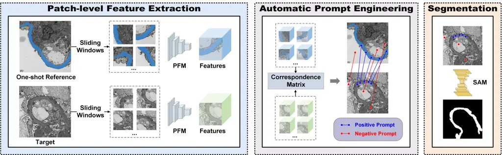
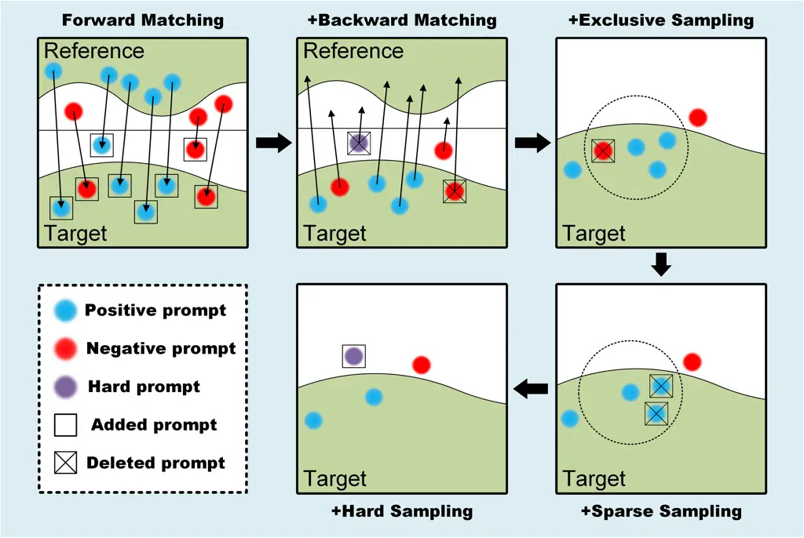
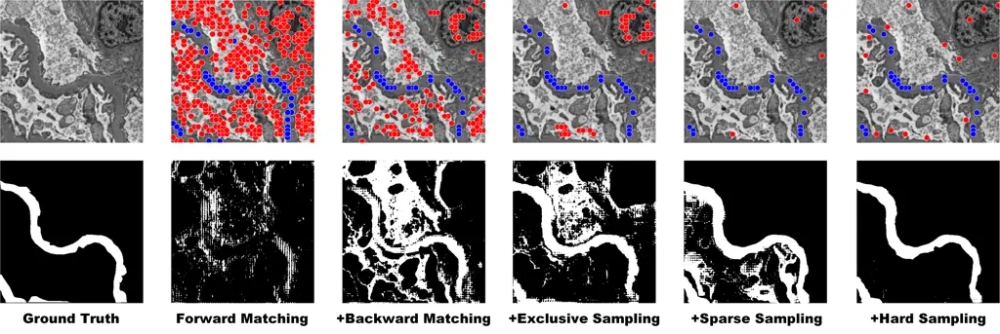

# Feature-prompting GBMSeg: One-Shot Reference Guided Training-Free Prompt Engineering for Glomerular Basement Membrane Segmentation

Xueyu Liu Affiliation: Taiyuan University of Technology, Taiyuan, China
E-mail <wuyongfei@tyut.edu.cn>    Guangze Shi Affiliation: Taiyuan
University of Technology, Taiyuan, China E-mail <wuyongfei@tyut.edu.cn>
   Rui Wang Affiliation: University of Science and Technology of China,
Hefei, China    Yexin Lai Affiliation: Taiyuan University of Technology,
Taiyuan, China E-mail <wuyongfei@tyut.edu.cn>    Jianan Zhang
Affiliation: Taiyuan University of Technology, Taiyuan, China
E-mail <wuyongfei@tyut.edu.cn>    Lele Sun Affiliation: Taiyuan
University of Technology, Taiyuan, China E-mail <wuyongfei@tyut.edu.cn>
   Quan Yang Affiliation: Taiyuan University of Technology, Taiyuan,
China E-mail <wuyongfei@tyut.edu.cn>    Yongfei
Wu$`{}^{(\textrm{{\char 0\relax}})}`$ Affiliation: Taiyuan University of
Technology, Taiyuan, China E-mail <wuyongfei@tyut.edu.cn>    Ming Li
Affiliation: Taiyuan University of Technology, Taiyuan, China
E-mail <wuyongfei@tyut.edu.cn>    Weixia Han Affiliation: Second
Hospital of Shanxi Medical University, Taiyuan, China    Wen Zheng
Affiliation: Taiyuan University of Technology, Taiyuan, China
E-mail <wuyongfei@tyut.edu.cn>

###### Abstract

Assessment of the glomerular basement membrane (GBM) in transmission
electron microscopy (TEM) is crucial for diagnosing chronic kidney
disease (CKD). The lack of domain-independent automatic segmentation
tools for the GBM necessitates an AI-based solution to automate the
process. In this study, we introduce GBMSeg, a training-free framework
designed to automatically segment the GBM in TEM images guided only by a
one-shot annotated reference. Specifically, GBMSeg first exploits the
robust feature matching capabilities of the pretrained foundation model
to generate initial prompt points, then introduces a series of novel
automatic prompt engineering techniques across the feature and physical
space to optimize the prompt scheme. Finally, GBMSeg employs a
class-agnostic foundation segmentation model with the generated prompt
scheme to obtain accurate segmentation results. Experimental results on
our collected 2538 TEM images confirm that GBMSeg achieves superior
segmentation performance with a Dice similarity coefficient (DSC) of
87.27% using only one labeled reference image in a training-free manner,
outperforming recently proposed one-shot or few-shot methods. In
summary, GBMSeg introduces a distinctive automatic prompt framework that
facilitates robust domain-independent segmentation performance without
training, particularly advancing the automatic prompting of foundation
segmentation models for medical images. Future work involves automating
the thickness measurement of segmented GBM and quantifying pathological
indicators, holding significant potential for advancing pathology
assessments in clinical applications. The source code will be made
available on
[https://github.com/SnowRain510/GBMSeg](https://github.com/SnowRain510/GBMSeg)

###### Keywords: 

T

ransmission electron microscopy; Glomerular basement membrane;
Pretrained foundation model; Segment anything model; Prompt engineering.

## 1 Introduction

Renal pathology remains the gold standard for diagnosing various kidney
diseases and is essential for formulating treatment strategies and
predicting prognosis. Histopathological evaluation of glomerular
basement membrane (GBM) plays a crucial role in the diagnosis \[2\].
Conditions such as membranous nephropathy (MN) and certain primary
glomerular diseases can contribute to the increase or decrease in GBM
thickness. By precisely evaluating the GBM, pathologists can provide
valuable assistance in determining the specific type of disease
affecting a patient. The GBM typically ranges from 100 to 400 nanometers
in thickness, requiring transmission electron microscopy (TEM) for
accurate visualization of this pathological tissue \[21\]. The abundance
of ultrastructures to be examined contributes to a time-consuming and
labor-intensive process. Meanwhile, the lack of automated segmentation
methods constrains the diagnostic procedure of qualitative analyses of
GBM thickness.

Several studies conduct to automate the analysis of TEM images \[8, 10,
4\]. However, successfully executing the entire automated process for
GBM segmentation is challenging. The GBM with notably indistinct
boundaries with the inner capillary endothelium and outer foot
processes, poses a significant challenge for the segmentation of these
boundaries \[17\]. Recently, some attempts are made to overcome the
challenge, M.Rangayyan et al. \[14\] propose a semi-automatic GBM
measurement technique based on the Canny edge detector and active
contour method to extract GBM contours under manual supervision. Cao et
al. \[1\] introduce a random forest (RF) based machine learning method
for the automatic segmentation of basement membranes using 330 annotated
TEM images. Wen et al. \[18\] apply the DeepLab-v3-based semantic
segmentation algorithm, use the null convolution to expand the
perceptual field, control the feature resolution of the image, and
achieve a better GBM segmentation using 120 annotated TEM images. Yang
et al. \[19\] utilize a multi-scale attentional convolutional neural
network (CNN) to automatically segment glomerular electron-dense
deposits with 1,200 annotated TEM patches. Lin et al. \[7\] tackle
self-supervised representation learning to utilize vast unlabeled data
and mitigate annotation scarcity, validate on 18,928 unlabeled
glomerular TEM images for self-supervised pre-training and fine-tune on
311 labeled images. Wang et al. \[17\] propose a network architecture,
RADS-Net, whose segmentation module combines the advantages of vision
transform (ViT) and CNN to achieve better performance in GBM contours
segmentation task with 30,000 annotated GBM patches.

However, those aforementioned computer-aided diagnostic methods for
segmenting GBM have several limitations. On the one hand, TEM images
exhibit a complex background and high resolution, necessitating
significant labor costs for pixel-level annotation. Despite efforts by
Wang et al. \[17\] to simplify the annotation process through
semi-automated dataset construction, the specialization of medical data
still demands substantial time investment from pathologists for
annotation and correction of training data. On the other hand, a domain
shift problem arises in TEM images due to different digital devices.
Traditional deep learning methods trained and tested for GBM
segmentation typically rely on data obtained from the same digital
device. This makes the training of the model prone to reaching the local
optimum of the current domain, and generalization becomes challenging.

In recent years, research on foundational models in natural language
processing (NLP) has been progressively influencing the field of
computer vision (CV) \[13, 5\]. Especially, Pretrained foundation models
(PFMs) represented by DINOv2\[12\] acquire generalized visual features
by capturing intricate information at the patch levels, relying solely
on raw image data. The learned generic visual features ensure robust
zero-shot transferability for downstream tasks. Simultaneously, the
Segment Anything Model (SAM) \[6\] demonstrates remarkable zero-shot
segmentation performance, showcasing considerable potential in
open-world image perception. By combining two types of foundational
models, a recent work by Liu et al. \[9\] introduces a new paradigm that
implements a training-free segmentation framework on natural images,
representing an exploration of automated prompt engineering for the
one-shot segmentation task.

Building upon the aforementioned inspiration and committed to addressing
the challenges mentioned above, we present GBMSeg, the training-free
model is guided by the one-shot reference image to accurately segment
the GBM in TEM images. To enhance the integration of feature matching
and SAM for synergistic benefits, we develop a series of automatic
prompt engineering techniques across the feature and physical space
aimed at improving segmentation quality. A total of 2538 TEM images from
286 kidney biopsy samples are digitalized as our dataset. GBMSeg
achieves the highest Dice Similarity Coefficient (DSC) of 87.27% in a
training-free paradigm using only a single annotated reference image,
outperforming the recently proposed one-shot or few-shot segmentation
methods.

## 2 Methodology

This section introduces our training-free framework, GBMSeg, designed
for the segmentation of the GBM in TEM images with a one-shot reference
approach. The overview of GBMSeg is illustrated in Fig. 1. Our framework
consists of three components: Patch-level feature extraction, automatic
prompt engineering, and GBM segmentation. Specifically, given a target
image $`x_{t}`$ and a one-shot reference image $`x_{r}`$, we divide both
into $`16\times 16`$ patches $`p_{t}`$ and $`p_{r}`$ using sliding
windows with overlap. Firstly, the Patch-level feature extraction module
generates a correspondence matrix $`M_{s}`$ by calculating the
similarity between $`p_{t}`$ and $`p_{r}`$. We then utilize the
$`M_{s}`$ to design a series of prompt engineering for obtaining optimal
positive and negative prompt points. Finally, these prompt points are
used as inputs to SAM, facilitating the generation of mask proposals. In
the following subsections, we will describe the process of automatically
generating the prompting scheme in the first two components in detail.



Figure 1: The workflow of GBMSeg, the one-shot reference guided
training-free framework, automates the segmentation of the GBM through
three components: Patch-level feature extraction, automatic prompt
engineering, and GBM segmentation.

### 2.1 Patch-level feature extraction

To generate the prompt points of the GBM (or background) in the target
image automatically, we need to build a patch-level correspondence
matrix between the reference image $`x_{r}`$ and the target image
$`x_{t}`$. Specifically, we first rely on the image encoder from
DINOv2\[12\] to extract patch-level features for both $`x_{t}`$ and
$`x_{r}`$ which are represented by $`f_{t}`$ and $`f_{r}`$,
respectively. Patch-level correspondence matrix between the $`f_{t}`$
and $`f_{r}`$ is computed to discover the most similar regions of the
GBM (or background) on the target image. We define a correspondence
matrix $`M_{s}`$ as follows:

```math
(M_{s})_{ij}=\left\lVert f_{r}^{i}-f_{t}^{j}\right\rVert, \tag{1}
```

Here, $`(M_{s})_{ij}`$ represents the Euclidean distance between the
$`i`$-th patch features $`f_{r}^{i}`$ from $`f_{r}`$ and the $`j`$-th
patch features $`f_{t}^{j}`$ from $`f_{t}`$. A smaller value of
$`(M_{s})_{ij}`$ indicates that the $`j`$-th patch is more similar to
the $`i`$-th patch. Thus, we can obtain the patch from the target image
that has the highest similarity to each patch in the reference image via
$`M_{s}`$.

### 2.2 Automatic prompt engineering

SAM serves as a robust foundational model for image segmentation,
demonstrating the potential for zero-shot learning through carefully
designed prompts. Similar to NLP, the efficacy of prompts profoundly
influences SAM’s output results. Consequently, leveraging SAM’s
impressive performance in class-agnostic segmentation, we transform the
semantic segmentation task into an endeavor focused on automatically
generating high-quality ptompt point. As shown in Fig. 2, we devise a
series of prompt engineering strategies across the feature and physical
space to systematically enhance the segmentation properties of the GBM,
a procedural elucidation of which is expounded below.



Figure 2: A process for automatic prompt engineering. As the prompt
engineering is refined, the prompt scheme is gradually optimized.

Forward matching. Given a target image, our objective is to employ the
$`M_{s}`$ for the automatic generation of prompt points by selecting the
most similar patches from the reference image. We define the patches
from $`x_{r}`$ whose centers are on the reference mask as $`p_{r}^{p}`$,
and the patches whose centers are not on the reference mask as
$`p_{r}^{n}`$. For each $`x_{t}`$, we can use $`M_{s}`$ in the feature
space to obtain the most corresponding patch $`p_{t}^{p}`$ (or
$`p_{t}^{n}`$) for each $`p_{r}^{p}`$ (or $`p_{r}^{n}`$), and set it
center as a positive prompt point (or a negative prompt point).

Backward matching. Ideally, all patches from the GBM region (or
background) in the reference image should be matched as $`p_{t}^{p}`$
(or $`p_{t}^{n}`$) via forward matching. However, in comparison to
natural images, the background of TEM images is more complex, and the
edges of the GBM are more blurred. Relying solely on forward matching
will lead to imprecise and incomplete segmentation results attributed to
numerous wrong prompt points. To eliminate incorrect prompt points, we
perform backward matching on the prompt points $`p_{t}^{p}`$ (or
$`p_{t}^{n}`$) obtained from forward matching to $`x_{r}`$ using
$`M_{s}`$. For each $`p_{t}^{p}`$ (or $`p_{t}^{n}`$), if the most
correspond patches are $`p_{r}^{p}`$ (or $`p_{r}^{n}`$), these prompt
points are retained. Conversely, if the most corresponding patch is
$`p_{r}^{n}`$ (or $`p_{r}^{p}`$), these points are excluded. In
addition, these excluded points with correspondence exceeding the mean
value would be employed as hard negative sampling prompt points in
subsequent steps.

Exclusive sampling. Through forward and backward matching prompt
engineering, we have substantiated the accuracy of generated prompt
point in the feature space. To further optimize the prompt scheme, we
employ exclusive sampling in the physical space. Specifically, by
defining a hyperparameter $`D_{ex}`$, we exclude all negative prompt
points within the range defined by each positive prompt point as the
center of the circle and $`D_{ex}`$ as the search radius. This approach
ensures the maximization of negative prompt points for errors in the
physical space.

Sparse sampling. The rationale behind our point generation involves
iterating over all $`p_{r}^{p}`$ and $`p_{r}^{n}`$ to generate prompt
points, resulting in a substantial number of positive prompt points and
negative prompt points for each $`x_{t}`$. However, the features of
background or target exhibit significant diversity. Overemphasizing the
same region can cause SAM to disregard other regions. For instance, when
the features in the target image strongly correlate with those in the
reference image, an abundance of prompt points may concentrate on that
region, leading to excessive attention to that specific area and
neglecting other regions. Therefore, we employ sparse sampling in the
physical space to sparsify positive prompt points (or negative prompt
points), aiming for a more balanced focus on the GBM region (or
background) to enhance segmentation performance. Specifically, we
introduce a hyperparameter $`D_{sp}`$ to conduct a search with all
selected prompt points as the center of the circle and $`D_{sp}`$ as the
search radius. If there exists a set of prompt points of the same class
within the range, we compute the average distance between all prompt
points and other classes of prompt points separately, retaining the
prompt point with the largest distance. This sparsification of prompt
points in physical space aims to enhance the subsequent segmentation
performance of SAM.

Hard sampling. To minimize false positive segmentation of background
regions similar to GBM regions, we employ a collection of hard negative
prompt points. These prompt points are selected based on their
correspondence value exceeding the mean value and are removed during the
backward matching procedure. These hard negative sampling prompt points,
which represent false positive prompt points, are then incorporated into
the negative prompt points.

## 3 Experimental Results

### 3.1 Dataset preparation

A total of 286 kidney biopsy samples from patients are collected at the
Second Affiliated Hospital of Shanxi Medical University between 2020 and 2022. The dataset comprises a diverse range of chronic kidney diseases,
such as membranous nephropathy, diabetic nephropathy, microscopic
lesions, and others. From these kidney biopsy samples, a total of 2538
TEM images of glomeruli are digitalized using the JEM-1400 FLASH TEM,
operating at 120 kV acceleration voltage, and magnification varied
between 2500$`\times`$ and 15000$`\times`$. Ethical approval for data
collection is obtained from the Ethics Committee on Human Research of
the Second Affiliated Hospital of Shanxi Medical University (No.
YX.026). All TEM images are labeled by three pathologists using
Labelme\[15\] to annotate the GBM. Only one of these images served as
the reference of GBMSeg, while the remaining are employed to evaluate
the model’s performance.

### 3.2 Implementation Detail

Our experiments are carried out on a Linux server platform equipped with
an NVIDIA Tesla V100. In the patch-level feature extraction stage, we
utilize DINOv2 with a ViT-L/14 as the default image encoder. The SAM
serves as the segmenter, incorporating ViT-H, ViT-L, and ViT-B, with
their performances compared. Notably, our model is training-free, and to
emphasize, any training is not employed for segmenting the GBM. During
the testing phase, we employ the DSC to evaluate the segmentation
performance of the proposed method.

### 3.3 Ablation study

We conduct ablation experiments to evaluate the segmentation performance
of different model components. The quantitative segmentation results,
compared to various prompt engineering schemes, are presented in Table

1. As the components in the automatic prompt engineering continue to be
   refined, multiple backbone architectures exhibit improved SAM
   segmentation performance.

|                  |                   |                    |                 |               |       |       |       |       |
| ---------------- | ----------------- | ------------------ | --------------- | ------------- | ----- | ----- | ----- | ----- |
| Forward Matching | Backward Matching | Exclusive Sampling | Sparse Sampling | Hard Sampling | ViT-L | ViT-H | ViT-B | Ave.  |
| ✓                |                   |                    |                 |               | 59.73 | 9.68  | 49.77 | 39.73 |
| ✓                | ✓                 |                    |                 |               | 71.69 | 54.46 | 41.32 | 55.82 |
| ✓                | ✓                 | ✓                  |                 |               | 82.11 | 62.38 | 59.50 | 67.99 |
| ✓                | ✓                 | ✓                  | ✓               |               | 84.94 | 84.44 | 71.34 | 80.24 |
| ✓                | ✓                 | ✓                  | ✓               | ✓             | 87.27 | 85.56 | 73.77 | 82.20 |

Table 1: The performance comparison of different model components (Unit:
%).

The corresponding qualitative segmentation results are also displayed in
Fig. 3. Specifically, forward matching alone leads to a significant
number of erroneous and redundant prompt points, resulting in high false
positives and false negatives. The introduction of backward matching
reduces the occurrence of erroneous prompt points to a certain extent
and enhances the recall of segmentation results. Exclusive sampling
further corrects for false negative prompt points, contributing to a
more comprehensive segmentation of the GBM. Meanwhile, sparse sampling
helps refine the prompt points, improving segmentation accuracy by
eliminating excessive prompt points in similar regions. Finally, hard
sampling is employed to increase the number of challenging negative
prompt points, negatively prompting the background area around the
target and optimizing segmentation performance.

Additionally, we conducted hyperparameter selection experiments for
exclusive sampling and sparse sampling. For exclusive sampling, the
performance is optimal when $`D_{ex}`$ selects 25% of the image size.
For sparse sampling, the best performance is achieved when $`D_{sp}`$
for positive sampling points is set to 0, and $`D_{sp}`$ for negative
sampling points is set to 12.5% of the image size. This may be due to
the fact that a dense distribution of negative prompts in regions with
heterogeneous background features can degrade SAM segmentation
performance. Conversely, in targets with homogeneous features, a dense
positive prompt distribution does not degrade SAM segmentation
performance and helps counteract the impact of some erroneous negative
prompts.



Figure 3: Different stages of the automatic prompt engineering yield
positive and negative prompt schemes, alongside corresponding GBM
segmentation results. Notably, as the components of automatic prompt
engineering are refined, the segmentation results steadily converge
toward the ground truth.

### 3.4 Performance comparison with few-shot and one-shot methods

To assess the effectiveness of the synergy between the proposed
automatic prompt engineering and SAM, we compare GBMSeg with
state-of-the-art few-shot or one-shot segmentation networks \[11, 3\],
as well as recently introduced training-free segmentation frameworks
\[16, 20, 9\]. The experimental results, presented in Table 2,
demonstrate that GBMSeg not only outperforms the current
state-of-the-art training-free methods but also excels over both the
one-shot and few-shot training methods. Our model achieves optimal
performance with minimal training resources by implementing an effective
prompt scheme to assist the SAM in segmenting the GBM.

|                   |                   |           |             |       |
| ----------------- | ----------------- | --------- | ----------- | ----- |
| Methods           | Annotated samples | SAM-based | Traing-free | DSC   |
| HSNet-1 \[11\]    | One-shot          | ✗         | ✗           | 21.03 |
| HSNet-5 \[11\]    | Five-shot         | ✗         | ✗           | 50.34 |
| VAT-1 \[3\]       | One-shot          | ✗         | ✗           | 68.74 |
| VAT-5 \[3\]       | Five-shot         | ✗         | ✗           | 78.81 |
| SegGPT\[16\]      | One-shot          | ✗         | ✓           | 74.31 |
| PerSAM\[20\]      | One-shot          | ✓         | ✓           | 42.39 |
| Matcher\[9\]      | One-shot          | ✓         | ✓           | 69.09 |
| GBMSeg (Our work) | One-shot          | ✓         | ✓           | 87.27 |

Table 2: The performance comparison with few-shot and one-shot methods
(Unit: %).

## 4 Conclusion

In this study, we introduce GBMSeg, a training-free model designed to
segment the GBM in TEM images, guided only by a one-shot reference. The
proposed framework leverages the robust feature matching capabilities
inherent in a universal feature extraction model to generate initial
positive and negative prompt points. Subsequently, it employs a series
of novel automatic prompt engineering techniques across the feature and
physical space to obtain optimized prompt schemes. The refined prompt
scheme is then input into a foundation segmentation model, resulting in
the final segmentation outcome. GBMSeg demonstrates exceptional
performance, achieving a DSC of up to 87.27% on 2538 glomerular TEM
images, using only one annotated reference image. This performance
establishes GBMSeg as outperforming the recently proposed one-shot or
few-shot segmentation methods. Rigorous experiments on ablation studies
also substantiate the efficacy of each component in the automatic prompt
engineering process. In summary, GBMSeg adeptly and efficiently segments
GBM only using a one-shot reference, offering a training-free paradigm.
Future endeavors include the quantification of pathological metrics hold
significant potential for enhancing pathological assessment and
decision-making in clinical applications.

#### Disclosure of Interests.

The authors have no competing interests to declare that are relevant to
the content of this article.

## References

- \[1\] Cao, L., Lu, Y., Li, C., Yang, W., et al.: Automatic
  segmentation of pathological glomerular basement membrane in
  transmission electron microscopy images with random forest stacks.
  Computational and mathematical methods in medicine 2019 (2019)
- \[2\] Fogo, A.B.: Renal pathology. Pediatric nephrology (2009)
- \[3\] Hong, S., Cho, S., Nam, J., Lin, S., Kim, S.: Cost aggregation
  with 4d convolutional swin transformer for few-shot segmentation. In:
  European Conference on Computer Vision. pp. 108–126. Springer (2022)
- \[4\] Huang, W., Chen, C., Xiong, Z., Zhang, Y., Chen, X., Sun, X.,
  Wu, F.: Semi-supervised neuron segmentation via reinforced consistency
  learning. IEEE Transactions on Medical Imaging 41(11),
  3016–3028 (2022)
- \[5\] Jia, C., Yang, Y., Xia, Y., Chen, Y.T., Parekh, Z., Pham, H.,
  Le, Q., Sung, Y.H., Li, Z., Duerig, T.: Scaling up visual and
  vision-language representation learning with noisy text supervision.
  In: International conference on machine learning. pp. 4904–4916.
  PMLR (2021)
- \[6\] Kirillov, A., Mintun, E., Ravi, N., Mao, H., Rolland, C.,
  Gustafson, L., Xiao, T., Whitehead, S., Berg, A.C., Lo, W.Y., et al.:
  Segment anything. arXiv preprint arXiv:2304.02643 (2023)
- \[7\] Lin, G., Zhang, Z., Long, K., Zhang, Y., Lu, Y., Geng, J., Zhou,
  Z., Feng, Q., Lu, L., Cao, L.: Gclr: A self-supervised representation
  learning pretext task for glomerular filtration barrier segmentation
  in tem images. Artificial Intelligence in Medicine p. 102720 (2023)
- \[8\] Liu, D., Zhang, D., Song, Y., Zhang, F., O’Donnell, L., Huang,
  H., Chen, M., Cai, W.: Pdam: A panoptic-level feature alignment
  framework for unsupervised domain adaptive instance segmentation in
  microscopy images. IEEE Transactions on Medical Imaging 40(1),
  154–165 (2020)
- \[9\] Liu, Y., Zhu, M., Li, H., Chen, H., Wang, X., Shen, C.: Matcher:
  Segment anything with one shot using all-purpose feature matching.
  arXiv preprint arXiv:2305.13310 (2023)
- \[10\] Liu, Y., Ji, S.: Cleftnet: augmented deep learning for synaptic
  cleft detection from brain electron microscopy. IEEE Transactions on
  Medical Imaging 40(12), 3507–3518 (2021)
- \[11\] Min, J., Kang, D., Cho, M.: Hypercorrelation squeeze for
  few-shot segmentation. In: Proceedings of the IEEE/CVF international
  conference on computer vision. pp. 6941–6952 (2021)
- \[12\] Oquab, M., Darcet, T., Moutakanni, T., Vo, H., Szafraniec, M.,
  Khalidov, V., Fernandez, P., Haziza, D., Massa, F., El-Nouby, A.,
  et al.: Dinov2: Learning robust visual features without supervision.
  arXiv preprint arXiv:2304.07193 (2023)
- \[13\] Radford, A., Kim, J.W., Hallacy, C., Ramesh, A., Goh, G.,
  Agarwal, S., Sastry, G., Askell, A., Mishkin, P., Clark, J., et al.:
  Learning transferable visual models from natural language supervision.
  In: International conference on machine learning. pp. 8748–8763.
  PMLR (2021)
- \[14\] Rangayyan, R.M., Kamenetsky, I., Benediktsson, H.: Segmentation
  and analysis of the glomerular basement membrane in renal biopsy
  samples using active contours: a pilot study. Journal of digital
  imaging 23, 323–331 (2010)
- \[15\] Russell, B.C., Torralba, A., Murphy, K.P., Freeman, W.T.:
  Labelme: a database and web-based tool for image annotation.
  International journal of computer vision 77(1-3), 157–173 (2008)
- \[16\] Wang, X., Zhang, X., Cao, Y., Wang, W., Shen, C., Huang, T.:
  Seggpt: Towards segmenting everything in context. In: Proceedings of
  the IEEE/CVF International Conference on Computer Vision. pp.
  1130–1140 (2023)
- \[17\] Wang, Y., Liu, Y., Fu, Y., Chen, X., Zhao, S., Ye, J., He, Y.,
  Wang, Z., Guan, T., Li, J.: Segmentation and thickness calculation of
  glomerular basement membrane using rads-net in glomerular microscopic
  images. Biomedical Signal Processing and Control 88, 105557 (2024)
- \[18\] Wen, J., Lin, G., Zhang, Y., Zhou, Z., Cao, L., Feng, Q.:
  Semantic segmentation of ultrastructural pathological images of
  glomerular filtration membrane using deep learning network. Chin J Med
  Phys 37(2), 195–204 (2019)
- \[19\] Yang, J., Hu, X., Pan, H., Chen, P., Xia, S.: Multi-scale
  attention network for segmentation of electron dense deposits in
  glomerular microscopic images. Microscopy Research and Technique
  85(9), 3256–3264 (2022)
- \[20\] Zhang, R., Jiang, Z., Guo, Z., Yan, S., Pan, J., Dong, H., Gao,
  P., Li, H.: Personalize segment anything model with one shot. arXiv
  preprint arXiv:2305.03048 (2023)
- \[21\] Zhuo, L., Wang, H., Chen, D., Lu, H., Zou, G., Li, W.:
  Alternative renal biopsies: past and present. International Urology
  and Nephrology 50, 475–479 (2018)
