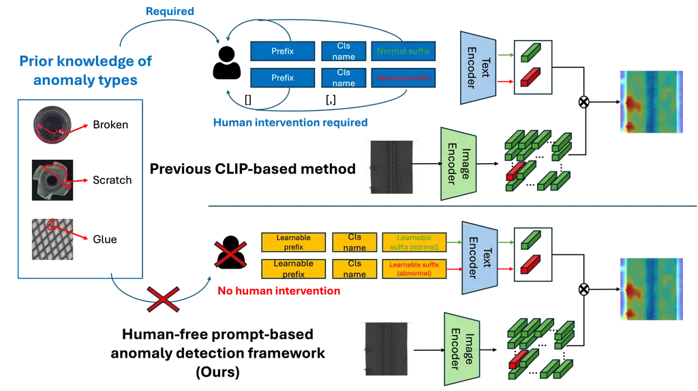
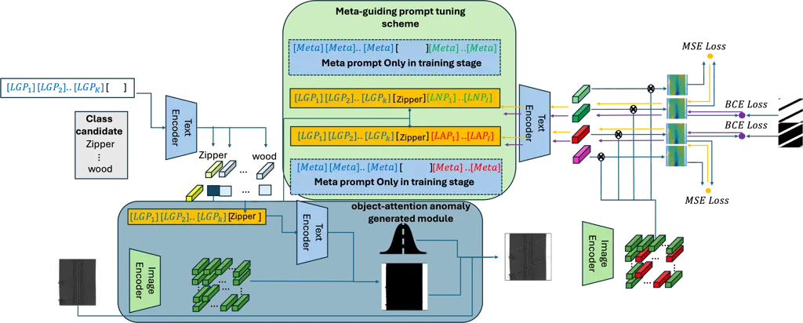
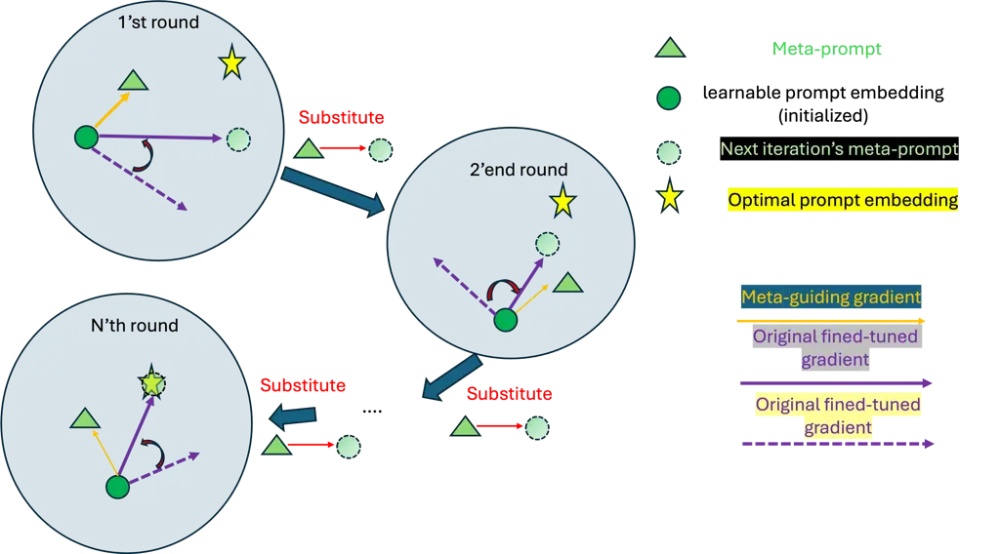

# Human-Free Automated Prompting for Vision-Language Anomaly Detection: Prompt Optimization with Meta-guiding Prompt Scheme

Pi-Wei Chen  
National Cheng Kung University  
nf6111015@gs.ncku.edu.tw and Jerry Lin  
BakuAI AS  
jerry@bakuai.no and Feng-Hao Yeh  
National Cheng Kung University  
yeh.feng.hao.110@gmail.com and Jia Ji  
National Cheng Kung University  
jijia20001118@gmail.com and Zih-Ching Chen  
NVIDIA  
virginiac@nvidia.com and Chao-Chun Chen  
National Cheng Kung University  
chencc@imis.ncku.edu.tw

###### Abstract

Pre-trained vision-language models (VLMs) are highly adaptable to
various downstream tasks through few-shot learning, making prompt-based
anomaly detection a promising approach. Traditional methods depend on
human-crafted prompts that require prior knowledge of specific anomaly
types. Our goal is to develop a human-free prompt-based anomaly
detection framework that optimally learns prompts through data-driven
manner, eliminating the need for human intervention. The primary
challenge in this approach is the lack of anomalous samples during the
training phase. To tackle this challenge, we develop the
Object-Attention Anomaly Generation Module (OAGM) to synthesize anomaly
samples for training. Furthermore, to prevent learned prompt from
overfit on synthesized anomaly feature, we proposed Meta-Guiding
Prompt-Tuning Scheme (MPTS) that iteratively adjusts the gradient-based
optimization direction of learnable prompts to avoid overfitting to the
synthesized anomalies . This framework allows for the optimal prompt
embeddings by searching in the continuous latent space via
backpropagation, free from human semantic constraints. Additionally, the
modified locality-aware attention improves the precision of pixel-wise
anomaly segmentation.

## 1 Introduction

In the field of anomaly detection, acquiring annotations for anomalous
samples is often challenging. Consequently, prior research has focused
on unsupervised learning, which involves training models on large
volumes of anomaly-free data to identify deviations from normal features
as anomalies. Recently, some approaches have addressed more extreme
scenarios where only a few normal samples are available. These methods
leverage vision-language pretrained models, such as CLIP, to facilitate
few-shot anomaly detection.



Figure 1: The upper part shows previous methods requiring human-designed
prompts. The lower part illustrates our automated, data-driven approach
using learnable prompts without prior knowledge.

Vision-language models are renowned for their adaptability to various
downstream tasks such as classification and segmentation. The remarkable
transferability of vision-language models across different computer
vision tasks can be attributed to their large-scale pre-training on
text-image pairs \[3\]. This training enables the model to capture
relevant semantic features based on the provided prompts, thereby
allowing the model to leverage the textual modality to solve visual
tasks such as anomaly detection. \[8\] pioneered the application of VLMs
for zero-shot or few-shot anomaly detection. This approach leverages
lexical terms related to ’anomaly’ and ’normal’ to identify anomalous
visual features in the test samples, providing a foundation for
subsequent studies to further advance few-shot anomaly detection
methodologies. Prompt engineering is a crucial technique that preserves
the robustness and generalization capabilities of CLIP while efficiently
adapting it to meet the demands of specific applications. The primary
objective of prompt tuning is to obtain an optimal textual embedding
that aligns with the target visual image embedding, ensuring that the
model accurately captures the nuances of the task at hand.

Previous work \[8\] proposed a prompt ensemble technique that composes
different prompt templates (e.g., ”a photo of a \[c\] for visual
inspection”) and normal-abnormal-relevant prompts (e.g., ”flawless” for
normality, ”damaged” for anomaly) to obtain text embeddings aligned with
anomaly detection semantics. Recent studies \[9, 16\] have leveraged
prefix prompt tuning (context optimization \[15\]) to replace static
prompt templates with learnable prompts, better catering to anomaly
detection tasks. Although prior work has demonstrated the efficacy of
prefix prompting, it still necessitates a customized, manually-designed
suffix to describe the anomaly type for each class item. This process
heavily relies on detailed and specific prior knowledge of the dataset
and the types of anomalies that may appear in each product category, as
shown in the upper part of Fig 1. This remains a non-trivial task
requiring iterative adjustments, rather than automatically finding the
optimal textual embedding.

We are motivated by \[15\], which provides insights that the optimal
prompts derived through prompt tuning do not necessarily align with
human semantics or intuition. Previous work has often focused on
combining various human semantic terms, such as ’anomaly’ and ’defect,’
to generate better embeddings. However, we propose a novel perspective:
instead of adhering to human-centric semantics, we should employ
data-driven optimization methods, such as gradient-based learning, to
derive the most effective textual embeddings. By utilizing these
advanced deep learning techniques, we can create more robust and precise
embeddings that better capture the nuances needed for anomaly detection
and adapt to various datasets without the need for prior knowledge as
show in lower part in Fig 1.

However, to optimize the Learnable Normal Prompt (LNP) and Learnable
Anomaly Prompt (LAP), samples from both normal and anomalous data are
required. In the case of few-shot anomaly setting, only normal samples
are available during training. To enable the acquirement of optimal
textual embedding for anomaly detection, we need to self-generate
anomaly sample to obtain the optimal prompt for better textual
embedding. One intuitive method to synthesize anomalous samples is by
adding Gaussian noise to the image pixels to mimic anomalies. However,
Gaussian noise alone might not guarantee performance in real-world
scenarios because such synthetic anomalies often lack the complex and
context-specific characteristics of true anomalies.

Additionally, Vision-Language Models (VLMs) are not designed for
pixel-wise tasks like segmentation, making them unsuitable for
pixel-level anomaly detection. During VLM pre-training, only global
features (e.g., class tokens in Vision Transformers) are considered,
neglecting localized features that capture fine-grained image details.
Consequently, the relationship between text prompts and specific image
regions is not optimized, leading to unpredictable results where the
target prompt may not align with the target object pixels \[12, 10\].

In this paper, we propose a human-free automated prompting anomaly
detection framework, namely ”Meta-prompting Semantic Learning for
Anomaly Detection with Locality-aware Attention Image Encoder”. The
proposed framework follows the intuition of data-driven methods that
leverage back-propagation to actively find the prompt that can generate
the optimal textual embedding suited for anomaly detection, instead of
passively combining all possible human semantic prompts to meet the
requirements of prompt-based anomaly detection. To address the
limitation of the absence of anomaly samples for context optimization,
we develop the Object-Attention Anomaly Generation Module to synthesize
anomaly samples for training. Meanwhile, the proposed Meta-guiding
Prompt-tuning Scheme (MPTS) is developed to prevent the learnable prompt
from overfitting on synthesized anomalies through iterative
gradient-based calibration.

In Meta-Prompt Tuning Scheme (MPTS), we introduce a dynamic meta-prompt
that serves as an anchor to balance specificity and generality in
anomaly detection via gradient-based calibration. This meta-prompt
ensures that learnable prompts remain aligned with meaningful,
generalizable concepts while leveraging useful information from
synthesized anomalies without deviating from the core goal of anomaly
detection. Initially, a general prompt template provided by a large
language model (LLM) is embedded with real-world anomaly semantics,
serving as the initial meta-prompt. This helps ensure that the learnable
prompts do not deviate significantly from true anomalies during
fine-tuning. Throughout each training round, the optimized learnable
prompt from the previous round serves as the new meta-guiding prompt,
iteratively refining the process. Meta-guiding prompts ensure that the
learnable prompts resemble real anomalies, enhancing detection
effectiveness. Additionally, introducing Gaussian noise diversifies the
patterns, improving generalization across various anomaly types. This
combination allows the learnable prompts to generalize well to different
anomalies while maintaining alignment with real-world characteristics.

To further improve the quality of synthesized anomalous samples, we
introduce the ”Object-Attention Anomaly Generation Module”. This module
leverages the general knowledge of CLIP to identify the target object in
the image and applies noise specifically to that object. By doing so,
the synthesized anomalies better reflect practical scenarios, as
real-world anomalies usually occur on target objects rather than in the
background, which is typically not the focus of anomaly detection.

Additionally, we introduce Locality-aware Attention, which can be
adopted by any transformer-based model to mitigate the misalignment of
input token features and corresponding output token features. This
mechanism restricts attention to local neighborhoods, preserving
essential local details and enhancing the alignment between the input
features and the output tokens. By focusing on neighboring regions, the
locality-aware attention ensures that the feature extraction process
maintains the spatial integrity of the image. This addresses the
limitations of the vanilla attention mechanism, where distant tokens
tend to dilute crucial local information, resulting in the misalignment
of locality features between input and output. The contributions are
listed as follows: (1) We propose a novel paradigm for a prompt-based
anomaly detection framework, namely Meta-prompting Semantic Learning for
Anomaly Detection with Locality Feature Attention Image Encoder, which
optimizes the pre-trained VLM for anomaly detection tasks in a
human-free prompting manner; (2) We introduce the Meta-guiding
Prompt-tuning Scheme along with the Object-Attention Anomaly Generation
Module to enable the optimization of learnable prompts in the absence of
anomaly samples. The optimized learnable prompts with the Meta-guiding
Prompt-tuning Scheme even exceed manually designed prompts by a
significant margin; (3) We propose the Locality-Aware Transformer, which
aims to extract a feature map where all locality features align with
their original image positions, ensuring pixel-wise anomaly segmentation
in the CLIP-based framework.



Figure 2: The overall architecture of Meta-prompting Semantic Learning
for Anomaly Detection with Locality Feature Attention Image Encoder

## 2 Related Work

### 2.1 Vision-language model

Vision-language models (VLMs) are advanced AI systems that integrate
computer vision (CV) and natural language processing (NLP) to understand
the commonality of semantics between text embeddings and visual
features. These multimodal models are trained on extensive datasets of
paired images and text, utilizing techniques like contrastive learning
\[3\] and masked language modeling to map visual and textual data into a
shared semantic space. A notable open-source VLM is OPENCLIP \[7\],
which excels in generalization, enabling rapid adaptation to various
downstream tasks such as image classification and object detection
without task-specific training. Furthermore, \[15\] proposed context
optimization, which can tune learnable prompts with few-shot samples,
achieving optimal performance surpassing human-designed prompts with.

### 2.2 Anomaly detection

Traditional paradigms of anomaly detection \[13, 6, 11, 2\] typically
utilize only normal samples for training anomaly detection models. This
approach, known as unsupervised anomaly detection, does not require any
anomaly samples during training. In recent years, the research focus has
shifted from unsupervised anomaly detection to the more challenging
few-shot scenario, where only a limited number of normal samples are
available during the training phase. PatchCore \[4\] employs a
memory-efficient technique to capture normal patterns in few-shot data
for anomaly inference. RegAD \[14\] introduces a region-based method
that maximizes the information extracted from each example, effectively
learning informative features for anomaly inference using only a few
normal samples.

Recent studies \[8, 9\] have further addressed the anomaly detection
challenge with multimodal solutions, leveraging the general knowledge
embedded in pre-trained vision-language models (VLMs) to perform
zero-shot and few-shot anomaly detection with the guidance of textual
modality. However, these approaches still rely on human-designed
prompts, with their performance dependent on the prompt engineer’s prior
knowledge of the specific application scenario. This dependency
highlights the need for more advanced, data-driven methods to optimize
prompt selection and enhance anomaly detection performance.

## 3 Proposed Framework

### 3.1 Problem Definition:

In this paper, we address the few-shot anomaly detection task, where
only a few normal samples are available during the training stage. We
suppose $`D_{\text{train}}=\{(\mathbf{x}_{i},y_{i}=0)\}_{i=1}^{k}`$ is
the $`k`$-shot sample given in the training stage ($`y_{i}\in\{0,1\}`$).
Each $`\mathbf{x}_{i}\in\mathbb{R}^{H\times W}`$ is a normal sample when
$`y_{i}=0`$, and abnormal when $`y_{i}=1`$.

In our proposed human-free prompt-based anomaly detection framework, we
substitute traditional human prompts (”a photo of a {} without defect”
as the normality prompt and ”a photo of a defective {}” as the
abnormality prompt) with learnable prompts. The learnable normality
prompt (LNP) and the learnable abnormality prompt (LAP) are composed of
a learnable general prefix (LGP) $`=\left[G_{1},\ldots,G_{ng}\right]`$
and a learnable normal or abnormal suffix (LNS
$`=\left[N_{1},\ldots,N_{nr}\right]`$ or LAS
$`=\left[A_{1},\ldots,A_{na}\right]`$, respectively:

```math
\begin{cases}\text{LNP}=\left[G_{1},\ldots,G_{ng}\right]\left[\text{cls}\right]\left[N_{1},\ldots,N_{nr}\right]\ \\
\text{LAP}=\left[G_{1},\ldots,G_{ng}\right]\left[\text{cls}\right]\left[A_{1},\ldots,A_{na}\right]\end{cases} \tag{1}
```

The LNP and LAP are leveraged to calculate the anomaly score map
$`S\in\mathbb{R}^{H\times W\times 1}`$ on the feature map
$`F\in\mathbb{R}^{H^{\prime}\times W^{\prime}\times C}`$ extracted from
the testing sample.

In the inference stage, we have
$`D_{\text{test}}=\{(\mathbf{x}_{i},y_{i},M_{i})\}_{i=1}^{N}`$. The mask
$`M\in\{0,1\}^{H\times W}`$ is the ground truth map for anomaly pixels,
where each pixel $`m_{j}\in M`$ indicates whether the corresponding
pixel $`x_{j}\in x`$ is anomalous ($`m_{j}=1`$) or normal ($`m_{j}=0`$).

Our objective is to leverage $`D_{\text{train}}`$ to tune LAP and LNP
such that they can yield an anomaly score map $`S`$ that aligns with the
ground truth anomaly map $`M`$. This can be represented as:

```math
\arg\max\text{Sim}(S,M) \tag{2}
```

where $`\text{Sim}()`$ is a similarity metric that calculates the
alignment degree between $`S`$ and $`M`$.

### 3.2 Overview

The overall framework of the proposed Meta-prompting Semantic Learning
for Anomaly Detection with Locality Feature Attention Image Encoder is
illustrated in Fig 2. The proposed Meta-guiding Prompt-tuning Scheme
(Sec 3.3) sets a new paradigm for prompt-based anomaly detection with no
human semantic lexicon involved in inference. To address the absence of
anomalous samples for tuning prompts, the proposed Object-Attention
Anomaly Generation Module (OAGM) (Sec 3.4) produces synthesized
anomalous samples for tuning while remaining practical by only applying
to items instead of the background. Additionally, to enhance the
locality feature extraction, the visual encoder adopts a novel proposed
Locality-Aware Transformer (Sec 3.5), which enhances locality feature
extraction with neighbor-cls-only attention. The prompts LG and
normal/abnormal suffix ( LNS / LAS ) are designed as fully learnable
parameters.

### 3.3 Meta-guiding Prompt-tuning Scheme



Figure 3: The illustration of Meta-guiding Prompt-tuning Scheme

The Meta-guiding Prompt-tuning Scheme is illustrated in Fig 3, which an
self-optimized meta-prompt will iterativly update it self and guiding
the learning direction of learnable prompt with gradient correction.

To tune LAP and LNP to align with the anomaly detection task, the OAGM
(Sec 3.4) will synthesize anomalous samples
$`{(\mathbf{x^{\prime}}_{i},y_{i}=1,M^{\prime}a)}{i=1}^{k}`$, where
$`M^{\prime}_{a}\in{0,1}^{H\times W}`$ is the abnormality binary mask
indicating whether each pixel $`m_{j}\in M^{\prime}_{a}`$ is
contaminated with synthesized anomaly ($`m_{j}=1`$) or not
($`m_{j}=0`$). A normality binary mask $`M^{\prime}_{n}`$ can be
obtained by:

```math
M^{\prime}_{n}=1-M^{\prime}_{a} \tag{3}
```

The LNP with the extracted feature map of $`\mathbf{x^{\prime}}_{i}`$ is
dot-multiplied to calculate the normality score map $`S_{n}`$,
indicating whether each pixel in $`\mathbf{x^{\prime}}_{i}`$ aligns with
normality. Similarly, LAP is used to obtain an abnormality score map
$`S_{a}`$. To aggregate the information from both LNP and LAP and
produce a probability-like output (bounded from 0 to 1), we concatenate
$`S_{n}`$ and $`S_{a}`$ and apply Softmax along each element, finally
obtaining normalized score maps $`S^{\prime}_{n}`$ and
$`S^{\prime}_{a}`$. The training objective is to tune LNP such that its
embedding perfectly aligns with the normality embedding in
$`\mathbf{x^{\prime}}`$. This involves aligning $`S^{\prime}_{n}`$ with
the normality binary mask $`M^{\prime}_{n}`$ using BCEloss:

```math
\displaystyle\mathcal{L}_{\text{ano}}^{\text{LNP}}=-\sum_{j\mid m_{j}=1}\Big[ \displaystyle M^{\prime}_{n}(j)\log S^{\prime}_{n}(j)
```

```math
\displaystyle+(1-M^{\prime}_{n}(j))\log(1-S^{\prime}_{n}(j))\Big] \tag{4}
```

For LAP, the objective is to align LAP with the abnormality embedding in
$`\mathbf{x^{\prime}}`$:

```math
\displaystyle\mathcal{L}_{\text{ano}}^{\text{LAP}}=-\sum_{j\mid m_{j}=1}\Big[ \displaystyle M^{\prime}_{a}(j)\log S^{\prime}_{a}(j)
```

```math
\displaystyle+(1-M^{\prime}_{a}(j))\log(1-S^{\prime}_{a}(j))\Big] \tag{5}
```

Meta-guiding: Synthesized anomaly samples, while useful for training,
may contain artifacts or specific characteristics that are not
representative of real-world anomalies. To address this limitation, we
propose a meta-guiding scheme to regularize the tuning process with
general, domain-agnostic knowledge embedded in pre-trained VLMs.

Initially, we provide general manual prompts as Meta Normality Prompt
(MNP) and Meta Abnormality Prompt (MAP) (see appendix), which act as
anchors to prevent LAP and LNP from overfitting on artifact anomalies
and maintain generalization with a broader concept of anomaly. By
calibrating the LNP and LAP gradients from Eq 4 and Eq 5, respectively,
with the divergence loss between MAP/MNP and LAP/LNP, we can ensure that
LAP and LNP are optimized toward a task-specific prompt that human
semantics cannot achieve while maintaining generalization.

This divergence loss is designed to estimate the output score maps from
LAP/LNP ($`S^{\prime}_{a}`$ and $`S^{\prime}_{n}`$, respectively) and
MAP/MNP (denoted as $`S^{M}_{a}`$ and $`S^{M}_{n}`$, respectively).
Since the values of the output score maps are already transformed to
probability form, we use KL divergence as the distance metric to
estimate the divergence. The divergence loss can be written as:

```math
\mathcal{L}_{\text{div}}^{A}=\sum_{i=1}^{H\times W}\text{KL}(S^{M}_{a}(i)\parallel S^{\prime}_{a}(i)) \tag{6}
```

```math
\mathcal{L}_{\text{div}}^{M}=\sum_{i=1}^{H\times W}\text{KL}(S^{M}_{n}(i)\parallel S^{\prime}_{n}(i)) \tag{7}
```

To strike a balance between task-specific objectives and generalization,
the meta-guiding scheme will only calibrate the gradient when the
gradient $`G_{\text{ano}}^{\text{LAP/LNP}}`$ from fine-tuning the
anomaly loss:

```math
G_{\text{ano}}^{\text{LAP/LNP}}=\frac{\partial\mathcal{L}^{\text{LAP/LNP}}_{\text{ano}}}{\partial\theta_{\text{LAP/LNP}}} \tag{8}
```

contradicts the gradient from divergence loss
$`G_{\text{div}}^{\text{LAP/LNP}}`$.

```math
G_{\text{div}}^{\text{LAP/LNP}}=\frac{\partial\mathcal{L}_{\text{div}}^{\text{A/M}}}{\partial\theta_{\text{LAP/LNP}}} \tag{9}
```

The LAP and LNP are optimized with the gradient
$`G_{\text{ano}}^{\text{LAP/LNP}}`$ after being calibrated with Eq 10:

```math
\begin{cases}G_{\text{ano}}-\lambda\cdot\text{Cos}\left(G_{\text{ano}},G_{\text{div}}\right),&\text{if }\text{Cos}\left(G_{\text{ano}},G_{\text{div}}\right)<0\\
G_{\text{ano}},&\text{otherwise}\end{cases} \tag{10}
```

The meta-guiding scheme ensures that the optimization direction will
explore the optimal prompt that aligns better with the anomaly detection
task while preventing overfitting on synthesized anomalies.

Based on the intuition that we have obtained a more optimal
$`\text{LAP}^{t+1}`$/$`\text{LNP}^{t+1}`$ through gradient descent
instead of relying on human semantics, we substitute the MAP/MNP with
$`\text{LAP}^{t+1}`$/$`\text{LNP}^{t+1}`$ as the new Meta prompt for the
next meta-epoch training. We iteratively refine the MAP/MNP and LAP/LNP
until the loss converges. This iterative substitution strategy balances
the need for task-specific adaptation and generalization. By continually
referring back to the meta-guiding prompts, the model maintains a
connection to the initial general knowledge while fine-tuning the
prompts to better detect anomalies.

### 3.4 Object-attention Anomaly Generation Module

To tune LAP and LNP to align with the anomaly detection task, we propose
the Object-Attention Anomaly Generation Module (OAGM). Traditional
methods that add Gaussian noise randomly across the entire image are
suboptimal because they affect irrelevant background regions, diluting
the model’s ability to focus on the target object. The OAGM addresses
this limitation by selectively adding noise only to the target object
areas, enhancing the model’s ability to detect anomalies.

First, we utilize a pre-trained Vision-Language Model (VLM) to produce
the binary mask $`\mathbf{M}_{\text{obj}}`$ for the target object:

```math
\mathbf{M}_{\text{obj}}(i,j)=\begin{cases}1&\text{if pixel }(i,j)\text{ belongs to the target object}\\
0&\text{otherwise}\end{cases}
```

Next, Gaussian noise $`\mathcal{N}(0,\sigma^{2})`$ is selectively added
to the pixels identified by $`\mathbf{M}_{\text{obj}}`$:

```math
\mathbf{x}^{\prime}(i,j)=\begin{cases}\mathbf{x}(i,j)+\mathcal{N}(0,\sigma^{2})&\text{if }\mathbf{M}_{\text{obj}}(i,j)=1\\
\mathbf{x}(i,j)&\text{if }\mathbf{M}_{\text{obj}}(i,j)=0\end{cases}
```

### 3.5 Locality-aware attention

The vanilla ViT is not suitable for pixel-level tasks due to the feature
misalignment issue. We obtain insight from \[5\] that the feature
misalignment issue results from the nature of the original attention
mechanism, where each patch (token) feature attends to distant patch
features. This leads to local features being fused with irrelevant
background features, causing misalignment between input and output
features.

Based on this observation, we substitute the vanilla attention with the
proposed Locality-Aware Attention (LAA) that restricts each token to
attend only to its neighboring token features during feature extraction.
To avoid model collapse caused by directly modifying the self-attention
mechanism, which would lead to changes in subsequent layers and be
amplified through the layers, we adopt the dual-path design from \[\] to
maintain stable input features by preserving the original path alongside
the new path.

The LAA applies a $`k`$-neighbor exclusive mask
$`\mathbf{M}_{\text{LAA}}\in\mathbb{R}^{H^{\prime}\times W^{\prime}}`$
to mask the attention map (the dot product of $`\mathbf{Q}`$ and
$`\mathbf{K}`$) in the attention mechanism:

```math
\text{Attention}_{\text{LAA}}(\mathbf{Q},\mathbf{K},\mathbf{V})=\text{softmax}\left(\frac{\mathbf{Q}\mathbf{K}^{T}+\mathbf{M}_{\text{LAA}}}{\sqrt{d_{k}}}\right)\mathbf{V} \tag{11}
```

where $`\mathbf{M}_{\text{LAA}}`$ is constructed with the following
formula to enable each token to attend only to its $`k`$-neighbors:

```math
M_{(i,j),(m,n)}=\begin{cases}0&\text{if }\sqrt{(i-m)^{2}+(j-n)^{2}}\leq k\\
-\infty&\text{otherwise}\end{cases} \tag{12}
```

Each patch can be indexed in the 2D grid as $`(i,j)`$ where
$`0\leq i<H^{\prime}`$ and $`0\leq j<W^{\prime}`$. $`(i,j)`$ and
$`(m,n)`$ are the coordinates of the patches in the original feature map
before patchification, and $`k`$ is the predefined neighbor distance.

## 4 Experiments

We conduct experiment to validate that Meta-guiding Prompt-tuning Scheme
with Object-attention Generation Module can optimize a prompt embedding
that outperform human-semantic prompt under scenario that only 1 sample
(1-shot) is provided in pixel-level anomaly segmentation. Additionally,
we complete ablation experiment to verify the effectiveness of each
proposed component.  
Dataset In this paper, we conduct experiment on MVTec\[1\] dataset,
which is a benchmark dataset for industrial anomaly detection that
provide pixel-level ground truth map indicating the anomaly location in
the image. MVtec comprise 15 Categories of item, and each category
contain 5-6 sub-categories of anomlay type.

### 4.1 Comparison to human-semantic prompt

| Class                 | carpet | grid  | leather | tile  | wood  | bottle | cable | capsule | hazelnut | metal_nut | pill  | screw | toothbrush | transistor | zipper | mean  |
| --------------------- | ------ | ----- | ------- | ----- | ----- | ------ | ----- | ------- | -------- | --------- | ----- | ----- | ---------- | ---------- | ------ | ----- |
| Human-semantic prompt | 93.98  | 35.86 | 90.89   | 43.21 | 57.74 | 82.86  | 42.54 | 72.05   | 84.09    | 55.98     | 51.57 | 70.77 | 75.43      | 62.23      | 50.90  | 64.67 |
| Ours                  | 99.40  | 98.45 | 99.38   | 96.12 | 96.18 | 89.91  | 87.75 | 94.51   | 97.70    | 75.08     | 95.92 | 95.48 | 97.23      | 72.23      | 90.63  | 92.40 |

Table 1: Comparison to Human semantic prompt

As shown in Table1, we can see that our proposed framework outperform
manual design prompt by 28%, which further validate our assumption that
optimal prompt for downstream task is not necessary align with human
semantic. The human-semantic prompt template and suffix is followed by
the literature \[\]. We have further conduct ablation study in Sec. 4.2
to verify that the meta-prompt guiding scheme is crucial for learning
the optimal prompt embedding.

### 4.2 Ablation Study

Ablation on Meta-prompt guiding scheme

| Ablation study on MPTS |               |                 |               |
| ---------------------- | ------------- | --------------- | ------------- |
| Class                  | $`\lambda=0`$ | $`\lambda=0.5`$ | $`\lambda=1`$ |
| carpet                 | 76.27         | 99.32           | 99.40         |
| grid                   | 60.51         | 97.97           | 98.45         |
| leather                | 76.84         | 99.15           | 99.38         |
| tile                   | 80.87         | 94.86           | 96.12         |
| wood                   | 50.06         | 95.42           | 96.18         |
| bottle                 | 49.01         | 84.26           | 89.91         |
| cable                  | 48.90         | 81.80           | 87.75         |
| capsule                | 87.55         | 91.84           | 94.51         |
| hazelnut               | 77.84         | 87.74           | 97.70         |
| metal_nut              | 52.74         | 76.77           | 75.08         |
| pill                   | 67.36         | 87.33           | 95.92         |
| screw                  | 78.54         | 95.27           | 95.48         |
| toothbrush             | 52.90         | 92.59           | 97.23         |
| transistor             | 60.55         | 65.23           | 72.23         |
| zipper                 | 88.22         | 93.90           | 90.63         |
| mean                   | 67.21         | 89.56           | 92.40         |

Table 2: The ablation study of guiding level $`\lambda`$ for
Meta-guiding Prompt-tuning Scheme

The ablation study results in Table2 highlight the effectiveness of the
Meta-guiding Prompt-tuning Scheme, particularly in enhancing anomaly
detection performance. When $`\lambda=0`$, the model lacks meta-guiding
and achieves a mean score of 67.21, indicating limited effectiveness due
to overfitting on synthesized anomalies. Introducing meta-guiding with
$`\lambda=0.5`$ significantly improves the mean score to 89.56,
demonstrating enhanced generalization and alignment with broader anomaly
concepts. The highest performance is achieved with $`\lambda=1`$,
yielding a mean score of 92.40 and near-perfect results in several
classes, confirming that the scheme effectively balances task-specific
tuning and general knowledge integration. These findings validate the
module’s contribution to improving anomaly detection accuracy and
robustness.  
Ablation on Object-attention Anomaly Generated Module(OAGM)

| Ablation study on OAGM |              |                           |
| ---------------------- | ------------ | ------------------------- |
| Class                  | Without OAGM | With OAGM ($`\lambda=1`$) |
| carpet                 | 98.36        | 99.40                     |
| grid                   | 96.53        | 98.45                     |
| leather                | 97.93        | 99.38                     |
| tile                   | 91.14        | 96.12                     |
| wood                   | 89.19        | 96.18                     |
| bottle                 | 64.18        | 89.91                     |
| cable                  | 49.31        | 87.75                     |
| capsule                | 85.53        | 94.51                     |
| hazelnut               | 65.62        | 97.70                     |
| metal_nut              | 72.12        | 75.08                     |
| pill                   | 78.42        | 95.92                     |
| screw                  | 87.06        | 95.48                     |
| toothbrush             | 77.05        | 97.23                     |
| transistor             | 66.85        | 72.23                     |
| zipper                 | 75.61        | 90.63                     |
| mean                   | 78.54        | 92.40                     |

Table 3: Comparison of Anomaly Detection Performance with and without
OAGM

The ablation study in Table3 demonstrates the effectiveness of the
Object-attention Anomaly Generation Module (OAGM) across different
categories. For texture items like carpet, wood, and tile, the entire
image serves as the target, leading to high baseline performance even
without OAGM (98.36, 89.19, and 91.14, respectively). OAGM provides
slight improvements (99.40, 96.18, and 96.12) due to the inherent nature
of these items. Conversely, object-like items such as bottle, cable, and
capsule show significant performance boosts with OAGM, increasing from
64.18, 49.31, and 85.53 to 89.91, 87.75, and 94.51, respectively. The
overall mean score rises from 78.54 to 92.40, highlighting OAGM’s role
in enhancing anomaly detection by focusing on target objects and
reducing irrelevant background noise, especially in object-centric
categories.  
Ablation on Locality-aware Attention  
To evaluate the impact of the proposed Locality-Aware Attention (LAA),
we conducted an ablation study comparing different configurations of
attention mechanisms. Specifically, we compared the original VV-att (V-V
attention as described in \[10\]), QK-LAA (original QK attention with
LAA), and VV-LAA (V-V attention combined with LAA). The results are
summarized in Table4.

| Ablation study on Locality-Aware Attention |        |        |        |
| ------------------------------------------ | ------ | ------ | ------ |
| Class                                      | VV-att | QK-LAA | VV-LAA |
| carpet                                     | 98.29  | 99.29  | 99.40  |
| grid                                       | 95.93  | 96.93  | 98.45  |
| leather                                    | 98.10  | 99.10  | 99.38  |
| tile                                       | 94.63  | 95.63  | 96.12  |
| wood                                       | 94.07  | 95.07  | 96.18  |
| bottle                                     | 79.83  | 80.83  | 89.91  |
| cable                                      | 84.58  | 85.58  | 87.75  |
| capsule                                    | 89.09  | 90.09  | 94.51  |
| hazelnut                                   | 94.53  | 95.53  | 97.70  |
| metal nut                                  | 72.64  | 73.64  | 75.08  |
| pill                                       | 85.12  | 86.12  | 95.92  |
| screw                                      | 91.77  | 92.77  | 95.48  |
| toothbrush                                 | 95.55  | 96.55  | 97.23  |
| transistor                                 | 70.19  | 71.19  | 72.23  |
| zipper                                     | 87.45  | 88.45  | 90.63  |
| mean                                       | 89.52  | 90.52  | 92.40  |

Table 4: Ablation study on Locality-Aware Attention

From the results, it is evident that LAA enhances performance across all
categories. The mean performance of QK-LAA (90.52) surpasses that of
VV-att (89.52), demonstrating that the locality constraint improves
feature alignment even when applied to the traditional QK attention
mechanism. Furthermore, the combination of V-V attention with LAA
(VV-LAA) achieves the highest mean performance (92.40), indicating that
our LAA not only addresses the feature misalignment issue but also
synergizes effectively with advanced attention mechanisms to boost
overall performance. This significant improvement underscores the
effectiveness of LAA in enhancing pixel-wise anomaly detection tasks.

## 5 Conclusion

In this paper, we introduced a novel framework, Meta-prompting Semantic
Learning for Anomaly Detection with Locality Feature Attention Image
Encoder, which optimizes vision-language models for anomaly detection in
a human-free manner. Our Meta-guiding Prompt-tuning Scheme and
Object-Attention Anomaly Generation Module address the absence of
anomaly samples by synthesizing realistic anomalies and iteratively
refining prompts via gradient-based calibration. Additionally, the
Locality-Aware Transformer preserves local details and ensures alignment
between input features and output tokens, enhancing pixel-wise anomaly
segmentation. Our extensive experiments demonstrated significant
performance improvements over manually designed prompts, showcasing the
efficacy of our approach and advancing the field of few-shot and
zero-shot anomaly detection.This work opens new avenues for future
research in developing more sophisticated anomaly detection models that
can adapt to various real-world scenarios without extensive human
intervention.

## References

- \[1\] P. Bergmann, M. Fauser, D. Sattlegger, and C. Steger. Mvtec
  ad–a comprehensive real-world dataset for unsupervised anomaly
  detection. In _Proceedings of the IEEE/CVF Conference on Computer
  Vision and Pattern Recognition_, pages 9592–9600, 2019.
- \[2\] L. Chen, Z. You, N. Zhang, J. Xi, and X. Le. Utrad: Anomaly
  detection and localization with u-transformer. _Neural Networks_,
  147:53–62, 2022.
- \[3\] T. Chen, S. Kornblith, M. Norouzi, and G. Hinton. A simple
  framework for contrastive learning of visual representations. In
  _International Conference on Machine Learning_, pages 1597–1607.
  PMLR, 2020.
- \[4\] L. Cohen, L. Bergman, and Y. Hoshen. Patchcore:
  Memory-efficient patch-based core-set construction for unsupervised
  anomaly detection. _arXiv preprint arXiv:2012.04228_, 2020.
- \[5\] A. Dosovitskiy, L. Beyer, A. Kolesnikov, D. Weissenborn, X.
  Zhai, T. Unterthiner, M. Dehghani, M. Minderer, G. Heigold, S. Gelly,
  et al. An image is worth 16x16 words: Transformers for image
  recognition at scale. _arXiv preprint arXiv:2010.11929_, 2020.
- \[6\] S. Fan, C. Shi, and X. Wang. Abnormal event detection via
  heterogeneous information network embedding. In _Proceedings of the
  27th ACM International Conference on Information and Knowledge
  Management_, pages 1483–1486, 2018.
- \[7\] G. Ilharco, M. Wortsman, R. Wightman, C. Gordon, N. Carlini, R.
  Taori, A. Dave, V. Shankar, H. Namkoong, J. Miller, H. Hajishirzi, A.
  Farhadi, and L. Schmidt. Openclip, 2021. If you use this software,
  please cite it as below.
- \[8\] J. Jeong, Y. Zou, T. Kim, D. Zhang, A. Ravichandran, and O.
  Dabeer. Winclip: Zero-/few-shot anomaly classification and
  segmentation. In _Proceedings of the IEEE/CVF Conference on Computer
  Vision and Pattern Recognition_, pages 19606–19616, 2023.
- \[9\] X. Li, Z. Zhang, X. Tan, C. Chen, Y. Qu, Y. Xie, and L. Ma.
  Promptad: Learning prompts with only normal samples for few-shot
  anomaly detection. _arXiv preprint arXiv:2404.05231_, 2024.
- \[10\] Y. Li, H. Wang, Y. Duan, and X. Li. Clip surgery for better
  explainability with enhancement in open-vocabulary tasks. _arXiv
  preprint arXiv:2304.05653_, 2023.
- \[11\] T. Schlegl, P. Seeböck, S. M. Waldstein, G. Langs, and U.
  Schmidt-Erfurth. f-anogan: Fast unsupervised anomaly detection with
  generative adversarial networks. _Medical Image Analysis_,
  54:30–44, 2019.
- \[12\] F. Wang, J. Mei, and A. Yuille. Sclip: Rethinking
  self-attention for dense vision-language inference. _arXiv preprint
  arXiv:2312.01597_, 2023.
- \[13\] J. Xie, R. Girshick, and A. Farhadi. Unsupervised deep
  embedding for clustering analysis. In _International Conference on
  Machine Learning_, pages 478–487, 2016.
- \[14\] W. Zhang, W. Li, Y. Liu, and X. Wang. Regad: Region-based
  anomaly detection in medical imaging. _arXiv preprint
  arXiv:2103.10242_, 2021.
- \[15\] K. Zhou, J. Yang, C. C. Loy, and Z. Liu. Learning to prompt
  for vision-language models. _International Journal of Computer
  Vision_, 130(9):2337–2348, 2022.
- \[16\] Q. Zhou, G. Pang, Y. Tian, S. He, and J. Chen. Anomalyclip:
  Object-agnostic prompt learning for zero-shot anomaly detection.
  _arXiv preprint arXiv:2310.18961_, 2023.
