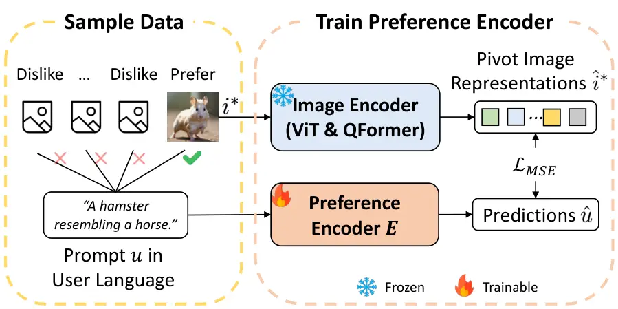
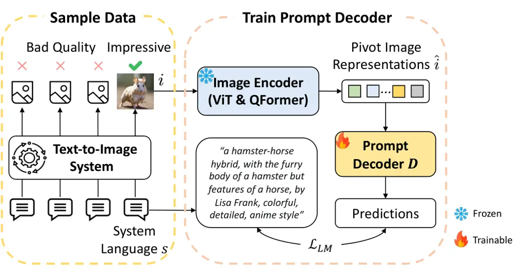
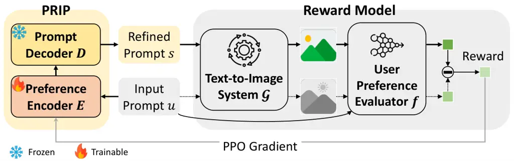

# Prompt Refinement with Image Pivot for Text-to-Image Generation

Jingtao Zhan ^(†)^(†)thanks: jingtaozhan@gmail.com
Affiliation: Department of Computer Science and Technology, Tsinghua
UniversityZhongguancun Laboratory; Beijing, China    Qingyao Ai
^(†)^(†)thanks: Corresponding author: aiqy@tsinghua.edu.cn
Affiliation: Department of Computer Science and Technology, Tsinghua
UniversityZhongguancun Laboratory; Beijing, China    Yiqun Liu
Affiliation: Department of Computer Science and Technology, Tsinghua
UniversityZhongguancun Laboratory; Beijing, China    Yingwei Pan
Affiliation: HiDream.ai; Beijing, China    Ting Yao
Affiliation: HiDream.ai; Beijing, China    Jiaxin Mao
Affiliation: Gaoling School of Artificial Intelligence, Renmin
University of China; Beijing, China    Shaoping Ma
Affiliation: Department of Computer Science and Technology, Tsinghua
UniversityZhongguancun Laboratory; Beijing, China    Tao Mei
Affiliation: HiDream.ai; Beijing, China

###### Abstract

For text-to-image generation, automatically refining user-provided
natural language prompts into the keyword-enriched prompts favored by
systems is essential for the user experience. Such a prompt refinement
process is analogous to translating the prompt from ‘‘user languages’’
into ‘‘system languages’’. However, the scarcity of such parallel
corpora makes it difficult to train a prompt refinement model. Inspired
by zero-shot machine translation techniques, we introduce Prompt
Refinement with Image Pivot (PRIP). PRIP innovatively uses the latent
representation of a user-preferred image as an intermediary ‘‘pivot’’
between the user and system languages. It decomposes the refinement
process into two data-rich tasks: inferring representations of
user-preferred images from user languages and subsequently translating
image representations into system languages. Thus, it can leverage
abundant data for training. Extensive experiments show that PRIP
substantially outperforms a wide range of baselines and effectively
transfers to unseen systems in a zero-shot manner¹¹ 1 We have
open-sourced code and data at
[https://github.com/jingtaozhan/PromptReformulate](https://github.com/jingtaozhan/PromptReformulate).

## 1 Introduction

Recent breakthroughs in text-to-image generation have markedly expanded
the boundaries of digital artistry, enabling the creation of visually
compelling images with unprecedented ease Kingma et al. (2021); Ho
et al. (2020); Lu et al. (2023); Zhu et al. (2024); Zhang et al.
(2024b). However, the complexity of crafting effective prompts presents
a significant challenge to average users. This challenge stems from the
significant difference between user-provided natural language prompts
and the keyword-enriched prompts required for system’s high-quality
rendering Brade et al. (2023); Witteveen and Andrews (2022); Parsons
(2022); Chen et al. (2023). We term the two kinds of prompts as _user
languages_ and _system languages_. System languages usually include
technical terms and artistic references unfamiliar to
non-specialists Liu and Chilton (2022); Oppenlaender (2022). Crafting
prompts in system languages is not intuitive, even for the system’s
developers, and only becomes clear after extensive user experimentation
and community-driven insight Liu and Chilton (2022); Parsons (2022);
Deckers et al. (2023).

Developing a model that automatically refines user languages into system
languages is essential to enhance user experience OpenAI (2023); Hao
et al. (2022); Brade et al. (2023). Yet, the shortage of high-quality
refinement pairs makes it difficult to train such models. On the one
hand, refining prompts requires expertise, which makes annotation
expensive. On the other hand, humans can hardly refine prompts to the
optimum due to the intricate nature of system languages. As demonstrated
in Hao et al. (2022) and our experimental results, human-generated
refinement data is sub-optimal for training prompt refinement models.

As prompt refinement is analogous to a machine translation task that
converts the prompts written in user languages into system languages,
the lack of high-quality refinement pairs echoes the challenge of
machine translation for low-resource languages Mhaskar and Bhattacharyya
(); Ranathunga et al. (2023), in which a source language is translated
into a target language without sufficient parallel corpora for training.
MT researchers tackle this through a “pivoting” approach Wu and Wang
(2007); Cohn and Lapata (2007), which utilizes a high-resource language
as the intermediate “pivot language”. Thus, the source-target
translation is achieved by training two separate models: a source-pivot
model and a pivot–target model. Text from the source language is first
translated to the pivot language and then to the target language.

Inspired by pivot-based MT solutions, we propose Prompt Refinement with
Image Pivot (PRIP). PRIP employs the latent representation of a
user-preferred image as the pivot between user and system languages. It
decomposes prompt refinement into the following two phases. In the first
phase, PRIP takes the prompt in user languages as input and infers what
images the user prefers. It outputs a latent representation, which
focuses on high-level semantics instead of pixel-level details, for the
image that is preferred by the user. In the second phase, PRIP takes the
latent representation of an image as input and outputs a prompt in the
system language that can guide the text-to-image system in rendering
this image. By doing so, PRIP reframes a data-limited prompt refinement
problem into two data-rich tasks. For example, user-image preference
pairs can be constructed using preference simulation models like
HPSv2 Wu et al. (2023) or user click behaviors, and image-system
decoding pairs can be sampled from interaction logs or prompt-sharing
websites.

We evaluate PRIP by applying it to various text-to-image models and
comparing it with extensive baselines. Results demonstrate that PRIP not
only substantially improves the text-to-image system seen during
training, but also effectively transfers to various unseen systems in a
zero-shot manner. It significantly outperforms a wide range of
baselines, including general large language models and prompt refinement
models trained with human-generated or synthetic refinement pairs.

## 2 Related Work

Text-to-Image Prompting. The automatic refinement of user language into
system language is a critical enhancement for a user-friendly
text-to-image system Xie et al. (2023). For a typical text refinement
model, training relies heavily on large-scale source-target refinement
pairs Stahlberg (2020). However, acquiring such pairs for image prompt
refinement is challenging due to the intricate nature of system
language, which often exceeds the annotation capacities of crowdsourced
workers. To avoid this, some researchers have shifted towards
interactive systems that aid users by suggesting enhancements to their
prompts, which mitigates but does not dispense with the need for manual
refinement Feng et al. (2023); Brade et al. (2023); Liu and Chilton
(2022). Others have attempted to train automatic refinement systems
using synthetically generated training pairs, mainly through rephrasing
well-crafted prompts into simpler user language forms Hao et al. (2022).
Yet its synthetic nature often leads to suboptimal refinement
performance. Our PRIP addresses the challenge by leveraging the
user-pivot-system pipeline, thus avoiding reliance on direct user-system
pair annotations.

Prompting Large Language Models (LLMs). There has been research on how
to prompt LLMs, such as chain of thoughts Wei et al. (2022) and
automated template learning Jiang et al. (2020); Haviv et al. (2021).
Interested readers can refer to the survey by Liu et al. (2023). These
studies primarily focus on eliciting the knowledge learned by LLMs
during pre-training. However, in cross-modal scenarios like
text-to-image generation, the monomodal pre-training of LLMs does not
truly capture how prompts influence the image generation process. As a
result, generic LLMs do not possess the capability to refine
text-to-image prompts, which is also demonstrated in our experiments.

Finetuning Generation Models. Several researchers finetune text-to-image
models for prompt understanding. Xu et al. (2023) finetune the
generation model on user inputs and use ImageReward as reward. Zhong
et al. (2023) finetune the text encoder within the generation model to
align simple user inputs with complex prompts. deep-floyd (2024) utilize
a large language model to process the prompt for better understanding.
Our experiments show that PRIP can further improve these models.

## 3 Method

This section introduces Prompt Refinement with Image Pivot (PRIP). We
first analyze the prompt refinement task. Then we describe how to
decompose the user-system refinement process into user-pivot and
pivot-system sub-tasks, where the pivot is the representation of the
image preferred by the user. Finally, we elaborate on the training
approaches for the user-pivot-system framework.

Figure 1: PRIP Model Architecture: a Preference Encoder and a Prompt
Decoder. (1) Upon receiving a user prompt, Preference Encoder first
applies a transformer to derive a token-level representation. A
subsequent transformer leverages cross-attention to deduce the image
preference and yields an image representation. (2) Prompt Decoder then
employs a linear layer to align the dimensionality. This aligned
representation is integrated into a template and input into a large
language model, which generates the refined system prompt.

### 3.1 Problem Analysis

For text-to-image generation, there exists a notable divergence between
the natural language prompts input by non-specialist users, termed _user
language_, and the specialized detail-rich prompts, termed _system
language_. User languages are often colloquial and ambiguous. System
languages include details and artistic terminology, which can guide the
systems to yield visually stunning images.

Prompt refinement systems are optimized to automatically translate user
language into system language. We use $`\mathcal{R}`$ to denote the
refinement system, which refines the user language $`u`$ into the system
language $`s`$ with probability $`\mathcal{R}(s|u)`$. The text-to-image
generation system is denoted as $`\mathcal{G}`$, where
$`\mathcal{G}(i|p)`$ represents the likelihood of generating an image
$`i`$ from a prompt $`p`$. The function $`f(i,p)`$ quantifies the user
satisfaction probability correlating a prompt $`p`$ with image $`i`$.

Thus, the objective $`\mathcal{F}`$ of prompt refinement is:

```math
\mathcal{F}=\E_{u,s,i}[f(i,u)\cdot\mathcal{G}(i|s)\cdot\mathcal{R}(s|u)], \tag{1}
```

where the refinement system $`\mathcal{R}`$ should output system
language $`s`$ that maximizes the user satisfaction within the
generation probabilities $`\mathcal{G}(i|s)`$. Ideally, the training of
$`\mathcal{R}`$ would rely on a rich parallel corpus of user-system
pairs $`\{u,s\}`$. However, the rarity of such paired data makes
training $`\mathcal{R}`$ directly with this objective function a
considerable challenge.

Viewing $`\mathcal{R}`$ as a translation model, with $`u`$ and $`s`$ as
the respective source and target languages, the above challenge is akin
to the zero-shot MT problem Mhaskar and Bhattacharyya (); Ranathunga
et al. (2023), where direct source-target translation pairs are absent.
Zero-shot MT overcomes this by using a pivot language $`v`$, which is a
high-resource language and ensures conditional independence between the
source and target languages Wu and Wang (2007); Cohn and Lapata (2007);
Bertoldi et al. (2008). Thus, the source language $`u`$ can be first
translated into the pivot language $`v`$ and then to the target language
$`s`$. $`\mathcal{R}(s|u)`$ is formally reframed as:

```math
\displaystyle{\mathcal{R}}(s|u)={\textstyle\sum_{v}}[{D}(s|v)\cdot{E}(v|u)], \tag{2}
```

where $`D`$ and $`E`$ denote pivot-target and source-pivot translation
models, respectively. The pivot language $`v`$, being high-resource,
addresses the data-scarce problem. During inference, to simplify the
translation process, the most probable pivot language $`v^{*}`$ is
selected $`v^{*}=\arg\max_{v}E(v|u)`$, and the translated output
$`s^{*}`$ is $`s^{*}=\arg\max_{s}D(s|v^{*})`$. In this paper, we adapt
this technique to tackle prompt refinement for text-to-image generation.

### 3.2 Model Architecture

Building upon the principles of zero-shot MT, we introduce Prompt
Refinement with Image Pivot (PRIP). PRIP utilizes the representation of
the user-desired image as the pivot $`v`$ during the prompt refinement
process. The refinement workflow, depicted in Figure 1, unfolds in two
distinct stages: (1) initially, PRIP uses a Preference Encoder $`E`$ to
infer the user’s preferred image from the user language prompt. The
Preference Encoder adopts a T5-like architecture Raffel et al. (2020).
It first encodes the user language prompt into token-level latent
representations and then employs a cross-attention mechanism to produce
the pivot image representations. (2) subsequently, PRIP uses a Prompt
Decoder $`D`$ to decode the corresponding system language prompt. The
Prompt Decoder is based on a large language model. It accepts the pivot
image representations as input, which are then projected to the required
dimensionality by a linear layer. The generation process is guided by a
prompt template. The Prompt Decoder’s output is the refined, system
language prompt.

Both user-pivot and pivot-system stages can leverage extensive training
data. The user-pivot stage requires user-image preference data. The data
can be easily sourced from click logs or synthesized with user
preference simulation models like HPSv2 Wu et al. (2023). This data may
also be annotated, which requires less specialized expertise compared
with annotating refinement pairs. The pivot-system stage uses
image-prompt pairs. Such data is readily-available from the system’s
generation logs or from online websites where users share prompts sta
(); pro (). It does not require annotation and simply relies on the
input and output correspondences of the system.

PRIP reframes the refinement objective $`\mathcal{F}`$ as:

```math
\displaystyle\mathcal{F}=\E_{u,s,i}[f(i,u)\;{\mathcal{G}}(i|s)\;{\textstyle\sum_{v}}{D}(s|v){E}(v|u)] \tag{3}
```

To effectively optimize this objective, the training process of PRIP is
in two stages. The initial stage involves deriving an approximate
objective and employing rich parallel data $`\{u,v\}`$ and $`\{v,s\}`$
to warm up PRIP. The subsequent stage leverages reinforcement learning
to directly optimize the above objective. They are detailed in the
following.

### 3.3 Disentangled Supervised Training

We adopt two objectives approximate to Eq. (3) to warm up PRIP. They
enable the use of rich, readily-available data for training. They are
derived as:

```math
\displaystyle\mathcal{F}\geq\E_{u,s,i}[f(i,u)\cdot{\mathcal{G}}(i|s)\cdot{D}(s|i)\cdot{E}(i|u)]
```

```math
\displaystyle=\;\E_{u,i}\left[f(i,u)\;{E}(i|u)\right]\cdot\E_{s,i}\left[{\mathcal{G}}(i|s)\;{D}(s|i)\right]+{\rm Cov}
```

The inequality approaches equality when the evaluated expression is zero
for $`v\neq i`$. This is possible when $`\mathcal{G}`$ and $`D`$ form
perfect one-to-one correspondences, zeroing
$`\mathcal{G}(i|s)\cdot D(s|v)`$ for all $`v\neq i`$. For text-to-image
systems with strong prompt-following abilities, this simplification of a
one-to-one mapping is close and the approximation is reasonable. The
term $`\rm Cov`$ is the covariance between $`f(i,u)\cdot E(i|u)`$ and
$`\mathcal{G}(i|s)\cdot D(s|i)`$. When they are uncorrelated, the
covariance term reduces to zero. We temporarily disregard the covariance
and adopt the product of expectations as an approximate surrogate for
the original objective. The resulting training objectives are
individually focused:

```math
\displaystyle\max_{E}\E_{u,i}\;[f(i,u)\cdot{E}(i|u)] \tag{4}
```

```math
\displaystyle\max_{D}\E_{s,i}\;[{\mathcal{G}}(i|s)\cdot{D}(s|i)] \tag{5}
```

These refocused optimization targets permit disentangled training of
each module. The subsequent sections detail the specific training
processes.



Figure 2: Training Preference Encoder: Prompts and preferred images are
paired to create the training set. The objective is to minimize the Mean
Squared Error between the ground-truth image representations and the
predictions from the Preference Encoder.

#### 3.3.1 Training User-Pivot Preference

User-pivot transition is guided by Eq. (4), The Preference Encoder is
trained to predict the image that can maximize user satisfaction.

As shown in Figure 2, the training process is in two steps. (1) Firstly,
we sample the image $`i^{*}`$ that can maximize user satisfaction
$`f(i,u)`$, namely $`i^{*}=\arg\max_{i}f(i,u)`$. Sampling such data is
easier than annotating user-system refinement pairs: annotating
preference does not require special expertise for annotators and
preference can also be extracted from click behaviors in interaction
logs. (2) Secondly, The Preference Encoder $`E`$ is trained to predict
$`i^{*}`$ given $`u`$. The user language $`u`$ is processed by the
Preference Encoder, outputting the predicted representation $`\hat{u}`$.
The image $`i^{*}`$ is input into an image encoder and results in its
semantic representation $`\hat{i}^{*}`$. The discrepancy between these
representations is minimized with MSE loss:

```math
\mathcal{L}_{MSE}=||\hat{i}^{*}-\hat{u}||^{2}_{2} \tag{6}
```

With this training process, the Preference Encoder aligns with user
preferences by learning to imagine the user-preferred images.

#### 3.3.2 Training Pivot-System Decoding



Figure 3: Training Prompt Decoder: Prompts that can generate impressive
images are sampled as the system language. The objective is to predict
the system language based on the associated image representation.

Pivot-system transition is guided by Eq. (5). The Prompt Decoder is
trained to reconstruct the system language from the pivot image
representation.

As illustrated in Figure 3, the training process is in two steps. (1)
Firstly, we collect system language prompts $`s`$ and their
corresponding generated images $`i`$. The system languages are
high-quality prompts suitable for the generation system. They can be
sampled from the user-submitted prompts in the generation log or from
websites where users share well-performing prompts. (2) The Prompt
Decoder is trained to generate system language $`s`$ from the image
$`i`$. A frozen image encoder processes the image $`i`$, creating its
representation $`\hat{i}`$. This representation serves as the training
context for the Prompt Decoder to predict the system language.
Autoregressive language modeling objective is used and is formulated as
follows:

```math
\mathcal{L}_{LM}=-{\textstyle\sum_{n}}{\rm log}\;{D}(s_{n}|s_{1:n-1},\hat{i}), \tag{7}
```

where $`s_{n}`$ is the $`n`$-th token of $`s`$. In this way, the Prompt
Decoder aligns with the generation systems by learning to reverse the
generation process.

### 3.4 End-to-End User-Pivot-System Training

While the previously described training stages effectively optimize the
user-pivot and pivot-system transitions on supervised data, they serve
primarily as approximations of the ultimate objective presented in
Eq. (3). To bridge this gap, we leverage the previous training as a
warm-up stage and subsequently employ Eq. (3) for end-to-end training.



Figure 4: End-to-End RL Training: Given a user prompt, PRIP generates a
refined prompt, and Reward Model evaluates user preference scores for
generated images. The differential in scores serves as the reward, and
PRIP is updated with PPO Gradient.

We adopt reinforcement learning (RL) and define the reward as the
differential in preference scores. This is equivalent to Eq. (3):

```math
\displaystyle\arg\max_{D,E}\mathcal{F}=\arg\max_{D,E}\E\;[{\rm reward}\;{D}(s|v){E}(v|u)],
```

```math
\displaystyle{\rm reward}={\textstyle\sum_{i}}f(i,u){\mathcal{G}}(i|s)-{\textstyle\sum_{i^{\prime}}}f(i^{\prime},u){\mathcal{G}}(i^{\prime}|u)
```

The training workflow is depicted in Figure 4. For any given prompt, we
generate two image sets: one set from the initial prompt and another
from the refined system prompt. The reward is computed as the
differential in preference scores between these two sets. To enhance
training efficiency, Prompt Decoder remains frozen due to the
significant computational costs of training a large language model. Only
Preference Encoder is updated with proximal policy optimization
(PPO) Schulman et al. (2017), a well-regarded RL algorithm.

### 3.5 Inference Process

During inference, the Preference Encoder and the Prompt Decoder are
concatenated as a user-pivot-system pipeline. Given a prompt, the
Preference Encoder predicts the representation of the user-preferred
image. Then, the Prompt Decoder decodes the representation and outputs
the refined prompt. The refined prompt is input to the generation system
for image rendering.

Furthermore, since the Prompt Decoder cannot directly access the initial
prompt, it might result in a hallucination problem Ji et al. (2023) when
the refined prompt is generated. A solution is to provide the initial
prompt as additional context to the Prompt Decoder during inference.
This paper uses a straightforward approach: prepending the initial
prompt as a prefix and using the Prompt Decoder for expansion. The
refined prompt starts with the initial prompt and consists of many
details added by the Prompt Decoder. Future studies may investigate
other methods. For example, constrained beam search can also use the
initial prompts as additional context by constraining the refined
prompts to be semantically close to the initial prompts. We leave this
exploration to future work.

## 4 Experimental Setup

### 4.1 Evaluation Setup

Generation Systems. We evaluate the prompt refinement performance for a
wide range of generation systems. When PRIP and other refinement
baselines are trained, they are optimized for Stable Diffusion
1.4 (SD1.4) Rombach et al. (2022). Thus, the refinement performance on
SD1.4 corresponds to the in-distribution performance. We also employ
various advanced generation systems to evaluate the out-of-distribution
performance. They are: (1) Stable Diffusion XL base 1.0 (SDXL) Podell
et al. (2023), a state-of-the-art generation model that is much stronger
than SD1.4. (2) Deepfloyd-IF (IF) deep-floyd (2024), an advanced model
for high degree of prompt understanding. It employs a T5-XXL model for
prompt processing. (3) SUR Zhong et al. (2023), which is specifically
proposed to understand simple user inputs for high-quality rendering.
(4) ReFL Xu et al. (2023), which is initialized from SD1.4 and further
trained with the same reward model as PRIP. The difference is that ReFL
trains the generation model while PRIP modifies the input. We also
attempted to evaluate on DALL-E 3 OpenAI (2023). However, due to
restrictions on its inputs, such as not allowing artists’ names, our
test prompts and refined prompts often do not meet these restrictions
and make evaluation impossible.

Dataset. We conduct evaluations using the HPS prompt dataset Wu et al.
(2023), which includes a wide variety of prompts mined from user
interactions and image captions. It is a standard benchmark to evaluate
text-to-image generation performance Clark et al. (2023); Wallace et al.
(2023). The prompts are categorized into Anime, ConceptArt, Painting,
and Photo. Each category contains 800 prompts. For each prompt, we
generate four images to ensure a robust assessment.

Metrics. We employ both automated and human judgment. Automated
assessments utilize ImageReward Xu et al. (2023) and HPSv2 Wu et al.
(2023), which are trained to mimic human preferences and have been
demonstrated to accurately align with actual human judgments. Humans
annotate relevance and win ratios. Relevance is the prompt-image
alignment on a scale of 0 (irrelevant) to 2 (highly relevant). Win ratio
(and tie) shows pairwise prompt-image preference between two generation
systems. We randomly sample $`30`$ prompts per category and report the
annotation results averaged on all $`120`$ prompts. Each pair is
annotated by three people who are familiar with text-to-image generation
and of different backgrounds.

| Evaluation Metric | ImageReward |            |           |            | HPSv2     |            |           |           | Relevance | Win     | Win+Tie |
| ----------------- | ----------- | ---------- | --------- | ---------- | --------- | ---------- | --------- | --------- | --------- | ------- | ------- |
| Dataset           | Anime       | ConceptArt | Painting  | Photo      | Anime     | ConceptArt | Painting  | Photo     | All       | All     | All     |
| SD1.4             | 0.038^(∗)   | 0.185^(∗)  | 0.190^(∗) | 0.130^(∗)  | 27.42^(∗) | 26.86^(∗)  | 26.86^(∗) | 27.57^(∗) | 1.38      | 1%^(∗)  | 100%    |
| \+ GPT3.5         | -0.037^(∗)  | 0.030^(∗)  | 0.126^(∗) | -0.005^(∗) | 27.36^(∗) | 26.77^(∗)  | 26.87^(∗) | 27.41^(∗) | –         | –       | –       |
| \+ GPT4           | -0.143^(∗)  | -0.024^(∗) | 0.030^(∗) | -0.196^(∗) | 27.29^(∗) | 26.71^(∗)  | 26.76^(∗) | 27.28^(∗) | –         | –       | –       |
| \+ PromptistSFT   | -0.140^(∗)  | -0.083^(∗) | 0.010^(∗) | -0.287^(∗) | 27.19^(∗) | 26.60^(∗)  | 26.77^(∗) | 26.88^(∗) | –         | –       | –       |
| \+ Rew-Syn        | -0.015^(∗)  | 0.056^(∗)  | 0.223^(∗) | -0.221^(∗) | 27.35^(∗) | 26.79^(∗)  | 26.99^(∗) | 26.96^(∗) | –         | –       | –       |
| \+ Rew-Log        | 0.066^(∗)   | 0.151^(∗)  | 0.173^(∗) | 0.063^(∗)  | 27.44^(∗) | 26.87^(∗)  | 26.86^(∗) | 27.51^(∗) | –         | –       | –       |
| \+ PromptistRL    | -0.009^(∗)  | 0.092^(∗)  | 0.211^(∗) | -0.060^(∗) | 27.29^(∗) | 26.73^(∗)  | 26.89^(∗) | 26.97^(∗) | 1.20^(∗)  | 38%^(∗) | 84%     |
| \+ Rew-Syn+RL     | 0.079^(∗)   | 0.135^(∗)  | 0.246^(∗) | 0.138^(∗)  | 27.46^(∗) | 26.85^(∗)  | 26.99^(∗) | 27.70^(∗) | 1.31^(∗)  | 40%^(∗) | 89%     |
| \+ Rew-Log+RL     | 0.028^(∗)   | 0.177^(∗)  | 0.187^(∗) | 0.105^(∗)  | 27.42^(∗) | 26.85^(∗)  | 26.86^(∗) | 27.55^(∗) | 1.33^(∗)  | 6%^(∗)  | 96%     |
| \+ PRIP           | 0.346       | 0.443      | 0.576     | 0.252      | 27.97     | 27.45      | 27.65     | 28.03     | 1.45      | 73%     | 94%     |

Table 1: In-distribution refinement performance on the seen
system (SD1.4). Win/Tie ratio shows preference against SD1.4, and
SD1.4’s “Win+Tie” is always 100%. Human annotation is only conducted on
RL-based methods to save costs. ^(∗) indicates PRIP significantly
outperforms the baseline with p-value $`<0.01`$ measured by T-Test. PRIP
substantially outperforms baselines.

### 4.2 Baselines

We compare PRIP against a comprehensive set of prompt refinement
baselines: (1) GPT3.5 & 4: They are generic language models and are not
tailored for prompt refinement. To guide them, we use a popular prompt
template from bluelovers (2023) and slightly modify it for this task.
The template contains guidance and examples. (2) PromptistSFT &
PromptistRL Hao et al. (2022): PromptistSFT is trained on synthesized
parallel data: system languages are collected from prompt-sharing
websites, while user languages are rephrased from the system languages
to simple form by ChatGPT. Initialized from PromptistSFT, PromptistRL
undergoes an RL process with CLIP Radford et al. (2021) and Aesthetic
scores Schuhmann (2022) as reward. (3) Rew-Syn & Rew-Syn+RL: We enhance
PromptistSFT and PromptistRL by aligning them with user preference.
Rew-Syn uses ImageReward and HPSv2 to filter out the PromptistSFT
training pairs whose refinement does not improve satisfaction scores.
Rew-Syn+RL utilizes ImageReward and HPSv2 as reward, which is identical
to PRIP’s. (4) Rew-Log & Rew-Log+RL: Rew-Log extracts human rewriting
pairs from a large-scale interaction log Wang et al. (2023) by pairing
the first and the last prompts in the same session. It filters out the
pairs that do not improve ImageReward or HPSv2 scores. Rew-Log+RL is
initialized from Rew-Log and undergoes the same RL training process as
PRIP’s.

### 4.3 Implementation Details

Architecture. The model architecture is as follows. Preference Encoder
and Prompt Decoder are initialized with FLAN-T5-Large Chung et al.
(2022) and Llama2-7B Touvron et al. (2023), respectively. We use the
vision component of BLIP-2 Li et al. (2023) as the frozen Image Encoder.

Data. Training data for PRIP can be easily acquired, as discussed in
Section 3.2. In this paper, we collect data from DiffusionDB Wang et al.
(2023), a real interaction log between 10k users and SD1.4. Since this
dataset logs the multiple generated images for each prompt, we can
sample the most-preferred image for training the user-pivot model (the
Preference Encoder). We use ImageReward to simulate user preference and
select the highest-scored image as the pivot. We also observe that there
exist high-quality prompts in the log that can serve as the system
languages. Therefore, we sample these prompts and the associated images
for training the Prompt Decoder model. The sampling criterion is
empirically set: the CLIP and Aesthetic scores are above $`0.28`$ and
$`5.2`$, respectively. Future studies can explore other data resources.

Please refer to Appendix A.4 for more details.

| Evaluation Metric        | ImageReward |           |           |           | HPSv2     |           |           |           | Relevance | Win     | Win+Tie |
| ------------------------ | ----------- | --------- | --------- | --------- | --------- | --------- | --------- | --------- | --------- | ------- | ------- |
| Generation Model         | SDXL        | IF        | SUR       | ReFL      | SDXL      | IF        | SUR       | ReFL      | SDXL      | SDXL    | SDXL    |
| w$`\backslash`$ o refine | 0.866^(∗)   | 0.624^(∗) | 0.596^(∗) | 0.421^(∗) | 27.76^(∗) | 27.63^(∗) | 27.82^(∗) | 27.64^(∗) | 1.67      | 1%^(∗)  | 100%    |
| \+ GPT3.5                | 0.753^(∗)   | 0.569^(∗) | 0.431^(∗) | 0.316^(∗) | 27.67^(∗) | 27.57^(∗) | 27.72^(∗) | 27.57^(∗) | –         | –       | –       |
| \+ GPT4                  | 0.702^(∗)   | 0.455^(∗) | 0.360^(∗) | 0.214^(∗) | 27.67^(∗) | 27.41^(∗) | 27.67^(∗) | 27.49^(∗) | –         | –       | –       |
| \+ PromptistSFT          | 0.679^(∗)   | 0.298^(∗) | 0.374^(∗) | 0.229^(∗) | 27.54^(∗) | 26.93^(∗) | 27.53^(∗) | 27.44^(∗) | –         | –       | –       |
| \+ Rew-Syn               | 0.817^(∗)   | 0.464^(∗) | 0.513^(∗) | 0.347^(∗) | 27.72^(∗) | 27.17^(∗) | 27.67^(∗) | 27.60^(∗) | –         | –       | –       |
| \+ Rew-Log               | 0.850^(∗)   | 0.591^(∗) | 0.561^(∗) | 0.401^(∗) | 27.75^(∗) | 27.57^(∗) | 27.79^(∗) | 27.62^(∗) | –         | –       | –       |
| \+ PromptistRL           | 0.833^(∗)   | 0.509^(∗) | 0.547^(∗) | 0.404^(∗) | 27.67^(∗) | 27.21^(∗) | 27.65^(∗) | 27.56^(∗) | 1.52^(∗)  | 40%^(∗) | 88%     |
| \+ Rew-Syn+RL            | 0.874^(∗)   | 0.579^(∗) | 0.596^(∗) | 0.459^(∗) | 27.81^(∗) | 27.46^(∗) | 27.83^(∗) | 27.77^(∗) | 1.62      | 51%^(∗) | 89%     |
| \+ Rew-Log+RL            | 0.861^(∗)   | 0.619^(∗) | 0.573^(∗) | 0.406^(∗) | 27.77^(∗) | 27.60^(∗) | 27.79^(∗) | 27.63^(∗) | 1.67      | 4%^(∗)  | 98%     |
| \+ PRIP                  | 0.983       | 0.741     | 0.789     | 0.640     | 28.15     | 27.90     | 28.22     | 28.14     | 1.68      | 82%     | 96%     |

Table 2: Out-of-distribution refinement performance on unseen systems.
Results are averaged on four categories. Human annotation is only
conducted on RL-based methods for SDXL to save costs. Win/Tie ratio
shows preference against generation without refinement. Note that the
first row is generation without refinement and its “Win+Tie” is 100%.
^(∗) indicates PRIP significantly outperforms the baseline with p-value
$`<0.01`$ measured by T-Test. PRIP effectively transfers to unseen
systems.

| Input Prompt                                                                                                                                                                                                                                                                 | User                                                                            | PRIP                                                                            |
| ---------------------------------------------------------------------------------------------------------------------------------------------------------------------------------------------------------------------------------------------------------------------------- | ------------------------------------------------------------------------------- | ------------------------------------------------------------------------------- |
| User  : A monkey is pictured acting as a DJ. PRIP: A monkey is pictured acting as a DJ., he is wearing headphones and has a large smile on his face, he is holding a record, he is at a rave, he is on the cover of a tourism pamphlet for Florida, he is a resident DJ at … | ![[Uncaptioned image]](arxiv-2407-00247v1--f281f12aa4af.figures/figure-4.webp)  | ![[Uncaptioned image]](arxiv-2407-00247v1--f281f12aa4af.figures/figure-5.webp)  |
| User  : A Walter White funko pop figurine. PRIP: A Walter White funko pop figurine., intricate, highly detailed, photorealistic, 4k, HDR, smooth, sharp focus, high resolution, award-winning photo, taken at the 2022 EPCOT International Flower and Food Festival          | ![[Uncaptioned image]](arxiv-2407-00247v1--f281f12aa4af.figures/figure-6.webp)  | ![[Uncaptioned image]](arxiv-2407-00247v1--f281f12aa4af.figures/figure-7.webp)  |
| User  : A mushroom house in a dark forest, with warm light emitting from its windows. PRIP: A mushroom house in a dark forest, with warm light emitting from its windows., by Thomas Kinkade, colorful, vibrant, intricate, highly detailed, deviantart, …                   | ![[Uncaptioned image]](arxiv-2407-00247v1--f281f12aa4af.figures/figure-8.webp)  | ![[Uncaptioned image]](arxiv-2407-00247v1--f281f12aa4af.figures/figure-9.webp)  |
| User  : Frog emerging from yogurt. PRIP: Frog emerging from yogurt., detailed, intricate, 4k, by Pauline Baynes, whimsical, award-winning, highly detailed, fantasy, magical, sparkle                                                                                        | ![[Uncaptioned image]](arxiv-2407-00247v1--f281f12aa4af.figures/figure-10.webp) | ![[Uncaptioned image]](arxiv-2407-00247v1--f281f12aa4af.figures/figure-11.webp) |
| User  : A little cat is running in the woods PRIP: A little cat is running in the woods, smiling, friendly, colorful, happy, laughing, cute, adorable                                                                                                                        | ![[Uncaptioned image]](arxiv-2407-00247v1--f281f12aa4af.figures/figure-12.webp) | ![[Uncaptioned image]](arxiv-2407-00247v1--f281f12aa4af.figures/figure-13.webp) |
| User  : A billboard posed by the side of a street in a rural town. PRIP: A billboard posed by the side of a street in a rural town., Christchurch, New Zealand, Hawaiian, small town, tropical, warm, fountain, happy, fun, touristy, cute, quaint                           | ![[Uncaptioned image]](arxiv-2407-00247v1--f281f12aa4af.figures/figure-14.webp) | ![[Uncaptioned image]](arxiv-2407-00247v1--f281f12aa4af.figures/figure-15.webp) |
| User  : A crowd of pink elephants playing steampunk instruments during a grindcore show. PRIP: A crowd of pink elephants playing steampunk instruments during a grindcore show., cute, adorable, pastel colors, Thomas Kinkade, Colorful, Lisa Frank, family                 | ![[Uncaptioned image]](arxiv-2407-00247v1--f281f12aa4af.figures/figure-16.webp) | ![[Uncaptioned image]](arxiv-2407-00247v1--f281f12aa4af.figures/figure-17.webp) |
| User  : an empty bench sitting on the side of a sidewalk PRIP: an empty bench sitting on the side of a sidewalk, in christchurch new zealand, small town, lots of flowers, small city, small town atmosphere, neighborhood, neighborhood atmosphere                          | ![[Uncaptioned image]](arxiv-2407-00247v1--f281f12aa4af.figures/figure-18.webp) | ![[Uncaptioned image]](arxiv-2407-00247v1--f281f12aa4af.figures/figure-19.webp) |

Table 3: Refinement cases. Column one details user inputs and PRIP
outputs. The next two columns show SDXL-generated images for different
prompts. PRIP substantially enhances the image quality.

## 5 Experimental Results

This section presents the experimental results. We first evaluate models
on various generation systems, including the one used during training
(in-distribution scenario) and several unseen, advanced systems
(out-of-distribution scenario). Then, we show how PRIP refines the
prompt by presenting several cases. Finally, a comprehensive ablation
study demonstrates the effectiveness of pivoting.

### 5.1 In-Distribution Performance

Table 1 presents the in-distribution refinement performance. We have the
following observations: (1) Results indicate that generic language
models like GPT3.5 and GPT4 do not excel at refining image prompts. We
find that GPT3.5 merely rephrases prompts without adding details and
sometimes hallucinates, which results in its output being mostly
ineffective. As for GPT4, it can effectively add rich details compared
with GPT3.5. Yet its added details often misalign with the initial
prompts, leading to even worse performance. (2) Synthetically generated
refinement pairs also demonstrate limited efficacy, with neither
PromptistSFT nor Rew-Syn surpassing the SD1.4 baseline. The user
languages are synthesized by rephrasing high-quality prompts. Yet such
synthesized user inputs are different from real inputs and compromise
the model performance. (3) In contrast, PRIP does not rely on any
synthesized or human-generated refinement pairs that are usually
low-quality and noisy. Results demonstrate that PRIP significantly
outperforms all baselines.

### 5.2 Out-of-Distribution Performance

Table 2 shows the performance on four state-of-the-art generation
systems that are unseen during training. As introduced in Section 4.1,
these systems employ special techniques to improve prompt-understanding
abilities. For example, IF uses a large language model to process
prompts, and ReFL is finetuned on user inputs with preference feedback.
Even on these systems, PRIP still presents significant improvements.
Furthermore, according to the human annotation results in Table 1 and 2,
PRIP’s performance improvement is more pronounced on SDXL than SD1.4. We
closely examine the output and find that SD1.4 sometimes struggles to
process the rich details added by PRIP while SDXL can. The results
indicate that PRIP is even more suitable for advanced generation
systems. It also implies that existing generation systems all prefer
prompts with rich details and professional terms. In Appendix A.1, we
provide an additional analysis showing how PRIP leads to robust
improvement.

### 5.3 Case Studies

Table 3 presents several refinement examples. We can see that PRIP
expands user inputs with details and stylistic elements. The details are
rich, professional, and tailored for each user input. For example, in
the first case, PRIP adds the monkey’s wearing, action, and environment.
It also specifies that the image is a tourism pamphlet cover. These make
the rendered image both closely relevant to the user input and
aesthetically-pleasing. Moreover, some added terms are professional
artist names and beyond the capability of average users, such as “Thomas
Kinkade” in the third case, “Pauline Baynes” in the fourth case, and
“Lisa Frank” in the seventh case. With PRIP automatically adding these
professional terms, the text-to-image systems can become more
user-friendly.

### 5.4 Ablation Study

|                                |             |       |       |       |
| ------------------------------ | ----------- | ----- | ----- | ----- |
| Evaluation Metric              | ImageReward |       | HPSv2 |       |
| Generation Model               | SD1.4       | SDXL  | SD1.4 | SDXL  |
| without Reinforcement Learning |             |       |       |       |
| PRIP\RL                        | 0.122       | 0.888 | 27.24 | 27.87 |
| \User-Pivot Preference         | 0.072       | 0.862 | 27.17 | 27.80 |
| \Pivot-System Decoding         | 0.058       | 0.810 | 27.04 | 27.69 |
| with Reinforcement Learning    |             |       |       |       |
| PRIP                           | 0.404       | 0.983 | 27.77 | 28.15 |
| \User-Pivot Preference         | 0.198       | 0.917 | 27.33 | 27.92 |
| \Pivot-System Decoding         | 0.047       | 0.821 | 27.04 | 27.71 |

Table 4: Ablation Study Results. The table presents the performance when
various components of PRIP are removed. Results demonstrate their
importance.

To evaluate the contributions of PRIP’s components, we perform a
detailed ablation study, examining the exclusion of the following
elements: (1) $`\backslash`$User-Pivot Preference: For user-pivot
training as in Eq. (6), the ground truth is a random image generated
from this prompt instead of the image with the highest preference score.
This investigates whether the pivot should be a user-preferred image.
(2) $`\backslash`$Pivot-System Decoding: In pivot-system training as in
Eq. (7), Prompt Decoder is not provided with image as input and is
trained using a basic language modeling loss. The trained model is
familiar with prompts but not capable of decoding image pivots. (3)
Without RL (PRIP$`\backslash`$RL): We evaluate the PRIP model that does
not undergo an end-to-end RL process, as presented in Section 3.4.

Table 4 presents the ablation results. It demonstrates that all three
components are vital to PRIP. According to the performance of
$`\backslash`$Pivot-System Decoding, pivot-system training is critical.
Without it, the performance substantially degenerates. This indicates
that PRIP relies on this process to learn to decode the image pivot.
“$`\backslash`$User-Pivot Preference” replaces the user-preferred image
with a random image, which also results in a performance drop. This
demonstrates the importance of aligning user preference by using the
best image as the pivot during training. RL can substantially improve
the effectiveness of PRIP. Yet, it still relies on the user-pivot and
pivot-system to provide a good warmup process. This is in line with the
observations by Zheng et al. (2023) that the exploration space of the
language model is too large and convergence of RL is formidable without
a good start point.

### 5.5 Scaling Analysis

We investigate how the model size affects PRIP performance. We use two
smaller models, TinyLlama with 1.1B parameters Zhang et al. (2024a) and
GPT2-Large with 0.78B parameters Radford et al. (2019). Although
TinyLlama has fewer parameters than Llama2-7B Touvron et al. (2023), it
was trained on 2.5T tokens, compared to 2T tokens for the latter. Thus,
TinyLlama is a strong “small” model, while GPT2-Large is a relatively
weaker “small” model.

The setup is as follows. We use both models to initialize the Prompt
Decoder. We do not use the RL training process as described in
Section 3.4 to save cost. We only train the models with pivot-system
pairs as shown in Section 3.3.2. We pair the Preference Encoder with
these two new Prompt Decoders to form two new PRIP models. We test the
prompt refinement performance on the Anime and Painting datasets using
the SD1.4 model for image generation.

|                                          |             |           |           |           |
| ---------------------------------------- | ----------- | --------- | --------- | --------- |
| Evaluation Metric                        | ImageReward |           | HPSv2     |           |
| Dataset                                  | Anime       | Painting  | Anime     | Painting  |
| SD1.4                                    | 0.038       | 0.190     | 27.42     | 26.89     |
| + PRIP$`\backslash`$RL prompt refinement |             |           |           |           |
| GPT2-Large 0.78B                         | 0.047       | 0.197     | 27.49^(∗) | 27.00^(∗) |
| TinyLlama 1.1B                           | 0.059       | 0.253^(∗) | 27.51^(∗) | 26.99^(∗) |
| Llama2 7B                                | 0.065       | 0.269^(∗) | 27.53^(∗) | 27.03^(∗) |

Table 5: PRIP performance when prompt decoder is initialized from
different language models, including GPT2-large, TinyLlama, and Llama2.
Results show that a larger model leads to better performance. ^(∗)
indicates the refinement model significantly outperforms the SD1.4
baseline (without refinement) with p-value $`<0.01`$ measured by T-Test.

Based on the results in the table, we can observe: (1) As the capability
of the base model increases, the model’s prompt refinement ability also
improves gradually. A more capable base model helps PRIP better infer
the system prompt language from the pivot image representation, thus
achieving better image generation results. (2) TinyLlama demonstrates a
substantial improvement over GPT2-Large in our task, suggesting that the
extensive pre-training contributes to the superior performance in this
downstream task. (3) We also observed that the performance of TinyLlama
is approaching that of Llama2-7B, even though their parameter scales
differ by a factor of 7. This suggests that with the help of PRIP’s
extensive training data, the demand for the size of the base model has
become smaller. A well-optimized small model can achieve performance
close to that of a large model.

## 6 Conclusion

In this paper, we present PRIP, a pioneering pivot-based approach
tailored for text-to-image prompt refinement. By formulating the
refinement process as user-pivot preference encoding and pivot-system
prompt decoding, PRIP sidesteps the scarcity of user-system refinement
pairs and leverages large-scale data for effective model training.
Extensive experiments demonstrate PRIP’s effectiveness in prompt
refinement. The improvement is pronounced for both text-to-image systems
seen and unseen during training, highlighting its remarkable
effectiveness and robust generalizability.

## 7 Limitation and Future Work

There are several limitations for future studies:

\(1\) Dependence on Supervised Data: PRIP’s Preference Encoder relies on
image preference data to align with user preferences. This data requires
manual annotation or user click logs. Future work should explore how to
effectively train the Preference Encoder with minimal preference data.

\(2\) Dependence on System Language Corpus: PRIP’s Prompt Decoder
requires a corpus of system language prompts for training. Obtaining
this data can rely on scraping prompts from websites or using
interaction logs, which should be done with user consent and possibly
compensation. Future work should investigate acquiring this data while
protecting users’ intellectual property and privacy.

\(3\) Usage of a Frozen Image Encoder: During PRIP’s training, we use a
frozen image encoder to encode images. Due to resource limitations, we
did not explore the impact of different image encoders. Future work can
explore how to select and train image encoders for PRIP.

\(4\) Transferability to New Systems: While PRIP shows promise in
transferring to unseen systems, its long-term adaptability to rapidly
evolving generation systems remains to be fully tested. Future work
should investigate how to further improve PRIP’s transferability,
possibly by adapting the pivot-system module for different systems.

\(5\) Hallucination Problem: Since the Prompt Decoder cannot directly
access user inputs when generating system language, hallucinations may
occur. We address this issue by using the user input as a prefix during
inference. Yet this restricts PRIP’s capabilities, as using redundant or
unclear user inputs as prefixes can affect the refinement effectiveness.
Future work should further investigate this problem.

## 8 Ethical Considerations

The development and deployment of PRIP raise several ethical
considerations that should be addressed in future applications:

\(1\) Intellectual Property Protection: PRIP relies on system languages
provided by users for training. It is crucial to implement appropriate
incentives and revenue-sharing mechanisms to protect the intellectual
property of these users.

\(2\) Privacy Protection: When using prompt logs for training, user
privacy must be fully respected. It is necessary to obtain users’
consent in advance and implement appropriate anonymization measures.

\(3\) Bias and Fairness: Like all AI systems, PRIP’s outputs are
influenced by the data it is trained on. If image preference data
contains biases, these biases can be reflected in the refined prompts,
potentially showing societal stereotypes and biases in generated images.

\(4\) Misuse Potential: The enhanced capability in text-to-image
generation can be misused for creating misleading or harmful content.
Ensuring that PRIP and similar technologies are used responsibly
requires robust guidelines and possibly technological safeguards against
such misuse.

\(5\) Accessibility and Inclusion: By facilitating more intuitive
interaction with text-to-image systems, PRIP contributes to making these
technologies more accessible. However, it is crucial to ensure that
these advancements are equally accessible to users across different
languages, cultures, and socio-economic backgrounds.

## 9 Broad Impact

PRIP’s development has broad implications for both society and the field
of AI:

\(1\) Enhancing Creative Expression: By simplifying the process of
prompt refinement, PRIP enables users, especially those without
technical expertise, to more effectively leverage the power of
text-to-image generation systems for creative expression, educational
purposes, and more.

\(2\) Research in AI and Human-Computer Interaction: PRIP’s novel
approach to prompt refinement contributes to the understanding of how
humans interact with AI systems. It opens new avenues for research in
natural language processing, computer vision, and human-computer
interaction, particularly in the context of improving the intuitiveness
and effectiveness of AI interfaces.

\(3\) Potential Negative Consequences: While PRIP enhances user
experience, the technology’s ability to generate realistic images from
refined prompts raises concerns about misinformation, privacy, and the
ethical use of AI-generated content. It is important for the research
community to address these issues and to develop ethical guidelines and
best practices for the use of such technologies.

## Acknowledgments

This work is supported by Quan Cheng Laboratory (Grant No. QCLZD202301).

## References

- (1) [Prompthero - search prompts for stable diffusion, chatgpt &
  midjourney](https://prompthero.com/). Accessed: 2024-01-20.
- (2) [Stable diffusion - prompts
  examples](https://stablediffusion-fr.webpkgcache.com/doc/-/s/stablediffusion.fr/prompts).
  Accessed: 2024-01-20.
- Akhtar and Mian (2018) Naveed Akhtar and Ajmal Mian. 2018. Threat of
  adversarial attacks on deep learning in computer vision: A survey.
  _Ieee Access_, 6:14410–14430.
- Bertoldi et al. (2008) Nicola Bertoldi, Madalina Barbaiani, Marcello
  Federico, and Roldano Cattoni. 2008. Phrase-based statistical machine
  translation with pivot languages. In _Proceedings of the 5th
  International Workshop on Spoken Language Translation: Papers_, pages
  143–149.
- bluelovers (2023) bluelovers. 2023. Chatgpt stable diffusion prompts
  generator.
  [https://gist.github.com/bluelovers/92dac6fe7dcbafd7b5ae0557e638e6ef](https://gist.github.com/bluelovers/92dac6fe7dcbafd7b5ae0557e638e6ef).
  Accessed: 2023-7-20.
- Brade et al. (2023) Stephen Brade, Bryan Wang, Mauricio Sousa, Sageev
  Oore, and Tovi Grossman. 2023. Promptify: Text-to-image generation
  through interactive prompt exploration with large language models. In
  _Proceedings of the 36th Annual ACM Symposium on User Interface
  Software and Technology_, pages 1–14.
- Chen et al. (2023) Yang Chen, Yingwei Pan, Yehao Li, Ting Yao, and Tao
  Mei. 2023. Control3d: Towards controllable text-to-3d generation. In
  _ACM Multimedia_.
- Chung et al. (2022) Hyung Won Chung, Le Hou, Shayne Longpre, Barret
  Zoph, Yi Tay, William Fedus, Yunxuan Li, Xuezhi Wang, Mostafa
  Dehghani, Siddhartha Brahma, et al. 2022. Scaling
  instruction-finetuned language models. _arXiv preprint
  arXiv:2210.11416_.
- Clark et al. (2023) Kevin Clark, Paul Vicol, Kevin Swersky, and
  David J Fleet. 2023. Directly fine-tuning diffusion models on
  differentiable rewards. _arXiv preprint arXiv:2309.17400_.
- Cohn and Lapata (2007) Trevor Cohn and Mirella Lapata. 2007. Machine
  translation by triangulation: Making effective use of multi-parallel
  corpora. In _Proceedings of the 45th Annual Meeting of the Association
  of Computational Linguistics_, pages 728–735.
- Deckers et al. (2023) Niklas Deckers, Julia Peters, and Martin
  Potthast. 2023. Manipulating embeddings of stable diffusion prompts.
  _arXiv preprint arXiv:2308.12059_.
- deep-floyd (2024) deep-floyd. 2024.
  [IF](https://github.com/deep-floyd/IF).
- Feng et al. (2023) Yingchaojie Feng, Xingbo Wang, Kam Kwai Wong, Sijia
  Wang, Yuhong Lu, Minfeng Zhu, Baicheng Wang, and Wei Chen. 2023.
  Promptmagician: Interactive prompt engineering for text-to-image
  creation. _IEEE Transactions on Visualization and Computer Graphics_.
- Hao et al. (2022) Yaru Hao, Zewen Chi, Li Dong, and Furu Wei. 2022.
  Optimizing prompts for text-to-image generation. _arXiv preprint
  arXiv:2212.09611_.
- Haviv et al. (2021) Adi Haviv, Jonathan Berant, and Amir
  Globerson. 2021. Bertese: Learning to speak to bert. _arXiv preprint
  arXiv:2103.05327_.
- Ho et al. (2020) Jonathan Ho, Ajay Jain, and Pieter Abbeel. 2020.
  Denoising diffusion probabilistic models. _Advances in neural
  information processing systems_, 33:6840–6851.
- Ji et al. (2023) Ziwei Ji, Nayeon Lee, Rita Frieske, Tiezheng Yu, Dan
  Su, Yan Xu, Etsuko Ishii, Ye Jin Bang, Andrea Madotto, and Pascale
  Fung. 2023. Survey of hallucination in natural language generation.
  _ACM Computing Surveys_, 55(12):1–38.
- Jiang et al. (2020) Zhengbao Jiang, Frank F Xu, Jun Araki, and Graham
  Neubig. 2020. How can we know what language models know? _Transactions
  of the Association for Computational Linguistics_, 8:423–438.
- Kingma et al. (2021) Diederik Kingma, Tim Salimans, Ben Poole, and
  Jonathan Ho. 2021. Variational diffusion models. _Advances in neural
  information processing systems_, 34:21696–21707.
- Li et al. (2023) Junnan Li, Dongxu Li, Silvio Savarese, and Steven
  Hoi. 2023. BLIP-2: bootstrapping language-image pre-training with
  frozen image encoders and large language models. In _ICML_.
- Liu et al. (2023) Pengfei Liu, Weizhe Yuan, Jinlan Fu, Zhengbao Jiang,
  Hiroaki Hayashi, and Graham Neubig. 2023. Pre-train, prompt, and
  predict: A systematic survey of prompting methods in natural language
  processing. _ACM Computing Surveys_, 55(9):1–35.
- Liu and Chilton (2022) Vivian Liu and Lydia B Chilton. 2022. Design
  guidelines for prompt engineering text-to-image generative models. In
  _Proceedings of the 2022 CHI Conference on Human Factors in Computing
  Systems_, pages 1–23.
- Lu et al. (2023) Haoming Lu, Hazarapet Tunanyan, Kai Wang, Shant
  Navasardyan, Zhangyang Wang, and Humphrey Shi. 2023. Specialist
  diffusion: Plug-and-play sample-efficient fine-tuning of text-to-image
  diffusion models to learn any unseen style. In _Proceedings of the
  IEEE/CVF Conference on Computer Vision and Pattern Recognition_, pages
  14267–14276.
- (24) Shivam Mhaskar and Pushpak Bhattacharyya. Pivot based neural
  machine translation: A survey.
- OpenAI (2023) OpenAI. 2023. Improving image generation with better
  captions.
  [https://cdn.openai.com/papers/dall-e-3.pdf](https://cdn.openai.com/papers/dall-e-3.pdf).
  Accessed: 2023-11-13.
- Oppenlaender (2022) Jonas Oppenlaender. 2022. A taxonomy of prompt
  modifiers for text-to-image generation. _arXiv preprint
  arXiv:2204.13988_, 2.
- Parsons (2022) Guy Parsons. 2022. The dall·e 2 prompt book.
  [https://dallery.gallery/the-dalle-2-prompt-book](https://dallery.gallery/the-dalle-2-prompt-book).
- Podell et al. (2023) Dustin Podell, Zion English, Kyle Lacey, Andreas
  Blattmann, Tim Dockhorn, Jonas Müller, Joe Penna, and Robin
  Rombach. 2023. [Sdxl: Improving latent diffusion models for
  high-resolution image synthesis](http://arxiv.org/abs/2307.01952).
- Radford et al. (2021) Alec Radford, Jong Wook Kim, Chris Hallacy,
  Aditya Ramesh, Gabriel Goh, Sandhini Agarwal, Girish Sastry, Amanda
  Askell, Pamela Mishkin, Jack Clark, et al. 2021. Learning transferable
  visual models from natural language supervision. In _International
  conference on machine learning_, pages 8748–8763. PMLR.
- Radford et al. (2019) Alec Radford, Jeff Wu, Rewon Child, David Luan,
  Dario Amodei, and Ilya Sutskever. 2019. Language models are
  unsupervised multitask learners.
- Raffel et al. (2020) Colin Raffel, Noam Shazeer, Adam Roberts,
  Katherine Lee, Sharan Narang, Michael Matena, Yanqi Zhou, Wei Li, and
  Peter J Liu. 2020. Exploring the limits of transfer learning with a
  unified text-to-text transformer. _The Journal of Machine Learning
  Research_, 21(1):5485–5551.
- Ranathunga et al. (2023) Surangika Ranathunga, En-Shiun Annie Lee,
  Marjana Prifti Skenduli, Ravi Shekhar, Mehreen Alam, and Rishemjit
  Kaur. 2023. Neural machine translation for low-resource languages: A
  survey. _ACM Computing Surveys_, 55(11):1–37.
- Rombach et al. (2022) Robin Rombach, Andreas Blattmann, Dominik
  Lorenz, Patrick Esser, and Björn Ommer. 2022. High-resolution image
  synthesis with latent diffusion models. In _Proceedings of the
  IEEE/CVF conference on computer vision and pattern recognition_, pages
  10684–10695.
- Schuhmann (2022) Christoph Schuhmann. 2022. Improved aesthetic
  predictor.
  [https://github.com/christophschuhmann/improved-aesthetic-predictor](https://github.com/christophschuhmann/improved-aesthetic-predictor).
- Schulman et al. (2017) John Schulman, Filip Wolski, Prafulla Dhariwal,
  Alec Radford, and Oleg Klimov. 2017. Proximal policy optimization
  algorithms. _arXiv preprint arXiv:1707.06347_.
- Stahlberg (2020) Felix Stahlberg. 2020. Neural machine translation: A
  review. _Journal of Artificial Intelligence Research_, 69:343–418.
- Touvron et al. (2023) Hugo Touvron, Louis Martin, Kevin Stone, Peter
  Albert, Amjad Almahairi, Yasmine Babaei, Nikolay Bashlykov, Soumya
  Batra, Prajjwal Bhargava, Shruti Bhosale, et al. 2023. Llama 2: Open
  foundation and fine-tuned chat models. _arXiv preprint
  arXiv:2307.09288_.
- Wallace et al. (2023) Bram Wallace, Meihua Dang, Rafael Rafailov,
  Linqi Zhou, Aaron Lou, Senthil Purushwalkam, Stefano Ermon, Caiming
  Xiong, Shafiq Joty, and Nikhil Naik. 2023. Diffusion model alignment
  using direct preference optimization. _arXiv preprint
  arXiv:2311.12908_.
- Wang et al. (2023) Zijie J Wang, Evan Montoya, David Munechika,
  Haoyang Yang, Benjamin Hoover, and Duen Horng Chau. 2023. Diffusiondb:
  A large-scale prompt gallery dataset for text-to-image generative
  models. In _Proceedings of the 61st Annual Meeting of the Association
  for Computational Linguistics_, pages 893–911.
- Wei et al. (2022) Jason Wei, Xuezhi Wang, Dale Schuurmans, Maarten
  Bosma, Fei Xia, Ed Chi, Quoc V Le, Denny Zhou, et al. 2022.
  Chain-of-thought prompting elicits reasoning in large language models.
  _Advances in Neural Information Processing Systems_, 35:24824–24837.
- Witteveen and Andrews (2022) Sam Witteveen and Martin Andrews. 2022.
  Investigating prompt engineering in diffusion models. _arXiv preprint
  arXiv:2211.15462_.
- Wolf et al. (2020) Thomas Wolf, Lysandre Debut, Victor Sanh, Julien
  Chaumond, Clement Delangue, Anthony Moi, Pierric Cistac, Tim Rault,
  Rémi Louf, Morgan Funtowicz, Joe Davison, Sam Shleifer, Patrick von
  Platen, Clara Ma, Yacine Jernite, Julien Plu, Canwen Xu, Teven Le
  Scao, Sylvain Gugger, Mariama Drame, Quentin Lhoest, and Alexander M.
  Rush. 2020. [Transformers: State-of-the-art natural language
  processing](https://www.aclweb.org/anthology/2020.emnlp-demos.6). In
  _Proceedings of the 2020 Conference on Empirical Methods in Natural
  Language Processing: System Demonstrations_, pages 38–45, Online.
  Association for Computational Linguistics.
- Wu and Wang (2007) Hua Wu and Haifeng Wang. 2007. Pivot language
  approach for phrase-based statistical machine translation. _Machine
  Translation_, 21:165–181.
- Wu et al. (2023) Xiaoshi Wu, Yiming Hao, Keqiang Sun, Yixiong Chen,
  Feng Zhu, Rui Zhao, and Hongsheng Li. 2023. Human preference score v2:
  A solid benchmark for evaluating human preferences of text-to-image
  synthesis. _arXiv preprint arXiv:2306.09341_.
- Xie et al. (2023) Yutong Xie, Zhaoying Pan, Jinge Ma, Luo Jie, and
  Qiaozhu Mei. 2023. A prompt log analysis of text-to-image generation
  systems. In _Proceedings of the ACM Web Conference 2023_, pages
  3892–3902.
- Xu et al. (2023) Jiazheng Xu, Xiao Liu, Yuchen Wu, Yuxuan Tong, Qinkai
  Li, Ming Ding, Jie Tang, and Yuxiao Dong. 2023. Imagereward: Learning
  and evaluating human preferences for text-to-image generation. _arXiv
  preprint arXiv:2304.05977_.
- Zhang et al. (2024a) Peiyuan Zhang, Guangtao Zeng, Tianduo Wang, and
  Wei Lu. 2024a. [Tinyllama: An open-source small language
  model](http://arxiv.org/abs/2401.02385).
- Zhang et al. (2024b) Zhongwei Zhang, Fuchen Long, Yingwei Pan, Zhaofan
  Qiu, Ting Yao, Yang Cao, and Tao Mei. 2024b. Trip: Temporal residual
  learning with image noise prior for image-to-video diffusion models.
  In _CVPR_.
- Zheng et al. (2023) Rui Zheng, Shihan Dou, Songyang Gao, Wei Shen,
  Binghai Wang, Yan Liu, Senjie Jin, Qin Liu, Limao Xiong, Lu Chen,
  et al. 2023. Secrets of rlhf in large language models part i: Ppo.
  _arXiv preprint arXiv:2307.04964_.
- Zhong et al. (2023) Shanshan Zhong, Zhongzhan Huang, Weushao Wen,
  Jinghui Qin, and Liang Lin. 2023. Sur-adapter: Enhancing text-to-image
  pre-trained diffusion models with large language models. In
  _Proceedings of the 31st ACM International Conference on Multimedia_,
  pages 567–578.
- Zhu et al. (2024) Rui Zhu, Yingwei Pan, Yehao Li, Ting Yao, Zhenglong
  Sun, Tao Mei, and Chang Wen Chen. 2024. Sd-dit: Unleashing the power
  of self-supervised discrimination in diffusion transformer. In _CVPR_.

## Appendix A Appendix

### A.1 Comparison with ReFL

PRIP enhances input prompts for text-to-image generation systems, while
alternative approaches like ReFL directly finetune the diffusion models
themselves. Both utilize similar reward scores and reinforcement
learning techniques.

|            |                          |       |           |     |         |
| ---------- | ------------------------ | ----- | --------- | --- | ------- |
| Method     | Average on Four Datasets |       |           |     |         |
|            | ImageReward              | HPSv2 | Relevance | Win | Win+Tie |
| ReFL       | 0.421                    | 27.64 | 1.42      | 0%  | 100%    |
| SD1.4+PRIP | 0.404                    | 27.77 | 1.45      | 53% | 80%     |
| ReFL+PRIP  | 0.640                    | 28.14 | 1.44      | 64% | 89%     |

Table 6: Comparison with ReFL, a SD1.4 model finetuned with user
preference. Win ratio shows preference against ReFL. Results highlight
that PRIP outperforms ReFL in manual evaluations and that integrating
PRIP with ReFL yields further enhancements.

Quantitative Analysis: Table 6 details a comparison of their
performance. The automated metrics suggest that PRIP, despite only
adjusting the input, rivals the performance of ReFL that finetunes the
entire model. By feeding PRIP’s refined prompts to ReFL during
inference, we observe further improvements, implying that the strengths
of the two methods are complementary. From the perspective of human
evaluation, images generated by PRIP are notably preferred, a finding
that diverges from the ImageReward scores. Considering that ReFL’s
training utilizes ImageReward, ReFL may adversarially attack this
metric Akhtar and Mian (2018), resulting in seemingly high but perhaps
not genuine scores. PRIP, while also trained with ImageReward, operates
under strict constraints imposed by a fixed text-to-image model, thereby
avoiding potential attack to the reward model.

| User Prompt                                          | SD1.4                                                                           | ReFL                                                                            | SD1.4+PRIP                                                                      | ReFL+PRIP                                                                       |
| ---------------------------------------------------- | ------------------------------------------------------------------------------- | ------------------------------------------------------------------------------- | ------------------------------------------------------------------------------- | ------------------------------------------------------------------------------- |
| A digital art depicting a chicken wearing a suit.    | ![[Uncaptioned image]](arxiv-2407-00247v1--f281f12aa4af.figures/figure-20.webp) | ![[Uncaptioned image]](arxiv-2407-00247v1--f281f12aa4af.figures/figure-21.webp) | ![[Uncaptioned image]](arxiv-2407-00247v1--f281f12aa4af.figures/figure-22.webp) | ![[Uncaptioned image]](arxiv-2407-00247v1--f281f12aa4af.figures/figure-23.webp) |
| The interior of a spaceship orbiting alpha centauri. | ![[Uncaptioned image]](arxiv-2407-00247v1--f281f12aa4af.figures/figure-24.webp) | ![[Uncaptioned image]](arxiv-2407-00247v1--f281f12aa4af.figures/figure-25.webp) | ![[Uncaptioned image]](arxiv-2407-00247v1--f281f12aa4af.figures/figure-26.webp) | ![[Uncaptioned image]](arxiv-2407-00247v1--f281f12aa4af.figures/figure-27.webp) |
| A horse and astronaut in one image.                  | ![[Uncaptioned image]](arxiv-2407-00247v1--f281f12aa4af.figures/figure-28.webp) | ![[Uncaptioned image]](arxiv-2407-00247v1--f281f12aa4af.figures/figure-29.webp) | ![[Uncaptioned image]](arxiv-2407-00247v1--f281f12aa4af.figures/figure-30.webp) | ![[Uncaptioned image]](arxiv-2407-00247v1--f281f12aa4af.figures/figure-31.webp) |
| A plane flies in the sky passing over the moon.      | ![[Uncaptioned image]](arxiv-2407-00247v1--f281f12aa4af.figures/figure-32.webp) | ![[Uncaptioned image]](arxiv-2407-00247v1--f281f12aa4af.figures/figure-33.webp) | ![[Uncaptioned image]](arxiv-2407-00247v1--f281f12aa4af.figures/figure-34.webp) | ![[Uncaptioned image]](arxiv-2407-00247v1--f281f12aa4af.figures/figure-35.webp) |

Table 7: Examples of PRIP and ReFL: The table showcases the user prompts
in the first column, followed by images generated using different
methods in the subsequent columns. Both ReFL and PRIP enhance the
performance of SD1.4 individually, and their combination yields even
better outcomes.

Image Examples: Table 7 showcases the images generated by ReFL and PRIP.
We can see that both ReFL and PRIP enhance the generation quality of
SD1.4. For instance, the first and third examples illustrate that ReFL
and PRIP align the generated images more closely with the prompts and
that their combination achieves even better images. This observation is
consistent with our quantitative findings.

### A.2 Human Annotation Process

We recruit annotators to manually evaluate the output images from
different generation systems. We recruit five annotators in total, from
different backgrounds. The annotator is paid for 30\$ per hour. Each
data item is labeled by three annotators, and the median value is used
as the final label.

The annotators are informed about the intended usage of the data: "The
data annotated is used for scientific research, and does not involve any
personal privacy. The annotation process will not have any physical or
psychological impact on the subjects. The results of this research may
be published in academic conferences/journals/books, or used for
teaching. The dataset may be made public, but it is only for research by
the academic community, and your name or other information that may
identify you will not appear in any published or teaching materials."

We provide the instructions for the Preference Annotation task and the
Relevance Annotation Task in the following.

#### A.2.1 Preference Annotation

The instruction for the Preference Annotation task is mainly the same as
Wu et al. (2023): “ We will provide a prompt that describes the image
the user wants to draw. You will see two images, which are generated
from two different AI models. Please consider the prompt and choose the
better image from the perspectives of universal and personal aesthetic
appeal. This task mainly involves two aspects: text-image alignment and
image quality. Although we encourage and value personal preference, it’s
important to consider the following fundamental principles when
balancing the two aspects or facing a dilemma: (1) When Image (A)
surpasses Image (B) in terms of aesthetic appeal and fidelity, or Image
(B) suffers from severe distortion and blurriness, if Image (B) aligns
only slightly better with the prompt, Image (A) should take precedence
over Image (B). (2) When facing a dilemma that images are relatively
similar in terms of aesthetics and personal preference, please carefully
read and consider the prompt for sorting based more on the text-image
alignment. (3) It is crucial to pay special attention to the capitalized
names. If there is any term or content you are not familiar with, we
recommend you to search for sample images and explanations online. ”

#### A.2.2 Relevance Annotation

We will provide a prompt that describes the image the user wants to
draw. You will see one image, which is generated from an AI system.
Please consider the prompt and choose how relevant the image is to the
prompt.

- •
  0: The image is completely irrelevant to the given prompt. The image
  does not contain any of the key entities mentioned in the prompt. This
  also applies if the image only matches the prompt in style or detail,
  but does not contain the corresponding key entities.
- •
  1: The image is partially relevant to the given prompt. The image
  contains some of the key entities mentioned in the prompt, but may
  differ in style, action, or detail.
- •
  2: The image is perfectly relevant to the given prompt. The subject,
  style, and details of the image are all consistent with the prompt.

### A.3 Datasheet

In this paper, we use two public datasets, namely DiffusionDB Wang
et al. (2023) for training and HPSv2 benchmark Wu et al. (2023) for
evaluation.

- •
  License: The DiffusionDB dataset is under “CC0 1.0 License” license.
  The HPSv2 benchmark is under ‘Apache-2.0 license’.
- •
  Intended use: our use is consistent with the dataset creators’
  intended use. For DiffusionDB, the authors stated that the dataset can
  help “design human-AI interaction tools to help users more easily use
  these models.”. The HPSv2 benchmark is exactly proposed to evaluate
  text-to-image generation performance.
- •
  Content Processing: Since we directly use the two public datasets and
  do not preprocess the datasets, we also inevitably use the potentially
  harmful content from the two datasets. According to both creators, the
  data is filtered by NSFW classifiers but still may contain a small
  portion of harmful content.
- •
  Coverage: The two datasets cover a wide range of topics, including
  anime, concept art, paintings, and realistic photos. The languages are
  mainly English, and also include other languages like Japanese and
  Chinese.
- •
  Train/Val/Test: We use DiffusionDB for training and validation. We
  construct 300k image preference pairs and 900k system language prompts
  for training. We randomly sample 1,000 prompts from DiffusionDB for
  validation. HPSv2 is used as the test set. It contains four
  categories, each consisting of 800 prompts.

### A.4 Computational Experiments

Preference Encoder is initialized from Flan-T5-Large Chung et al. (2022)
and is of 738M parameters. Prompt Decoder is initialized from Llama 2
7B Touvron et al. (2023) and is of 7B parameters. We use Transformers
library Wolf et al. (2020) for training and inference. User-pivot
warmup, pivot-system warmup and RL takes $`24`$, $`144`$, and $`384`$
GPU hours on A100 devices.

We empirically tune the training hyper-parameters such as learning rate
to minimize the validation loss on a held-out set. During warmup,
Preference Encoder is trained for $`3`$ epochs with a learning rate of
$`0.001`$, and Prompt decoder is trained for $`2`$ epochs and a learning
rate of $`2\times 10^{-5}`$. During user-pivot-system RL training, we
use ImageReward and HPSv2 to output preference scores, and train PRIP
for $`1,000`$ steps with a batch size of $`512`$ and a constant learning
rate of $`0.001`$

### A.5 PRIP Model Card

The two components of PRIP, namely the Preference Encoder and the Prompt
Decoder, share the same model architecture with Flan-T5-Large Chung
et al. (2022) and Llama 2 Touvron et al. (2023), respectively.

| Preference Encoder    |                               |
| --------------------- | ----------------------------- |
| Initialization        | Flan-T5-Large                 |
| Input                 | Text                          |
| Output                | $`\mathbb{R}^{32\times 768}`$ |
| Prompt Decoder        |                               |
| Initialization        | Llama 2                       |
| Input                 | $`\mathbb{R}^{32\times 768}`$ |
| Output                | Text                          |

Table 8: PRIP Model Card.

### A.6 Use of AI Assistant

We used AI assistant tools such as ChatGPT for polishing. However,
AI-generated text is only used for reference in writing and is added to
the article after careful consideration and modification. The help of AI
lies in providing suggestions to make the paper more readable. We do not
directly copy large chunks of text generated by ChatGPT into our paper
without checking or modification.
