# One Prompt is not Enough: Automated Construction of a Mixture-of-Expert Prompts

Ruochen Wang Affiliation: University of California, Los Angeles   
Sohyun An Affiliation: Korea Advanced Institute of Science & Technology
   Minhao Cheng Affiliation: Penn State University    Tianyi Zhou
Affiliation: University of Maryland, College Park    Sung Ju Hwang
Affiliation: Korea Advanced Institute of Science & Technology    Cho-Jui
Hsieh Affiliation: University of California, Los Angeles Correspondence
to: <chohsieh@cs.ucla.edu>

###### Abstract

Large Language Models (LLMs) exhibit strong generalization capabilities
to novel tasks when prompted with language instructions and in-context
demos. Since this ability sensitively depends on the quality of prompts,
various methods have been explored to automate the instruction design.
While these methods demonstrated promising results, they also restricted
the searched prompt to one instruction. Such simplification
significantly limits their capacity, as a single demo-free instruction
might not be able to cover the entire complex problem space of the
targeted task. To alleviate this issue, we adopt the Mixture-of-Expert
paradigm and divide the problem space into a set of sub-regions; Each
sub-region is governed by a specialized expert, equipped with both an
instruction and a set of demos. A two-phase process is developed to
construct the specialized expert for each region: (1) demo assignment:
Inspired by the theoretical connection between in-context learning and
kernel regression, we group demos into experts based on their semantic
similarity; (2) instruction assignment: A region-based joint search of
an instruction per expert complements the demos assigned to it, yielding
a synergistic effect. The resulting method, codenamed Mixture-of-Prompts
(MoP), achieves an average win rate of 81% against prior arts across
several major benchmarks.

###### Keywords: 

Machine Learning, ICML

^(†)^(†)affiliationnotice: Equal contribution

[https://github.com/turningpoint-ai/mixture-of-prompts](https://github.com/turningpoint-ai/mixture-of-prompts)

![[Uncaptioned
image]](arxiv-2407-00256v1--d7223c21ee99.figures/figure-1.webp)

## 1 Introduction

Recent advancements in large language models (LLMs) have demonstrated a
remarkable ability to solve novel tasks described by user
instructions (Ouyang et al., 2022; OpenAI, 2023; Touvron et al., 2023;
Peters et al., 2018; Devlin et al., 2018; Brown et al., 2020; Wei
et al., 2022b). Despite the success, there still exists a substantial
gap between user intention and the model’s interpretation. Therefore,
carefully designed prompts (a.k.a. Prompt Engineering) become an
essential ingredient for fully eliciting LLM’s superior generalization
ability (Alhoshan et al., 2022; Zhao et al., 2021; Liu et al., 2021; Lu
et al., 2021; Su et al., 2022; Wang et al., 2022a; Wei et al., 2022a;
Yao et al., 2023; Schick et al., 2023; Kojima et al., ). However, it
usually requires laborious efforts through inefficient trial and error.
To reduce human efforts, several recent attempts have shown tremendous
potential in utilizing LLMs themselves to design prompts for language
generation (Zhou et al., 2022; Pryzant et al., 2023; Chen et al., 2023;
Fernando et al., 2023; Yang et al., 2023; Xu et al., 2022). These
methods are part of a broader conceptual framework termed “LLM as
Optimizers”  (Yang et al., 2023). While the results are promising,
pioneering efforts along this line primarily focus on finding the
optimal demo-free instruction for a specified task, based on a set of
(input, output) demonstrations. While the prompts produced by these
methods can outperform human-designed counterparts, a single demo-free
instruction might not suffice to serve all the possible instances of a
task or cover the whole problem space, limiting the LLM’s
problem-solving potential.

This paper aims to expand the problem space coverage for automatic
prompting by optimizing a Mixture of Prompts (MoP). Our key insight is
to adopt the Mixture of Experts (MoE) paradigm (Jacobs et al., 1991;
Jordan & Jacobs, 1994) to partition the problem space into multiple
homogeneous regions, each governed by a specialized expert (prompt). At
inference time, a single expert will be selected to prompt the LLM to
answer a new input query. Under the MoE framework, prompt optimization
reduces to an expert assignment problem that aims to search for the most
suitable prompt for each expert, with the goal of optimizing the
performance of their mixture as a whole.

Another primary improvement proposed in this paper is to expand the
prompt of each expert to contain both the instruction and demos, jointly
optimized for each expert region in the problem space. Intuitively,
concrete demos are good at providing fine-grained knowledge and
expertise (local information) matching the details of input queries in a
local region, whereas the instruction provides a generic ability and
high-level guidance to solve a task (global information); Hence, they
are complementary and together empower the experts to excel at their
problem region. Motivated by this, we adopt a two-phase search algorithm
that jointly optimizes a (demos, instruction) pair per expert: We first
cluster all demos into different experts according to their semantic
similarity, and then search for the best instruction complementary to
each demo cluster of a prompt. For the first phase, i.e., demo
assignment, we cluster the demos to multiple regions in a semantic
embedding space by clustering algorithms. For the second phase, i.e.,
instruction assignment, we introduce a region-based joint search that
finds the best instruction to complement the demos assigned to each
expert. Given a new test query, we routine the expert containing the
semantically closest demos to it. This method is inspired by the
recently established theoretical connection between In-Context Learning
and Kernel Regression (Han et al., 2023), which suggests that demos
semantically closer to a test input in the LLM’s embedding space tends
to perform better at inferring its answer.

We scrutinize the proposed Mixture-of-Prompts (MoP) through extensive
empirical study. Our key findings can be summarized as follows: (1)
Clustering demos in the embedding space can effectively find
semantically similar clusters that help allocate test samples accurately
to the corresponding region and the optimal expert. (2) More experts are
not necessarily better: there exists an optimal number of partitions for
the problem space. (3) The optimal instruction for each demo cluster is
often distinct, necessitating the joint search of demo and instructions.
We further validate the strength of MoP across three major prompt
optimization benchmarks: Instruction-Induction (Honovich et al., 2022),
Super Natural Instructions (Wang et al., 2022b), and
BIG-Bench-Hard (Suzgun et al., 2022). These benchmarks cover a wide
range of possible tasks, including coding, math, common-sense reasoning,
knowledge retrieval, etc. The results show that MoP surpasses six
representative recent methods, achieving an average win rate of 81%
across several major benchmarks. Our key contribution can be summarized
as follows:

- •
  We propose a Mixture-of-Prompt (MoP), a Mixture-of-Expert framework
  that partitions the problem space into homogenous regions.
- •
  We extend each expert prompt to contain both instruction and demos,
  which expand the output space of prompt optimization.
- •
  Our empirical study with 50 tasks - one of the largest in prompt
  optimization literature - reveals that the proposed two-step search
  algorithm, which leverages semantic similarity for demo assignment and
  region-based joint search for instruction assignment, achieves
  significant performance gains on major benchmarks.

## 2 Related work

##### Prompt optimization for language generation.

Aligning pretrained language models with human intentions is a crucial
step toward unlocking their potential (Ouyang et al., 2022; Schick
et al., 2023; Kojima et al., ). An effective line of training-free
alignment methods is prompt optimization (PO) (Shin et al., 2020; Zhou
et al., 2022). PO originated from in-context learning (ICL) (Dale,
2021), which is mainly concerned with various designs and arrangements
of in-context demonstrations (Wei et al., 2022a; Yao et al., 2023). It
later evolves into automatic prompt engineering, where various discrete
optimization algorithms are utilized to search for the best prompt (Shin
et al., 2020; Deng et al., 2022; Zhang et al., 2022). With the emergence
large language models (LLMs), there has been a paradigm shift towards
leveraging these models for optimizing prompts in a manner akin to human
writers (Zhou et al., 2022; Pryzant et al., 2023; Xu et al., 2022; Yang
et al., 2023; Chen et al., 2023; Fernando et al., 2023). Our research
builds on this recent advancement as these method yields strong results
and offers a more interpretable optimization process.

##### Mixture of Experts Paradigm.

Mixture of Experts (Jacobs et al., 1991; Jordan & Jacobs, 1994) is a
classic paradigm of longstanding interest within the machine learning
community. MoE structure was originally studied based on traditional
machine learning models (Jordan et al., 1996; Collobert et al., 2001).
Subsequently, it was extended to deep neural networks by (Eigen et al., 2013) to enhance its capacity to handle complex vision and speech
problems. Following this development, there has been a proliferation of
MoE layers integrated with various base neural network
structures (Shazeer et al., 2017; Dauphin et al., 2017; Vaswani et al.,
2017), leading to significant accomplishments in a wide range of
language-related tasks. In recent years, efforts to combine the MoE
layer with various base network architectures have demonstrated
remarkable successes in modeling natural languages. Our work extends
this high-level paradigm developed in the architectural domain to the
prompt optimization task, where each expert is defined as a specialized
prompt.

## 3 Preliminaries

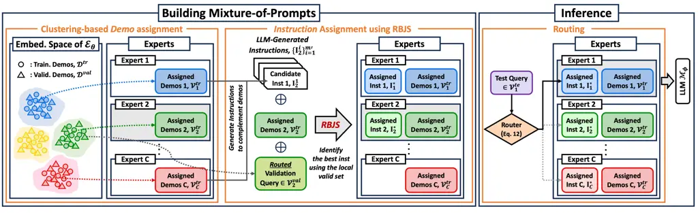

Figure 1: Illustration of MoP. We adopt the MoE paradigm and divide the
problem space into a set of sub-regions. Each sub-region is governed by
a specialized expert, equipped with both an instruction and a set of
demos. A two-phase process is developed to construct the specialized
expert for each region: (1) demo assignment: Inspired by the theoretical
connection between ICL and kernel regression, we group demos into
experts based on their semantic similarity; (2) instruction assignment:
A region-based joint search (RBJS) of an instruction per expert
complements the demos assigned to it, yielding a synergistic effect.
During inference, each new query is routed to its closest expert in the
embedding space and the assigned expert then utilizes its prompt
(instruction + demos) to make the final prediction.

##### Terminology.

We start by introducing key terminologies that will be used throughout
the paper. We define a Prompt as the entire text preceding the question.
We consider the setting where a prompt can be divided into two parts:
(1) Instruction: a set of natural language sentences describing the
task, and (2) Demos: a set of input-output pairs structured in a
specific way to demonstrate how to solve a task. Below is an example
prompt under this definition:

Mathematically, a prompt ($`P`$) can be represented as follows (Xie
et al., 2021):

```math
\displaystyle P(x) \displaystyle=\left[I,x_{1},\ y_{1},\ o^{\text{delim}},...,\ x_{n},\ y_{n},\ o^{\text{delim}},\ x\right]. \tag{1}
```

Here, $`I`$ represents an instruction, $`{\{(x_{i},y_{i})\}}_{i=1}^{n}`$
represents in-context demos, which is the set of (input, output) pairs,
and $`o^{\text{delim}}`$ represents delimiter token.

##### Prompt Optimization.

Recent efforts have demonstrated significant potential in automating the
prompt engineering processes. Concretely, given a set of demos sampled
from a task distribution $`\mathcal{D}`$, analog to the “training data”
in supervised learning, a prompt optimization aims at finding an
Instruction (demo-free) that minimizes the empirical risk (or maximizes
a score):

```math
\displaystyle P^{*}(x)=\argmax_{P(x)}{\mathbb{E}_{(x,y)\sim\mathcal{D}}{f\left(P(x),y\right)}}, \tag{2}
```

where $`f(\cdot)`$ denotes some task-specific scoring function
(Appendix I). After optimization, the best instruction can be used to
predict new inputs in the following format:
$`P^{*}(x)=\left[I^{*},\ x\right]`$. Under the framework of Empirical
Risk Minimization, one can deduce an underlying assumption that demos
(training data) encapsulate all external information about the task.

##### APE - Automatic Prompt Engineering.

The most relevant work to ours is APE (Zhou et al., 2022) - a pioneering
method demonstrating that LLMs can be used to optimize prompt. The key
idea of APE is to ask an LLM to induce candidate instructions by
observing a subset of demos, randomly sampled from the entire training
dataset, and pick the best one according to their rank on a held-out
validation set (partitioned from training demos as well). Formally,

```math
\displaystyle\left\{I^{j}\right\}_{j=1}^{m}\sim\mathbb{P}\left(I^{j}\mid\tilde{\mathcal{D}}^{\text{train}},T(\tilde{\mathcal{D}}^{\text{train}});\mathcal{M}_{\phi}\right). \tag{3}
```

Here, $`\mathcal{M}_{\phi}`$ denote an LLM, $`\{I^{j}\}_{j=1}^{m}`$ are
the candidate instructions, and
$`T(\tilde{\mathcal{D}}^{\text{train}})`$ represents the chosen template
format (see Figure 6). Subsequently, the best instruction among the
candidate pool is selected based on the validation accuracy:

```math
\displaystyle I^{*}=\argmax_{I^{j}}{\mathbb{E}_{(x,y)\sim\tilde{\mathcal{D}}^{\text{valid}}}{f\left(\left[I^{j},\ x\right],y\right)}}. \tag{4}
```

We refer the reader to Section K.1 for more details.

##### Limitations of APE.

While methods like APE demonstrated promising results in designing
prompts that surpass human engineers, they are still constrained to
searching within a _single demo-free_ instruction space. Such a
limitation can hinder the problem-solving potential in NLP tasks, where
the complexity of problems may not be adequately addressed by a _single
demo-free_ instruction alone.

## 4 MoP: Mixture-of-Prompts

### 4.1 Framework Overview

##### Mixture-of-Expert for prompt optimization.

To address the aforementioned issue of existing automatic prompt
engineering methods, we expand the problem space coverage for automatic
prompt engineering by optimizing the Mixture of Prompts (MoP). To
achieve this, we employ the Mixture of Experts (MoE) paradigm (Jacobs
et al., 1991; Jordan & Jacobs, 1994) to partition the entire problem
space into $`C`$ regions, each governed by a specialized expert. Within
the MoE framework, prompt optimization (Equation 2) transforms into an
expert assignment problem that aims to search for the most suitable
prompt $`P_{c}^{*}`$ for each expert, with the ultimate goal of
optimizing the performance of the entire mixture:

```math
\displaystyle P^{*}(x) \displaystyle=\argmax_{\{P_{1}(x),\ldots,P_{C}(x)\}}{\sum_{c=1}^{C}{\mathbb{E}_{(x_{c},y_{c})\sim\mathcal{V}_{c}}{f\left(P_{c}(x_{c}),y_{c}\right)}}}, \tag{5}
```

```math
\displaystyle\text{ where }\mathcal{D}=\{\mathcal{V}_{c}\}_{c=1}^{C}.
```

Here, $`(x_{c},y_{c})\sim\mathcal{V}_{c}`$ refers to the data point
assigned to expert $`c`$ by the employed routing function during
inference time (we explain it in more detail later in Section 4.2).
Notably, our MoP framework expands the prompt for each expert to contain
both the instruction and demos jointly optimized for each expert region
in the problem space;
$`P_{c}(x_{c})=\left[I_{c},\ {{\mathcal{V}}_{c}^{\text{train}}},\ x_{c}\right]`$
in Equation 5. Intuitively, concrete demos excel at defining
fine-grained details and expertise (local information) matching the
queries in a local region, whereas instructions provide general
abilities and high-level explanations for solving tasks (global
information). Inspired by this, we introduce a two-phase search
algorithm that jointly optimizes (demos, instructions) pairs for each
expert (detail in Section 4.2 and 4.3).

### 4.2 Demo Assignment

In our two-phase search algorithm, we initiate the process by assigning
training demos to different experts. Since demos represent local
expertise, their assignment defines the design of experts in MoE and is
entirely up to the constructors. While there are many options, we
propose a clustering-based demo assignment method, derived from a recent
theory of In-Context Learning in LLMs.

##### LLM learns from demos via Kernel Regression in the embedding space.

Recently,  Han et al. (2023) provides the first theoretical result
showing that LLM performs In-Context Learning (ICL) from demos as Kernel
Regression in the embedding space. Formally:

###### Theorem 4.1.

Let $`\{(x_{i},y_{i})\}_{i=1}^{n}`$ denote the demos used in the prompt;
Let $`K`$ define a kernel function that measures the semantic similarity
between two data points, which can be represented as
$`K(x_{i},x_{j})=\phi(x_{i})^{T}\phi(x_{j})`$ with some embedding space
$`\phi(\cdot)`$. Then the output of LLM, $`P(y|[S_{n},x_{test}])`$,
converges polynomially to the following Kernel Regression model with
probability $`1-\delta`$.

```math
\hat{y}_{i}=(\sum\nolimits_{j}y_{i}K(x_{i},x_{j}))/(\sum\nolimits_{j}K(x_{i},x_{j})), \tag{6}
```

Theorem 4.1 (Han et al., 2023) suggests that, when LLM is prompted with
a set of demos and a new test query ($`x^{\text{test}}`$), demos that
are semantically closer to the test example in embedding space
contribute more to its prediction. The same phenomenon has been observed
by several empirical studies (Rubin et al., 2021; Han et al., 2023; Liu
et al., 2021). This behavior is also intuitive for ICL: the whole
purpose of providing demos is for LLMs to leverage and apply their
patterns to the test input.

##### Clustering demos to each expert based on their semantic similarity.

The above analysis motivates a natural way of assigning demos to
different experts: by clustering them based on semantic similarity.
Starting from the kernel model in Theorem 4.1, our goal is to divide the
demos into $`C`$ groups $`\{\mathcal{V}_{1},\dots,\mathcal{V}_{C}\}`$
such that each group (expert) only uses its own demo. In this case, the
same sample $`x_{i}`$’s prediction, assuming its in group $`c`$, will
become

```math
\bar{y}_{i}=(\sum\nolimits_{j\in\mathcal{V}_{c}}y_{i}K(x_{i},x_{j}))/(\sum\nolimits_{j\in\mathcal{V}_{c}}K(x_{i},x_{j})), \tag{7}
```

and the error $`|\bar{y}_{i}-\hat{y}_{i}|`$ is related to the sum of the
kernel entries outside the cluster
$`\sum_{j\notin\mathcal{V}_{c}}K(x_{i},x_{j})`$. Therefore, a good demo
assignment algorithm will minimize the sum of between-cluster kernel
values while keeping the clusters balanced, leading to the following
clustering objective:

```math
\min_{\{\mathcal{V}_{1},\dots,\mathcal{V}_{C}\}}\sum_{c=1}^{C}\frac{\sum_{i\in\mathcal{V}_{c}}\sum_{j\notin\mathcal{V}_{c}}K(x_{i},x_{j})}{|\mathcal{V}_{c}|}. \tag{8}
```

Based on the derivation in Appendix F, this is equivalent to the
following clustering objective:

```math
\min_{\{\mathcal{V}_{1},\dots,\mathcal{V}_{C}\}}\sum_{c=1}^{C}\sum_{i\in\mathcal{V}_{c}}\|\phi(x_{i})-m_{c}\|^{2},\ \ \ m_{c}=\frac{1}{|\mathcal{V}_{c}|}\sum_{j\in\mathcal{V}_{c}}\phi(x_{j}), \tag{9}
```

which is exactly the objective function of K-means clustering in the
embedding space $`\phi(\cdot)`$. In practice, we assume
$`\phi(\cdot):=\mathcal{E}_{\theta}(\cdot)`$ is a mapping formed by a
neural network encoder, and conduct K-means in such embedding space to
cluster demos. Note that the choice of embedding space does not have to
be the same as the API model; as long as the embedding space reflects
the high-level semantic similarity between different demos, it can be
used to effectively partition the problem space. We also compare other
options in the ablation study.

##### On the choice of clustering algorithm.

In principle, our demo assignment method allows any clustering algorithm
to be applied. In practice, we resort to the widely adopted K-means
family for their simplicity, and made the following changes to better
suit our application: 1) We select the K-means-auto variant as it can
infer the optimal number of experts from the data. 2) To avoid biasing
towards a larger number of clusters, we employ scaled inertia
(Equation 10) as the criterion when identifying the optimal number of
experts.

```math
\displaystyle C^{*}=\argmin_{C=C_{\text{min}},\ldots,C_{\text{max}}}\left(\min_{\{\mathcal{V}_{1},\dots,\mathcal{V}_{C}\}}\sum_{c=1}^{C}\sum_{i\in\mathcal{V}_{c}}\|\phi(x_{i})-m_{c}\|^{2}+\alpha C\right) \tag{10}
```

##### Routing function.

During inference time, each new query $`x`$ will be routed to its
closest expert in the embedding space.

```math
c(x)=\argmin_{c=1,\ldots,C^{*}}K\left({\phi_{\theta}(x),\bm{\mu}_{c}}\right) \tag{11}
```

Here, $`\bm{\mu}_{c}`$ is the clustering centroids for each expert. The
assigned expert $`c(x)`$ will then use its prompt (instruction + demos)
to make the final prediction.

### 4.3 Instruction Assignment

Given the set of demos assigned to each expert, the final step is to
identify the best instruction for each cluster, so that the collective
performance of the mixture is maximized. We introduce a Region-Based
Joint Search (RBJS) algorithm for solving this objective. RBJS consists
of two parts: generating candidate instructions and identifying the best
one for each expert.

##### Generating candidate instructions to complement the demos.

As discussed in Section 4.1, each expert acquires a different specialty
from the local information stored in their assigned demos. Because of
this, they also process distinct blind spots in terms of their general
task-solving ability. Therefore, they might require different
instructions to compensate for their special needs. Inspired by this
analysis, for each expert, we propose to generate candidate instructions
utilizing the demos assigned to other experts. This way, the instruction
can potentially capture the missed information.

This choice is also supported by the empirical risk minimization
framework, as outlined in Section 3. For prompt optimization, ’demons’ —
analogous to training data in supervised learning — incorporate all
task-relevant external information accessible to the model. Therefore,
utilizing each expert’s local demonstrations for instruction generation
merely duplicates the existing information. This contradicts our goal of
creating instructions that compensate for the unique specialties of each
expert.

Any existing instruction generation algorithm can be used to propose
candidate instructions given a set of demos. In this work, we choose APE
for its simplicity.

##### Identifying the best candidate for each expert.

To select the best instruction from a set of proposals, existing prompt
optimization algorithms commonly rank their performance on a held-out
validation set, sampled from the same distribution as the training
demos. Using the entire validation set measures how well an expert
(instruction, demos) performs on the full data distribution. However,
this might not serve our purpose: During inference, each expert is only
responsible for predicting the data within their region. Our empirical
results also support this analysis; we find that the performance of an
expert between the full and local data distribution is not necessarily
aligned (Figure 2(d)).

To alleviate the issue in an exhaustive search, we first route each
input in the validation set to its experts, then perform a joint search
on the optimal (instruction, demos) pair.

Algorithm 1 in the appendix summarizes the entire search process of the
Region-Based Joint Search algorithm.

## 5 Experiments

In this section, we experimentally validate MoP, which jointly searches
for the optimal (instruction, demos) pair to partition the problem space
into homogeneous regions.

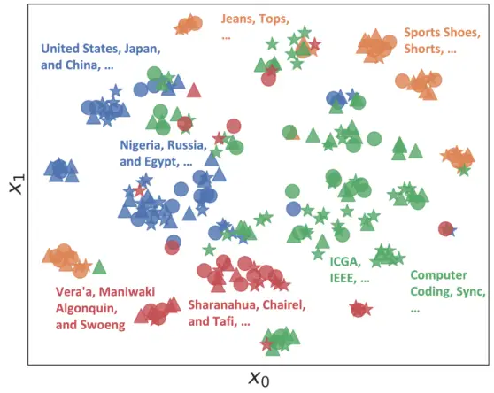

(a) Visualization of demo clusters

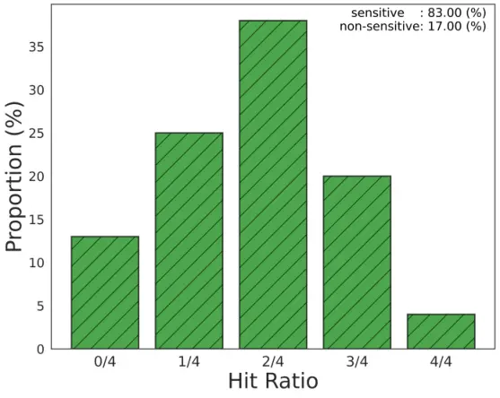

(b) Experts’ different strengths

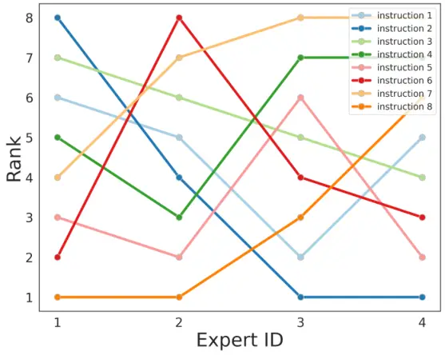

(c) Necessity of Joint Search

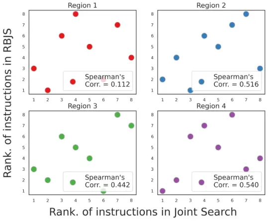

(d) Necessity of RBJS

Figure 2: Analysis. (a) There exist underlying patterns in the data
distribution, and demos with semantically similar meanings are grouped
closely. The circle, triangle, and star shapes represent training,
routed validation, and routed test demos, respectively. (b) Each expert
has distinct task-solving ability for each input. (c) A single
instruction is insufficient for all experts, highlighting the need for
distinct synergistic instructions for each expert. (d) Performance of
instructions evaluated under local data distribution for each expert
(i.e. subsets routed to each expert) is not aligned with the full data;
This motivates performing region-based evaluation during joint search
(RBJS).

### 5.1 Experimental Setup

##### Settings.

We follow the settings in the original APE paper (Zhou et al., 2022)
with the following exceptions. (1) Our evaluation is conducted on
OpenAI’s latest GPT-3.5-Turbo-Instruct model ¹¹ 1
https://platform.openai.com/docs/models/gpt-3-5, a cost-efficient
(100$`\times`$ cheaper) replacement for the text-davinci model used in
APE. We reran APE on this model. (2) For all our methods, we report the
mean and standard deviation across 3 runs to account for the randomness
in the search phase.

##### Tasks and Evaluation Metrics.

We empirically validate the strength of MoP across three major prompt
optimization benchmarks: Instruction Induction (Honovich et al., 2022),
Super Natural Instructions (Wang et al., 2022b), BIG-Bench-Hard (Suzgun
et al., 2022). These benchmarks cover a wide range of possible tasks,
including coding, math, common-sense reasoning, knowledge retrieval,
etc. We provide detailed descriptions of each task in the Appendix H.
For these benchmarks, we measure task performance for each task using
predefined score functions (details in Appendix I).

##### Baselines.

We compare our method against following baselines: APE (Zhou et al., 2022) searches for a single instruction among a pool of instruction
candidates proposed by a LLM, APE+Demos combines randomly selected demos
with an APE-found instruction, APE+K-centroids combines demos
corresponding to the centroids of K-means with an APE-found instruction,
InstructZero; IZ (Chen et al., 2023) finds a single instruction for a
black-box LLM by optimizing the soft prompt of an open-source LLM using
a Bayesian Optimization approach, and IZ+Demos and IZ+K-centroids are
the same as the previous APE variants. For more details, refer to
Appendix K. We defer more baselines that partially use our method to the
ablation study in Section 6.

##### Implementation Details.

Following the previous automatic prompting works (Zhou et al., 2022), we
set the temperature to 0.9 when generating instructions using LLMs to
encourage diversity and to 0.0 when evaluating with LLMs. Furthermore,
for a fair comparison, we set the same budget for all methods. Regarding
demo assignments in MoP, we use the default hyperparameter consistently
across all experiments. More details can be found in Appendix L.

### 5.2 Analysis

Before delving into the main experiments, we conduct an empirical
analysis that motivates the development of our MoP framework. The
results presented here are obtained for the Auto categorization task,
with the maximum number of experts set to four.

##### Visualization of demo clusters.

Building upon the theoretical connection between ICL and Kernel
Regression, we begin by clustering a given set of demos into regions
based on their semantic similarity. To achieve this, we first map the
given demo sets into the embedding space using text-embedding-ada-002
model ²² 2 https://openai.com/blog/new-and-improved-embedding-model as a
text encoder ($`\mathcal{E}_{\theta}`$), and then apply the clustering
algorithm described in Section 4.2. Figure 2(a) visualizes clustering in
the embedding space with t-SNE projection. The illustration indicates
that there exist underlying patterns in the data distribution, and demos
with semantically similar meanings are grouped closely. For example, for
the ’Auto categorization’ task shown in Figure 2(a), demos relevant to
country, computer science, extinct languages, and apparel are each
clustered together. By clustering demos in the embedding space, we can
effectively find semantically similar clusters that help allocate test
queries (marked with stars Figure 2(a)) accurately to the corresponding
region and the optimal expert.

##### Experts process different specialties.

We then verify the impact of demo clusters on performance for each test
query. In order to eliminate the impact of instructions on performance,
all experts utilize only clustered demos as prompts, thereby restricting
the output space to demos only. Subsequently, we calculate the Hit Ratio
by counting the number of correctly answered experts out of the total
number of experts ($`C`$) for each test input. If test inputs yield Hit
Ratios within the range other than 0/$`C`$ and $`C`$/$`C`$, it indicates
their sensitivity to the assigned expert. As depicted in Figure 2(b), we
measure the Hit Ratios and observe that 83% of test inputs have Hit
Ratio values that are neither 0 nor 1. This implies that most test
inputs are influenced by the type of clustered demos they are assigned;
Each expert develops distinct specialties based on the local information
within their assigned demos, resulting in distinct blind spots in terms
of task-solving ability for each test input.

##### Necessity of RBJS.

We also examine the necessity of jointly searching for the optimal
(instructions, demos) pair. To investigate this, we initially assign
training demos to 4 different experts and consider 8 candidate
instructions generated by a LLM. Then, for each expert, we vary the
instructions and measure the test performance of prompts by combining
these instructions with the demos specific to each expert. Figure 2(c)
visualizes the ranks of the candidate instructions for each individual
expert. As depicted in Figure 2(c), the rankings of each candidate
instruction vary significantly across different experts. These results
indicate that a single instruction is insufficient for all experts,
highlighting the need for distinct synergistic instructions for each
expert. This emphasizes the importance of a joint optimization scheme
for the (instruction, demos) pair, which can lead to improved results.
Furthermore, for each region, we calculate the correlation between 1)
the validation rankings of candidate instructions obtained from a random
subset of the full validation set (Joint Search) and 2) the rankings
obtained when using an equal-sized routed local validation set within
the target region (RBJS). As illustrated in Figure 2(d), it is evident
that there is a misalignment in the validation rankings of candidate
instructions between the use of a random subset of the full dataset and
the utilization of routed local data. We defer the evaluation of the
RBJS’s effectiveness to an ablation study in Section 6.5.

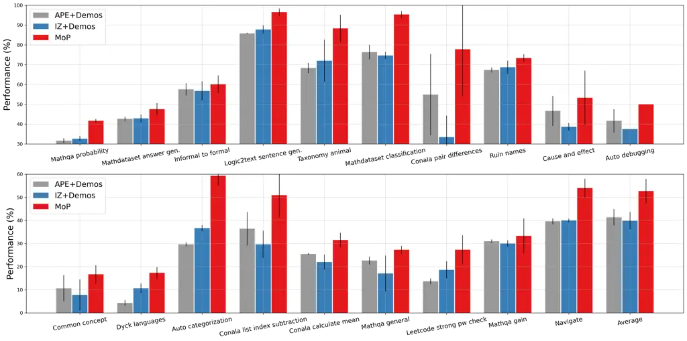

Figure 3: Main results. We validate MoP across three major prompt
optimization benchmarks. MoP achieves an average performance of 52.73%
outperforming the average performance of 41.39% / 39.87% achieved by
APE+Demos / IZ+Demos in these results.

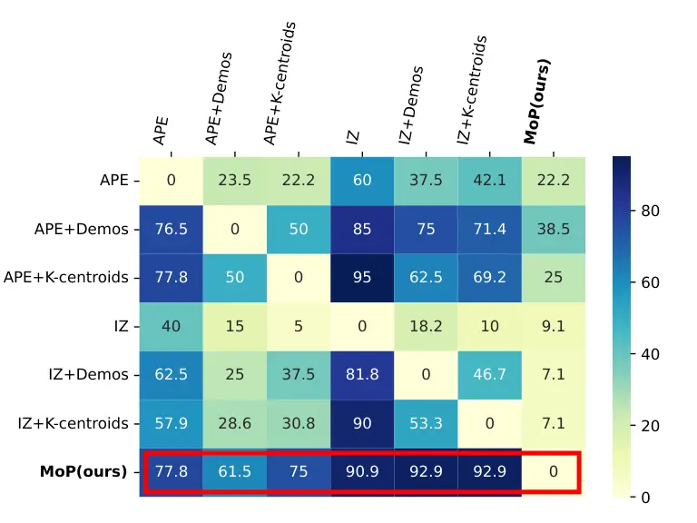

(a) Instruction Induction

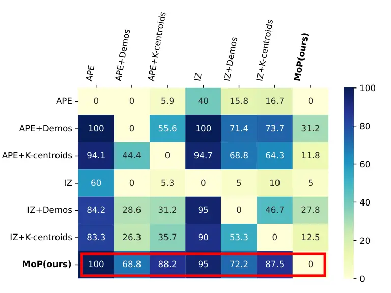

(b) Super Natural Instructions

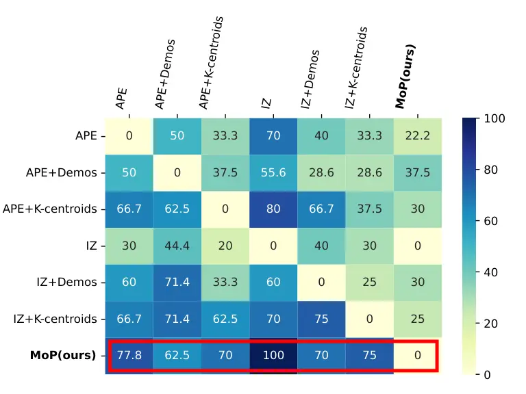

(c) BIG-Bench-Hard

Figure 4: Win rate matrices. We compare the pairwise win rate of all
methods on Instruction Induction (a), SuperNI (b), and BIG-Bench-Hard
(c). Our method achieves the best win rate against all six baselines
across various benchmarks. The average win rate of MoP across all
benchmarks is 81%.

### 5.3 Main Results

In this section, we conduct a large-scale experiment to compare MoP
against six previous SOTAs across three major benchmarks:
Instrucion-Induction (Zhou et al., 2022), Super Natural
Instruction (Wang et al., 2022b), and BIG-Bench-Hard (Suzgun et al.,
2022). Tasks from these benchmarks cover a broad spectrum of language
understanding scenarios, including various types of reasoning, knowledge
retrieval, coding, math, etc. Due to space limit, we only showcase 19
tasks here, and include all results in Appendix J. As shown in Figure 3,
MoP outperforms prior arts (APE + Demos and IZ + Demos) by a substantial
margin.

In addition, we also compute the win rate of every pair of methods. As
shown in Figure 4, the win rate of MoP dominates all six prior methods,
with an average of 81% across three benchmarks. The results not only
reveal the strength of our framework but also demonstrate that MoP can
generalize to a wide range of tasks.

## 6 Ablation Study

In this section, we ablate the effect of different modules in the
proposed MoP framework. We conduct the experiments on three tasks: Auto
categorization, Mathdataset classification, and Taxonomy animal the task
throughout the section. All other settings are identical to the previous
section.

### 6.1 Robustness of MoP on Out-of-Distribution Data

|              |                 |                 |                 |
| ------------ | --------------- | --------------- | --------------- |
| OOD Data     | Mathdataset     | Taxonomy animal | Auto cate       |
| APE          | 9 $`\pm`$ 11.0  | 62 $`\pm`$ 3.6  | 37 $`\pm`$ 4.1  |
| APE + random | 44 $`\pm`$ 6.6  | 61 $`\pm`$ 3.3  | 38 $`\pm`$ 0.4  |
| APE + kcen   | 40 $`\pm`$ 11.8 | 60 $`\pm`$ 1.0  | 44 $`\pm`$ 2.2  |
| IZ           | 25 $`\pm`$ 26.0 | 55 $`\pm`$ 5.8  | 44 $`\pm`$ 10.1 |
| IZ + random  | 45 $`\pm`$ 9.9  | 60 $`\pm`$ 0.6  | 43 $`\pm`$ 0.4  |
| IZ + kcen    | 48 $`\pm`$ 11.7 | 61 $`\pm`$ 1.4  | 44 $`\pm`$ 1.2  |
| MoP          | 68 $`\pm`$ 4.7  | 60 $`\pm`$ 1.5  | 46 $`\pm`$ 1.8  |

Table 1: Comparison on Out-of-Distribution data. We compare different
methods on Out-of-Distribution data, created adversarially using the
embedding model (same as MoP) to group the original dataset into two
clusters, one for training and one for testing. Overall, MoP achieves
the best robustness under this setting.

To further assess the robustness of our method under Out-Of-Distribution
(OOD) settings, we craft OOD datasets that can challenge MoP: Using the
same embedding model as MoP, we divided the original dataset into two
clusters: one designated for training and the other for testing. This
division ensured that all test data were significantly distant from the
training clusters, providing a rigorous test of MoP’s demonstration
assignment and routing functions — arguably a more adversarial setup
than that faced by APE.

The results in Table 6.1 reveal several insights. Firstly, all methods
exhibited a performance drop on the OOD dataset. This aligns with the
principle of empirical risk minimization, where optimization is strictly
confined to the information provided by the training data. Secondly, MoP
consistently outperforms other baselines.

The resilience of MoP can be attributed to its strategic segmentation of
the problem space. By dividing the space into distinct regions, each
managed by an expert, MoP ensures that even an OOD query is matched to
the closest region. This reduces the ”out-of-distribution” effect for
the query relative to the localized data distribution, making the query
effectively less alien to the selected expert region.

### 6.2 Different Number of Demos

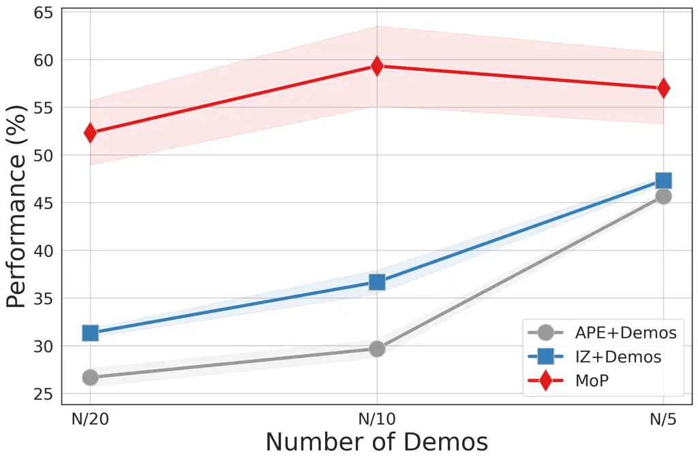

(a) Auto categorization

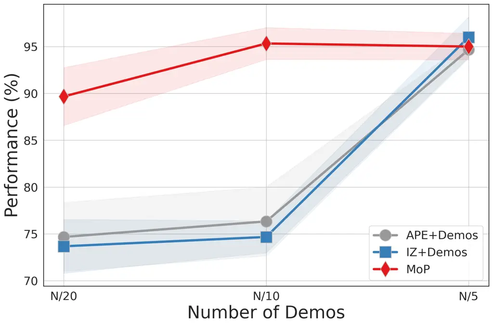

(b) Mathdataset classification

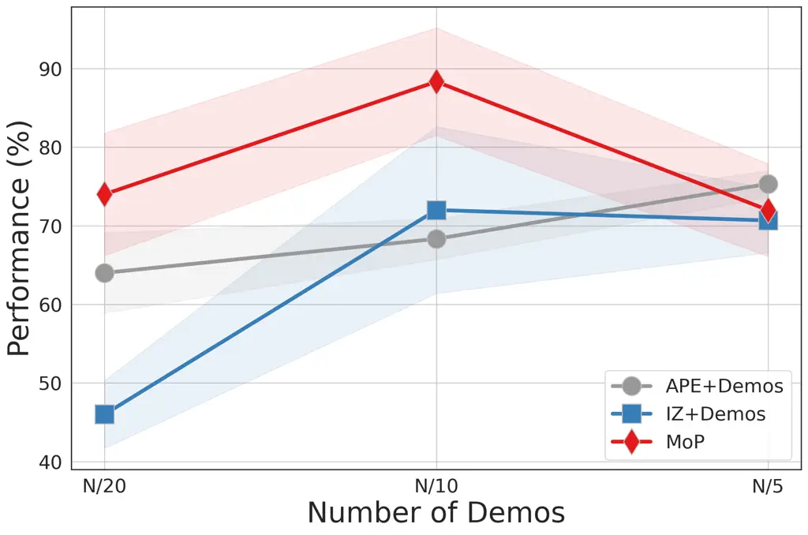

(c) Taxonomy animal

Figure 5: Ablation study on different number of demos. We measure the
task performance of each method across different numbers of demos. Here,
$`N`$ on the x-axis represents the total number of training demos.

Firstly, we verify the performance of MoP against baselines across
different numbers of demos. As shown in Figure 5, MoP consistently
outperforms the baselines across various numbers of demos, achieving a
significant improvement of 16.89%, 22.89%, 2.78% compared to APE+Demos
and 21.67%, 19.88%, 3.33% compared to IZ+Demos across all the tasks
considered for each number of demos.

### 6.3 Different Clustering Algorithm

We use K-means-Auto to cluster demos, which automatically decides the
best number of experts. The intuition behind it is that more experts do
not necessarily produce the best result. Here, we validate this choice
by comparing the performance of K-Means-Balanced and K-means-Auto. As
shown in Table 2, both K-Means variants outperform random, while
K-Means-Auto achieves the best results.

### 6.4 Different Embedding Model

During demo assignment, we measure the semantic similarity of demos
using $`l_{2}`$ distance in the embedding space. While our method is
agnostic to the specific choice of embedding models, stronger text
encoders perform better in identifying semantically similar demos. Here
we examine how the strength of the embedding model affects the
performance of MoP. We examine three commonly used text encoders:
GPT2-Large, T5, and Ada-002. The results in Table 2’s 1st group suggests
that, while Ada achieves the best result, MoP operates reasonably well
with paried with GPT2-Large. This shows that the proposed demo
assignment method does not rely on a specific embedding model.

### 6.5 Different Prompt Assignment Algorithms

We further ablate the key elements behind the design of our Region-Based
Joint Search algorithm. 1). The optimal instruction for each expert
might be distinct, therefore their generation and assignment should be
conditioned on the demo clusters (Joint Search); 2). To find
instructions that compensate for each expert’s demos, we use demos from
all other experts to generate instructions. 3). The optimal prompt for
each expert is evaluated only on the text points assigned to this expert
(Region-based). We designed three prompt assignment methods to validate
these hypotheses respectively: 1). Independent Search searches for the
best prompt and assigns demos independently, i.e. the global best prompt
will be assigned to all experts; 2). RBJS Same-Cluster uses each
expert’s own demos to generate prompts; 3). Joint Search ranks the best
prompt on all validation data. The results in the bottom group of
Table 2 confirm the claims: Region-Based Joint Search achieves the best
results.

### 6.6 Different Routing Algorithms

The routing function is crucial to the MoE framework, as it is
responsible for assigning the test input to the most suitable experts.
Following the clustering-based demo assignment, our routing function
maps a test input to its closest expert in embedding space as well. As
shown in Table 2, our routing function significantly outperforms random
assignment.

|             |                |                 |                |
| ----------- | -------------- | --------------- | -------------- |
| Embed Model | Mathdataset    | Taxonomy animal | Auto cate      |
| GPT2-Large  | 97 $`\pm`$ 1.3 | 89 $`\pm`$ 0.9  | 53 $`\pm`$ 0.9 |
| Sentence-T5 | 92 $`\pm`$ 2.3 | 76 $`\pm`$ 3.9  | 53 $`\pm`$ 5.3 |
| Ada         | 95 $`\pm`$ 3.3 | 88 $`\pm`$ 6.9  | 59 $`\pm`$ 0.4 |

|                  |                |                 |                |
| ---------------- | -------------- | --------------- | -------------- |
| Clustering       | Mathdataset    | Taxonomy animal | Auto cate      |
| Random           | 89 $`\pm`$ 1.3 | 74 $`\pm`$ 5.7  | 36 $`\pm`$ 0.8 |
| K-means-Balanced | 96 $`\pm`$ 0.8 | 82 $`\pm`$ 2.6  | 52 $`\pm`$ 2.6 |
| K-means-Auto     | 95 $`\pm`$ 1.7 | 88 $`\pm`$ 6.9  | 59 $`\pm`$ 4.2 |

|                    |                |                 |                |
| ------------------ | -------------- | --------------- | -------------- |
| Prompt Assignment  | Mathdataset    | Taxonomy animal | Auto cate      |
| Independent Search | 94 $`\pm`$ 1.5 | 71 $`\pm`$ 6.3  | 52 $`\pm`$ 3.4 |
| Joint Search (JS)  | 93 $`\pm`$ 1.7 | 82 $`\pm`$ 9.0  | 56 $`\pm`$ 2.9 |
| RBJS Same-Cluster  | 91 $`\pm`$ 1.4 | 72 $`\pm`$ 1.0  | 60 $`\pm`$ 4.9 |
| RBJS (Ours)        | 95 $`\pm`$ 1.7 | 88 $`\pm`$ 6.9  | 59 $`\pm`$ 4.2 |

|                  |                |                 |                |
| ---------------- | -------------- | --------------- | -------------- |
| Routing Function | Mathdataset    | Taxonomy animal | Auto cate      |
| Random           | 77 $`\pm`$ 2.2 | 87 $`\pm`$ 3.3  | 32 $`\pm`$ 2.9 |
| MoP              | 95 $`\pm`$ 1.7 | 88 $`\pm`$ 6.9  | 59 $`\pm`$ 4.2 |

Table 2: Ablation study. The choice of models and algorithms in MoP is
listed in the last row of every group. The best performance is achieved
with K-means-Auto, text-embedding-ada, and RBJS.

## 7 Conclusion

This work introduces the Mixture-of-Prompts (MoP) approach to enhance
the performance of prompt optimization for Large Language Models. While
existing methods search for a single instruction to prompt language
models, MoP optimizes for a set of experts (prompts), each governing a
specialized region of the problem space. This divide-and-conquer
approach reduces the complexity associated with the task assigned to a
single prompt, thereby substantially enlarging the problem space
coverage. Within MoP framework, we further investigate various demo and
instruction assignment methods for constructing the expert committee.
Equipped with the proposed similarity-based demo assignment and
region-based demo-instruction joint search, MoP substantially improves
the performance over comparable methods over a diverse set of NLP tasks.
We hope the proposed method and associated findings could open up new
possibilities for prompt optimization research.

##### Limitations

We include a discussion on the limitations of our method in Appendix M.

## Acknowledgements

The work is partially supported by NSF 2048280, 2331966, 2325121,
2244760, ONR N00014-23-1-2300, Institute for Information &
communications Technology Promotion(IITP) grant funded by the Korea
government(MSIT) (No.RS-2019-II190075 Artificial Intelligence Graduate
School Program(KAIST), and the National Research Foundation of
Korea(NRF) grant funded by the Korea government(MSIT) (No.
RS-2023-00256259).

## Impact Statement

In this work, we validate that our framework enhances the performance of
prompt optimization for Large Language Models, by introducing the
Mixture-of-Prompts, as shown in Section 5. Our approach potentially
accelerates the effective utilization of Large Language Models, which
have consistently showcased remarkable generalization capabilities
across diverse tasks, contributing to promoting more equitable access to
technological resources. Nevertheless, it is essential to acknowledge
the possibility of our framework being misused for purposes such as
generating misleading information or promoting unethical practices. We
hope that our research will be applied responsibly and ethically.

## References

- Alhoshan et al. (2022) Alhoshan, W., Zhao, L., Ferrari, A., and
  Letsholo, K. J. A zero-shot learning approach to classifying
  requirements: A preliminary study. In _International Working
  Conference on Requirements Engineering: Foundation for Software
  Quality_, pp. 52–59. Springer, 2022.
- Brown et al. (2020) Brown, T., Mann, B., Ryder, N., Subbiah, M.,
  Kaplan, J. D., Dhariwal, P., Neelakantan, A., Shyam, P., Sastry, G.,
  Askell, A., et al. Language models are few-shot learners. _Advances in
  neural information processing systems_, 33:1877–1901, 2020.
- Chen et al. (2023) Chen, L., Chen, J., Goldstein, T., Huang, H., and
  Zhou, T. Instructzero: Efficient instruction optimization for
  black-box large language models. _arXiv preprint
  arXiv:2306.03082_, 2023.
- Collobert et al. (2001) Collobert, R., Bengio, S., and Bengio, Y. A
  parallel mixture of svms for very large scale problems. _Advances in
  Neural Information Processing Systems_, 14, 2001.
- Dale (2021) Dale, R. Gpt-3: What’s it good for? _Natural Language
  Engineering_, 27(1):113–118, 2021.
- Dauphin et al. (2017) Dauphin, Y. N., Fan, A., Auli, M., and
  Grangier, D. Language modeling with gated convolutional networks. In
  _International conference on machine learning_, pp. 933–941.
  PMLR, 2017.
- Deng et al. (2022) Deng, M., Wang, J., Hsieh, C.-P., Wang, Y., Guo,
  H., Shu, T., Song, M., Xing, E., and Hu, Z. Rlprompt: Optimizing
  discrete text prompts with reinforcement learning. In _Proceedings of
  the 2022 Conference on Empirical Methods in Natural Language
  Processing_, pp. 3369–3391, 2022.
- Devlin et al. (2018) Devlin, J., Chang, M.-W., Lee, K., and
  Toutanova, K. Bert: Pre-training of deep bidirectional transformers
  for language understanding. _arXiv preprint arXiv:1810.04805_, 2018.
- Eigen et al. (2013) Eigen, D., Ranzato, M., and Sutskever, I. Learning
  factored representations in a deep mixture of experts. _arXiv preprint
  arXiv:1312.4314_, 2013.
- Fernando et al. (2023) Fernando, C., Banarse, D., Michalewski, H.,
  Osindero, S., and Rocktäschel, T. Promptbreeder: Self-referential
  self-improvement via prompt evolution. _arXiv preprint
  arXiv:2309.16797_, 2023.
- Han et al. (2023) Han, C., Wang, Z., Zhao, H., and Ji, H. In-context
  learning of large language models explained as kernel regression.
  _arXiv preprint arXiv:2305.12766_, 2023.
- Honovich et al. (2022) Honovich, O., Shaham, U., Bowman, S. R., and
  Levy, O. Instruction induction: From few examples to natural language
  task descriptions. _arXiv preprint arXiv:2205.10782_, 2022.
- Jacobs et al. (1991) Jacobs, R. A., Jordan, M. I., Nowlan, S. J., and
  Hinton, G. E. Adaptive mixtures of local experts. _Neural
  computation_, 3(1):79–87, 1991.
- Jordan et al. (1996) Jordan, M., Ghahramani, Z., and Saul, L. Hidden
  markov decision trees. _Advances in neural information processing
  systems_, 9, 1996.
- Jordan & Jacobs (1994) Jordan, M. I. and Jacobs, R. A. Hierarchical
  mixtures of experts and the em algorithm. _Neural computation_,
  6(2):181–214, 1994.
- (16) Kojima, T., Gu, S. S., Reid, M., Matsuo, Y., and Iwasawa, Y.
  Large language models are zero-shot reasoners, 2022. _URL
  https://arxiv. org/abs/2205.11916_.
- Liu et al. (2021) Liu, J., Shen, D., Zhang, Y., Dolan, B., Carin, L.,
  and Chen, W. What makes good in-context examples for gpt-$`3`$? _arXiv
  preprint arXiv:2101.06804_, 2021.
- Lu et al. (2021) Lu, Y., Bartolo, M., Moore, A., Riedel, S., and
  Stenetorp, P. Fantastically ordered prompts and where to find them:
  Overcoming few-shot prompt order sensitivity. _arXiv preprint
  arXiv:2104.08786_, 2021.
- OpenAI (2023) OpenAI. Gpt-4 technical report. _ArXiv_,
  abs/2303.08774, 2023. URL
  [https://api.semanticscholar.org/CorpusID:257532815](https://api.semanticscholar.org/CorpusID:257532815).
- Ouyang et al. (2022) Ouyang, L., Wu, J., Jiang, X., Almeida, D.,
  Wainwright, C., Mishkin, P., Zhang, C., Agarwal, S., Slama, K., Ray,
  A., et al. Training language models to follow instructions with human
  feedback. _Advances in Neural Information Processing Systems_,
  35:27730–27744, 2022.
- Peters et al. (2018) Peters, M. E., Neumann, M., Zettlemoyer, L., and
  Yih, W.-t. Dissecting contextual word embeddings: Architecture and
  representation. _arXiv preprint arXiv:1808.08949_, 2018.
- Pryzant et al. (2023) Pryzant, R., Iter, D., Li, J., Lee, Y. T., Zhu,
  C., and Zeng, M. Automatic prompt optimization with” gradient descent”
  and beam search. _arXiv preprint arXiv:2305.03495_, 2023.
- Rubin et al. (2021) Rubin, O., Herzig, J., and Berant, J. Learning to
  retrieve prompts for in-context learning. _arXiv preprint
  arXiv:2112.08633_, 2021.
- Schick et al. (2023) Schick, T., Dwivedi-Yu, J., Dessì, R., Raileanu,
  R., Lomeli, M., Zettlemoyer, L., Cancedda, N., and Scialom, T.
  Toolformer: Language models can teach themselves to use tools. _arXiv
  preprint arXiv:2302.04761_, 2023.
- Shazeer et al. (2017) Shazeer, N., Mirhoseini, A., Maziarz, K., Davis,
  A., Le, Q., Hinton, G., and Dean, J. Outrageously large neural
  networks: The sparsely-gated mixture-of-experts layer. _arXiv preprint
  arXiv:1701.06538_, 2017.
- Shin et al. (2020) Shin, T., Razeghi, Y., Logan IV, R. L., Wallace,
  E., and Singh, S. Autoprompt: Eliciting knowledge from language models
  with automatically generated prompts. In _Proceedings of the 2020
  Conference on Empirical Methods in Natural Language Processing
  (EMNLP)_, pp. 4222–4235, 2020.
- Su et al. (2022) Su, H., Kasai, J., Wu, C. H., Shi, W., Wang, T., Xin,
  J., Zhang, R., Ostendorf, M., Zettlemoyer, L., Smith, N. A., et al.
  Selective annotation makes language models better few-shot learners.
  _arXiv preprint arXiv:2209.01975_, 2022.
- Suzgun et al. (2022) Suzgun, M., Scales, N., Schärli, N., Gehrmann,
  S., Tay, Y., Chung, H. W., Chowdhery, A., Le, Q. V., Chi, E. H., Zhou,
  D., , and Wei, J. Challenging big-bench tasks and whether
  chain-of-thought can solve them. _arXiv preprint
  arXiv:2210.09261_, 2022.
- Touvron et al. (2023) Touvron, H., Lavril, T., Izacard, G., Martinet,
  X., Lachaux, M.-A., Lacroix, T., Rozière, B., Goyal, N., Hambro, E.,
  Azhar, F., et al. Llama: Open and efficient foundation language
  models. _arXiv preprint arXiv:2302.13971_, 2023.
- Vaswani et al. (2017) Vaswani, A., Shazeer, N., Parmar, N., Uszkoreit,
  J., Jones, L., Gomez, A. N., Kaiser, Ł., and Polosukhin, I. Attention
  is all you need. _Advances in neural information processing systems_,
  30, 2017.
- Wang et al. (2022a) Wang, X., Wei, J., Schuurmans, D., Le, Q., Chi,
  E., Narang, S., Chowdhery, A., and Zhou, D. Self-consistency improves
  chain of thought reasoning in language models. _arXiv preprint
  arXiv:2203.11171_, 2022a.
- Wang et al. (2022b) Wang, Y., Mishra, S., Alipoormolabashi, P., Kordi,
  Y., Mirzaei, A., Arunkumar, A., Ashok, A., Dhanasekaran, A. S., Naik,
  A., Stap, D., et al. Super-naturalinstructions:generalization via
  declarative instructions on 1600+ tasks. In _EMNLP_, 2022b.
- Wang et al. (2022c) Wang, Y., Mishra, S., Alipoormolabashi, P., Kordi,
  Y., Mirzaei, A., Arunkumar, A., Ashok, A., Dhanasekaran, A. S., Naik,
  A., Stap, D., et al. Super-naturalinstructions: Generalization via
  declarative instructions on 1600+ nlp tasks. _arXiv preprint
  arXiv:2204.07705_, 2022c.
- Wei et al. (2022a) Wei, J., Wang, X., Schuurmans, D., Bosma, M., Xia,
  F., Chi, E., Le, Q. V., Zhou, D., et al. Chain-of-thought prompting
  elicits reasoning in large language models. _Advances in Neural
  Information Processing Systems_, 35:24824–24837, 2022a.
- Wei et al. (2022b) Wei, J., Wang, X., Schuurmans, D., Bosma, M., Xia,
  F., Chi, E., Le, Q. V., Zhou, D., et al. Chain-of-thought prompting
  elicits reasoning in large language models. _Advances in Neural
  Information Processing Systems_, 35:24824–24837, 2022b.
- Xie et al. (2021) Xie, S. M., Raghunathan, A., Liang, P., and Ma, T.
  An explanation of in-context learning as implicit bayesian inference.
  _arXiv preprint arXiv:2111.02080_, 2021.
- Xu et al. (2022) Xu, H., Chen, Y., Du, Y., Shao, N., Wang, Y., Li, H.,
  and Yang, Z. Gps: Genetic prompt search for efficient few-shot
  learning. _arXiv preprint arXiv:2210.17041_, 2022.
- Yang et al. (2023) Yang, C., Wang, X., Lu, Y., Liu, H., Le, Q. V.,
  Zhou, D., and Chen, X. Large language models as optimizers. _arXiv
  preprint arXiv:2309.03409_, 2023.
- Yao et al. (2023) Yao, S., Yu, D., Zhao, J., Shafran, I., Griffiths,
  T. L., Cao, Y., and Narasimhan, K. Tree of thoughts: Deliberate
  problem solving with large language models. _arXiv preprint
  arXiv:2305.10601_, 2023.
- Zhang et al. (2022) Zhang, T., Wang, X., Zhou, D., Schuurmans, D., and
  Gonzalez, J. E. Tempera: Test-time prompt editing via reinforcement
  learning. In _The Eleventh International Conference on Learning
  Representations_, 2022.
- Zhao et al. (2021) Zhao, Z., Wallace, E., Feng, S., Klein, D., and
  Singh, S. Calibrate before use: Improving few-shot performance of
  language models. In _International Conference on Machine Learning_,
  pp. 12697–12706. PMLR, 2021.
- Zhou et al. (2022) Zhou, Y., Muresanu, A. I., Han, Z., Paster, K.,
  Pitis, S., Chan, H., and Ba, J. Large language models are human-level
  prompt engineers. _arXiv preprint arXiv:2211.01910_, 2022.

Appendix

##### Organization

The appendix file is organized as follows:

- •
  Appendix A - We provide comparison with additional baselines:
  APE-Nearest Neighbor and OPRO.
- •
  Appendix B - We provide the algorithm of the proposed approach, MoP.
- •
  Appendix C - We provide a theoretical connection between MoP and MoE.
- •
  Appendix D - We provide a comparison of the runtime associated with
  different methods.
- •
  Appendix E - We provide representative examples for both success and
  failure cases.
- •
  Appendix F - We provide the derivation of clustering objective.
- •
  Appendix G - We provide templates used in each scenario in our
  experiments.
- •
  Appendix H - We provide detailed descriptions for each task.
- •
  Appendix I - We provide an explanation of the metrics used for
  evaluating prompts.
- •
  Appendix J - We provide the entire results for the main experiment
  alongside Section 5.3.
- •
  Appendix K - We provide further descriptions of the baselines.
- •
  Appendix L - We provide additional descriptions of the implementation
  details for the experimental settings.
- •
  Appendix M - We conclude by outlining the limitations of our work.

## Appendix A Comparison with additional baselines

|                      |                      |                    |                    |
| -------------------- | -------------------- | ------------------ | ------------------ |
| Task                 | APE-Nearest-Neighbor | OPRO               | MoP                |
| Causal judgement     | 59.93 $`\pm`$ 0.50   | 43.09 $`\pm`$ 5.85 | 60.99 $`\pm`$ 2.19 |
| Disambiguation QA    | 59.67 $`\pm`$ 0.47   | 48.00 $`\pm`$ 7.00 | 64.00 $`\pm`$ 2.16 |
| Dyck languages       | 14.00 $`\pm`$ 2.83   | 0.00 $`\pm`$ 0.00  | 17.33 $`\pm`$ 2.49 |
| Movie Recommendation | 87.00 $`\pm`$ 2.45   | 70.50 $`\pm`$ 2.50 | 81.67 $`\pm`$ 2.36 |
| Navigate             | 47.33 $`\pm`$ 2.05   | 59.00 $`\pm`$ 4.00 | 54.00 $`\pm`$ 4.08 |
| Object counting      | 45.67 $`\pm`$ 1.70   | 60.00 $`\pm`$ 6.00 | 46.67 $`\pm`$ 2.05 |
| Ruin names           | 70.67 $`\pm`$ 2.62   | 70.00 $`\pm`$ 5.00 | 73.33 $`\pm`$ 1.89 |
| Snarks               | 56.55 $`\pm`$ 5.22   | 48.31 $`\pm`$ 3.37 | 55.81 $`\pm`$ 4.53 |
| Sports understanding | 83.33 $`\pm`$ 0.94   | 23.50 $`\pm`$ 3.50 | 85.33 $`\pm`$ 2.62 |
| Word sorting         | 80.67 $`\pm`$ 1.25   | 63.00 $`\pm`$ 2.00 | 73.67 $`\pm`$ 1.89 |

Table 3: Comparison with OPRO and APE-Nearest-Neighbor on
BIG-Bench-Hard. We report the execution accuracy gain ($`\Delta`$) of
MoP from the baseline described in Section 5.1 on the BIG-Bench-Hard
benchmark tasks. We run 3 experiments and provide both the mean and
standard deviation values. Please note that due to the inherent
randomness in the ChatGPT API, a performance gap of less than 1% between
the two methods can be considered a tie. The number of demos is set to
$`N_{\text{train}}/5`$, where $`N_{\text{train}}`$ is the total number
of training demos.

We conducted further experiments to compare our method with two
additional baselines: (1) OPRO (Yang et al., 2023) - a recently proposed
genetic algorithm-based prompt optimization method. (2) APE + Nearest
Neighbor: At test time, we select demonstrations based on their
proximity to the test query. We focus on the Big-Bench-Hard for those
experiments, as it contains some of the hardest tasks that can stress
test how each algorithm handles complex problem spaces. For these
experiments, we focus on the BBH benchmark, known for its challenging
tasks, to assess how each algorithm performs in complex problem-solving
scenarios.

##### OPRO

Since OPRO only provides implementation for BBH and its best results are
obtained using powerful proprietary LLMs, we rerun OPRO with
GPT-3.5-Turbo for fair comparison. As summarized in  Table 3, our method
(MoP) achieves an 80% win rate against this newer prompt optimization
approach.

##### APE + Nearest Neighbor

We employ the same embedding model, text-embedding-ada-002, as used in
MoP for the distance function in the nearest neighbor search. The
results, presented in  Table 3, show that MoP achieves a win rate of 70%
over APE + Nearest Neighbor. This result provides further evidence of
the necessity of jointly optimizing instructions and demonstrations:
Since the Nearest Neighbor demo set can only be determined at inference
time, it relies on an independently searched demo-free instruction
(i.e., APE/IZ), which results in a suboptimal combination. In contrast,
for MoP, prompts and demonstrations are jointly optimized for each
expert, creating a coherent skill set. Each expert is initially assigned
a fixed cluster of demonstrations; subsequently, the prompt assignment
algorithm selects the best instruction for each expert separately, to
enhance the utility of their specific demonstrations.

## Appendix B Algorithms for MoP

 Input: Training demos
$`\mathcal{D}^{\text{train}}={\{(x_{i},y_{i})\}}_{i=1}^{N^{\text{train}}}`$,
validation demos
$`\mathcal{D}^{\text{valid}}={\{(x_{i},y_{i})\}}_{i=1}^{N^{\text{valid}}}`$,
model $`\mathcal{M}_{\phi}`$, text encoder
$`\mathcal{E}_{\theta}(\cdot)`$, task-specific scoring function
$`f(\cdot)\rightarrow\mathbb{R}`$.

 
$`\triangleright`$
Demo Assignment with clustering algorithm described in Section 4.2.

 Input: $`\alpha`$ in Equation 10, the minimum number of clusters
$`C_{\text{min}}`$, the maximum number of clusters $`C_{\text{max}}`$

 Compute
$`\bm{e}_{i}^{\text{train}}=\mathcal{E}_{\theta}(x_{i}^{\text{train}})`$
for $`i=1,\dots,N_{\text{train}}`$

 Select the best $`C`$ ($`C^{*}`$), which minimizes the scaled inertia
score in Equation 10:

 Clustering $`\{\bm{e}_{i}^{\text{train}}\}_{i=1}^{N_{\text{train}}}`$
into $`C^{*}`$ clusters.

 Output: Clustered demos
$`\{\mathcal{V}_{1}^{\text{train}},\ldots,\mathcal{V}_{C^{*}}^{\text{train}}\}`$

 
$`\triangleright`$
Construct the region-based validation subset,
$`\mathcal{V}_{c}^{\text{valid}}\subset\mathcal{D}^{\text{valid}}`$
using a clustering-based routing function.

 Input:
$`\{\mathcal{V}_{1}^{\text{train}},\ldots,\mathcal{V}_{C^{*}}^{\text{train}}\}`$

 $`\mathcal{V}_{c}^{\text{valid}}\leftarrow\emptyset`$  for
$`c=1,\ldots,C^{*}`$

 for $`i=1`$ to $`N_{\text{valid}}`$ do

  $`c(x_{i}^{\text{valid}})=\argmin_{c=1,\ldots,C^{*}}K\left({\phi_{\theta}(x_{i}^{\text{valid}}),\bm{\mu}_{c}}\right).`$
$`\triangleright`$ Routing function in Equation 11        

  $`\mathcal{V}_{c}^{\text{valid}}\leftarrow\mathcal{V}_{c}^{\text{valid}}\cup\{({x_{i}^{\text{valid}}},{y_{i}^{\text{valid}}})\}`$

 end for

 Output: Clustered validation demos
$`\{\mathcal{V}_{1}^{\text{valid}},\ldots,\mathcal{V}_{C^{*}}^{\text{valid}}\}`$

 
$`\triangleright`$
Instruction Assignment with Region-based Joint Search described
in Section 4.3.

 Input:
$`\{\mathcal{V}_{1}^{\text{train}},\ldots,\mathcal{V}_{C^{*}}^{\text{train}}\}`$,
$`\{\mathcal{V}_{1}^{\text{valid}},\ldots,\mathcal{V}_{C^{*}}^{\text{valid}}\}`$

 for $`c=1`$ to $`C^{*}`$ do

  Randomly sample a subset
$`\tilde{\mathcal{D}}_{c}^{\text{train}}\sim\{\mathcal{V}_{1}^{\text{train}},\ldots,\mathcal{V}_{C^{*}}^{\text{train}}\}\setminus\{\mathcal{V}_{c}^{\text{train}}\}`$,
where $`|\tilde{\mathcal{D}}_{c}^{\text{train}}|=r`$.

  Generate candidate instructions $`\{I_{c}^{j}\}_{j=1}^{m^{\prime}}`$
that complement the demos using a model $`\mathcal{M}_{\phi}`$ and a
template format $`T(\tilde{\mathcal{D}}^{\text{train}})`$ given
$`\tilde{\mathcal{D}}^{\text{train}}`$.

  Evaluate the score on the region-based validation subset
$`\mathcal{V}_{c}^{\text{valid}}`$ :

  $`I_{c}^{*}=\argmax_{I_{c}^{j}}{\mathbb{E}_{(x,y)\sim\mathcal{V}_{c}^{\text{valid}}}{f([I_{c}^{j},{\mathcal{V}_{c}^{\text{train}},x],y)}}}`$

 end for

 Output: $`\{I_{c}^{*}\}_{c=1}^{C^{*}}`$

 Output: $`\{P_{c}^{*}(x)\}_{c=1}^{C^{*}}`$, where
$`P_{c}^{*}(x)=[I_{c}^{*},\ \mathcal{V}_{c}^{\text{train}},\ x]`$

Algorithm 1 Building MoP

## Appendix C Theoretical connection between MoP and MoE

Our work adapts the MoE framework, traditionally involving distinct
models as experts, by defining experts as diverse prompts
(instructions + demonstrations). We offer the following insights to
highlight the duality between this application and traditional MoE.

1.  1.  Prompt Optimization can be viewed as model selection: An LLM
        pre-trained on the next-token prediction task can be seen as a
        collection of conditional probabilistic models, each defined by a
        specific prompt. By crafting various prompts, LLM users are
        essentially picking different submodels to perform various tasks.
        Thus, designing varied prompts is equivalent to selecting different
        sub-models from this collection, making the process of automatically
        optimizing the prompt for each expert parallel to constructing a
        suitable model for each expert in traditional MoE.
2.  2.  Theoretical properties of MoE apply to MoP: This aforementioned
        conceptual framework allows us to directly apply the theoretical
        properties of MoE to the task of prompt optimization for LLMs, as
        optimizing for a mixture of expert prompts is identical to
        optimizing a mixture of expert models.

We view the main contribution of our work as the first to adapt the MoE
framework to prompt optimization tasks and bring the community’s
attention to its strong and consistent potential despite the choices of
simple algorithms for each component (demo assignment, prompt
assignment, and routing function). We hope this explanation better
highlights the theoretical duality between MoP and MoE, and further
motivates our work.

## Appendix D Search cost comparison

|                  |                     |                      |                         |
| ---------------- | ------------------- | -------------------- | ----------------------- |
| Method           | Comment             | Search cost (minute) | Inference cost (minute) |
| APE + demos      | random demos        | 0.22                 | 0.013 / 100 queries     |
| IZ + demos       | random demos        | 8.87                 | 0.012 / 100 queries     |
| MoP (10 experts) | w/o parallelization | 0.75                 | 0.016 / 100 queries     |

Table 4: Comparison of search and inference costs for different
algorithms. The results are measured on the Instruction Induction
Benchmark, using the same hardware (1$`\times`$ 48G A6000) and API model
(gpt-3.5-turbo-instruct).

We benchmark the runtime of the search and inference phase of MoP with
different baselines. There exist two computational components in our
method: between two types of computations: 1). query LLM 2). running the
embedding model. Since the first former dominates latter in practice, we
will focus on analyzing the complexity w.r.t. LLM queries:

- •
  Inference: MoP, operating under the Mixture of Experts (MoE) paradigm,
  deploys a single prompt akin to deploying a single instruction. This
  constitutes one key benefit of MoP (MoE) paradigm over prompt ensemble
  methods, or simply using longer prompts.
- •
  Search: The search in MoP involves negligible costs for the demo
  assignment phase as they do not require LLM querying. For the prompt
  assignment phase, the complexity is linear w.r.t. the number of
  experts but is fully parallelizable.

Table 4 reports the wallclock times comparing MoP with APE and IZ. Our
findings include: (1). gs include: (1) All methods exhibit similar
inference times, which aligns with our previous analysis. (2). Both APE
and MoP have substantially lower search costs compared to IZ, which
incurs additional costs due to the local operation of an open-sourced
LLM. (3). While MoP’s search cost (with 10 experts) approximately
triples that of APE, this can be significantly reduced through
parallelization.

## Appendix E Qualitative analysis of the discovered experts

We provide an example analysis of the discovered experts, focusing on
why MoP are more (less) effective for certain tasks.

##### Example success case:

An example where MoP significantly outperforms random demos is in the
task of Auto-categorization. This task uses training datasets with
various categorization questions belonging to different genres, such as
Country (e.g., countries with large populations, countries in the UN),
Celebrity, Language, and Companies. We found that each identified expert
specializes in one or two categories. For instance, one expert handles
only celebrity-related queries, enhancing their ability to provide
accurate answers. Another case where MoP excels is the Movie
recommendation task from BBH. Here, each expert identified by the MoP
algorithm focuses on a distinct set of movies. For example, expert 1
focuses on classic adventures in fantasy and whimsical settings, like
’The Wizard of Oz’ and ’Raiders of the Lost Ark’; while expert 5 handles
movies that involve deep themes and complex stories, such as ’The
Matrix’ and ’Schindler’s List’.”

##### Example failure case:

An example where MoP exhibits performance similar to random
demonstrations is in the task ’Larger Animals’. In this task, MoP
performs similarly to APE-Random, indicating that using multiple experts
yields no additional benefit. Upon examining the identified experts, we
find negligible differences in their specializations. This observation
is intuitive, as this task involves selecting the largest animal from a
randomly sampled list of animals of varying sizes; therefore, no
specialized training data is necessary to successfully accomplish the
task.

## Appendix F Derivation of clustering objective

From (8) we have

```math
\displaystyle\min_{\{\mathcal{V}_{1},\dots,\mathcal{V}_{C}\}}\sum_{c=1}^{C}\frac{\sum_{i\in\mathcal{V}_{c}}\sum_{j\notin\mathcal{V}_{c}}K(x_{i},x_{j})}{|\mathcal{V}_{c}|}
```

```math
\displaystyle= \displaystyle\min_{\{\mathcal{V}_{1},\dots,\mathcal{V}_{C}\}}\sum_{c=1}^{C}\sum_{i\in\mathcal{V}_{c}}(\frac{\sum_{j\notin\mathcal{V}_{c}}K(x_{i},x_{j})}{|\mathcal{V}_{c}|})
```

```math
\displaystyle= \displaystyle\min_{\{\mathcal{V}_{1},\dots,\mathcal{V}_{C}\}}\sum_{c=1}^{C}\sum_{i\in\mathcal{V}_{c}}(\frac{\sum_{j}K(x_{i},x_{j})-\sum_{j\in\mathcal{V}_{c}}K(x_{i},x_{j})}{|\mathcal{V}_{c}|})
```

```math
\displaystyle= \displaystyle\min_{\{\mathcal{V}_{1},\dots,\mathcal{V}_{C}\}}\sum_{c=1}^{C}\sum_{i\in\mathcal{V}_{c}}(K(x_{i},x_{i})-\frac{\sum_{j\in\mathcal{V}_{c}}K(x_{i},x_{j})}{|\mathcal{V}_{c}|})+\text{const}
```

```math
\displaystyle= \displaystyle\min_{\{\mathcal{V}_{1},\dots,\mathcal{V}_{C}\}}\sum_{c=1}^{C}\sum_{i\in\mathcal{V}_{c}}(K(x_{i},x_{i})-2\frac{\sum_{j\in\mathcal{V}_{c}}K(x_{i},x_{j})}{|\mathcal{V}_{c}|}+\frac{\sum_{j,k\in\mathcal{V}_{c}}K(x_{j},x_{k})}{|\mathcal{V}_{c}|^{2}})
```

```math
\displaystyle= \displaystyle\min_{\{\mathcal{V}_{1},\dots,\mathcal{V}_{C}\}}\sum_{c=1}^{C}\sum_{i\in\mathcal{V}_{c}}(\phi(x_{i})-\frac{\sum_{j\in\mathcal{V}_{c}}\phi(x_{j})}{|\mathcal{V}_{c}|})^{2}
```

## Appendix G Template used in our experiments

Referring to Zhou et al. (2022), we provide templates used in each
scenario in our experiments. Generating instructions refers to
generating instructions, while Evaluation denotes the inference time
(validation or test phase). For the case of Listing Demos, it refers to
the template used when listing multiple demo samples. When a prompt is
injected into the model, the $`<`$COMPLETE$`>`$ part is removed, and the
model generates an output. For a fair comparison, the same template was
applied to all methods.

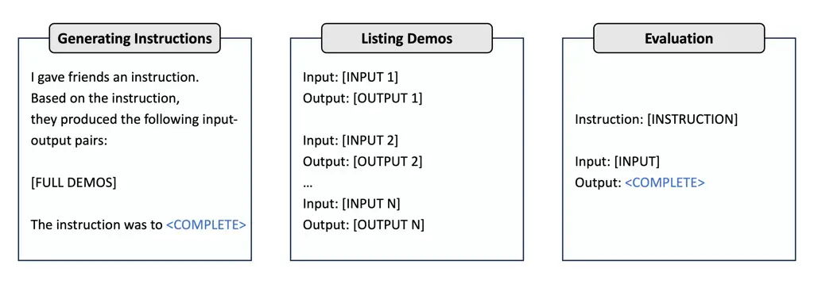

Figure 6: The template used in our experiments.

## Appendix H Tasks

In this section, we provide detailed descriptions for each task across
three benchmarks, encompassing a wide range of possible tasks, including
coding, mathematics, common-sense reasoning, and knowledge retrieval:
Instruction Induction (Table 5), Super Natural Instructions for coding
and mathematics (Table 6 and Table 7), and BIG-Bench-Hard (Table 8).

|                         |                                                                                                        |                                                                                                                                |
| ----------------------- | ------------------------------------------------------------------------------------------------------ | ------------------------------------------------------------------------------------------------------------------------------ |
| Task                    | Task Summary                                                                                           | Demo                                                                                                                           |
| Auto categorization     | Categorize items based on a common theme or characteristic.                                            | Python, Cobol, and C $`\rightarrow`$ programming languages                                                                     |
| Rhymes                  | Write a word that rhymes with the input word.                                                          | sing $`\rightarrow`$ ring                                                                                                      |
| Sentence similarity     | Rate the semantic similarity of two input sentences on a scale of 0 - definitely not to 5 - perfectly. | Sentence 1: A man is smoking. Sentence 2: A man is skating. $`\rightarrow`$ 0 - definitely not                                 |
| Sentiment               | Determine whether a movie review is positive or negative.                                              | The film is small in scope, yet perfectly formed. $`\rightarrow`$ positive                                                     |
| Word in context         | Determine whether an input word has the same meaning in the two input sentences.                       | Sentence 1: Approach a task. Sentence 2: To approach the city. Word: approach $`\rightarrow`$ not the same                     |
| Larger animal           | Write the larger of the two given animals.                                                             | koala, snail $`\rightarrow`$ koala                                                                                             |
| Informal to formal      | Rephrase the sentence in formal language.                                                              | Please call once you get there $`\rightarrow`$ Please call upon your arrival.                                                  |
| Orthography starts with | Extract the words starting with a given letter from the input sentence.                                | The man whose car I hit last week sued me. \[m\] $`\rightarrow`$ man, me                                                       |
| Antonyms                | Write a word that means the opposite of the input word.                                                | won $`\rightarrow`$ lost                                                                                                       |
| Second word letter      | Extract the second letter of the input word.                                                           | cat $`\rightarrow`$ a                                                                                                          |
| Common concept          | Find a common characteristic for the given objects.                                                    | guitars, pendulums, neutrinos $`\rightarrow`$ involve oscillations                                                             |
| Cause and effect        | Find which of the two given cause and effect sentences is the cause.                                   | Sentence 1: The soda went flat. Sentence 2: The bottle was left open. $`\rightarrow`$ The bottle was left open.                |
| Translation EN-FR       | Translate the word into French.                                                                        | time $`\rightarrow`$ temps                                                                                                     |
| Diff                    | Subtract the second number from the first.                                                             | 32 22 $`\rightarrow`$ 10                                                                                                       |
| First word letter       | Extract the first letter of the input word.                                                            | cat $`\rightarrow`$ c                                                                                                          |
| Letters list            | Break the input word into letters, separated by spaces.                                                | cat $`\rightarrow`$ c a t                                                                                                      |
| Taxonomy animal         | Write all the animals that appear in the given list.                                                   | cat, helicopter, cook, whale, frog, lion $`\rightarrow`$ frog, cat, lion, whale                                                |
| Negation                | Negate the input sentence.                                                                             | Time is finite $`\rightarrow`$ Time is not finite.                                                                             |
| Num to verbal           | Write the number in English words                                                                      | 26 $`\rightarrow`$ twenty-six                                                                                                  |
| Active to passive       | Write the input sentence in passive form.                                                              | The artist introduced the scientist. $`\rightarrow`$ The scientist was introduced by the artist.                               |
| Singular to plural      | Convert the input word to its plural form.                                                             | cat $`\rightarrow`$ cats                                                                                                       |
| Sum                     | Sum the two given numbers.                                                                             | 22 10 $`\rightarrow`$ 32                                                                                                       |
| Synonyms                | Write a word with a similar meaning to the input word.                                                 | alleged $`\rightarrow`$ supposed                                                                                               |
| Translation EN-DE       | Translate the word into German.                                                                        | time $`\rightarrow`$ Zeit                                                                                                      |
| Translation EN-ES       | Translate the word into Spanish.                                                                       | time $`\rightarrow`$ hora                                                                                                      |
| Auto debugging          | Produce a specific result or output given the code.                                                    | import numpy as np $`\backslash`$n x = numpy.zeros(10) $`\backslash`$n $`\rightarrow`$ NameError: name ’numpy’ is not defined. |

Table 5: Descriptions on Instruction Induction benchmark tasks.
Referring to Zhou et al. (2022), we provide task names, task summaries,
and example demos within each task.

|                                                  |                                                                                   |                                                                                                                                         |
| ------------------------------------------------ | --------------------------------------------------------------------------------- | --------------------------------------------------------------------------------------------------------------------------------------- |
| Task                                             | Task Summary                                                                      | Demo                                                                                                                                    |
| Conala concat strings                            | Given a list of strings, concatenate them to form one string.                     | \[’s’, ’blew’, ’g’, ’and’, ’u’, ’as’, ’C’\] $`\rightarrow`$ sblewganduasC                                                               |
| Conala normalize lists                           | Given a list of numbers, normalize the list such that the result adds to 1.       | \[-6.875, -64.545, -64.548\] $`\rightarrow`$ \[0.051 0.475 0.475\]                                                                      |
| Conala calculate mean                            | Given a list of numbers, calculate the mean of the list.                          | \[140.719, 220.491, 119.072\] $`\rightarrow`$ 160.094                                                                                   |
| Conala max absolute value                        | Given a list of numbers, calculate the element with the largest absolute value.   | \[14.594 -85.985\] $`\rightarrow`$ -85.985                                                                                              |
| Conala list index subtraction                    | Given a list of numbers, subtract each element by its index in the list.          | \[-14, 4\] $`\rightarrow`$ \[-15, 2\]                                                                                                   |
| Conala remove duplicates                         | Given a list of numbers, remove all of the duplicates in the list.                | \[0, 0, 5, 7, 4, 3\] $`\rightarrow`$ \[5, 7, 4, 3\]                                                                                     |
| Conala list intersection                         | Given a two lists of numbers, find the intersection of the two lists.             | \[8, 10, 6, 2, 7\] , \[10, 4, 10, 10, 4\] $`\rightarrow`$ \[10\]                                                                        |
| Splash question to sql                           | Generate an SQL statement from a question asking for certain data.                | What are the names of all cartoons directed by Ben Jones? $`\rightarrow`$ SELECT Title FROM Cartoon WHERE Directed_by = ”Ben Jones”     |
| Logic2text sentence generation                   | Generate a natural language interpretation of the given logical operators.        | most_eq all_rows ; venue ; london = true $`\rightarrow`$ for the venue records of all rows , most of them fuzzily match to london.      |
| Conala list index addition                       | Add lists together based on their index.                                          | \[\[69, 8, -40\], \[63, -57, 65\]\] $`\rightarrow`$ \[132, -49, 25\]                                                                    |
| Conala sort dictionary                           | Sort a list of dictionaries based on a given key.                                 | \[’first’: 47, ’second’: -34, ’first’: 11, ’second’: 54\] $`\rightarrow`$ \[’first’: 11, ’second’: 54, ’first’: 47, ’second’: -34\]     |
| Conala pair averages                             | Calculate the averages for each two consecutive elements.                         | \[47, 62, 2, -13\] $`\rightarrow`$ \[54.5, 32.0, -5.5\]                                                                                 |
| Conala pair differences                          | Calculate the absolute difference for each two consecutive elements.              | \[-19, 40, 12, 95\] $`\rightarrow`$ \[59, 28, 83\]                                                                                      |
| English language answer relevance classification | Given a question and answer pair, detect whether the answer is acceptable or not. | Question: Is it more correct to say a computer program is, $`\ldots`$, Answer: I would say that neither, $`\ldots`$. $`\rightarrow`$ no |
| Code x glue information retrieval                | Given a code, calculate the number of for loops in the cpp program.               | int ways(int n,int p), $`\ldots`$, $`\rightarrow`$ 1                                                                                    |

Table 6: Descriptions on Super Natural Instructions benchmark code
tasks. Referring to Wang et al. (2022b), we provide task names, task
summaries, and example demos within each task.

|                                                                      |                                                                                                              |                                                                                                                                                                               |
| -------------------------------------------------------------------- | ------------------------------------------------------------------------------------------------------------ | ----------------------------------------------------------------------------------------------------------------------------------------------------------------------------- |
| Task                                                                 | Task Summary                                                                                                 | Demo                                                                                                                                                                          |
| Semeval 2019 task10 closed vocabulary mathematical answer generation | Answering multiple choices mathematical problem described with a closed-vocabulary.                          | If (fracyy - 3 = frac4239), then what does y equal? (A) 39 (B) 41 (C) 42 (D) 45 (E) 81 $`\rightarrow`$ C                                                                      |
| Semeval 2019 task10 open vocabulary mathematical answer generation   | Answering multiple choices mathematical problem described with an open vocabulary.                           | A new airplane can travel at speeds up to 4,680 miles per hour. How many miles can the airplane travel in 10 seconds? (A) 1.3 (B) 7.8 (C) 13 (D) 78 (E) 130 $`\rightarrow`$ C |
| Ai2 arithmetic questions arithmetic                                  | Given an arithmetic question, compute a solution.                                                            | Alyssa loves eating fruits. Alyssa paid \$12.05 for grapes, and \$9.85 for cherries. In total, how much money did Alyssa spend? $`\rightarrow`$ 21.9                          |
| Aqua multiple choice answering                                       | Given a mathematical question, find the most suitable numerical answer.                                      | Question: The sub-duplicate ratio of 16:64 is Option A: 4:3 Option B: 1:2 Option C: 1:3 Option D: 1:4 Option E: 2:4 $`\rightarrow`$ Option E                                  |
| Svamp subtraction question answering                                 | Given a mathematical question involving subtraction, find the most suitable numerical answer.                | Context: Baker sold 44 cakes. If he had made 48 cakes initially Question: How many cakes would baker still have? $`\rightarrow`$ 4                                            |
| Mathdataset classification                                           | Classify the type of a math word problem.                                                                    | Solve 154 = -39\*v - 41 for v. $`\rightarrow`$ algebra                                                                                                                        |
| Mathdataset answer generation                                        | Find the numerical answer for a math word problem.                                                           | Solve -38\*s = -53\*s - 90 for s. $`\rightarrow`$ -6                                                                                                                          |
| Asdiv addsub question answering                                      | Given a mathematical question, find the most suitable numerical answer.                                      | 46 apples were in the basket. 22 are red and the rest are green. how many apples are green? $`\rightarrow`$ 24                                                                |
| Asdiv multidiv question answering                                    | Given a mathematical question, find the most suitable numerical answer.                                      | each bag contains 23 pounds of oranges. how many pounds of oranges are in 45 bags? $`\rightarrow`$ 1035                                                                       |
| Asdiv multiop question answering                                     | Given a mathematical question, find the most suitable numerical answer.                                      | a mirror store has 78 mirrors in stock. 8 mirrors are broken and 57 mirrors are sold. how many mirrors are left? $`\rightarrow`$ 13                                           |
| Asdiv singleop question answering                                    | Given a mathematical question, find the most suitable numerical answer.                                      | nick saved \$68.50. if nick saved \$25.43 more than lee how much did lee save? $`\rightarrow`$ 43.07                                                                          |
| Mawps addsub question answering                                      | Given a mathematical question, find the most suitable numerical answer.                                      | Mark has 13 trees in his backyard. If he plants 12 more, how many trees will he have? $`\rightarrow`$ 25                                                                      |
| Mawps multidiv question answering                                    | Given a mathematical question, find the most suitable numerical answer.                                      | A cereal box holds 18 cups of cereal. Each serving is 2 cups. How many servings are in the whole box? $`\rightarrow`$ 9                                                       |
| Mawps multiop question answering                                     | Given a mathematical question, find the most suitable numerical answer.                                      | Paul had saved up 3 dollars. If he received another 7 dollars for his allowance, how many 5 dollar toys could he buy? $`\rightarrow`$ 2                                       |
| Mawps singleop question answering                                    | Given a mathematical question, find the most suitable numerical answer.                                      | Joan has 9 blue balloons but lost 2 of them. How many blue balloons does Joan have now? $`\rightarrow`$ 7                                                                     |
| Leetcode 420 strong password check                                   | Check if the given password is strong                                                                        | password = RtZGIgm7YeiPB66yVIoC $`\rightarrow`$ 0                                                                                                                             |
| Mathqa gain                                                          | Given a math problem on gain and options to choose from, find the correct option that answers the problem.   | Problem: a 8% stock yields 20%. the market value of the stock is : Options: a) rs 48 , b) rs 45 , c) rs 40 , d) rs 50 , e) rs 55 $`\rightarrow`$ c                            |
| Mathqa general                                                       | Given a general math problem and options to choose from, find the correct option that answers the problem.   | Problem: what is the remainder of w = $`3^{1}9`$ when divided by 10? Options: a) 0 , b) 1 , c) 5 , d) 7 , e) 9 $`\rightarrow`$ d                                              |
| Mathqa other                                                         | Given a math problem and options to choose from, find the correct option that answers the problem.           | Problem: how many factors does $`35^{2}`$ have? Options: a) 2 , b) 8 , c) 24 , d) 25 , e) 26 $`\rightarrow`$ c                                                                |
| Mathqa geometry                                                      | Given a problem on geometry and options to choose from, find the correct option that answers the problem.    | Problem: the surface of a cube is 24 sq cm . find its volume? Options: a) 8 , b) 6 , c) 4 , d) 3 , e) 1 $`\rightarrow`$ a                                                     |
| Mathqa probability                                                   | Given a problem on probability and options to choose from, find the correct option that answers the problem. | Problem: two coins are tossed. find the probability of at most 2 tails? Options: a) 1 / 2 , b) 1 / 4 , c) 1 / 3 , d) 1 , e) 3 / 4 $`\rightarrow`$ d                           |
| Mathqa answer selection                                              | Selecting answers to mathqa questions.                                                                       | Problem: 1395 x 1395 Options: a. 1946025, b. 1981709, c. 18362619, d. 2031719, e. none of these $`\rightarrow`$ a                                                             |
| Mathqa correct answer generation                                     | Generate correct answers for math questions.                                                                 | Problem: if 7 spiders make 7 webs in 7 days, then how many days are needed for 1 spider to make 1 web? $`\rightarrow`$ 7                                                      |

Table 7: Descriptions on Super Natural Instructions benchmark
mathematical tasks. Referring to Wang et al. (2022b), we provide task
names, task summaries, and example demos within each task.

|                      |                                                                                                           |                                                                                                                                                                                        |
| -------------------- | --------------------------------------------------------------------------------------------------------- | -------------------------------------------------------------------------------------------------------------------------------------------------------------------------------------- |
| Task                 | Task Summary                                                                                              | Demo                                                                                                                                                                                   |
| Causal judgement     | Answer questions about causal attribution.                                                                | Frank T., had an ongoing dispute with his neighbor, $`\ldots`$. Did Frank T. intentionally shoot his neighbor in the body? Options: - Yes - No $`\rightarrow`$ Yes                     |
| Disambiguation QA    | Clarify the meaning of sentences with ambiguous pronouns.                                                 | Sentence: The scientist collaborated with the artist, and he shared a story. Options: (A) The scientist shared a story (B) The artist shared a story (C) Ambiguous $`\rightarrow`$ (C) |
| Dyck languages       | Correctly close a Dyck-n word.                                                                            | Input: ( { { } } $`\rightarrow`$ )                                                                                                                                                     |
| Movie Recommendation | Recommend movies similar to the given list of movies.                                                     | Find a movie similar to Forrest Gump, The Silence of the Lambs, Seven, Fargo: Options: (A) Gandhi (B) Schindler’s List (C) Dogfight (D) Repo Man $`\rightarrow`$ (B)                   |
| Navigate             | Given a series of navigation instructions, determine whether one would end up back at the starting point. | If you follow these instructions, do you return to the starting point? Take 5 steps. Take 4 steps. Take 3 steps. Options: - Yes - No $`\rightarrow`$ No                                |
| Object Counting      | Questions that involve enumerating objects of different types and asking the model to count them.         | I have a piano, a flute, and four trombones. How many musical instruments do I have? $`\rightarrow`$ 6                                                                                 |
| Ruin names           | Select the humorous edit that ’ruins’ the input movie or musical artist name.                             | Which of the following is a humorous edit of this artist or movie name: ’bon iver’? Options: (A) bon liver (B) bion iver (C) ban iver (D) bon ivee $`\rightarrow`$ (A)                 |
| Snarks               | Determine which of two sentences is sarcastic.                                                            | Which statement is sarcastic? Options: (A) He’s over six feet, so he must be tall (B) He’s over six feet, so he must be wonderful $`\rightarrow`$ (B)                                  |
| Sports understanding | Determine whether an artificially constructed sentence relating to sports is plausible or implausible.    | Is the following sentence plausible? ”Mookie Betts skated behind the net.” $`\rightarrow`$ no                                                                                          |
| Word sorting         | Sort a list of words.                                                                                     | List: thunderclap swab built poland $`\rightarrow`$ built poland swab thunderclap                                                                                                      |

Table 8: Descriptions on BIG-Bench-Hard benchmark code tasks. Referring
to Suzgun et al. (2022), we provide task names, task summaries, and
example demos within each task.

## Appendix I Score Functions

For the Instruction Induction benchmark tasks, we evaluate the quality
of prompts using a metric called execution accuracy proposed by Honovich
et al. (2022). The metric is defined as follows: For each (input,
output) pair, if the model’s prediction matches the output exactly, it
equals 1. If there is no perfect match, it equals 0. In certain tasks, a
modified version of this metric is employed. For instance, it measures
the proportion of correct answers within the total answer set. Please
refer to Section 4.2 of Honovich et al. (2022) for further details.

For the tasks in the Super Natural Instructions benchmark, we employ
ROUGE-L scores as the evaluation metric, as outlined in Wang et al.
(2022b).

For the BIG-Bench-Hard benchmark task, we utilize execution accuracy as
the evaluation metric, following Suzgun et al. (2022).

## Appendix J Main Results

### J.1 Results on Instruction Induction

|                         |                                                                               |                 |                 |                     |                 |                 |
| ----------------------- | ----------------------------------------------------------------------------- | --------------- | --------------- | ------------------- | --------------- | --------------- |
| Task                    | The execution accuracy gain ($`\Delta`$) of MoP from the following method (%) |                 |                 |                     |                 |                 |
|                         | APE                                                                           | APE             | APE             | InstructZero        | InstructZero    | InstructZero    |
|                         | (Zhou et al., 2022)                                                           | +Demos          | +K-centroids    | (Chen et al., 2023) | +Demos          | +K-centroids    |
| Auto categorization     | $`35.33`$ 2.55                                                                | $`29.66`$ 2.48  | $`26.00`$ 4.10  | $`26.00`$ 2.81      | $`22.66`$ 2.52  | $`20.33`$ 2.92  |
| Auto debugging          | $`29.17`$ 3.40                                                                | $`8.33`$ 3.40   | $`0.00`$ 0.00   | $`20.83`$ 3.40      | $`12.50`$ 0.00  | $`8.33`$ 3.40   |
| Antonyms                | $`5.34`$ 3.08                                                                 | $`-0.66`$ 0.77  | $`-0.66`$ 0.61  | $`3.00`$ 1.12       | $`0.00`$ 0.77   | $`0.00`$ 0.77   |
| Cause and effect        | $`9.33`$ 9.30                                                                 | $`6.66`$ 8.98   | $`6.66`$ 9.17   | $`9.33`$ 9.30       | $`14.66`$ 7.93  | $`17.33`$ 8.08  |
| Common concept          | $`11.61`$ 2.95                                                                | $`6.05`$ 3.99   | $`-0.52`$ 3.70  | $`6.68`$ 5.05       | $`8.89`$ 4.51   | $`0.39`$ 5.96   |
| Informal to formal      | $`-2.24`$ 2.55                                                                | $`2.61`$ 3.09   | $`6.90`$ 2.97   | $`13.89`$ 4.54      | $`3.41`$ 3.77   | $`13.56`$ 4.33  |
| Taxonomy animal         | $`6.33`$ 4.15                                                                 | $`20.00`$ 4.23  | $`14.33`$ 5.22  | $`19.66`$ 6.92      | $`16.33`$ 7.29  | $`10.33`$ 3.98  |
| Negation                | $`4.33`$ 0.98                                                                 | $`1.00`$ 0.90   | $`1.66`$ 0.77   | $`5.00`$ 2.29       | $`-0.67`$ 0.72  | $`1.33`$ 1.09   |
| Rhymes                  | $`-6.66`$ 15.07                                                               | $`-0.66`$ 5.18  | $`-2.00`$ 8.12  | $`17.67`$ 8.19      | $`8.34`$ 6.34   | $`3.34`$ 8.44   |
| Sentence similarity     | $`32.00`$ 5.26                                                                | $`0.67`$ 4.03   | $`5.00`$ 4.26   | $`19.67`$ 8.89      | $`1.34`$ 5.92   | $`2.34`$ 6.44   |
| Sentiment               | $`3.33`$ 0.55                                                                 | $`-0.33`$ 0.55  | $`1.33`$ 0.55   | $`5.33`$ 1.09       | $`0.00`$ 0.67   | $`0.67`$ 0.55   |
| Orthography starts with | $`4.00`$ 1.88                                                                 | $`-4.00`$ 1.88  | $`-0.67`$ 0.86  | $`31.67`$ 13.74     | $`4.33`$ 2.07   | $`6.33`$ 2.51   |
| Synonyms                | $`4.34`$ 1.54                                                                 | $`-2.33`$ 2.18  | $`-0.66`$ 2.03  | $`-12.00`$ 6.60     | $`0.00`$ 1.46   | $`-3.00`$ 2.39  |
| Translation EN-DE       | $`0.67`$ 0.72                                                                 | $`1.67`$ 0.72   | $`-0.66`$ 0.90  | $`-1.00`$ 0.77      | $`1.34`$ 0.77   | $`-0.66`$ 1.02  |
| Translation EN-ES       | $`0.00`$ 1.02                                                                 | $`-0.67`$ 0.98  | $`-0.34`$ 1.02  | $`1.66`$ 1.12       | $`0.00`$ 1.02   | $`0.00`$ 1.12   |
| Translation EN-FR       | $`1.33`$ 1.09                                                                 | $`0.33`$ 0.55   | $`-1.00`$ 0.67  | $`3.33`$ 1.72       | $`1.00`$ 0.94   | $`0.67`$ 0.86   |
| Word in context         | $`5.66`$ 2.52                                                                 | $`-3.67`$ 1.09  | $`1.33`$ 1.09   | $`10.66`$ 5.41      | $`-1.67`$ 1.19  | $`1.66`$ 2.97   |
| Diff                    | $`0.00`$ 0.00                                                                 | $`0.00`$ 0.00   | $`0.00`$ 0.00   | $`65.00`$ 26.54     | $`0.00`$ 0.00   | $`1.67`$ 1.36   |
| First word letter       | $`0.00`$ 0.00                                                                 | $`0.00`$ 0.00   | $`0.00`$ 0.00   | $`1.00`$ 0.47       | $`0.00`$ 0.00   | $`0.00`$ 0.00   |
| Larger animal           | $`-1.33`$ 0.72                                                                | $`-1.00`$ 0.90  | $`1.34`$ 1.22   | $`22.67`$ 8.76      | $`14.67`$ 6.72  | $`14.67`$ 7.17  |
| Letters list            | $`0.00`$ 0.00                                                                 | $`0.00`$ 0.00   | $`0.00`$ 0.00   | $`0.00`$ 0.00       | $`0.00`$ 0.00   | $`0.00`$ 0.00   |
| Num to verbal           | $`0.67`$ 0.27                                                                 | $`0.00`$ 0.00   | $`0.00`$ 0.00   | $`1.00`$ 0.81       | $`0.00`$ 0.00   | $`0.00`$ 0.00   |
| Active to passive       | $`0.00`$ 0.00                                                                 | $`0.00`$ 0.00   | $`0.00`$ 0.00   | $`0.00`$ 0.00       | $`0.00`$ 0.00   | $`0.67`$ 0.54   |
| Singular to plural      | $`2.34`$ 0.77                                                                 | $`0.00`$ 0.38   | $`-0.33`$ 0.27  | $`-0.33`$ 0.27      | $`-0.33`$ 0.27  | $`-0.33`$ 0.27  |
| Second word letter      | $`-12.00`$ 9.80                                                               | $`-12.00`$ 9.80 | $`-11.67`$ 9.80 | $`25.33`$ 16.72     | $`22.00`$ 16.94 | $`21.00`$ 16.50 |
| Sum                     | $`0.00`$ 0.00                                                                 | $`0.00`$ 0.00   | $`0.00`$ 0.00   | $`0.00`$ 0.00       | $`0.00`$ 0.00   | $`0.00`$ 0.00   |

Table 9: Results on Instruction Induction. We report the execution
accuracy gain ($`\Delta`$) of MoP from the baseline described in
Section 5.1 on the Instruction Induction benchmark tasks. We run 3
experiments and provide both the mean and standard deviation values.
Please note that due to the inherent randomness in the ChatGPT API, a
performance gap of less than 1% between the two methods can be
considered a tie. The number of demos is set to $`N_{\text{train}}/10`$,
where $`N_{\text{train}}`$ is the total number of training demos.

We show the execution accuracy results for each method in the entire
Instruction Induction benchmark (Honovich et al., 2022) tasks in
Table 9, excluding the two tasks for which the dataset has not been made
publicly available: ”Ascii” and ”Cs algorithms”.

### J.2 Results on Super Natural Instructions

|             |                                                  |                         |
| ----------- | ------------------------------------------------ | ----------------------- |
| Task        |                                                  | ROUGE-L (%)             |
|             |                                                  | APE (Zhou et al., 2022) |
| Code        | Conala concat strings                            | 88.84 $`\pm`$ 2.25      |
|             | Conala normalize lists                           | 45.37 $`\pm`$ 0.25      |
|             | Conala calculate mean                            | 23.00 $`\pm`$ 2.68      |
|             | Conala max absolute value                        | 23.00 $`\pm`$ 2.68      |
|             | Conala list index subtraction                    | 35.07 $`\pm`$ 9.55      |
|             | Conala remove duplicates                         | 72.22 $`\pm`$ 2.28      |
|             | Conala list intersection                         | 97.18 $`\pm`$ 0.35      |
|             | Splash question to sql                           | 60.54 $`\pm`$ 0.85      |
|             | Logic2text sentence generation                   | 41.26 $`\pm`$ 1.09      |
|             | Conala list index addition                       | 47.72 $`\pm`$ 10.39     |
|             | Conala sort dictionary                           | 99.84 $`\pm`$ 0.22      |
|             | Conala pair averages                             | 63.47 $`\pm`$ 11.05     |
|             | Conala pair differences                          | 18.86 $`\pm`$ 1.48      |
|             | English language answer relevance classification | 50.67 $`\pm`$ 2.49      |
|             | Code x glue information retreival                | 20.52 $`\pm`$ 4.61      |
| Mathematics | Semeval 2019 task10 closed vocabulary            | 18.60 $`\pm`$ 3.88      |
|             | mathematical answer generation                   |                         |
|             | Semeval 2019 task10 open vocabulary              | 19.44 $`\pm`$ 3.61      |
|             | mathematical answer generation                   |                         |
|             | Ai2 arithmetic questions arithmetic              | 51.81 $`\pm`$ 5.60      |
|             | Aqua multiple choice answering                   | 45.85 $`\pm`$ 0.59      |
|             | Svamp subtraction question answering             | 67.79 $`\pm`$ 5.30      |
|             | Mathdataset classification                       | 46.11 $`\pm`$ 18.29     |
|             | Mathdataset answer generation                    | 24.11 $`\pm`$ 1.95      |
|             | Asdiv addsub question answering                  | 74.97 $`\pm`$ 11.30     |
|             | Asdiv multidiv question answering                | 70.96 $`\pm`$ 10.94     |
|             | Asdiv multiop question answering                 | 73.01 $`\pm`$ 10.69     |
|             | Asdiv singleop question answering                | 66.83 $`\pm`$ 13.95     |
|             | Mawps addsub question answering                  | 80.27 $`\pm`$ 4.64      |
|             | Mawps multidiv question answering                | 52.17 $`\pm`$ 5.66      |
|             | Mawps multiop question answering                 | 59.69 $`\pm`$ 11.80     |
|             | Mawps singleop question answering                | 77.30 $`\pm`$ 1.00      |
|             | Leetcode 420 strong password check               | 6.66 $`\pm`$ 3.87       |
|             | Mathqa gain                                      | 14.02 $`\pm`$ 2.04      |
|             | Mathqa general                                   | 17.33 $`\pm`$ 1.30      |
|             | Mathqa other                                     | 14.49 $`\pm`$ 2.43      |
|             | Mathqa geometry                                  | 20.16 $`\pm`$ 1.01      |
|             | Mathqa probability                               | 12.08 $`\pm`$ 0.56      |
|             | Mathqa answer selection                          | 14.61 $`\pm`$ 1.32      |
|             | Mathqa correct answer generation                 | 27.15 $`\pm`$ 1.18      |

Table 10: The performance of APE on tasks related to code and
mathematics in Super Natural Instructions. We report the performance of
APE (Zhou et al., 2022) on code and mathematics-related tasks, selected
based on the domain information provided in the metadata of the Super
Natural Instructions benchmark. We run 3 experiments and provide both
the mean and standard deviation values.

|             |                                                 |                                                                          |                 |                 |                     |                 |                 |
| ----------- | ----------------------------------------------- | ------------------------------------------------------------------------ | --------------- | --------------- | ------------------- | --------------- | --------------- |
| Task        |                                                 | The ROUGE-L score gain ($`\Delta`$) of MoP from the following method (%) |                 |                 |                     |                 |                 |
|             |                                                 | APE                                                                      | APE             | APE             | InstructZero        | InstructZero    | InstructZero    |
|             |                                                 | (Zhou et al., 2022)                                                      | +Demos          | +K-centroids    | (Chen et al., 2023) | +Demos          | +K-centroids    |
| Code        | Conala normalize lists                          | $`1.98`$ 0.46                                                            | $`0.22`$ 0.54   | $`1.33`$ 0.44   | $`6.49`$ 2.09       | $`0.60`$ 0.68   | $`2.20`$ 0.76   |
|             | Conala calculate mean                           | $`8.55`$ 2.38                                                            | $`6.05`$ 1.83   | $`7.72`$ 1.85   | $`7.38`$ 2.47       | $`9.55`$ 2.58   | $`9.65`$ 2.08   |
|             | Conala list index subtraction                   | $`15.87`$ 7.76                                                           | $`14.53`$ 6.87  | $`16.72`$ 6.31  | $`35.20`$ 5.63      | $`21.25`$ 6.44  | $`21.44`$ 7.21  |
|             | Logic2text sentence generation                  | $`55.22`$ 1.28                                                           | $`10.71`$ 1.14  | $`2.68`$ 1.21   | $`47.57`$ 9.28      | $`8.71`$ 1.67   | $`1.67`$ 1.13   |
|             | Conala list index addition                      | $`4.47`$ 7.81                                                            | $`-4.37`$ 6.11  | $`-0.01`$ 6.89  | $`34.84`$ 5.13      | $`24.45`$ 6.58  | $`21.64`$ 6.76  |
|             | Conala pair differences                         | $`58.91`$ 13.65                                                          | $`22.87`$ 18.05 | $`17.12`$ 16.22 | $`57.94`$ 15.04     | $`44.32`$ 15.00 | $`45.15`$ 13.78 |
|             | Code x glue information retreival               | $`19.48`$ 3.01                                                           | $`-0.33`$ 2.64  | $`4.67`$ 1.52   | $`31.30`$ 2.63      | $`-0.67`$ 4.09  | $`3.00`$ 1.63   |
| Mathematics | Semeval 2019 task10 closed voc. math. ans. gen. | $`15.73`$ 2.53                                                           | $`-2.67`$ 1.27  | $`-3.34`$ 1.54  | $`10.37`$ 3.95      | $`-2.39`$ 1.89  | $`-0.27`$ 4.23  |
|             | Semeval 2019 task10 open voc. math. ans. gen.   | $`18.23`$ 2.21                                                           | $`-0.66`$ 0.90  | $`-0.66`$ 2.34  | $`12.64`$ 3.36      | $`-1.33`$ 0.86  | $`-1.00`$ 0.77  |
|             | Aqua multiple choice answering                  | $`17.16`$ 0.71                                                           | $`-6.16`$ 0.68  | $`-0.32`$ 0.72  | $`19.27`$ 4.45      | $`-5.16`$ 0.72  | $`-1.49`$ 0.75  |
|             | Mathdataset classification                      | $`49.22`$ 10.61                                                          | $`19.00`$ 2.34  | $`7.00`$ 2.34   | $`41.49`$ 2.69      | $`20.66`$ 1.39  | $`9.33`$ 2.28   |
|             | Mathdataset answer generation                   | $`23.45`$ 2.08                                                           | $`4.89`$ 1.85   | $`1.08`$ 2.30   | $`21.44`$ 2.09      | $`4.67`$ 2.09   | $`0.58`$ 1.84   |
|             | Leetcode 420 strong password check              | $`20.67`$ 4.24                                                           | $`13.66`$ 3.67  | $`2.33`$ 3.63   | $`19.60`$ 5.24      | $`8.66`$ 4.18   | $`0.66`$ 5.35   |
|             | Mathqa gain                                     | $`19.31`$ 4.54                                                           | $`2.33`$ 4.41   | $`4.00`$ 4.42   | $`18.86`$ 4.50      | $`3.33`$ 4.46   | $`4.00`$ 4.39   |
|             | Mathqa general                                  | $`10.00`$ 1.24                                                           | $`4.66`$ 1.39   | $`1.33`$ 2.28   | $`12.73`$ 1.23      | $`10.28`$ 4.57  | $`7.30`$ 4.99   |
|             | Mathqa other                                    | $`21.18`$ 2.17                                                           | $`1.67`$ 1.72   | $`5.67`$ 1.85   | $`21.88`$ 2.16      | $`3.34`$ 2.34   | $`8.34`$ 1.81   |
|             | Mathqa geometry                                 | $`13.51`$ 0.80                                                           | $`-5.33`$ 0.98  | $`5.34`$ 0.61   | $`12.58`$ 2.12      | $`-5.33`$ 0.72  | $`5.34`$ 0.77   |
|             | Mathqa probability                              | $`29.59`$ 0.63                                                           | $`10.00`$ 0.90  | $`7.00`$ 0.90   | $`24.61`$ 4.42      | $`9.00`$ 0.90   | $`7.67`$ 0.72   |
|             | Mathqa answer selection                         | $`13.39`$ 1.61                                                           | $`0.33`$ 1.52   | $`-1.33`$ 2.96  | $`13.64`$ 4.48      | $`8.98`$ 7.48   | $`4.72`$ 8.49   |
|             | Mathqa correct answer generation                | $`0.03`$ 2.50                                                            | $`-3.90`$ 2.41  | $`1.80`$ 2.41   | $`-3.52`$ 3.08      | $`-6.16`$ 2.42  | $`0.49`$ 2.47   |

Table 11: Results for the Super-Natural Instructions. We report the
ROUGE-L score gain ($`\Delta`$) of MoP from the baseline described in
Section 5.1 on the Super Natural Instructions benchmark tasks. We run 3
experiments and provide both the mean and standard deviation values.
Please note that due to the inherent randomness in the ChatGPT API, a
performance gap of less than 1% between the two methods can be
considered a tie. The number of demos is set to $`N_{\text{train}}/10`$,
where $`N_{\text{train}}`$ is the total number of training demos.

To further enhance the practical applicability of our approach, we
conducted experiments on the Super Natural Instructions benchmark (Wang
et al., 2022c). This benchmark encompasses a variety of tasks, including
those related to commonsense classification and information extraction.
Although it covers a wide range of tasks, our validation specifically
focused on tasks related to code and mathematics.

To accomplish this, we began by evaluating the performance of APE on
tasks related to code and mathematics. Subsequently, we conducted
experiments on 20 tasks where APE encountered challenges, i.e., tasks
for which APE’s ROUGE-L score was below 50% (please refer to Table 10).

### J.3 Results on BIG-Bench-Hard benchmark

|                      |                                                                               |                |                |                     |                |                |
| -------------------- | ----------------------------------------------------------------------------- | -------------- | -------------- | ------------------- | -------------- | -------------- |
| Task                 | The execution accuracy gain ($`\Delta`$) of MoP from the following method (%) |                |                |                     |                |                |
|                      | APE                                                                           | APE            | APE            | InstructZero        | InstructZero   | InstructZero   |
|                      | (Zhou et al., 2022)                                                           | +Demos         | +K-centroids   | (Chen et al., 2023) | +Demos         | +K-centroids   |
| Causal judgement     | $`6.38`$ 1.64                                                                 | $`1.42`$ 1.36  | $`4.25`$ 1.92  | $`0.35`$ 2.62       | $`1.77`$ 1.30  | $`1.77`$ 1.79  |
| Disambiguation QA    | $`3.67`$ 2.95                                                                 | $`-1.67`$ 2.28 | $`-1.67`$ 1.72 | $`7.00`$ 1.49       | $`-2.33`$ 1.28 | $`-3.33`$ 2.07 |
| Dyck languages       | $`9.33`$ 6.69                                                                 | $`13.00`$ 1.61 | $`5.33`$ 4.77  | $`7.66`$ 6.49       | $`6.66`$ 1.86  | $`5.33`$ 5.54  |
| Movie Recommendation | $`11.67`$ 8.17                                                                | $`0.00`$ 1.98  | $`-2.33`$ 2.13 | $`13.34`$ 5.63      | $`3.67`$ 1.59  | $`0.00`$ 2.52  |
| Navigate             | $`-5.00`$ 5.08                                                                | $`14.33`$ 2.46 | $`4.00`$ 4.45  | $`6.00`$ 2.87       | $`14.00`$ 2.40 | $`2.00`$ 5.93  |
| Object counting      | $`0.34`$ 2.14                                                                 | $`13.34`$ 1.21 | $`3.67`$ 1.72  | $`1.67`$ 5.38       | $`12.00`$ 1.86 | $`4.34`$ 1.86  |
| Ruin names           | $`3.66`$ 1.87                                                                 | $`6.00`$ 1.31  | $`1.66`$ 1.75  | $`5.66`$ 1.75       | $`4.66`$ 2.25  | $`3.66`$ 1.31  |
| Snarks               | $`-6.74`$ 3.99                                                                | $`-0.37`$ 3.06 | $`-1.12`$ 2.84 | $`2.25`$ 4.29       | $`4.87`$ 3.92  | $`4.12`$ 4.22  |
| Sports understanding | $`1.33`$ 2.27                                                                 | $`-1.67`$ 1.59 | $`1.33`$ 2.80  | $`5.00`$ 2.34       | $`-3.34`$ 1.61 | $`0.00`$ 2.34  |
| Word sorting         | $`10.67`$ 1.19                                                                | $`-2.33`$ 1.09 | $`1.00`$ 2.39  | $`6.34`$ 5.16       | $`-4.00`$ 1.87 | $`-2.00`$ 1.98 |

Table 12: Results on BIG-Bench-Hard. We report the execution accuracy
gain ($`\Delta`$) of MoP from the baseline described in Section 5.1 on
the BIG-Bench-Hard benchmark tasks. We run 3 experiments and provide
both the mean and standard deviation values. Please note that due to the
inherent randomness in the ChatGPT API, a performance gap of less than
1% between the two methods can be considered a tie. The number of demos
is set to $`N_{\text{train}}/5`$, where $`N_{\text{train}}`$ is the
total number of training demos.

We conduct experiments on the tasks included in the BIG-Bench-Hard
benchmark, which focuses on tasks believed to be challenging, among the
BIG-Bench Instruction Induction tasks proposed in Zhou et al. (2022).

## Appendix K Baselines

### K.1 APE

In this section, to facilitate readers’ understanding, we provide a
detailed explanation of APE (Automatic Prompt Engineering (Zhou et al.,
2022)), which is closely relevant to our work.

#### K.1.1 The background behind Automatic prompt optimization

To begin with, we aim to explain the background behind auto-prompting
methods, including APE (Zhou et al., 2022). While recent LLMs have
demonstrated their remarkable ability to solve tasks described by user
instructions (Ouyang et al., 2022; OpenAI, 2023; Touvron et al., 2023;
Peters et al., 2018; Devlin et al., 2018; Brown et al., 2020; Wei
et al., 2022b), carefully crafted prompts are crucial for maximizing
LLMs’ problem-solving ability. However, this often involves laborious
trial and error. Recent attempts automate this by using LLMs to design
prompts with their language generation ability, addressing tasks given
demo datasets. APE is one of these automatic prompt optimization
methods, which has empirically demonstrated that LLM-generated prompts
are more effective than human-crated prompts in solving target tasks.

#### K.1.2 Detailed Explanation of the APE algorithm

 Input: Training demos
$`\mathcal{D}^{\text{train}}={\{(x_{i},y_{i})\}}_{i=1}^{N^{\text{train}}}`$,
validation demos
$`\mathcal{D}^{\text{valid}}={\{(x_{i},y_{i})\}}_{i=1}^{N^{\text{valid}}}`$,
model $`\mathcal{M}_{\phi}`$, task-specific scoring function
$`f(\cdot)\rightarrow\mathbb{R}`$.

 Randomly sample a subset
$`\tilde{\mathcal{D}}^{\text{train}}\sim\mathcal{D}^{\text{train}}`$,
where $`|\tilde{\mathcal{D}}^{\text{train}}|=r`$

 Generate candidate instructions $`\{I^{j}\}_{j=1}^{m}`$ using a model
$`\mathcal{M}_{\phi}`$ and a template format
$`T(\tilde{\mathcal{D}}^{\text{train}})`$ given
$`\tilde{\mathcal{D}}^{\text{train}}`$ (Equation 3).

 Randomly sample a subset
$`\tilde{\mathcal{D}}^{\text{valid}}\sim\mathcal{D}^{\text{valid}}`$,
where $`|\tilde{\mathcal{D}}_{\text{valid}}|=q`$

 for $`j=1`$ to $`m`$ do

  Evaluate the instruction $`I^{j}`$ on the subset
$`\tilde{\mathcal{D}}^{\text{valid}}`$ and calculate the validation
score;
$`\mathbb{E}_{(x,y)\sim\tilde{\mathcal{D}}^{\text{valid}}}{f\left(\left[I^{j},\ x\right],y\right)}`$.

 end for

 Output: $`P^{*}(x)=[I^{*},\ x]`$, where
$`I^{*}=\argmax_{I^{j}}{\mathbb{E}_{(x,y)\sim\tilde{\mathcal{D}}^{\text{valid}}}{f\left(\left[I^{j},\ x\right],y\right)}}.`$

Algorithm 2 APE (Zhou et al., 2022)

We provide a more detailed explanation of the APE method. In APE (Zhou
et al., 2022), firstly, it leverages a pre-trained black-box LLM to
propose a set of candidate instructions. Specifically, APE initially
selects random demos utilized for proposing instructions and adopts the
templates corresponding to ’Generating Instructions’ from Figure 6,
along with the sampled demos, into \[FULL_DEMOS\]. It then feeds this
prompt into LLM to generate a set of candidate instructions. After
generating a set of candidate instructions in this manner, APE evaluates
these generated candidate instructions using the subset of validation
set ($`\tilde{\mathcal{D}}^{\text{valid}}`$). Subsequently, it utilizes
the best instruction with the highest validation score, which is a
single demo-free instruction, during the test phase. For a fair
comparison, all methods, including our MoP method, use the same
training, validation, and test datasets.

### K.2 InstructZero

InstructZero (Chen et al., 2023) finds a single instruction for a
black-box LLM by optimizing the soft prompt of an open-source LLM using
a Bayesian Optimization approach. To be more specific, within each
Bayesian optimization iteration in InstructZero, a soft prompt is
transformed into an instruction using the open-source LLM, and this
instruction is subsequently fed into the black-box LLM. The output from
the black-box LLM is then sent back to the Bayesian optimization process
to generate the next soft prompt. For more details, please refer to
Algorithm 1 in Chen et al. (2023).

## Appendix L Implementation Details

As described in Section 5, for a fair comparison, we allocate an equal
budget to all methods. To elaborate further, APE and InstructZero search
for the optimal prompt among 20 candidate instruction options, while in
the case of MoP, the total number of candidate instructions across all
experts sums up to 20.

In the case of APE+Demos, APE+K-centroids, InstructZero+Demos, and
InstructZero+K-centroids, each of them combines the best prompt found
through APE or InstructZero with randomly selected demos or demos
corresponding to centroids in the clustered embedding space. For these
methods, the number of demos is set the same as in the case of MoP for a
fair comparison.

Regarding hyperparameters, the $`\alpha`$ value in Equation 10 is set to
the default value of 0.02 and remained the same across all experiments.

## Appendix M Limitations

To promote future exploration, we discuss two limitations of the
proposed method. First, the K-means-Auto algorithm used in the demo
assignment does not guarantee the balance of the resulting clusters.
When a cluster receives demos that exceed the limit, we randomly discard
them to meet the constraint. This operation might be sub-optimal as it
does not factor in their relative importance. Future work might explore
various data selection methods for trimming the cluster size. Second,
MoP uses existing instruction generation method (APE), but sometimes APE
fails to generate sensible instructions in the first place. However, MoP
can be applied to any instruction generation method, and if better
instruction generation methods emerge in the future, we can also expect
improved performance from MoP accordingly. Lastly, the theory that
motivates the use of clustering algorithm to assign demos - connecting
ICL to kernel regression - cannot explain the demo order sensitivity in
LLMs. This suggests that future theoretical advancements could help
motivate better demo assignment algorithms. Finally, while the
theory (Han et al., 2023) connecting ICL to kernel regression inspires
the use of clustering algorithms for demo assignments, it could not
explain the order sensitivity of demos in LLMs; Further theoretical
developments could help develop better demo assignment algorithms.
