# On Discrete Prompt Optimization for Diffusion Models

Ruochen Wang Affiliation: University of California, Los Angeles
Affiliation: Google Research Correspondence to: <ruocwang@g.ucla.edu>   
Ting Liu Affiliation: Google Deepmind    Cho-Jui Hsieh
Affiliation: University of California, Los Angeles Affiliation: Google
Research    Boqing Gong Affiliation: Google Research Correspondence to:
<bgong@google.com>

###### Abstract

This paper introduces the first gradient-based framework for prompt
optimization in text-to-image diffusion models. We formulate prompt
engineering as a discrete optimization problem over the language space.
Two major challenges arise in efficiently finding a solution to this
problem: (1) Enormous Domain Space: Setting the domain to the entire
language space poses significant difficulty to the optimization process.
(2) Text Gradient: Efficiently computing the text gradient is
challenging, as it requires backpropagating through the inference steps
of the diffusion model and a non-differentiable embedding lookup table.
Beyond the problem formulation, our main technical contributions lie in
solving the above challenges. First, we design a family of dynamically
generated compact subspaces comprised of only the most relevant words to
user input, substantially restricting the domain space. Second, we
introduce “Shortcut Text Gradient” — an effective replacement for the
text gradient that can be obtained with constant memory and runtime.
Empirical evaluation on prompts collected from diverse sources
(DiffusionDB, ChatGPT, COCO) suggests that our method can discover
prompts that substantially improve (prompt enhancement) or destroy
(adversarial attack) the faithfulness of images generated by the
text-to-image diffusion model.

###### Keywords: 

Machine Learning, ICML

Google Research  Google Deepmind  UCLA  
[https://github.com/ruocwang/dpo-diffusion](https://github.com/ruocwang/dpo-diffusion)

## 1 Introduction

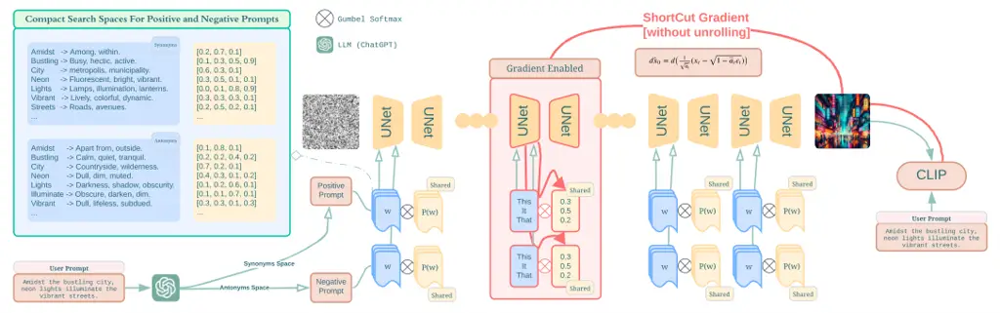

Figure 1: Computational procedure of Shortcut Text Gradient (Bottom)
v.s. Full Gradient (Top) on text.

Large-scale text-based generative models exhibit a remarkable ability to
generate novel content conditioned on user input prompts (Ouyang et al.,
2022; Touvron et al., 2023; Rombach et al., 2022; Ramesh et al., 2022;
Saharia et al., 2022; Ho et al., 2022; Yu et al., 2022; Chang et al.,
2023). Despite being trained with huge corpora, there still exists a
substantial gap between user intention and what the model
interprets (Zhou et al., 2022; Feng et al., 2022; Rombach et al., 2022;
Radford et al., 2021; Lian et al., 2023; Ouyang et al., 2022; Ramesh
et al., 2022). The misalignment is even more severe in text-to-image
generative models, partially since they often rely on much smaller and
less capable text encoders (Radford et al., 2021; Cherti et al., 2023;
Raffel et al., 2020) than large language models (LLMs). As a result,
instructing a large model to produce intended content often requires
laborious human efforts in crafting the prompt through trials and errors
(a.k.a. Prompt Engineering) (Art, Year; Wang et al., 2022; Witteveen &
Andrews, 2022; Liu & Chilton, 2022; Zhou et al., 2022; Hao et al.,
2022). To automate this process for language generation, several recent
attempts have shown tremendous potential in utilizing LLMs to enhance
prompts (Pryzant et al., 2023; Zhou et al., 2022; Chen et al., 2023; Guo
et al., 2023; Yang et al., 2023; Hao et al., 2022). However, efforts on
text-to-image generative models remain scarce and preliminary, probably
due to the challenges faced by these models’ relatively small text
encoders in understanding subtle language cues.

##### DPO-Diff.

This paper presents a systematic study of prompt optimization for
text-to-image diffusion models. We introduce a novel optimization
framework based on the following key observations. 1) Prompt engineering
for diffusion models can be formulated as a Discrete Prompt Optimization
(DPO-Diff) problem over the space of natural languages. Moreover, the
framework can be used to find prompts that either improve (prompt
enhancement) or destroy (adversarial attack) the generation process, by
simply reversing the sign of the objective function. 2) We show that for
diffusion models with classifier-free guidance (Ho & Salimans, 2022),
improving the image generation process is more effective when optimizing
“negative prompts” (Andrew, 2023; Woolf, 2022) than positive prompts.
Beyond the problem formulation of DPO-Diff, where “Diff” highlights our
focus on text-to-image diffusion models, the main technical
contributions of this paper lie in efficient methods for solving this
optimization problem, including the design of compact domain spaces and
a gradient-based algorithm.

##### Compact domain spaces.

DPO-Diff’s domain space is a discrete search space at the word level to
represent prompts. While this space is generic enough to cover any
sentence, it is excessively large due to the dominance of words
irrelevant to the user input. To alleviate this issue, we design a
family of dynamically generated compact search spaces based on relevant
word substitutions, for both positive and negative prompts. These
subspaces enable efficient search for both prompt enhancement and
adversarial attack tasks.

##### Shortcut Text Gradients for DPO-Diff.

Solving DPO-Diff with a gradient-based algorithm requires computing the
text gradient, i.e., backpropagating from the generated image, through
all inference steps of a diffusion model, and finally to the discrete
text. Two challenges arise in obtaining this gradient: 1) This process
incurs compound memory-runtime complexity over the number of backward
passes through the denoising step, making it prohibitive to run on
large-scale diffusion models (e.g., a 870M-parameter Stable Diffusion v1
requires $`\sim`$750G memory to run backpropagation through 50 inference
steps (Rombach et al., 2022)). 2) The embedding lookup tables in text
encoders are non-differentiable. To reduce the computational cost in 1),
we provide a generic replacement for the text gradient that bypasses the
need to unroll the inference steps in a backward pass, allowing it to be
computed with constant memory and runtime. To backpropagate through the
discrete embedding lookup table, we continuously relax the categorical
word choices to a learnable smooth distribution over the vocabulary,
using the Gumbel Softmax trick (Guo et al., 2021; Jang et al., 2016;
Dong & Yang, 2019). The gradient obtained by this method, termed
Shortcut Text Gradient, enables us to efficiently solve DPO-Diff
regardless of the number of inference steps of a diffusion model.

To evaluate our prompt optimization method for the diffusion model, we
collect and filter a set of challenging prompts from diverse sources
including DiffusionDB (Wang et al., 2022), COCO (Lin et al., 2014), and
ChatGPT (Ouyang et al., 2022). Empirical results suggest that DPO-Diff
can effectively discover prompts that improve (or destroy for
adversarial attack) the faithfulness of text-to-image diffusion models,
surpassing human-engineered prompts and prior baselines by a large
margin. We summarize our primary contributions as follows:

- $`\bullet`$
  DPO-Diff: A generic framework for prompt optimization as a discrete
  optimization problem over the space of natural languages, of arbitrary
  metrics.
- $`\bullet`$
  Compact domain spaces: A family of dynamic compact search spaces, over
  which a gradient-based algorithm enables efficient solution finding
  for the prompt optimization problem.
- $`\bullet`$
  Shortcut Text Gradients: The first novel computation method to enable
  backpropagation through the diffusion models’ lengthy sampling steps
  with constant memory-runtime complexity, enabling gradient-based
  search algorithms.
- $`\bullet`$
  Negative prompt optimization: The first empirical result demonstrating
  the effectiveness of optimizing negative prompts for diffusion models.

## 2 Related Work

##### Text-to-image diffusion models.

Diffusion models trained on a large corpus of image-text datasets
significantly advanced the state of text-guided image
generation (Rombach et al., 2022; Ramesh et al., 2022; Saharia et al.,
2022; Chang et al., 2023; Yu et al., 2022). Despite the success, these
models can sometimes generate images with poor quality. While some
preliminary observations suggest that negative prompts can be used to
improve image quality (Andrew, 2023; Woolf, 2022), there exists no
principled way to find negative prompts. Moreover, several studies have
shown that large-scale text-to-image diffusion models face significant
challenges in understanding language cues in user input during image
generation; Particularly, diffusion models often generate images with
missing objects and incorrectly bounded attribute-object pairs,
resulting in poor “faithfulness” or “relevance” (Hao et al., 2022; Feng
et al., 2022; Lian et al., 2023; Liu et al., 2022). Existing solutions
to this problem include compositional generation (Liu et al., 2022),
augmenting diffusion model with large language models (Yang et al.,
2023), and manipulating attention masks (Feng et al., 2022). As a method
orthogonal to them, our work reveals that negative prompt optimization
can also alleviate this issue.

##### Prompt optimization for text-based generative models.

Aligning a pretrained large language model (LLM) with human intentions
is a crucial step toward unlocking the potential of large-scale
text-based generative models (Ouyang et al., 2022; Rombach et al.,
2022). An effective line of training-free alignment methods is prompt
optimization (PO) (Zhou et al., 2022). PO originated from in-context
learning (Dale, 2021), which is mainly concerned with various
arrangements of task demonstrations. It later evolves into automatic
prompt engineering, where powerful language models are utilized to
refine prompts for certain tasks (Zhou et al., 2022; Pryzant et al.,
2023; Yang et al., 2023; Pryzant et al., 2023; Hao et al., 2022). While
PO has been widely explored for LLMs, efforts on diffusion models remain
scarce. The most relevant prior work to ours is Promptist (Hao et al.,
2022), which finetunes an LLM via reinforcement learning from human
feedback (Ouyang et al., 2022) to augment user prompts with artistic
modifiers (e.g., high-resolution, 4K) (Art, Year), resulting in
aesthetically pleasing images. However, the lack of paired
contextual-aware data significantly limits its ability to follow the
user intention (Figure 3).

##### Textual Inversion

Optimizing texts in pretrained diffusion models has also been explored
under “Textual Inversion” task (Gal et al., 2022; Wen et al., 2023;
Mokady et al., 2023). Textual Inversion involves adapting a frozen model
to generate novel visual concepts based on a set of user-provided
images. It achieves this by distilling these images into soft or hard
text prompts, enabling the model to replicate the visual features of the
user images. Since the source images are provided, the training process
mirrors that of typical diffusion model training. While some Textual
Inversion papers also use the term “prompt optimization”, it is distinct
from the Prompt Optimization considered by Promptist (Hao et al., 2022)
and our work. Our objective is to enhance a model’s ability to follow
text prompts. Here, the primary input is the user prompt, and
improvement is achieved by optimizing this prompt to enhance the
resulting image. Since the score function is applied to the final
generated image, the optimization process necessitates backpropagation
through all inference steps. Despite using similar terminologies, these
methodologies are fundamentally distinct and not interchangeable.
Table 3 further summarizes the key differences in taxonomy.

##### Efficient Backpropagation through diffusion sampling steps.

Text-to-image diffusion models generate images via a progressive
denoising process, making multiple passes through the same network (Ho
et al., 2020). When a loss is applied to the output image, computing the
gradient w.r.t. any model component (text, weight, sampler, etc.)
requires backpropagating through all the sampling steps. This process
incurs compound complexity over the number of backward passes in both
memory and runtime, making it infeasible to run on regular commercial
devices. Existing efforts achieve constant memory via gradient
checkpointing (Watson et al., 2021) or solving an augmented SDE
problem (Nie et al., 2022), at the expense of even higher runtime.

## 3 Preliminaries on diffusion model

##### Denoising diffusion probabilistic models.

On a high level, diffusion models (Ho et al., 2020) is a type of
hierarchical Variational Autoencoder (Sønderby et al., 2016) that
generates samples by reversing (backward) a progressive noisification
process (forward). Let $`\bm{x}_{0}\cdots\bm{x}_{T}`$ be a series of
intermediate samples of increasing noise levels, the forward process
progressively adds Gaussian noise to the original image $`\bm{x}_{0}`$:

```math
\displaystyle q(\bm{x}_{t}|\bm{x}_{t-1})=\mathcal{N}(\bm{x}_{t};\sqrt{1-\beta_{t}}\bm{x}_{t-1},\beta_{t}\bm{I}), \tag{1}
```

where $`\beta`$ is a scheduling variable. Using reparameterization
trick, $`\bm{x}_{t}|^{T}_{t=1}`$ can be computed from $`\bm{x}_{0}`$ in
one step:

```math
\displaystyle\bm{x}_{t}=\sqrt{\bar{\alpha}_{t}}\bm{x}_{0}+\sqrt{1-\bar{\alpha}_{t}}\epsilon, \tag{2}
```

```math
\displaystyle\text{where}\ \ \alpha_{t}=1-\beta_{t}\ \text{and}\ \bar{\alpha}_{t}=\prod\nolimits_{i=1}^{t}\alpha_{i}, \tag{3}
```

where $`\epsilon`$ is a standard Gaussian error. The reverse process
starts with a standard Gaussian noise,
$`\bm{x}_{T}\sim\mathcal{N}(\bm{0},\bm{I})`$, and progressively denoises
it using the following joint distribution:

```math
\displaystyle p_{\theta}(\bm{x}_{0:T}) \displaystyle=p(\bm{x}_{T})\prod\nolimits_{t=1}^{T}p_{\theta}(\bm{x}_{t-1}|\bm{x}_{t})
```

```math
\displaystyle\text{where}\ \ p_{\theta}(\bm{x}_{t-1}|\bm{x}_{t})=\mathcal{N}(\bm{x}_{t-1};\mu_{\theta}(\bm{x}_{t},t),\bm{\Sigma}).
```

While the mean function $`\mu_{\theta}(\bm{x}_{t},t)`$ can be
parameterized by a neural network (e.g., UNet (Rombach et al., 2022;
Ronneberger et al., 2015)) directly, prior studies found that modeling
the residual error $`\epsilon(\bm{x}_{t},t)`$ instead works better
empirically (Ho et al., 2020). The two strategies are mathematically
equivalent as
$`\mu_{\theta}(\bm{x}_{t},t)=\frac{1}{\sqrt{\alpha_{t}}}(\bm{x}_{t}-\frac{1-\alpha_{t}}{\sqrt{1-\bar{\alpha}_{t}}}\epsilon(\bm{x}_{t},t))`$.

##### Conditional generation and negative prompts.

The above formulation can be easily extended to conditional generation
via classifier-free guidance (Ho & Salimans, 2022), widely adopted in
contemporary diffusion models. At each sampling step, the predicted
error $`\tilde{\epsilon}`$ is obtained by subtracting the unconditional
signal ($`c(``")`$) from the conditional signal ($`c(s)`$), up to a
scaling factor $`w`$:

```math
\displaystyle\tilde{\epsilon}_{\theta}(\bm{x}_{t},c(s),\!t)=(1+w)\epsilon_{\theta}(\bm{x}_{t},c(s),t)-w\epsilon_{\theta}(x_{t},c(``"),t). \tag{4}
```

If we replace this empty string with an actual text, then it becomes a
Negative Prompt (Andrew, 2023; Woolf, 2022), instructing the model what
to exclude from the generated image.

## 4 DPO-Diff Framework

##### Formulation

Our main insight is that prompt engineering can be formulated as a
discrete optimization problem in the language space. Concretely, we
represent the problem domain $`\mathcal{S}`$ as a sequence of $`M`$
words $`w_{i}`$ from a predefined vocabulary $`\mathcal{V}`$:
$`\mathcal{S}=\{w_{1},w_{2},\dots w_{M}|\forall i,\ w_{i}\in\mathcal{V}\}`$.
This space is generic enough to cover all possible sentences of lengths
less than $`M`$ (when the empty string is present). Let $`G(s)`$ denote
a text-to-image generative model, and $`s_{user}`$, $`s`$ denote the
user input and optimized prompt, respectively. The optimization problem
can be written as

```math
\displaystyle\min_{s\in\mathcal{S}}\mathcal{L}(G(s),s_{user}) \tag{5}
```

where $`\mathcal{L}`$ can be any objective function that measures the
effectiveness of the learned prompt when used to generate images.
Following previous works (Hao et al., 2022), we use clip loss
$`\text{CLIP}(I,s_{user})`$ (Crumb, 2022) to measure the
instruction-following ability of the diffusion model.

##### Application

DPO-Diff framework is versatile for handling not only prompt enhancement
but also adversarial attack tasks. Figure 1 illustrates the taxonomy of
those two applications. Adversarial attacks for text-to-image generative
models can be defined as follows:

###### Definition 4.1.

Given a user input $`s_{user}`$, the attacker aims at slightly
perturbing $`s_{user}`$ to disrupt the prompt-following ability of image
generation, i.e., the resulting generated image is no longer describable
by $`s_{user}`$.

To modify (5) into the adversarial attack, we can simply add a negative
sign to the objective function ($`\mathcal{L}`$), and restrict the
distance between an adversarial prompt ($`s`$) and user input
($`s_{user}`$). Mathematically, this can be written as the following:

```math
\displaystyle\min_{s\in\mathcal{S}}\;{\color[rgb]{1,0,0}-\mathcal{L}}(G(s),s_{user})\quad\text{s.t.}\ {\color[rgb]{1,0,0}d(s,s_{user})\leq\lambda}, \tag{6}
```

where $`d(s,s_{user})`$ is a distance measure that forces the perturbed
prompt ($`s`$) to be semantically similar to the user input
($`s_{user}`$).

## 5 Compact search spaces for efficient prompt discovery

While the entire language space facilitates maximal generality, it is
also unnecessarily inefficient as it is popularized with words
irrelevant to the task. We propose a family of compact search spaces
that dynamically extracts a subset of task-relevant words to the user
input.

### 5.1 Application 1: Discovering adversarial prompts for model diagnosis

##### Synonym Space for adversarial attack.

In light of the constraint on semantic similarity in (6), we build a
search space for the adversarial prompts by substituting each word in
the user input $`s_{user}`$ with its synonyms (Alzantot et al., 2018),
preserving the meaning of the original sentence. The synonyms can be
found by either dictionary lookup or querying ChatGPT (Appendix F.2).

### 5.2 Application 2: Discovering enhanced prompts for image generation

While the Synonym Space is suitable for attacking diffusion models, we
found that it performs poorly on finding improved prompts. This is in
contradiction to LLMs where rephrasing user prompts can often lead to
substantial gains (Zhou et al., 2022). One plausible reason is that
contemporary diffusion models often rely on small-scale text
encoders (Radford et al., 2021; Cherti et al., 2023; Raffel et al., 2020) that are much weaker than LLMs with many known limitations in
understanding subtle language cues (Feng et al., 2022; Liu et al., 2022;
Yang et al., 2023).

##### Antonym Space for negative prompt optimization.

Inspired by these observations, we propose a novel solution to optimize
for negative prompts instead — a unique concept that rises from
classifier-free guidance (Ho & Salimans, 2022) used in diffusion models
(Section 3). Recall that negative prompts instruct the diffusion model
to remove contents in generated images, opposite to the positive prompt;
Intuitively, the model’s output image can safely exclude the content
with the opposite meaning to the words in the user input, thereby
amplifying the concepts presented in the positive prompt. We thereby
build the space of negative prompts from the antonyms of each word in
the user prompt. The antonyms of words can also be obtained either via
dictionary lookup or querying ChatGPT. However unlike synonyms space, we
concatenate the antonyms directly in comma separated format, mirroring
the practical usage of negative prompts. To the best of our knowledge,
this is the first exploratory work on automated negative prompt
optimization.

## 6 A Gradient-based solver for DPO-Diff

Due to the query efficiency of white-box algorithms leveraging gradient
information, we also explore a gradient-based method to solve (5) and
(6). However, obtaining the text gradient is non-trivial due to two
major challenges. 1) Backpropagating through the sampling steps of the
diffusion inference process incurs high complexity w.r.t. memory and
runtime, making it prohibitively expensive to obtain gradients (Watson
et al., 2021; Nie et al., 2022). For samplers with 50 inference steps
(e.g., DDIM (Song et al., 2020)), it raises the runtime and memory cost
by 50 times compared to a single diffusion training step. 2) To further
compute the gradient on text, the backpropagation needs to pass through
a non-differentiable embedding lookup table. To alleviate these issues,
we propose Shortcut Text Gradient, an efficient replacement for text
gradient that can be obtained with constant memory and runtime. Our
solution to (1) and (2) are discussed in  Section 6.1.1 and
 Section 6.1.2 respectively. Moreover,  Section 6.2 discusses how to
sample from the learned text distribution via evolutionary search.

### 6.1 Shortcut Text Gradient

#### 6.1.1 Backpropagating through diffusion sampling steps

To efficiently backpropagate the loss from the final image to
intermediate feature at an arbitrary step, our key idea is to trim the
computation graph down to only a few steps from both ends, resulting in
a constant number of backward passes (Figure 1. To achieve this, three
operations are required through the image generation process:

(1) Sampling without gradient from step $`T`$ (noise) to $`t`$. We
disable gradients up to step $`t`$, thereby eliminating the need for
backpropagation from $`T`$ to $`t`$.

(2) Enable gradient from $`t`$ to $`t-K`$. The backward computation
graph is enabled for the $`K`$ step starting at $`t`$.

(3) Estimating $`\bm{x}_{0}`$ directly from $`\bm{x}_{t-K}`$. To bypass
the final $`t-K`$ steps of UNet, a naive solution is to directly decode
and feed the noisy image $`\bm{x}_{t-K}`$ to the loss function. However,
due to distribution shifts, these intermediate images often cannot be
properly interpreted by downstream modules such as VAE decoder (Rombach
et al., 2022) and CLIP (Dhariwal & Nichol, 2021). Instead, we propose to
use the following closed-form estimation of the final image
$`\hat{\bm{x}}_{0}`$ (Song et al., 2020) to bridge the gap:

```math
\displaystyle\bm{\hat{x}}_{0}=\frac{1}{\sqrt{\bar{\alpha}_{t-K}}}(\bm{x}_{t-K}-\sqrt{1-\bar{\alpha}_{t-K}}\bm{\hat{\epsilon}}_{\theta}(\bm{x}_{t-K},t-K))
```

This way, the Jacobian of $`\hat{\bm{x}}_{0}`$ w.r.t. $`\bm{x}_{t-K}`$
can be computed analytically, with complexity independent of $`t`$. Note
that the above estimation of $`x_{0}`$ is not a trick — it directly
comes from a mathematically equivalent interpretation of the diffusion
model, where each inference step can be viewed as computing
$`\hat{\bm{x}}_{0}`$ and plugging it into
$`q(\bm{x}_{t-K}|\bm{x}_{t},\hat{\bm{x}}_{0})`$ to obtain the
transitional probability (See Appendix C for the derivation).

Remark 1: Complexity Analysis With Shortcut Text Gradient, the
computational cost of backpropagating through the inference process can
be reduced to $`K`$-times backward passes of UNet. When we set $`t=T`$
and $`K=T`$, it becomes the full-text gradient; When $`K=1`$, the
computation costs reduce to a single backward pass. Remark 2: Connection
to ReFL (Xu et al., 2024). ReFL is a post-hoc alignment method for
finetuning diffusion models. It also adopts the estimation of $`x_{0}`$
when optimizing diffusion model against a scorer, which is
mathematically equivalent to the case when $`K=1`$.

#### 6.1.2 Backpropagating through embeddings lookup table

In diffusion models, a tokenizer transforms text input into indices,
which will be used to query a lookup table for corresponding word
embeddings. To allow further propagating gradients through this
non-differentiable indexing operation, we relax the categorical choice
of words into a continuous probability of words and learn a distribution
over them. We parameterize the distribution using Gumbel Softmax (Jang
et al., 2016) with uniform temperature ($`\eta=1`$):

```math
\displaystyle\tilde{e}=\sum_{i=1}^{|\mathcal{V}|}e_{i}*\frac{\exp\left((\log\alpha_{i}+g_{i})/\eta\right)}{\sum_{i=1}^{|\mathcal{V}|}\exp\left((\log\alpha_{i}+g_{i})/\eta\right)} \tag{7}
```

where $`\alpha`$ (a $`|\mathcal{V}|`$-dimensional vector) denotes the
learnable parameter, $`g`$ denotes the Gumbel random variable, $`e_{i}`$
is the embedding of word $`i`$, and $`\tilde{e}`$ is the output mixed
embedding.

### 6.2 Efficient sampling with Evolutionary Search

To efficiently sample candidate prompts from the learned Gumbel
“distribution”, we adopt evolutionary search, known for its sample
efficiency (Goldberg, 1989; Wu et al., 2019). Our adaptation of the
evolutionary algorithm to the prompt optimization task involves three
key steps: (1) Genotype Definition: We define the genotype of each
candidate prompt as the list of searched words from the compact search
space, where modifications to the genotype correspond to edits the word
choices in the prompt. (2) Population Initialization: We initialize the
algorithm’s population with samples drawn from the learned Gumbel
distribution to bias the starting candidates towards regions of high
potential. (3) Evolutionary Operations: We execute a standard
evolutionary search, including several rounds of crossover and
mutation (Goldberg, 1989), culminating in the selection of the top
candidate as the optimized prompt. Details of the complete DPO-Diff
algorithm, including specific hyperparameters, are available in
Algorithm 1 of  Appendix D and discussed further in  Section F.1.

##### Remark: Extending DPO-Diff to Blackbox Settings.

In cases where the model is only accessible through forward API, our
Evolutionary Search (ES) module can be used as a stand-alone black-box
optimizer, thereby expanding the applicability of our framework. As
further ablated in Section 8.1, ES archives descent results with enough
queries.

## 7 Experiments

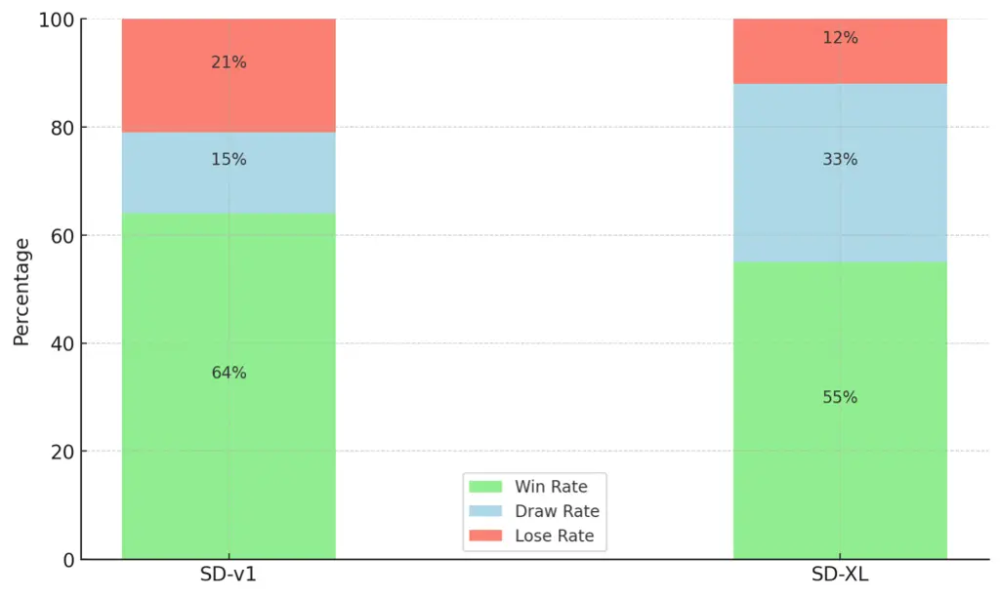

Figure 2: Win Rate of DPO-Diff versus Promptist on prompt improvement
task with Human Evaluation. DPO-Diff surpasses or matches the
performance of Promptist 79% of times on SD-v1 and 88% of times on
SD-XL.

### 7.1 Experimental Setup

##### Dataset preparation.

To encourage semantic diversity, we collect a prompt dataset from three
sources: DiffusionDB (Wang et al., 2022), ChatGPT generated
prompts (Ouyang et al., 2022), and COCO (Lin et al., 2014). For each
source, we filter 100 “hard prompts” with a clip loss higher (lower for
adversarial attack) than a threshold, amounting to 600 prompts in total
for two tasks. Due to space limit, we include preparation details in
Appendix G.1.

##### Evaluation Metrics.

All methods are evaluated quantitatively using the clip loss (Crowson
et al., 2022) and Human Preference Score v2 (HPSv2). HPSv2 is a
CLIP-based model trained to predict human preferences on images
generated from text. For base models, we adopt Stable Diffusion v1-4.
Each prompt is evaluated under two random seeds (shared across different
methods). Besides automatic evaluation metrics, we also conduct human
evaluations on the generated images, following the protocol specified in
Appendix G.2.

##### Optimization Parameters.

We use the Spherical CLIP Loss (Crumb, 2022) as the objective function,
which ranges between 0.75 and 0.85 for most inputs. The $`K`$ for the
Shortcut Text Gradient is set to 1, as it produces effective supervision
signals with minimal cost. To generate the search spaces, we prompt
ChatGPT (gpt-4-1106-preview) for at most 5 substitutes of each word in
the user prompt. Furthermore, we use a fixed set of hyperparameters for
both prompt improvement and adversarial attacks. We include a detailed
discussion on all the hyperparameters and search space generation in
Appendix F.

### 7.2 Application 1 - Adversarial Attack

|          |                  |                     |                  |                     |                  |                     |
| -------- | ---------------- | ------------------- | ---------------- | ------------------- | ---------------- | ------------------- |
| Attack   | DiffusionDB      |                     | COCO             |                     | ChatGPT          |                     |
|          | CLIP$`\uparrow`$ | HPSv2$`\downarrow`$ | CLIP$`\uparrow`$ | HPSv2$`\downarrow`$ | CLIP$`\uparrow`$ | HPSv2$`\downarrow`$ |
| User     | 0.76 ± 0.03      | 75.28 ± 8.54        | 0.77 ± 0.03      | 75.28 ± 8.54        | 0.77 ± 0.02      | 73.57 ± 10.81       |
| DPO-Diff | 0.86 ± 0.05      | 40.52 ± 11.88       | 0.94 ± 0.04      | 45.85 ± 10.18       | 0.95 ± 0.05      | 39.73 ± 16.73       |

|           |                    |                   |                    |                   |                    |                   |
| --------- | ------------------ | ----------------- | ------------------ | ----------------- | ------------------ | ----------------- |
| Improve   | DiffusionDB        |                   | COCO               |                   | ChatGPT            |                   |
|           | CLIP$`\downarrow`$ | HPSv2$`\uparrow`$ | CLIP$`\downarrow`$ | HPSv2$`\uparrow`$ | CLIP$`\downarrow`$ | HPSv2$`\uparrow`$ |
| User      | 0.87 ± 0.02        | 48.81 ± 09.71     | 0.87 ± 0.01        | 50.33 ± 4.85      | 0.84 ± 0.01        | 53.36 ± 5.17      |
| Manual    | 0.89 ± 0.04        | 51.43 ± 10.29     | \-                 | \-                | \-                 | \-                |
| Promptist | 0.88 ± 0.02        | 54.39 ± 12.47     | 0.87 ± 0.03        | 50.08 ± 7.43      | 0.85 ± 0.02        | 59.32 ± 6.50      |
| DPO-Diff  | 0.81 ± 0.03        | 62.37 ± 12.48     | 0.82 ± 0.02        | 61.26 ± 0.77      | 0.78 ± 0.03        | 67.71 ± 6.46      |

Table 1: Quantitative comparison of different prompting methods. We
evaluate the generated images using both Spherical CLIP loss and Human
Preference Score v2 (HPSv2) score (renormalized to 0-100) - a score
trained to mimic human preferences on images generated from text. Our
method achieves the best result on both prompt improvement and
adversarial attack among all methods, including the previous SOTA -
Promptist.

Unlike RLHF-based prompt-engineering methods (e.g. Promptist (Hao
et al., 2022)) that require finetuning a prompt generator when adapting
to a new task, DPO-Diff, as a train-free method, can be seamlessly
applied to finding adversarial prompts by simply reversing the sign of
the objective function.

In this section, we demonstrate that DPO-Diff is capable of discovering
adversarial prompts that destroy the prompt-following ability of Stable
Diffusion.

|                                                                                          |                                                                        |                                                                       |
| ---------------------------------------------------------------------------------------- | ---------------------------------------------------------------------- | --------------------------------------------------------------------- |
|                                                                                          |                                                                        |                                                                       |
| User Input                                                                               | Promptist - Modifiers                                                  | Negative Prompts by DPO-Diff                                          |
|                                                                                          |                                                                        |                                                                       |
| The yellow sun was descending beyond the violet peaks, coloring the sky with hot shades. | by Greg Rutkowski and Raymond Swanland, …, ultra realistic digital art | red, soaring, red, valleys, white, floor, Plain, body, focus, surreal |
|                               |             |            |
|                                                                                          |                                                                        |                                                                       |
| A dedicated gardener tending to a … bonsai tree.                                         | intricate, elegant, highly detailed, …, sharp focus, illustration      | irresponsible, overlooking, huge, herb, …                             |
| 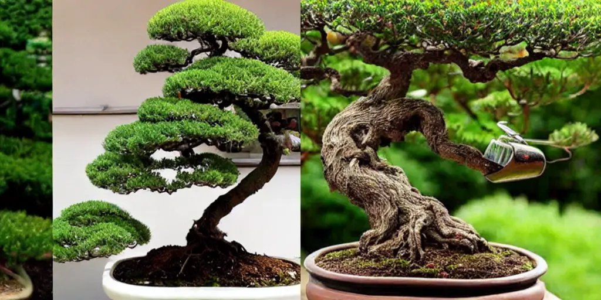                              | 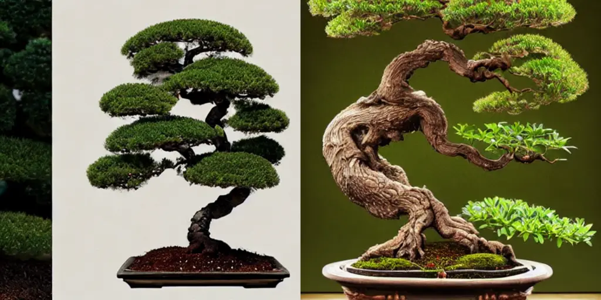            | 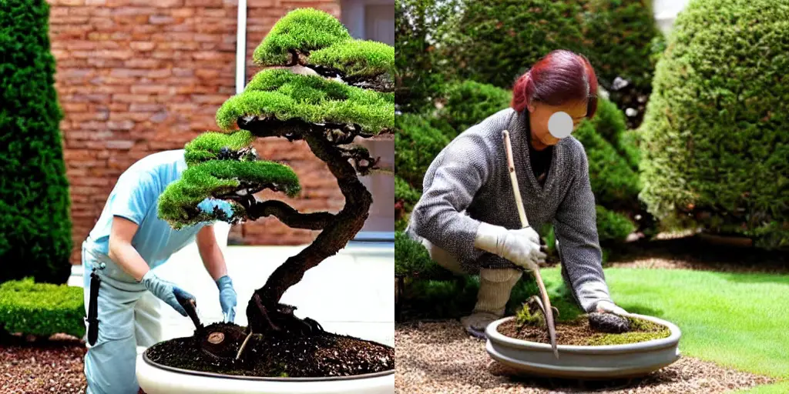           |
|                                                                                          |                                                                        |                                                                       |
| magical … bear with glowing magical marks …                                              | D&D, fantasy, cinematic lighting, …, art by artgerm and greg …         | normal, elephant, …, heaps, tundra, advance, Boring, black, …         |
| 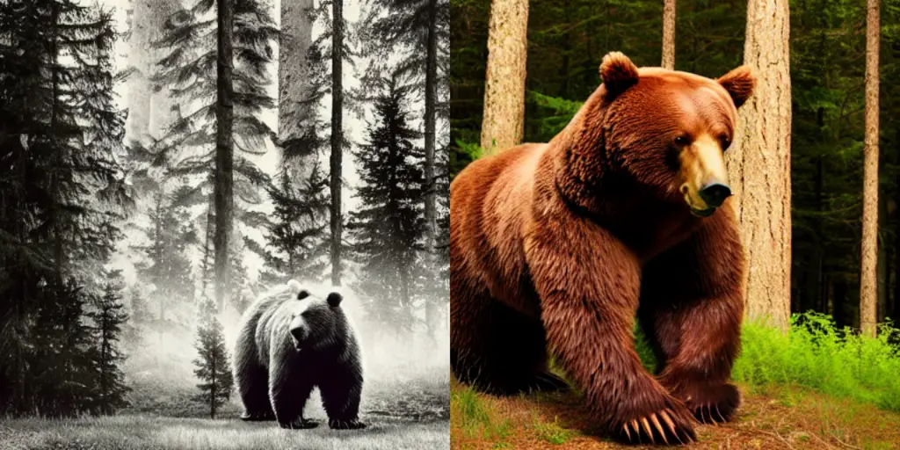                              |            |           |

Figure 3: Example images generated by improved negative prompts from
DPO-Diff v.s. Promptist (More in Figure 7). Compared with Promptist,
DPO-Diff was able to generate images that better capture the content in
the original prompt.

|                                                              |                                                              |
| ------------------------------------------------------------ | ------------------------------------------------------------ |
|                                                              |                                                              |
| User Input                                                   | Adversarial Prompts by DPO-Diff                              |
|                                                              |                                                              |
| A vibrant sunset casting hues of orange and pink.            | The vibrant sundown casting tones of orange plus blush.      |
|  | 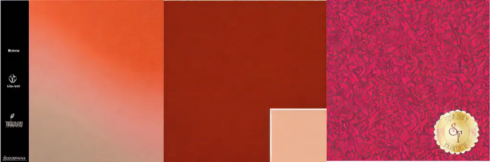 |
|                                                              |                                                              |
| A group of friends gather around a table for a meal.         | A party of friends cluster around a surface for a food       |
|  | 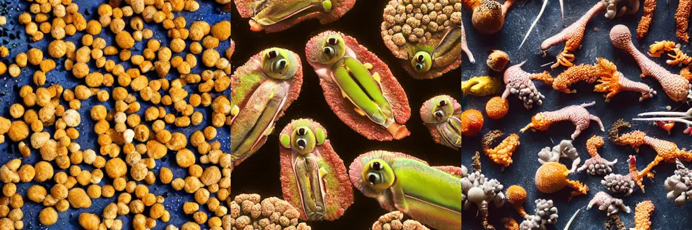 |
|                                                              |                                                              |
| oil painting of a mountain landscape                         | grease picture illustrating one mountain view                |
|  | 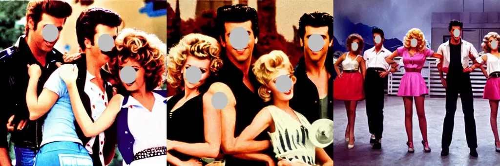 |

Figure 4: Example images generated by adversarial prompts from DPO-Diff.
While keeping the overall meaning similar to the user input, adversarial
prompts completely destroy the prompt-following ability of the Stable
Diffusion model. (More in  Figure 8)

As suggested by (6), a successful adversarial prompt must not change the
original intention of the user prompt. While we specified this
constraint to ChatGPT when building the Synonyms Space, occasionally
ChatGPT might mistake a word for the synonyms. To address this, during
the evolutionary search phase, we perform rejection sampling to refuse
candidate prompts that have different meanings to the user input.
Concretely, we enforce their cosine similarity in embedding space to be
higher than 0.9 (More on this can be found in Appendix G).

Table 1 summarizes the quantitative results. Our method is able to
perturb the original prompt to adversarial directions, resulting in a
substantial increase in the clip loss. Figure 4 also visualizes a set of
intriguing images generated by the adversarial prompts. We can see that
DPO-Diff can effectively explore the text regions where Stable Diffusion
fails to interpret.

##### Human Evaluation.

We further ask human judges to check whether the attack generated by
DPO-Diff is successful or not. Since previous prompt optimization
methods do not apply to this task, we only ask the evaluators to compare
DPO-Diff against the original image. DPO-Diff achieves an average
success rate (ASR) of 44% on SD-v1. Considering that Stable Diffusion
models are trained on a large amount of caption corpus, this success
rate is fairly substantial.

### 7.3 Application 2: Prompt Improvement

In this section, we apply DPO-Diff to craft prompts that improve the
prompt-following ability of the generated images. We compare our method
with three baselines: (1) User Input. (2) Human Engineered Prompts
(available only on DiffusionDB) (Wang et al., 2022). (3) Promptist (Hao
et al., 2022), trained to mimic the human-crafted prompt provided in
DiffusionDB.

Table 1 summarizes the result. Among all methods, DPO-Diff achieves the
best results under both Spherical CLIP loss and Human Preference Score
(HPSv2) score. On the other hand, our findings suggest that both
human-engineered and Promptist-optimized prompts do not improve the
relevance between generated images and user intention. The reason is
that these methods merely add a set of aesthetic modifiers to the
original prompt, irrelevant to the semantics of user input. This can be
further observed from the qualitative examples in Figure 3, where images
generated by Promptist often also do not follow the prompts well.

##### Human Evaluation.

We further ask human judges to rate DPO-Diff and Promptist on how well
the generated images follow the user prompt. Figure 2 summarizes the
win/draw/loss rate of DPO-Diff against Promptist; The result shows that
DPO-Diff surpasses or matches Promptist in human rate 79% of times on
SD-v1.

### 7.4 Qualitative analysis of search progression

|                                                                                                                                                                                                                                                                                                              |
| ------------------------------------------------------------------------------------------------------------------------------------------------------------------------------------------------------------------------------------------------------------------------------------------------------------ |
| User Prompt: A bunch of luggage that is in front of a truck.                                                                                                                                                                                                                                                 |
| 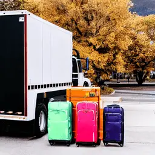 |
| User Prompt: There are cranes in the water and a boat in the distance.                                                                                                                                                                                                                                       |
|  |
| User Prompt: harry potter shrek, movie poster, movie still, …                                                                                                                                                                                                                                                |
| 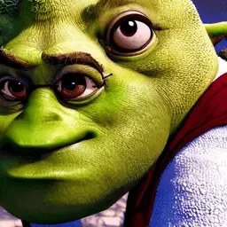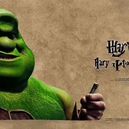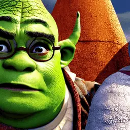 |

Figure 5: Evolution of the optimized images from DPO-Diff at iteration
0, 10, 20, 40, and 80 (left to right). Noticeable improvements can be
observed as early as 10 iterations, and the progression is surprisingly
interpretable.

To examine the convergence of our search algorithm qualitatively, we
plot the progression of optimized images at various evaluation stages.
We set the target iterations at 0 (the original image), 10, 20, 40, and
80 to illustrate the changes, and showcase the image with the highest
clip loss among all evaluated candidates at each iteration.

Figure 5 illustrates some example trajectories. In most cases, the
images exhibit noticeable improvement in aligning with the user’s prompt
at as early as the 10th iteration, and continue to improve. Moreover,
the progression are surprisingly interpretable. For instance, with the
prompt: ”A bunch of luggage in front of a truck,” the initial image
fails to include any luggage, featuring only the truck; However, as the
optimization continues, we can see that DPO-Diff incrementally adds more
luggage to the scene.

## 8 Ablation Study

Figure 6: Learning curves of different search algorithms in solving
DPO-Diff.

We conduct ablation studies on DPO-Diff using 30 randomly sampled
prompts, 10 from each source. Each search algorithm is run under 4
random seeds.

### 8.1 Comparison of different search algorithms.

We compare four search algorithms for DPO-Diff: Random Search (RS),
Evolution Prompt Optimization (EPO), Gradient-based Prompt Optimization
(GPO), and the full algorithm (GPO + ES). Figure 6 shows their
performance under different search budgets (number of evaluations)¹¹ 1
Since the runtime of backpropagation through one-step diffusion sampling
is negligible w.r.t. the full sampling process (50 steps for DDIM
sampler), we count it the same as one inference step.; While GPO tops
EPO under low budgets, it also plateaus quicker as randomly drawing from
the learned distribution is sample-inefficient. Combining GPO with EPO
achieves the best overall performance.

### 8.2 Negative prompt v.s. positive prompt optimization

One finding in our work is that optimizing negative prompts (Antonyms
Space) is more effective than positive prompts (Synonyms Space) for
Stable Diffusion. To verify the strength of these spaces, we randomly
sample 100 prompts for each space and compute their average clip loss of
generated images. Table 2 suggests that Antonyms Space contains
candidates with consistently lower clip loss than Synonyms Space.

|                 |                 |                 |                 |
| --------------- | --------------- | --------------- | --------------- |
| Prompt          | DiffusionDB     | ChatGPT         | COCO            |
| User Input      | 0.8741 ± 0.0203 | 0.8159 ± 0.0100 | 0.8606 ± 0.0096 |
| Positive Prompt | 0.8747 ± 0.0189 | 0.8304 ± 0.0284 | 0.8624 ± 0.0141 |
| Negative Prompt | 0.8579 ± 0.0242 | 0.8133 ± 0.0197 | 0.8403 ± 0.0210 |

Table 2: Quantitative evaluation of optimizing negative prompts (w/
Antonyms Space) and positive prompts (w/ Synonym Space) for Stable
Diffusion.

## 9 Discussion on the Search v.s. Learning paradigms for utilizing computatons

This section elucidates the relationship between two distinct prompt
optimization approaches for diffusion models: DPO-Diff (ours) and
Promptist. While Promptist represents a pioneering effort, it is
important to discuss why DPO-Diff remains essential.

##### Limitations of Promptist

Promptist utilizes the Reinforcement Learning from Human Feedback
(RLHF) (Bain & Sammut, 1995; Christiano et al., 2017; Ouyang et al., 2022) approach to fine-tune a language model to generate improved
prompts. RLHF relies on paired data
$`\langle\texttt{user\_prompt},\texttt{improved\_prompt}\rangle`$, which
is scarce for diffusion models and challenging to curate. This is
primarily because generating the improved prompts requires extensive
trial-and-error by human experts, essentially performing what DPO-Diff
automates. In fact, the performance limit exhibited by Promptist is
exactly caused by this lack of data: The data used by Promptist from
DiffusionDB predominantly features aesthetic modifiers that do not alter
the semantics of the prompts This limits its effectiveness to aesthetic
enhancements and not addressing the core need for semantic accuracy in
prompts. Consequently, it struggles with semantic prompt adherence and
lacks flexibility in modifying prompts for tasks such as adversarial
attacks.

##### Two complementary computational paradigms

Promptist and DPO-Diff represent two major paradigms for effectively
utilizing computation: learning and searching, respectively (Sutton,
2019). Learning-based approach of Promptist enhances performance through
more parameters and larger datasets, whereas the search-based approach
of DPO-Diff focuses on maximizing the potential of pretrained models via
post-hoc optimization. Although learning-based methods require high
quality paired data, they can be efficiently deployed once trained; On
the other hand, search-based methods generate high quality prompts, but
are much slower to execute. Therefore, as Sutton (2019) highlights,
these paradigms are complementary rather than competitive. DPO-Diff can
be leveraged to generate high quality dataset offline, which can
subsequently train Promptist to reduce inference latency effectively.
Together, they pave the way for a comprehensive solution to prompt
optimization for diffusion models, positioning DPO-Diff as the first
search-based solution to address this problem.

## 10 Conclusions

This work presents DPO-Diff, the first gradient-based framework for
optimizing discrete prompts. We formulate prompt optimization as a
discrete optimization problem over the text space. To improve the search
efficiency, we introduce a family of compact search spaces based on
relevant word substitutions, as well as design a generic computational
method for computing the discrete text gradient for diffusion model’s
inference process. DPO-Diff is generic - We demonstrate that it can be
directly applied to effectively discover both refined prompts to aid
image generation and adversarial prompts for model diagnosis. We hope
that the proposed framework helps open up new possibilities in
developing advanced prompt optimization methods for text-based image
generation tasks.

##### Limitations

To motivate future work, we discuss the known limitations of DPO-Diff in
Appendix A.

## Acknowledgements

The work is partially supported by NSF 2048280, 2331966, 2325121,
2244760, ONR N00014-23-1-2300, and finished during the primary
contributor’s internship at Google. Special thanks to Liangzhe Yuan,
Long Zhao, and Han Zhang for providing invaluable guidance and
accommodations throughout the internship.

## Impact Statement

This work makes contribution to both research and practical applications
of text-to-image (T2I) generation. For the research community, we
introduce a new paradigm to optimize prompts for text-to-image
generation, demonstrating promising results across various prompts,
models, and metrics. This approach could provide valuable insights for
future studies on diffusion models. For industrial applications, our
method can be easily adopted by T2I generation service providers to
improve the performance of their models, or used as an offline data
generator for training prompt agents.

## References

- Alzantot et al. (2018) Alzantot, M., Sharma, Y., Elgohary, A., Ho,
  B.-J., Srivastava, M., and Chang, K.-W. Generating natural language
  adversarial examples. _arXiv preprint arXiv:1804.07998_, 2018.
- Andrew (2023) Andrew. How to use negative prompts?, 2023. URL
  [https://lexica.art/](https://lexica.art/).
- Art (Year) Art, L. Lexica, Year. URL
  [https://lexica.art/](https://lexica.art/).
- Bain & Sammut (1995) Bain, M. and Sammut, C. A framework for
  behavioural cloning. In _Machine Intelligence 15_, pp. 103–129, 1995.
- Chang et al. (2023) Chang, H., Zhang, H., Barber, J., Maschinot, A.,
  Lezama, J., Jiang, L., Yang, M.-H., Murphy, K., Freeman, W. T.,
  Rubinstein, M., et al. Muse: Text-to-image generation via masked
  generative transformers. _arXiv preprint arXiv:2301.00704_, 2023.
- Chen et al. (2023) Chen, L., Chen, J., Goldstein, T., Huang, H., and
  Zhou, T. Instructzero: Efficient instruction optimization for
  black-box large language models. _arXiv preprint
  arXiv:2306.03082_, 2023.
- Cheng et al. (2018) Cheng, M., Le, T., Chen, P.-Y., Yi, J., Zhang, H.,
  and Hsieh, C.-J. Query-efficient hard-label black-box attack: An
  optimization-based approach. _arXiv preprint arXiv:1807.04457_, 2018.
- Cherti et al. (2023) Cherti, M., Beaumont, R., Wightman, R., Wortsman,
  M., Ilharco, G., Gordon, C., Schuhmann, C., Schmidt, L., and
  Jitsev, J. Reproducible scaling laws for contrastive language-image
  learning. In _Proceedings of the IEEE/CVF Conference on Computer
  Vision and Pattern Recognition_, pp. 2818–2829, 2023.
- Christiano et al. (2017) Christiano, P. F., Leike, J., Brown, T.,
  Martic, M., Legg, S., and Amodei, D. Deep reinforcement learning from
  human preferences. _Advances in neural information processing
  systems_, 30, 2017.
- Crowson et al. (2022) Crowson, K., Biderman, S., Kornis, D., Stander,
  D., Hallahan, E., Castricato, L., and Raff, E. Vqgan-clip: Open domain
  image generation and editing with natural language guidance. In
  _European Conference on Computer Vision_, pp. 88–105. Springer, 2022.
- Crumb (2022) Crumb. Clip-guided stable diffusion, 2022. URL
  [https://crumbly.medium.com/](https://crumbly.medium.com/).
- Dale (2021) Dale, R. Gpt-3: What’s it good for? _Natural Language
  Engineering_, 27(1):113–118, 2021.
- Dhariwal & Nichol (2021) Dhariwal, P. and Nichol, A. Diffusion models
  beat gans on image synthesis. _Advances in neural information
  processing systems_, 34:8780–8794, 2021.
- Dong & Yang (2019) Dong, X. and Yang, Y. Searching for a robust neural
  architecture in four gpu hours. In _Proceedings of the IEEE/CVF
  Conference on Computer Vision and Pattern Recognition_, pp.
  1761–1770, 2019.
- Feng et al. (2022) Feng, W., He, X., Fu, T.-J., Jampani, V., Akula,
  A., Narayana, P., Basu, S., Wang, X. E., and Wang, W. Y. Training-free
  structured diffusion guidance for compositional text-to-image
  synthesis. _arXiv preprint arXiv:2212.05032_, 2022.
- Gal et al. (2022) Gal, R., Alaluf, Y., Atzmon, Y., Patashnik, O.,
  Bermano, A. H., Chechik, G., and Cohen-Or, D. An image is worth one
  word: Personalizing text-to-image generation using textual inversion.
  _arXiv preprint arXiv:2208.01618_, 2022.
- Goldberg (1989) Goldberg, D. E. _Genetic Algorithms in Search,
  Optimization and Machine Learning 1st Edition_. Addison-Wesley
  Professional, 1989. ISBN 978-0201157673.
- Guo et al. (2021) Guo, C., Sablayrolles, A., Jégou, H., and Kiela, D.
  Gradient-based adversarial attacks against text transformers. _arXiv
  preprint arXiv:2104.13733_, 2021.
- Guo et al. (2023) Guo, Q., Wang, R., Guo, J., Li, B., Song, K., Tan,
  X., Liu, G., Bian, J., and Yang, Y. Connecting large language models
  with evolutionary algorithms yields powerful prompt optimizers. _arXiv
  preprint arXiv:2309.08532_, 2023.
- Hao et al. (2022) Hao, Y., Chi, Z., Dong, L., and Wei, F. Optimizing
  prompts for text-to-image generation. _arXiv preprint
  arXiv:2212.09611_, 2022.
- Ho & Salimans (2022) Ho, J. and Salimans, T. Classifier-free diffusion
  guidance. _arXiv preprint arXiv:2207.12598_, 2022.
- Ho et al. (2020) Ho, J., Jain, A., and Abbeel, P. Denoising diffusion
  probabilistic models. _Advances in neural information processing
  systems_, 33:6840–6851, 2020.
- Ho et al. (2022) Ho, J., Chan, W., Saharia, C., Whang, J., Gao, R.,
  Gritsenko, A., Kingma, D. P., Poole, B., Norouzi, M., Fleet, D. J.,
  et al. Imagen video: High definition video generation with diffusion
  models. _arXiv preprint arXiv:2210.02303_, 2022.
- Ilyas et al. (2018) Ilyas, A., Engstrom, L., Athalye, A., and Lin, J.
  Black-box adversarial attacks with limited queries and information. In
  _International conference on machine learning_, pp. 2137–2146.
  PMLR, 2018.
- Jang et al. (2016) Jang, E., Gu, S., and Poole, B. Categorical
  reparameterization with gumbel-softmax. _arXiv preprint
  arXiv:1611.01144_, 2016.
- Lian et al. (2023) Lian, L., Li, B., Yala, A., and Darrell, T.
  Llm-grounded diffusion: Enhancing prompt understanding of
  text-to-image diffusion models with large language models. _arXiv
  preprint arXiv:2305.13655_, 2023.
- Lin et al. (2014) Lin, T.-Y., Maire, M., Belongie, S., Hays, J.,
  Perona, P., Ramanan, D., Dollár, P., and Zitnick, C. L. Microsoft
  coco: Common objects in context. In _Computer Vision–ECCV 2014: 13th
  European Conference, Zurich, Switzerland, September 6-12, 2014,
  Proceedings, Part V 13_, pp. 740–755. Springer, 2014.
- Liu et al. (2022) Liu, N., Li, S., Du, Y., Torralba, A., and
  Tenenbaum, J. B. Compositional visual generation with composable
  diffusion models. In _European Conference on Computer Vision_, pp.
  423–439. Springer, 2022.
- Liu & Chilton (2022) Liu, V. and Chilton, L. B. Design guidelines for
  prompt engineering text-to-image generative models. In _Proceedings of
  the 2022 CHI Conference on Human Factors in Computing Systems_, pp.
  1–23, 2022.
- Mokady et al. (2023) Mokady, R., Hertz, A., Aberman, K., Pritch, Y.,
  and Cohen-Or, D. Null-text inversion for editing real images using
  guided diffusion models. In _Proceedings of the IEEE/CVF Conference on
  Computer Vision and Pattern Recognition_, pp. 6038–6047, 2023.
- Nie et al. (2022) Nie, W., Guo, B., Huang, Y., Xiao, C., Vahdat, A.,
  and Anandkumar, A. Diffusion models for adversarial purification.
  _arXiv preprint arXiv:2205.07460_, 2022.
- Ouyang et al. (2022) Ouyang, L., Wu, J., Jiang, X., Almeida, D.,
  Wainwright, C., Mishkin, P., Zhang, C., Agarwal, S., Slama, K., Ray,
  A., et al. Training language models to follow instructions with human
  feedback. _Advances in Neural Information Processing Systems_,
  35:27730–27744, 2022.
- Pryzant et al. (2023) Pryzant, R., Iter, D., Li, J., Lee, Y. T., Zhu,
  C., and Zeng, M. Automatic prompt optimization with” gradient descent”
  and beam search. _arXiv preprint arXiv:2305.03495_, 2023.
- Radford et al. (2021) Radford, A., Kim, J. W., Hallacy, C., Ramesh,
  A., Goh, G., Agarwal, S., Sastry, G., Askell, A., Mishkin, P., Clark,
  J., et al. Learning transferable visual models from natural language
  supervision. In _International conference on machine learning_, pp.
  8748–8763. PMLR, 2021.
- Raffel et al. (2020) Raffel, C., Shazeer, N., Roberts, A., Lee, K.,
  Narang, S., Matena, M., Zhou, Y., Li, W., and Liu, P. J. Exploring the
  limits of transfer learning with a unified text-to-text transformer.
  _The Journal of Machine Learning Research_, 21(1):5485–5551, 2020.
- Ramesh et al. (2022) Ramesh, A., Dhariwal, P., Nichol, A., Chu, C.,
  and Chen, M. Hierarchical text-conditional image generation with clip
  latents. _arXiv preprint arXiv:2204.06125_, 1(2):3, 2022.
- Rombach et al. (2022) Rombach, R., Blattmann, A., Lorenz, D., Esser,
  P., and Ommer, B. High-resolution image synthesis with latent
  diffusion models. In _Proceedings of the IEEE/CVF conference on
  computer vision and pattern recognition_, pp. 10684–10695, 2022.
- Ronneberger et al. (2015) Ronneberger, O., Fischer, P., and Brox, T.
  U-net: Convolutional networks for biomedical image segmentation. In
  _Medical Image Computing and Computer-Assisted Intervention–MICCAI
  2015: 18th International Conference, Munich, Germany, October 5-9,
  2015, Proceedings, Part III 18_, pp. 234–241. Springer, 2015.
- Saharia et al. (2022) Saharia, C., Chan, W., Saxena, S., Li, L.,
  Whang, J., Denton, E. L., Ghasemipour, K., Gontijo Lopes, R.,
  Karagol Ayan, B., Salimans, T., et al. Photorealistic text-to-image
  diffusion models with deep language understanding. _Advances in Neural
  Information Processing Systems_, 35:36479–36494, 2022.
- Sønderby et al. (2016) Sønderby, C. K., Raiko, T., Maaløe, L.,
  Sønderby, S. K., and Winther, O. Ladder variational autoencoders.
  _Advances in neural information processing systems_, 29, 2016.
- Song et al. (2020) Song, J., Meng, C., and Ermon, S. Denoising
  diffusion implicit models. _arXiv preprint arXiv:2010.02502_, 2020.
- Sutton (2019) Sutton, R. The bitter lesson. _Incomplete Ideas (blog)_,
  13(1):38, 2019.
- Touvron et al. (2023) Touvron, H., Lavril, T., Izacard, G., Martinet,
  X., Lachaux, M.-A., Lacroix, T., Rozière, B., Goyal, N., Hambro, E.,
  Azhar, F., et al. Llama: Open and efficient foundation language
  models. _arXiv preprint arXiv:2302.13971_, 2023.
- Wang et al. (2022) Wang, Z. J., Montoya, E., Munechika, D., Yang, H.,
  Hoover, B., and Chau, D. H. Diffusiondb: A large-scale prompt gallery
  dataset for text-to-image generative models. _arXiv preprint
  arXiv:2210.14896_, 2022.
- Watson et al. (2021) Watson, D., Chan, W., Ho, J., and Norouzi, M.
  Learning fast samplers for diffusion models by differentiating through
  sample quality. In _International Conference on Learning
  Representations_, 2021.
- Wen et al. (2023) Wen, Y., Jain, N., Kirchenbauer, J., Goldblum, M.,
  Geiping, J., and Goldstein, T. Hard prompts made easy: Gradient-based
  discrete optimization for prompt tuning and discovery. _arXiv preprint
  arXiv:2302.03668_, 2023.
- Witteveen & Andrews (2022) Witteveen, S. and Andrews, M. Investigating
  prompt engineering in diffusion models. _arXiv preprint
  arXiv:2211.15462_, 2022.
- Woolf (2022) Woolf, M. Lexica, 2022. URL
  [https://minimaxir.com/2022/11/stable-diffusion-negative-prompt/](https://minimaxir.com/2022/11/stable-diffusion-negative-prompt/).
- Wu et al. (2019) Wu, B., Dai, X., Zhang, P., Wang, Y., Sun, F., Wu,
  Y., Tian, Y., Vajda, P., Jia, Y., and Keutzer, K. Fbnet:
  Hardware-aware efficient convnet design via differentiable neural
  architecture search. In _Proceedings of the IEEE/CVF conference on
  computer vision and pattern recognition_, pp. 10734–10742, 2019.
- Xu et al. (2024) Xu, J., Liu, X., Wu, Y., Tong, Y., Li, Q., Ding, M.,
  Tang, J., and Dong, Y. Imagereward: Learning and evaluating human
  preferences for text-to-image generation. _Advances in Neural
  Information Processing Systems_, 36, 2024.
- Yang et al. (2023) Yang, C., Wang, X., Lu, Y., Liu, H., Le, Q. V.,
  Zhou, D., and Chen, X. Large language models as optimizers. _arXiv
  preprint arXiv:2309.03409_, 2023.
- Yu et al. (2022) Yu, J., Xu, Y., Koh, J. Y., Luong, T., Baid, G.,
  Wang, Z., Vasudevan, V., Ku, A., Yang, Y., Ayan, B. K., et al. Scaling
  autoregressive models for content-rich text-to-image generation.
  _arXiv preprint arXiv:2206.10789_, 2(3):5, 2022.
- Zhou et al. (2022) Zhou, Y., Muresanu, A. I., Han, Z., Paster, K.,
  Pitis, S., Chan, H., and Ba, J. Large language models are human-level
  prompt engineers. _arXiv preprint arXiv:2211.01910_, 2022.

## Appendix A Limitations

We identify the following known limitations of the proposed method:
Search cost Our method requires multiple passes through the diffusion
model to optimize a given prompt, which incurs a modest amount of search
costs. One promising solution is to use DPO-Diff to generate free paired
data for RLHF (e.g. Promptist), which we leave for future work to
explore. Text encoder moreover, while DPO-Diff improves the faithfulness
of the generated image, the performance is upper-bounded by the
limitations of the underlying text encoder. For example, the clip text
encoder used in stable diffusion tends to discard spatial relationships
in text, which in principle must be resolved by improving the model
itself, such as augmenting the diffusion model with a powerful LLM (Lian
et al., 2023; Liu et al., 2022; Feng et al., 2022). Clip loss The clip
loss used in DPO-Diff might not always align with human evaluation.
Automatic scoring metrics that better reflect human judgment, similar to
the reward models used in instruction fine-tuning, can further aid the
discovery of improved prompts. Synonyms generated by ChatGPT For
adversarial attack task, ChatGPT sometimes generate incorrect synonyms.
Although we use reject-sampling based on sentence embedding similarity
as a posthoc fix, it is not completely accurate. This may impact the
validity of adversarial prompts, as by definition they must preserve the
user’s original intent. We address this in human evaluation by asking
the raters to consider this factor when determining the success of an
attack.

## Appendix B Benefit of optimizing discrete text prompts over soft prompts

Optimizing discrete text prompts offers two major advantages over tuning
soft prompts, primarily in two areas: (1) Interpretability: The results
of discrete prompt optimization are texts that are naturally human
interpretable. This also facilitates direct use in fine-tuning
RLHF-based agents like Promptist. (2) Simplified Search Space: Our
preliminary attempts with continuous text embeddings revealed challenges
in achieving convergence, even on toy examples. The reason, we
conjecture was that the gradients backpropagated through the denoising
process have low info-to-noise ratio; And updating soft prompt using
such gradient could be very unstable due to its huge continuous search
space. In contrast, discrete prompt optimization effectively narrows the
search to a finite vocabulary set, greatly reducing search complexity
and improving stability.

## Appendix C Derivation for the alternative interpretation of DDPM’s modeling.

###### Proposition C.1.

The original parameterization of DDPM at step $`t-K`$:
$`\bm{\mu}_{\theta}(\bm{x}_{t-K},t-K)=\frac{1}{\sqrt{\alpha_{t-K}}}(\bm{x}_{t-K}-\frac{\beta_{t-K}}{\sqrt{1-\bar{\alpha}_{t-K}}}\bm{\epsilon}_{\theta}(\bm{x}_{t-K},t-K))`$
can be viewed as first computing an estimate of $`x_{0}`$ from the
current-step error $`\bm{\hat{\epsilon}}_{\theta}(\bm{x}_{t-K},t-K)`$:

```math
\displaystyle\bm{\hat{x}}_{0}=\frac{1}{\sqrt{\bar{\alpha}_{t-K}}}(\bm{x}_{t-K}-\sqrt{1-\bar{\alpha}_{t-K}}\bm{\hat{\epsilon}}_{\theta}(\bm{x}_{t-K},t-K))
```

And use the estimate to compute the transition probability
$`q(\bm{x}_{t-K}|\bm{x}_{t-K},\bm{x}_{0})`$.

###### Proof.

To avoid clustered notations, we use $`t`$ instead of $`t-K`$ for the
proof below. Starting from reorganizing (3) to the one step estimation:

```math
\displaystyle\bm{\hat{x}}_{0}=\frac{1}{\sqrt{\bar{\alpha}_{t}}}(\bm{x}_{t}-\sqrt{1-\bar{\alpha}_{t}}\bm{\hat{\epsilon}}_{\theta}(\bm{x}_{t},t)) \tag{8}
```

where $`\bm{\hat{\epsilon}}_{\theta}`$ is the predicted error at step
$`t`$ by the network. Intuitively this equation means to use the current
predicted error to one-step estimate $`x_{0}`$. Using the Bayesian
Theorem, one can show that

```math
\displaystyle q(\bm{x}_{t-K}|\bm{x}_{t},\hat{\bm{x}}_{0})=\mathcal{N}(\bm{x}_{t-1};\tilde{\bm{\mu}}(\bm{x}_{t},\bm{x}_{0}),\tilde{\beta}_{t}\bm{I}) \tag{9}
```

```math
\displaystyle\tilde{\bm{\mu}}(\bm{x}_{t},\bm{x}_{0})=\frac{\sqrt{\bar{\alpha}_{t-1}}\beta_{t}}{1-\bar{\alpha}_{t}}\bm{x}_{0}+\frac{\sqrt{\alpha_{t}}(1-\bar{\alpha}_{t-1})}{1-\bar{\alpha}_{t}}\bm{x}_{t} \tag{10}
```

If we plug $`\hat{\bm{x}}_{0}`$ into the above equation, it becomes:

```math
\displaystyle\bm{\mu}_{\theta}(\bm{x}_{t},t)=\frac{1}{\sqrt{\alpha_{t}}}(\bm{x}_{t}-\frac{\beta_{t}}{\sqrt{1-\bar{\alpha}_{t}}}\bm{\epsilon}_{\theta}(\bm{x}_{t},t)) \tag{11}
```

which is identical to the original modeling of DDPM (Ho et al., 2020). ∎

## Appendix D The complete DPO-Diff algorithm

0:  User Input $`s_{user}`$, diffusion model $`G(\cdot)`$, a loss
function $`\mathcal{L}(I,s)`$, learning rate $`lr`$.

0:  An optimized prompt $`s^{*}`$.

 // Building Search Space

 Query ChatGPT to generate a word-substitutes dictionary for
$`s_{user}`$

 Initialize Gumbel parameter $`\alpha`$ accordingly.

 // Gradient Prompt Optimization

 for $`i`$ from $`1`$ to max_iter do

  Sample $`p(w;\alpha)`$ for each word $`w`$ from Gumbel Softmax.

  Compute mixed embedding:
$`\tilde{e}(\alpha)=\sum_{i=1}^{|\mathcal{V}|}p(w=i;\alpha)*e_{i}`$

  Compute text gradient:
$`g_{s}=\nabla_{\alpha}\mathcal{L}(G(\tilde{e}(\alpha)),s)`$

  Update Gumbel Parameter: $`\alpha_{i}=\alpha_{i}-lr*g_{s_{user}}`$

 end for

 // Evolutionary Sampling

 Generate initial population $`\mathcal{P}\sim Gumbel(\alpha)`$

 Find the population that minimizes $`\mathcal{L}`$ using genetic
algorithm $`\mathcal{P}^{*}=EvoSearch(\mathcal{P},\mathcal{L})`$

 $`s^{*}=\mathrm{argmax}_{s}(\mathcal{G}(s\in\mathcal{P}^{*}),s_{user})`$

Algorithm 1 DPO-Diff solver: Discrete Prompt Optimization Algorithm

## Appendix E Taxonomy of prompt optimization v.s. textual inversion

|                     |                                                                          |                                                                                                                                             |                  |                                                    |                                               |
| ------------------- | ------------------------------------------------------------------------ | ------------------------------------------------------------------------------------------------------------------------------------------- | ---------------- | -------------------------------------------------- | --------------------------------------------- |
| Task Name           | Example Method                                                           | Taxonomy                                                                                                                                    | Input            | Output                                             | Backpropagation                               |
| Textual Inversion   | TI (Gal et al., 2022), NTI (Mokady et al., 2023), PEZ (Wen et al., 2023) | Generate novel visual concepts provided in user images, done by distilling image to a soft text embedding and use that for downstream tasks | use r image      | a text prompt that encodes the given image content | identical to regular diffusion model training |
| Prompt Optimization | Promptist (Hao et al., 2022), DPO-Diff (ours)                            | Improve the user prompt into a better one so that the generated images better follow the original user intention                            | user text prompt | An improved version of user text prompt            | through inference steps                       |

Table 3: Comparison of prompt optimization and textual inversion tasks.

## Appendix F Implementation details

### F.1 Hyperparameters

This section details the hyperparameter choices for our experiments. We
use the same set of hyperparameters for all datasets and tasks (prompt
improvement and adversarial attack), unless otherwise specified.

##### Model

We use Stable Diffusion v1-4 with a DDIM sampler for all experiments in
the main paper. The guidance scale and inference steps are set to 7.5
and 50 respectively (default). We also experimented with other versions,
such as Stable Diffusion v2-1 (512 x 512 resolution) and v2 (786x786
resolution), and found that the results are similar across different
versions. Although, we note that the high-resolution version of v2 tends
to produce moderately better original images than v1-4 and v2-1 in terms
of clip loss, possibly due to sharper images.

##### Shortcut Text Gradient

We set $`K=1`$, corresponding to a 1-step Shortcut Text Gradient. This
minimizes the memory and runtime cost while empirically producing enough
signal to guide the prompt optimization. Throughout the entire
optimization episode, we progressively increase $`t`$ from 15 to 25 via
a fixed stepwise function. This corresponds to a coarse-to-fine learning
curriculum. We note that the performance is only marginally affected by
the choice of the upper and lower bound for $`t`$ (e.g. 20-30, 10-40 all
produce similar results), as long as it avoids values near $`0`$
(diminishing gradient) and $`T`$ (excessively noisy).

##### Gumbel softmax

We use Gumbel Softmax with temperature 1. The learnable parameters are
initialized to 1 for the original word (for positive prompts) and empty
string (for negative prompts), and 0 otherwise. To encourage
exploration. We bound the learnable parameters within 0 and 3 via hard
clipping. The performance remains largely incentive to the choice of
bound, as long as they are in a reasonable range (i.e. not excessively
small or large).

##### Optimization

We optimize DPO-Diff using RMSprop with a learning rate of 0.1 and
momentum of 0.5 for 20 iterations. Each iteration will produce a single
Gumbel Sample (batch size = 1) to compute the gradient, which will be
clipped to $`1/40`$.

##### clip loss

The specific clip loss used in our experiment is spherical clip loss,
following an early online implementation of clip-guided
diffusion (Crumb, 2022):

```math
\displaystyle\text{spherical\_clip(x, y)}=2\cdot\left(\arcsin\frac{\left\|x-y\right\|_{2}}{2}\right)^{2}
```

Note that our method does not rely on this specific choice to function;
We also experimented with other distance measures such as cos similarity
on the clip embedding space, and found that they produced nearly
identical prompts (and thus images).

##### Evolution Search

We follow a traditional evolution search composed of four steps:
initialize population, tournament, mutation, and crossover. The specific
choice of hyperparameters is population size = 20, tournament = top 10,
mutation with prob = 0.1 and size = 10, and crossover with size = 10. We
run the evolutionary search for two iterations for both tasks, while we
note that the prompt improvement task often covers much faster (within a
single iteration).

### F.2 Search space construction

We construct our Synonyms and Antonyms space by querying ChatGPT using
the following prompts. Since ChatGPT sometimes makes mistakes by
producing false synonyms or antonyms, we further filter candidate
prompts by thresholding the cosine similarity between adversarial
prompts and user prompts in the embedding space of T5 during the
evolutionary search phase (Raffel et al., 2020). The threshold is set to
0.9 for all datasets.

> Read the next paragraph. For each word, give 5 substitution words that
> do not change the meaning. Use the format of "A $`\rightarrow`$ B".

For Antonyms:

> Read the next paragraph. For each word, give 5 opposite words if it
> has any. Use the format of "A $`\rightarrow`$ B".

## Appendix G More experimental settings

### G.1 Dataset Collection

The prompts used in our paper are collected from three sources,
DiffusionDB, COCO, and ChatGPT.

##### DiffusionDB

DiffusionDB is a giant prompt database comprised of 2m highly diverse
prompts for text-to-image generation. Since these prompts are
web-crawled, they are highly noisy, often containing incomplete phrases,
emojis, random characters, non-imagery prompts, etc (We refer the reader
to its
[HuggingFace](https://huggingface.co/datasets/poloclub/diffusiondb) repo
for an overview of the entire database.). Therefore, we filter prompts
from DiffusionDB by (1). asking ChatGPT to determine whether the prompt
is complete and describes an image, and (2) remove emoji-only prompts.
We filter a total of 4,000 prompts from DiffusionDB and use those
prompts to generate images via Stable Diffusion. We sample 100 prompts
with clip loss above 0.85 for prompt improvement, and 0.8 for
adversarial attacks respectively. For ChatGPT, we found that it tends to
produce prompts with much lower clip score compared with COCO and
DiffusionDB. To ensure a sufficient amount of prompts from this source
is included in the dataset, we lower the cutoff threshold to 0.82 when
filtering its hard prompts for the prompt improvement task.

##### COCO

We use the captions from the 2014 validation split of MS-COCO dataset as
prompts. Similar to DiffusionDB, we filter 4000 prompts, and further
sample 100 prompts with clip loss above 0.85 for prompt improvement, and
0.8 for adversarial attack respectively.

##### ChatGPT

We also query ChatGPT for descriptions, as we found that it tends to
produce more vivid and poetic descriptions compared with the former
sources. We use a diverse set of instructions for this task. Below are a
few example prompts we used to query ChatGPT for image descriptions.

> Generate N diverse sentences describing photoes/pictures/images  
> Generate N diverse sentences describing images with length around 10  
> Generate N diverse sentences describing images with length around 20  
> Generate N diverse sentences describing images using simple words  
> Generate N diverse sentences describing images using fancy words

Below are some example prompts returned by ChatGPT:

> A majestic waterfall cascades down a rocky cliff into a clear pool
> below, surrounded by lush greenery.  
> The sun setting behind the mountains casting a warm orange glow over
> the tranquil lake.  
> A pair of bright red, shiny high heels sit on a glossy wooden floor,
> with a glittering disco ball above.  
> A farmer plowing a field with a tractor.  
> The vivid orange and dark monarch butterfly was flapping through the
> atmosphere, alighting on a flower to sip nectar.

We empirically observe that ChatGPT produces prompts with low clip loss
when used to generate images through Stable Diffusion on average,
compared with DiffusionDB and COCO. Therefore, for filtering challenging
prompts, we reduce the threshold from 0.85 to 0.82 to allow more prompts
to be selected.

### G.2 Human Evaluation

We ask 5 judges without ML background to evaluate the faithfulness of
the generated images. For each prompt, we generate two images using the
same seeds across different methods. To further avoid subjectiveness in
evaluation, we provide the judgers an ordered list of important key
concepts for each prompt, and ask them to find the winning prompt by
comparing the hit rate. The ordered list of key concepts is provided by
ChatGPT.

Since the 600 prompts used in the main experiments are filtered
automatically via clip loss, they exhibit a certain level of false
positive rate: some images are actually faithful. Therefore, we further
filter out 100 most broken prompts to be evaluated by human judgers.

##### Special treatment for Adversarial Attack task.

When conducting human evaluation on adversarial attack tasks, we make
the following adjustments to the protocol: (1). The wins and losses are
reversed (2) There will be no ”draw”, as this counts as a failed
attempt. (3). Removing meaning-altering successes: we asked the human
evaluators to identify cases where success is achieved only because the
adversarial prompt changed the meaning of the user prompt. Such
instances are categorized as failures. The results of our evaluation
showcase that DPO-Diff achieved a success rate of 44%, thereby
establishing itself as the only baseline for this particular task on
diffusion models.

## Appendix H Extra qualitative results

We include extra quantitative results of DPO-Diff in Figure 7 and
Figure 8. Additionally, we conducted experiments with the latest SD-XL
model, as illustrated in  Figure 10. The results indicate that DPO-Diff
also achieves significant improvements with more advanced diffusion
models.

|                                                                                  |                                                                                                  |                                                                                             |
| -------------------------------------------------------------------------------- | ------------------------------------------------------------------------------------------------ | ------------------------------------------------------------------------------------------- |
|                                                                                  |                                                                                                  |                                                                                             |
| User Input                                                                       | Promptist - Modifiers                                                                            | DPO-Diff - Negative Prompt                                                                  |
|                                                                                  |                                                                                                  |                                                                                             |
| The ash and dark pigeon was roosting on the lamppost, observing the environment. | intricate, elegant, highly detailed, …, illustration, by justin gerard and artgerm, 8 k          | fresh, shiny, hawk, overlooking, inside, Portrait, background, faded, unreal                |
|                      |                                      |                                 |
|                                                                                  |                                                                                                  |                                                                                             |
| alien caught smoking cigarettes in rented house                                  | intricate, elegant, highly detailed, …, art by artgerm and greg rutkowski and, 8 k               | native, liberated, clear, dull, out, bought, road, Macro, Script, monochrome, rendered      |
| 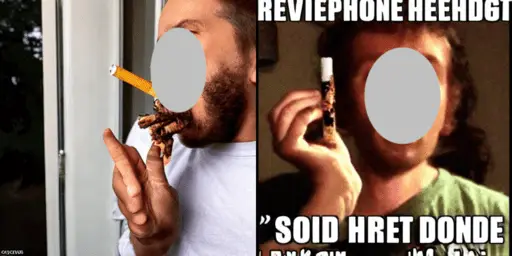                     |                                      | 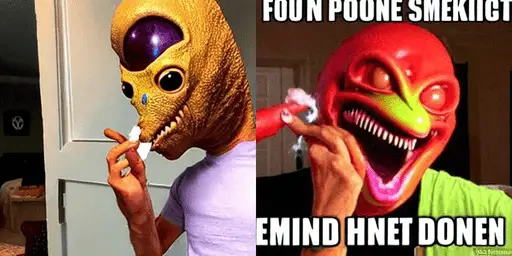                                |
|                                                                                  |                                                                                                  |                                                                                             |
| a spooky ghost in a graveyard by justin gerard and tony sart                     | greg rutkowski, zabrocki, karlkka, …, zenith view, zenith view, pincushion lens effect           | physical, house, aside, except, Grains, design, replica                                     |
|                      |                                      |                                 |
|                                                                                  |                                                                                                  |                                                                                             |
| a plane flies through the air with fumes coming out the back                     | Rephrase: a plane flies through the air with fumes coming …, trending on artstation              | car, crashes, land, …, breeze, departing, into, front, Grains, cold, monochrome, oversized  |
|                      |                                      |                                 |
|                                                                                  |                                                                                                  |                                                                                             |
| A man is seated on a floor with a computer and some papers.                      | intricate, elegant, highly detailed, …, illustration, by justin gerard and artger rutkowski, 8 k | female, was, standing, below, top, without, zero, …, emails, Blurry, bad, extra, proportion |
|                      |                                      | 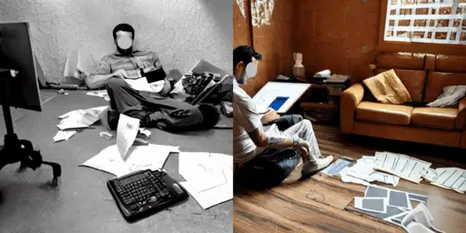                                |
|                                                                                  |                                                                                                  |                                                                                             |
| Orange and brown cat sitting on top of white shoes.                              | Trending on Artstation, …, 4k, 8k, unreal 5, very detailed, hyper control-realism.               | purple, however, black, crawling, …, socks, Cropped, background, inverted, shape            |
|                      | 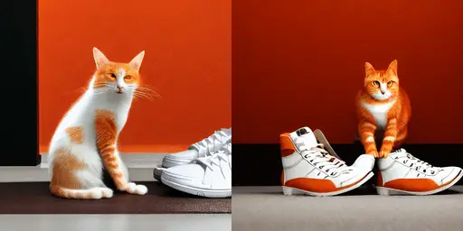                                     | 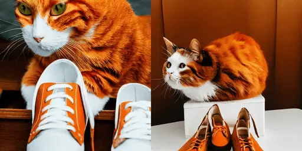                                |

Figure 7: More images generated by user input versus improved negative
prompts using Stable Diffusion v1-4.

|                                                                                              |                                                                                                           |
| -------------------------------------------------------------------------------------------- | --------------------------------------------------------------------------------------------------------- |
|                                                                                              |                                                                                                           |
| User Input                                                                                   | DPO-Diff - Adversarial Prompts                                                                            |
|                                                                                              |                                                                                                           |
| A cinematic scene from Berlin.                                                               | A cinematic shot from Metropolis.                                                                         |
| 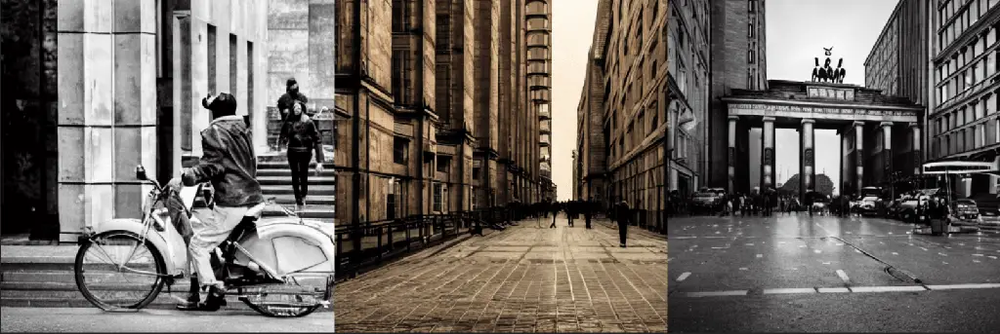                                 | 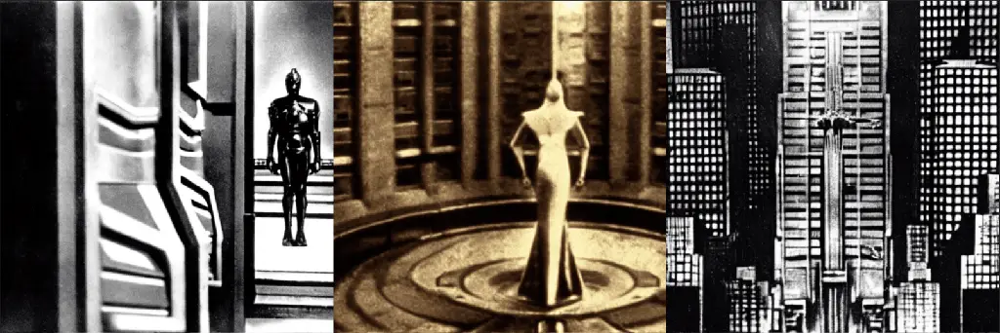                                              |
|                                                                                              |                                                                                                           |
| A painter adding the finishing touches to a vibrant canvas.                                  | A craftsman incorporating the finishing touches to a vivid masterpiece .                                  |
|                                  |                                               |
|                                                                                              |                                                                                                           |
| A skillful tailor sewing a beautiful dress with intricate details.                           | A skillful tailor tailoring a lovely attire with sophisticated elements .                                 |
|                                  | 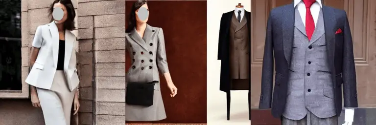                                              |
|                                                                                              |                                                                                                           |
| portrait of evil witch woman in front of sinister deep dark forest ambience                  | image of vile mage dame in front of threatening profound dim wilderness ambience                          |
|                                  | 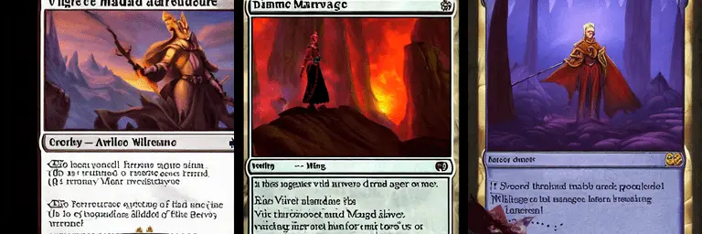                                              |
|                                                                                              |                                                                                                           |
| Amazing photorealistic digital concept art of a guardian robot in a rural setting by a barn. | astounding photorealistic digital theory design of a defender robot in a provincial context by a stable . |
| 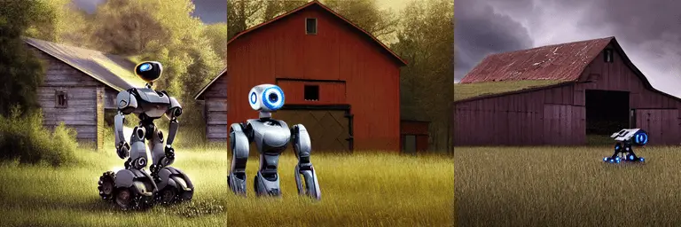                                 | 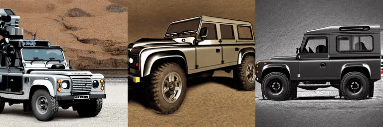                                              |
|                                                                                              |                                                                                                           |
| close up portrait of a young lizard as a wizard with an epic idea                            | close up snapshot of a youthful chameleon as a magician with an heroic guess                              |
| 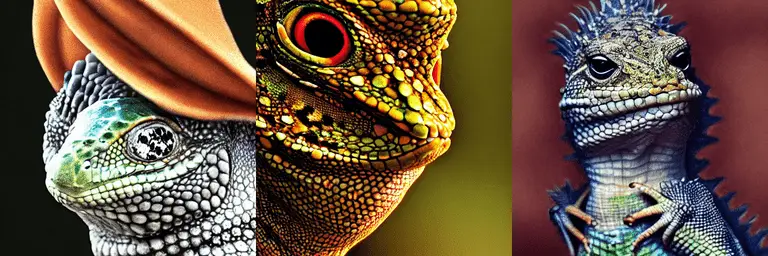                                 | 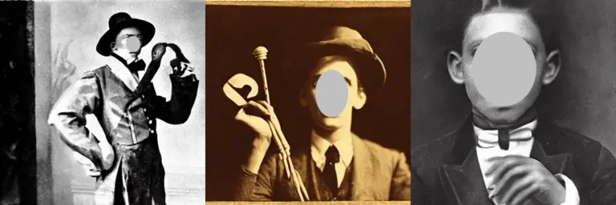                                              |

Figure 8: More images generated by user input and adversarial prompts
using Stable Diffusion v1-4.

## Appendix I Further discussion on Gradient-based Prompt Optimization

The computational cost of the Shortcut Text Gradient is controlled by
$`K`$. Moreover, when we set $`t=T`$ and $`K=T-1`$, it becomes the
full-text gradient.

The result of remark 2 is rather straightforward: recall that the image
generation process starts with a random noise $`x_{T}`$ and gradually
denoising it to the final image $`x_{0}`$. Since the gradient is enabled
from $`t`$ to $`t-K`$ in Shortcut Text Gradient; when $`t=T`$ and
$`K=T`$, it indicates that gradient is enabled from $`T`$ to $`0`$,
which covers the entire inference process. In this case, the Shortcut
Text Gradient reduces to the full gradient on text.

Figure 9: Gradient near the beginning and end of the inference process
are significantly less informative. We plot the average gradient norm
over all words across different timesteps. For each timestep, the
Shortcut Text Gradient is computed over 100 Gumbel samples.

## Appendix J Extra ablation study results.

### J.1 Gradient norm v.s. timestep.

When randomly sampling t in computing the Shortcut Text Gradient, we
avoid timesteps near the beginning and the end of the image generation
process, as gradients at those places are not informative. As we can
see, for both adversarial attack and prompt improvement, the gradient
norm is substantially smaller near $`t=T`$ and especially $`t=0`$,
compared with timesteps in the middle. The reason, we conjecture, is
that the images are almost pure noise at the beginning, and are almost
finalized towards the end. Figure 9 shows the empirical gradient norm
across different timesteps.

### J.2 Extended discussion on different search algorithms

In our experiments, we found that Gradient-based Prompt Optimization
converges faster at the early stage of the optimization. This result
confirms the common belief that white-box algorithms are more query
efficient than black-box algorithms in several other machine learning
fields, such as adversarial attack (Ilyas et al., 2018; Cheng et al.,
2018). However, when giving a sufficient amount of query, Evolutionary
Search eventually catches up and even outperforms GPO. The reason, we
conjecture, is that GPO uses random search to draw candidates from the
learned distribution, which bottlenecked its sample efficiency at later
stages. This promotes the hybrid algorithm used in our experiments:
Using Evolutionary Search to sample from the learned distribution of
GPO. The hybrid algorithm achieves the best overall convergence.

### J.3 Extended discussion on negative v.s. positive prompt optimization

As discussed in the main text, one of our highlighted findings of is
that optimizing for negative prompts is more effective than positive
prompts in improving the prompt-following ability of diffusion models.
This is evidenced by Table 2, which shows that Antonym Space contains a
denser population of promising prompts (lower clip loss) than positive
spaces. Such search space also allows the search algorithm to identify
an improved prompt more easily. We conjecture that this might indicate
diffusion models are more sensitive to changes in negative prompts than
positive prompts, as the baseline negative prompt is merely an empty
string.

|                                                                                  |                                                                                                                                                    |                                                                                                    |
| -------------------------------------------------------------------------------- | -------------------------------------------------------------------------------------------------------------------------------------------------- | -------------------------------------------------------------------------------------------------- |
|                                                                                  |                                                                                                                                                    |                                                                                                    |
| User Input                                                                       | Promptist - Modifiers                                                                                                                              | DPO-Diff - Negative Prompt                                                                         |
|                                                                                  |                                                                                                                                                    |                                                                                                    |
| a brown dachshund with a black cat sitting in a canoe.                           | highly detailed, digital painting, …, sharp focus, illustration, art by artgerm and greg rutkowski and epao                                        | zero, black, cat, lacking, green, horse, walking, beyond, house, Mutation, animals, error, surreal |
|                      |                                                                                        |                                        |
|                                                                                  |                                                                                                                                                    |                                                                                                    |
| darth vader in iron man armour                                                   | highly detailed, digital painting, …, illustration, art by greg rutkowski and alphonse mucha                                                       | yoda, outside, lightweight, exposed, Render, Script, incomplete, pieces                            |
| 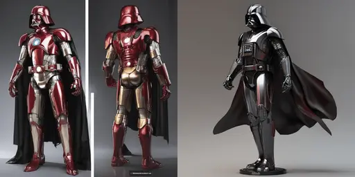                     |                                                                                        |                                        |
|                                                                                  |                                                                                                                                                    |                                                                                                    |
| The ash and dark pigeon was roosting on the lamppost, observing the environment. | intricate, elegant, highly detailed, digital painting, artstation, concept art, sharp focus, illustration, by justin gerard and art rutkowski, 8 k | green, clear, departing, ditch, inner, Mistake, CGI, cooked, replica                               |
| 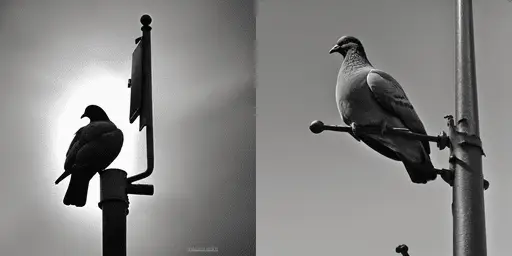                     |                                                                                        |                                        |
|                                                                                  |                                                                                                                                                    |                                                                                                    |
| a very big building with a mounted clock                                         | greg rutkowski, zabrocki, …, 8 k, ultra wide angle, zenith view, pincushion lens effect                                                            | mildly, tiny, detached, Logo, cityscape, inverted, stale                                           |
| 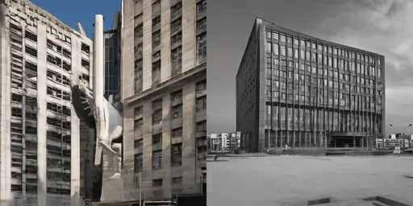                     |                                                                                        |                                        |
|                                                                                  |                                                                                                                                                    |                                                                                                    |
| The man is sitting on the bench close to the asian section.                      | greg rutkowski, zabrocki, karlkka, …, 8 k, ultra wide angle, zenith view, pincushion lens effect                                                   | girl, standing, under, ground, distant, unto, entirety, Mistake, black, engine, poorly             |
|                      |                                                                                        |                                        |
|                                                                                  |                                                                                                                                                    |                                                                                                    |
| Two sinks stand next to a bathtub in a bathroom.                                 | greg rutkowski, zabrocki, karlkka, jayison devadas, trending impervious                                                                            | one,soars, lie, multiple, kitchen, outside, bedroom, Blurry, artificial, down, poorly              |
|                      |                                                                                        |                                        |
|                                                                                  |                                                                                                                                                    |                                                                                                    |
| A woman that is standing next to a man.                                          | highly detailed, digital painting, artstation, …, art by greg rutkowski and alphonse mucha                                                         | male, crawling, away, far, several, woman, Mutation, characters, folded, username                  |
| 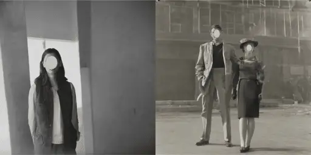                     |                                                                                        | 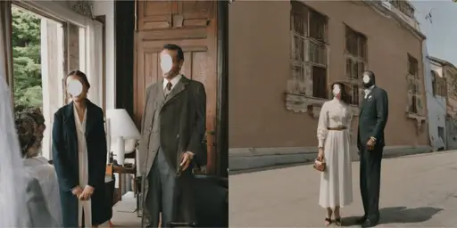                                       |

Figure 10: Images generated by user input and improved negative prompts
on Stable Diffusion XL.
