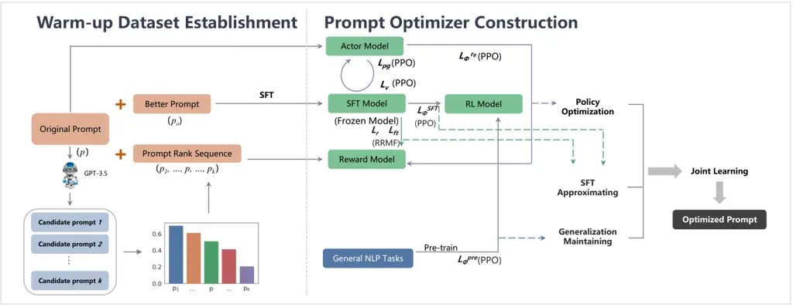

# MAPO: Boosting Large Language Model Performance with Model-Adaptive Prompt Optimization

Yuyan Chen Affiliation: Shanghai Key Laboratory of Data Science, School
of Computer Science, Fudan University Email: <chenyuyan21@m.>    Zhihao
Wen Affiliation: Singapore Management University Email: <zhixuli@>    Ge
Fan Affiliation: Tencent Email: <shawyh@fudan.edu.cn>    Zhengyu Chen
Email: <zhwen.2019@phdcs.smu.edu.sg>    Wei Wu Affiliation: Ant Group
Email: <ge.fan@outlook.com>    Dayiheng Liu
Email: <chenzhengyu@zju.edu.cn>    Zhixu Li Affiliation: Shanghai Key
Laboratory of Data Science, School of Computer Science, Fudan University
Email: <congyue.ww@antgroup.com>    Bang Liu
Email: <liudayiheng.ldyh@alibaba-inc.com>    Yanghua Xiao
Affiliation: Shanghai Key Laboratory of Data Science, School of Computer
Science, Fudan University Affiliation: Fudan-Aishu Cognitive
Intelligence Joint Research Center Email: <bang.liu@umontreal.ca>

###### Abstract

Prompt engineering, as an efficient and effective way to leverage Large
Language Models (LLM), has drawn a lot of attention from the research
community. The existing research primarily emphasizes the importance of
adapting prompts to specific tasks, rather than specific LLMs. However,
a good prompt is not solely defined by its wording, but also binds to
the nature of the LLM in question. In this work, we first quantitatively
demonstrate that different prompts should be adapted to different LLMs
to enhance their capabilities across various downstream tasks in NLP.
Then we novelly propose a model-adaptive prompt optimizer (MAPO) method
that optimizes the original prompts for each specific LLM in downstream
tasks. Extensive experiments indicate that the proposed method can
effectively refine prompts for an LLM, leading to significant
improvements over various downstream tasks.

## 1 Introduction

Advancements in Large Language Models (LLMs) have ushered in a
transformative era in natural language processing, showcasing their
remarkable capabilities across a wide range of tasks (OpenAI, 2023;
Bubeck et al., 2023; Lyu et al., 2019). While these models possess
human-like comprehension and response abilities, their performance is
heavily influenced by the quality of prompts. As can be observed in
Fig. 1, answers from different LLMs vary widely when they are provided
with the same task-specific prompts. Therefore, it is necessary to
generate prompts that are most suitable for each LLM, thereby enhancing
its performance on downstream tasks.

Figure 1: Variance on answers from different LLMs (b) when they are
given the same task-specific prompts (a).

A common practice towards prompt optimization is to count on human
expertise (White et al., 2023; Jiang et al., 2022; Zamfirescu-Pereira
et al., 2023). While effective, such approaches are costly and
unscalable. Hence, there has been a lot of effort to streamline the
prompt optimization process through automated or semi-automated ways,
including prompt retrieval (Ma et al., 2023; Zhou et al., 2022), prompt
generation from scratch (Pang et al., 2023), and prompt editing (Gao
et al., 2020; Pryzant et al., 2023; Deng et al., 2022). For example, in
prompt retrieval, Ma et al. (2023) propose a search strategy based on
greedy search to identify near-optimal prompts for in-context learning;
in prompt generating from scratch, Pang et al. (2023) introduce SharpT,
which learns a shared latent space and generates soft prompts using a
lightweight prompt generator; in prompt editing, some approaches rely on
reinforcement learning or LLM-based feedback for prompt
optimization (Deng et al., 2022; Zhou et al., 2022).

Figure 2: The performance of different LLMs on task-specific prompts for
three tasks: question-answering (a), classification (b), and generation
(c). The results reveal significant variations across different LLMs’
performance.

However, the aforementioned research primarily emphasizes the importance
of adapting prompts to specific tasks, rather than specific LLMs. The
latter, although very important, has not been studied to date in NLP.
The only relevant work so far has been done on multi-modal large models,
which automatically optimizing prompts using reinforcement learning to
generate images based on text (Hao et al., 2022). They underscore the
concept of “model-preferred prompts” or “model-specific prompts”,
emphasizing that there’s a need for a systematic method to automatically
align user intentions with the specific prompt preferences of each
model (Lyu et al., 2024). Therefore, in this paper, we novelly propose a
Model-Adaptive Prompt Optimization (i.e. MAPO) approach for LLMs in NLP.
Given the lack of effective training signals, we first establish a
so-called warm-up dataset to obtain candidate prompts from an oracle
LLM, and then model the prompt optimization problem with reinforcement
learning. Specifically, we first generate candidate prompts and search
for the optimal prompts to establish a warm-up dataset. After that, we
combine Supervised Fine-Tuning (SFT) and Reinforcement Learning (RL) to
optimize original prompts for each specific LLM in various downstream
tasks. Moreover, we make joint learning with Proximal Policy
Optimization (PPO)  (Schulman et al., 2017) and RRMF (note that RRMF is
inspired by RRHF (Yuan et al., 2023)), to further improve the
performance of RL. We conduct extensive experiments which validates the
robustness and generalization of the proposed MAPO. To sum up, our main
research question revolves around identifying the optimal prompt that is
suited for various models. Our contributions are threefold:

- •
  We are the first to quantitatively show that different prompts should
  be adapted to different Large Language Models (LLMs) in order to
  enhance their performance across various NLP downstream tasks.
- •
  We introduce a novel approach called the Model-Adaptive Prompt
  Optimizer (MAPO), specifically designed to optimize the original
  prompts for each particular LLM in downstream tasks.
- •
  The experiments show that our proposed MAPO model exhibits greater
  robustness and generalization and also achieves superior performance
  in a variety of downstream tasks.

## 2 Empirical study

In this section, we conduct empirical study on three LLMs
(BLOOM-7B (Scao et al., 2022), GPT-J-6B (Wang and Komatsuzaki, 2021),
and LLaMA-7B (Scao et al., 2022)) to evaluate their separate performance
on question-answering (QA) (Chen et al., 2024b; Chen et al., 2023b),
classification (Chen et al., 2023c; Chen et al., 2023a), and
generation (Chen et al., 2022; Chen et al., 2024a; Chen et al., 2023d)
tasks with same task-specific prompts. We use nine dataset from P3 (Sanh
et al., 2021) covering three downstream tasks with details in
Appendix E. P3 is a widely-used prompt benchmark which contains original
prompts and the corresponding ground-truth answers. We adopt F1 score,
accuracy and ROUGE-L for QA, classification, and generation tasks,
respectively. The visualization results are shown in the Fig. 2. From
the violin plot, we observe significant variations in distribution among
different LLMs in each task. For example, in the generation task, the
results of all three models are distributed within the range of 0 to
0.5, but there are still differences in the specific distribution
patterns. Moreover, the medians, means, and other statistical measures
also differ greatly among three LLMs in each downstream task. Therefore,
we consider that finding the optimal prompt for each specific LLM on
each task is meaningful, as it can help enhance the LLMs’ performance on
various downstream tasks.

## 3 Methods

Based on the above empirical study, we present MAPO, a model-adaptive
prompt optimization approach for LLMs. It takes the original prompt as
input and generate an optimized prompt which makes an LLM give better
outputs. The framework of MAPO is shown in Fig. 3.



Figure 3: Framework of the proposed MAPO, including warm-up dataset
establishment and prompt optimizer construction.

### 3.1 Warm-up Dataset Establishment

We first establish a warm-up dataset as training dataset for prompt
optimization.

Generating Candidate Prompts. The original prompts are from nine
above-mentioned datasets in P3 (Sanh et al., 2021). We generate 1,000
candidate prompts per prompt using GPT-3.5 ¹¹ 1
https://chat.openai.com/. The generated candidate prompts should
maintain semantic meaning similar to the original prompt but may have
different expressions. To achieve this, we use the following instruction
as input for GPT-3.5 to generate candidates: “Please rewrite the given
text ‘original prompt’ while keeping the semantic meaning unchanged.”.
Some candidate prompts are shown in Appendix A.

Searching for the Optimal Prompt. To determine which candidate prompt is
optimal for an original prompt, we compare the match degree, which
refers to the similarity, between the outputs generated using a
candidate prompt and the ground truth output. The purpose is to identify
the candidate prompt that produces an output most similar to the ground
truth output. When a ground-truth output is not available, the output of
a stronger LLM, such as GPT-3.5, is regarded as the ground-truth.
Specifically, first, we input the original prompt $`P`$ and each
candidate prompt into an LLM, respectively, for inference and obtain the
corresponding outputs. Next, we compare the match degree with specified
evaluation metrics. We adopt F1 score, accuracy, and ROUGE-L (Lin, 2004)
for QA, classification, and generation tasks, respectively. Based on
these metrics, we iterate the searching process and find the optimal
prompt $`P_{o}`$ for an LLM in downstream tasks. The warm-up dataset
consists of a collection of prompt pairs (referred to as
$`\{P,P_{o}\}`$), whose distribution is shown in Table 1.

|       |         |               |             |              |
| ----- | ------- | ------------- | ----------- | ------------ |
| Tasks | Dataset | Train (Pairs) | Val (Pairs) | Test (Pairs) |
| QA    | AdverQA | 10000         | 1000        | \-           |
|       | OpenQA  | 4957          | 500         | 500          |
|       | CloseQA | 11679         | 1000        | 1000         |
| Class | News    | 120000        | \-          | 7600         |
|       | Movie   | 8530          | 1066        | 1066         |
|       | QASC    | 8134          | 926         | 920          |
| Gen   | Topics  | 67389         | 4018        | 1497         |
|       | Summary | 14732         | 818         | 819          |
|       | Explan  | 9741          | 1221        | \-           |

Table 1: The amount of the warm-up dataset on various downstream tasks.

### 3.2 Prompt Optimizer Construction

The prompt optimizer seeks to refine the initial prompt ($`P`$) into an
optimized prompt ($`P_{o}`$) tailored to a particular LLM. This
refinement process entails altering the structure or wording of $`P`$ to
produce $`P_{o}`$, which is more suitable for the LLM in subsequent
tasks.

#### 3.2.1 Supervised Fine-tuning

We begin by employing the warm-up dataset to conduct supervised
fine-tuning (SFT) with an LLM across multiple downstream tasks. The
objective of SFT is to enhance the LLM’s capacity to generate responses
that align with its preferences, utilizing annotated data. Prior
research conducted by  Ramamurthy et al. (2022) supports the notion that
employing SFT prior to reinforcement learning (RL) leads to improved
outcomes. Furthermore, to differentiate between specific tasks during
training, we incorporate a brief instruction preceding the input, such
as “This is a… (generative/question-answering/classification) task.”.

#### 3.2.2 Building Reward Model

Next, we construct a reward model to learn the effectiveness of prompts
based on the preferences of different LLMs. This approach is motivated
by the fact that discriminative annotation through sorting incurs
significantly lower costs compared to generating annotations for
answers. Initially, we obtain a ranking sequence for an LLM in a
specific downstream task. We sort the outputs generated by candidate
prompts $`\{P_{1},P_{2},\ldots,P_{k-1},P_{k}\}`$ alongside the original
prompt $`P`$, using the same evaluation metric as described in Sec. 3.1.
This sorting process yields a ranking sequence
$`\{P_{1},P_{2},\ldots,P,P_{k-1},P_{k}\}`$. Prompts to the left of $`P`$
exhibit poorer inference results, while prompts to the right demonstrate
better results. Next, we employ the ranking sequence to train a reward
model. We utilize the same LLM utilized in the SFT process (referred to
as $`\hat{\text{LLM}}`$) and replace the softmax layer with a linear
layer to construct the reward model. The reward model takes a prompt as
input and produces a scalar score indicating the quality of the prompt.
We form pairwise ranking pairs by combining prompts from the ranking
sequence and employ Pairwise Ranking Loss for training, as illustrated
below:

```math
\displaystyle\begin{split}L_{\theta}=-\frac{1}{\binom{k}{2}}E_{(x,y_{w},y_{l})\sim D}\\
[log(\sigma(r_{\theta}(x,y_{w})-r_{\theta}(x,y_{l}))],\end{split} \tag{1}
```

where $`x`$ represents the original prompt, $`y_{w}`$ and $`y_{l}`$
denote the higher-scoring and lower-scoring prompts, respectively, in
the corresponding ranking pair. $`r_{\theta}`$ represents the scalar
output of the reward model, $`D`$ is the set of ranking pairs, and $`K`$
denotes the number of candidate prompts. Through this process, based on
the outputs generated by $`\hat{\text{LLM}}`$ with the given prompt, the
reward model learns to assign higher scores (rewards) to better prompts
and lower scores (rewards) to inferior prompts, thus imitating an LLM’s
preferences.

#### 3.2.3 Reinforcement Learning

Subsequently, we employ Reinforcement Learning (RL) to further fine-tune
LLMs. RL is used to adjust the bias in the reward model’s scoring since
the distribution of generated prompts might change during the SFT
process. The primary objective of optimization is to maximize the scores
of prompts generated by $`\hat{\text{LLM}}`$ after SFT (referred to as
the SFT model), as evaluated by the reward model. To achieve this, we
utilize a combination of Proximal Policy Optimization (PPO) (Schulman
et al., 2017) and RRMF algorithms (note that RRMF is inspred by RRHF
(Yuan et al., 2023)) for joint learning.

Policy Optimization. This step aims to optimize the RL policy to improve
the performance of the RL model. We first adopt the datasets shown in
Table 3, which to construct environment-action pairs. The environment
refers to the original prompt, and the action represents the prompt
generated by $`\hat{\text{LLM}}`$ without instruct-tuning. We pass the
environment-action pairs to the reward model to obtain rewards. In this
process, we introduce an actor model, which is $`\hat{\text{LLM}}`$, and
a frozen model, which is SFT model with its parameters frozen during the
RL training process. The frozen model serves as a benchmark to evaluate
whether the updated actor model has advantages over it. We then
calculate the policy gradient loss (i.e., actor’s loss) based on the
importance ratio and reward
$`(r+\gamma V_{\text{next}}-V_{\text{cur}})`$, and calculate the value
loss (i.e., critic’s loss) by comparing the predicted value
$`V_{\text{pred}}`$ with the true value $`(r+V_{\text{next}})`$ as
follows:

```math
\displaystyle L_{\text{pg}}=\frac{P_{\pi_{\text{a}}}(t)}{P_{\pi_{\text{f}}}(t)}(r+\gamma V_{\text{next}}-V_{\text{cur}}), \tag{2}
```

```math
\displaystyle L_{\text{v}}=\|V_{\text{pred}}-(r+V_{\text{next}})\|. \tag{3}
```

Here, $`\frac{P_{\pi_{\text{a}}}(t)}{P_{\pi_{\text{f}}}(t)}`$ represents
the ratio of probabilities (i.e., importance ratio) of generating the
same token under the actor model and the frozen model.
$`(r+\gamma V_{\text{next}}-V_{\text{cur}})`$ represents the reward of
the current step. $`V_{\text{pred}}`$ denotes the predicted value, and
$`(r+V_{\text{next}})`$ denotes the true value.

Next, we maximize the mathematical expectation of the reward model,
aiming to consistently generate prompts that $`\hat{\text{LLM}}`$
perceives as the best in the RL-trained SFT model (referred to as RL
model). We feed prompts $`x`$ generated by the SFT model based on the
datasets shown in Table 3 (i.e., $`D`$) into the RL model
$`\pi_{\phi}^{RL}`$ to obtain an optimized prompt $`y`$. $`y`$ changes
every time the RL model is updated. We then input $`(x,y)`$ into the
reward model $`r_{\theta}`$ and calculate a score (i.e., reward), which
represents the real-time feedback from the reward model. The loss
function is defined as follows:

```math
\displaystyle L_{\phi}^{r_{\theta}}=E(x,y)\sim D_{\pi_{\phi}^{RL}}[r_{\theta}(x,y)]. \tag{4}
```

Finally, we combine the above loss functions to optimize the RL policy
from multiple perspectives. The final loss function is defined as:

```math
\displaystyle L_{\rho}=\alpha_{1}L_{\text{pg}}+\alpha_{2}L_{\text{v}}+\alpha_{3}L_{\phi}^{r_{\theta}}, \tag{5}
```

where $`\alpha_{1}`$, $`\alpha_{2}`$, and $`\alpha_{3}`$ represent the
optimal weights of each function, which are determined through
experiments (the same applies below).

SFT Approximating. This step aims to maintain similarity between the RL
model and the SFT model. When the RL model undergoes parameter updates,
it leads to variations in the generated prompt $`y`$ based on the given
prompt $`x`$. If there is a significant discrepancy between the RL model
and the SFT model, it can result in inaccurate estimation of scores by
the reward model. To address this issue, we measure the distance between
the prompts generated by the RL model and the SFT model using
Kullback-Leibler (KL) divergence. The objective is to minimize the KL
divergence and the loss function is defined as follows:

```math
\displaystyle L_{\phi}^{SFT}=-\beta log(\pi_{\phi}^{RL}(y|x)/\pi^{SFT}(y|x)). \tag{6}
```

where $`\pi_{\phi}^{RL}(y|x)`$ and $`\pi^{SFT}(y|x)`$ represent prompts
generated by RL model and the SFT model, respectively.

Next, we have borrowed the idea from RRHF (Yuan et al., 2023) but adapt
it to focus on “model feedback” instead of “human feedback”. We name it
Ranking Responses from Model Feedback (RRMF). Specifically, we calculate
the likelihood probability of $`\hat{\text{LLM}}`$ during SFT and align
this probability with the score of the reward model. To optimize this
objective, we employ supervised learning with a rank loss, defined as
follows:

```math
\displaystyle p_{i}=\frac{\sum\log P_{\pi}(y_{i}|x,y_{i})}{\|y_{i}\|}, \tag{7}
```

```math
\displaystyle L_{\text{r}}=\sum_{r_{i}<r_{j}}max(0,p_{i}-p_{j}), \tag{8}
```

where $`p_{i}`$ is the conditional log probability which represents the
reward of each optimized prompt $`y_{i}`$. $`r_{i}`$ represents the
reward model $`r_{\theta}(x,y_{i})`$. We also incorporate the
cross-entropy loss introduced by RRHF (Yuan et al., 2023) to learn the
generated prompts $`y_{i}^{\prime}`$ with the highest reward
$`r_{i}^{\prime}`$ as follows:

```math
\displaystyle L_{ft}=-\Sigma logP_{\pi}(y_{i}^{\prime}|x,y_{i}^{\prime}). \tag{9}
```

Finally, we combine the above loss functions for SFT approximating as
follows:

```math
\displaystyle L_{SFT}=\beta_{1}L_{\phi}^{SFT}+\beta_{2}L_{ft}+\beta_{3}L_{\text{r}}. \tag{10}
```

Generalization Maintaining. This step addresses the issue of
catastrophic forgetting by ensuring that an LLM performs well not only
on specific tasks but also on general NLP tasks. To achieve this, we
follow a similar approach as outlined in InstructGPT (Ouyang et al.,
2022). We sample 10% data from general NLP tasks in GLUE (Wang et al., 2018) and the SuperGLUE benchmark (Wang et al., 2019), which are
considered representative, as indicated in Table 3, during the
pre-training phase. The objective of pre-training is to generate outputs
that are as good as or better than the original one based on the
original prompts. The original prompts are taken from Natural
Instructions (Wang et al., 2022b). The loss function is as follows:

```math
\displaystyle L_{Pre}=\gamma E_{x}\sim D_{pretrain}[log(\pi_{\phi}^{RL}(x))], \tag{11}
```

where $`D_{pretrain}`$ represents the selected datasets for
pre-training.

Joint learning. Finally, we make joint learning with the above-mentioned
loss functions as follows:

```math
\displaystyle L_{\phi}=\gamma_{1}L_{\rho}+\gamma_{2}L_{SFT}+\gamma_{3}L_{Pre}. \tag{12}
```

## 4 Experiments

In this section, We conduct experiments with three popular LLMs as
$`\hat{\text{LLM}}`$, respectively, including BLOOM (7B), GPT-J (6B),
and LLaMA (7B), on different downstream tasks to validate the
effectiveness of MAPO.

### 4.1 Experimental Setups

The experiments are executed on 4 Nvidia A100 GPUs with 80GB each, using
PyTorch in Python. DeepSpeed ²² 2 https://github.com/microsoft/DeepSpeed
is utilized in the training process. The maximum sequence length for
original prompts and optimized prompts are both set to 512 tokens. The
number of epochs is set to 20 in the entire training process. We provide
the detailed configuration of the hyperparameters in Appendix B. The
dataset and metrics we utilize are the same as those described in
Sec. 2. All results are reported on the corresponding test sets or 10%
dev sets if a dataset does not have a test set. Details of all used
baselines and datasets are in Appendix D and  E.

### 4.2 Main Results

The main results are shown in Table 2. We observe that the performance
increase evidently among all LLMs during SFT. We then utilize MAPO to
make further optimization. We find the optimized prompts generated by
MAPO are more adaptive in QA and generation task for BLOOM (increase by
20.5% for CloseQA and by 30.9% for Explan compared with SFT (p\<0.01))
and GPT-J (increase by 21.4% for CloseQA and by 20.6% for Explan
compared with SFT (p\<0.01)). And the prompts are more adaptive in
classification task (increase by 22.8% for News (p\<0.01)) for LLaMA.
These results indicate that MAPO effectively enhances the performance of
various LLMs and exhibits preferences in different downstream tasks.

|      |         |          |       |       |                        |                        |                        |                            |                         |                        |                        |                            |
| ---- | ------- | -------- | ----- | ----- | ---------------------- | ---------------------- | ---------------------- | -------------------------- | ----------------------- | ---------------------- | ---------------------- | -------------------------- |
| Task | Dataset | Original |       |       | SFT-optimized          |                        |                        | $`\overline{\uparrow}`$(%) | MAPO-optimized          |                        |                        | $`\overline{\uparrow}`$(%) |
|      |         | BLOOM    | GPT-J | LLaMA | BLOOM($`\uparrow`$(%)) | GPT-J($`\uparrow`$(%)) | LLaMA($`\uparrow`$(%)) |                            | BLOOM ($`\uparrow`$(%)) | GPT-J($`\uparrow`$(%)) | LLaMA($`\uparrow`$(%)) |                            |
| QA   | AdverQA | 13.5     | 3.0   | 3.2   | 18.3 (35.6)            | 9.4 (213.3)            | 23.2 (625.0)           | 291.3                      | 19.5 (6.6)              | 11.0 (17.0)            | 25.1 (8.2)             | 10.6                       |
|      | OpenQA  | 25.9     | 17.0  | 13.3  | 26.7 (3.1)             | 20.3 (19.4)            | 15.4 (15.8)            | 12.8                       | 27.2 (1.9)              | 21.0 (3.4)             | 16.1 (4.5)             | 3.3                        |
|      | CloseQA | 6.4      | 6.9   | 10.8  | 7.8 (21.9)             | 8.4 (21.7)             | 13.9 (28.7)            | 24.1                       | 9.4 (20.5)              | 10.2 (21.4)            | 14.8 (6.5)             | 16.1                       |
| CLS  | News    | 92.8     | 0.0   | 1.1   | 95.5 (2.9)             | 5.5 (-)                | 10.1 (818.2)           | \-                         | 98.7 (3.4)              | 6.3 (14.5)             | 12.4 (22.8)            | 13.6                       |
|      | Movie   | 90.9     | 51.1  | 78.7  | 92.6 (1.9)             | 52.7 (3.1)             | 81.3 (3.3)             | 2.8                        | 93.3 (0.8)              | 53.9 (2.3)             | 82.5 (1.5)             | 1.5                        |
|      | QASC    | 99.4     | 54.0  | 61.6  | 99.9 (0.5)             | 56.3 (4.3)             | 70.2 (14.0)            | 6.2                        | 99.9 (0.0)              | 56.8 (0.9)             | 72.8 (3.7)             | 1.5                        |
| GEN  | Topics  | 29.5     | 17.5  | 14.3  | 34.8 (18.0)            | 21.6 (23.4)            | 18.6 (30.1)            | 23.8                       | 36.2 (4.0)              | 23.4 (8.3)             | 19.5 (4.8)             | 5.7                        |
|      | Summary | 46.1     | 13.1  | 6.6   | 48.8 (5.9)             | 16.7 (27.5)            | 10.7 (62.1)            | 31.8                       | 50.2 (2.9)              | 17.8 (6.6)             | 12.2 (14.0)            | 7.8                        |
|      | Explan  | 5.7      | 8.5   | 6.9   | 6.8 (19.3)             | 10.7 (25.9)            | 8.2 (18.8)             | 21.3                       | 8.9 (30.9)              | 12.9 (20.6)            | 9.1 (11.0)             | 20.8                       |

Table 2: Performance is evaluated for BLOOM, GPT-J, and LLaMA using
original, SFT-optimized, and MAPO-optimized prompts with a frozen LLM
during inference. The symbols $`\uparrow`$(%) and
$`\overline{\uparrow}`$(%) under SFT-optimized denote the relative
increase from original prompts, while those under MAPO-optimized
indicate improvement over SFT-optimized results. It’s emphasized that
the term “frozen LLM for inference” means the model hasn’t been trained
directly on downstream tasks but only makes inferences. Thus, there’s no
training data with prompts as inputs and expected responses as outputs.
“CLS” represents classification, and “GEN” stands for generation tasks.

To validate the superiority of MAPO, we compare it with several SOTA
prompt optimization baselines in various popular tasks based on the same
setting Roberta-Large, as shown in Table 3. The reported results
represent the best-performing LLM among the three LLMs, which indicates
that our method applies not only to LLMs but also to smaller LMs. We
analyze the possible reasons as follows: MAPO employs both SFT and RL to
optimize LLMs. In fact, the SFT process is not specific to LM.
Fine-tuning smaller models is feasible and common, requiring fewer
computational resources. RL is a widely-used algorithm across
applications and model scales, and small models require less
computational and storage resources, making RL more feasible on them.

|     |              |       |        |      |      |      |      |      |      |      |
| --- | ------------ | ----- | ------ | ---- | ---- | ---- | ---- | ---- | ---- | ---- |
|     |              | SST-2 | YelpP. | MR   | CR   | RTE  | QNLI | SNLI | MNLI | MRPC |
| F   | Finetuning   | 80.6  | 88.7   | 67.4 | 73.3 | 58.6 | 60.2 | 54.6 | 47.8 | 77.4 |
| C   | Softprompt   | 73.8  | 88.6   | 74.1 | 75.9 | 54.7 | 49.7 | 36.1 | 33.2 | 51.6 |
|     | Black-Box    | 89.1  | 93.2   | 86.6 | 87.4 | 52.6 | 48.8 | 46.6 | 42.9 | 61.6 |
|     | Autoprompt   | 75    | 79.8   | 62   | 57.5 | \-   | \-   | \-   | \-   | \-   |
| D   | Manual       | 82.8  | 83     | 80.9 | 79.6 | 51.6 | 50.8 | 31.1 | 51.7 | 67.4 |
|     | In-Context   | 85.9  | 89.6   | 80.6 | 85.5 | 60.4 | 53.8 | 47.1 | 53.4 | 45.8 |
|     | Instructions | 89    | 84.4   | 85.2 | 80.8 | \-   | \-   | \-   | \-   | \-   |
|     | GrIPS        | 87.1  | 88.2   | 86.1 | 80   | \-   | \-   | \-   | \-   | \-   |
|     | RLprompt     | 92.5  | 95.1   | 87.1 | 89.5 | \-   | \-   | \-   | \-   | \-   |
|     | TEMPERA      | 91.9  | 92.6   | 88   | 91.1 | 60.3 | 57.4 | 56.4 | 45.2 | 74   |
|     | AMA          | 95.7  | \-     | \-   | \-   | 75.1 | \-   | \-   | \-   | \-   |
|     | SFT          | 94.9  | 92     | 88.5 | 87.6 | 74.3 | 62.5 | 58.8 | 54.6 | 78.5 |
|     | MAPO-w/o g   | 96.0  | 93.3   | 90.1 | 88.7 | 75.2 | 63.0 | 59.8 | 55.7 | 79.0 |
| D   | MAPO         | 96.1  | 93.5   | 90.2 | 88.9 | 75.3 | 63.1 | 60.0 | 55.7 | 79.3 |

Table 3: The few-shot performance of SFT, MAPO with SOTA prompt
optimizing baselines in downstream tasks. F: Finetuning, C: Continous
prompt, D: Discrete prompt.

We also test the performance of MAPO with the above-mentioned SOTA
prompt optimization baselines. We use three LLMs, including BLOOM,
GPT-J, and LLaMA, to replace the BART model used in Table 3 for
verifying the nine datasets in Table 2, as shown in Table 4. Due to SFT
in LLMs equals fine-tuning pretrained language models, we directly list
the SFT results in the Fine-tuning row. Apart from Fine-tuning, we also
freeze the LLMs and only modify the prompts for inference on downstream
tasks. According to the experimental results, the performance of almost
all baselines, except RLprompt, does not exceed that of Fine-tuning
/SFT, and some even do not outperform the original LLMs. This highlights
the importance of SFT in LLMs. When we add RL, as in the case of
RLprompt, the performance on downstream tasks surpasses that of SFT,
indicating the significance of RL for prompt optimization. Moreover,
using our proposed MAPO method to optimize the prompt further improves
performance over RLprompt, except in a very few cases, such as using
BLOOM for movie classification tasks. These experimental results
demonstrate that the MAPO method proposed in this study makes a
substantial contribution to improving the performance and accuracy in
downstream tasks.

Moreover, we conduct experiments to evaluate the domain transfer
performance of MAPO. The results are presented in Table 5 and Table 6,
while the results of LLMs with original prompts are reported by  Arora
et al. (2022). Remarkably, we observe that each LLM, when using prompts
optimized by MAPO, displays improved performance across various
downstream tasks. Specifically, BLOOM exhibits the highest increase in
performance compared with GPT-J and LLaMA. This experiment clearly
demonstrates the significant domain transfer capability of MAPO.

### 4.3 Ablation Study

The effect of RL compared with SFT. From the experiments (Table 3,
Table 5 and Table 6), we can observe that the performance improvements
gained solely from using SFT are less than half of those achieved by our
proposed MAPO method, both on similar tasks and general NLP tasks. This
clearly indicates the effectiveness of MAPO in optimizing model-adaptive
prompts.

In order to further demonstrate RL is necessary and how it compares to
simply extending SFT with a larger warm-up dataset, we use various
proportions of the warm-up dataset to progressively increase the SFT
training data and then introduce RL to it as shown in Table 17. Our
findings consistently show that RL adds value to the performance beyond
what is achieved by SFT alone across all proportions of the dataset.
This affirms the effectiveness of RL irrespective of the SFT dataset
size. However, as the proportion of the warm-up dataset increases, the
margin of improvement from adding RL begins to decline. While one could
hypothesize that adding RL to a very large SFT dataset might not result
in as significant an improvement as it would for a smaller dataset, this
observation actually underscores our method’s suitability for
low-resource scenarios.

Moreover, we have tried different number of epochs to see if extended
training time consistently improves SFT performance as shown in
Table 18. Extending the training time does not consistently lead to
performance improvements for SFT. In some instances, the performance
even declines. We also find that some peak performance does not
necessarily occur at the final epoch.

|         |                |      |      |      |      |      |      |      |      |      |
| ------- | -------------- | ---- | ---- | ---- | ---- | ---- | ---- | ---- | ---- | ---- |
|         | Task           | QA   |      |      | CLS  |      |      | GEN  |      |      |
|         |                | Ad   | Op   | Cl   | Ne   | Mo   | QA   | To   | Su   | Ex   |
| (BLOOM) | Original       | 13.5 | 25.9 | 6.4  | 92.8 | 90.9 | 99.4 | 29.5 | 46.1 | 5.7  |
| F       | Finetuning/SFT | 18.3 | 26.7 | 7.8  | 95.5 | 92.6 | 99.9 | 34.8 | 48.8 | 6.8  |
| C       | Soft prompt    | 14.5 | 24.5 | 6.5  | 92.1 | 90.5 | 99.1 | 30.1 | 44.6 | 5.5  |
|         | Black-Box      | 15.2 | 24.7 | 6.9  | 93.3 | 91.6 | 99.3 | 31.2 | 45.7 | 5.8  |
|         | Autoprompt     | 15.7 | 25.0 | 7.1  | 93.6 | 91.9 | 99.4 | 31.6 | 46.0 | 6    |
| D       | Manual         | 13.7 | 24.6 | 6.8  | 91.8 | 90.9 | 99.0 | 31.5 | 45.1 | 5.7  |
|         | In-Context     | 13.9 | 24.7 | 6.7  | 91.6 | 90.9 | 99.3 | 31.8 | 45.6 | 5.9  |
|         | Instructions   | 15.0 | 24.9 | 6.7  | 92.7 | 91.0 | 99.2 | 30.8 | 45.5 | 5.8  |
|         | GrIPS          | 16.6 | 25.3 | 6.8  | 93.1 | 91.2 | 99.4 | 31.8 | 46.7 | 6.2  |
|         | RLprompt       | 19.2 | 26.9 | 8.9  | 97.5 | 94.1 | 99.9 | 35.9 | 49.1 | 8.2  |
|         | TEMPERA        | 17.4 | 25.5 | 7.2  | 94.6 | 91.7 | 99.5 | 33.1 | 46.7 | 6.2  |
|         | AMA            | 19.1 | 26.4 | 7.6  | 95.1 | 92.4 | 99.4 | 33.5 | 47.9 | 6.1  |
| D       | MAPO           | 19.5 | 27.2 | 9.4  | 98.7 | 93.3 | 99.9 | 36.2 | 50.2 | 8.9  |
| (GPT-J) | Original       | 3.0  | 17.0 | 6.9  | 0.0  | 51.1 | 54   | 17.5 | 13.1 | 8.5  |
| F       | Finetuning/SFT | 9.4  | 20.3 | 8.4  | 5.5  | 52.7 | 56.3 | 21.6 | 16.7 | 10.7 |
| C       | Soft prompt    | 5.4  | 16.6 | 6.8  | 2.1  | 51.0 | 54.5 | 17.8 | 13.7 | 8.9  |
|         | Black-Box      | 7.3  | 17.5 | 7.2  | 2.5  | 51.4 | 54.7 | 18.2 | 14.3 | 9.1  |
|         | Autoprompt     | 7.8  | 17.9 | 7.3  | 1.9  | 51.5 | 54.6 | 19.1 | 14.6 | 9.3  |
| D       | Manual         | 5.7  | 15.9 | 6.5  | 1.7  | 50.9 | 54.9 | 18.7 | 13.9 | 9.5  |
|         | In-Context     | 5.6  | 16.5 | 6.7  | 1.6  | 50.7 | 54.6 | 19.2 | 14.0 | 9.3  |
|         | Instructions   | 7.1  | 17.1 | 7.2  | 1.7  | 51.6 | 54.0 | 19.1 | 14.3 | 9.2  |
|         | GrIPS          | 7.7  | 17.9 | 7.7  | 4.3  | 52.1 | 55.6 | 19.7 | 16.4 | 10.3 |
|         | RLprompt       | 10.1 | 20.0 | 9.5  | 5.7  | 53.7 | 56.4 | 22.1 | 17.2 | 11.8 |
|         | TEMPERA        | 9.5  | 19.3 | 9.1  | 4.8  | 53.2 | 56.1 | 22.3 | 16.8 | 11.4 |
|         | AMA            | 9.6  | 19.1 | 8.8  | 5.0  | 52.9 | 56.3 | 22.4 | 16.5 | 11.6 |
| D       | MAPO           | 11.0 | 21.0 | 10.2 | 6.3  | 53.9 | 56.8 | 23.4 | 17.8 | 12.9 |
| (LLaMA) | Original       | 3.2  | 13.3 | 10.8 | 1.1  | 78.7 | 61.6 | 14.3 | 6.6  | 6.9  |
| F       | Finetuning/SFT | 23.2 | 15.4 | 13.9 | 10.1 | 81.3 | 70.2 | 18.6 | 10.7 | 8.2  |
| C       | Soft prompt    | 7.7  | 12.6 | 10.2 | 4.4  | 77.4 | 62.7 | 15.6 | 8.2  | 7.3  |
|         | Black-Box      | 9.2  | 13.3 | 10.7 | 5.6  | 78.1 | 63.1 | 16.2 | 8.4  | 7.5  |
|         | Autoprompt     | 10.3 | 13.5 | 11.0 | 7.4  | 78.4 | 65.2 | 16.7 | 9.0  | 7.6  |
| D       | Manual         | 12.3 | 12.7 | 11.1 | 7.5  | 77.5 | 64.8 | 16.2 | 8.3  | 6.7  |
|         | In-Context     | 13.7 | 13.0 | 10.8 | 8.0  | 77.7 | 65.3 | 16.5 | 8.5  | 7.0  |
|         | Instructions   | 16.2 | 13.2 | 11.3 | 7.5  | 78.0 | 65.7 | 17.1 | 9.1  | 7.5  |
|         | GrIPS          | 19.3 | 14.7 | 13.4 | 9.3  | 80.6 | 68.6 | 18.9 | 10.7 | 8.3  |
|         | RLprompt       | 24.7 | 15.8 | 14.3 | 11.6 | 81.9 | 71.4 | 19.2 | 11.7 | 8.8  |
|         | TEMPERA        | 22.6 | 15.4 | 13.8 | 8.9  | 81.5 | 69.6 | 18.7 | 9.6  | 8.7  |
|         | AMA            | 23.5 | 15.5 | 13.6 | 8.6  | 81.7 | 70.5 | 18.5 | 9.8  | 8.9  |
| D       | MAPO           | 25.1 | 16.1 | 14.8 | 12.4 | 82.5 | 72.8 | 19.5 | 12.2 | 9.1  |

Table 4: The performance with a frozen LLM for inference of MAPO with
SOTA prompt optimizing baselines in nine tasks from P3 benchmark using
LLaMA. F: Finetuning/SFT, C: Continous prompt, D: Discrete prompt.

|        |            |       |      |        |      |       |       |      |       |      |        |      |       |        |      |
| ------ | ---------- | ----- | ---- | ------ | ---- | ----- | ----- | ---- | ----- | ---- | ------ | ---- | ----- | ------ | ---- |
| Task   | Dataset    | BLOOM | +SFT | (↑(%)) | ↑(%) | +MAPO | (↑(%) | ↑(%) | GPT-J | +SFT | (↑(%)) | ↑(%) | +MAPO | (↑(%)) | ↑(%) |
| Coref. | xwinograd  | 60.1  | 60.2 | 0.2    | 0.2  | 60.6  | 0.9   | 0.9  | \-    | \-   | \-     | \-   | \-    | \-     | \-   |
| NLU    | BoolQ      | 67.9  | 68.0 | 0.1    | 0.4  | 68.2  | 0.4   | 0.9  | 67.2  | 67.4 | 0.3    | 0.2  | 67.9  | 1.0    | 0.5  |
|        | CB         | 77.6  | 77.8 | 0.3    |      | 78.1  | 0.6   |      | 83.9  | 84.1 | 0.2    |      | 84.2  | 0.4    |      |
|        | COPA       | 74.0  | 74.3 | 0.4    |      | 75.0  | 1.4   |      | 84.0  | 84.2 | 0.2    |      | 84.2  | 0.2    |      |
|        | MultiRC    | 59.7  | 60.3 | 1.0    |      | 60.4  | 1.2   |      | 63.8  | 63.9 | 0.2    |      | 64.1  | 0.5    |      |
|        | ReCoRD     | 69.8  | 70.1 | 0.4    |      | 70.2  | 0.6   |      | 74.4  | 74.5 | 0.1    |      | 74.7  | 0.4    |      |
|        | WiC        | 61.4  | 61.6 | 0.3    |      | 62.0  | 1.0   |      | 61.0  | 61.1 | 0.2    |      | 61.3  | 0.5    |      |
|        | WSC        | 64.4  | 64.7 | 0.5    |      | 65.1  | 1.1   |      | 77.9  | 78.0 | 0.1    |      | 78.1  | 0.3    |      |
| NLI    | ANLIR1     | 31.5  | 31.7 | 0.6    | 0.6  | 32.1  | 1.9   | 1.3  | 37.8  | 38.0 | 0.5    | 0.3  | 38.2  | 1.1    | 0.7  |
|        | ANLIR2     | 35.1  | 35.2 | 0.3    |      | 35.4  | 0.9   |      | 37.9  | 38.0 | 0.3    |      | 38.3  | 1.1    |      |
|        | ANLIR3     | 37.1  | 37.5 | 1.1    |      | 37.8  | 1.9   |      | 40.9  | 41.0 | 0.2    |      | 41.1  | 0.5    |      |
|        | StoryCloze | 79.0  | 79.2 | 0.3    |      | 79.5  | 0.6   |      | 87.8  | 87.9 | 0.1    |      | 87.9  | 0.1    |      |
| CLS    | Amazon     | 65.2  | 66.4 | 1.8    | 1.4  | 67.7  | 3.8   | 3.3  | 68.2  | 68.7 | 0.7    | 0.6  | 69.4  | 1.8    | 1.6  |
|        | DBPedia    | 70.5  | 71.2 | 1.0    |      | 72.5  | 2.8   |      | 83.9  | 84.2 | 0.4    |      | 85.1  | 1.4    |      |
| QA     | DROP       | 67.9  | 68.2 | 0.4    | 1.9  | 69.9  | 2.9   | 5.6  | 51.6  | 51.9 | 0.6    | 1.3  | 52.8  | 2.3    | 3.2  |
|        | NQ         | 15.1  | 15.4 | 2.0    |      | 16.1  | 6.6   |      | 19.6  | 20.1 | 2.6    |      | 20.8  | 6.1    |      |
|        | RealTimeQA | 29.0  | 30.2 | 4.1    |      | 31.5  | 8.6   |      | 36.0  | 36.5 | 1.4    |      | 37.2  | 3.3    |      |
|        | WebQs      | 34.8  | 35.1 | 0.9    |      | 36.3  | 4.3   |      | 44.1  | 44.3 | 0.5    |      | 44.6  | 1.1    |      |

Table 5: Zero-shot domain transfer performance based on BLOOM and GPT-J
with original, SFT-optimized and MAPO-Optimized prompts. CLS:
Classification, M: MAPO. The (↑(%) ) and ↑(%) represent the increase
degree of MAPO-optimized prompts compared with original prompts in each
dataset and task, respectively (The same below).

|      |            |       |      |        |      |       |        |      |
| ---- | ---------- | ----- | ---- | ------ | ---- | ----- | ------ | ---- |
| Task | Dataset    | LLaMA | +SFT | (↑(%)) | ↑(%) | +MAPO | (↑(%)) | ↑(%) |
| RS   | BoolQ      | 76.5  | 76.6 | 0.1    | 0.1  | 76.7  | 0.3    | 0.5  |
|      | PIQA       | 79.8  | 79.9 | 0.1    |      | 80.0  | 0.3    |      |
|      | SIQA       | 48.9  | 48.9 | 0.0    |      | 49.0  | 0.2    |      |
|      | HellaSwag  | 76.1  | 76.2 | 0.1    |      | 76.5  | 0.5    |      |
|      | WinoGrande | 70.1  | 70.2 | 0.1    |      | 70.5  | 0.6    |      |
|      | ARC-e      | 72.8  | 72.9 | 0.1    |      | 73.2  | 0.6    |      |
|      | ARC-c      | 47.6  | 47.6 | 0.0    |      | 47.8  | 0.4    |      |
|      | OBQA       | 57.2  | 57.4 | 0.3    |      | 57.9  | 1.2    |      |
| QA   | NQ         | 16.8  | 17.2 | 2.4    | 1.4  | 18.1  | 7.7    | 4.7  |
|      | RACE       | 50.0  | 50.2 | 0.4    |      | 50.8  | 1.6    |      |

Table 6: Zero-shot domain transfer performance based on LLaMA with
original, SFT-optimized and MAPO-Optimized prompts. RS: Commonsense
Reasoning.

The effect of warm-up dataset. As shown in Fig. 5 and Table  11, our
study examines the effects of different proportions of the warm-up
dataset on MAPO’s performance. The results indicate that as the size of
the warm-up dataset increases, performance typically improves. BLOOM is
particularly sensitive, showing a pronounced growth trend. Conversely,
GPT-J shows a more gradual growth. LLaMA’s performance reveals an
inflection around 60%, suggesting other factors also influence its
performance. Even with reduced dataset sizes, the decrement in
performance remains minimal, highlighting the method’s suitability for
low-resource tasks. We also conduct few-shot experiments on general NLP
tasks with just 10% data and observe promising improvements. This
underlines our method’s adaptability and effectiveness in scenarios of
data scarcity.

The effect of PPO and RRMF. To investigate the specific effects of PPO
and RRMF during the RL process, we conduct separate experiments to
evaluate the contributions of each component. The experimental results,
depicted in Fig.6 (with details provided in Table 10 in Appendix F),
clearly demonstrate the important roles played by PPO and RRMF in
enhancing the performance of MAPO. We propose the following explanations
for these results: PPO focuses on reducing the dissimilarity between the
RL model and the SFT model. RRMF aligns the scores from the reward model
with the likelihood probabilities of an LLM. Both PPO and RRMF aim to
assign higher probabilities to prompts that are more adaptable to the
model.

The effect of the Randomness. We also incorporate randomness (e.g.,
temperature) during the generation process of LLM. Given that our
prompts do not require high creativity, we have set a lower temperature
range \[0-0.5\] for generation, within which we aim to generate optimal
prompts. To further investigate the impact of varying temperatures on
the generated output, we conduct an additional set of experiments to
assess the performance of the MAPO method under different randomness
settings (temperature=0,0.2,0.5,0.8) as shown in Table 14, Table 12,
Table 15 and Table 16. Each experiment group runs 5 times. Our findings
reveal that a high-temperature setting (t=0.8) tends to produce inferior
prompts that lead to less accurate outputs for a specific task. Lower
temperature (t=0.2) or greedy settings (t=0) are likely to produce more
accurate outputs that are closer to our optimal results. This suggests
that in a task like prompt optimization, introducing a stable (low
temperature) but slight degree of variability (non-zero temperature)
yields the best results.

### 4.4 Case Study and Error Analysis

We conduct a case study to visualize the prompts optimized by MAPO, as
shown in Table 7. Additional cases are included in Appendix G. We first
observe that the majority of the original prompts have significant
modifications after optimization through our MAPO method. Only about 10%
of the generated prompt pairs remain completely unchanged. To further
quantify these changes, we calculate a normalized edit distance. Given
the varying lengths of different prompt pairs, we divide the edit
distance by the average length of the two strings. This yields a value
between 0 and 1, where 0 indicates identical strings and 1 indicates
completely different strings. The average normalized edit distance for
all prompt pairs stands at 0.67, demonstrating that most prompts do
experience substantial modifications.

Next, we provide a detailed examination of these modifications. In the
QA task, BLOOM transforms active voice into passive voice, GPT-J
utilizes the phrase “the term used” and substitutes “refer to” with
“denote”, while LLaMA adopts a more informal style by mentioning the
“commonly used term”. In the generation task, both BLOOM and GPT-J
present similar prompts that emphasize topic coverage. LLaMA maintains
the original sentence structure but modifies the subjects and replaces
“decorate” with “adorn”. In the classification task, all three LLMs
rearrange the word order and offer additional details about the topic.
Therefore, MAPO demonstrates its prompt optimization capabilities by
adapting better prompts to specific tasks for different LLMs while
preserving core information and adjusting tone or structure as
necessary.

However, there are also some errors during prompt optimization,
including prompts with incomplete sentences, prompts with improper
prepositions or missing necessary parts, and prompts with ambiguous
meanings, etc. Therefore, there is ample room for improvement in MAPO to
better adapt to different LLMs in downstream tasks.

[TABLE]

Table 7: Original prompts and MAPO-optimized prompts for three LLMs in
various downstream tasks.

### 4.5 Exploratory Analysis

We conduct an exploratory analysis to further investigate the patterns
in optimized prompt as shown in Fig. 7, Fig. 8 and Fig. 9. We extract
the three most frequent words from the original prompt and investigate
their distribution in the optimized prompt for each LLM, while either
retaining high-frequency words in instructions (including sentence,
topics, subjects, present, statement, discussed, mentioned, included,
following) or removing them.

Taking the generation task (Fig. 7) as an example, when high-frequency
words in instructions are retained, we observe that BLOOM retains a
relatively higher proportion of the original prompts compared to GPT-J
and LLaMA, while LLaMA retains the fewest. When these words are removed,
we notice that BLOOM has a higher proportion of words like “man”, “view”
in its optimized prompts, which are more relative with human. GPT-J has
a higher proportion of words like “match”, “grass”, “bathroom”, “white”,
which suggests it focuses on specific scenes, objects, or themes. LLaMA
has a higher proportion of words like “room”, “close”, “playing”,
indicating its preferences on place and experiences. The variations
observed in word distribution indicate that each LLM tends to emphasize
different aspects during the optimization process. Accurate conclusions
need more experiments.

## 5 Related Work

LLMs’ prompt optimization process involves prompt retrieval, prompt
generation from scratch and prompt editing. For prompt retrieval, for
example, Ma et al. (2023) adopt greedy search to identify near-optimal
prompts. Zhou et al. (2022) introduce APE for automatic instruction
selection, etc. For prompt generation from scratch, Pang et al. (2023)
introduce SharpT, which learns a shared latent space and generates soft
prompts. White et al. (2023) describe a catalog of prompt engineering
techniques. Zamfirescu-Pereira et al. (2023) investigate end-user prompt
engineering using a prototype LLM-based chatbot design tool. Wang et al.
(2022a) present Self-Instruct for improving instruction-following
capabilities of PLMs. For prompt editing, Gao et al. (2020)
automatically select label words and generate templates. Pryzant et al.
(2023) introduce APO based on “gradients” to provide critical feedback
on the current prompt. Deng et al. (2022) propose RLprompt based on RL.
Zhang et al. (2023) propose TEMPERA, which provides interpretable
prompts for different queries. Prasad et al. (2022) introduce GrIPS, a
gradient-free approach for improving task instructions for LLMs.
Moreover, some research focuses on incorporating additional knowledge to
enhance prompt editing. For example, Li et al. (2023) propose DSP to
generate “directional stimulus” of each input. Qin and Eisner (2021a)
optimize a mixture of prompts using gradient descent to generate
relational knowledge. Shin et al. (2020) develop Autoprompt, a
gradient-guided approach to find the best tokens in the prompt. Jiang
et al. (2020) propose mining-based and paraphrasing-based methods to
automatically generate diverse prompts. Furthermore, some research focus
on continuous prompt optimization instead of discrete prompt
optimization mentioned before, such as research by Zheng et al. (2023),
Hambardzumyan et al. (2021), Zhong et al. (2021), etc. However, all
above-mentioned prompts optimization approaches aim to obtain
task-specific prompts instead of model-specific ones. Different from
theirs, we dedicate at optimizing prompts for LLMs within the NLP domain
and achieve impressive performance.

## 6 Conclusions

The remarkable capabilities of LLMs have revolutionized NLP in various
tasks. However, their performance heavily relies on the quality of
prompts. In this work, we address the prompt optimization challenge by
proposing a Model-Adaptive Prompt Optimization (MAPO) approach. Through
extensive experiments, we demonstrated that MAPO can adapt different
LLMs with generating model-friendly prompts to enhance their
capabilities across various downstream tasks. In future work, we aim to
construct more fine-grained model-adaptive prompts that can adapt to the
continuously evolving data encountered in real-world production
environments. Additionally, we intend to enhance its applicability
across a broad spectrum of linguistic contexts.

## Limitations

It is important to acknowledge certain limitations of our approach.
Firstly, the effectiveness of prompt optimization heavily relies on the
availability and quality of the warm-up dataset. In cases where the
dataset is limited or does not sufficiently cover the specific task, the
performance gains from prompt optimization may be constrained.
Additionally, MAPO requires extensive SFT and RL, which can be
computationally expensive and time-consuming. This could limit the
scalability of MAPO, especially when dealing with large-scale tasks or
datasets. Despite these limitations, our study provides valuable
insights into model-adaptive prompt optimization for LLMs and
contributes to the ongoing efforts in improving the performance of these
LLMs in practical applications.

## Acknowledgement

This work is supported by Shanghai Municipal Science and Technology
Major Project (No.2021SHZDZX0103), Science and Technology Commission of
Shanghai Municipality Grant (No. 22511105902), the National Natural
Science Foundation of China (No.62072323, U21A20488), Shanghai Science
and Technology Innovation Action Plan (No. 22511104700), Key Projects of
Industrial Foresight and Key Core Technology Research and Development in
Suzhou(SYC2022009).

## References

- Arora et al. (2022) Simran Arora, Avanika Narayan, Mayee F Chen,
  Laurel J Orr, Neel Guha, Kush Bhatia, Ines Chami, Frederic Sala, and
  Christopher Ré. 2022. Ask me anything: A simple strategy for prompting
  language models. _arXiv preprint arXiv:2210.02441_.
- Bentivogli et al. (2009) Luisa Bentivogli, Peter Clark, Ido Dagan, and
  Danilo Giampiccolo. 2009. The fifth pascal recognizing textual
  entailment challenge. In _TAC_. Citeseer.
- Bowman et al. (2015) Samuel R Bowman, Gabor Angeli, Christopher Potts,
  and Christopher D Manning. 2015. A large annotated corpus for learning
  natural language inference. _arXiv preprint arXiv:1508.05326_.
- Brown et al. (2020) Tom Brown, Benjamin Mann, Nick Ryder, Melanie
  Subbiah, Jared D Kaplan, Prafulla Dhariwal, Arvind Neelakantan, Pranav
  Shyam, Girish Sastry, Amanda Askell, et al. 2020. Language models are
  few-shot learners. _Advances in neural information processing
  systems_, 33:1877–1901.
- Bubeck et al. (2023) Sébastien Bubeck, Varun Chandrasekaran, Ronen
  Eldan, Johannes Gehrke, Eric Horvitz, Ece Kamar, Peter Lee, Yin Tat
  Lee, Yuanzhi Li, Scott Lundberg, et al. 2023. Sparks of artificial
  general intelligence: Early experiments with gpt-4. _arXiv preprint
  arXiv:2303.12712_.
- Chen et al. (2023a) Yuyan Chen, Qiang Fu, Ge Fan, Lun Du, Jian-Guang
  Lou, Shi Han, Dongmei Zhang, Zhixu Li, and Yanghua Xiao. 2023a.
  Hadamard adapter: An extreme parameter-efficient adapter tuning method
  for pre-trained language models. In _Proceedings of the 32nd ACM
  International Conference on Information and Knowledge Management_,
  pages 276–285.
- Chen et al. (2023b) Yuyan Chen, Qiang Fu, Yichen Yuan, Zhihao Wen,
  Ge Fan, Dayiheng Liu, Dongmei Zhang, Zhixu Li, and Yanghua Xiao.
  2023b. Hallucination detection: Robustly discerning reliable answers
  in large language models. In _Proceedings of the 32nd ACM
  International Conference on Information and Knowledge Management_,
  pages 245–255.
- Chen et al. (2023c) Yuyan Chen, Zhixu Li, Jiaqing Liang, Yanghua Xiao,
  Bang Liu, and Yunwen Chen. 2023c. Can pre-trained language models
  understand chinese humor? In _Proceedings of the Sixteenth ACM
  International Conference on Web Search and Data Mining_, pages
  465–480.
- Chen et al. (2023d) Yuyan Chen, Yanghua Xiao, Zhixu Li, and Bang Liu.
  2023d. Xmqas: Constructing complex-modified question-answering dataset
  for robust question understanding. _IEEE Transactions on Knowledge and
  Data Engineering_.
- Chen et al. (2022) Yuyan Chen, Yanghua Xiao, and Bang Liu. 2022.
  Grow-and-clip: Informative-yet-concise evidence distillation for
  answer explanation. In _2022 IEEE 38th International Conference on
  Data Engineering (ICDE)_, pages 741–754. IEEE.
- Chen et al. (2024a) Yuyan Chen, Yichen Yuan, Panjun Liu, Dayiheng Liu,
  Qinghao Guan, Mengfei Guo, Haiming Peng, Bang Liu, Zhixu Li, and
  Yanghua Xiao. 2024a. Talk funny! a large-scale humor response dataset
  with chain-of-humor interpretation. In _Proceedings of the AAAI
  Conference on Artificial Intelligence_, volume 38, pages 17826–17834.
- Chen et al. (2024b) Yuyan Chen, Jin Zhao, Zhihao Wen, Zhixu Li, and
  Yanghua Xiao. 2024b. Temporalmed: Advancing medical dialogues with
  time-aware responses in large language models. In _Proceedings of the
  17th ACM International Conference on Web Search and Data Mining_,
  pages 116–124.
- Dagan et al. (2005) Ido Dagan, Oren Glickman, and Bernardo
  Magnini. 2005. The pascal recognising textual entailment challenge. In
  _Machine learning challenges workshop_, pages 177–190. Springer.
- Demszky et al. (2018) Dorottya Demszky, Kelvin Guu, and Percy
  Liang. 2018. Transforming question answering datasets into natural
  language inference datasets. _arXiv preprint arXiv:1809.02922_.
- Deng et al. (2022) Mingkai Deng, Jianyu Wang, Cheng-Ping Hsieh, Yihan
  Wang, Han Guo, Tianmin Shu, Meng Song, Eric P Xing, and Zhiting
  Hu. 2022. Rlprompt: Optimizing discrete text prompts with
  reinforcement learning. _arXiv preprint arXiv:2205.12548_.
- Devlin et al. (2018) Jacob Devlin, Ming-Wei Chang, Kenton Lee, and
  Kristina Toutanova. 2018. Bert: Pre-training of deep bidirectional
  transformers for language understanding. _arXiv preprint
  arXiv:1810.04805_.
- Dolan and Brockett (2005) Bill Dolan and Chris Brockett. 2005.
  Automatically constructing a corpus of sentential paraphrases. In
  _Third International Workshop on Paraphrasing (IWP2005)_.
- Gao et al. (2020) Tianyu Gao, Adam Fisch, and Danqi Chen. 2020. Making
  pre-trained language models better few-shot learners. _arXiv preprint
  arXiv:2012.15723_.
- Giampiccolo et al. (2007) Danilo Giampiccolo, Bernardo Magnini, Ido
  Dagan, and William B Dolan. 2007. The third pascal recognizing textual
  entailment challenge. In _Proceedings of the ACL-PASCAL workshop on
  textual entailment and paraphrasing_, pages 1–9.
- Haim et al. (2006) R Bar Haim, Ido Dagan, Bill Dolan, Lisa Ferro,
  Danilo Giampiccolo, Bernardo Magnini, and Idan Szpektor. 2006. The
  second pascal recognising textual entailment challenge. In
  _Proceedings of the Second PASCAL Challenges Workshop on Recognising
  Textual Entailment_, volume 7.
- Hambardzumyan et al. (2021) Karen Hambardzumyan, Hrant Khachatrian,
  and Jonathan May. 2021. Warp: Word-level adversarial reprogramming.
  _arXiv preprint arXiv:2101.00121_.
- Hao et al. (2022) Yaru Hao, Zewen Chi, Li Dong, and Furu Wei. 2022.
  Optimizing prompts for text-to-image generation. _arXiv preprint
  arXiv:2212.09611_.
- Hu and Liu (2004) Minqing Hu and Bing Liu. 2004. Mining and
  summarizing customer reviews. In _Proceedings of the tenth ACM SIGKDD
  international conference on Knowledge discovery and data mining_,
  pages 168–177.
- Jiang et al. (2022) Ellen Jiang, Kristen Olson, Edwin Toh, Alejandra
  Molina, Aaron Donsbach, Michael Terry, and Carrie J Cai. 2022.
  Promptmaker: Prompt-based prototyping with large language models. In
  _CHI Conference on Human Factors in Computing Systems Extended
  Abstracts_, pages 1–8.
- Jiang et al. (2020) Zhengbao Jiang, Frank F. Xu, Jun Araki, and Graham
  Neubig. 2020. [How can we know what language models
  know?](https://doi.org/10.1162/tacl_a_00324) _Transactions of the
  Association for Computational Linguistics_, 8:423–438.
- Li and Liang (2021) Xiang Lisa Li and Percy Liang. 2021.
  Prefix-tuning: Optimizing continuous prompts for generation. _arXiv
  preprint arXiv:2101.00190_.
- Li et al. (2023) Zekun Li, Baolin Peng, Pengcheng He, Michel Galley,
  Jianfeng Gao, and Xifeng Yan. 2023. Guiding large language models via
  directional stimulus prompting. _arXiv preprint arXiv:2302.11520_.
- Lin (2004) Chin-Yew Lin. 2004. Rouge: A package for automatic
  evaluation of summaries. In _Text summarization branches out_, pages
  74–81.
- Liu et al. (2019) Yinhan Liu, Myle Ott, Naman Goyal, Jingfei Du,
  Mandar Joshi, Danqi Chen, Omer Levy, Mike Lewis, Luke Zettlemoyer, and
  Veselin Stoyanov. 2019. Roberta: A robustly optimized bert pretraining
  approach. _arXiv preprint arXiv:1907.11692_.
- Lyu et al. (2019) Weimin Lyu, Sheng Huang, Abdul Rafae Khan,
  Shengqiang Zhang, Weiwei Sun, and Jia Xu. 2019. Cuny-pku parser at
  semeval-2019 task 1: Cross-lingual semantic parsing with ucca. In
  _Proceedings of the 13th international workshop on semantic
  evaluation_, pages 92–96.
- Lyu et al. (2024) Weimin Lyu, Xiao Lin, Songzhu Zheng, Lu Pang, Haibin
  Ling, Susmit Jha, and Chao Chen. 2024. Task-agnostic detector for
  insertion-based backdoor attacks. _arXiv preprint arXiv:2403.17155_.
- Ma et al. (2023) Huan Ma, Changqing Zhang, Yatao Bian, Lemao Liu,
  Zhirui Zhang, Peilin Zhao, Shu Zhang, Huazhu Fu, Qinghua Hu, and
  Bingzhe Wu. 2023. Fairness-guided few-shot prompting for large
  language models. _arXiv preprint arXiv:2303.13217_.
- Mishra et al. (2021) Swaroop Mishra, Daniel Khashabi, Chitta Baral,
  and Hannaneh Hajishirzi. 2021. Cross-task generalization via natural
  language crowdsourcing instructions. _arXiv preprint
  arXiv:2104.08773_.
- OpenAI (2023) OpenAI. 2023. [Gpt-4 technical
  report](http://arxiv.org/abs/2303.08774).
- Ouyang et al. (2022) Long Ouyang, Jeffrey Wu, Xu Jiang, Diogo Almeida,
  Carroll Wainwright, Pamela Mishkin, Chong Zhang, Sandhini Agarwal,
  Katarina Slama, Alex Ray, et al. 2022. Training language models to
  follow instructions with human feedback. _Advances in Neural
  Information Processing Systems_, 35:27730–27744.
- Pang and Lee (2005) Bo Pang and Lillian Lee. 2005. Seeing stars:
  Exploiting class relationships for sentiment categorization with
  respect to rating scales. _arXiv preprint cs/0506075_.
- Pang et al. (2023) Bo Pang, Semih Yavuz, Caiming Xiong, and Yingbo
  Zhou. 2023. Sharpt: Shared latent space prompt tuning. In _Findings of
  the Association for Computational Linguistics: EACL 2023_, pages
  1214–1220.
- Prasad et al. (2022) Archiki Prasad, Peter Hase, Xiang Zhou, and Mohit
  Bansal. 2022. Grips: Gradient-free, edit-based instruction search for
  prompting large language models. _arXiv preprint arXiv:2203.07281_.
- Pryzant et al. (2023) Reid Pryzant, Dan Iter, Jerry Li, Yin Tat Lee,
  Chenguang Zhu, and Michael Zeng. 2023. Automatic prompt optimization
  with" gradient descent" and beam search. _arXiv preprint
  arXiv:2305.03495_.
- Qin and Eisner (2021a) Guanghui Qin and Jason Eisner. 2021a. Learning
  how to ask: Querying lms with mixtures of soft prompts. _arXiv
  preprint arXiv:2104.06599_.
- Qin and Eisner (2021b) Guanghui Qin and Jason Eisner. 2021b. [Learning
  how to ask: Querying LMs with mixtures of soft
  prompts](https://doi.org/10.18653/v1/2021.naacl-main.410). In
  _Proceedings of the 2021 Conference of the North American Chapter of
  the Association for Computational Linguistics: Human Language
  Technologies_, pages 5203–5212, Online. Association for Computational
  Linguistics.
- Ramamurthy et al. (2022) Rajkumar Ramamurthy, Prithviraj Ammanabrolu,
  Kianté Brantley, Jack Hessel, Rafet Sifa, Christian Bauckhage,
  Hannaneh Hajishirzi, and Yejin Choi. 2022. Is reinforcement learning
  (not) for natural language processing?: Benchmarks, baselines, and
  building blocks for natural language policy optimization. _arXiv
  preprint arXiv:2210.01241_.
- Sanh et al. (2021) Victor Sanh, Albert Webson, Colin Raffel, Stephen H
  Bach, Lintang Sutawika, Zaid Alyafeai, Antoine Chaffin, Arnaud
  Stiegler, Teven Le Scao, Arun Raja, et al. 2021. Multitask prompted
  training enables zero-shot task generalization. _arXiv preprint
  arXiv:2110.08207_.
- Scao et al. (2022) Teven Le Scao, Angela Fan, Christopher Akiki, Ellie
  Pavlick, Suzana Ilić, Daniel Hesslow, Roman Castagné, Alexandra Sasha
  Luccioni, François Yvon, Matthias Gallé, et al. 2022. Bloom: A
  176b-parameter open-access multilingual language model. _arXiv
  preprint arXiv:2211.05100_.
- Schick and Schütze (2020) Timo Schick and Hinrich Schütze. 2020.
  Exploiting cloze questions for few shot text classification and
  natural language inference. _arXiv preprint arXiv:2001.07676_.
- Schulman et al. (2017) John Schulman, Filip Wolski, Prafulla Dhariwal,
  Alec Radford, and Oleg Klimov. 2017. Proximal policy optimization
  algorithms. _arXiv preprint arXiv:1707.06347_.
- Shin et al. (2020) Taylor Shin, Yasaman Razeghi, Robert L Logan IV,
  Eric Wallace, and Sameer Singh. 2020. Autoprompt: Eliciting knowledge
  from language models with automatically generated prompts. _arXiv
  preprint arXiv:2010.15980_.
- Socher et al. (2013) Richard Socher, Alex Perelygin, Jean Wu, Jason
  Chuang, Christopher D Manning, Andrew Y Ng, and Christopher
  Potts. 2013. Recursive deep models for semantic compositionality over
  a sentiment treebank. In _Proceedings of the 2013 conference on
  empirical methods in natural language processing_, pages 1631–1642.
- Sun et al. (2022) Tianxiang Sun, Yunfan Shao, Hong Qian, Xuanjing
  Huang, and Xipeng Qiu. 2022. Black-box tuning for
  language-model-as-a-service. In _International Conference on Machine
  Learning_, pages 20841–20855. PMLR.
- Wang et al. (2019) Alex Wang, Yada Pruksachatkun, Nikita Nangia,
  Amanpreet Singh, Julian Michael, Felix Hill, Omer Levy, and Samuel
  Bowman. 2019. Superglue: A stickier benchmark for general-purpose
  language understanding systems. _Advances in neural information
  processing systems_, 32.
- Wang et al. (2018) Alex Wang, Amanpreet Singh, Julian Michael, Felix
  Hill, Omer Levy, and Samuel R Bowman. 2018. Glue: A multi-task
  benchmark and analysis platform for natural language understanding.
  _arXiv preprint arXiv:1804.07461_.
- Wang and Komatsuzaki (2021) Ben Wang and Aran Komatsuzaki. 2021.
  [Gpt-j-6b: A 6 billion parameter autoregressive language
  model](https://github.com/kingoflolz/mesh-transformer-jax).
  [https://github.com/kingoflolz/mesh-transformer-jax](https://github.com/kingoflolz/mesh-transformer-jax).
- Wang et al. (2022a) Yizhong Wang, Yeganeh Kordi, Swaroop Mishra, Alisa
  Liu, Noah A Smith, Daniel Khashabi, and Hannaneh Hajishirzi. 2022a.
  Self-instruct: Aligning language model with self generated
  instructions. _arXiv preprint arXiv:2212.10560_.
- Wang et al. (2022b) Yizhong Wang, Swaroop Mishra, Pegah
  Alipoormolabashi, Yeganeh Kordi, Amirreza Mirzaei, Anjana Arunkumar,
  Arjun Ashok, Arut Selvan Dhanasekaran, Atharva Naik, David Stap,
  et al. 2022b. Benchmarking generalization via in-context instructions
  on 1,600+ language tasks. _arXiv preprint arXiv:2204.07705_.
- White et al. (2023) Jules White, Quchen Fu, Sam Hays, Michael
  Sandborn, Carlos Olea, Henry Gilbert, Ashraf Elnashar, Jesse
  Spencer-Smith, and Douglas C Schmidt. 2023. A prompt pattern catalog
  to enhance prompt engineering with chatgpt. _arXiv preprint
  arXiv:2302.11382_.
- Williams et al. (2017) Adina Williams, Nikita Nangia, and Samuel R
  Bowman. 2017. A broad-coverage challenge corpus for sentence
  understanding through inference. _arXiv preprint arXiv:1704.05426_.
- Yuan et al. (2023) Zheng Yuan, Hongyi Yuan, Chuanqi Tan, Wei Wang,
  Songfang Huang, and Fei Huang. 2023. Rrhf: Rank responses to align
  language models with human feedback without tears. _arXiv preprint
  arXiv:2304.05302_.
- Zamfirescu-Pereira et al. (2023) JD Zamfirescu-Pereira, Richmond Y
  Wong, Bjoern Hartmann, and Qian Yang. 2023. Why johnny can’t prompt:
  how non-ai experts try (and fail) to design llm prompts. In
  _Proceedings of the 2023 CHI Conference on Human Factors in Computing
  Systems_, pages 1–21.
- Zhang et al. (2023) Tianjun Zhang, Xuezhi Wang, Denny Zhou, Dale
  Schuurmans, and Joseph E Gonzalez. 2023. Tempera: Test-time prompt
  editing via reinforcement learning. In _The Eleventh International
  Conference on Learning Representations_.
- Zhang et al. (2015) Xiang Zhang, Junbo Zhao, and Yann LeCun. 2015.
  Character-level convolutional networks for text classification.
  _Advances in neural information processing systems_, 28.
- Zheng et al. (2023) Yuanhang Zheng, Zhixing Tan, Peng Li, and Yang
  Liu. 2023. Black-box prompt tuning with subspace learning. _arXiv
  preprint arXiv:2305.03518_.
- Zhong et al. (2021) Zexuan Zhong, Dan Friedman, and Danqi Chen. 2021.
  Factual probing is \[mask\]: Learning vs. learning to recall. _arXiv
  preprint arXiv:2104.05240_.
- Zhou et al. (2022) Yongchao Zhou, Andrei Ioan Muresanu, Ziwen Han,
  Keiran Paster, Silviu Pitis, Harris Chan, and Jimmy Ba. 2022. Large
  language models are human-level prompt engineers. _arXiv preprint
  arXiv:2211.01910_.

## Appendix A Candidate Prompts

For the nine datasets selected in P3, we present one prompt and the
corresponding three candidate prompts for each dataset, as shown in
Table 8.

[TABLE]

Table 8: One sample prompt and the corresponding three candidate prompts
generated by GPT-3.5 for each selected dataset in P3.

## Appendix B Training Details

We provide the training details as shown in Table 9. Other
hyper-parameters are set to default.

|                                |       |
| ------------------------------ | ----- |
|                                | Value |
| Gradient Accumulation Steps    | 8     |
| Weight Decay                   | 0.1   |
| Learning Rate for Actor Model  | 2e-5  |
| Learning Rate for Critic Model | 1e-5  |
| Entropy Coefficient            | 0.005 |
| Value Loss Coefficient         | 0.5   |
| Mini Batch Size                | 32    |
| Positive Lambda Coefficient    | 2.0   |
| Negative Lambda Coefficient    | 1.8   |
| GAMMA                          | 0.99  |
| Adam Optimizer Epsilon         | 1e-5  |
| GAE Lambda                     | 0.95  |
| Max Gradient Norm              | 0.5   |
| PPO Epochs                     | 20    |
| Clip Parameter                 | 0.2   |

Table 9: Hyperparameters used for MAPO in all the tasks.

## Appendix C Computational Cost

While the training phase is computationally intensive, the generation
phase is relatively lightweight. Specifically, once the prompt
optimizing model MAPO is trained, the prompt generation process simply
involves a feed forward propagation to generate the optimal prompt
instead of further optimization through SFT and RL, thus significantly
reducing the computational complexity. We list the computational
complexity during the training and inference phase:

Training Phase. During the training phase, initially, a warm-up dataset
is established. This involves generating candidate prompts using a model
like GPT-3.5. For each original prompt, 1000 candidate prompts are
generated. This leads to a time and space complexity of
$`O(N\times M)`$, where $`N`$ is the number of original prompts, and
$`M`$ is the number of candidates per prompt. Subsequently, an optimal
prompt is searched for, which involves comparisons among candidate
prompts, yielding complexities of $`O(N\times M)`$ for both time and
space. Building the prompt optimizer is the next stage. Supervised
fine-tuning (SFT) has a time complexity of $`O(E\times B\times T)`$,
with $`E`$ being the number of epochs, $`B`$ the batch size, and $`T`$
the number of model parameters. Its space complexity mainly arises from
model parameters and gradients, which is $`O(T)`$. For building the
reward model, both time and space complexities are mainly
$`O(N\times M\times\log M)`$. The reinforcement learning (RL) part
requires $`O(E^{\prime}\times B^{\prime}\times T)`$ time, where
$`E^{\prime}`$ is the number of epochs specific to RL, $`B^{\prime}`$ is
the batch size in RL, and $`T`$ remains the model parameters. The space
complexity is $`O(T)`$. Summing these up, the total time complexity for
the training phase becomes
$`O(N\times M)+O(E\times B\times T)+O(N\times M\times\log M)+O(E^{\prime}\times B^{\prime}\times T)`$.
For space, it’s $`O(N\times M\times\log M)+O(T)`$.

Inference Phase. In the inference phase, an optimized prompt is
generated from an original prompt using the MAPO technique. The time
complexity here is dominated by a single feed-forward operation, which
is $`O(T)`$. There is almost negligible extra space required, making the
space complexity effectively $`O(1)`$ for this phase.

We also caclulate how long it roughly takes for a complete training run.
For a LLaMA-7B model running on four A100 80GB GPUs, SFT on a high-scale
task (such as the News classification task with 120,000 training data)
takes about 8 hours, RL takes about 12 hours, and the complete MAPO
process takes roughly 20 hours in total; For a Bloom-7B model under the
same hardware conditions, SFT takes about 5 hours, RL takes about 9
hours, and the total time for MAPO takes about 14 hours; For a GPT-J-6B
model, SFT takes about 10 hours, RL takes about 16 hours, and the total
time for MAPO takes about 26 hours.

## Appendix D Baselines

We compared MAPO with several State-Of-The-Art (SOTA) prompt
optimization baselines, including the following:

- •
  Finetuning (Devlin et al., 2018): Finetuning (few-shot) involves
  finetuning the entire language model with a classification head using
  a few-shot dataset.
- •
  Soft Prompt (Qin and Eisner, 2021b; Li and Liang, 2021): Soft Prompt
  Tuning utilizes continuous embeddings as a variant of
  parameter-efficient transfer learning, replacing discrete prompts.
- •
  Black-Box (Sun et al., 2022): Black-Box Tuning combines discrete and
  soft prompts, with the soft part trained using gradient descent and
  the discrete part optimized using a gradient-free tuner.
- •
  Autoprompt (Shin et al., 2020): Autoprompt incorporates discrete
  trigger tokens and updates prompts through iterative gradient search.
- •
  Manual (Brown et al., 2020; Schick and Schütze, 2020; Sanh et al.,
  2021): Manual prompt achieves strong performance on various natural
  language understanding and natural language generation tasks without
  relying on training examples.
- •
  In-Context (Brown et al., 2020): In-Context Demonstration randomly
  selects a training example and concatenates it with the input query.
- •
  Instructions: Self-Instruction manually creates prompts for each task
  following Natural Instructions (Wang et al., 2022b), where the prompt
  is concatenated with the inputs.
- •
  GrIPS (Prasad et al., 2022): GrIPS performs phrase-level editing on
  the instructions and selects the best one.
- •
  RLprompt (Deng et al., 2022): RLprompt generates discrete prompts
  using a reinforcement learning (RL) framework.
- •
  TEMPERA (Zhang et al., 2023): TEMPERA is a test-time prompt editing
  method that uses reinforcement learning, efficiently leveraging prior
  knowledge and adapting to different queries, while providing an
  interpretable prompt for each query.
- •
  AMA (Arora et al., 2022): AMA recursively reformats tasks and prompts
  using the LLM to effectively aggregate predictions across prompts
  using weak supervision.

For a fair assessment, we adopt the same experimental setup as in
LM-BFF (Gao et al., 2020) and RLPrompt (Deng et al., 2022). We take 16
training samples from each class in our training dataset for every task,
making them our few-shot dataset. So, if we consider all the classes
(Y), we have a total of 16 times the number of classes as our training
samples. Similarly, we pick 16 samples from each class to form our
validation dataset. Besides this usual setup, we also select $`n`$
random examples from our training data. We call this our “in-context
exemplar pool”. For consistency, we repeat our experiments four times
using different random seeds. Afterward, we calculate the average
results and note down the usual variation we see between the results.
For our language model, we’ve chosen to use RoBERTa large (Liu et al.,
2019). We base our initial guidelines on the Natural
Instructions (Mishra et al., 2021). We also ensure that the first
examples we give for context are randomly picked from a set of 16. This
set is different from our few-shot dataset and is also randomly picked
from our main training data. By comparing MAPO with these SOTA
baselines, we gain insights into the performance and effectiveness of
MAPO in various downstream tasks.

## Appendix E Datasets

We utilized nine representative datasets from P3 (Sanh et al., 2021) to
establish the warm-up dataset, covering question-answering,
classification, and generation tasks. The selected datasets for each
task are as follows:

- •
  Question-Answering Task: AdverQA
  ([https://huggingface.co/datasets/bigscience/P3/tree/main/data/adversarial_qa_dbidaf_question_context_answer](https://huggingface.co/datasets/bigscience/P3/tree/main/data/adversarial_qa_dbidaf_question_context_answer)),
  OpenQA
  ([https://huggingface.co/datasets/bigscience/P3/tree/main/data/openbookqa_main_which_correct](https://huggingface.co/datasets/bigscience/P3/tree/main/data/openbookqa_main_which_correct)),
  CloseQA
  ([https://huggingface.co/datasets/bigscience/P3/tree/main/data/sciq_Direct_Question_Closed_Book\_](https://huggingface.co/datasets/bigscience/P3/tree/main/data/sciq_Direct_Question_Closed_Book_)).
- •
  Classification Task: News
  ([https://huggingface.co/datasets/bigscience/P3/tree/main/data/ag_news_classify](https://huggingface.co/datasets/bigscience/P3/tree/main/data/ag_news_classify)),
  Movie
  ([https://huggingface.co/datasets/bigscience/P3/tree/main/data/rotten_tomatoes_Movie_Expressed_Sentiment](https://huggingface.co/datasets/bigscience/P3/tree/main/data/rotten_tomatoes_Movie_Expressed_Sentiment)),
  QASC
  ([https://huggingface.co/datasets/bigscience/P3/tree/main/data/qasc_is_correct_1](https://huggingface.co/datasets/bigscience/P3/tree/main/data/qasc_is_correct_1))
- •
  Generation Task: Topics
  ([https://huggingface.co/datasets/bigscience/P3/tree/main/data/common_gen_topics_from_the_sentence](https://huggingface.co/datasets/bigscience/P3/tree/main/data/common_gen_topics_from_the_sentence)),
  Summary
  ([https://huggingface.co/datasets/bigscience/P3/tree/main/data/samsum_Sum_up_the_following_dialogue](https://huggingface.co/datasets/bigscience/P3/tree/main/data/samsum_Sum_up_the_following_dialogue)),
  Explan
  ([https://huggingface.co/datasets/bigscience/P3/tree/main/data/cos_e_v1.11_generate_explanation_given_text](https://huggingface.co/datasets/bigscience/P3/tree/main/data/cos_e_v1.11_generate_explanation_given_text)).

We evaluate our proposed MAPO method, along with other SOTA baselines,
on the following datasets for validation: SST-2 (Socher et al., 2013),
Yelp Polarity (Zhang et al., 2015), MR (Pang and Lee, 2005), CR (Hu and
Liu, 2004), RTE (Dagan et al., 2005; Haim et al., 2006; Giampiccolo
et al., 2007; Bentivogli et al., 2009), QNLI (Demszky et al., 2018),
SNLI (Bowman et al., 2015), MNLI (Williams et al., 2017), MRPC (Dolan
and Brockett, 2005). These datasets provide a comprehensive evaluation
of MAPO’s performance compared to other baselines across a range of
tasks, including sentiment analysis, text classification, natural
language inference, and paraphrase identification, etc.

Specifically, for Table 3, the training data aligns with that used by
TEMPERA (Zhang et al., 2023), that is all experiments, including our
own, use Roberta-large as the backbone for validating the downstream
tasks. Because the setup employs a “few-shot” methodology that has
elaborated before, we name Table 3 as “few-shot”. For Table 5 and  6,
there is no training data involved; the LM performs zero-shot inference.
That means all reported results occur without training on the datasets
in Table 5 and  6. The purpose is to demonstrate the generalization
(domain transfer) ability of our MAPO method. If one wishes to further
enhance performance on these datasets, additional training with labeled
data on Table 5 and  6 becomes necessary.

## Appendix F Additional Experiments

The performance of the reward model. We plot the performance of the
reward model during the training process of MAPO as shown in Fig. 4. As
the training progresses, the reward model exhibits consistent growth and
improvement. The consistent increase indicates that the reward model is
gradually becoming more proficient in downstream tasks. It successfully
adapts to its environment, leading to improved outcomes and higher task
completion rates. Therefore, it can serve as a discriminator of the
goodness of an optimized prompt.

Figure 4: The performance of the reward model in three LLMs during the
training process of MAPO.

Figure 5: Performance of different proportion of warm-up dataset in
various downstream tasks by three LLMs. Q: QA, C: classification,
G:generation. We only keep the first four letters of each dataset’s name
in the figure.

Figure 6: The separate effects of PPO and RRMF during the process of RL
in constructing MAPO.

The original capabilities maintaining ability of MAPO. We further
analyze the original capabilities maintaining ability of MAPO. We use a
language model trained with MAPO, which has the ability to optimize
prompts but without losing its original capabilities, to modify prompts
and accomplish downstream tasks. We believe that the GLUE and SuperGLUE
tasks are representative, hence we use them as pre-training tasks.
However, the improvements in Table 5 and  6 are not significant,
possibly due to the limited scope of our pre-training tasks. Future work
can explore using a broader range of datasets for pre-training, which
may lead to more significant improvements in various downstream tasks.

Moreover, for Table 3, the training and validation data for SFT, RM, and
RL are different from the data used for generalization, although they
all come from Table 3. This is because we consider GLUE and SuperGLUE
tasks to be representative, hence we use them as pre-training tasks.
Theoretically, a more diverse NLP dataset should be selected for this
part, but we happened to choose this subset. To mitigate the impact on
the results, we also run another test with two steps: using the
optimized prompts generated by MAPO and then using the original
Roberta-Large model to make inference. As shown in Table 3 (the row
“MAPO-w/o g”), the results do not show a significant decline, with a
t-test greater than 0.05. The use of data from Table 3 for
generalization is merely to ensure that the prompt-optimized model
retains its original capabilities for downstream tasks instead of data
leakage.

|       |         |       |       |       |       |       |       |       |       |       |
| ----- | ------- | ----- | ----- | ----- | ----- | ----- | ----- | ----- | ----- | ----- |
| Tasks | Dataset | PPO   |       |       | RRMF  |       |       | MAPO  |       |       |
|       |         | BLOOM | GPT-J | LLaMA | BLOOM | GPT-J | LLaMA | BLOOM | GPT-J | LLaMA |
| QA    | AdverQA | 18.8  | 9.6   | 24.3  | 19.2  | 9.9   | 24.8  | 19.5  | 11.0  | 25.1  |
|       | OpenQA  | 26.9  | 20.7  | 16.0  | 27.0  | 20.9  | 15.8  | 27.2  | 21.0  | 16.1  |
|       | CloseQA | 8.3   | 8.8   | 14.4  | 9.0   | 9.8   | 14.6  | 9.4   | 10.2  | 14.8  |
| Class | News    | 96.9  | 6.1   | 12.1  | 98.3  | 6.2   | 12.2  | 98.7  | 6.3   | 12.4  |
|       | Movie   | 93.1  | 53.1  | 82.1  | 93.0  | 53.6  | 82.2  | 93.3  | 53.9  | 82.5  |
|       | QASC    | 99.9  | 56.7  | 72.4  | 99.9  | 56.5  | 71.2  | 99.9  | 56.8  | 72.8  |
| Gen   | Topics  | 35.9  | 23.1  | 18.9  | 35.2  | 23.2  | 19.1  | 36.2  | 23.4  | 19.5  |
|       | Summary | 50.1  | 17.2  | 11.7  | 49.4  | 17.7  | 12    | 50.2  | 17.8  | 12.2  |
|       | Explan  | 8.3   | 11.5  | 8.4   | 7.2   | 12.4  | 8.7   | 8.9   | 12.9  | 9.1   |

Table 10: The separate effect of PPO and RRMF, which demonstrate the
important roles played by both PPO and RRMF in enhancing the performance
of MAPO.

|         |         |        |        |        |        |        |        |        |        |        |        |        |        |        |        |        |
| ------- | ------- | ------ | ------ | ------ | ------ | ------ | ------ | ------ | ------ | ------ | ------ | ------ | ------ | ------ | ------ | ------ |
|         |         | BLOOM  |        |        |        |        | GPT-J  |        |        |        |        | LLaMA  |        |        |        |        |
| Tasks   | Dataset | 20%    | 40%    | 60%    | 80%    | 100%   | 20%    | 40%    | 60%    | 80%    | 100%   | 20%    | 40%    | 60%    | 80%    | 100%   |
| QA      | AdverQA | 17.8   | 18.6   | 18.9   | 19.2   | 19.5   | 9.2    | 9.3    | 9.9    | 11.0   | 11.0   | 22.2   | 23.2   | 25.1   | 25.4   | 26.0   |
|         | OpenQA  | 25.4   | 26.1   | 26.3   | 26.5   | 27.2   | 19.0   | 19.1   | 19.5   | 21.0   | 21.1   | 14.3   | 15.1   | 16.1   | 16.3   | 16.6   |
|         | CloseQA | 8.0    | 8.6    | 8.8    | 9.1    | 9.4    | 8.4    | 8.6    | 9.4    | 10.2   | 10.3   | 13.0   | 13.8   | 14.8   | 15.2   | 15.4   |
| Class   | News    | 96.8   | 97.4   | 97.6   | 98.0   | 98.7   | 4.6    | 4.8    | 5.3    | 6.3    | 6.4    | 10.2   | 11.5   | 12.4   | 12.5   | 12.7   |
|         | Movie   | 89.8   | 90.9   | 91.3   | 92.5   | 93.3   | 51.8   | 52.2   | 52.8   | 53.9   | 53.9   | 79.8   | 80.2   | 82.5   | 82.7   | 83.1   |
|         | QASC    | 98.0   | 98.6   | 98.7   | 98.8   | 99.9   | 53.8   | 54.4   | 55.2   | 56.8   | 56.9   | 70.5   | 71.4   | 72.8   | 73.3   | 73.4   |
| Gen     | Topics  | 35.0   | 35.7   | 36     | 36.4   | 36.2   | 21.3   | 21.6   | 22.2   | 23.4   | 23.6   | 17.5   | 18.2   | 19.5   | 19.8   | 19.9   |
|         | Summary | 47.9   | 48.9   | 49.3   | 49.7   | 50.2   | 16.0   | 16.3   | 16.8   | 17.8   | 18.1   | 10.1   | 11.3   | 12.2   | 12.4   | 12.8   |
|         | Explan  | 7.5    | 8.1    | 8.3    | 8.6    | 8.9    | 11.2   | 11.4   | 11.9   | 12.9   | 13.2   | 7.3    | 8.2    | 9.1    | 9.5    | 10.0   |
| Average | \-      | 47.4   | 48.1   | 48.4   | 48.8   | 49.3   | 21.7   | 22.0   | 22.6   | 23.7   | 23.8   | 27.2   | 28.1   | 29.4   | 29.7   | 30.0   |
| ↓       | \-      | 1.9    | 1.2    | 0.9    | 0.5    | -      | 2.1    | 1.9    | 1.3    | 0.1    | -      | 2.8    | 1.9    | 0.6    | 0.3    | -      |
| ↓(%)    | \-      | 4.0    | 2.4    | 1.9    | 1.0    | -      | 9.8    | 8.5    | 5.7    | 0.6    | -      | 10.2   | 6.7    | 2.0    | 1      | -      |
| Dataset | \-      | 55822  | 111645 | 167468 | 223291 | 279113 | 55822  | 111645 | 167468 | 223291 | 279113 | 55822  | 111645 | 167468 | 223291 | 279113 |
| D-↓     | \-      | 223291 | 167468 | 111645 | 55822  | -      | 223291 | 167468 | 111645 | 55822  | -      | 223291 | 167468 | 111645 | 55822  | -      |
| D-↓(%)  | \-      | 400.0  | 150.0  | 66.7   | 25.0   | -      | 400.0  | 150.0  | 66.7   | 25.0   | -      | 400.0  | 150.0  | 66.7   | 25.0   | -      |

Table 11: Performance of different proportion of warm-up dataset in
various downstream tasks by three LLMs. Q: QA, C: classification,
G:generation. ↓means the number of performance decline. ↓(%) means the
percentage of performance decline. D-↓ means the number of data
reduction. D-↓(%) means the percentage of data reduction.

|          |       |         |      |      |      |      |      |      |      |         |
| -------- | ----- | ------- | ---- | ---- | ---- | ---- | ---- | ---- | ---- | ------- |
|          | SST-2 | Yelp P. | MR   | CR   | RTE  | QNLI | SNLI | MNLI | MRPC | Average |
| MAPO     | 96.1  | 93.5    | 90.2 | 88.9 | 75.3 | 63.1 | 60   | 55.7 | 79.3 | 78.0    |
| MAPO-0   | 95.8  | 93.1    | 90.2 | 88.2 | 74.9 | 62.9 | 59.7 | 55.1 | 78.9 | 77.6    |
| MAPO-0.2 | 95.9  | 93.3    | 90.3 | 88   | 75.2 | 63   | 59.8 | 54.8 | 78.3 | 77.6    |
| MAPO-0.5 | 95.2  | 92.2    | 88.9 | 87.9 | 74.8 | 62.8 | 59.2 | 55   | 78.8 | 77.2    |
| MAPO-0.8 | 95.3  | 92.3    | 88.7 | 87.9 | 74.5 | 62.7 | 59.2 | 54.9 | 78.7 | 77.1    |

Table 12: The few-shot performance of MAPO with SOTA prompt optimizing
baselines in downstream tasks. F: Finetuning, C: Continous prompt, D:
Discrete prompt. MAPO means using MAPO with temperature \[0,0.5\].
MAPO-0 means using MAPO with temperature 0.

[TABLE]

Table 13: Natural Instructions of various downstream tasks.

|      |         |       |     |        |       |     |         |       |      |         |      |       |
| ---- | ------- | ----- | --- | ------ | ----- | --- | ------- | ----- | ---- | ------- | ---- | ----- |
| Task | Dataset | M     |     |        |       |     |         |       |      |         |      |       |
|      |         | BLOOM | (↑) | (↑(%)) | GPT-J | (↑) | (↑ (%)) | LLaMA | (↑)  | (↑ (%)) | ↑    | ↑ (%) |
| QA   | AdverQA | 19.5  | 6   | 44.4   | 11    | 8   | 266.7   | 25.1  | 21.9 | 684.4   | 12   | 331.8 |
|      | OpenQA  | 27.2  | 1.3 | 5      | 21    | 4   | 23.5    | 16.1  | 2.8  | 21.1    | 2.7  | 16.5  |
|      | CloseQA | 9.4   | 3   | 46.9   | 10.2  | 3.3 | 47.8    | 14.8  | 4    | 37      | 3.4  | 43.9  |
| CLS  | News    | 98.7  | 5.9 | 6.4    | 6.3   | 6.3 | \-      | 12.4  | 11.3 | 1027.3  | 7.8  | 516.9 |
|      | Movie   | 93.3  | 2.4 | 2.6    | 53.9  | 2.8 | 5.5     | 82.5  | 3.8  | 4.8     | 3    | 4.3   |
|      | QASC    | 99.9  | 0.5 | 0.5    | 56.8  | 2.8 | 5.2     | 72.8  | 11.2 | 18.2    | 4.8  | 8     |
| GEN  | Topics  | 36.2  | 6.7 | 22.7   | 23.4  | 5.9 | 33.7    | 19.5  | 5.2  | 36.4    | 5.9  | 30.9  |
|      | Summary | 50.2  | 4.1 | 8.9    | 17.8  | 4.7 | 35.9    | 12.2  | 5.6  | 84.8    | 4.8  | 43.2  |
|      | Explan  | 8.9   | 3.2 | 56.1   | 12.9  | 4.4 | 51.8    | 9.1   | 2.2  | 31.9    | 3.3  | 46.6  |
| Task | Dataset | M-0   |     |        |       |     |         |       |      |         |      |       |
|      |         | BLOOM | (↑) | (↑(%)) | GPT-J | (↑) | (↑ (%)) | LLaMA | (↑)  | (↑ (%)) | ↑    | ↑ (%) |
| QA   | AdverQA | 19.3  | 5.8 | 43     | 10.5  | 7.5 | 250     | 24.8  | 21.6 | 675     | 11.6 | 322.7 |
|      | OpenQA  | 26.8  | 0.9 | 3.5    | 20.9  | 3.9 | 22.9    | 15.2  | 1.9  | 14.3    | 2.2  | 13.6  |
|      | CloseQA | 8.9   | 2.5 | 39.1   | 9.8   | 2.9 | 42      | 14    | 3.2  | 29.6    | 2.9  | 36.9  |
| CLS  | News    | 96.5  | 3.7 | 4      | 5.9   | 5.9 | \-      | 11.9  | 10.8 | 981.8   | 6.8  | 492.9 |
|      | Movie   | 92.8  | 1.9 | 2.1    | 53.6  | 2.5 | 4.9     | 82    | 3.3  | 4.2     | 2.6  | 3.7   |
|      | QASC    | 99.9  | 0.5 | 0.5    | 56.6  | 2.6 | 4.8     | 72.2  | 10.6 | 17.2    | 4.6  | 7.5   |
| GEN  | Topics  | 35.9  | 6.4 | 21.7   | 23    | 5.5 | 31.4    | 19    | 4.7  | 32.9    | 5.5  | 28.7  |
|      | Summary | 49.7  | 3.6 | 7.8    | 17    | 3.9 | 29.8    | 11.9  | 5.3  | 80.3    | 4.3  | 39.3  |
|      | Explan  | 7.8   | 2.1 | 36.8   | 12.3  | 3.8 | 44.7    | 8.8   | 1.9  | 27.5    | 2.6  | 36.3  |
| Task | Dataset | M-0.2 |     |        |       |     |         |       |      |         |      |       |
|      |         | BLOOM | (↑) | (↑(%)) | GPT-J | (↑) | (↑ (%)) | LLaMA | (↑)  | (↑ (%)) | ↑    | ↑ (%) |
| QA   | AdverQA | 19    | 5.5 | 40.7   | 10.7  | 7.7 | 256.7   | 24.4  | 21.2 | 662.5   | 11.5 | 320   |
|      | OpenQA  | 26.9  | 1   | 3.9    | 20.1  | 3.1 | 18.2    | 15.6  | 2.3  | 17.3    | 2.1  | 13.1  |
|      | CloseQA | 8.4   | 2   | 31.3   | 10    | 3.1 | 44.9    | 14.2  | 3.4  | 31.5    | 2.8  | 35.9  |
| CLS  | News    | 96.7  | 3.9 | 4.2    | 6.1   | 6.1 | \-      | 12.1  | 11   | 1000    | 7    | 502.1 |
|      | Movie   | 92.9  | 2   | 2.2    | 53.2  | 2.1 | 4.1     | 81.5  | 2.8  | 3.6     | 2.3  | 3.3   |
|      | QASC    | 99.9  | 0.5 | 0.5    | 56.6  | 2.6 | 4.8     | 72.3  | 10.7 | 17.4    | 4.6  | 7.6   |
| GEN  | Topics  | 36    | 6.5 | 22     | 23.3  | 5.8 | 33.1    | 19.3  | 5    | 35      | 5.8  | 30    |
|      | Summary | 50.2  | 4.1 | 8.9    | 16.6  | 3.5 | 26.7    | 12    | 5.4  | 81.8    | 4.3  | 39.1  |
|      | Explan  | 8.2   | 2.5 | 43.9   | 12.5  | 4   | 47.1    | 9     | 2.1  | 30.4    | 2.9  | 40.5  |
| Task | Dataset | M-0.5 |     |        |       |     |         |       |      |         |      |       |
|      |         | BLOOM | (↑) | (↑(%)) | GPT-J | (↑) | (↑ (%)) | LLaMA | (↑)  | (↑ (%)) | ↑    | ↑ (%) |
| QA   | AdverQA | 18.8  | 5.3 | 39.3   | 10    | 7   | 233.3   | 23.6  | 20.4 | 637.5   | 10.9 | 303.4 |
|      | OpenQA  | 27.1  | 1.2 | 4.6    | 20.4  | 3.4 | 20      | 15.8  | 2.5  | 18.8    | 2.4  | 14.5  |
|      | CloseQA | 8.3   | 1.9 | 29.7   | 8.5   | 1.6 | 23.2    | 14.2  | 3.4  | 31.5    | 2.3  | 28.1  |
| CLS  | News    | 96.2  | 3.4 | 3.7    | 5.7   | 5.7 | \-      | 10.3  | 9.2  | 836.4   | 6.1  | 420.1 |
|      | Movie   | 93.2  | 2.3 | 2.5    | 53    | 1.9 | 3.7     | 81.6  | 2.9  | 3.7     | 2.4  | 3.3   |
|      | QASC    | 99.9  | 0.5 | 0.5    | 56.5  | 2.5 | 4.6     | 70.6  | 9    | 14.6    | 4    | 6.6   |
| GEN  | Topics  | 35.5  | 6   | 20.3   | 21.9  | 4.4 | 25.1    | 18.9  | 4.6  | 32.2    | 5    | 25.9  |
|      | Summary | 49.2  | 3.1 | 6.7    | 17    | 3.9 | 29.8    | 11.1  | 4.5  | 68.2    | 3.8  | 34.9  |
|      | Explan  | 7.1   | 1.4 | 24.6   | 11.1  | 2.6 | 30.6    | 8.5   | 1.6  | 23.2    | 1.9  | 26.1  |
| Task | Dataset | M-0.8 |     |        |       |     |         |       |      |         |      |       |
|      |         | BLOOM | (↑) | (↑(%)) | GPT-J | (↑) | (↑ (%)) | LLaMA | (↑)  | (↑ (%)) | ↑    | ↑ (%) |
| QA   | AdverQA | 18.3  | 4.8 | 35.6   | 9.8   | 6.8 | 226.7   | 23.3  | 20.1 | 628.1   | 10.6 | 296.8 |
|      | OpenQA  | 26.7  | 0.8 | 3.1    | 20.6  | 3.6 | 21.2    | 15.6  | 2.3  | 17.3    | 2.2  | 13.9  |
|      | CloseQA | 7.9   | 1.5 | 23.4   | 8.6   | 1.7 | 24.6    | 14.1  | 3.3  | 30.6    | 2.2  | 26.2  |
| CLS  | News    | 95.9  | 3.1 | 3.3    | 5.8   | 5.8 | \-      | 10.2  | 9.1  | 827.3   | 6    | 415.3 |
|      | Movie   | 92.8  | 1.9 | 2.1    | 52.9  | 1.8 | 3.5     | 81.5  | 2.8  | 3.6     | 2.2  | 3.1   |
|      | QASC    | 99.9  | 0.5 | 0.5    | 56.6  | 2.6 | 4.8     | 70.4  | 8.8  | 14.3    | 4    | 6.5   |
| GEN  | Topics  | 35.1  | 5.6 | 19     | 21.9  | 4.4 | 25.1    | 18.7  | 4.4  | 30.8    | 4.8  | 25    |
|      | Summary | 50.1  | 4   | 8.7    | 16.8  | 3.7 | 28.2    | 10.9  | 4.3  | 65.2    | 4    | 34    |
|      | Explan  | 7.1   | 1.4 | 24.6   | 10.9  | 2.4 | 28.2    | 8.2   | 1.3  | 18.8    | 1.7  | 23.9  |

Table 14: (↑) denotes the absolute performance increase achieved using
MAPO-optimized prompts versus a frozen LLM, while (↑(%)) highlights the
relative performance boost. Symbols ↑ and ↑(%) represent the average
absolute and relative enhancements across all three LLMs, respectively.
These enhancements pertain to specific downstream tasks, with “CLS”
signifying classification and “GEN” indicating generation tasks. M,
M-0.2, M-0.5, and M-0.8 correspond to using MAPO with temperature
settings of \[0,0.5\], 0, 0.2, 0.5, and 0.8, respectively.

|        |            |       |       |     |     |      |      |       |       |     |     |        |      |
| ------ | ---------- | ----- | ----- | --- | --- | ---- | ---- | ----- | ----- | --- | --- | ------ | ---- |
| Task   | Dataset    | BLOOM | M     | ↑   | ↑   | ↑(%) | ↑(%) | GPT-J | M     | (↑) | ↑   | (↑(%)) | ↑(%) |
| Coref. | xwinograd  | 60.1  | 60.6  | 0.5 | 0.5 | 0.9  | 0.9  | \-    | \-    | \-  | \-  | \-     | -    |
| NLU    | BoolQ      | 67.9  | 68.2  | 0.3 | 0.6 | 0.4  | 0.9  | 67.2  | 67.9  | 0.7 | 0.3 | 1      | 0.5  |
|        | CB         | 77.6  | 78.1  | 0.5 |     | 0.6  |      | 83.9  | 84.2  | 0.3 |     | 0.4    |      |
|        | COPA       | 74.0  | 75.0  | 1.0 |     | 1.4  |      | 84    | 84.2  | 0.2 |     | 0.2    |      |
|        | MultiRC    | 59.7  | 60.4  | 0.7 |     | 1.2  |      | 63.8  | 64.1  | 0.3 |     | 0.5    |      |
|        | ReCoRD     | 69.8  | 70.2  | 0.4 |     | 0.6  |      | 74.4  | 74.7  | 0.3 |     | 0.4    |      |
|        | WiC        | 61.4  | 62.0  | 0.6 |     | 1.0  |      | 61    | 61.3  | 0.3 |     | 0.5    |      |
|        | WSC        | 64.4  | 65.1  | 0.7 |     | 1.1  |      | 77.9  | 78.1  | 0.2 |     | 0.3    |      |
| NLI    | ANLI R1    | 31.5  | 32.1  | 0.6 | 0.5 | 1.9  | 1.3  | 37.8  | 38.2  | 0.4 | 0.3 | 1.1    | 0.7  |
|        | ANLI R2    | 35.1  | 35.4  | 0.3 |     | 0.9  |      | 37.9  | 38.3  | 0.4 |     | 1.1    |      |
|        | ANLI R3    | 37.1  | 37.8  | 0.7 |     | 1.9  |      | 40.9  | 41.1  | 0.2 |     | 0.5    |      |
|        | StoryCloze | 79.0  | 79.5  | 0.5 |     | 0.6  |      | 87.8  | 87.9  | 0.1 |     | 0.1    |      |
| CLS    | Amazon     | 65.2  | 67.7  | 2.5 | 2.3 | 3.8  | 3.3  | 68.2  | 69.4  | 1.2 | 1.2 | 1.8    | 1.6  |
|        | DBPedia    | 70.5  | 72.5  | 2.0 |     | 2.8  |      | 83.9  | 85.1  | 1.2 |     | 1.4    |      |
| QA     | DROP       | 67.9  | 69.9  | 2.0 | 1.8 | 2.9  | 5.6  | 51.6  | 52.8  | 1.2 | 1   | 2.3    | 3.2  |
|        | NQ         | 15.1  | 16.1  | 1.0 |     | 6.6  |      | 19.6  | 20.8  | 1.2 |     | 6.1    |      |
|        | RealTimeQA | 29.0  | 31.5  | 2.5 |     | 8.6  |      | 36    | 37.2  | 1.2 |     | 3.3    |      |
|        | WebQs      | 34.8  | 36.3  | 1.5 |     | 4.3  |      | 44.1  | 44.6  | 0.5 |     | 1.1    |      |
| Task   | Dataset    | BLOOM | M-0   | ↑   | ↑   | ↑(%) | ↑(%) | GPT-J | M-0   | (↑) | ↑   | (↑(%)) | ↑(%) |
| Coref. | xwinograd  | 60.1  | 60.5  | 0.4 | 0.4 | 0.7  | 0.7  | \-    | \-    | \-  | \-  | \-     | -    |
| NLU    | BoolQ      | 67.9  | 68.0  | 0.1 | 0.5 | 0.1  | 0.7  | 67.2  | 67.8  | 0.6 | 0.3 | 0.9    | 0.4  |
|        | CB         | 77.6  | 78.0  | 0.4 |     | 0.5  |      | 83.9  | 84.1  | 0.2 |     | 0.2    |      |
|        | COPA       | 74.0  | 74.8  | 0.8 |     | 1.1  |      | 84    | 84.2  | 0.2 |     | 0.2    |      |
|        | MultiRC    | 59.7  | 60.4  | 0.7 |     | 1.2  |      | 63.8  | 64.1  | 0.3 |     | 0.5    |      |
|        | ReCoRD     | 69.8  | 70.2  | 0.4 |     | 0.6  |      | 74.4  | 74.7  | 0.3 |     | 0.4    |      |
|        | WiC        | 61.4  | 61.8  | 0.4 |     | 0.7  |      | 61    | 61.3  | 0.3 |     | 0.5    |      |
|        | WSC        | 64.4  | 65.0  | 0.6 |     | 0.9  |      | 77.9  | 78.1  | 0.2 |     | 0.3    |      |
| NLI    | ANLI R1    | 31.5  | 32.0  | 0.5 | 0.5 | 1.6  | 1.2  | 37.8  | 38.2  | 0.4 | 0.2 | 1.1    | 0.6  |
|        | ANLI R2    | 35.1  | 35.4  | 0.3 |     | 0.9  |      | 37.9  | 38.1  | 0.2 |     | 0.5    |      |
|        | ANLI R3    | 37.1  | 37.8  | 0.7 |     | 1.9  |      | 40.9  | 41.1  | 0.2 |     | 0.5    |      |
|        | StoryCloze | 79.0  | 79.4  | 0.4 |     | 0.5  |      | 87.8  | 87.9  | 0.1 |     | 0.1    |      |
| CLS    | Amazon     | 65.2  | 67.3  | 2.1 | 1.8 | 3.2  | 2.7  | 68.2  | 69    | 0.8 | 1   | 1.2    | 1.3  |
|        | DBPedia    | 70.5  | 72.0  | 1.5 |     | 2.1  |      | 83.9  | 85.1  | 1.2 |     | 1.4    |      |
| QA     | DROP       | 67.9  | 69.5  | 1.6 | 1.5 | 2.4  | 4.6  | 51.6  | 52.3  | 0.7 | 0.7 | 1.4    | 2.3  |
|        | NQ         | 15.1  | 15.8  | 0.7 |     | 4.6  |      | 19.6  | 20.4  | 0.8 |     | 4.1    |      |
|        | RealTimeQA | 29.0  | 31.2  | 2.2 |     | 7.6  |      | 36    | 37    | 1   |     | 2.8    |      |
|        | WebQs      | 34.8  | 36.1  | 1.3 |     | 3.7  |      | 44.1  | 44.5  | 0.4 |     | 0.9    |      |
| Task   | Dataset    | BLOOM | M-0.2 | ↑   | ↑   | ↑(%) | ↑(%) | GPT-J | M-0.2 | (↑) | ↑   | (↑(%)) | ↑(%) |
| Coref. | xwinograd  | 60.1  | 60.6  | 0.5 | 0.5 | 0.8  | 0.8  | \-    | \-    | \-  | \-  | \-     | -    |
| NLU    | BoolQ      | 67.9  | 68.1  | 0.2 | 0.5 | 0.3  | 0.7  | 67.2  | 67.9  | 0.7 | 0.3 | 1      | 0.4  |
|        | CB         | 77.6  | 78.1  | 0.5 |     | 0.6  |      | 83.9  | 84.2  | 0.3 |     | 0.4    |      |
|        | COPA       | 74.0  | 74.6  | 0.6 |     | 0.8  |      | 84    | 84.2  | 0.2 |     | 0.2    |      |
|        | MultiRC    | 59.7  | 60.3  | 0.6 |     | 1.0  |      | 63.8  | 64    | 0.2 |     | 0.3    |      |
|        | ReCoRD     | 69.8  | 70.2  | 0.4 |     | 0.6  |      | 74.4  | 74.6  | 0.2 |     | 0.3    |      |
|        | WiC        | 61.4  | 61.7  | 0.3 |     | 0.5  |      | 61    | 61.3  | 0.3 |     | 0.5    |      |
|        | WSC        | 64.4  | 65.1  | 0.7 |     | 1.1  |      | 77.9  | 78.1  | 0.2 |     | 0.3    |      |
| NLI    | ANLI R1    | 31.5  | 32.2  | 0.7 | 0.5 | 2.2  | 1.3  | 37.8  | 38.2  | 0.4 | 0.3 | 1.1    | 0.7  |
|        | ANLI R2    | 35.1  | 35.5  | 0.4 |     | 1.1  |      | 37.9  | 38.3  | 0.4 |     | 1.1    |      |
|        | ANLI R3    | 37.1  | 37.6  | 0.5 |     | 1.3  |      | 40.9  | 41.1  | 0.2 |     | 0.5    |      |
|        | StoryCloze | 79.0  | 79.5  | 0.5 |     | 0.6  |      | 87.8  | 87.9  | 0.1 |     | 0.1    |      |
| CLS    | Amazon     | 65.2  | 67.1  | 1.9 | 1.6 | 2.9  | 2.4  | 68.2  | 69.1  | 0.9 | 1   | 1.3    | 1.3  |
|        | DBPedia    | 70.5  | 71.8  | 1.3 |     | 1.8  |      | 83.9  | 85    | 1.1 |     | 1.3    |      |
| QA     | DROP       | 67.9  | 69.3  | 1.4 | 1.2 | 2.1  | 3.8  | 51.6  | 52.6  | 1   | 0.7 | 1.9    | 2.1  |
|        | NQ         | 15.1  | 15.6  | 0.5 |     | 3.3  |      | 19.6  | 20.3  | 0.7 |     | 3.6    |      |
|        | RealTimeQA | 29.0  | 31.0  | 2.0 |     | 6.9  |      | 36    | 36.7  | 0.7 |     | 1.9    |      |
|        | WebQs      | 34.8  | 35.8  | 1.0 |     | 2.9  |      | 44.1  | 44.5  | 0.4 |     | 0.9    |      |
| Task   | Dataset    | BLOOM | M-0.5 | ↑   | ↑   | ↑(%) | ↑(%) | GPT-J | M-0.5 | (↑) | ↑   | (↑(%)) | ↑(%) |
| Coref. | xwinograd  | 60.1  | 60.4  | 0.3 | 0.3 | 0.5  | 0.5  | \-    | \-    | \-  | \-  | \-     | -    |
| NLU    | BoolQ      | 67.9  | 68.0  | 0.1 | 0.3 | 0.1  | 0.5  | 67.2  | 67.6  | 0.4 | 0.2 | 0.6    | 0.2  |
|        | CB         | 77.6  | 77.8  | 0.2 |     | 0.3  |      | 83.9  | 84.1  | 0.2 |     | 0.2    |      |
|        | COPA       | 74.0  | 74.4  | 0.4 |     | 0.5  |      | 84    | 84.2  | 0.2 |     | 0.2    |      |
|        | MultiRC    | 59.7  | 60.3  | 0.6 |     | 1.0  |      | 63.8  | 63.9  | 0.1 |     | 0.2    |      |
|        | ReCoRD     | 69.8  | 70.1  | 0.3 |     | 0.4  |      | 74.4  | 74.5  | 0.1 |     | 0.1    |      |
|        | WiC        | 61.4  | 61.6  | 0.2 |     | 0.3  |      | 61    | 61.2  | 0.2 |     | 0.3    |      |
|        | WSC        | 64.4  | 64.8  | 0.4 |     | 0.6  |      | 77.9  | 78    | 0.1 |     | 0.1    |      |
| NLI    | ANLI R1    | 31.5  | 32.0  | 0.5 | 0.3 | 1.6  | 0.9  | 37.8  | 38.2  | 0.4 | 0.2 | 1.1    | 0.5  |
|        | ANLI R2    | 35.1  | 35.3  | 0.2 |     | 0.6  |      | 37.9  | 38.1  | 0.2 |     | 0.5    |      |
|        | ANLI R3    | 37.1  | 37.5  | 0.4 |     | 1.1  |      | 40.9  | 41    | 0.1 |     | 0.2    |      |
|        | StoryCloze | 79.0  | 79.3  | 0.3 |     | 0.4  |      | 87.8  | 87.9  | 0.1 |     | 0.1    |      |
| CLS    | Amazon     | 65.2  | 66.7  | 1.5 | 1.2 | 2.3  | 1.8  | 68.2  | 68.9  | 0.7 | 0.5 | 1      | 0.8  |
|        | DBPedia    | 70.5  | 71.4  | 0.9 |     | 1.3  |      | 83.9  | 84.3  | 0.4 |     | 0.5    |      |
| QA     | DROP       | 67.9  | 68.5  | 0.6 | 0.8 | 0.9  | 2.7  | 51.6  | 52.2  | 0.6 | 0.5 | 1.2    | 1.7  |
|        | NQ         | 15.1  | 15.5  | 0.4 |     | 2.6  |      | 19.6  | 20.2  | 0.6 |     | 3.1    |      |
|        | RealTimeQA | 29.0  | 30.6  | 1.6 |     | 5.5  |      | 36    | 36.6  | 0.6 |     | 1.7    |      |
|        | WebQs      | 34.8  | 35.4  | 0.6 |     | 1.7  |      | 44.1  | 44.4  | 0.3 |     | 0.7    |      |
| Task   | Dataset    | BLOOM | M-0.8 | ↑   | ↑   | ↑(%) | ↑(%) | GPT-J | M-0.8 | (↑) | ↑   | (↑(%)) | ↑(%) |
| Coref. | xwinograd  | 60.1  | 60.2  | 0.1 | 0.1 | 0.2  | 0.2  | \-    | \-    | \-  | \-  | \-     | -    |
| NLU    | BoolQ      | 67.9  | 68.0  | 0.1 | 0.3 | 0.1  | 0.4  | 67.2  | 67.5  | 0.3 | 0.2 | 0.4    | 0.2  |
|        | CB         | 77.6  | 77.8  | 0.2 |     | 0.3  |      | 83.9  | 84.1  | 0.2 |     | 0.2    |      |
|        | COPA       | 74.0  | 74.3  | 0.3 |     | 0.4  |      | 84    | 84.2  | 0.2 |     | 0.2    |      |
|        | MultiRC    | 59.7  | 60.3  | 0.6 |     | 1.0  |      | 63.8  | 63.9  | 0.1 |     | 0.2    |      |
|        | ReCoRD     | 69.8  | 70.1  | 0.3 |     | 0.4  |      | 74.4  | 74.5  | 0.1 |     | 0.1    |      |
|        | WiC        | 61.4  | 61.6  | 0.2 |     | 0.3  |      | 61    | 61.2  | 0.2 |     | 0.3    |      |
|        | WSC        | 64.4  | 64.7  | 0.3 |     | 0.5  |      | 77.9  | 78    | 0.1 |     | 0.1    |      |
| NLI    | ANLI R1    | 31.5  | 31.8  | 0.3 | 0.3 | 1.0  | 0.8  | 37.8  | 38.1  | 0.3 | 0.2 | 0.8    | 0.4  |
|        | ANLI R2    | 35.1  | 35.3  | 0.2 |     | 0.6  |      | 37.9  | 38    | 0.1 |     | 0.3    |      |
|        | ANLI R3    | 37.1  | 37.5  | 0.4 |     | 1.1  |      | 40.9  | 41    | 0.1 |     | 0.2    |      |
|        | StoryCloze | 79.0  | 79.3  | 0.3 |     | 0.4  |      | 87.8  | 87.9  | 0.1 |     | 0.1    |      |
| CLS    | Amazon     | 65.2  | 66.5  | 1.3 | 1.1 | 2.0  | 1.6  | 68.2  | 68.8  | 0.6 | 0.4 | 0.9    | 0.7  |
|        | DBPedia    | 70.5  | 71.3  | 0.8 |     | 1.1  |      | 83.9  | 84.2  | 0.3 |     | 0.4    |      |
| QA     | DROP       | 67.9  | 68.3  | 0.4 | 0.7 | 0.6  | 2.5  | 51.6  | 52.1  | 0.5 | 0.4 | 1      | 1.5  |
|        | NQ         | 15.1  | 15.5  | 0.4 |     | 2.6  |      | 19.6  | 20.1  | 0.5 |     | 2.6    |      |
|        | RealTimeQA | 29.0  | 30.5  | 1.5 |     | 5.2  |      | 36    | 36.6  | 0.6 |     | 1.7    |      |
|        | WebQs      | 34.8  | 35.3  | 0.5 |     | 1.4  |      | 44.1  | 44.3  | 0.2 |     | 0.5    |      |

Table 15: Zero-shot domain transfer performance based on BLOOM and GPT-J
with original and MAPO-Optimized prompts. CLS: Classification, M: MAPO.
The (↑ ) and ↑represent the absolute improvement scores of
MAPO-optimized prompts compared with original prompts in each dataset
and task, respectively. The (↑(%) ) and ↑(%) represent the relative
improvement percentages of MAPO-optimized prompts compared with original
prompts in each dataset and task, respectively.

|      |            |       |       |     |     |        |      |
| ---- | ---------- | ----- | ----- | --- | --- | ------ | ---- |
| Task | Dataset    | LLaMA | M     | (↑) | ↑   | (↑(%)) | ↑(%) |
| RS   | BoolQ      | 76.5  | 76.7  | 0.2 | 0.3 | 0.3    | 0.5  |
|      | PIQA       | 79.8  | 80    | 0.2 |     | 0.3    |      |
|      | SIQA       | 48.9  | 49    | 0.1 |     | 0.2    |      |
|      | HellaSwag  | 76.1  | 76.5  | 0.4 |     | 0.5    |      |
|      | WinoGrande | 70.1  | 70.5  | 0.4 |     | 0.6    |      |
|      | ARC-e      | 72.8  | 73.2  | 0.4 |     | 0.5    |      |
|      | ARC-c      | 47.6  | 47.8  | 0.2 |     | 0.4    |      |
|      | OBQA       | 57.2  | 57.9  | 0.7 |     | 1.2    |      |
| QA   | NQ         | 16.8  | 18.1  | 1.3 | 1.1 | 7.7    | 4.7  |
|      | RACE       | 50    | 50.8  | 0.8 |     | 1.6    |      |
| Task | Dataset    | LLaMA | M-0   | (↑) | ↑   | (↑(%)) | ↑(%) |
| RS   | BoolQ      | 76.5  | 76.7  | 0.2 | 0.3 | 0.3    | 0.4  |
|      | PIQA       | 79.8  | 80    | 0.2 |     | 0.3    |      |
|      | SIQA       | 48.9  | 49    | 0.1 |     | 0.2    |      |
|      | HellaSwag  | 76.1  | 76.4  | 0.3 |     | 0.4    |      |
|      | WinoGrande | 70.1  | 70.4  | 0.3 |     | 0.4    |      |
|      | ARC-e      | 72.8  | 73.2  | 0.4 |     | 0.5    |      |
|      | ARC-c      | 47.6  | 47.8  | 0.2 |     | 0.4    |      |
|      | OBQA       | 57.2  | 57.8  | 0.6 |     | 1      |      |
| QA   | NQ         | 16.8  | 17.8  | 1   | 0.8 | 6      | 3.6  |
|      | RACE       | 50    | 50.6  | 0.6 |     | 1.2    |      |
| Task | Dataset    | LLaMA | M-0.2 | (↑) | ↑   | (↑(%)) | ↑(%) |
| RS   | BoolQ      | 76.5  | 76.7  | 0.2 | 0.3 | 0.3    | 0.4  |
|      | PIQA       | 79.8  | 80    | 0.2 |     | 0.3    |      |
|      | SIQA       | 48.9  | 49    | 0.1 |     | 0.2    |      |
|      | HellaSwag  | 76.1  | 76.4  | 0.3 |     | 0.4    |      |
|      | WinoGrande | 70.1  | 70.4  | 0.3 |     | 0.4    |      |
|      | ARC-e      | 72.8  | 73.1  | 0.3 |     | 0.4    |      |
|      | ARC-c      | 47.6  | 47.8  | 0.2 |     | 0.4    |      |
|      | OBQA       | 57.2  | 57.7  | 0.5 |     | 0.9    |      |
| QA   | NQ         | 16.8  | 18    | 1.2 | 1   | 7.1    | 4.3  |
|      | RACE       | 50    | 50.7  | 0.7 |     | 1.4    |      |
| Task | Dataset    | LLaMA | M-0.5 | (↑) | ↑   | (↑(%)) | ↑(%) |
| RS   | BoolQ      | 76.5  | 76.7  | 0.2 | 0.2 | 0.3    | 0.3  |
|      | PIQA       | 79.8  | 79.9  | 0.1 |     | 0.1    |      |
|      | SIQA       | 48.9  | 49    | 0.1 |     | 0.2    |      |
|      | HellaSwag  | 76.1  | 76.4  | 0.3 |     | 0.4    |      |
|      | WinoGrande | 70.1  | 70.4  | 0.3 |     | 0.4    |      |
|      | ARC-e      | 72.8  | 73    | 0.2 |     | 0.3    |      |
|      | ARC-c      | 47.6  | 47.7  | 0.1 |     | 0.2    |      |
|      | OBQA       | 57.2  | 57.6  | 0.4 |     | 0.7    |      |
| QA   | NQ         | 16.8  | 17.7  | 0.9 | 0.7 | 5.4    | 3.2  |
|      | RACE       | 50    | 50.5  | 0.5 |     | 1      |      |
| Task | Dataset    | LLaMA | M-0.8 | (↑) | ↑   | (↑(%)) | ↑(%) |
| RS   | BoolQ      | 76.5  | 76.6  | 0.1 | 0.2 | 0.1    | 0.2  |
|      | PIQA       | 79.8  | 79.9  | 0.1 |     | 0.1    |      |
|      | SIQA       | 48.9  | 49    | 0.1 |     | 0.2    |      |
|      | HellaSwag  | 76.1  | 76.3  | 0.2 |     | 0.3    |      |
|      | WinoGrande | 70.1  | 70.4  | 0.3 |     | 0.4    |      |
|      | ARC-e      | 72.8  | 73    | 0.2 |     | 0.3    |      |
|      | ARC-c      | 47.6  | 47.6  | 0   |     | 0      |      |
|      | OBQA       | 57.2  | 57.5  | 0.3 |     | 0.5    |      |
| QA   | NQ         | 16.8  | 17.6  | 0.8 | 0.5 | 4.8    | 2.7  |
|      | RACE       | 50    | 50.3  | 0.3 |     | 0.6    |      |

Table 16: Domain transfer performance with a frozen LLM for inference
based on LLaMA with original and MAPO-Optimized prompts. CLS:
Classification, M: MAPO. The (↑ ) and ↑represent the absolute
improvement scores of MAPO-optimized prompts compared with original
prompts in each dataset and task, respectively. The (↑(%) ) and ↑(%)
represent the relative improvement percentages of MAPO-optimized prompts
compared with original prompts in each dataset and task, respectively.

|         |         |      |       |      |       |      |       |      |       |      |       |
| ------- | ------- | ---- | ----- | ---- | ----- | ---- | ----- | ---- | ----- | ---- | ----- |
| Tasks   | Dataset | 20%  |       | 40%  |       | 60%  |       | 80%  |       | 100% |       |
| (BLOOM) |         | +SFT | +MAPO | +SFT | +MAPO | +SFT | +MAPO | +SFT | +MAPO | +SFT | +MAPO |
| QA      | AdverQA | 14.6 | 17.8  | 16.9 | 18.6  | 17.5 | 18.9  | 17.7 | 19.2  | 18.3 | 19.5  |
|         | OpenQA  | 22.1 | 25.4  | 24.3 | 26.1  | 24.9 | 26.3  | 25.1 | 26.5  | 26.7 | 27.2  |
|         | CloseQA | 6.6  | 8.0   | 7.7  | 8.6   | 7.3  | 8.8   | 7.8  | 9.1   | 7.8  | 9.4   |
| Class   | News    | 93.6 | 96.8  | 95.8 | 97.4  | 95.5 | 97.6  | 96.2 | 98.0  | 95.5 | 98.7  |
|         | Movie   | 87.1 | 89.8  | 88.3 | 90.9  | 88.9 | 91.3  | 90.7 | 92.5  | 92.6 | 93.3  |
|         | QASC    | 96.0 | 98.0  | 97.6 | 98.6  | 97.1 | 98.7  | 97.4 | 98.8  | 99.9 | 99.9  |
| Gen     | Topics  | 32.7 | 35.0  | 33.6 | 35.7  | 34.6 | 36.0  | 34.7 | 36.4  | 34.8 | 36.2  |
|         | Summary | 45.8 | 47.9  | 47.1 | 48.9  | 47.3 | 49.3  | 48.5 | 49.7  | 48.8 | 50.2  |
|         | Explan  | 6.2  | 7.5   | 7.3  | 8.1   | 7.1  | 8.3   | 6.3  | 8.6   | 6.8  | 8.9   |
| Average | \-      | 45.0 | 47.4  | 46.5 | 48.1  | 46.7 | 48.4  | 47.2 | 48.8  | 47.9 | 49.3  |
| ↑       | \-      | \-   | 2.4   | -    | 1.6   | -    | 1.7   | -    | 1.6   | -    | 1.4   |
| ↑(%)    | \-      | \-   | 5.3   | -    | 3.4   | -    | 3.6   | -    | 3.4   | -    | 2.9   |
| Tasks   | Dataset | 20%  |       | 40%  |       | 60%  |       | 80%  |       | 100% |       |
| (GPT-J) |         | +SFT | +MAPO | +SFT | +MAPO | +SFT | +MAPO | +SFT | +MAPO | +SFT | +MAPO |
| QA      | AdverQA | 6.8  | 9.2   | 7.7  | 9.3   | 7.9  | 9.9   | 9.4  | 11.0  | 9.9  | 11.0  |
|         | OpenQA  | 17.3 | 19.0  | 17.3 | 19.1  | 18.2 | 19.5  | 20.3 | 21.0  | 19.8 | 21.1  |
|         | CloseQA | 7.1  | 8.4   | 7.3  | 8.6   | 8.2  | 9.4   | 8.4  | 10.2  | 9.6  | 10.3  |
| Class   | News    | 2.4  | 4.6   | 2.8  | 4.8   | 3.9  | 5.3   | 5.5  | 6.3   | 5.5  | 6.4   |
|         | Movie   | 49.2 | 51.8  | 50.7 | 52.2  | 51.7 | 52.8  | 52.7 | 53.9  | 51.8 | 53.9  |
|         | QASC    | 50.3 | 53.8  | 52.8 | 54.4  | 53.6 | 55.2  | 56.3 | 56.8  | 55.2 | 56.9  |
| Gen     | Topics  | 19.5 | 21.3  | 20.0 | 21.6  | 20.8 | 22.2  | 21.6 | 23.4  | 21.8 | 23.6  |
|         | Summary | 13.8 | 16.0  | 14.7 | 16.3  | 15.7 | 16.8  | 16.7 | 17.8  | 17.1 | 18.1  |
|         | Explan  | 8.5  | 11.2  | 9.9  | 11.4  | 10.1 | 11.9  | 10.7 | 12.9  | 11.8 | 13.2  |
| Average | \-      | 19.4 | 21.7  | 20.4 | 22.0  | 21.1 | 22.6  | 22.4 | 23.7  | 22.5 | 23.8  |
| ↑       | \-      | \-   | 2.3   | -    | 1.6   | -    | 1.5   | -    | 1.3   | -    | 1.3   |
| ↑(%)    | \-      | \-   | 11.9  | -    | 7.8   | -    | 7.1   | -    | 5.8   | -    | 5.8   |
| Tasks   | Dataset | 20%  |       | 40%  |       | 60%  |       | 80%  |       | 100% |       |
| (LLaMA) |         | +SFT | +MAPO | +SFT | +MAPO | +SFT | +MAPO | +SFT | +MAPO | +SFT | +MAPO |
| QA      | AdverQA | 19.6 | 22.2  | 22.0 | 23.2  | 23.2 | 25.1  | 24.5 | 25.4  | 24.4 | 26.0  |
|         | OpenQA  | 12.8 | 14.3  | 13.5 | 15.1  | 15.4 | 16.1  | 14.9 | 16.3  | 15.9 | 16.6  |
|         | CloseQA | 11.5 | 13.0  | 12.2 | 13.8  | 13.9 | 14.8  | 14.5 | 15.2  | 14.8 | 15.4  |
| Class   | News    | 8.8  | 10.2  | 9.8  | 11.5  | 10.1 | 12.4  | 11.0 | 12.5  | 10.8 | 12.7  |
|         | Movie   | 77.5 | 79.8  | 79.0 | 80.2  | 81.3 | 82.5  | 80.6 | 82.7  | 81.5 | 83.1  |
|         | QASC    | 67.3 | 70.5  | 68.3 | 71.4  | 70.2 | 72.8  | 71.2 | 73.3  | 71.6 | 73.4  |
| Gen     | Topics  | 16.1 | 17.5  | 17.2 | 18.2  | 18.6 | 19.5  | 18.3 | 19.8  | 18.0 | 19.9  |
|         | Summary | 8.2  | 10.1  | 9.4  | 11.3  | 10.7 | 12.2  | 10.5 | 12.4  | 11.6 | 12.8  |
|         | Explan  | 5.6  | 7.3   | 7.6  | 8.2   | 8.2  | 9.1   | 8.8  | 9.5   | 8.8  | 10.0  |
| Average | \-      | 25.3 | 27.2  | 26.6 | 28.1  | 28.0 | 29.4  | 28.3 | 29.7  | 28.6 | 30.0  |
| ↑       | \-      | \-   | 1.9   | -    | 1.5   | -    | 1.4   | \-   | 1.4   | \-   | 1.4   |
| ↑(%)    | \-      | \-   | 7.5   | -    | 5.6   | -    | 5.0   | \-   | 4.9   | \-   | 4.9   |

Table 17: Performance of different proportion of warm-up dataset in
various downstream tasks by three LLMs. Q: QA, C: classification,
G:generation. SFT means using SFT-optimized prompts without RL.

|      |         |                  |            |       |      |      |      |      |      |
| ---- | ------- | ---------------- | ---------- | ----- | ---- | ---- | ---- | ---- | ---- |
| Task | Dataset | Best Performance | Best Epoch | Epoch |      |      |      |      |      |
| \-   | \-      | \-               | \-         | 1     | 5    | 10   | 15   | 20   | 50   |
| QA   | AdverQA | 18.3             | 18         | 14.8  | 14.3 | 15.4 | 18.2 | 18.3 | 18.2 |
|      | OpenQA  | 26.7             | 14         | 26.0  | 26.0 | 26.1 | 26.7 | 26.7 | 26.6 |
|      | CloseQA | 7.8              | 19         | 6.8   | 7.0  | 7.0  | 7.5  | 7.8  | 7.8  |
| CLS  | News    | 95.5             | 20         | 93.2  | 93.7 | 94.3 | 95.3 | 95.5 | 95.7 |
|      | Movie   | 92.6             | 15         | 91.4  | 91.7 | 91.3 | 92.6 | 92.4 | 92.5 |
|      | QASC    | 99.9             | 7          | 99.6  | 99.8 | 99.9 | 99.9 | 99.9 | 99.9 |
| GEN  | Topics  | 34.8             | 19         | 30.3  | 31.5 | 33.8 | 34.2 | 34.8 | 34.8 |
|      | Summary | 48.8             | 18         | 46.1  | 46.4 | 47.5 | 48.4 | 48.8 | 48.9 |
|      | Explan  | 6.8              | 15         | 5.9   | 6.3  | 6.4  | 6.8  | 6.5  | 6.7  |
| Task | Dataset | Best Performance | Best Epoch | Epoch |      |      |      |      |      |
| \-   | \-      | \-               | \-         | 1     | 5    | 10   | 15   | 20   | 50   |
| QA   | AdverQA | 9.4              | 20         | 4.4   | 5.3  | 6.7  | 8.8  | 9.4  | 9.6  |
|      | OpenQA  | 20.3             | 15         | 17.5  | 18.1 | 18.8 | 20.3 | 20.2 | 20.0 |
|      | CloseQA | 8.4              | 20         | 7.0   | 7.3  | 7.8  | 8.2  | 8.4  | 8.6  |
| CLS  | News    | 5.5              | 20         | 1.4   | 2.6  | 3.1  | 4.8  | 5.5  | 5.9  |
|      | Movie   | 52.7             | 15         | 51.1  | 51.6 | 52.6 | 52.7 | 52.4 | 52.7 |
|      | QASC    | 56.3             | 19         | 54.3  | 54.6 | 54.5 | 55.4 | 56.3 | 56.3 |
| GEN  | Topics  | 21.6             | 18         | 17.9  | 20.2 | 20.7 | 21.3 | 21.6 | 21.6 |
|      | Summary | 16.7             | 20         | 13.2  | 14.5 | 15.2 | 16.3 | 16.7 | 17.1 |
|      | Explan  | 10.7             | 19         | 8.8   | 9.2  | 9.9  | 9.6  | 10.7 | 11.0 |
| Task | Dataset | Best Performance | Best Epoch | Epoch |      |      |      |      |      |
| \-   | \-      | \-               | \-         | 1     | 5    | 10   | 15   | 20   | 50   |
| QA   | AdverQA | 23.2             | 20         | 5.8   | 9.3  | 13.3 | 18.7 | 23.2 | 29.5 |
|      | OpenQA  | 15.4             | 15         | 13.6  | 14.1 | 14.6 | 15.4 | 15.3 | 16.8 |
|      | CloseQA | 13.9             | 20         | 10.8  | 11.3 | 12.9 | 13.5 | 13.9 | 14.5 |
| CLS  | News    | 10.1             | 13         | 3.4   | 5.7  | 9.3  | 10.1 | 10.1 | 10.1 |
|      | Movie   | 81.3             | 19         | 79.2  | 79.6 | 80.5 | 81.1 | 81.3 | 81.2 |
|      | QASC    | 70.2             | 20         | 62.8  | 63.7 | 65.9 | 69.2 | 70.2 | 71.9 |
| GEN  | Topics  | 18.6             | 20         | 15.5  | 16.1 | 17.7 | 18.4 | 18.6 | 19.3 |
|      | Summary | 10.7             | 20         | 6.6   | 7.1  | 8.6  | 9.4  | 10.7 | 11.5 |
|      | Explan  | 8.2              | 14         | 7.3   | 7.5  | 7.5  | 8.2  | 8.2  | 8.3  |

Table 18: Performance of different number of epochs when training SFT.
Best Performance means the best performance within 20 epochs. Best Epoch
means the epoch corresponding to the best performance. We list the
performance in the 1,5,10,15,20,50 epochs. We bold the performance
metrics where a longer training epoch (epoch=50) results in a decline in
performance.

## Appendix G Additional Cases

We list more cases whose prompts have been optimized by our proposed
MAPO as shown in Table  19. We make detailed analysis for the difference
among LLMs as follows:

- •
  In SST-2, BLOOM and LLaMA both use phrases like “terrific flair” and
  “remarkable skill” to describe Khouri’s ability, emphasizing positive
  sentiment. GPT-J uses the phrase “tremendous artistry,” highlighting
  the artistic aspect, but does not explicitly convey the positive
  sentiment as strongly as BLOOM and LLaMA.
- •
  In Yelp, BLOOM and LLaMA use phrases like “quality of the food is
  commendable” and “service provided is inconsistent” to provide a
  balanced assessment. GPT-J and the original version have the same
  wording, emphasizing the hit-or-miss nature of the service.
- •
  In MR, BLOOM and LLaMA use phrases like “admirable endeavor” and
  “praiseworthy pursuit” to highlight the positive qualities of the
  venture. GPT-J and the original version use neutral language without
  explicitly conveying positive or negative sentiment.
- •
  In CR, BLOOM, GPT-J, and LLaMA all express confusion or potential
  confusion regarding the positioning of the space key on a phone. The
  wording in BLOOM and LLaMA suggests that using a different key for
  text input is more common in phones, implying a deviation from the
  norm.
- •
  In RTE, BLOOM and LLaMA emphasize the impact of the situation by using
  phrases like “somber site” and “distressing sight” when describing the
  washed-up marine animals. GPT-J and the original version provide more
  neutral descriptions without explicitly conveying the emotional
  aspect.
- •
  In QNLI, BLOOM, GPT-J, and LLaMA all rephrase the sentence 2,
  maintaining the same overall meaning. The variations in wording are
  mainly stylistic, with BLOOM, GPT-J, and LLaMA using different
  synonyms to convey the same information.
- •
  In SNLI, BLOOM, GPT-J, and LLaMA rephrase the sentence 1 by adding
  additional details related to the slip and slide activity and the
  celebratory context. The variations in wording are mainly stylistic,
  enhancing the description of the baby’s experience and the wetness.
- •
  In MNLI, BLOOM, GPT-J, and LLaMA maintain the same wording as the
  original sentence 1. The variations in wording occur in sentence 2,
  with BLOOM and GPT-J emphasizing the need for interest rates to
  increase, while LLaMA focuses on the importance of boosting savings.
- •
  In MRPC, BLOOM, GPT-J, and LLaMA all maintain the same wording as the
  original sentences. The variations in the rephrased sentence 1 (BLOOM
  and LLaMA) emphasize the 15 percent drop in revenue, while GPT-J
  maintains a more neutral tone.

[TABLE]

Table 19: Original prompts and MAPO-optimized prompts for different LLMs
in more downstream tasks. Each prompt is start with the corresponding
instruction as shown in Table 13. We omit instructions in the following
Table due to space limits.

## Appendix H Additional Exploratory Analysis

We further analyze the distribution of the top 3 words from the original
prompts in the optimized prompts of different LLMs in both the QA and
classification tasks as shown in Fig. 8 and Fig.  9, respectively. In
the QA task, we observe minimal variations when considering whether to
remove the instruction. After prompt optimization, BLOOM has a higher
proportion of words like “contemporary”, “french”, “Methodist”,
“places”, “education”, “power”, and “life” compared to the other two
models. GPT-J has a higher proportion of words like “church”, “time”,
“order”, “early”, and “year”, indicating a focus on temporal and
sequential aspects. And LLaMA has a higher proportion of words like
“earlier”, “similar”, “number”, “song”, and “property” compared to the
other two models. In the classification task, we also observe minimal
variations when considering whether to remove the instruction. After
optimization, BLOOM has a higher proportion of the word “year”, “new”
compared to the other two models. GPT-J has a higher proportion of words
like “largest”, “music”, “national”, “school” and “poland”. LLaMA has a
higher proportion of words like “increase”, “goverment”, “executive”,
“medical”, “warsaw”, and “parliament” compared to the other two LLMs.

These findings strongly suggest that each LLM exhibits unique
preferences and patterns in prompt optimization across different tasks.
The observed variations in word distribution clearly indicate the
specific areas of focus and the semantic nuances that each LLM
emphasizes during the optimization process. Additional experiments will
contribute to a more comprehensive understanding of the prompt
optimization dynamics exhibited by each LLM.

Figure 7: The distribution of three most frequent words, which extracted
from the original prompt, in the optimized prompt among different LLMs
in the generation task. (a) retaining frequent words in the instruction,
(b) removing frequent words in the instruction.

Figure 8: The distribution of three most frequent words, which extracted
from the original prompt, in the optimized prompt among different LLMs
in the QA task. (a) retaining frequent words in the instruction, (b)
removing frequent words in the instruction.

Figure 9: The distribution of three most frequent words, which extracted
from the original prompt, in the optimized prompt among different LLMs
in the classification task. (a) retaining frequent words in the
instruction, (b) removing frequent words in the instruction.
