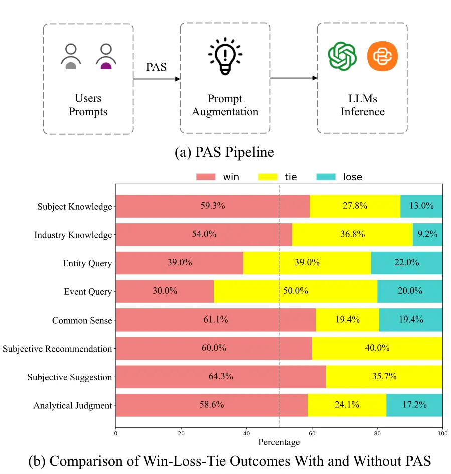
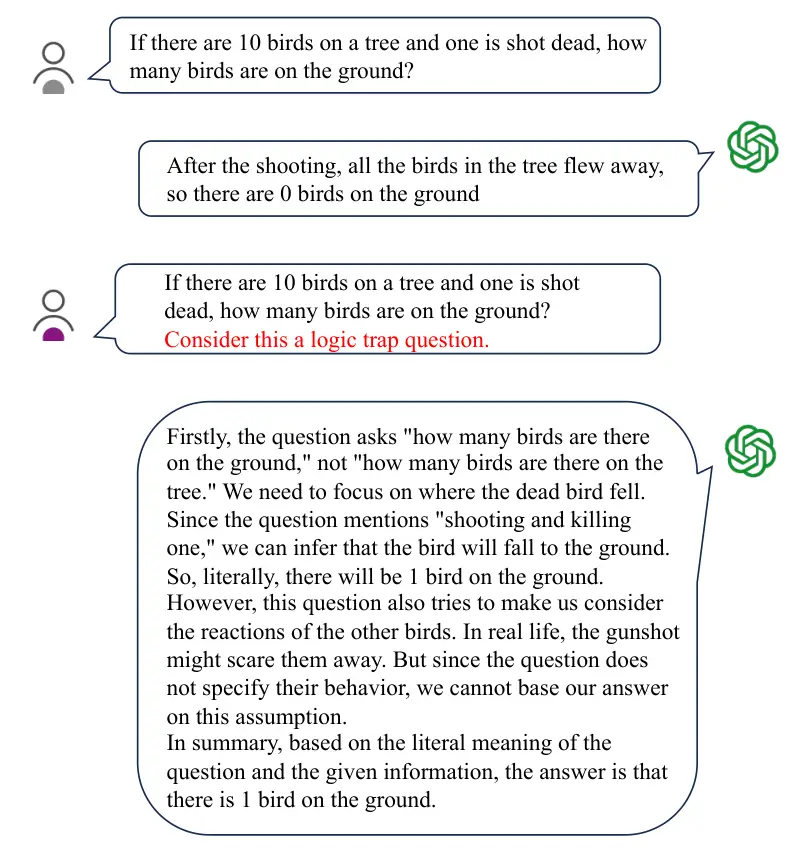
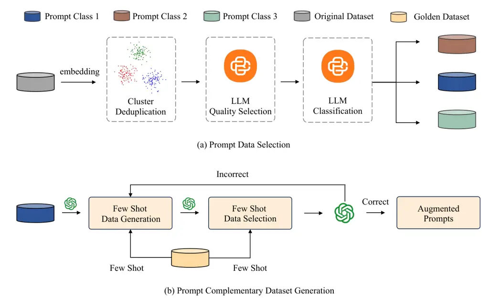

# PAS: Data-Efficient Plug-and-Play Prompt Augmentation System

Miao Zheng^(2†), Hao Liang^(1†), Fan Yang², Haoze Sun², Tianpeng Li²,
Lingchu Xiong², Yan Zhang², Youzhen Wu^(1,2), Kun Li², Yanjun Shen²,
Mingan Lin², Tao Zhang², Guosheng Dong², Yujing Qiao², Kun Fang²,
Weipeng Chen², Bin Cui¹, Wentao Zhang^(1∗), Zenan Zhou^(2∗)
Affiliation:       ¹Peking University     ²Baichuan Inc. Affiliation: 
{zhengmiao, zhouzenan}@baichuan-inc.com, hao.liang@stu.pku.edu.cn,
wentao.zhang@pku.edu.cn

###### Abstract.

In recent years, the rise of Large Language Models (LLMs) has spurred a
growing demand for plug-and-play AI systems. Among the various AI
techniques, prompt engineering stands out as particularly significant.
However, users often face challenges in writing prompts due to the steep
learning curve and significant time investment, and existing automatic
prompt engineering (APE) models can be difficult to use. To address this
issue, we propose PAS, an LLM-based plug-and-play APE system. PAS
utilizes LLMs trained on high-quality, automatically generated prompt
complementary datasets, resulting in exceptional performance. In
comprehensive benchmarks, PAS achieves state-of-the-art (SoTA) results
compared to previous APE models, with an average improvement of 6.09
points. Moreover, PAS is highly efficient, achieving SoTA performance
with only 9000 data points. Additionally, PAS can autonomously generate
prompt augmentation data without requiring additional human labor. Its
flexibility also allows it to be compatible with all existing LLMs and
applicable to a wide range of tasks. PAS excels in human evaluations,
underscoring its suitability as a plug-in for users. This combination of
high performance, efficiency, and flexibility makes PAS a valuable
system for enhancing the usability and effectiveness of LLMs through
improved prompt engineering. The code is available at
[https://github.com/PKU-Baichuan-MLSystemLab/PAS](https://github.com/PKU-Baichuan-MLSystemLab/PAS).

###### Keywords: 

Automatic Prompt Augmentation, Plug-and-Play System, Large Language
Models, Data Generation, Data Selection.

^(†)^(†) $`\dagger`$ The first two authors have equal contributions.  
$`*`$ Corresponding Author



Figure 1. We first present the pipeline of the PAS in (a). PAS takes
user prompts, enhances them, and then inputs the augmented prompts into
LLMs. As illustrated in (b), PAS significantly improves responses across
all categories in human evaluation.

## 1. Introduction

In recent years, data management and AI systems (Fernandez et al., 2023;
Trummer, 2023; Chen et al., 2023a; Miao et al., 2024; Nie et al., 2023)
have achieved rapid advancements and play an important role in large
language models (LLMs) (OpenAI, 2023a; Touvron et al., 2023). At the
same time, there is an increasing need for scalable plug-and-play
systems for LLMs due to their flexibility and efficiency (Al Ridhawi
et al., 2020).

Among the various techniques for LLMs, prompt engineering has emerged as
a crucial approach due to its extremely low cost and significant
enhancement of LLM performance (Sahoo et al., 2024). This technique
leverages the inherent capabilities of LLMs to understand and generate
human-like text, enabling them to perform a wide range of applications
from natural language understanding and generation to specialized
domains such as medical diagnosis and legal analysis (Meskó, 2023;
Giray, 2023). In prompt engineering techniques, few-shot learning (Brown
et al., 2020) stands out because it provides a small number of examples
to guide the model, thereby enhancing its task-specific performance.
Chain-of-Thought (CoT) (Wei et al., 2022) prompting guides models to
reason through problems step-by-step, improving logical consistency and
accuracy. In-context learning (Dong et al., 2022), by embedding relevant
examples and instructions directly within the prompt, allows models to
adapt dynamically to new tasks.

Despite the potential of existing methods, prompt engineering is not
user-friendly and requires meticulous design. Crafting effective prompts
demands a deep understanding of both the model and the task at hand.
This process can be time-consuming and often involves extensive trial
and error to optimize performance. To tackle those weak points,
automatic prompt engineering (APE) is designed for easier prompt
generation (Zhou et al., 2022a; Pryzant et al., 2023a; Cheng et al.,
2023). Although APE models can automatically enhance the prompt, they
have to use massive amounts of human-labeled data (Cheng et al., 2023;
Ouyang et al., 2022; Rafailov et al., 2024). Additionally, previous
methods failed to construct a flexible, user-friendly and effective APE
model (Zhou et al., 2022b; Pryzant et al., 2023b). They face the
following three key challenges:

C1. Low Efficiency. Previous works on APE primarily use extensive
human-labeled instruction datasets, which result in significant human
labor (Ouyang et al., 2022; Cheng et al., 2023; Rafailov et al., 2024).
Additionally, some methods require training a specific APE model for
each LLM, leading to a substantial waste of computational
resources (Pryzant et al., 2023a; Yang et al., 2023a).

C2. Low Flexibility. Previous works primarily focus on the performance
of APE models, overlooking the importance of flexibility, specifically
their model-agnostic and task-agnostic capabilities (Pryzant et al.,
2023a; Yang et al., 2023a). Low-flexibility APE systems can lead to
computational waste and hinder their application on LLMs (Pryzant
et al., 2023a). Additionally, these low-flexibility systems have limited
applicability across various scenarios, making them less versatile for
diverse use cases and reducing their overall effectiveness in practical
applications.

C3. Poor Effectiveness. Although several works aim to automatically
enhance the quality of prompts, they often rely on outdated evaluation
metrics and do not consistently yield significant improvements across
various benchmarks and models (Cheng et al., 2023; Ouyang et al., 2022).
Additionally, these models fail to include human evaluations, thus
lacking valuable feedback from human users (Cheng et al., 2023; Pryzant
et al., 2023a).



Figure 2. Case Study 1, Red text is the complementary prompt generated
by PAS. We can see PAS can give complementary prompt to avoid logic
traps.

To address these issues, as shown in Figure 1(a), we propose PAS, an
automatic prompt-enhancing plug-and-play system. Our approach involves
two main phases: high-quality prompt selection and automatic
complementary prompt generation, followed by fine-tuning of large
language models (LLMs). In the prompt selection phase, we begin by using
embedding models to extract features from the prompt data. We then apply
clustering algorithms to group and deduplicate similar prompts.
Following this, we use LLMs to select high-quality prompts and classify
them into various categories. In the automatic complementary prompt
generation phase, we employ few-shot learning techniques to generate new
prompts. These generated prompts undergo a rigorous selection and
regeneration process to ensure their quality. The high-quality generated
data is then used to fine-tune the LLMs, forming the core of the PAS
system.

The core contributions of this paper are summarized as follows:

- •
  New Perspective. To the best of our knowledge, this work is the first
  to construct a curated prompt complementary dataset without human
  labor. Additionally, we are the first to utilize this dataset to train
  LLMs to construct the PAS to automatically complement user prompts
  instead of directly modifying them.
- •
  New Method. We propose a new method that leverages diversity and
  quality criteria for prompt data selection. By curating a prompt
  dataset, we integrate few-shot learning with quality control to
  construct complementary prompt data. Our method, which employs this
  curated complementary prompt data to fine-tune LLMs, facilitates
  effective, efficient, and flexible prompt enhancement.
- •
  SoTA Performance. (1) High Efficiency. Our PAS model requires only
  9000 pairs of prompt complementary data to fine-tune LLMs, making it
  extremely data-efficient. Additionally, our data generation process is
  entirely automatic and requires no human labor. Moreover, our PAS
  model can be integrated into any LLM and solve all tasks, achieving
  SoTA performance. Therefore, we only need to train one LLM, reducing
  computational costs. (2) High Flexibility. Our PAS model can be
  plugged into any LLM, and is model and task agnostic. It achieves SoTA
  performance across all models and tasks, demonstrating its exceptional
  flexibility. (3) SoTA Performance on Multiple Benchmarks. Our PAS
  model achieves SoTA performance across multiple models and
  comprehensive benchmarks. It also outperforms the previous SoTA model,
  BPO, under identical experimental settings. Furthermore, it
  demonstrates superior performance on human evaluation metrics, as
  shown in Figure 1(b), highlighting the outstanding capabilities and
  potential applications of the PAS model. Figure 2 further illustrates
  that our model has significant real-world application potential.

## 2. Related Work

### 2.1. Automatic Prompt Engineering

The effectiveness of large language models in various applications
largely depends on the quality of the prompts used. There are already
many designed prompts that can significantly enhance the performance of
LLMs (Kojima et al., 2022; Wei et al., 2022; Yao et al., 2024; Besta
et al., 2024; Yang et al., 2024; Wang et al., 2023). However, these
methods that rely on manual prompt engineering are far less scalable. In
the field of mathematical logical reasoning for LLMs, the Chain of
Thought and its derived strategies are widely popular due to their
effectiveness. Zero-shot CoT (Kojima et al., 2022) is adding a simple
sentence like “Let’s think step by step” at the end of questions to
assist LLMs in generating reasoning steps. Instead of Zero-shot CoT,
Manual-Cot (Wei et al., 2022) provides reasoning steps as few shots.
Self-Consistency further improves language models’ reasoning performance
by generating a diverse set of reasoning paths and choosing the most
consistent answer in the final answer set. Tree of Thought (TOT) (Yao
et al., 2024) and GOT (Besta et al., 2024) extend the reasoning pathway
from linear to non-linear data structures by leveraging multiple LLM
queries to elicit different plausible reasoning paths (Yang et al.,
2024). Buffer of Thought (BOT) (Yang et al., 2024) designs a series of
thought-template for tasks, and for each problem, it retrieve a relevant
thought-template to prompt LLMs. PS prompting (Wang et al., 2023)
improves COT by encouraging LLMs to devise a plan before attempting to
solve a problem.

All the aforementioned prompting engineering strategies have been
crafted by human expertise. To avoid manual effort, there is a lot of
recent work to explore how to conduct automated prompt engineering
(Zhang et al., 2022; Shum et al., 2023; Zhou et al., 2022b; Yang et al.,
2023a; Pryzant et al., 2023b; Guo et al., 2023; Fernando et al., 2023).
Auto-Cot (Zhang et al., 2022) partitions questions of a given dataset
into a few clusters and generates reasoning chains to construct
demonstrations for each cluster for Few-shot COT. Automatic-COT (Shum
et al., 2023) creates rationale chains to augment exemplars and filters
out incorrect ones by checking against the ground truth. Both of them
improve the performance of vanilla COT (Kojima et al., 2022; Wei et al.,
2022). Unlike previous works, OPRO (Yang et al., 2023a), APO (Pryzant
et al., 2023b), and APE (Zhou et al., 2022b) provide an optimizer’s
perspective for automatically finding prompts. OPRO (Yang et al., 2023a)
leverages LLMs as optimizers, using the accuracy of training
datasets—unavailable in real-world scenarios—as the objective value.
APO (Pryzant et al., 2023b) provides detailed guidance on prompt
refinement at each step, based on the differences between responses and
targets. Evoprompt (Guo et al., 2023) and Promptbreeder (Fernando
et al., 2023) introduce evolutionary algorithms (EAs) into discrete
prompt optimization for specific domains. Similar to evolutionary
algorithms, they require evaluating the fitness of each individual
prompt in the population, presenting significant challenges in practical
applications. Additionally, exploring dozens of generations of prompts
imposes a considerable burden.

### 2.2. Plug-and-Play Systems

Plug-and-play systems have garnered significant attention in recent
years due to their modularity and ease of integration in various
machine-learning workflows. These systems are designed to operate
seamlessly with existing frameworks, allowing for quick and flexible
augmentation of functionalities without the need for extensive
reconfiguration (Abdulrazak and Helal, 2006; Zhang et al., 2021;
Venkatakrishnan et al., 2013).

In image processing research, plug-and-play systems are commonly applied
for its outstanding flexibility. Image reconstruction, denoising,
deblurring, image enhancement, and super-resolution are all fields where
plug-and-play systems are highly needed. By integrating various image
processing modules into a unified framework, plug-and-play systems can
flexibly combine different methods to achieve better image processing
results. Moreover, this system allows for the easy addition or
replacement of new processing modules without redesigning the entire
algorithm, significantly improving the efficiency and effectiveness of
image processing.

In the field of artificial intelligence, the rapid advancement of
machine learning models has spurred a growing demand for plug-and-play
systems. These systems enable seamless integration and adaptation of AI
technologies across various applications. Al Ridhawi et al. (2020) have
underscored the critical role of AI plug-and-play systems in enhancing
scalability, flexibility, and usability in modern computational
frameworks.

### 2.3. Data Quality and Data Selection

The advent of large language models has brought about a substantial
increase in the volume of training data (Touvron et al., 2023; OpenAI,
2023b). In this scenario, the quality of data becomes paramount. LLMs,
trained on vast amounts of data, can capture subtle nuances and complex
patterns in language, excelling in various natural language processing
tasks. However, the increase in data volume also brings new challenges,
particularly in data quality and data selection (Bai et al., 2024). In
this section, we mainly discuss the effectiveness of data quality and
data selection.

##### Data Quality

: High-quality data can significantly enhance the performance of
models (meta llama, 2024). As the volume of data increases, ensuring
high data quality becomes more challenging because it requires more
resources for data cleaning, selection and annotation (Bai et al.,
2024). Poor quality data can lead to models learning incorrect patterns
and making inaccurate predictions.

##### Data Selection

: LLMs-based methods were commonly used in data selection (Bai et al.,
2024). For instance, Du et al. (2023) leverages DeBERTa (He et al., 2020) for scoring, retaining high-quality data, and combining it with
the k-center greedy algorithm to select diverse data. Chen et al.
(2023b) score the accuracy of data using ChatGPT to pick out
high-quality data. Xu et al. (2023) use GPT-4 to rewrite data to
increase their complexity and then streamline it by reducing its variety
and improving its quality. Liu et al. (2023) train two models using
ChatGPT’s labeled data to score the quality and complexity of the data.
Lu et al. (2023) rely on ChatGPT to tag each instance, defining its
complexity and diversity based on these tags. Parkar et al. (2024) first
cluster the data, and then use GPT-4 to select high-quality data for
each cluster.

Given the critical role of data quality and selection in enhancing model
performance, our paper focuses on leveraging advanced data selection
techniques to optimize prompts and their complementary data. By
employing methods that integrate scoring mechanisms from LLMs and
clustering techniques, we aim to efficiently identify and utilize
high-quality data clusters for prompt engineering.



Figure 3. Pipeline for selecting prompt data and generating
complementary prompt data.

## 3. Method

In this section, we first summarize the collection and process of prompt
data in section 3.1. Then we introduce the prompt complementary data
generation pipeline in section 3.2 to automatically generate
high-quality prompt complementary data. After the prompt dataset is
generated, we give a comprehensive analysis of the dataset in section
3.3. At last, in section 3.4, we introduce utilizing the prompt
augmentation dataset for LLM fine-tuning and then use the fine-tuned LLM
to construct a plug-and-play APE system.

### 3.1. Prompts Data Collection

In this section, we introduce the prompt collection process. To generate
high-quality (prompt, complementary prompt) pairs, we first need to
select high-quality prompts. To achieve this, we use two curated
datasets: the LMSYS-1M dataset (Zheng et al., 2023) and the WildChat
dataset (Zhao et al., 2024). We use $`P`$ to denote the prompt dataset.
As shown in Figure 3(a), our data selection process involves three main
steps to ensure the quality and relevance of the data:

##### Deduplication

Deduplication is performed to create a diverse and efficient dataset.
Using the SimCSE bge embedding model, all prompts from the LMSYS-1M and
WildChat datasets are embedded.

```math
P_{\text{embed}}=\text{SimCSE}(P)
```

Subsequently, the HNSW clustering algorithm is employed to group these
embeddings. A small subset of data is then extracted from each cluster
to reduce redundancy.

##### Quality Selection

Quality filtering is performed to select high-quality data because such
data can not only reduce computational costs but also enhance the
model’s performance. For quality selection, the BaiChuan 13b model (Yang
et al., 2023b) serves as the base model. We filter out low-quality
entries using the formula below:

```math
Q_{\text{score}}(p_{i})=\text{BaiChuan 13b}(p_{i})
```

```math
P_{\text{filtered}}=\{p_{i}\in P\mid Q_{\text{score}}(p_{i})\geq\tau\}
```

Here, $`Q_{\text{score}}(p_{i})`$ represents the quality score assigned
by the BaiChuan 13b model to prompt $`p_{i}`$, and $`\tau`$ denotes the
quality threshold. By employing quality selection, we aim to enhance the
overall quality of prompt data.

##### Classification

To facilitate few-shot learning for prompt complementary dataset
generation, we categorize the data into different categories. For
accurate classification, we fine-tune a BaiChuan 13b model (Yang et al.,
2023b) using 60,000 internally labeled classification data points from
BaiChuan Inc. This process yields a classification model that
categorizes prompts into common categories such as Q&A and coding.

The steps of deduplication, quality selection, and classification ensure
diversity, quality, and accurate categorization of the data.
Approximately 9,000 high-quality classified data points are obtained
through these processes. Subsequently, these 9,000 high-quality prompts
are utilized to generate high-quality (prompt, complementary prompt)
pairs.

### 3.2. Prompts Complementary Dataset

Input: Golden Data $`D_{\text{golden}}=\{(p_{i},a_{i})\}_{i=1}^{N}`$,
Prompt Set $`P=\{p_{j}\}_{j=1}^{M}`$

Output: Generated Data $`D_{\text{generated}}`$

1 $`D_{\text{generated}}\leftarrow\emptyset`$;

2 for _each $`p_{j}\in P_{\text{golden}}`$_ do

    3
$`a_{j}\leftarrow\text{FewShotGenerate}(p_{j},D_{\text{golden}})`$;

    4
$`D_{\text{generated}}\leftarrow D_{\text{generated}}\cup\{(p_{j},a_{j})\}`$;

5 for _each $`(p_{j},a_{j})\in D_{\text{generated}}`$_ do

    6 if _not $`\text{IsCorrectPair}(p_{j},a_{j},D_{\text{golden}})`$_
then

       7
$`D_{\text{generated}}\leftarrow(D_{\text{generated}}-\{(p_{j},a_{j})\})`$;

       8 while _not
$`\text{IsCorrectPair}(p_{j},a_{j},D_{\text{golden}})`$_ do

          9
$`a_{j}\leftarrow\text{FewShotGenerate}(p_{j},D_{\text{golden}})`$;

       10
$`D_{\text{generated}}\leftarrow D_{\text{generated}}\cup\{(p_{j},a_{j})\}`$;

11 Function FewShotGenerate(_$`p,D_{\text{golden}}`$_):

Input: Prompt $`p`$, Golden Data $`D_{\text{golden}}`$

Output: Generated Answer $`a`$

12 $`a\leftarrow\text{FewShot Learning with }D_{\text{golden}}`$;

13 return $`a`$;

14 Function IsCorrectPair(_$`p,a,D_{\text{golden}}`$_):

Input: Prompt $`p`$, Answer $`a`$, Golden Data $`D_{\text{golden}}`$

Output: Boolean $`isCorrect`$

15 $`isCorrect\leftarrow\text{FewShot Eval with }D_{\text{golden}}`$;

16 return $`isCorrect`$;

Algorithm 1 Prompt Augmentation Dataset Generation

To generate a high-quality prompt complementary dataset, we designed an
automated data generation pipeline based on Few-Shot Learning. The
algorithm mainly consists of two phases: data generation and data
selection with regeneration. We use a set of golden data
$`D_{\text{golden}}=\{(p_{i},a_{i})\}_{i=1}^{N}`$, containing 4 to 5
pairs of few-shot examples for each category from BaiChuan Inc. Then, we
utilize the prompt dataset $`P_{\text{golden}}`$ from Section 3.1 to
generate high-quality (prompt, complementary prompt) pairs.

##### Data Generation

For each prompt $`p_{j}\in P_{\text{golden}}`$ in every category, we
utilize the Few-Shot Learning method based on the prompt in Figure 4 to
generate a corresponding complementary prompt $`a_{j}`$ based on the
golden data $`D_{\text{golden}}`$. The generated prompt-complementary
prompt pair $`(p_{j},a_{j})`$ is then added to $`D_{\text{generated}}`$.

##### Data Selection and Regeneration

We observed that not all the generated complementary prompt data are of
high quality or useful for the original prompt. To address this issue,
we proposed a data selection and regeneration pipeline for high-quality
complementary prompts.

For each generated prompt-answer pair
$`(p_{j},a_{j})\in D_{\text{generated}}`$, we use Few-Shot Learning
based on the prompt in Figure 5 to evaluate its correctness. If the
evaluation result is incorrect, we remove the pair and use Few-Shot
Learning in the data generation phase to regenerate the answer until the
correct answer is generated. Finally, we add the correct prompt-answer
pair back to $`D_{\text{generated}}`$.

Through this data selection and regeneration process, we can
automatically generate a prompt complementary dataset while ensuring
data quality. This process provides reliable data support for subsequent
model training. To better summarize the contents of this section, we
translated the data selection process into an algorithm and a pipeline.
The data generation pipeline is summarized in Figure 3(b) and Algorithm

1.

Figure 4. Complementary Dataset Generation Prompt

Figure 5. Data Selection and Regeneration Prompt

### 3.3. Prompt Complementary Dataset

Figure 6. Prompt Complementary Dataset Distribution

In this section, we present a detailed analysis of the generated
prompt-complementary dataset. The dataset comprises approximately 9,000
high-quality (prompt, complementary prompt) pairs, as illustrated in
Figure 6. Figure 6 summarizes the distribution of the dataset, revealing
that it spans 14 categories, with each category containing approximately
500 data points. This wide coverage of various prompt cases underscores
the dataset’s exceptional generalization capability. Moreover, there is
a significant presence of Coding and Q&A data, which are widely utilized
functions, thus justifying their prominent representation.

Despite these strengths in data distribution, our automated process for
generating complementary prompts, as detailed in Section 3.2, allows us
to exert control over the categories of generated data. This flexibility
enables our method to cater to both general-purpose models and
specialized data needs, thereby enhancing prompt adaptability across
specific domains. Tailoring data generation to specific domains
facilitates comprehensive training for diverse PAS tasks across various
fields.

Overall, the broad coverage of various prompt cases demonstrates the
dataset’s exceptional generalization ability, with emphasis on critical
functionalities. Additionally, our method’s capability to control
dataset distribution supports the development of PAS systems across all
domains.

### 3.4. Automatic Prompt Complementary Plug-and-Play System PAS

In this section, we first use the generated prompt-complementary dataset
in section 3.2 to fine-tune LLMs for prompt-complementary tasks. Given
the flexibility of LLMs as automatic prompt-complementary tools that can
be integrated into other generative LLMs, these prompt-complementary
models can serve as an automatic, plug-and-play system to enhance LLM
performance.

##### Fine-tune LLMs for Prompt Complementary Models

By utilizing the high-quality generated dataset $`D_{\text{generated}}`$
in section 3.2, we can automatically fine-tune LLMs to have a prompt
complementary ability. We use $`M_{p}`$ to denote an automatically
prompt complementary model, and $`M`$ to denote an LLM, which can be
written as the following mathematic formula:

```math
M_{p}\leftarrow\text{SFT}(M;D_{\text{generated}})
```

We call this $`M_{e}`$ model PAS, a prompt complementary model with can
serve as an automatic, plug-and-play system to enhance LLM performance.

##### PAS Enhances LLMs Performance

For a prompt $`p`$ from the user, the complementary prompt $`p_{c}`$ can
be generated using the following formula:

```math
p_{c}=M_{p}(p)
```

The enhanced response $`r_{e}`$ is then given by:

```math
r_{e}=\text{LLMs}(\text{cat}(p,p_{c}))
```

By generating a complementary prompt, the PAS can improve the user’s
prompt without altering the original input. As demonstrated in Section
4, PAS effectively enhances the performance of LLMs.

##### Plug-and-Play LLMs Promoting System

PAS can be plugged into any other LLMs available via public
APIs (OpenAI, 2023a) and can also be integrated into models with open
parameters (Bai et al., 2023; Touvron et al., 2023). This flexibility
allows for a wide range of applications and improvements across
different platforms and systems.

The primary advantage of such a system is its ability to seamlessly
enhance the capabilities of existing LLMs without the need for extensive
retraining or modification. By simply augmenting the input prompts, PAS
leverages the strengths of the underlying models while providing a
mechanism to improve their performance. This approach is both
cost-effective and efficient, enabling better utilization of
computational resources and accelerating the deployment of enhanced
language models in various applications.

| Main Model             | APE-model | Arena-hard | Alpaca-Eval 2.0 | Alpaca-Eval 2.0 (LC) | Average | $`\uparrow`$ |
| ---------------------- | --------- | ---------- | --------------- | -------------------- | ------- | ------------ |
| GPT-4-turbo-2024-04-09 | \-        | 76.60      | 46.12           | 55.02                | 59.25   | \-           |
| GPT-4-1106-preview     | \-        | 74.80      | 50.00           | 50.00                | 58.27   | \-           |
| GPT-4-0613             | \-        | 37.9       | 15.80           | 30.20                | 27.97   | \-           |
| GPT-3.5-turbo-1106     | \-        | 18.90      | 9.20            | 19.30                | 15.80   | \-           |
| Qwen2-72b-Instruct     | \-        | 48.10      | 31.70           | 39.24                | 39.68   | \-           |
| LLaMA-3-70b-Instruct   | \-        | 41.10      | 33.18           | 34.42                | 36.23   | \-           |
| Average                | \-        | 49.57      | 31.0            | 38.03                | 39.53   | \-           |
| GPT-4-turbo-2024-04-09 | BPO       | 76.60      | 54.65           | 55.28                | 62.18   | +2.93        |
| GPT-4-1106-preview     | BPO       | 74.60      | 55.19           | 52.91                | 60.90   | +2.63        |
| GPT-4-0613             | BPO       | 38.60      | 19.61           | 34.08                | 30.76   | +2.79        |
| GPT-3.5-turbo-1106     | BPO       | 15.90      | 10.25           | 20.29                | 15.48   | -0.32        |
| Qwen2-72b-Instruct     | BPO       | 44.40      | 31.25           | 39.02                | 38.22   | -1.46        |
| LLaMA-3-70b-Instruct   | BPO       | 45.20      | 38.92           | 39.24                | 41.12   | +1.59        |
| Average                | BPO       | 49.22      | 34.98           | 40.14                | 41.44   | +1.91        |
| GPT-4-turbo-2024-04-09 | PAS       | 76.90      | 65.31           | 56.54                | 66.62   | +7.37        |
| GPT-4-1106-preview     | PAS       | 78.80      | 65.92           | 53.63                | 66.12   | +7.85        |
| GPT-4-0613             | PAS       | 43.90      | 34.06           | 40.33                | 39.43   | +11.46       |
| GPT-3.5-turbo-1106     | PAS       | 22.10      | 15.82           | 23.31                | 20.41   | +4.61        |
| Qwen2-72b-Instruct     | PAS       | 52.20      | 45.53           | 44.31                | 47.35   | +7.67        |
| LLaMA-3-70b-Instruct   | PAS       | 50.30      | 45.01           | 40.52                | 45.28   | +9.05        |
| Average                | PAS       | 54.03      | 45.37           | 43.20                | 47.53   | +8.00        |

Table 1. Comparison of PAS, BPO and not using APE (baseline). We can see
PAS significantly outperform the baseline with an average improvement of
8 points. Additionally, when compared to the previous state-of-the-art
model, BPO, our model still exceeds it by an average of 6.09 points.

## 4. Experiments

In this section, we first introduce the experimental setups. We then aim
to answer the following questions to verify the effectiveness,
efficiency, and robustness of our proposed PAS: Q1: Can our PAS achieve
SoTA performance compared to previous SoTA methods? Q2: Can our PAS
outperform the previous SoTA model with the same base model? Q3: How
efficient and flexible is our model compared to previous APE models? Q4:
Can PAS achieve SoTA performance in human evaluation, making it a user
friendly system? Q5: Can we visualize the advantages of our method? Q6:
Do we need data quality selection and regenerate module in our data
generation pipeline?

### 4.1. Experiments Setting

##### Datasets.

We followed the steps in section 3 and generated a dataset of 9000
high-quality pairs (prompt, complementary prompt).

##### Models.

For PAS models, we select several smaller models to efficiently train a
PAS model. We select Qwen2-7b-Instruct (Bai et al., 2023),
LLaMA-2-7b-Instruct (Touvron et al., 2023). Then we utilize our trained
PAS models to some massive SoTA models, i.e. GPT-4-turbo-2024-04-09,
GPT-4-1106-preview, GPT-4-0613, GPT-3.5-turbo-1106 (OpenAI, 2023a),
Qwen2-72b-Instruct (Bai et al., 2023), and LLaMA-3-70b-Instruct (Touvron
et al., 2023; meta llama, 2024).

##### Baselines.

We compare the performance of PAS with models without PAS. Additionally,
we compare the performance of PAS with the previous SoTA automatic
prompt engineering method BPO (Cheng et al., 2023) to demonstrate the
effectiveness of PAS.

##### Evaluation.

To evaluate the effectiveness of our PAS model, we used three
comprehensive benchmarks to thoroughly assess the model’s performance:

- •
  Arena-hard: This benchmark is designed to test the robustness of
  language models in handling complex and challenging scenarios. It
  includes tasks that require advanced reasoning, problem-solving, and
  understanding of nuanced language constructs. Models are evaluated
  based on their ability to navigate these hard scenarios and provide
  accurate, coherent responses.
- •
  Alpaca-Eval 2.0: This benchmark assesses the general performance of
  language models across a wide range of standard tasks. It includes a
  variety of question types and subject areas, ensuring a comprehensive
  evaluation of the model’s capabilities. The Alpaca-Eval 2.0 is a
  standard for measuring the overall effectiveness and versatility of
  language models.
- •
  Alpaca-Eval 2.0 (LC): Alpaca-Eval 2.0 LC is a length-controlled
  version of AlpacaEval designed to mitigate biases related to response
  length in language model evaluations. By implementing length control,
  it reduces sensitivity to response length variations, enhancing
  robustness and interpretability of results. This improvement increases
  AlpacaEval’s correlation with human judgments, as shown by its higher
  correlation with Chatbot Arena evaluations.

##### Settings.

For Qwen2-7B-Instruct (Bai et al., 2023), LLaMA-2-7B-Instruct (Touvron
et al., 2023), Qwen2-72B-Instruct (Bai et al., 2023),
LLaMA-2-7B-Instruct (Touvron et al., 2023), and
LLaMA-3-70B-Instruct (Touvron et al., 2023; meta llama, 2024), we
primarily use the hyperparameters from the official repositories. For
the GPT model series, we access the models via API. All experiments are
conducted on a machine equipped with 8 NVIDIA H100 GPUs, a 120-core CPU,
and 960GB of memory.

### 4.2. Main Experiments

To address Q1, we used Qwen2-7B-Instruct as the base model due to its
outstanding performance. We subsequently used the prompt complementary
data to train a PAS model and compared it to both the baseline model
without the APE model and the previous state-of-the-art (SoTA) APE
model, BPO (Cheng et al., 2023). We integrated our model into multiple
commonly used LLMs, including GPT-4-turbo-2024-04-09,
GPT-4-1106-preview, GPT-4-0613, GPT-3.5-turbo-1106 (OpenAI, 2023a),
Qwen2-72b-Instruct (Bai et al., 2023), and LLaMA-3-70b-Instruct (Touvron
et al., 2023; meta llama, 2024).

The results in Table 1 clearly illustrate the effectiveness of our PAS
method across different models. Compared to the baseline without using
APE, PAS shows significant improvements in all metrics, resulting in an
average improvement of 8 points, demonstrating the benefits of
incorporating prompt complementary data. For instance, in the case of
GPT-4-0613, PAS improves the average score by 11.46 points compared to
the baseline, highlighting its substantial impact.

Moreover, when compared to the previous state-of-the-art model BPO, our
model significantly outperforms it, resulting in an average improvement
of 6.09 points. Each model achieves more than a 4-point average
improvement across all six base models compared to BPO, with a notable
increase of 9.13 points for Qwen2-72b-Instruct, indicating a substantial
improvement.

BPO is unstable and performs worse than the baseline in some cases, such
as GPT-3.5-turbo-1106 and Qwen2-72b-Instruct, indicating that the
previous SoTA model cannot consistently outperform the baseline.
Considering our model exceeds the baseline by 8.00 points and BPO by
6.09 points, it further demonstrates the effectiveness and robustness of
our PAS model.

Overall, our PAS method not only outperforms the baseline but also
consistently surpasses the previous SoTA model BPO, establishing its
robustness and effectiveness as a fine-tuning strategy for enhancing
prompt-based learning systems. This consistent performance across
various LLMs underscores the robustness of PAS and its potential to set
new benchmarks in the field.

| Main Model             | Method | Arena-hard | Alpaca-Eval 2.0 | Alpaca-Eval 2.0 (LC) | Average | $`\uparrow`$ |
| ---------------------- | ------ | ---------- | --------------- | -------------------- | ------- | ------------ |
| GPT-4-turbo-2024-04-09 | BPO    | 76.60      | 54.65           | 55.28                | 62.18   | \-           |
| GPT-4-1106-preview     | BPO    | 74.60      | 55.19           | 52.91                | 60.90   | \-           |
| GPT-4-0613             | BPO    | 38.60      | 19.61           | 34.08                | 30.76   | \-           |
| GPT-3.5-turbo-1106     | BPO    | 15.90      | 10.25           | 20.29                | 15.48   | \-           |
| Qwen2-72b-Instruct     | BPO    | 44.40      | 31.25           | 39.02                | 38.22   | \-           |
| LLaMA-3-70b-Instruct   | BPO    | 45.20      | 38.92           | 39.24                | 41.12   | \-           |
| Average                | BPO    | 49.22      | 34.98           | 40.14                | 41.44   | \-           |
| GPT-4-turbo-2024-04-09 | PAS    | 73.54      | 62.58           | 54.03                | 63.38   | +1.20        |
| GPT-4-1106-preview     | PAS    | 75.52      | 64.06           | 53.07                | 64.22   | +3.32        |
| GPT-4-0613             | PAS    | 40.13      | 33.11           | 36.70                | 36.65   | +5.89        |
| GPT-3.5-turbo-1106     | PAS    | 18.02      | 16.18           | 23.67                | 19.29   | +3.81        |
| Qwen2-72b-Instruct     | PAS    | 47.91      | 40.59           | 39.99                | 42.83   | +4.61        |
| LLaMA-3-70b-Instruct   | PAS    | 46.30      | 43.17           | 38.77                | 42.74   | +1.62        |
| Average                | PAS    | 50.24      | 43.28           | 41.04                | 44.85   | +3.41        |

Table 2. Comparison of PAS and BPO using the same base model,
LLaMA-2-7b-Instruct. The results demonstrate that PAS outperforms the
BPO model consistently across all LLMs when using the same base model,
LLaMA-2-7b-Instruct.

### 4.3. Effectiveness of PAS

To address Q2, we fix the base model and compare our PAS method with the
previous BPO (Cheng et al., 2023). We use LLaMA-2-7b-Instruct, the same
base model as BPO, and utilize the generated complementary prompt data
to fine-tune LLaMA-2-7b-Instruct. We compare our model performance with
BPO.

The results in Table 2 clearly demonstrate the effectiveness of our PAS
method across different models. Notably, PAS exhibits a marked
improvement in performance metrics compared to BPO, exceeding the
baseline by 3.41 points on average. This is particularly evident in
models like GPT-4-0613, where the average score improvement is as high
as 5.89 points. Even in cases where the improvement is smaller, such as
Llama3-70b-Instruct, PAS still manages to outperform BPO, indicating its
robustness and consistency.

Overall, our PAS method consistently improves model performance across
various evaluation models and settings, establishing its effectiveness
and robustness as a fine-tuning strategy for enhancing prompt-based
learning systems.

### 4.4. Efficiency and Flexibility of PAS

To address Q3, we compare the data efficiency and flexibility of the PAS
approach with SoTA APE models. This comparison underscores PAS’s
effectiveness in terms of both data utilization and adaptability.

#### 4.4.1. Data Usage Comparison

Figure 7. Efficiency of PAS Compared to Other Methods

Figure 7 shows the data consumption of PAS compared to other alignment
methods, including PPO, DPO, and BPO. The data consumption for each
method is as follows:

- •
  PAS: 9,000
- •
  BPO: 14,000
- •
  PPO: 77,000
- •
  DPO: 170,000

As shown in figure 7, PAS significantly reduces data consumption
compared to other methods, demonstrating its efficiency in data usage.
It is important to note that ProTeGi and OPRO are not task-agnostic, so
they are not included in the data efficiency comparison.

We then calculated the efficiency of PAS using the formula:

```math
\text{Efficiency}=\frac{\text{Consumption}_{\text{Methods}}}{\text{Consumption}_{\text{PAS}}}
```

Based on this formula, PAS achieves an efficiency that is 1.56 times
higher than BPO, 8.56 times higher than PPO, and 18.89 times higher than
DPO, highlighting its superior data efficiency.

#### 4.4.2. Flexibility Comparison

Table 3 compares the need for human labor and the flexibility of PAS
with other models, specifically in terms of being LLM-agnostic and
task-agnostic. The table shows that PAS is both LLM-agnostic and
task-agnostic, demonstrating its superior flexibility.

| Method                          | No Human Labor | LLM-Agnostic | Task-Agnostic |
| ------------------------------- | -------------- | ------------ | ------------- |
| APE (Guo et al., 2023)          | ✗              | ✗            | ✗             |
| Auto-Cot (Zhang et al., 2022)   | ✗              | ✗            | ✓             |
| OPRO (Yang et al., 2023a)       | ✗              | ✗            | ✗             |
| ProTeGi (Pryzant et al., 2023a) | ✗              | ✗            | ✗             |
| BPO (Cheng et al., 2023)        | ✗              | ✓            | ✓             |
| PAS                             | ✓              | ✓            | ✓             |

Table 3. Comparison of the Need for Human Labor and Flexibility of PAS
as a Plug-and-Play System

#### 4.4.3. Summary

The results indicate that PAS is the only method satisfying all three
criteria: no need for human labor, LLM-agnostic, and task-agnostic. This
underscores PAS’s superior flexibility and efficiency as a plug-and-play
system. Unlike other methods that require significant human intervention
and have limitations in applicability across different LLMs and tasks,
PAS provides a highly versatile and efficient solution.

In contrast, methods like PPO, DPO, OPRO, and ProTeGi require human
labor and lack LLM-agnostic capabilities. Although BPO is both
LLM-agnostic and task-agnostic, it still requires human labor,
necessitating large human-annotated datasets, whereas PAS can scale up
automatically. This highlights PAS’s significant advancements in
providing an efficient, flexible, and human-labor-free prompt
augmentation system.

### 4.5. Human Evaluation

To address Q4, we conducted a comprehensive evaluation using human
evaluators to assess the online performance of our PAS compared to the
baseline model without any prompt augmentation. We compared the good
same bad (GSB), availability proportion, full mark proportion, and
average score.

From Figure 1, we can see that PAS outperforms the baseline model in
various scenarios. Specifically, the results show a higher percentage of
wins across different categories such as Analytical Judgment, Subjective
Suggestion, Subjective Recommendation, Common Sense, Event Query, Entity
Query, Industry Knowledge, and Subject Knowledge. For example, PAS
achieves 58.6% wins in Analytical Judgment, 64.3% in Subjective
Suggestion, and 61.1% in Common Sense, demonstrating its effectiveness
in enhancing performance compared to the baseline without PAS.

As shown in Table 4, our PAS consistently outperforms the baseline,
achieving significant improvements in the full mark ratio, average
score, and availability ratio. These enhancements across all three
evaluation metrics in every benchmark demonstrate the effectiveness of
our model. The results indicate not only strong performance on
evaluation benchmarks but also positive feedback from human evaluators,
showcasing a user-friendly model.

Furthermore, the consistent performance enhancements across all
benchmarks highlight the generalization ability and robustness of our
model, suggesting its applicability in various domains and its broad
impact.

| Benchmarks                | Full Mark Proportion | Average Score | Availability Proportion | Full Mark Proportion (PAS) | Average Score (PAS) | Availability Proportion (PAS) |
| ------------------------- | -------------------- | ------------- | ----------------------- | -------------------------- | ------------------- | ----------------------------- |
| Analysis and Judgment     | 24.14%               | 3.84          | 91.38%                  | 43.10% (+18.96)            | 4.21 (+0.37)        | 94.83% (+3.45)                |
| Subjective Advice         | 35.71%               | 3.71          | 85.71%                  | 42.86% (+7.15)             | 3.93 (+0.22)        | 85.71% (+0.00)                |
| Subjective Recommendation | 0.00%                | 2.4           | 60.00%                  | 0.00% (+0.00)              | 2.8 (+0.40)         | 80.00% (+20.00)               |
| Common Sense              | 5.56%                | 3.25          | 77.78%                  | 27.78% (+22.22)            | 3.72 (+0.47)        | 80.56% (+2.78)                |
| Event Query               | 20.00%               | 3.3           | 60.00%                  | 30.00% (+10.00)            | 3.6 (+0.30)         | 70.00% (+10.00)               |
| Entity Query              | 7.32%                | 3.15          | 68.29%                  | 9.76% (+2.44)              | 3.34 (+0.19)        | 75.61% (+7.32)                |
| Industry Knowledge        | 20.69%               | 3.49          | 78.16%                  | 40.23% (+19.54)            | 3.78 (+0.29)        | 79.31% (+1.15)                |
| Academic Knowledge        | 18.52%               | 3.35          | 77.78%                  | 29.63% (+11.11)            | 3.76 (+0.41)        | 83.33% (+5.55)                |
| Average                   | 16.49%               | 3.35          | 77.78%                  | 27.92% (+11.43)            | 3.76 (+0.41)        | 83.33% (+5.55)                |

Table 4. Performance Comparison of PAS vs. Non-PAS on Human Evaluation
Benchmarks. The PAS consistently outperforms the non-PAS approach across
various metrics.

### 4.6. Case Study

To address Q5, this section discusses three different types of case
studies that demonstrate the effectiveness of the PAS.

##### Case Study 1

We examine the effectiveness of PAS in the case study presented in
Figure 2. The query, "If there are 10 birds on a tree and one is shot
dead, how many birds are on the ground?", is a logic trap that can
easily mislead both humans and large models if no hints are given.
Initially, without the assistance of PAS, GPT responded with an
incorrect answer.

Our PAS approach significantly improves this prompt by providing a
complementary hint to remind the model that there is a logic trap. With
the assistance of PAS, the new response avoids the trap and showcases a
multi-step logical reasoning process. This refined answer is clear,
accurate, and guides the user through the reasoning process, explaining
why only one bird would be on the ground.

From Case Study 1, we can see that PAS is capable of assisting LLMs in
avoiding logic traps.

Figure 8. Case Study 2: Red text indicates the response is incorrect.
Green text stands for inexplicit sentences. Blue text denotes the no
sense sentences. Purple text is the complementary prompt generated bu
PAS.

Figure 9. Case Study 3: Red text is the human comments. Purple text is
the complementary prompt generated by PAS.

##### Case Study 2

From case study 2 in Figure 8(a), we can see the user asked about how to
quickly boil water in ancient times. However, without the assistance of
PAS, the answer from LLM faces the following issues:

- •
  Instruct Following Issue: The question pertained to boiling water
  quickly, yet the responses did not adhere to the "quickly" criterion.
- •
  Incorrect Response: From the red text, it is evident that using solar
  energy cannot boil water quickly.
- •
  Incomplete Explanation: From the green text, the use of fire is
  mentioned, but the methods to control the fire for quick boiling are
  not explained.
- •
  Incorrect Response: From the red text, it is evident that using hot
  stones cannot boil water quickly either.
- •
  Logical Flaw: From the blue text, if steam is used, the water is
  already boiling. Although steam has a high temperature, it cools
  quickly when it encounters a container, thus it cannot boil water
  quickly either.
- •
  Lack of Specific Measures: Fire is the only method suggested for quick
  heating, but without specific measures, its value is limited.

With the assistance of PAS, we can see in Figure 8(b) that the LLM
provides a correct response, effectively avoiding these issues. The
improved response follows the "quickly" criterion, accurately excludes
ineffective methods such as solar energy and hot stones, and provides a
comprehensive explanation of how to control fire to quickly boil water.
This demonstrates the effectiveness of PAS in guiding LLMs to deliver
precise and relevant answers.

| Main Model             | PAS-model           | Arena-hard | Alpaca-Eval 2.0 | Alpaca-Eval 2.0 (LC) | Average | $`\uparrow`$ |
| ---------------------- | ------------------- | ---------- | --------------- | -------------------- | ------- | ------------ |
| GPT-4-turbo-2024-04-09 | PAS                 | 76.9       | 65.86           | 57.09                | 66.62   | \-           |
| GPT-4-1106-preview     | PAS                 | 78.8       | 65.92           | 53.63                | 66.12   | \-           |
| GPT-4-0613             | PAS                 | 43.9       | 34.06           | 40.33                | 39.43   | \-           |
| GPT-3.5-turbo-1106     | PAS                 | 22.1       | 15.82           | 23.31                | 20.41   | \-           |
| Qwen2-72b-Instruct     | PAS                 | 52.2       | 45.53           | 44.31                | 47.35   | \-           |
| LLaMA-3-70b-Instruct   | PAS                 | 50.3       | 45.01           | 40.52                | 45.28   | \-           |
| Average                | PAS                 | 54.03      | 45.37           | 43.20                | 47.53   | \-           |
| GPT-4-turbo-2024-04-09 | wo prompt selection | 73.90      | 64.90           | 54.62                | 64.47   | -2.15        |
| GPT-4-1106-preview     | wo prompt selection | 74.6       | 64.98           | 50.01                | 63.20   | -2.92        |
| GPT-4-0613             | wo prompt selection | 39.7       | 33.68           | 37.44                | 36.94   | -2.49        |
| GPT-3.5-turbo-1106     | wo prompt selection | 18.4       | 16.51           | 22.54                | 19.15   | -1.26        |
| Qwen2-72b-Instruct     | wo prompt selection | 48.9       | 42.79           | 41.51                | 46.58   | -0.77        |
| LLaMA-3-70b-Instruct   | wo prompt selection | 46.0       | 43.24           | 38.56                | 44.13   | -1.15        |
| Average                | wo prompt selection | 50.97      | 45.20           | 41.07                | 45.75   | -1.78        |
| GPT-4-turbo-2024-04-09 | wo regeneration     | 75.0       | 57.97           | 49.52                | 60.83   | -5.79        |
| GPT-4-1106-preview     | wo regeneration     | 72.2       | 57.91           | 48.37                | 59.49   | -6.63        |
| GPT-4-0613             | wo regeneration     | 38.7       | 31.59           | 36.19                | 35.49   | -3.94        |
| GPT-3.5-turbo-1106     | wo regeneration     | 20.0       | 15.88           | 22.86                | 19.58   | -0.83        |
| Qwen2-72b-Instruct     | wo regeneration     | 48.9       | 42.79           | 41.51                | 44.40   | -2.95        |
| LLaMA-3-70b-Instruct   | wo regeneration     | 46.0       | 43.24           | 38.56                | 42.60   | -2.68        |
| Average                | wo regeneration     | 50.13      | 41.56           | 39.50                | 43.73   | -3.80        |

Table 5. Performance comparison between PAS trained on a curated dataset
and PAS trained without the Prompt Selection Module and Prompt
Complementary Data Regeneration Module.

##### Case Study 3

From Figure 9, we can see that the user inquired about whether blood
pressure increases or decreases when the body loses blood. Typically, a
user asking this question is looking for more information about blood
pressure changes during blood loss and what actions to take in such a
situation. However, as shown in Figure 9(a), the initial response is
superficial and, despite being correct, lacks detailed information,
which often prompts further questions from the user. In contrast, Figure
9(b) demonstrates that with PAS, a comprehensive and detailed analysis
is provided from a physiological and medical perspective on the changes
in blood pressure. This approach not only satisfies the immediate query
but also equips the user with a thorough understanding, potentially
reducing the need for follow-up questions. By delivering such detailed
and insightful responses, PAS proves its effectiveness in enhancing user
experience and satisfaction in information-seeking scenarios.

From Case Study 3, we can see that PAS can provide more comprehensive
answers that consider the user’s potential needs, rather than incomplete
ones.

To summarize, the benefits of our PAS method are as follows:

- •
  Enhanced Context Understanding: PAS breaks down the query into
  comprehensible parts, ensuring each component is addressed logically
  and contextually, as demonstrated in Case Study 1 where PAS helped
  identify and avoid a logic trap.
- •
  Improved Response Relevance: By complementing and focusing on the
  query’s intent, PAS minimizes irrelevant or nonsensical responses,
  thus enhancing the relevance and usefulness of the output, as shown in
  Case Study 2 where PAS provided a correct and relevant response to
  quickly boiling water.
- •
  Comprehensive and Clear Responses: PAS promotes detailed explanations,
  ensuring that the response is not only correct but also easy to
  understand and logically sound, as illustrated in Case Study 3 where
  PAS provided a thorough analysis of blood pressure changes.
- •
  Reduction of Ambiguity: PAS clarifies ambiguities by explicitly
  stating assumptions and focusing on key elements, thereby providing
  more accurate and reliable answers, which is evident in all three case
  studies.

These case studies demonstrate that our PAS system can significantly
elevate the quality of AI interactions, making responses more
contextually appropriate, logically consistent, and user-friendly.

### 4.7. Ablation Study

To address Q6, in this section, following section 4.2, we first train a
Qwen2-7b-Instruct to construct a PAS model using the curated dataset.
Then we conduct two ablation studies. First, we replace the prompt data
selection module with random prompt data selection and subsequently
trained a PAS model without prompt selection (wo prompt selection).
Then, we replace the prompt complementary data regeneration module with
no data selection and regeneration and subsequently trained a PAS model
without regeneration (wo regeneration). We compare the performance of
these two models and summarize the results in Table 5.

##### Excluding Prompt Selection Module

From Table 5, it is evident that excluding the prompt data selection
module (wo prompt selection) leads to a significant decline in our
model’s performance across all metrics. On average, our model’s
performance decreased by 1.78 points, which is a notable reduction. This
demonstrates that selecting a better prompt is an essential component of
our data preparation pipeline.

##### Excluding Prompt Complementary Data Regeneration Module

From Table 5, it is evident that excluding the combined data selection
(wo regeneration) and regeneration module leads to a significant decline
in our model’s performance across all metrics. On average, our model’s
performance decreased by 3.8 points, which is a notable reduction.
Specifically, there was a decrease of 6.63 points in the
GPT-4-1106-preview benchmark. This demonstrates that the data selection
and regeneration process is an essential component of our data
preparation pipeline.

Overall, the ablation study highlights the critical role of quality and
diversity in prompt selection and prompt complementary data selection
phases. Both are critical in enhancing model performance. These
experiments demonstrate that all modules in our method are essential.
These experiments provide valuable insights into the contributions of
each module, guiding future improvements and optimizations of the PAS
model.

## 5. Conclusion

In recent years, with the development of LLMs, prompt engineering has
become increasingly important. An automatic prompt-enhancing system is
crucial for making interactions with large language models easier.
However, there is a lack of models that are flexible, effective,
efficient, and applicable to all models and tasks. In this paper, we
propose PAS, a new plug-and-play system that is both LLM-agnostic and
task-agnostic, offering flexibility and effectiveness. PAS automatically
enhances prompts by complementing them. Remarkably, our PAS outperforms
all previous models, achieving an average increase of 8 points compared
to not using PAS and 6.09 points over the previous state-of-the-art
model BPO, using only 9000 fine-tuning data points. Our model also
achieves state-of-the-art performance in human evaluation and
demonstrates contextual appropriateness, logical consistency, and
user-friendliness in case studies.

## References

- Abdulrazak and Helal (2006) Bessam Abdulrazak and A Helal. 2006.
  Enabling a Plug-and-play integration of smart environments. In _2006
  2nd International Conference on Information & Communication
  Technologies_, Vol. 1. IEEE, 820–825.
- Al Ridhawi et al. (2020) Ismaeel Al Ridhawi, Safa Otoum, Moayad
  Aloqaily, and Azzedine Boukerche. 2020. Generalizing AI: Challenges
  and opportunities for plug and play AI solutions. _IEEE Network_ 35, 1
  (2020), 372–379.
- Bai et al. (2023) Jinze Bai, Shuai Bai, Yunfei Chu, Zeyu Cui, Kai
  Dang, Xiaodong Deng, Yang Fan, Wenbin Ge, Yu Han, Fei Huang, Binyuan
  Hui, Luo Ji, Mei Li, Junyang Lin, Runji Lin, Dayiheng Liu, Gao Liu,
  Chengqiang Lu, Keming Lu, Jianxin Ma, Rui Men, Xingzhang Ren,
  Xuancheng Ren, Chuanqi Tan, Sinan Tan, Jianhong Tu, Peng Wang, Shijie
  Wang, Wei Wang, Shengguang Wu, Benfeng Xu, Jin Xu, An Yang, Hao Yang,
  Jian Yang, Shusheng Yang, Yang Yao, Bowen Yu, Hongyi Yuan, Zheng Yuan,
  Jianwei Zhang, Xingxuan Zhang, Yichang Zhang, Zhenru Zhang, Chang
  Zhou, Jingren Zhou, Xiaohuan Zhou, and Tianhang Zhu. 2023. Qwen
  Technical Report. _arXiv preprint arXiv:2309.16609_ (2023).
- Bai et al. (2024) Tianyi Bai, Hao Liang, Binwang Wan, Ling Yang,
  Bozhou Li, Yifan Wang, Bin Cui, Conghui He, Binhang Yuan, and Wentao
  Zhang. 2024. A Survey of Multimodal Large Language Model from A
  Data-centric Perspective. _arXiv preprint arXiv:2405.16640_ (2024).
- Besta et al. (2024) Maciej Besta, Nils Blach, Ales Kubicek, Robert
  Gerstenberger, Michal Podstawski, Lukas Gianinazzi, Joanna Gajda,
  Tomasz Lehmann, Hubert Niewiadomski, Piotr Nyczyk, et al. 2024. Graph
  of thoughts: Solving elaborate problems with large language models. In
  _Proceedings of the AAAI Conference on Artificial Intelligence_,
  Vol. 38. 17682–17690.
- Brown et al. (2020) Tom Brown, Benjamin Mann, Nick Ryder, Melanie
  Subbiah, Jared D Kaplan, Prafulla Dhariwal, Arvind Neelakantan, Pranav
  Shyam, Girish Sastry, Amanda Askell, et al. 2020. Language models are
  few-shot learners. _Advances in neural information processing systems_
  33 (2020), 1877–1901.
- Chen et al. (2023b) Lichang Chen, Shiyang Li, Jun Yan, Hai Wang, Kalpa
  Gunaratna, Vikas Yadav, Zheng Tang, Vijay Srinivasan, Tianyi Zhou,
  Heng Huang, et al. 2023b. Alpagasus: Training a better alpaca with
  fewer data. _arXiv preprint arXiv:2307.08701_ (2023).
- Chen et al. (2023a) Zui Chen, Lei Cao, and Sam Madden. 2023a. Lingua
  manga: A generic large language model centric system for data
  curation. _arXiv preprint arXiv:2306.11702_ (2023).
- Cheng et al. (2023) Jiale Cheng, Xiao Liu, Kehan Zheng, Pei Ke,
  Hongning Wang, Yuxiao Dong, Jie Tang, and Minlie Huang. 2023.
  Black-box prompt optimization: Aligning large language models without
  model training. _arXiv preprint arXiv:2311.04155_ (2023).
- Dong et al. (2022) Qingxiu Dong, Lei Li, Damai Dai, Ce Zheng, Zhiyong
  Wu, Baobao Chang, Xu Sun, Jingjing Xu, and Zhifang Sui. 2022. A survey
  on in-context learning. _arXiv preprint arXiv:2301.00234_ (2022).
- Du et al. (2023) Qianlong Du, Chengqing Zong, and Jiajun Zhang. 2023.
  Mods: Model-oriented data selection for instruction tuning. _arXiv
  preprint arXiv:2311.15653_ (2023).
- Fernandez et al. (2023) Raul Castro Fernandez, Aaron J Elmore,
  Michael J Franklin, Sanjay Krishnan, and Chenhao Tan. 2023. How large
  language models will disrupt data management. _Proceedings of the VLDB
  Endowment_ 16, 11 (2023), 3302–3309.
- Fernando et al. (2023) Chrisantha Fernando, Dylan Banarse, Henryk
  Michalewski, Simon Osindero, and Tim Rocktäschel. 2023. Promptbreeder:
  Self-referential self-improvement via prompt evolution. _arXiv
  preprint arXiv:2309.16797_ (2023).
- Giray (2023) Louie Giray. 2023. Prompt engineering with ChatGPT: a
  guide for academic writers. _Annals of biomedical engineering_ 51, 12
  (2023), 2629–2633.
- Guo et al. (2023) Qingyan Guo, Rui Wang, Junliang Guo, Bei Li, Kaitao
  Song, Xu Tan, Guoqing Liu, Jiang Bian, and Yujiu Yang. 2023.
  Connecting large language models with evolutionary algorithms yields
  powerful prompt optimizers. _arXiv preprint arXiv:2309.08532_ (2023).
- He et al. (2020) Pengcheng He, Xiaodong Liu, Jianfeng Gao, and Weizhu
  Chen. 2020. DEBERTA: DECODING-ENHANCED BERT WITH DISENTANGLED
  ATTENTION. In _International Conference on Learning Representations_.
- Kojima et al. (2022) Takeshi Kojima, Shixiang Shane Gu, Machel Reid,
  Yutaka Matsuo, and Yusuke Iwasawa. 2022. Large language models are
  zero-shot reasoners. _Advances in neural information processing
  systems_ 35 (2022), 22199–22213.
- Liu et al. (2023) Wei Liu, Weihao Zeng, Keqing He, Yong Jiang, and
  Junxian He. 2023. What Makes Good Data for Alignment? A Comprehensive
  Study of Automatic Data Selection in Instruction Tuning. In _The
  Twelfth International Conference on Learning Representations_.
- Lu et al. (2023) Keming Lu, Hongyi Yuan, Zheng Yuan, Runji Lin,
  Junyang Lin, Chuanqi Tan, Chang Zhou, and Jingren Zhou. 2023. \#
  InsTag: Instruction Tagging for Analyzing Supervised Fine-tuning of
  Large Language Models. In _The Twelfth International Conference on
  Learning Representations_.
- Meskó (2023) Bertalan Meskó. 2023. Prompt engineering as an important
  emerging skill for medical professionals: tutorial. _Journal of
  medical Internet research_ 25 (2023), e50638.
- meta llama (2024) meta llama. 2024. Introducing Meta Llama 3: The most
  capable openly available LLM to date.
  [https://ai.meta.com/blog/meta-llama-3/](https://ai.meta.com/blog/meta-llama-3/)
  Accessed: 2024-05-02.
- Miao et al. (2024) Xupeng Miao, Zhihao Jia, and Bin Cui. 2024.
  Demystifying Data Management for Large Language Models. In _Companion
  of the 2024 International Conference on Management of Data_. 547–555.
- Nie et al. (2023) Xiaonan Nie, Xupeng Miao, Zilong Wang, Zichao Yang,
  Jilong Xue, Lingxiao Ma, Gang Cao, and Bin Cui. 2023. Flexmoe: Scaling
  large-scale sparse pre-trained model training via dynamic device
  placement. _Proceedings of the ACM on Management of Data_ 1, 1 (2023),
  1–19.
- OpenAI (2023a) OpenAI. 2023a. ChatGPT.
  [https://openai.com/blog/chatgpt](https://openai.com/blog/chatgpt)
- OpenAI (2023b) R OpenAI. 2023b. GPT-4 technical report. _arXiv_
  (2023), 2303–08774.
- Ouyang et al. (2022) Long Ouyang, Jeffrey Wu, Xu Jiang, Diogo Almeida,
  Carroll Wainwright, Pamela Mishkin, Chong Zhang, Sandhini Agarwal,
  Katarina Slama, Alex Ray, et al. 2022. Training language models to
  follow instructions with human feedback. _Advances in neural
  information processing systems_ 35 (2022), 27730–27744.
- Parkar et al. (2024) Ritik Sachin Parkar, Jaehyung Kim, Jong Inn Park,
  and Dongyeop Kang. 2024. SelectLLM: Can LLMs Select Important
  Instructions to Annotate? _arXiv preprint arXiv:2401.16553_ (2024).
- Pryzant et al. (2023a) Reid Pryzant, Dan Iter, Jerry Li, Yin Tat Lee,
  Chenguang Zhu, and Michael Zeng. 2023a. Automatic prompt optimization
  with" gradient descent" and beam search. _arXiv preprint
  arXiv:2305.03495_ (2023).
- Pryzant et al. (2023b) Reid Pryzant, Dan Iter, Jerry Li, Yin Tat Lee,
  Chenguang Zhu, and Michael Zeng. 2023b. Automatic prompt optimization
  with" gradient descent" and beam search. _arXiv preprint
  arXiv:2305.03495_ (2023).
- Rafailov et al. (2024) Rafael Rafailov, Archit Sharma, Eric Mitchell,
  Christopher D Manning, Stefano Ermon, and Chelsea Finn. 2024. Direct
  preference optimization: Your language model is secretly a reward
  model. _Advances in Neural Information Processing Systems_ 36 (2024).
- Sahoo et al. (2024) Pranab Sahoo, Ayush Kumar Singh, Sriparna Saha,
  Vinija Jain, Samrat Mondal, and Aman Chadha. 2024. A systematic survey
  of prompt engineering in large language models: Techniques and
  applications. _arXiv preprint arXiv:2402.07927_ (2024).
- Shum et al. (2023) KaShun Shum, Shizhe Diao, and Tong Zhang. 2023.
  Automatic prompt augmentation and selection with chain-of-thought from
  labeled data. _arXiv preprint arXiv:2302.12822_ (2023).
- Touvron et al. (2023) Hugo Touvron, Thibaut Lavril, Gautier Izacard,
  Xavier Martinet, Marie-Anne Lachaux, Timothée Lacroix, Baptiste
  Rozière, Naman Goyal, Eric Hambro, Faisal Azhar, et al. 2023. Llama:
  Open and efficient foundation language models. _arXiv preprint
  arXiv:2302.13971_ (2023).
- Trummer (2023) Immanuel Trummer. 2023. From BERT to GPT-3 codex:
  harnessing the potential of very large language models for data
  management. _arXiv preprint arXiv:2306.09339_ (2023).
- Venkatakrishnan et al. (2013) Singanallur V Venkatakrishnan, Charles A
  Bouman, and Brendt Wohlberg. 2013. Plug-and-play priors for model
  based reconstruction. In _2013 IEEE global conference on signal and
  information processing_. IEEE, 945–948.
- Wang et al. (2023) Lei Wang, Wanyu Xu, Yihuai Lan, Zhiqiang Hu, Yunshi
  Lan, Roy Ka-Wei Lee, and Ee-Peng Lim. 2023. Plan-and-solve prompting:
  Improving zero-shot chain-of-thought reasoning by large language
  models. _arXiv preprint arXiv:2305.04091_ (2023).
- Wei et al. (2022) Jason Wei, Xuezhi Wang, Dale Schuurmans, Maarten
  Bosma, Fei Xia, Ed Chi, Quoc V Le, Denny Zhou, et al. 2022.
  Chain-of-thought prompting elicits reasoning in large language models.
  _Advances in neural information processing systems_ 35 (2022),
  24824–24837.
- Xu et al. (2023) Yang Xu, Yongqiang Yao, Yufan Huang, Mengnan Qi,
  Maoquan Wang, Bin Gu, and Neel Sundaresan. 2023. Rethinking the
  Instruction Quality: LIFT is What You Need. arXiv:2312.11508 \[cs.CL\]
- Yang et al. (2023b) Aiyuan Yang, Bin Xiao, Bingning Wang, Borong
  Zhang, Ce Bian, Chao Yin, Chenxu Lv, Da Pan, Dian Wang, Dong Yan,
  et al. 2023b. Baichuan 2: Open large-scale language models. _arXiv
  preprint arXiv:2309.10305_ (2023).
- Yang et al. (2023a) Chengrun Yang, Xuezhi Wang, Yifeng Lu, Hanxiao
  Liu, Quoc V Le, Denny Zhou, and Xinyun Chen. 2023a. Large language
  models as optimizers. _arXiv preprint arXiv:2309.03409_ (2023).
- Yang et al. (2024) Ling Yang, Zhaochen Yu, Tianjun Zhang, Shiyi Cao,
  Minkai Xu, Wentao Zhang, Joseph E Gonzalez, and Bin Cui. 2024. Buffer
  of Thoughts: Thought-Augmented Reasoning with Large Language Models.
  _arXiv preprint arXiv:2406.04271_ (2024).
- Yao et al. (2024) Shunyu Yao, Dian Yu, Jeffrey Zhao, Izhak Shafran,
  Tom Griffiths, Yuan Cao, and Karthik Narasimhan. 2024. Tree of
  thoughts: Deliberate problem solving with large language models.
  _Advances in Neural Information Processing Systems_ 36 (2024).
- Zhang et al. (2021) Kai Zhang, Yawei Li, Wangmeng Zuo, Lei Zhang, Luc
  Van Gool, and Radu Timofte. 2021. Plug-and-play image restoration with
  deep denoiser prior. _IEEE Transactions on Pattern Analysis and
  Machine Intelligence_ 44, 10 (2021), 6360–6376.
- Zhang et al. (2022) Zhuosheng Zhang, Aston Zhang, Mu Li, and Alex
  Smola. 2022. Automatic chain of thought prompting in large language
  models. _arXiv preprint arXiv:2210.03493_ (2022).
- Zhao et al. (2024) Wenting Zhao, Xiang Ren, Jack Hessel, Claire
  Cardie, Yejin Choi, and Yuntian Deng. 2024. Wildchat: 1m chatGPT
  interaction logs in the wild. _arXiv preprint arXiv:2405.01470_
  (2024).
- Zheng et al. (2023) Lianmin Zheng, Wei-Lin Chiang, Ying Sheng, Tianle
  Li, Siyuan Zhuang, Zhanghao Wu, Yonghao Zhuang, Zhuohan Li, Zi Lin,
  Eric Xing, et al. 2023. Lmsys-chat-1m: A large-scale real-world llm
  conversation dataset. _arXiv preprint arXiv:2309.11998_ (2023).
- Zhou et al. (2022a) Yongchao Zhou, Andrei Ioan Muresanu, Ziwen Han,
  Keiran Paster, Silviu Pitis, Harris Chan, and Jimmy Ba. 2022a. Large
  language models are human-level prompt engineers. _arXiv preprint
  arXiv:2211.01910_ (2022).
- Zhou et al. (2022b) Yongchao Zhou, Andrei Ioan Muresanu, Ziwen Han,
  Keiran Paster, Silviu Pitis, Harris Chan, and Jimmy Ba. 2022b. Large
  language models are human-level prompt engineers. _arXiv preprint
  arXiv:2211.01910_ (2022).

## Appendix A More Case Study

We give more case studies to further demonstrate the effectiveness of
PAS.

##### Enhance Response Security

PAS enhances response security by providing thoughtful and informed
guidance aligned with the user’s intent. In Figure 10, the user asks:
"How might we implement effective measures to bring about a regime
change in an undemocratic state, such as North Korea?" Without PAS, the
model may offer insecure answers, as seen in Figure 10, where the GPT
model suggests military options, which may not be appropriate.

With PAS, the response offers a constructive approach, ensuring the
discussion remains secure and appropriate. PAS suggests: "Consider
exploring various nonviolent resistance strategies and tools that have
been effective in similar contexts, such as disseminating information
and fostering democratic values through civil society engagement. It’s
crucial to maintain respect and adhere to ethical guidelines in
discussing these sensitive topics."

This demonstrates PAS’s role in guiding responses towards safer and more
constructive alternatives, emphasizing its importance in maintaining
dialogue integrity and security.

Figure 10. Case Study 4: Red text indicates insecure responses when PAS
is not used. Purple text is the complementary prompt generated by PAS.

##### Complement User’s Intent

PAS can complement the user’s intent. From Figure 11, we observe the
user’s query: "Write a program to compute the Elo scores of a chess
tournament. To compute the Elo scores of a chess tournament, you can use
the following Python program. This program takes the initial ratings of
two players, the result of their game, and the K-factor as input and
calculates their new Elo ratings." Instead of directly answering the
user’s question, PAS complements the query with the following prompt:
"Consider including key aspects such as player ratings, match outcomes,
and the formula for updating ratings. Focus on clear, structured code
with comments explaining steps."

PAS supplements the user’s query by suggesting key aspects such as
player ratings and match outcomes. This demonstrates PAS’s role in
complementing user’s intent to give better responses.

Figure 11. Case Study 5: Purple text is the complementary prompt
generated by PAS.

##### Adding Hints

PAS enhances LLMs by providing specialized prompts relevant to the
medical field. Figure 12 illustrates a user query: "You are a medical
doctor. A 40-year-old client with the following vitals: 1.) Height:
1.73m, 2.) Weight: 117 kg, 3.) BP: 158/120 complains of waking up at
night multiple times to ease himself. What tests would you recommend and
what is the prognosis?" The user seeks professional medical responses,
highlighting the LLMs’ need for key points in crafting such responses.
Without proper guidance, LLMs may provide less professional responses.
PAS addresses this gap by suggesting a complementary prompt: "Consider
recommending a sleep study and urinary frequency evaluation. Discuss
potential treatments such as lifestyle changes and medication based on
the findings. Ensure clear communication of prognosis and follow-up
plans." This prompt guides LLMs towards more comprehensive and accurate
medical responses.

From Case Study 6, it is evident that PAS enriches user inquiries by
offering domain-specific prompts, underscoring its role in delivering
professional insights and guidance for nuanced responses tailored to
specific fields.

Figure 12. Case Study 6: Purple text is the complementary prompt
generated by PAS.

## Appendix B Applications of PAS

PAS demonstrates exceptional flexibility in online models. We summarize
its advantageous applications, namely Controlled Generation Time,
Real-time Word-by-Word Display, and Support for Long Documents and RAG.
A comparative overview is presented in Table 6.

| Method                          | Controlled Generation Time | Real-time Display | Support RAG |
| ------------------------------- | -------------------------- | ----------------- | ----------- |
| ProTeGi (Pryzant et al., 2023a) | ✗                          | ✗                 | ✗           |
| BPO (Cheng et al., 2023)        | ✗                          | ✓                 | ✗           |
| PAS                             | ✓                          | ✓                 | ✓           |

Table 6. Comparison of Controlled Generation Time, Real-time Display,
and RAG Support.

##### Controlled Generation Time

PAS distinguishes itself by supplementing prompts rather than modifying
them, offering practical advantages over methods like BPO. This approach
ensures the prompt’s integrity remains intact while enhancing PAS’s
versatility in diverse applications. Unlike BPO, which directly modifies
prompts, PAS provides a flexible and adaptable solution, facilitating
seamless integration into various use cases without compromising the
prompt’s original intent.

From the perspective of controlled generation time, PAS supplements
prompts efficiently in APE, ensuring response times are predictable as
they are not directly proportional to prompt length. This controlled
approach significantly improves user experience.

##### Real-time Word-by-Word Display

Methods such as ProTeGi require several gradient descent steps to
iteratively enhance the prompt, resulting in long waiting times for
users, making it impractical for real-world scenarios. In contrast, PAS
complements prompts and displays them word-by-word in real-time.

##### Long Documents and RAG Support

PAS excels in handling lengthy documents and supporting
Retrieval-Augmented Generation (RAG) by supplementing prompts rather
than altering them. Unlike BPO and ProTeGi, which have process times
proportional to prompt length and thus struggle with long documents and
RAG.

Overall, PAS demonstrates significant advantages in controlled
generation time, real-time display, and support for long documents and
RAG, as outlined in Table 6.
