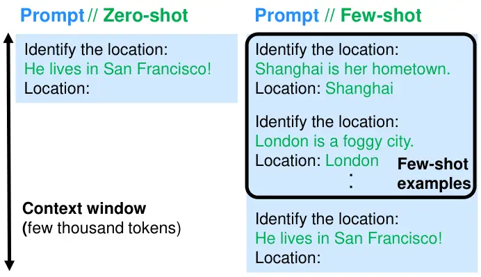
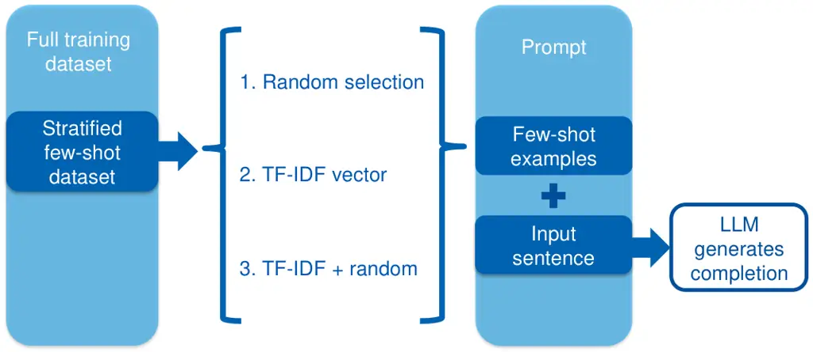
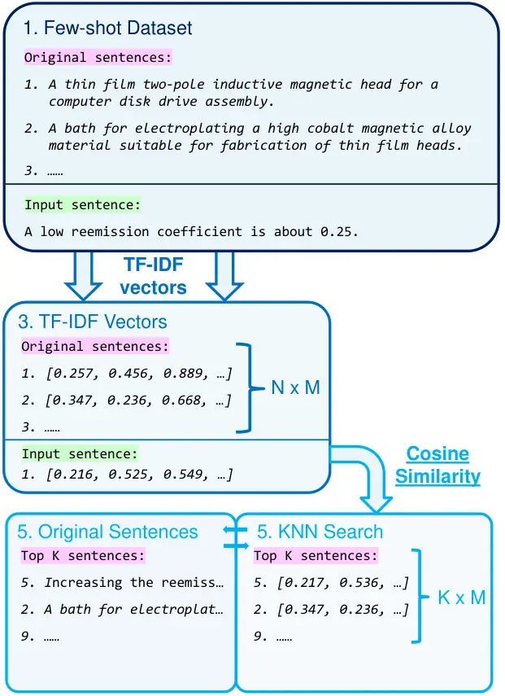
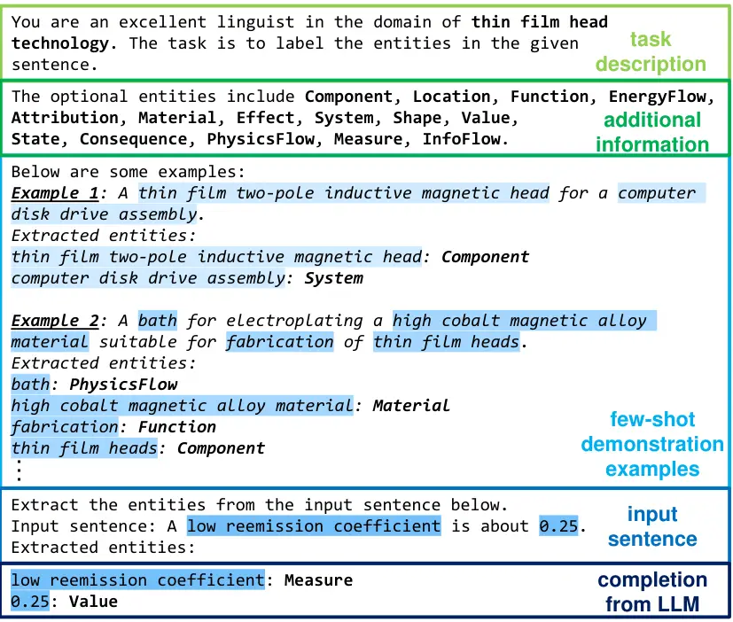
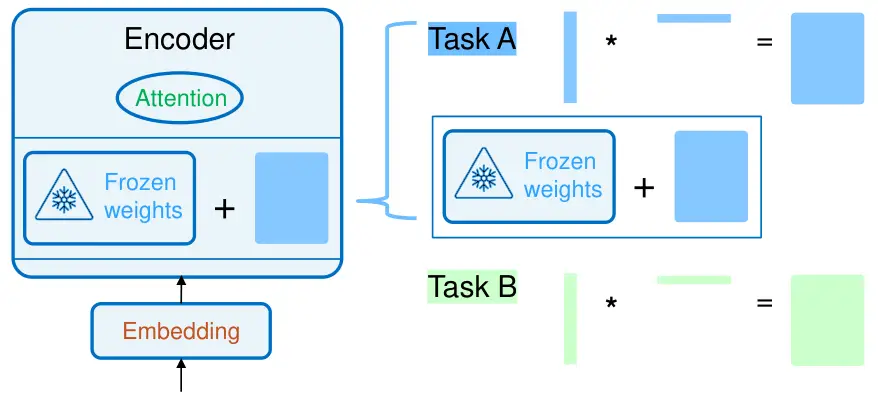
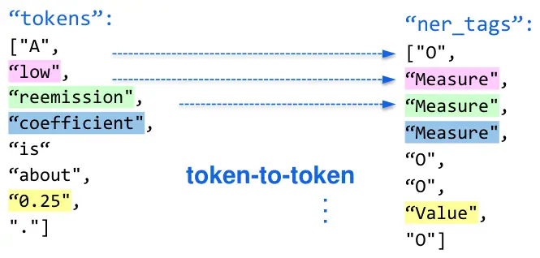
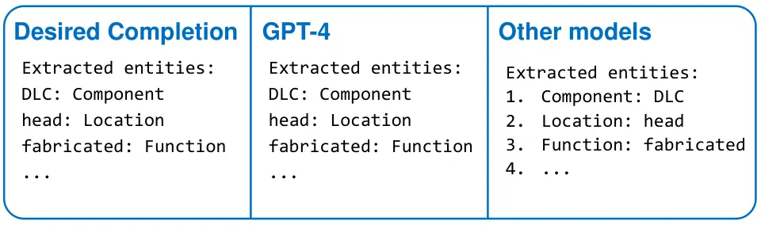

# FsPONER: Few-shot Prompt Optimization for Named Entity Recognition in Domain-specific Scenarios

Yongjian Tang ^(†)^(†)thanks: Yongjian Tang. Email:
yongjian.tang@tum.de. Affiliation: Technical University of Munich,
Germany Affiliation: Siemens AG, Munich, Germany    Rakebul Hasan
Affiliation: Siemens AG, Munich, Germany    Thomas Runkler
Affiliation: Technical University of Munich, Germany
Affiliation: Siemens AG, Munich, Germany

###### Abstract

Large Language Models (LLMs) have provided a new pathway for Named
Entity Recognition (NER) tasks. Compared with fine-tuning, LLM-powered
prompting methods avoid the need for training, conserve substantial
computational resources, and rely on minimal annotated data. Previous
studies have achieved comparable performance to fully supervised
BERT-based fine-tuning approaches on general NER benchmarks. However,
none of the previous approaches has investigated the efficiency of
LLM-based few-shot learning in domain-specific scenarios. To address
this gap, we introduce FsPONER, a novel approach for optimizing few-shot
prompts, and evaluate its performance on domain-specific NER datasets,
with a focus on industrial manufacturing and maintenance, while using
multiple LLMs – GPT-4-32K, GPT-3.5-Turbo, LLaMA 2-chat, and Vicuna.
FsPONER consists of three few-shot selection methods based on random
sampling, TF-IDF vectors, and a combination of both. We compare these
methods with a general-purpose GPT-NER method as the number of few-shot
examples increases and evaluate their optimal NER performance against
fine-tuned BERT and LLaMA 2-chat. In the considered real-world scenarios
with data scarcity, FsPONER with TF-IDF surpasses fine-tuned models by
approximately 10% in F1 score.

^(†)^(†)paperid: 561

## 1 Introduction

Named Entity Recognition (NER) is a common information extraction task,
in which we identify and categorize the key information in the text. The
strategies to solve such sequence labeling tasks have been evolving over
time. NER systems were initially crafted with semantic and syntactic
rules to recognize entities \[Etzioni et al.(2005)Etzioni, Cafarella,
Downey, Popescu, Shaked, Soderland, Weld, and Yates, Sekine and
Nobata(2004)\]. Due to the domain-specific rules and incomplete
dictionaries, such rule-based NER systems cannot be transferred to other
domains. Another strategy comprises unsupervised NER systems \[Collins
and Singer(1999), Nadeau et al.(2006)Nadeau, Turney, and Matwin\], which
detect entities from clustered groups exhibiting similar contextual
information and deduce the correct entities based on the statistical
lexical patterns computed on a large corpus. Furthermore, with the
advent of deep neural networks, NER systems were empowered to learn
distributed word representations and complex features from raw data
automatically \[Lample et al.(2016)Lample, Ballesteros, Subramanian,
Kawakami, and Dyer\]. Facilitated by the transformer
architecture \[Vaswani et al.(2017)Vaswani, Shazeer, Parmar, Uszkoreit,
Jones, Gomez, Kaiser, and Polosukhin\], such pre-trained language models
have advanced the state-of-the-art NER performance progressively over
the past decade \[Devlin et al.(2018)Devlin, Chang, Lee, and Toutanova,
Liu et al.(2019)Liu, Ott, Goyal, Du, Joshi, Chen, Levy, Lewis,
Zettlemoyer, and Stoyanov\]. Nevertheless, either training a model from
scratch or fine-tuning an existing model requires extensive data
tailored to a specific domain and this can be highly cost-intensive in
real-world applications.

In recent years, Foundation LLMs, such as GPT models \[Radford
et al.(2019)Radford, Wu, Child, Luan, Amodei, Sutskever, et al.,
OpenAI(2023), Brown et al.(2020)Brown, Mann, Ryder, Subbiah, Kaplan,
Dhariwal, Neelakantan, Shyam, Sastry, Askell, et al.\], have
demonstrated exceptional competence in knowledge inference and
information extraction, offering us an alternative solution to NER.
Their instruction-following abilities \[Zhang et al.(2023)Zhang, Dong,
Li, Zhang, Sun, Wang, Li, Hu, Zhang, Wu, et al., Ouyang
et al.(2022)Ouyang, Wu, Jiang, Almeida, Wainwright, Mishkin, Zhang,
Agarwal, Slama, Ray, et al.\] facilitate a more streamlined and
accessible problem-solving procedure, while simultaneously reducing the
need for massive annotated data. Fig. 1 illustrates an example of
leveraging LLMs to solve a NER task. In a zero-shot setting, the LLM
identifies the named entities relying on the prior knowledge obtained in
pre-training. The performance can be enhanced by incorporating a
sequence of few-shot examples into the prompt. These examples serve as
demonstrations, allowing the LLM to glean information of the presented
domain and refine its understanding, leading to a more precise
extraction of entity types.

Figure 1: A NER example using zero-shot and few-shot prompting.

In previous studies, LLM-based prompting has achieved comparable
performance to fully supervised baselines on standard NER
benchmarks \[Wang et al.(2023)Wang, Sun, Li, Ouyang, Wu, Zhang, Li, and
Wang, Xie et al.(2023)Xie, Li, Zhang, Zhang, Liu, and Wang, Xu
et al.(2023)Xu, Chen, Peng, Zhang, Xu, Zhao, Wu, Zheng, and Chen\], but
none of these studies evaluate the performance of LLMs on
domain-specific use cases. Moreover, these studies exclusively compare
the LLMs using prompting techniques with middle-sized pre-trained
language models, such as fine-tuned BERT variants \[Devlin
et al.(2018)Devlin, Chang, Lee, and Toutanova, Liu et al.(2019)Liu, Ott,
Goyal, Du, Joshi, Chen, Levy, Lewis, Zettlemoyer, and Stoyanov, Sanh
et al.(2019)Sanh, Debut, Chaumond, and Wolf\], and a comparison to
fine-tuned LLMs of the same size is still missing. To the best of our
knowledge, we are the first to include both genuine LLMs using few-shot
prompting and instruction fine-tuned LLMs in experiments. The
contribution of this work can be summarized as follows:

- (i)
  We propose FsPONER with three variants with different few-shot
  selection methods to filter semantically close examples and optimize
  the prompt.
- (ii)
  We investigate how the number of few-shot examples and the scale of
  few-shot datasets influence the NER performance.
- (iii)
  We exemplify the evaluation results of FsPONER on industrial
  manufacturing and maintenance use cases to assess its effectiveness in
  domain-specific NER scenarios, using four LLMs – GPT-4-32K,
  GPT-3.5-Turbo, LLaMA 2-chat, and Vicuna.
- (iv)
  We compare FsPONER with a non-domain-specific GPT-NER method and
  evaluate their optimal NER performance against fine-tuned LLaMA 2-chat
  7B and BERT, observing that FsPONER attains a 10% higher F1 score in
  the considered scenarios with data scarcity.

## 2 Related Work

### 2.1 Development of Language Models

Language modeling \[Zhao et al.(2023)Zhao, Zhou, Li, Tang, Wang, Hou,
Min, Zhang, Zhang, Dong, Du, Yang, Chen, Chen, Jiang, Ren, Li, Tang,
Liu, Liu, Nie, and Wen\] stands out as a core technique to advance
language intelligence of machines and has received extensive attention
over the past decade. The story begins with statistical language
models \[Jelinek(1998)\], which follow the Markov assumption and predict
the next word based on the most recent context. The rise of deep neural
architectures opens the stage for neural language models. As a
milestone, Bengio et al. \[Bengio et al.(2000)Bengio, Ducharme, and
Vincent\] introduced the concept of distributed word representations and
crafted word prediction functions on aggregated context features.
Furthermore, Collobert et al. proposed a unified multi-layer neural
architecture by discovering the internal representations of unlabeled
datasets \[Collobert et al.(2011)Collobert, Weston, Bottou, Karlen,
Kavukcuoglu, and Kuksa\], while Mikolov et al. \[Mikolov
et al.(2013b)Mikolov, Sutskever, Chen, Corrado, and Dean, Mikolov
et al.(2013a)Mikolov, Chen, Corrado, and Dean\] proposed word2vec, a
simplified shallow neural network designed for learning word
representations effectively. These studies have initiated the
utilization of language models for representation learning, elevating
word sequence modeling to a more advanced level.

Vaswani et al. \[Vaswani et al.(2017)Vaswani, Shazeer, Parmar,
Uszkoreit, Jones, Gomez, Kaiser, and Polosukhin\] proposed the
transformer architecture and attention mechanism, which started the
generation of pre-trained language models. In alignment with this highly
parallelizable architecture, language models were trained to learn
context-aware word representations. BERT, a model proposed by Devlin et
al. \[Devlin et al.(2018)Devlin, Chang, Lee, and Toutanova\] and
pre-trained on large-scale unlabeled corpora bidirectionally, stands
out. The semantic representations obtained in pre-training make BERT
approachable for a broad spectrum of downstream tasks in specific
domains. Inspired by such ”pre-training” and ”fine-tuning” modes, a
substantial quantity of follow-up works have been developed over time,
e.g. RoBERTa \[Liu et al.(2019)Liu, Ott, Goyal, Du, Joshi, Chen, Levy,
Lewis, Zettlemoyer, and Stoyanov\] and DistilBERT\[Sanh
et al.(2019)Sanh, Debut, Chaumond, and Wolf\].

The research community continues to enhance the performance of language
models by scaling up their sizes. Compared with their smaller
counterparts, large-scale models demonstrate unseen emergent
abilities \[Wei et al.(2022a)Wei, Tay, Bommasani, Raffel, Zoph,
Borgeaud, Yogatama, Bosma, Zhou, Metzler, Chi, Hashimoto, Vinyals,
Liang, Dean, and Fedus, Lu et al.(2023)Lu, Bigoulaeva, Sachdeva,
Madabushi, and Gurevych\] in solving complex tasks, which have provided
us with more information-based problem-solving possibilities, such as
in-context learning, prompt engineering, step-by-step reasoning and
retrieval augmented generation. These techniques have enlightened this
work, leveraging few-shot prompting to solve domain-specific NER tasks.

### 2.2 In-context Learning

In-context learning \[Dong et al.(2022)Dong, Li, Dai, Zheng, Wu, Chang,
Sun, Xu, and Sui\] refers to the process of learning from analogy, where
a query and a piece of demonstration context are merged into a prompt
and then fed into LLMs to obtain the required outcomes. In contrast to
supervised learning, in which model parameters are updated at training
or fine-tuning stages, ICL does not perform any parameter updates, but
generates the answer directly based on the provided information. The
prompt serves as an activator, enabling LLMs to understand the critical
information within the demonstration context comprehensively.

Wei et al. \[Wei et al.(2023b)Wei, Wei, Tay, Tran, Webson, Lu, Chen,
Liu, Huang, Zhou, and Ma\] illustrate that LLMs can override semantic
pre-trained knowledge when presented with conflicting in-context
examples. The ability to surpass semantic priors enhances as the model
size increases. Smaller models cannot flip predictions and follow
contradictory labels, while larger models can perform this effectively.
Liu et al. \[Liu et al.(2023)Liu, Lin, Hewitt, Paranjape, Bevilacqua,
Petroni, and Liang\] utilize LLMs to retrieve relevant information
within a long context. They find that the performance is optimal when
relevant information occurs at the beginning or end of the input
context, and it degrades significantly when models must access relevant
information in the middle. Moreover, as the input context grows longer,
even explicitly designed long-context models fail to identify the
relevant information effectively.

Many creative ideas of ICL have been proposed. Li et al. \[Li
et al.(2023)Li, Wang, Zhu, Zhang, Hou, Lian, and Xie\] introduce
EmotionPrompt, which incorporates emotional stimulus into prompts and
emphasizes the task significance to improve the performance of LLMs. Ye
et al. \[Ye et al.(2024)Ye, Hwang, Yang, Yun, Kim, and Seo\] add an
instruction set to the prompt and enhance the zero-shot generalization
abilities of LLMs. Wei et al. \[Wei et al.(2023a)Wei, Hou, Lampinen,
Chen, Huang, Tay, Chen, Lu, Zhou, Ma, and Le\] present symbol tuning.
They replace in-context input–label pairs with arbitrary symbols and
find that symbol-tuned LLMs are better at ICL than original models,
especially in settings where relevant labels are not available.

In terms of reasoning, Kojima et al. \[Kojima et al.(2022)Kojima, Gu,
Reid, Matsuo, and Iwasawa\] show that LLMs are decent zero-shot
reasoners by adding an instructive command at the end of the prompt
template. Wei et al. \[Wei et al.(2022b)Wei, Wang, Schuurmans, Bosma,
Xia, Chi, Le, Zhou, et al.\] propose chain-of-thought prompting and
improve the performance of LLMs on a range of arithmetic, commonsense,
and symbolic reasoning tasks. Built on this, Yao et al. \[Yao
et al.(2024)Yao, Yu, Zhao, Shafran, Griffiths, Cao, and Narasimhan\]
introduce tree-of-thought, which allows language models to perform
deliberate decision-making by considering multiple different reasoning
paths and self-evaluating choices to decide the next course of action.
Moreover, Besta et al. \[Besta et al.(2024)Besta, Blach, Kubicek,
Gerstenberger, Podstawski, Gianinazzi, Gajda, Lehmann, Niewiadomski,
Nyczyk, et al.\] propose graph of thoughts, in which the information
generated by LLMs is modeled as an arbitrary graph, where units of
information are vertices, and edges correspond to dependencies between
these vertices.

### 2.3 In-context Learning with Few-shot Examples

The in-context learning ability of LLMs has facilitated a new form of
few-shot learning – few-shot prompting, in which demonstration examples
are integrated into the context window directly.

Lu et al. \[Lu et al.(2022)Lu, Bartolo, Moore, Riedel, and Stenetorp\]
find that the order in which few-shot examples are permutated in the
prompt can make the difference between near state-of-the-art and random
guess performance. Larger models generally achieve better performance
with low variance in the experiments, and adding more few-shot samples
into prompts does yield a noticeable enhancement in performance, but it
does not significantly reduce variance. To find the optimal sample
permutations, they propose the idea of ordering few-shot examples based
on entropy, which yields a 13$`\%`$ relative improvement for GPT family
models across eleven different text classification tasks.

Furthermore, Liu et al. \[Liu et al.(2022)Liu, Shen, Zhang, Dolan,
Carin, and Chen\] propose the idea of selecting few-shot examples in the
embedding space of a sentence encoder. They leverage RoBERTa-large \[Liu
et al.(2019)Liu, Ott, Goyal, Du, Joshi, Chen, Levy, Lewis, Zettlemoyer,
and Stoyanov\] to transform original sentences into embedding vectors.
Based on these vectors, they apply the $`k`$NN algorithm to identify the
$`k`$ nearest examples for the input sentence and use them as few-shot
examples. The selected in-context examples can provide more informative
inputs to unleash GPT-3’s extensive knowledge. Such refined few-shot
selection strategy has shown efficiency in advancing the performance of
LLMs across a wide range of NLP tasks, including question answering,
machine translation, and information extraction.

### 2.4 Few-shot In-context Learning for NER

Regarding the application of LLMs in NER tasks, Wang et al. \[Wang
et al.(2023)Wang, Sun, Li, Ouyang, Wu, Zhang, Li, and Wang\] integrate
semantically close examples into the prompt and analyze the impact of
few-shot quantity and quality on NER performance. They enhance the
embedding-based few-shot selection method \[Liu et al.(2022)Liu, Shen,
Zhang, Dolan, Carin, and Chen\] by replacing RoBERTa-large \[Liu
et al.(2019)Liu, Ott, Goyal, Du, Joshi, Chen, Levy, Lewis, Zettlemoyer,
and Stoyanov\] with SimCSE \[Gao et al.(2021)Gao, Yao, and Chen\], a
contrastive learning framework developed for sentence embedding, and
using it to encode the few-shot examples and input sentences. They name
the approach GPT-NER, which exhibits efficiency in low-resource and
few-shot setups, and has attained comparable performance to
fully-supervised BERT-based approaches on two general NER benchmarks.

Xie et al. \[Xie et al.(2023)Xie, Li, Zhang, Zhang, Liu, and Wang\]
investigate the zero-shot performance of ChatGPT \[Radford
et al.(2019)Radford, Wu, Child, Luan, Amodei, Sutskever, et al.\] in
information extraction, in which they adapt reasoning methods and
decompose the NER task into multiple simpler sub-problems. Their method
enhances the zero-shot NER performance across seven benchmarks,
including Chinese and English datasets as well as domain-specific and
general-purpose scenarios. However, their study does not encompass
few-shot learning.

## 3 FsPONER

Previous studies have focused on identifying semantically similar
examples to the input in the embedding space, which overlooked the
entity distribution within the dataset. When dealing with infrequent
entity types in specific domains, LLMs may struggle to accurately
extract entities using the universal prior knowledge acquired during
pre-training. To address this, we introduce data stratification as a
preliminary step to consider all entity types fairly and propose
FsPONER, a LLM-based NER framework with three different few-shot
selection methods: random sampling, TF-IDF vectors, and a combination of
both. The goal is to incorporate term frequency alongside sentence
embedding, enhancing domain-specific NER performance. We follow the
outline in Fig. 2 and demonstrate the principle of prompt optimization
in FsPONER.

Figure 2: Overview of FsPONER.

### 3.1 Stratified Few-shot Dataset

The entity types in NER datasets are usually not equally distributed. If
we directly select few-shot examples from the original dataset, we risk
focusing only on the most common entity types while overlooking the less
common ones. To address this issue, we uniformly stratify a certain
number of few-shot examples based on their entity types and build a
stratified few-shot dataset.

We start by sorting all entity types from the raw dataset based on their
frequency. Subsequently, we iterate through the examples of each entity
type, and sequentially select one example from the most frequent entity
to the least frequent one. The stratified dataset fairly considers less
frequent entities and enables LLMs to learn more detailed information
from the few-shot examples.

Furthermore, a smaller few-shot dataset aligns with our practical
considerations, because in real-world projects, data annotation is
expensive and only hundreds of annotated data are available. To simulate
such low-resource scenarios, we limit the size of few-shot dataset to
300 examples in the experiments.

### 3.2 Few-shot Selection Methods

We illustrate FsPONER with three variants with different few-shot
selection methods: random sampling, TF-IDF vectors, and a combination of
both.

#### 3.2.1 Selecting few-shot examples randomly

Random sampling is an intuitive solution, in which samples are drawn
from the few-shot dataset randomly and employed as few-shot examples
directly. For each input sentence, the selected samples are
non-repetitive, but they can be selected as few-shot examples for other
input sentences repeatedly. While this approach is straightforward to
implement, it overlooks the semantic relation between the sentences.
Therefore, we incorporate TF-IDF into the other two methods to filter
more fitting examples.

#### 3.2.2 Selecting few-shot examples based on TF-IDF vectors

As a weighting factor, Term Frequency–Inverse Document Frequency
(TF-IDF) measures the significance of a word to a document in a corpus
and finds wide applications in information retrieval and text mining
tasks.

Figure 3: The few-shot selection process based on TF-IDF vectors.

The TF-IDF-based method shares a similar structure with GPT-NER \[Wang
et al.(2023)Wang, Sun, Li, Ouyang, Wu, Zhang, Li, and Wang\], but we
substitute the sentence encoder with a TF-IDF transformer, converting
both input sentences and few-shot examples into TF-IDF vectors. As
illustrated in Fig. 3, we store the transformed TF-IDF vectors in an
$`N\times M`$ matrix, where $`N`$ is the number of few-shot examples and
$`M`$ is the quantity of individual words within this corpus. We
calculate the cosine similarity between two TF-IDF vectors and identify
the $`K`$ nearest few-shot examples for each input sentence as few-shot
examples.

#### 3.2.3 Selecting few-shot examples based on TF-IDF and random sampling

Assuming that NER datasets exhibit a normal distribution of entities, we
suggest the third method by integrating random sampling into the
TF-IDF-based selection. Our goal is to ensure that the distribution of
entities in the selected few-shot examples aligns with the overall
few-shot dataset. For this purpose, we alternatively select few-shot
examples from two sets of examples created through either random
sampling or TF-IDF vectors until we reach the desired quantity.

### 3.3 Prompt Structure

Using the few-shot examples selected by FsPONER, we craft the prompt for
domain-specific NER use cases.

Figure 4: The prompt structure for domain-specific NER tasks.

Fig. 4 illustrates the prompt structure, which consists of a concise
task description, a paragraph of additional information, multiple
few-shot examples, and the input sentence, from which LLMs identify the
named entities. In the task description, we explain the NER task briefly
and clearly define the dataset’s domain. This allows the LLM to exploit
the domain-specific knowledge acquired during the pre-training stage.
Subsequently, we enumerate all pre-defined named entities as additional
information to constrain the entity types for the LLM. In the third
block, we add the selected few-shot examples to the prompt. The LLM
learns from these examples and thereby extracts the entities more
accurately during the inference stage. After the few-shot demonstration,
we finally add the formal input sentence to the prompt and perform
inference based on the given information.

## 4 Fine-tuning

As LLM-based prompting becomes increasingly popular, there is a growing
interest in the research community to evaluate their performance against
fine-tuned language models. Previous works \[Wang et al.(2023)Wang, Sun,
Li, Ouyang, Wu, Zhang, Li, and Wang\] have shown that general-purpose
LLMs can achieve comparable performance to fine-tuned models in standard
benchmarks. However, their efficacy in domain-specific scenarios has
never been studied. To address this gap, we fine-tune BERT and LLaMA
2-chat on three industrial datasets and compare the results with LLMs
using FsPONER. We outline the procedure of fine-tuning LLaMA 2-chat 7B,
with a focus on data pre-processing and low-rank adaptation \[Hu
et al.(2022)Hu, Shen, Wallis, Allen-Zhu, Li, Wang, Wang, and Chen\] to
reduce GPU requirements.

### 4.1 Data Preprocessing

An unprocessed instruction dataset comprises instruction, input, and
output columns. The instruction describes the task. The input provides
further context of this task. The response represents the standard
answer that LLMs should generate. As shown in Fig. 5, we place these
columns side by side to create a set of prompt-completion pairs for
instruction fine-tuning, accompanied by an introductory explanation at
the beginning to elucidate their respective roles. Throughout the
training process, the LLM learns the statistical distribution of
prompt-completion pairs, thereby advancing its understanding in the
specific domain.

Figure 5: A pre-processed prompt-completion pair for fine-tuning.

### 4.2 Low-rank Adaptation

Training the LLaMA 2-chat 7B model in full precision is infeasible with
our available GPU resources. We leverage Low-Rank Adaptation (LoRA) \[Hu
et al.(2022)Hu, Shen, Wallis, Allen-Zhu, Li, Wang, Wang, and Chen\] in
Fig. 6 to reduce the hardware requirement on GPU memory while
simultaneously maintaining the on-par performance. LoRA reduces the
parameters to be trained by freezing all original model parameters and
injecting a pair of low-rank decomposition matrices. We only update the
two decomposition matrices in training. For different downstream tasks
or datasets, we train different decomposition matrices and then add them
to the original weights to update the values. The memory required to
store these matrices is much smaller than training the entire model,
which makes the entire fine-tuning process more accessible.

Figure 6: The principle of LoRA.

### 4.3 BERT-based Fine-tuning

BERT variants find wide applications in diverse downstream tasks and
many of them still hold the state-of-the-art performance on standard
benchmarks. Therefore, we include BERT as a reference and fine-tune it
for the considered NER datasets in a supervised fashion.

As an encoder model, BERT approaches NER as a sequence labeling task and
the data preprocessing differs from LLaMA 2-chat. As illustrated in
Fig. 7, we convert the raw data into token-to-token JSON format. During
the fine-tuning process, BERT learns to associate each individual word
token with the correct entity type.

Figure 7: The BERT model formulates NER as a token-to-token task.

## 5 Experiments

Regarding LLM-based prompting, multiple influencing factors, such as the
order, quantity, and quality of few-shot examples, can influence the
performance of LLMs. Considering these factors, some existing
works \[Wang et al.(2023)Wang, Sun, Li, Ouyang, Wu, Zhang, Li, and Wang,
Xu et al.(2023)Xu, Chen, Peng, Zhang, Xu, Zhao, Wu, Zheng, and Chen\]
optimize the few-shot examples for the prompt, progressively advancing
the performance of LLMs on general NER benchmarks. However, none of them
investigates the efficiency of few-shot prompting on domain-specific NER
scenarios. To answer the question, we integrate FsPONER into four LLMs
and compare the performance with fine-tuned BERT and LLaMA 2-chat 7B on
three NER datasets in industrial manufacturing and maintenance,
exemplifying the advantages and drawbacks of few-shot prompting in the
considered domain-specific scenarios.

### 5.1 Experimental setting

Selected LLMs: We have experimented with 4 LLMs to investigate the
efficiency of FsPONER. Table 1 provides an overview of these models
based on their sizes, context window length, training data volume,
allowed input modalities, and openness to the public. The two
large-scale GPT models – GPT-3.5-turbo \[Brown et al.(2020)Brown, Mann,
Ryder, Subbiah, Kaplan, Dhariwal, Neelakantan, Shyam, Sastry, Askell,
et al.\] and GPT-4-32K \[OpenAI(2023)\] are only accessible with OpenAI
API. Their performance stands for the forefront of existing LLMs, which
allows us to exploit the full potential of FsPONER. Furthermore, we
include LLaMA 2-chat \[tou(2023)\], one of the open-source
top-performing models released by Meta AI, and Vicuna \[Zheng
et al.(2023)Zheng, Chiang, Sheng, Zhuang, Wu, Zhuang, Lin, Li, Li, Xing,
Zhang, Gonzalez, and Stoica\], which is instruction fine-tuned from
LLaMA 2-chat 13B on 125K instructional conversations generated by human
beings. Alongside the four LLMs, we consider BERT \[Devlin
et al.(2018)Devlin, Chang, Lee, and Toutanova\] and evaluate it as a
reference. Since it does not demonstrate instruction-following
abilities, we fine-tune it for NER tasks in a supervised fashion.

| Models          | GPT-3.5-turbo | GPT-4-32k  | LLaMA 2-chat | Vicuna V1.5  |
| --------------- | ------------- | ---------- | ------------ | ------------ |
| Model size      | 175B          | \-         | 7B/13B/70B   | 7B/13B       |
| (parameters)    |               |            |              |              |
| Context window  | 4096          | 32768      | 4096         | 4096         |
| length (tokens) |               |            |              |              |
| Training data   | 300B tokens   | \-         | 2T tokens    | 2T tokens +  |
| volume          | for GPT-3     |            |              | 125K samples |
| Modalities      | text          | text/image | text         | text         |
|                 |               | (input)    |              |              |
| Openness        | closed        | closed     | open         | open         |

Table 1: Basic information of the selected LLMs

Selected datasets: In the experiments we consider the following three
publicly available real-world datasets from industrial manufacturing and
maintenance – the thin-film head technology dataset \[Chen
et al.(2020)Chen, Xu, Zhu, Zhang, Lei, and Yang\], the assembly
instruction dataset \[Costa et al.(2017)Costa, Veiga, Sousa, and
Nunes\], and the manufacturing dataset \[Kumar and Starly(2022)\]. We
present their basic information in Table 2.

| Datasets   | Number   | Number   | Domain    | State-of-  | Examples          |
| ---------- | -------- | -------- | --------- | ---------- | ----------------- |
|            | of words | of types |           | the-art    | of types          |
|            |          |          |           | (F1 score) |                   |
| FabNER     | 350,000+ | 12       | Manufac-  | 92%        | MATE(Material),   |
|            |          |          | turing    |            | PRO(Properties),  |
|            |          |          |           |            | ENAT(Enabling     |
|            |          |          |           |            | technology),      |
|            |          |          |           |            | …                 |
| Thin-film  | 92,000+  | 17       | Hard-disk | 78.2%      | Component,        |
| head       |          |          |           |            | Function,         |
| technology |          |          |           |            | PhysicsFlow,      |
|            |          |          |           |            | EnergyFlow,       |
|            |          |          |           |            | …                 |
| Assembly   | 22,000+  | 9        | Assembly  | 84.69%     | PART(parts),      |
| NER        |          |          |           |            | OPER(operations), |
|            |          |          |           |            | TOOL(tools),      |
|            |          |          |           |            | QTY(Quality),     |
|            |          |          |           |            | …                 |

Table 2: Basic information of the three NER datasets

Few-shot dataset: For real-world use cases, data annotation proves to be
a cost-intensive endeavor. Utilizing limited high-quality data resources
to enhance the performance of LLMs is a sensible and realistic strategy.
In line with this practical consideration, we create a stratified
few-shot dataset of 300 samples. From our empirical practice, this is an
applicable volume that keeps data annotation expenses within a
manageable bound. When constructing the prompt, few-shot examples will
be selected from this dataset.

### 5.2 Results of FsPONER

We compare the three few-shot selection methods proposed for FsPONER
with GPT-NER \[Wang et al.(2023)Wang, Sun, Li, Ouyang, Wu, Zhang, Li,
and Wang\] as we increase the number of few-shot examples in the prompt
and attempt to identify the top-performing setting for FsPONER.

Due to the massive scale of conducted experiments and some repetitive
results across the three datasets, we exclusively demonstrate the
evaluation results on the thin-film technology dataset and perform
in-depth analysis for the selected models. For readers who are
interested, the evaluation results on the other two datasets are
available in supplementary documents \[Tang et al.(2024)Tang, Hasan, and
Runkler\].

Fig. 9 illustrates the evaluation results on the thin-film head
technology dataset, with few-shot selection methods on the horizontal
axis and F1 score on the vertical axis. Multiple performance-changing
rules of LLMs are evident. All evaluated models advance their
performance across all few-shot selection methods as the number of
few-shot examples increases. With an extended context window, GPT-4
leads the performance and achieves the optimal F1 score of 68.76% by
integrating 80 few-shot examples selected by FsPONER with TF-IDF.
Furthermore, GPT-4 demonstrates exceptional capability in correctly
understanding instructions. In the zero-shot evaluation, only GPT-4 can
strictly adhere to the format described in text when generating entity
types. The other LLMs may modify the format spontaneously, e.g. adding a
serial number or placing the corresponding entity types before the
original words, as illustrated in Fig. 8. Additional steps are required
to process these generated completions.

Figure 8: The generated completions in zero-shot setting.

For the other models, due to the limited context window of 4096 tokens,
we are not allowed to add more than 20 few-shot examples to the prompt.
When using Fs-PONER with TF-IDF, Text-Davinci-003 from the GPT-3-Turbo
family demonstrates the optimal performance, reaching a weighted F1
score over 66%, which is 2.7% lower than GPT-4-32K. However, if we feed
both GPT models with 20 few-shot examples, Text-Davinci-003 leads the F1
score by 0.5%.

Figure 9: The evaluation results on the thin-film technology dataset.
    (RS refers to random sampling.)

Due to the limited model size, the performance of the selected
open-source models falls behind the two GPT models. With respect to
LLaMA 2-chat, the 13B version surpasses the 7B model in multiple facts.
The performance of LLaMA 2-chat 7B hits a plateau once we have added 5
few-shot examples to the prompt. By contrast, the LLaMA 2-chat 13B
demonstrates stronger ability to comprehend long context and the
performance continues to improve as we increase the number of few-shot
examples, reaching a F1 score of 62.05%, which is 4.97% higher than the
7B model when employing FsPONER with TF-IDF.

Vicuna-V1.5-13B is instruction fine-tuned from LLaMA 2-chat 13B using
125K human-generated conversations, the overall NER performance is close
to the fundamental model, reaching a weighted F1 score of 61.42%. This
observation indicates that fine-tuning on more generic conversational
data does not enhance LLM’s performance in a industrial domain.

If we zoom in GPT-4-32K, the performance has not saturated. When we
double the number of few-shot examples from 40 to 80, an improvement by
around 1% can still be observed in FsPONER with TF-IDF. Therefore, we
integrate more few-shot examples, aiming to identify the maximum
achievable performance of GPT-4-32k on the three considered NER
datasets.

Figure 10: The F1 score of GPT-4-32K on three NER datasets with a
growing number of few-shot examples selected randomly (left) or using
TF-IDF vectors (right).

According to the previous experiments, FsPONER with TF-IDF achieves the
top-notch performance among all few-shot selection methods. In light of
this conclusion, we analyze the advantages of TF-IDF against random
sampling and illustrate the F1 score evolution as we increase the number
of few-shot examples to 100 in Fig. 10.

For both few-shot selection methods, F1 scores improve dramatically in
the first 20 few-shot examples and the trend slows down after reaching
40 examples. The NER performance with 60 few-shot examples closely
approaches the performance with 100 examples, showing a difference below
1.5% for random sampling and 0.8% for TF-IDF in all three datasets.
After the performance curve gradually levels off, TF-IDF secures a
higher F1 score. Furthermore, compared to the twisting curve resulting
from the unpredictable quality of random examples, the performance
advances coherently and consistently in TF-IDF. The saturation
phenomenon of F1 score exhibits the performance plateau of prompting
with more few-shot examples. We have reached the optimal performance of
FsPONER.

### 5.3 Results of Fine-tuning

Following the evaluation results in Fig. 9 and Fig. 10, we use FsPONER
with TF-IDF for few-shot selection, integrating 80 few-shot examples in
the prompt for each input sentence, and compare its performance with the
fine-tuned BERT and LLaMA 2-chat 7B. While the LLMs using FsPONER select
examples from the few-shot dataset, Bert and LLaMA 2-chat are fine-tuned
with the full training dataset in our experiments.

We include an unsupervised NER baseline additionally to measure the
advanced performance of language models. While the initial method \[Wang
et al.(2022)Wang, Li, Meng, Zhang, Ouyang, Li, and Wang\] integrates the
$`k`$NN algorithm into the vanilla BERT model as a complete system, we
directly utilize sentence-BERT to obtain the embedding of each token.
This adaptation enables us to avoid training BERT, which overlaps with
the bert-based fine-tuning approach.

Figure 11: Overal NER performance of different language models on the
thin-film technology, FabNER manufacturing, and assemblyNER datasets
(from top to bottom).

As illustrated in Fig. 11, the fine-tuned models outperform the
pre-trained LLMs using FsPONER in the two larger datasets. In the FabNER
dataset, the fine-tuned LLaMA 2-chat 7B obtains 78.28% and the
fine-tuned BERT reaches 74.04%, which leads all pre-trained models by
more than 20% in F1 score. We observe analogous results from the thin
film technology dataset, where the fine-tuned LLaMA 2-chat 7B achieves
the optimal performance of 81.06%, higher than the state-of-the-art
presented in Table 2. However, in the assembly dataset, which consists
of fewer data but with more generic entity types, the two GPT models
using FsPONER surpass the fine-tuned models, reaching 83.43% and 81.23%
in F1 score respectively. One explanation for this phenomenon is the
data scarcity in assembly domain, preventing effective fine-tuning of
BERT and LLaMA 2-chat 7B to attain their optimal performance.

In the experiments, we confine the source of few-shot examples to the
stratified few-shot dataset while fine-tuning with the full dataset.
Considering the difference in the quantity of applied data, we continue
investigating FsPONER with a varying size of few-shot dataset and extend
the data source to the full dataset.

Figure 12: The F1 score of GPT-4 with an increasing size of few-shot
dataset in thin-film technology (left) and manufacturing (right)
domains.

Fig. 12 illustrates the results, where we progressively expand the size
of few-shot dataset from 100 examples to the full dataset. The
assemblyNER dataset is not included, due to its limited data volume. For
the thin-film technology and FabNER manufacturing datasets, the F1 score
improves as the few-shot datasets scale up. When we utilize the full
dataset, GPT-4 can achieve a F1 score of 86.42% on the thin-film
technology dataset, which surpasses the fine-tuned LLaMA 2-chat 7B by
5.36%. In the FabNER dataset, GPT-4 advances the 52% F1 score obtained
with 300 few-shot examples to 69% by utilizing the entire dataset, which
is approximately 9% lower than the fully fine-tuned LLaMA 2 chat.

### 5.4 Discussion

The performed experiments demonstrate that data quantity, domain
specificity, and the model capabilities significantly influence
FsPONER’s performance in domain-specific NER tasks. In a scenario with
generic entity types, i.e. in the assemblyNER dataset, FsPONER with a
small set of high-quality data can outperform fine-tuning with the full
dataset. However, in a specific domain with abundant data, e.g. in the
FabNER dataset, fine-tuning still leads the performance. For both
fine-tuning and the FsPONER framework, larger models demonstrate more
advanced performance in general, but they require massive training data
and sufficient compute budget. We must consider the available GPU
resources, the allowed training time, and the resulting cost. With a
model of proper size and a well-suited method, we can achieve the
optimal performance within a cost-effective setting.

## 6 Conclusions and Future Work

In this work, we proposed FsPONER, a few-shot selection framework for
domain-specific NER tasks. In the considered NER scenarios, FsPONER with
TF-IDF consistently demonstrates the top-notch performance compared to a
general-purpose GPT-NER method and all other FsPONER variants. As we
increase the quantity of few-shot examples in the prompt or expand the
size of few-shot datasets, the performance of FsPONER continues to
improve. Specifically, in an industrial manufacturing scenario with data
scarcity, FsPONER with TF-IDF outperforms the fine-tuned models by
approximately 10% in F1 score.

As for future work, more strategies against hallucination are required
to generate solid entities and avoid varying completion formats in
Fig. 8. Furthermore, the long inference time of LLMs necessitates an
efficient solution, especially when dozens of few-shot examples are
added to the prompt. Moreover, the leaderboard of LLMs is continuously
updated. Many compact models have been specifically designed for
information extraction and should be assessed for domain-specific NER
tasks, which may have the potential to surpass the currently
top-performing LLMs.

## References

- \[tou(2023)\] LLaMA 2: Open foundation and fine-tuned chat
  models, 2023.
- \[Bengio et al.(2000)Bengio, Ducharme, and Vincent\] Y. Bengio,
  R. Ducharme, and P. Vincent. A neural probabilistic language model.
  _Advances in Neural Information Processing Systems_, 13, 2000.
- \[Besta et al.(2024)Besta, Blach, Kubicek, Gerstenberger, Podstawski,
  Gianinazzi, Gajda, Lehmann, Niewiadomski, Nyczyk, et al.\] M. Besta,
  N. Blach, A. Kubicek, R. Gerstenberger, M. Podstawski, L. Gianinazzi,
  J. Gajda, T. Lehmann, H. Niewiadomski, P. Nyczyk, et al. Graph of
  thoughts: Solving elaborate problems with large language models. In
  _Proceedings of the AAAI Conference on Artificial Intelligence_,
  volume 38, pages 17682–17690, 2024.
- \[Brown et al.(2020)Brown, Mann, Ryder, Subbiah, Kaplan, Dhariwal,
  Neelakantan, Shyam, Sastry, Askell, et al.\] T. Brown, B. Mann,
  N. Ryder, M. Subbiah, J. D. Kaplan, P. Dhariwal, A. Neelakantan,
  P. Shyam, G. Sastry, A. Askell, et al. Language models are few-shot
  learners. _Advances in Neural Information Processing Systems_,
  33:1877–1901, 2020.
- \[Chen et al.(2020)Chen, Xu, Zhu, Zhang, Lei, and Yang\] L. Chen,
  S. Xu, L. Zhu, J. Zhang, X. Lei, and G. Yang. A deep learning based
  method for extracting semantic information from patent documents.
  _Scientometrics_, 125(1):289–312, oct 2020. ISSN 0138-9130.
- \[Collins and Singer(1999)\] M. Collins and Y. Singer. Unsupervised
  models for named entity classification. In _1999 Joint SIGDAT
  Conference on Empirical Methods in Natural Language Processing and
  Very Large Corpora_, 1999.
- \[Collobert et al.(2011)Collobert, Weston, Bottou, Karlen,
  Kavukcuoglu, and Kuksa\] R. Collobert, J. Weston, L. Bottou,
  M. Karlen, K. Kavukcuoglu, and P. Kuksa. Natural language processing
  (almost) from scratch. _Journal of Machine Learning Research_,
  12(ARTICLE):2493–2537, 2011.
- \[Costa et al.(2017)Costa, Veiga, Sousa, and Nunes\] C. M. Costa,
  G. Veiga, A. Sousa, and S. Nunes. Evaluation of stanford NER for
  extraction of assembly information from instruction manuals. In _2017
  IEEE International Conference on Autonomous Robot Systems and
  Competitions (ICARSC)_, pages 302–309, 2017.
- \[Devlin et al.(2018)Devlin, Chang, Lee, and Toutanova\] J. Devlin,
  M.-W. Chang, K. Lee, and K. Toutanova. BERT: Pre-training of deep
  bidirectional transformers for language understanding. 2018.
- \[Dong et al.(2022)Dong, Li, Dai, Zheng, Wu, Chang, Sun, Xu, and Sui\]
  Q. Dong, L. Li, D. Dai, C. Zheng, Z. Wu, B. Chang, X. Sun, J. Xu, and
  Z. Sui. A survey for in-context learning. _arXiv preprint
  arXiv:2301.00234_, 2022.
- \[Etzioni et al.(2005)Etzioni, Cafarella, Downey, Popescu, Shaked,
  Soderland, Weld, and Yates\] O. Etzioni, M. Cafarella, D. Downey,
  A.-M. Popescu, T. Shaked, S. Soderland, D. S. Weld, and A. Yates.
  Unsupervised named-entity extraction from the web: An experimental
  study. _Artificial Intelligence_, 165(1):91–134, 2005.
- \[Gao et al.(2021)Gao, Yao, and Chen\] T. Gao, X. Yao, and D. Chen.
  SimCSE: Simple contrastive learning of sentence embeddings. In
  _Empirical Methods in Natural Language Processing (EMNLP)_, 2021.
- \[Hu et al.(2022)Hu, Shen, Wallis, Allen-Zhu, Li, Wang, Wang, and
  Chen\] E. J. Hu, Y. Shen, P. Wallis, Z. Allen-Zhu, Y. Li, S. Wang,
  L. Wang, and W. Chen. LoRA: Low-rank adaptation of large language
  models. In _International Conference on Learning
  Representations_, 2022. URL
  [https://openreview.net/forum?id=nZeVKeeFYf9](https://openreview.net/forum?id=nZeVKeeFYf9).
- \[Jelinek(1998)\] F. Jelinek. _Statistical Methods for Speech
  Recognition_. Language, Speech, and Communication. MIT Press, 1998.
  ISBN 9780262100663. URL
  [https://books.google.de/books?id=8rZNEAAAQBAJ](https://books.google.de/books?id=8rZNEAAAQBAJ).
- \[Kojima et al.(2022)Kojima, Gu, Reid, Matsuo, and Iwasawa\]
  T. Kojima, S. S. Gu, M. Reid, Y. Matsuo, and Y. Iwasawa. Large
  language models are zero-shot reasoners. _Advances in Neural
  Information Processing Systems_, 35:22199–22213, 2022.
- \[Kumar and Starly(2022)\] A. Kumar and B. Starly. ”FabNER”:
  information extraction from manufacturing process science domain
  literature using named entity recognition. _J. Intell. Manuf._,
  33(8):2393–2407, 2022.
- \[Lample et al.(2016)Lample, Ballesteros, Subramanian, Kawakami, and
  Dyer\] G. Lample, M. Ballesteros, S. Subramanian, K. Kawakami, and
  C. Dyer. Neural architectures for named entity recognition. In
  _Proceedings of the 2016 Conference of the North American Chapter of
  the Association for Computational Linguistics: Human Language
  Technologies_, June 2016.
- \[Li et al.(2023)Li, Wang, Zhu, Zhang, Hou, Lian, and Xie\] C. Li,
  J. Wang, K. Zhu, Y. Zhang, W. Hou, J. Lian, and X. Xie. Emotionprompt:
  Leveraging psychology for large language models enhancement via
  emotional stimulus. _arXiv preprint arXiv:2307.11760_, 2023.
- \[Liu et al.(2022)Liu, Shen, Zhang, Dolan, Carin, and Chen\] J. Liu,
  D. Shen, Y. Zhang, B. Dolan, L. Carin, and W. Chen. What makes good
  in-context examples for GPT-3? In E. Agirre, M. Apidianaki, and
  I. Vulić, editors, _Proceedings of Deep Learning Inside Out (DeeLIO
  2022): The 3rd Workshop on Knowledge Extraction and Integration for
  Deep Learning Architectures_, pages 100–114, May 2022.
- \[Liu et al.(2023)Liu, Lin, Hewitt, Paranjape, Bevilacqua, Petroni,
  and Liang\] N. F. Liu, K. Lin, J. Hewitt, A. Paranjape, M. Bevilacqua,
  F. Petroni, and P. Liang. Lost in the middle: How language models use
  long contexts. _Transactions of the Association for Computational
  Linguistics_, 2023.
- \[Liu et al.(2019)Liu, Ott, Goyal, Du, Joshi, Chen, Levy, Lewis,
  Zettlemoyer, and Stoyanov\] Y. Liu, M. Ott, N. Goyal, J. Du, M. Joshi,
  D. Chen, O. Levy, M. Lewis, L. Zettlemoyer, and V. Stoyanov. RoBERTa:
  A robustly optimized bert pretraining approach. _arXiv preprint
  arXiv:1907.11692_, 2019.
- \[Lu et al.(2023)Lu, Bigoulaeva, Sachdeva, Madabushi, and Gurevych\]
  S. Lu, I. Bigoulaeva, R. Sachdeva, H. T. Madabushi, and I. Gurevych.
  Are emergent abilities in large language models just in-context
  learning?, 2023. URL
  [https://arxiv.org/abs/2309.01809](https://arxiv.org/abs/2309.01809).
- \[Lu et al.(2022)Lu, Bartolo, Moore, Riedel, and Stenetorp\] Y. Lu,
  M. Bartolo, A. Moore, S. Riedel, and P. Stenetorp. Fantastically
  ordered prompts and where to find them: Overcoming few-shot prompt
  order sensitivity. In _Proceedings of the 60th Annual Meeting of the
  Association for Computational Linguistics (Volume 1: Long Papers)_.
  Association for Computational Linguistics, May 2022.
- \[Mikolov et al.(2013a)Mikolov, Chen, Corrado, and Dean\] T. Mikolov,
  K. Chen, G. Corrado, and J. Dean. Efficient estimation of word
  representations in vector space, 2013a. URL
  [https://arxiv.org/abs/1301.3781](https://arxiv.org/abs/1301.3781).
- \[Mikolov et al.(2013b)Mikolov, Sutskever, Chen, Corrado, and Dean\]
  T. Mikolov, I. Sutskever, K. Chen, G. S. Corrado, and J. Dean.
  Distributed representations of words and phrases and their
  compositionality. _Advances in Neural Information Processing Systems_,
  26, 2013b.
- \[Nadeau et al.(2006)Nadeau, Turney, and Matwin\] D. Nadeau, P. D.
  Turney, and S. Matwin. Unsupervised named-entity recognition:
  Generating gazetteers and resolving ambiguity. In _Advances in AI:
  19th Conference of the Canadian Society for Computational Studies of
  Intelligence_, pages 266–277. Springer, 2006.
- \[OpenAI(2023)\] OpenAI. GPT-4 technical report, 2023.
- \[Ouyang et al.(2022)Ouyang, Wu, Jiang, Almeida, Wainwright, Mishkin,
  Zhang, Agarwal, Slama, Ray, et al.\] L. Ouyang, J. Wu, X. Jiang,
  D. Almeida, C. Wainwright, P. Mishkin, C. Zhang, S. Agarwal, K. Slama,
  A. Ray, et al. Training language models to follow instructions with
  human feedback. _Advances in Neural Information Processing Systems_,
  35:27730–27744, 2022.
- \[Radford et al.(2019)Radford, Wu, Child, Luan, Amodei, Sutskever,
  et al.\] A. Radford, J. Wu, R. Child, D. Luan, D. Amodei,
  I. Sutskever, et al. Language models are unsupervised multitask
  learners. _OpenAI Blog_, 1(8):9, 2019.
- \[Sanh et al.(2019)Sanh, Debut, Chaumond, and Wolf\] V. Sanh,
  L. Debut, J. Chaumond, and T. Wolf. DistilBERT, a distilled version of
  BERT: smaller, faster, cheaper and lighter. _arXiv preprint
  arXiv:1910.01108_, 2019.
- \[Sekine and Nobata(2004)\] S. Sekine and C. Nobata. Definition,
  dictionaries and tagger for extended named entity hierarchy. In
  _LREC_, pages 1977–1980, 2004.
- \[Tang et al.(2024)Tang, Hasan, and Runkler\] Y. Tang, R. Hasan, and
  T. Runkler. Supplementary for ”FsPONER: Few-shot prompt optimization
  for named entity recognition in domain-specific scenarios”. 2024. URL
  [https://github.com/markustyj/FsPONER_ECAI2024/blob/main/ecai24_supplement_561.pdf](https://github.com/markustyj/FsPONER_ECAI2024/blob/main/ecai24_supplement_561.pdf).
- \[Vaswani et al.(2017)Vaswani, Shazeer, Parmar, Uszkoreit, Jones,
  Gomez, Kaiser, and Polosukhin\] A. Vaswani, N. Shazeer, N. Parmar,
  J. Uszkoreit, L. Jones, A. N. Gomez, Ł. Kaiser, and I. Polosukhin.
  Attention is all you need. _Advances in Neural Information Processing
  Systems_, 30, 2017.
- \[Wang et al.(2022)Wang, Li, Meng, Zhang, Ouyang, Li, and Wang\]
  S. Wang, X. Li, Y. Meng, T. Zhang, R. Ouyang, J. Li, and G. Wang.
  KNN-NER: Named entity recognition with nearest neighbor search. _arXiv
  preprint arXiv:2203.17103_, 2022.
- \[Wang et al.(2023)Wang, Sun, Li, Ouyang, Wu, Zhang, Li, and Wang\]
  S. Wang, X. Sun, X. Li, R. Ouyang, F. Wu, T. Zhang, J. Li, and
  G. Wang. GPT-NER: Named entity recognition via large language models.
  _arXiv preprint arXiv:2304.10428_, 2023.
- \[Wei et al.(2022a)Wei, Tay, Bommasani, Raffel, Zoph, Borgeaud,
  Yogatama, Bosma, Zhou, Metzler, Chi, Hashimoto, Vinyals, Liang, Dean,
  and Fedus\] J. Wei, Y. Tay, R. Bommasani, C. Raffel, B. Zoph,
  S. Borgeaud, D. Yogatama, M. Bosma, D. Zhou, D. Metzler, E. H. Chi,
  T. Hashimoto, O. Vinyals, P. Liang, J. Dean, and W. Fedus. Emergent
  abilities of large language models, 2022a.
- \[Wei et al.(2022b)Wei, Wang, Schuurmans, Bosma, Xia, Chi, Le, Zhou,
  et al.\] J. Wei, X. Wang, D. Schuurmans, M. Bosma, F. Xia, E. Chi,
  Q. V. Le, D. Zhou, et al. Chain-of-thought prompting elicits reasoning
  in large language models. _Advances in Neural Information Processing
  Systems_, 35:24824–24837, 2022b.
- \[Wei et al.(2023a)Wei, Hou, Lampinen, Chen, Huang, Tay, Chen, Lu,
  Zhou, Ma, and Le\] J. Wei, L. Hou, A. Lampinen, X. Chen, D. Huang,
  Y. Tay, X. Chen, Y. Lu, D. Zhou, T. Ma, and Q. Le. Symbol tuning
  improves in-context learning in language models. In _Proceedings of
  the 2023 Conference on Empirical Methods in Natural Language
  Processing_, Dec. 2023a.
- \[Wei et al.(2023b)Wei, Wei, Tay, Tran, Webson, Lu, Chen, Liu, Huang,
  Zhou, and Ma\] J. Wei, J. Wei, Y. Tay, D. Tran, A. Webson, Y. Lu,
  X. Chen, H. Liu, D. Huang, D. Zhou, and T. Ma. Larger language models
  do in-context learning differently, 2023b. URL
  [https://arxiv.org/abs/2303.03846](https://arxiv.org/abs/2303.03846).
- \[Xie et al.(2023)Xie, Li, Zhang, Zhang, Liu, and Wang\] T. Xie,
  Q. Li, J. Zhang, Y. Zhang, Z. Liu, and H. Wang. Empirical study of
  zero-shot NER with ChatGPT. In _Proceedings of the 2023 Conference on
  Empirical Methods in Natural Language Processing_, Singapore,
  Dec. 2023. Association for Computational Linguistics.
- \[Xu et al.(2023)Xu, Chen, Peng, Zhang, Xu, Zhao, Wu, Zheng, and
  Chen\] D. Xu, W. Chen, W. Peng, C. Zhang, T. Xu, X. Zhao, X. Wu,
  Y. Zheng, and E. Chen. Large language models for generative
  information extraction: A survey. _arXiv preprint
  arXiv:2312.17617_, 2023.
- \[Yao et al.(2024)Yao, Yu, Zhao, Shafran, Griffiths, Cao, and
  Narasimhan\] S. Yao, D. Yu, J. Zhao, I. Shafran, T. L. Griffiths,
  Y. Cao, and K. Narasimhan. Tree of thoughts: deliberate problem
  solving with large language models. In _Proceedings of the 37th
  International Conference on Neural Information Processing
  Systems_, 2024.
- \[Ye et al.(2024)Ye, Hwang, Yang, Yun, Kim, and Seo\] S. Ye, H. Hwang,
  S. Yang, H. Yun, Y. Kim, and M. Seo. Investigating the effectiveness
  of task-agnostic prefix prompt for instruction following. _Proceedings
  of the AAAI Conference on Artificial Intelligence_,
  38(17):19386–19394, Mar. 2024.
  [10.1609/aaai.v38i17.29909](https://doi.org/10.1609/aaai.v38i17.29909).
- \[Zhang et al.(2023)Zhang, Dong, Li, Zhang, Sun, Wang, Li, Hu, Zhang,
  Wu, et al.\] S. Zhang, L. Dong, X. Li, S. Zhang, X. Sun, S. Wang,
  J. Li, R. Hu, T. Zhang, F. Wu, et al. Instruction tuning for large
  language models: A survey. _arXiv preprint arXiv:2308.10792_, 2023.
- \[Zhao et al.(2023)Zhao, Zhou, Li, Tang, Wang, Hou, Min, Zhang, Zhang,
  Dong, Du, Yang, Chen, Chen, Jiang, Ren, Li, Tang, Liu, Liu, Nie, and
  Wen\] W. X. Zhao, K. Zhou, J. Li, T. Tang, X. Wang, Y. Hou, Y. Min,
  B. Zhang, J. Zhang, Z. Dong, Y. Du, C. Yang, Y. Chen, Z. Chen,
  J. Jiang, R. Ren, Y. Li, X. Tang, Z. Liu, P. Liu, J.-Y. Nie, and J.-R.
  Wen. A survey of large language models, 2023.
- \[Zheng et al.(2023)Zheng, Chiang, Sheng, Zhuang, Wu, Zhuang, Lin, Li,
  Li, Xing, Zhang, Gonzalez, and Stoica\] L. Zheng, W.-L. Chiang,
  Y. Sheng, S. Zhuang, Z. Wu, Y. Zhuang, Z. Lin, Z. Li, D. Li, E. P.
  Xing, H. Zhang, J. E. Gonzalez, and I. Stoica. Judging LLM-as-a-judge
  with MT-bench and chatbot arena, 2023.
