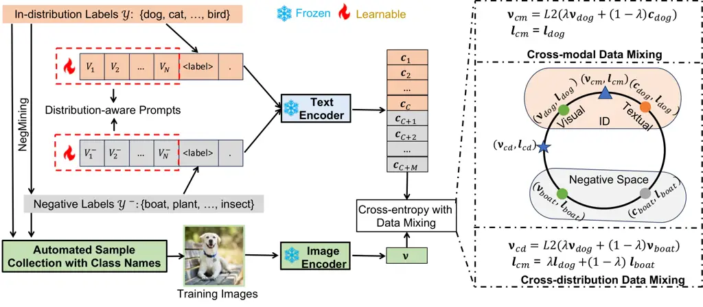
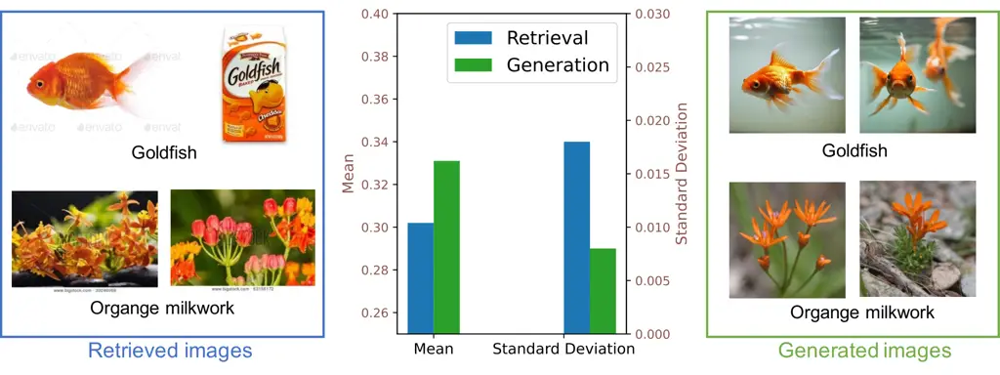

# LAPT: Label-driven Automated Prompt Tuning for OOD Detection with Vision-Language Models

Yabin Zhang Affiliation: The Hong Kong Polytechnic University
Affiliation: OPPO Research Institute  
{csybzhang,cslzhang}@comp.polyu.edu.hk    Wenjie Zhu Affiliation: The
Hong Kong Polytechnic University    Chenhang He Affiliation: The Hong
Kong Polytechnic University    Lei Zhang ^(†)^(†)thanks: Corresponding
author. Affiliation: The Hong Kong Polytechnic University
Affiliation: OPPO Research Institute  
{csybzhang,cslzhang}@comp.polyu.edu.hk

###### Abstract

Out-of-distribution (OOD) detection is crucial for model reliability, as
it identifies samples from unknown classes and reduces errors due to
unexpected inputs. Vision-Language Models (VLMs) such as CLIP are
emerging as powerful tools for OOD detection by integrating multi-modal
information. However, the practical application of such systems is
challenged by manual prompt engineering, which demands domain expertise
and is sensitive to linguistic nuances. In this paper, we introduce
Label-driven Automated Prompt Tuning (LAPT), a novel approach to OOD
detection that reduces the need for manual prompt engineering. We
develop distribution-aware prompts with in-distribution (ID) class names
and negative labels mined automatically. Training samples linked to
these class labels are collected autonomously via image synthesis and
retrieval methods, allowing for prompt learning without manual effort.
We utilize a simple cross-entropy loss for prompt optimization, with
cross-modal and cross-distribution mixing strategies to reduce image
noise and explore the intermediate space between distributions,
respectively. The LAPT framework operates autonomously, requiring only
ID class names as input and eliminating the need for manual
intervention. With extensive experiments, LAPT consistently outperforms
manually crafted prompts, setting a new standard for OOD detection.
Moreover, LAPT not only enhances the distinction between ID and OOD
samples, but also improves the ID classification accuracy and
strengthens the generalization robustness to covariate shifts, resulting
in outstanding performance in challenging full-spectrum OOD detection
tasks. Codes are available at
[https://github.com/YBZh/LAPT](https://github.com/YBZh/LAPT).

###### Keywords: 

Out-of-distribution detection Vision-language models Automated prompt
tuning Label-driven learning

## 1 Introduction

In real-world applications, artificial intelligence (AI) systems often
encounter data of unknown classes, known as out-of-distribution (OOD)
data. When tackling such OOD data, AI models may erroneously remain
overconfident in their predictions \[41, 33\], resulting in critical
errors and posing security risks. Consequently, it is crucial to
recognize OOD data for maintaining the reliability and safety of AI
systems in open-world scenarios.

Traditional OOD detection methods are primarily focused on image
information \[15, 24, 25\], neglecting the rich textual knowledge
carried by class names. With the rise of vision-language models (VLMs)
\[36, 20\], there has been a growing interest in leveraging textual
information to facilitate visual tasks \[72, 67, 70\], including OOD
detection \[29, 30, 21\]. For example, Ming _et al._ \[29\] compared
test images with linguistic descriptions of in-distribution (ID) classes
in feature space, leveraging the maximum probability of a scaled softmax
function to identify OOD images. While this method achieves notable
generalization across various datasets, it engages only a restricted
portion of the textual space, thereby not fully exploiting the textual
interpretative capabilities of VLMs. Jiang _et al._ \[21\] extended it
by exploiting larger textual spaces, extracting negative labels from
vast text corpora to enhance OOD detection performance significantly.
However, the deployment of this system is hindered by the demanding task
of prompt engineering, which requires domain-specific knowledge and is
sensitive to fine-grained linguistic variations, as illustrated in
Fig. 1.

Figure 1: VLMs-based OOD detection systems are sensitive to linguistic
nuances of text prompts, where results are reported on the OpenOOD
dataset with a ViTB/16 image encoder. A lower FPR95 metric denotes
better OOD detection performance.

To this end, we propose Label-driven Automated Prompt Tuning (LAPT), a
novel approach to OOD detection that substantially reduces the need of
manual prompt engineering. Specifically, given ID class names and
automatically extracted negative labels as in \[21\], we append
distribution-aware prompt tokens to these class labels. These learnable
tokens are optimized with minimal human intervention by aggregating
training images associated with class labels using pre-trained
text-to-image generation models \[39, 35\] or retrieving real images
from web-scale dataset \[43, 42\]. We employ a simple yet effective
cross-entropy loss for prompt optimization, enhanced by cross-modal and
cross-distribution data mixing techniques. Cross-modal mixing merges
image and text features from the same class, mitigating image noise
through multi-modal integration. Cross-distribution mixing
stochastically blends ID and negative features along with their
respective labels, exploring the intermediate space between ID and
negative domains. During testing, we adopt the OOD score introduced in
\[21\] to utilize both ID and negative labels.

Extensive experiments demonstrate that our method outperforms the
manually engineered text prompts by a large margin and achieves new
state-of-the-art on various OOD detection benchmarks. Especially, on the
challenging near-OOD detection task using the ImageNet-1k as the ID
dataset, our approach exceeds the best hand-crafted prompts by 10.76% in
FPR95 and 5.71% in AUROC, without any manual label annotations or prompt
crafting. Moreover, LAPT not only enhances the distinction between ID
and OOD samples, but also improves the ID classification accuracy and
strengthens the generalization robustness to covariate shifts. These
improvements collectively contribute to the superior performance of LAPT
in challenging full-spectrum OOD detection tasks \[60, 59\]. We
summarize our contributions as follows:

- •
  To circumvent the labor-intensive task of manual prompt engineering
  for OOD detection with VLMs, we introduce the LAPT methodology, which
  autonomously learns effective prompts using only ID class names.
- •
  Utilizing the ID class names and automatically mined negative labels,
  we devise distribution-aware prompts and autonomously gather the
  corresponding training images for each class via image synthesis and
  retrieval.
- •
  With the collected training data, we employ a simple yet effective
  cross-entropy objective for prompt optimization, enhanced by
  cross-modal data mixing to reduce image noise and cross-distribution
  data mixing to explore the intermediate space between ID and negative
  regions.
- •
  Extensive experiments demonstrate that our method significantly
  outperforms the hand-crafted text prompts and achieves new
  state-of-the-art results across multiple benchmarks. Moreover, LAPT
  enhances not only the distinction between ID and OOD samples, but also
  the ID classification accuracy and the generalization robustness to
  covariate shifts, achieving outstanding results in full-spectrum OOD
  detection tasks.

## 2 Related Work

Traditional OOD detection aims to address the severe issue of deep
learning models in producing overconfident predictions on OOD data \[33,
59\], which poses significant challenges to the deployment of deep
models in real-world applications. To tackle this problem, researchers
have developed various OOD detection methods, including score-based
\[15, 24, 25, 26, 54, 19, 52, 55, 45\], distance-based \[47, 48, 46, 6,
31, 44\] and generative-based \[40, 22\] approaches. Score-based
methods, which arguably garner the most attentions, distinguish ID from
OOD samples using carefully designed scoring functions, such as
confidence-based \[15, 25, 45, 52, 55\], discriminator-based \[22\],
energy-based \[26, 54\], and gradient-based \[18\] scores. In contrast,
distance-based methods detect OOD samples by measuring the distance in
feature space between the test data and their nearest ID samples \[47\]
or ID prototypes \[48\] using metrics like KNN \[46, 6, 31\] or
Mahalanobis distance \[24, 44\]. While these methods have achieved
certain success, they overlook textual information and require training
or pre-training on manually labeled ID training data. Moreover, some
approaches require manually collecting OOD data for additional training
\[10, 16, 63\], hindering their real-world applicability. Our method
differs from these approaches by effectively leveraging textual
information. Utilizing only the ID class names, we mine negative labels,
gather training data, and learn effective prompts in an automated
fashion, achieving state-of-the-art OOD detection results with minimal
human effort.

OOD detection with VLMs is gaining growing attention as the importance
of textual information for OOD image detection becomes increasingly
recognized \[29, 30, 21, 9, 32, 53, 34\]. MCM \[29\] leverages ID class
names for effective zero-shot OOD detection, which is further enhanced
by NegLabel \[21\] through the additional use of mined OOD class names.
However, as shown in Fig. 1, NegLabel’s performance is sensitive to text
prompts, limiting its practical application. ZOC \[9\] employs VLMs to
detect OOD samples by learning a captioner that generates candidate OOD
labels. Yet, this captioner struggles to generate effective OOD labels
for large-scale ID datasets with numerous ID classes. LoCoOp \[32\]
learns ID prompts using few-shot ID samples, regularizing these ID
prompts by mined OOD features from image backgrounds. CLIPN \[53\] and
LSN \[34\] learn text prompts for OOD classes. Our approach differs
significantly from them in two aspects. First, we initialize negative
prompts with negative labels instead of initializing negative prompts
with ’no’ and ID labels. Considering CLIP’s difficulty in understanding
the meaning of ’no’ \[34\], using OOD labels to initialize negative
prompts provides an effective starting point to accelerate convergence.
Second, CLIPN and LSN respectively require large-scale multi-modal data
and manually collected ID samples, leading to either high training costs
or the need of manual annotation. In contrast, our method automatically
gathers a small amount of positive/negative training data with ID
labels, requiring minimal manual effort yet achieving improved
performance.

## 3 Methods

### 3.1 Problem Setup

Let $`\mathcal{X}`$ and $`\mathcal{Y}=\{y_{1},\dots,y_{C}\}`$ be the
image space and ID label space, where $`\mathcal{Y}`$ is a set of class
names, _e.g_., $`\mathcal{Y}=\{cat,dog,\dots,bird\}`$ and $`C`$ is the
number of ID classes. Given the ID random variable
$`\mathbf{x}^{in}\in\mathcal{X}`$ and the OOD random variable
$`\mathbf{x}^{ood}\in\mathcal{X}`$, we use
$`\mathcal{P}_{\mathbf{x}^{in}}`$ and $`\mathcal{P}_{\mathbf{x}^{ood}}`$
to denote the ID marginal distribution and OOD marginal distribution,
respectively.

OOD detection. In traditional classification tasks, we assume that the
test image $`\mathbf{x}`$ is sampled from the ID distribution and
belongs to a specific ID class, _i.e_.,
$`\mathbf{x}\in\mathcal{P}_{\mathbf{x}^{in}}`$ and $`y\in\mathcal{Y}`$,
where $`y`$ is the label of $`\mathbf{x}`$. However, in real-world
applications, AI systems often encounter samples from unknown classes,
_i.e_., $`\mathbf{x}\in\mathcal{P}_{\mathbf{x}^{ood}}`$ and
$`y\notin\mathcal{Y}`$. AI models may misclassify these data into known
ID classes with high confidence \[41, 33\], posing critical errors and
security risks. To tackle this problem, OOD detection is introduced to
classify ID samples into correct ID classes and reject OOD samples
simultaneously. The ID class classification is achieved with a $`C`$-way
classifier following traditional classification \[23, 12\], while the
OOD detection is typically achieved with a score function $`S`$ \[24,
25, 26\]:

```math
G_{\gamma}(\mathbf{x})=\textrm{ID, }\textrm{if }S(\mathbf{x})\geq\gamma;\quad\textrm{otherwise, }G_{\gamma}(\mathbf{x})=\textrm{OOD}, \tag{1}
```

where $`G_{\gamma}`$ is the OOD detector with the threshold $`\gamma`$.
In other words, the test data $`\mathbf{x}`$ is detected as ID samples
if and only if $`S(\mathbf{x})\geq\gamma`$.

### 3.2 Reviews on MCM and NegLabel

CLIP-like models. Given the ID test image $`\mathbf{x}`$ within the
label space $`\mathcal{Y}`$, we extract the image representation
$`\mathbf{v}=f_{img}(\mathbf{x})\in\mathcal{R}^{D}`$ and the textual
representation
$`\mathbf{C}=f_{txt}(\rho(\mathcal{Y}))\in\mathcal{R}^{C\times D}`$ with
the pre-trained CLIP-like encoders, where $`D`$ denotes the feature
dimension. $`f_{img}(\cdot)`$ and $`f_{txt}(\cdot)`$ denote the image
and text encoders, respectively. $`\rho(\cdot)`$ denotes the text prompt
function, which is typically manually defined as ‘a photo of a
\<label\>.’, where the ‘label’ token is replaced by the specific class
name, _e.g_., ‘cat’ or ‘dog’. Both $`\mathbf{v}`$ and $`\mathbf{C}`$ are
$`L_{2}`$ normalized along the $`D`$ dimension. Then the zero-shot
classification probability can be achieved using $`\mathbf{C}`$ as the
classifier:

```math
\mathbf{p}=\mathrm{Softmax}(\mathbf{v}\mathbf{C}^{T})\in\mathcal{R}^{C}, \tag{2}
```

where the fixed scaling parameter is omitted for simplicity.

MCM. Besides the remarkable classification capabilities, MCM \[29\]
reveals that pre-trained CLIP models also exhibit strong zero-shot OOD
detection abilities. Specifically, MCM treats textual representations
$`\mathbf{C}`$ as ID prototypes and assesses OOD uncertainty based on
the scaled cosine distance between the visual features and the nearest
ID prototype. Furthermore, it has been validated that applying a softmax
function as a post hoc mechanism enlarges the distinction between ID and
OOD samples, leading to the following score function:

```math
S_{mcm}(\mathbf{v})=\max_{i}\frac{e^{\cos(\mathbf{v},\mathbf{c}_{i})/\tau}}{\sum_{i=1}^{C}{e^{\cos(\mathbf{v},\mathbf{c}_{i})/\tau}}}, \tag{3}
```

where $`\mathrm{cos}(\cdot,\cdot)`$ measures the cosine similarity,
$`\mathbf{c}_{i}`$ is the $`i`$-th entry of $`\mathbf{C}`$, and
$`\tau>0`$ is the scaling temperature.

NegLabel. While it is validated in \[29\] that leveraging the textual
information of ID classes enhances the OOD detection capability, the
potential contribution of negative labels is overlooked. To fill this
gap, NegLabel \[21\] explores negative class names
$`\mathcal{Y}^{-}=\{y_{C+1},\dots,y_{C+M}\}`$ from extensive text
corpora, where $`\mathcal{Y}^{-}\cap\mathcal{Y}=\emptyset`$. Under the
assumption that ID samples are more similar to ID labels and less
similar to negative labels than OOD samples, NegLabel employs a scoring
function to improve OOD detection:

```math
S_{NegLabel}(\mathbf{v})=\frac{\sum_{i=1}^{C}{e^{\cos(\mathbf{v},\mathbf{c}_{i})/\tau}}}{\sum_{i=1}^{C}{e^{\cos(\mathbf{v},\mathbf{c}_{i})/\tau}}+\sum_{j=C+1}^{C+M}{e^{\cos(\mathbf{v},\mathbf{c}_{j})/\tau}}}. \tag{4}
```

NegLabel performs excellently on various OOD detection benchmarks by
utilizing both ID and negative text knowledge.



Figure 2: The overall framework of our LAPT method, where
$`\mathbf{v}_{dog}/\mathbf{v}_{boat}`$,
$`\mathbf{c}_{dog}/\mathbf{c}_{boat}`$, and
$`\mathbf{l}_{dog}/\mathbf{l}_{boat}`$ are image features, textual
features, and soft labels of dog/boat samples.

### 3.3 LAPT: Label-driven Automated Prompt Tuning

Though NegLabel has achieved a notable success, its performance is
highly sensitive to the configuration of text prompts. As illustrated in
Fig. 1, given an ID dataset like ImageNet, varying text prompts leads to
considerable differences in OOD detection outcomes. For instance,
prompts such as ‘The nice \<label\>’ generally improve performance on
far-OOD datasets, while ‘a photo of a \<label\>’ shows enhanced
effectiveness for near-OOD scenarios. The choice of prompt can lead to
over 10% fluctuation in the FPR95 metric. Hence, manually setting text
prompts for optimal results is a labor-intensive and time-consuming
process.

We aim to streamline OOD detection by automating prompt generation with
minimal manual intervention. Our method learns continuous prompts using
auto-collected samples, needing only ID class names. The automated
process is very useful in practical applications. Details of LAPT are
provided as follows.

#### Distribution-aware prompts.

Given the ID class names, we first follow NegLabel \[21\] to mine the
negative labels $`\mathcal{Y}^{-}`$ from extensive corpus databases.
Then, instead of hand-crafting the optimal text prompts, we design a
learnable text prompt function in the following form:

```math
\rho_{l}(\mathrm{LABEL})=[\mathbf{V}]_{1}[\mathbf{V}]_{2}\cdots[\mathbf{V}]_{N}[\mathrm{LABEL}], \tag{5}
```

where $`[\mathbf{V}]_{n}\in\mathcal{R}^{D}(n\in\{1,2\cdots,N\})`$
represents the learnable context tokens, and $`N`$ is the total number
of context tokens.

We assess three prompt construction variations for OOD detection:
unified, class-specific, and distribution-aware prompts. The unified
prompt employs identical context tokens across all classes, and the
class-specific prompt utilizes unique tokens for each class, which are
explored in the ID classification \[72\]. Here, we propose a
distribution-aware prompt strategy, which differentiates tokens for ID
and OOD classes, as shown in Fig. 2. Our empirical results suggest that
the distribution-aware prompt notably enhances the distinction between
ID and OOD distributions, as analyzed in Sec. 4.3.



Figure 3: Visualization of retrieved images (left), generated images
(right), and the statistic of their cosine similarity to the class
labels (middle). A larger mean indicates greater image-label
consistency, and a larger standard deviation implies more diversity.

#### Automated sample collection with class labels.

Traditional prompt learning methods \[72, 32\] often optimize the
prompts with manually collected image samples, which are typically
selected from well-constructed benchmark datasets. Such a manual
sampling approach is inefficient for negative label-based OOD detection,
primarily because mined negative classes are often not included in
existing datasets. Moreover, manually collecting and annotating these
data is time-consuming and labor-intensive. To mitigate the manual
effort and facilitate practical application, we introduce automated
sample collection strategies that require only class names, as detailed
subsequently.

We introduce two automated sample collection methods for enhancing OOD
detection: text-to-image generation and text-based image retrieval. In
the generation approach, class names are fed into pre-trained
text-to-image models \[39, 35\] to generate synthetic images with varied
appearances using different seeds:

```math
\mathcal{X}_{col}^{s}=\mathrm{T2I}(\mathcal{Y}\cup\mathcal{Y}^{-}), \tag{6}
```

where $`\mathcal{X}_{col}^{s}`$ is the collected set of synthetic images
and $`\mathrm{T2I}(\cdot)`$ is the pre-trained generation model. The
performance of OOD detection is closely tied to the fidelity of these
generated images, depending on the generative power of the underlying
model. By harnessing advanced generative models \[39, 35\], we are able
to produce images that are not only visually convincing but also exhibit
strong consistency with the input text. Our empirical findings indicate
that these synthetic images can significantly enhance the OOD detection
capabilities.

In addition to generating synthetic images with generation models, we
also automate the collection of real images through text-based image
retrieval. Specifically, we utilize a large-scale real image dataset
(_e.g_., Laion \[43, 42\]) in conjunction with pre-trained VLMs, such as
CLIP, which align images and text within the same feature space. By
conducting a search within this space, we retrieve images that are
closest to the class names:

```math
\mathcal{X}_{col}^{r}=\textrm{Clip-retrieval}(\mathcal{Y}\cup\mathcal{Y}^{-},\mathrm{WebData}), \tag{7}
```

where $`\mathcal{X}_{col}^{r}`$ is the retrieved set of real images,
Clip-retrieval is the clip-retrieval tool \[1\], which enables efficient
image retrieval from millions of samples, and $`\mathrm{WebData}`$ is
the web-scale real image set.

We capitalize on the strengths of both synthetic image generation and
real image retrieval. Synthetic images ensure high textual fidelity and
control but may lack variety, while real images offer diversity but can
vary in text consistency, as shown in Fig. 3. Our strategy prioritizes
real images with high text-image alignment, quantified by the cosine
similarity between image representation and corresponding text label. If
real images fall short in text correlation, indicated by cosine
similarity below a threshold, synthetic images are used. This hybrid
approach is formalized as follows:

```math
\mathcal{X}_{col}=\{\mathbf{x}:\mathbf{x}\in\mathcal{X}_{col}^{r}\text{ if }\cos\left(f_{img}(\mathbf{x}),f_{txt}(y)\right)>\kappa\text{ else }\mathbf{x}\in\mathcal{X}_{col}^{s}\}, \tag{8}
```

where $`\mathcal{X}_{col}`$ represents the final collection of images.
The decision to use a real image or a synthetic one is based on whether
the cosine similarity exceeds the threshold $`\kappa`$, which is set as
$`0.3`$ by default following \[42\]. This hybrid approach optimizes the
balance between image diversity and text-image consistency, enhancing
the robustness of our method.

#### Prompt tuning with cross-modal and cross-distribution mixing.

Given the training images collected on a per-class basis, the most
straightforward learning approach is to use a classification objective,
which is commonly achieved with the following cross-entropy loss
function:

```math
\mathcal{L}=-\frac{1}{|\mathcal{X}_{col}|}\sum_{\mathbf{x}\in\mathcal{X}_{col}}\sum_{i=1}^{C+M}\mathbf{l}_{i}\log\frac{e^{\cos\left(\mathbf{v},(f_{txt}(\rho_{l}(y))\right)/\tau}}{\sum_{i=1}^{C+M}{e^{\cos(\mathbf{v},\cos(f_{txt}(\rho_{l}(y)))/\tau}}},\mathbf{v}=f_{img}(\mathbf{x}) \tag{9}
```

where $`y`$ is the class name of $`\mathbf{x}`$. $`\mathbf{l}_{i}`$ is
the $`i`$-th entry of $`\mathbf{l}\in\mathcal{R}^{C+M}`$, the softlabel
of sample $`\mathbf{x}`$. In Sec. 4.3, we will demonstrate that this
training objective aligns effectively with our proposed
distribution-aware prompt construction and automated sample collection
strategies.

Cross-modal mixing. While the simple classification loss has achieved
commendable results, we could further enhance it by addressing potential
sample noise and exploring broader data space through carefully designed
data mixing strategies. Despite the efforts to collect clean images that
match their respective class names, noise is inevitable in the collected
images. To mitigate the impact of image noise, we introduce a
cross-modal mixing strategy to neutralize potential noise in the images.
Specifically, for a given training image $`\mathbf{x}`$ of class $`y`$,
we introduce the refined training feature $`\mathbf{v}_{cm}`$ as
follows:

```math
\displaystyle\mathbf{v}_{cm} \displaystyle=\mathrm{L_{2}}\left(\lambda_{\alpha}f_{img}(\mathbf{x})+(1-\lambda_{\alpha})f_{txt}\left(\rho(y)\right)\right), \tag{10}
```

```math
\displaystyle\mathbf{l}_{cm} \displaystyle=\mathbf{l}, \tag{11}
```

where $`\lambda_{\alpha}\sim\mathrm{Beta}(\alpha,\alpha)\in[0,1]`$ with
$`\alpha\in(0,\infty)`$. $`\mathrm{L_{2}}(\cdot)`$ represents the
$`L_{2}`$ normalization along feature dimension and $`\rho(\cdot)`$ is
the hand-crafted text prompts \[36\]. The softlabel is unchanged after
mixing since the image $`\mathbf{x}`$ and its label $`y`$ belong to the
same class. When $`\lambda_{\alpha}=1`$, we adopt the image features as
the training examples, and we use the text features as the training
examples when $`\lambda_{\alpha}=0`$. We denote the cross-entropy loss
of Eq. 9 with $`\mathbf{v}_{cm}`$ and $`\mathbf{l}_{cm}`$ as
$`\mathcal{L}_{cm}`$. By mixing textual and visual representations, we
aim to create a more robust feature set that can help the model learn to
focus on relevant features while disregarding noisy information. This
strategy not only reinforces the model’s resistance to image noise but
also encourages it to leverage complementary information from both
modalities.

Cross-distribution mixing. In addition to using cross-modal data mixing
to mitigate image noise, we employ the data mixing strategy to explore a
broader feature space. In the vanilla NegLabel approach \[21\], the
selected negative classes are typically far from the ID distribution,
leaving a substantial intermediate area between ID and negative regions
underutilized. To enhance the utilization of these spaces, we introduce
a cross-distribution mixing strategy, which combines features and
corresponding labels of ID and negative samples to create new training
samples. This mixing strategy effectively bridges the distribution gap,
generating a continuous spectrum of features that extend from ID to
negative areas. The mixing process can be formalized as follows:

```math
\displaystyle\mathbf{v}_{cd} \displaystyle=\mathrm{L2}\left(\lambda_{\beta}f_{img}(\mathbf{x}_{id})+(1-\lambda_{\beta})f_{img}(\mathbf{x}_{ood})\right), \tag{12}
```

```math
\displaystyle\mathbf{l}_{cd} \displaystyle=\lambda_{\beta}\mathbf{l}_{id}+(1-\lambda_{\beta})\mathbf{l}_{ood}, \tag{13}
```

where $`\mathbf{x}_{id}`$ and $`\mathbf{x}_{ood}`$ are collected
positive and negative images, and $`\mathbf{l}_{id}`$ and
$`\mathbf{l}_{ood}`$ are soft labels of $`\mathbf{x}_{id}`$ and
$`\mathbf{x}_{ood}`$, respectively.
$`\lambda_{\beta}\sim\mathrm{Beta}(\beta,\beta)\in[0,1]`$ with
$`\beta\in(0,\infty)`$. This method not only allows the model to become
more aware of the intermediate space between ID and negative regions,
but also encourages it to learn more discriminative features that can
better generalize to new and unseen OOD samples. We denote the
cross-entropy loss of Eq. 9 with $`\mathbf{v}_{cd}`$ and
$`\mathbf{l}_{cd}`$ as $`\mathcal{L}_{cd}`$. The final objective is
constructed as:

```math
\mathcal{L}_{all}=\mathcal{L}+\mathcal{L}_{cm}+\mathcal{L}_{cd}. \tag{14}
```

Remarks. Our proposed data mixing strategies are distinct from existing
ones \[62, 51, 61, 64\] in both implementation and objectives.
Traditional data mixing strategies typically aim to enhance ID
classification performance by mixing randomly selected ID images \[62,
51\]. In contrast, our approach is carefully designed to include
multi-modal and multi-distribution data in the mixing process to enhance
the OOD detection capability. While there are some methods that utilize
data mixing for OOD detection, they usually mix ID data to simulate OOD
representations \[61\] or combining manually collected ID and OOD data
\[64\]. These methods, however, do not exploit the textual knowledge and
require manually labeled samples. Our cross-modal mixing strategy lowers
image noise by blending samples from the same class but across different
modalities, creating more robust features. Meanwhile, our
cross-distribution mixing scheme goes a step further by mixing
automatically collected positive and negative data, allowing us to
explore the space that lies between ID and negative regions. This
exploration enables our model to better understand and characterize the
boundary between ID and OOD, leading to more effective detection of
anomalies. Our methods are not just mixing data; they are deliberately
designed to align with our label-driven automated prompt learning
objective. By addressing noise and exploring intermediate feature space
through mixing, we develop a tailored solution that boosts the automated
prompt tuning for OOD detection.

In the test stage, we adopt the OOD score of Eq. 4 following \[21\]. The
overall pipeline of our automated prompt learning is summarized in
Algorithm 1.

0:  ID label space $`\mathcal{Y}`$

1:  $`\mathcal{Y}^{-}\leftarrow`$ NegMine($`\mathcal{Y}`$)

2:  Constructing distribution-aware prompts $`\rho_{l}`$ with labels
$`\mathcal{Y}\cup\mathcal{Y}^{-}`$ using Eq. (5)

3:  $`\mathcal{X}_{col}\leftarrow`$ Automated sample collection with
labels $`\mathcal{Y}\cup\mathcal{Y}^{-}`$ using Eq. (8)

4:  Prompt tuning with cross-modal and cross-distribution data mixing
using Eq. (14)

5:  return Learned prompts $`\rho_{l}`$

Algorithm 1 Label-driven Automated Prompt Tuning (LAPT)

## 4 Experiments

### 4.1 Setup

Datasets and benchmarks. Our validation primarily uses the ImageNet-1k
dataset \[4\] as ID data, and more evaluations on smaller-scaled ID
datasets are provided in the Supplementary Materials. Aligning with
standards from prior research \[19, 29, 21\], we use four diverse
datasets of iNaturalist \[49\], SUN \[56\], Places \[71\], and Textures
\[3\] as OOD test sets. Additionally, we assess our method on the
OpenOOD benchmark \[65, 58\], which differentiates OOD datasets into
near-OOD (_e.g_., SSB-hard \[50\], NINCO \[2\]) and far-OOD (_e.g_.,
iNaturalist \[49\], Textures \[3\], OpenImage-O \[52\]) based on
semantic similarity or difficulty. This grouping allows for a
comprehensive evaluation of OOD detectors against various OOD sample
types.

In addition to conventional OOD detection that solely considers semantic
shifts, we consider a full-spectrum OOD detection problem \[60\], which
additionally accounts for non-semantic covariate shift generalization.
An optimal system should not only be capable of identifying semantically
shifted OOD samples but should also exhibit robustness to non-semantic
covariate shifted OOD samples. Following the guidelines in \[65\], we
adopt ImageNet-C \[14\], ImageNet-R \[13\], and ImageNet-V2 \[37\] as
the covariate-shifted ID data in the full-spectrum OOD detection
evaluation.

Our evaluation metrics include (1) FPR95, the false positive rate of OOD
samples with ID detection rate at 95%; (2) AUROC, the area under the
receiver operating characteristic curve; and (3) ID classification
accuracy (ID ACC).

Implementation details. We adopt the visual encoder of VITB/16
pretrained by CLIP \[36\]. For automated sample collection, we
instantiate the text-to-image generation model with SDXL \[35\] and
employ a subset of the Laion400M dataset \[42\], approximately 60
million samples, as our WebData. Our model training is conducted using
the SGD optimizer with a learning rate schedule that follows cosine
annealing, starting from an initial learning rate of 1e-2. We set the
batch size to $`32`$ and train the model for $`10`$ epochs in all
experiments.

|                                                    |                   |                     |                   |                     |                   |                     |                   |                     |                   |                     |
| -------------------------------------------------- | ----------------- | ------------------- | ----------------- | ------------------- | ----------------- | ------------------- | ----------------- | ------------------- | ----------------- | ------------------- |
| OOD datasets                                       |                   |                     |                   |                     |                   |                     |                   |                     |                   |                     |
| Methods                                            | INaturalist       |                     | Sun               |                     | Places            |                     | Textures          |                     | Average           |                     |
|                                                    | AUROC$`\uparrow`$ | FPR95$`\downarrow`$ | AUROC$`\uparrow`$ | FPR95$`\downarrow`$ | AUROC$`\uparrow`$ | FPR95$`\downarrow`$ | AUROC$`\uparrow`$ | FPR95$`\downarrow`$ | AUROC$`\uparrow`$ | FPR95$`\downarrow`$ |
| Requires Manually Labeled Training Samples         |                   |                     |                   |                     |                   |                     |                   |                     |                   |                     |
| MSP \[15\]                                         | 87.44             | 58.36               | 79.73             | 73.72               | 79.67             | 74.41               | 79.69             | 71.93               | 81.63             | 69.61               |
| ODIN \[25\]                                        | 94.65             | 30.22               | 87.17             | 54.04               | 85.54             | 55.06               | 87.85             | 51.67               | 88.80             | 47.75               |
| Energy \[26\]                                      | 95.33             | 26.12               | 92.66             | 35.97               | 91.41             | 39.87               | 86.76             | 57.61               | 91.54             | 39.89               |
| GradNorm \[18\]                                    | 72.56             | 81.50               | 72.86             | 82.00               | 73.70             | 80.41               | 70.26             | 79.36               | 72.35             | 80.82               |
| ViM \[52\]                                         | 93.16             | 32.19               | 87.19             | 54.01               | 83.75             | 60.67               | 87.18             | 53.94               | 87.82             | 50.20               |
| KNN \[46\]                                         | 94.52             | 29.17               | 92.67             | 35.62               | 91.02             | 39.61               | 85.67             | 64.35               | 90.97             | 42.19               |
| VOS \[7\]                                          | 94.62             | 28.99               | 92.57             | 36.88               | 91.23             | 38.39               | 86.33             | 61.02               | 91.19             | 41.32               |
| NPOS \[48\]                                        | 96.19             | 16.58               | 90.44             | 43.77               | 89.44             | 45.27               | 88.80             | 46.12               | 91.22             | 37.93               |
| LSN \[34\]                                         | 95.83             | 21.56               | 94.35             | 26.32               | 91.25             | 34.48               | 90.42             | 38.54               | 92.96             | 30.22               |
| LoCoOp \[32\]                                      | 96.86             | 16.05               | 95.07             | 23.44               | 91.98             | 32.87               | 90.19             | 42.28               | 93.52             | 28.66               |
| Does Not Require Manually Labeled Training Samples |                   |                     |                   |                     |                   |                     |                   |                     |                   |                     |
| Mahalanobis \[24\]                                 | 55.89             | 99.33               | 59.94             | 99.41               | 65.96             | 98.54               | 64.23             | 98.46               | 61.50             | 98.94               |
| Energy \[26\]                                      | 85.09             | 81.08               | 84.24             | 79.02               | 83.38             | 75.08               | 65.56             | 93.65               | 79.57             | 82.21               |
| ZOC \[9\]                                          | 86.09             | 87.30               | 81.20             | 81.51               | 83.39             | 73.06               | 76.46             | 98.90               | 81.79             | 85.19               |
| MCM \[29\]                                         | 94.59             | 32.20               | 92.25             | 38.80               | 90.31             | 46.20               | 86.12             | 58.50               | 90.82             | 43.93               |
| CLIPN \[53\]                                       | 95.27             | 23.94               | 93.93             | 26.17               | 92.28             | 33.45               | 90.93             | 40.83               | 93.10             | 31.10               |
| NegLabel \[21\]                                    | 99.49             | 1.91                | 95.49             | 20.53               | 91.64             | 35.59               | 90.22             | 43.56               | 94.21             | 25.40               |
| LAPT (Ours)                                        | 99.63             | 1.16                | 96.01             | 19.12               | 92.01             | 33.01               | 91.06             | 40.32               | 94.68             | 23.40               |

Table 1: OOD detection results with ID data of ImageNet-1k and four OOD
datasets by using the VITB/16 CLIP encoder.

### 4.2 Main Results

Results on four OOD datasets. As illustrated in Tab. 1, our approach
consistently surpasses existing methods. Specifically, we re-implemented
traditional methods \[15, 25, 26, 18, 52, 46, 7, 48\] by fine-tuning
CLIP-encoders with labeled training samples from ImageNet in accordance
with \[48\]. Without utilizing any manually annotated data, our method
significantly outperforms these methods, corroborating the effectiveness
of our proposed VLMs adaptation technique. Notably, our approach exceeds
the performance of NegLabel \[21\], confirming the superiority of
learnable prompts over hand-crafted prompts. The OOD samples in these
datasets have a relatively large semantic difference from the ID data
(_e.g_., textures vs. animals), making the distinction relatively easy.
On more challenging datasets, where the OOD data are semantically closer
to the ID data, our advantages are even more pronounced, as shown in
Tabs. 2 and 3.

Results on OpenOOD benchmark. A more comprehensive evaluation of our
method is provided in Tab. 2 on the OpenOOD benchmark \[58, 65\].
Compared to its closest competitor NegLabel, our method not only
enhances the OOD detection performance but also improves the ID
classification accuracy. In terms of OOD detection, our approach
achieves a slight improvement in the relatively easy far-OOD scenarios
(_e.g_., 0.96% AUROC) and a substantial improvement in the more
challenging near-OOD settings (_e.g_., 5.71% AUROC), highlighting the
outstanding effectiveness of our method in challenging contexts. The
competitors with manually labeled training samples are quoted from \[58,
65\], where models are trained with full ImageNet training data.

|                                                    |                      |         |                            |         |                  |
| -------------------------------------------------- | -------------------- | ------- | -------------------------- | ------- | ---------------- |
| Methods                                            | FPR95 $`\downarrow`$ |         | $`\mathrm{AUROC}\uparrow`$ |         | ACC $`\uparrow`$ |
|                                                    | Near-OOD             | Far-OOD | Near-OOD                   | Far-OOD | ID               |
| Requires Manually Labeled Training Samples         |                      |         |                            |         |                  |
| GEN \[27\]                                         | –                    | –       | 78.97                      | 90.98   | 81.59            |
| AugMix \[17\] + ReAct \[45\]                       | –                    | –       | 79.94                      | 93.70   | 77.63            |
| RMDS \[38\]                                        | –                    | –       | 80.09                      | 92.60   | 81.14            |
| AugMix \[17\] + ASH \[5\]                          | –                    | –       | 82.16                      | 96.05   | 77.63            |
| Does Not Require Manually Labeled Training Samples |                      |         |                            |         |                  |
| MCM \[29\]                                         | 79.02                | 68.54   | 60.11                      | 84.77   | 66.28            |
| NegLabel \[21\]                                    | 68.18                | 27.34   | 76.92                      | 93.30   | 66.82            |
| LAPT (Ours)                                        | 58.94                | 24.86   | 82.63                      | 94.26   | 67.86            |

Table 2: OOD detection results on the OpenOOD benchmark, where
ImageNet-1k is adopted as ID dataset. Full results are available in the
Supplementary Materials.

Full-spectrum results on OpenOOD benchmark. In addition to the
capabilities of semantic OOD detection and ID sample recognition, we
also analyze the generalization ability of our method under covariate
shift \[73, 74, 69, 68\] on the full-spectrum OOD detection task \[60\]
using the OpenOOD benchmark \[58, 65\]. As illustrated in Tab. 3, our
method enhances all the three capacities, achieving improved results
across the board. Similar to the findings in Tab. 2, the improvement is
more pronounced in the challenging near-OOD scenarios.

|                                                    |                      |         |                            |         |                  |
| -------------------------------------------------- | -------------------- | ------- | -------------------------- | ------- | ---------------- |
| Methods                                            | FPR95 $`\downarrow`$ |         | $`\mathrm{AUROC}\uparrow`$ |         | ACC $`\uparrow`$ |
|                                                    | Near-OOD             | Far-OOD | Near-OOD                   | Far-OOD | ID               |
| Requires Manually Labeled Training Samples         |                      |         |                            |         |                  |
| DeepAug \[13\] + SHE \[66\]                        | 83.26                | 68.70   | 68.27                      | 78.85   | 57.82            |
| StyAug \[11\] + GradNorm \[18\]                    | 87.14                | 58.82   | 65.27                      | 81.62   | 55.44            |
| AugMix \[17\] + SHE \[66\]                         | 84.45                | 60.26   | 69.66                      | 83.06   | 57.46            |
| ASH \[5\]                                          | 93.27                | 59.56   | 60.52                      | 86.75   | 54.35            |
| LSA \[28\]                                         | 70.56                | 48.06   | 78.22                      | 86.85   | 61.74            |
| ISH + SCALE \[57\]                                 | –                    | –       | 68.04                      | 89.46   | 54.88            |
| Does Not Require Manually Labeled Training Samples |                      |         |                            |         |                  |
| MCM \[29\]                                         | 85.37                | 69.87   | 58.97                      | 77.11   | 57.69            |
| NegLabel \[21\]                                    | 76.25                | 33.30   | 72.77                      | 92.02   | 60.11            |
| LAPT (Ours)                                        | 71.18                | 33.07   | 74.77                      | 92.14   | 61.17            |

Table 3: Full-specturm OOD detection results on the OpenOOD benchmark,
where ImageNet-1k, ImageNet-C, ImageNet-R, ImageNet-V2 are adopted as ID
datasets.

### 4.3 Analyses and Discussions

The analyses are conducted on the OpenOOD dataset with a VITB/16
encoder.

Prompt construction. We conduct comprehensive analyses on prompt
construction as demonstrated in Fig. 4. As shown in Fig. 4(a), our
proposed distribution-aware prompts are well-matched for OOD detection,
outperforming both class-specific and unified prompts. Excessively long
prompts slightly impair experimental outcomes, as evidenced in
Fig. 4(b), possibly due to the increased capacity overfitting noise
presented in the training images. Consequently, we set the prompt length
as $`N=2`$ by default. As indicated in Fig. 4(c), initializing prompts
with manually crafted text introduces textual bias. For instance, ‘The
nice’ yields better results for far-OOD but proves suboptimal for
near-OOD, a bias that is perpetuated in our method when learnable
prompts are initialized with ‘The nice’. We discover that a random
initialization, which does not introduce any prior, performs
consistently well across different OOD tasks and is thus adopted as the
default practice. Finally, in Fig. 4(d), we observe that the placement
of label tokens has a minimal impact on the results; hence, we by
default place the class label at the end of the prompt, as shown in Eq.
(5)

(a) Types

(b) Length $`N`$

(c) Initializations

(d) Positions

Figure 4: Analyses on prompt (a) types, (b) length, (b) initializations,
and (d) positions.

Automated sample collection. As shown in Fig. 5(a), the synthetic image
generation strategy outperforms realistic image retrieval, possibly
because the generator has been exposed to a vast amount of training data
(_e.g_., 5 billion images), which greatly surpasses the scale of our
utilized WebData (_e.g_., 60 million images). The best results are
obtained by synergistically leveraging both synthetic and real data,
confirming their complementary nature. In terms of image generation,
employing a stronger image generator can result in better performance,
as shown in Fig. 5(b). Regarding image retrieval, utilizing a
larger-scale WebData can yield better outcomes, as presented in Fig.
5(c). Finally, we find in Fig. 5(d) that the model’s performance does
not continue to increase with the addition of more training samples.
This may be because it is difficult to collect a high-quality training
set that is semantically consistent with the text and diverse. With the
relatively small size of WebData, it is challenging to ensure semantic
consistency, and while the semantic consistency of generated images may
be good, their diversity is limited, as analyzed in Fig. 3. How to
automatically collect high-quality images for effective model training
remains an enduring and challenging problem.

(a) Collection Methods

(b) Generators

(c) WebData Scale

(d) Sample Number

Figure 5: Analyses on (a) image collection methods, (b) text-to-image
generators, (c) data scale of the WebData space, and (d) number of
training samples per class.

More analyses on stage ablation, the impact of text prompts in data
collection, data mixing strategies, hyper-parameters in data mixing,
different VLMs, visualization of learned prompts, and time complexity
are provided in the Supplementary Materials.

## 5 Conclusion and Limitations

We developed a novel label-driven automated prompt tuning (LAPT)
approach that autonomously configures effective prompts for OOD
detection. Requiring only ID class names, our method can automatically
mine OOD class names, collect training images per class, and learn
effective prompts, thereby outperforming manually crafted prompts with
minimal manual intervention. The automatically learned prompts not only
enhanced the distinction between ID and OOD samples but also improved
the ID classification accuracy and the strengthened generalization
robustness to covariate shifts.

The efficacy of our approach was highly dependent on the quality of
collected training samples. Employing more advanced generation
techniques to create a diverse set of synthetic images \[8\] or
expanding the retrieval space \[43\] to obtain real images that match
better the class names could yield improved results. These possibilities
present exciting avenues for future research.

## References

- \[1\] Beaumont, R.: Clip retrieval: Easily compute clip embeddings and
  build a clip retrieval system with them.
  [https://github.com/rom1504/clip-retrieval](https://github.com/rom1504/clip-retrieval) (2022)
- \[2\] Bitterwolf, J., Mueller, M., Hein, M.: In or out? fixing
  imagenet out-of-distribution detection evaluation. In: ICML (2023),
  [https://proceedings.mlr.press/v202/bitterwolf23a.html](https://proceedings.mlr.press/v202/bitterwolf23a.html)
- \[3\] Cimpoi, M., Maji, S., Kokkinos, I., Mohamed, S., Vedaldi, A.:
  Describing textures in the wild. In: Proceedings of the IEEE
  conference on computer vision and pattern recognition. pp.
  3606–3613 (2014)
- \[4\] Deng, J., Dong, W., Socher, R., Li, L.J., Li, K., Fei-Fei, L.:
  Imagenet: A large-scale hierarchical image database. In: 2009 IEEE
  conference on computer vision and pattern recognition. pp. 248–255.
  Ieee (2009)
- \[5\] Djurisic, A., Bozanic, N., Ashok, A., Liu, R.: Extremely simple
  activation shaping for out-of-distribution detection. arXiv preprint
  arXiv:2209.09858 (2022)
- \[6\] Du, X., Gozum, G., Ming, Y., Li, Y.: Siren: Shaping
  representations for detecting out-of-distribution objects. Advances in
  Neural Information Processing Systems 35, 20434–20449 (2022)
- \[7\] Du, X., Wang, X., Gozum, G., Li, Y.: Unknown-aware object
  detection: Learning what you don’t know from videos in the wild. In:
  Proceedings of the IEEE/CVF Conference on Computer Vision and Pattern
  Recognition. pp. 13678–13688 (2022)
- \[8\] Dunlap, L., Umino, A., Zhang, H., Yang, J., Gonzalez, J.E.,
  Darrell, T.: Diversify your vision datasets with automatic
  diffusion-based augmentation. In: Thirty-seventh Conference on Neural
  Information Processing Systems (2023),
  [https://openreview.net/forum?id=9wrYfqdrwk](https://openreview.net/forum?id=9wrYfqdrwk)
- \[9\] Esmaeilpour, S., Liu, B., Robertson, E., Shu, L.: Zero-shot
  out-of-distribution detection based on the pre-trained model clip. In:
  Proceedings of the AAAI conference on artificial intelligence.
  vol. 36, pp. 6568–6576 (2022)
- \[10\] Fort, S., Ren, J., Lakshminarayanan, B.: Exploring the limits
  of out-of-distribution detection. Advances in Neural Information
  Processing Systems 34, 7068–7081 (2021)
- \[11\] Geirhos, R., Rubisch, P., Michaelis, C., Bethge, M., Wichmann,
  F.A., Brendel, W.: Imagenet-trained cnns are biased towards texture;
  increasing shape bias improves accuracy and robustness. arXiv preprint
  arXiv:1811.12231 (2018)
- \[12\] He, K., Zhang, X., Ren, S., Sun, J.: Deep residual learning for
  image recognition. In: Proceedings of the IEEE conference on computer
  vision and pattern recognition. pp. 770–778 (2016)
- \[13\] Hendrycks, D., Basart, S., Mu, N., Kadavath, S., Wang, F.,
  Dorundo, E., Desai, R., Zhu, T., Parajuli, S., Guo, M., et al.: The
  many faces of robustness: A critical analysis of out-of-distribution
  generalization. In: Proceedings of the IEEE/CVF International
  Conference on Computer Vision. pp. 8340–8349 (2021)
- \[14\] Hendrycks, D., Dietterich, T.: Benchmarking neural network
  robustness to common corruptions and perturbations. arXiv preprint
  arXiv:1903.12261 (2019)
- \[15\] Hendrycks, D., Gimpel, K.: A baseline for detecting
  misclassified and out-of-distribution examples in neural networks.
  arXiv preprint arXiv:1610.02136 (2016)
- \[16\] Hendrycks, D., Mazeika, M., Dietterich, T.: Deep anomaly
  detection with outlier exposure. arXiv preprint
  arXiv:1812.04606 (2018)
- \[17\] Hendrycks, D., Mu, N., Cubuk, E.D., Zoph, B., Gilmer, J.,
  Lakshminarayanan, B.: Augmix: A simple data processing method to
  improve robustness and uncertainty. arXiv preprint
  arXiv:1912.02781 (2019)
- \[18\] Huang, R., Geng, A., Li, Y.: On the importance of gradients for
  detecting distributional shifts in the wild. Advances in Neural
  Information Processing Systems 34, 677–689 (2021)
- \[19\] Huang, R., Li, Y.: Mos: Towards scaling out-of-distribution
  detection for large semantic space. In: Proceedings of the IEEE/CVF
  Conference on Computer Vision and Pattern Recognition. pp.
  8710–8719 (2021)
- \[20\] Jia, C., Yang, Y., Xia, Y., Chen, Y.T., Parekh, Z., Pham, H.,
  Le, Q., Sung, Y.H., Li, Z., Duerig, T.: Scaling up visual and
  vision-language representation learning with noisy text supervision.
  In: International conference on machine learning. pp. 4904–4916.
  PMLR (2021)
- \[21\] Jiang, X., Liu, F., Fang, Z., Chen, H., Liu, T., Zheng, F.,
  Han, B.: Negative label guided OOD detection with pretrained
  vision-language models. In: The Twelfth International Conference on
  Learning Representations (2024),
  [https://openreview.net/forum?id=xUO1HXz4an](https://openreview.net/forum?id=xUO1HXz4an)
- \[22\] Kong, S., Ramanan, D.: Opengan: Open-set recognition via open
  data generation. In: Proceedings of the IEEE/CVF International
  Conference on Computer Vision. pp. 813–822 (2021)
- \[23\] Krizhevsky, A., Sutskever, I., Hinton, G.E.: Imagenet
  classification with deep convolutional neural networks. Advances in
  neural information processing systems 25 (2012)
- \[24\] Lee, K., Lee, K., Lee, H., Shin, J.: A simple unified framework
  for detecting out-of-distribution samples and adversarial attacks.
  Advances in neural information processing systems 31 (2018)
- \[25\] Liang, S., Li, Y., Srikant, R.: Enhancing the reliability of
  out-of-distribution image detection in neural networks. arXiv preprint
  arXiv:1706.02690 (2017)
- \[26\] Liu, W., Wang, X., Owens, J., Li, Y.: Energy-based
  out-of-distribution detection. Advances in neural information
  processing systems 33, 21464–21475 (2020)
- \[27\] Liu, X., Lochman, Y., Zach, C.: Gen: Pushing the limits of
  softmax-based out-of-distribution detection. In: Proceedings of the
  IEEE/CVF Conference on Computer Vision and Pattern Recognition. pp.
  23946–23955 (2023)
- \[28\] Lu, F., Zhu, K., Zheng, K., Zhai, W., Cao, Y.: Likelihood-aware
  semantic alignment for full-spectrum out-of-distribution detection.
  arXiv preprint arXiv:2312.01732 (2023)
- \[29\] Ming, Y., Cai, Z., Gu, J., Sun, Y., Li, W., Li, Y.: Delving
  into out-of-distribution detection with vision-language
  representations. Advances in Neural Information Processing Systems 35,
  35087–35102 (2022)
- \[30\] Ming, Y., Li, Y.: How does fine-tuning impact
  out-of-distribution detection for vision-language models?
  International Journal of Computer Vision 132(2), 596–609 (2024)
- \[31\] Ming, Y., Sun, Y., Dia, O., Li, Y.: How to exploit
  hyperspherical embeddings for out-of-distribution detection? arXiv
  preprint arXiv:2203.04450 (2022)
- \[32\] Miyai, A., Yu, Q., Irie, G., Aizawa, K.: Locoop: Few-shot
  out-of-distribution detection via prompt learning. Advances in Neural
  Information Processing Systems 36 (2024)
- \[33\] Nguyen, A., Yosinski, J., Clune, J.: Deep neural networks are
  easily fooled: High confidence predictions for unrecognizable images.
  In: Proceedings of the IEEE conference on computer vision and pattern
  recognition. pp. 427–436 (2015)
- \[34\] Nie, J., Zhang, Y., Fang, Z., Liu, T., Han, B., Tian, X.:
  Out-of-distribution detection with negative prompts. In: The Twelfth
  International Conference on Learning Representations (2024)
- \[35\] Podell, D., English, Z., Lacey, K., Blattmann, A., Dockhorn,
  T., Müller, J., Penna, J., Rombach, R.: Sdxl: Improving latent
  diffusion models for high-resolution image synthesis. arXiv preprint
  arXiv:2307.01952 (2023)
- \[36\] Radford, A., Kim, J.W., Hallacy, C., Ramesh, A., Goh, G.,
  Agarwal, S., Sastry, G., Askell, A., Mishkin, P., Clark, J., et al.:
  Learning transferable visual models from natural language supervision.
  In: International conference on machine learning. pp. 8748–8763.
  PMLR (2021)
- \[37\] Recht, B., Roelofs, R., Schmidt, L., Shankar, V.: Do imagenet
  classifiers generalize to imagenet? In: International conference on
  machine learning. pp. 5389–5400. PMLR (2019)
- \[38\] Ren, J., Fort, S., Liu, J., Roy, A.G., Padhy, S.,
  Lakshminarayanan, B.: A simple fix to mahalanobis distance for
  improving near-ood detection. arXiv preprint arXiv:2106.09022 (2021)
- \[39\] Rombach, R., Blattmann, A., Lorenz, D., Esser, P., Ommer, B.:
  High-resolution image synthesis with latent diffusion models. In:
  Proceedings of the IEEE/CVF conference on computer vision and pattern
  recognition. pp. 10684–10695 (2022)
- \[40\] Ryu, S., Koo, S., Yu, H., Lee, G.G.: Out-of-domain detection
  based on generative adversarial network. In: Proceedings of the 2018
  Conference on Empirical Methods in Natural Language Processing. pp.
  714–718 (2018)
- \[41\] Scheirer, W.J., de Rezende Rocha, A., Sapkota, A., Boult, T.E.:
  Toward open set recognition. IEEE transactions on pattern analysis and
  machine intelligence 35(7), 1757–1772 (2012)
- \[42\] Schuhmann, C., Beaumont, R., Vencu, R., Gordon, C., Wightman,
  R., Cherti, M., Coombes, T., Katta, A., Mullis, C., Wortsman, M.,
  et al.: Laion-5b: An open large-scale dataset for training next
  generation image-text models. Advances in Neural Information
  Processing Systems 35, 25278–25294 (2022)
- \[43\] Schuhmann, C., Vencu, R., Beaumont, R., Kaczmarczyk, R.,
  Mullis, C., Katta, A., Coombes, T., Jitsev, J., Komatsuzaki, A.:
  Laion-400m: Open dataset of clip-filtered 400 million image-text
  pairs. arXiv preprint arXiv:2111.02114 (2021)
- \[44\] Sehwag, V., Chiang, M., Mittal, P.: Ssd: A unified framework
  for self-supervised outlier detection. arXiv preprint
  arXiv:2103.12051 (2021)
- \[45\] Sun, Y., Guo, C., Li, Y.: React: Out-of-distribution detection
  with rectified activations. Advances in Neural Information Processing
  Systems 34, 144–157 (2021)
- \[46\] Sun, Y., Ming, Y., Zhu, X., Li, Y.: Out-of-distribution
  detection with deep nearest neighbors. In: International Conference on
  Machine Learning. pp. 20827–20840. PMLR (2022)
- \[47\] Tack, J., Mo, S., Jeong, J., Shin, J.: Csi: Novelty detection
  via contrastive learning on distributionally shifted instances.
  Advances in neural information processing systems 33,
  11839–11852 (2020)
- \[48\] Tao, L., Du, X., Zhu, X., Li, Y.: Non-parametric outlier
  synthesis. arXiv preprint arXiv:2303.02966 (2023)
- \[49\] Van Horn, G., Mac Aodha, O., Song, Y., Cui, Y., Sun, C.,
  Shepard, A., Adam, H., Perona, P., Belongie, S.: The inaturalist
  species classification and detection dataset. In: Proceedings of the
  IEEE conference on computer vision and pattern recognition. pp.
  8769–8778 (2018)
- \[50\] Vaze, S., Han, K., Vedaldi, A., Zisserman, A.: Open-set
  recognition: A good closed-set classifier is all you need? arXiv
  preprint arXiv:2110.06207 (2021)
- \[51\] Verma, V., Lamb, A., Beckham, C., Najafi, A., Mitliagkas, I.,
  Lopez-Paz, D., Bengio, Y.: Manifold mixup: Better representations by
  interpolating hidden states. In: International conference on machine
  learning. pp. 6438–6447. PMLR (2019)
- \[52\] Wang, H., Li, Z., Feng, L., Zhang, W.: Vim: Out-of-distribution
  with virtual-logit matching. In: Proceedings of the IEEE/CVF
  conference on computer vision and pattern recognition. pp.
  4921–4930 (2022)
- \[53\] Wang, H., Li, Y., Yao, H., Li, X.: Clipn for zero-shot ood
  detection: Teaching clip to say no. In: Proceedings of the IEEE/CVF
  International Conference on Computer Vision. pp. 1802–1812 (2023)
- \[54\] Wang, Y., Li, B., Che, T., Zhou, K., Liu, Z., Li, D.:
  Energy-based open-world uncertainty modeling for confidence
  calibration. In: Proceedings of the IEEE/CVF International Conference
  on Computer Vision. pp. 9302–9311 (2021)
- \[55\] Wei, H., Xie, R., Cheng, H., Feng, L., An, B., Li, Y.:
  Mitigating neural network overconfidence with logit normalization. In:
  International Conference on Machine Learning. pp. 23631–23644.
  PMLR (2022)
- \[56\] Xiao, J., Hays, J., Ehinger, K.A., Oliva, A., Torralba, A.: Sun
  database: Large-scale scene recognition from abbey to zoo. In: 2010
  IEEE computer society conference on computer vision and pattern
  recognition. pp. 3485–3492. IEEE (2010)
- \[57\] Xu, K., Chen, R., Franchi, G., Yao, A.: Scaling for training
  time and post-hoc out-of-distribution detection enhancement. arXiv
  preprint arXiv:2310.00227 (2023)
- \[58\] Yang, J., Wang, P., Zou, D., Zhou, Z., Ding, K., Peng, W.,
  Wang, H., Chen, G., Li, B., Sun, Y., Du, X., Zhou, K., Zhang, W.,
  Hendrycks, D., Li, Y., Liu, Z.: Openood: Benchmarking generalized
  out-of-distribution detection (2022)
- \[59\] Yang, J., Zhou, K., Li, Y., Liu, Z.: Generalized
  out-of-distribution detection: A survey. arXiv preprint
  arXiv:2110.11334 (2021)
- \[60\] Yang, J., Zhou, K., Liu, Z.: Full-spectrum out-of-distribution
  detection. International Journal of Computer Vision pp. 1–16 (2023)
- \[61\] Yang, T., Huang, Y., Xie, Y., Liu, J., Wang, S.: Mixood:
  Improving out-of-distribution detection with enhanced data mixup. ACM
  Transactions on Multimedia Computing, Communications and Applications
  19(5), 1–18 (2023)
- \[62\] Zhang, H., Cisse, M., Dauphin, Y.N., Lopez-Paz, D.: mixup:
  Beyond empirical risk minimization. arXiv preprint
  arXiv:1710.09412 (2017)
- \[63\] Zhang, J., Inkawhich, N., Chen, Y., Li, H.: Fine-grained
  out-of-distribution detection with mixup outlier exposure. CoRR
  (abs/2106.03917) (2021)
- \[64\] Zhang, J., Inkawhich, N., Linderman, R., Chen, Y., Li, H.:
  Mixture outlier exposure: Towards out-of-distribution detection in
  fine-grained environments. In: Proceedings of the IEEE/CVF Winter
  Conference on Applications of Computer Vision (WACV). pp. 5531–5540
  (January 2023)
- \[65\] Zhang, J., Yang, J., Wang, P., Wang, H., Lin, Y., Zhang, H.,
  Sun, Y., Du, X., Zhou, K., Zhang, W., Li, Y., Liu, Z., Chen, Y., Li,
  H.: Openood v1.5: Enhanced benchmark for out-of-distribution
  detection. arXiv preprint arXiv:2306.09301 (2023)
- \[66\] Zhang, J., Fu, Q., Chen, X., Du, L., Li, Z., Wang, G., Han, S.,
  Zhang, D., et al.: Out-of-distribution detection based on
  in-distribution data patterns memorization with modern hopfield
  energy. In: The Eleventh International Conference on Learning
  Representations (2022)
- \[67\] Zhang, R., Fang, R., Zhang, W., Gao, P., Li, K., Dai, J., Qiao,
  Y., Li, H.: Tip-adapter: Training-free clip-adapter for better
  vision-language modeling. arXiv preprint arXiv:2111.03930 (2021)
- \[68\] Zhang, Y., Deng, B., Jia, K., Zhang, L.: Label propagation with
  augmented anchors: A simple semi-supervised learning baseline for
  unsupervised domain adaptation. In: European Conference on Computer
  Vision. pp. 781–797. Springer (2020)
- \[69\] Zhang, Y., Deng, B., Tang, H., Zhang, L., Jia, K.: Unsupervised
  multi-class domain adaptation: Theory, algorithms, and practice. IEEE
  Transactions on Pattern Analysis and Machine Intelligence 44(5),
  2775–2792 (2020)
- \[70\] Zhang, Y., Zhu, W., Tang, H., Ma, Z., Zhou, K., Zhang, L.: Dual
  memory networks: A versatile adaptation approach for vision-language
  models. In: Proceedings of the IEEE/CVF conference on computer vision
  and pattern recognition. pp. 28718–28728 (2024)
- \[71\] Zhou, B., Lapedriza, A., Khosla, A., Oliva, A., Torralba, A.:
  Places: A 10 million image database for scene recognition. IEEE
  transactions on pattern analysis and machine intelligence 40(6),
  1452–1464 (2017)
- \[72\] Zhou, K., Yang, J., Loy, C.C., Liu, Z.: Learning to prompt for
  vision-language models. International Journal of Computer Vision
  130(9), 2337–2348 (2022)
- \[73\] Zhou, Q., Feng, Z., Gu, Q., Pang, J., Cheng, G., Lu, X., Shi,
  J., Ma, L.: Context-aware mixup for domain adaptive semantic
  segmentation. IEEE Transactions on Circuits and Systems for Video
  Technology (TCSVT) 33(2), 804–817 (2023)
- \[74\] Zhou, Q., Gu, Q., Pang, J., Lu, X., Ma, L.: Self-adversarial
  disentangling for specific domain adaptation. IEEE Transactions on
  Pattern Analysis and Machine Intelligence (TPAMI) 45(7), 8954–8968
  (2023). https://doi.org/10.1109/TPAMI.2023.3238727
