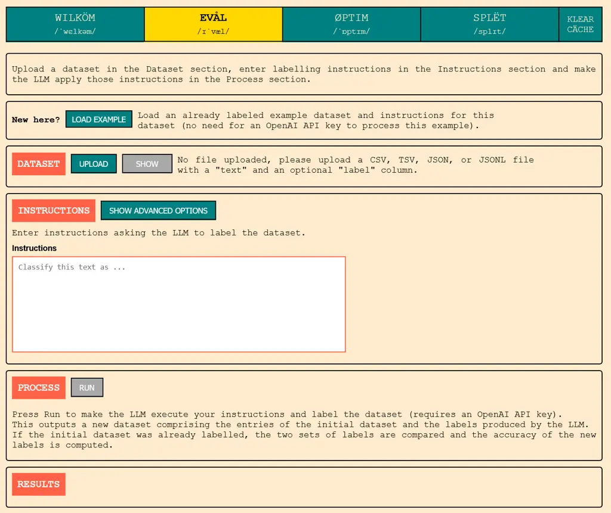
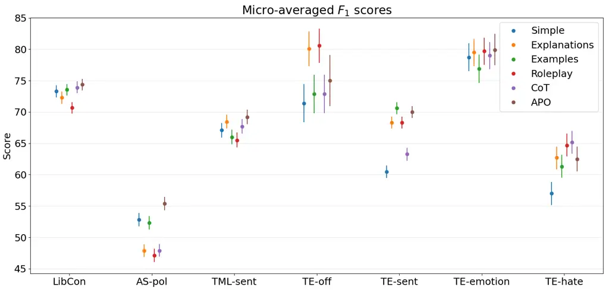
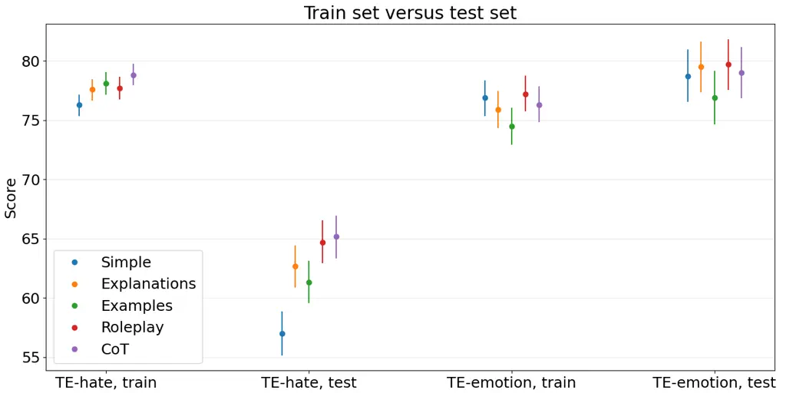
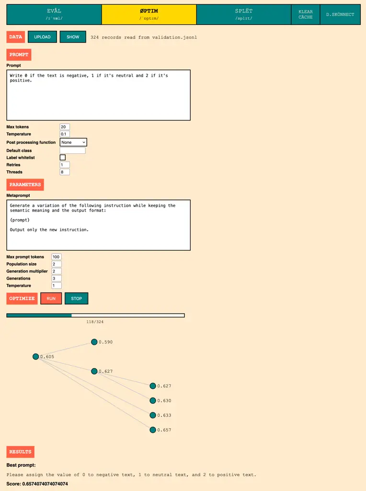
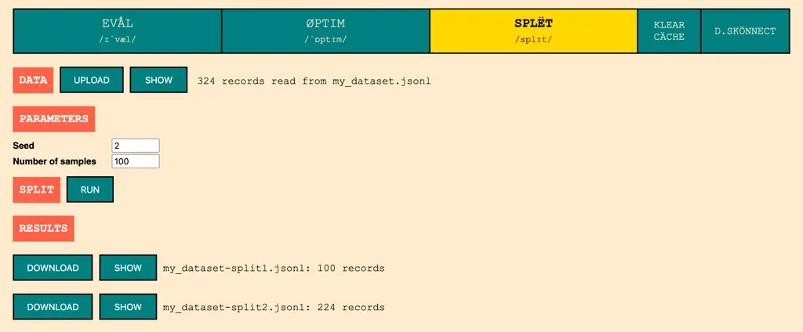

# Prompt Selection Matters: Enhancing Text Annotations for Social Sciences with Large Language Models

Louis Abraham^(\*) Affiliation: Université Paris 1 Panthéon-Sorbonne,
[Google
Scholar](https://scholar.google.fr/citations?user=c1Norb8AAAAJ&hl=en)   
Charles Arnal^(\*) Affiliation: Université Paris-Saclay, CNRS, Inria,
[Google
Scholar](https://scholar.google.com/citations?user=Pre7QicAAAAJ&hl=en)
   Antoine Marie^(\*) Affiliation: Institut Jean Nicod, Ecole Normale
Supérieure, PSL-EHESS-CNRS, [Google
Scholar](https://scholar.google.com/citations?hl=en&user=immG3K4AAAAJ&view_op=list_works&gmla=AC6lMd8GlGzRqp_6G-IUKuSTzrB3fqoBZ7GYA1LXSinBhZpro5hyEevDZrJJLTqz9Sw0am1yjkHFdqU52HFNpoSA)

###### Abstract

Large Language Models have recently been applied to text annotation
tasks from social sciences, equating or surpassing the performance of
human workers at a fraction of the cost. However, no inquiry has yet
been made of the impact of prompt selection on labelling accuracy. In
this study, we show that performance greatly varies between prompts, and
we apply the method of automatic prompt optimization to systematically
craft high quality prompts. We also provide the community with a simple,
browser-based implementation of the method at  
[https://prompt-ultra.github.io/](https://prompt-ultra.github.io/).

^(\*)^(\*)footnotetext: Equal contribution.

## 1 Introduction

Throughout the social sciences, many research questions are answered
using annotation and classification of large volumes of text, such as
tweets or Facebook comments. Researchers may be interested in knowing,
for instance, how politically slanted (liberal vs. conservative) a claim
or headline is; how emotional or hostile its tone is, or which one of
the basic emotions it reflects (sadness, joy, anger, etc) \[BLHJ16,
GL12, SM10, RBOP24\]. Text annotation so far had to be performed by
humans–experts, research assistants, or unskilled crowd workers who are
likely to mislabel the data \[Li24\]–or using machine learning models
trained via supervised learning specifically for the task at hand. As a
result, it was typically costly and time-consuming.

The recent progress of Large Language Models (LLMs) has opened new
avenues and could revolutionize text mining by allowing huge volumes of
text data to be analyzed in an unsupervised way in a matter of minutes
\[HCvH24, GAK23, Tör23, WR23, DKG22\]. Early results suggest that LLMs
can perform extremely well, extremely fast and at a reasonable cost,
with levels of accuracy rivaling those of experts and superior to those
of unskilled workers. Moreover, these results are achieved by
off-the-shelf, general purpose models, that do not need any specialized
training, unlike some pre-existing machine learning-based techniques.

Nonetheless, crucial aspects of the automatic annotation of text data
using LLMs have not been studied yet. In particular, few studies have
considered the importance of prompt choice in this context: simple
hand-crafted prompts, such as ‘‘Does the following message express
liberal or conservative views?’’ or ‘‘Is this tweet pro-life or
pro-choice?’’, are frequently used to annotate corpora. However, it has
been observed outside the context of text annotation that applying
distinct yet similar versions of a given prompt to certain tasks can
result in large differences in accuracy¹¹ 1 Similar differences can be
observed when using other performance metrics, such as F-scores., of the
order of more than $`10\%`$ \[KGR+22, BMR+20\]; similar findings within
the context of text annotation are reported in \[WR23\]. Going from
$`10\%`$ to $`20\%`$ of mislabelled data can greatly impact the quality
of a study’s conclusions, especially if the classification errors are
biased (e.g., if all mislabelled tweets express conservative views).

Our main objectives in this paper are threefold. First, to help social
better social scientists understand automatic text annotation using LLMs
by providing a clear illustration of how it works. Second, to
demonstrate the importance of prompt selection on performance, and to
raise awareness about the issue of performance variability. Third, to
explain to social scientists how to apply state-of-the-art prompt
optimization methods used in the wider LLM community \[ZMH+22, YWL+24\]
to their own classification tasks.

More precisely, our contributions are as follows:

- •
  We give a short, didactic overview of automatic text annotation for
  social sciences using LLMs; in particular, we draw attention to some
  shortcomings of the method that have not yet been discussed.
- •
  We describe the principle of automatic prompt optimization, as well as
  a simple implementation of the method.
- •
  To the social science community, we provide a website that enables
  researchers to efficiently label their own datasets using LLMs using
  either their own hand-crafted prompts or a prompt optimization
  algorithm. This browser-based service can be found at
   [https://prompt-ultra.github.io/](https://prompt-ultra.github.io/).
- •
  We investigate and quantify the impact of prompt selection on
  performance across a range of standard classification tasks in social
  sciences using LLMs. To that end, we compare both hand-crafted prompts
  and automatically optimized prompts.
- •
  We conclude that apparently similar prompts in natural language yield
  greatly varied performance levels. We also observe that automatic
  prompt optimization yields consistently good performance and beats
  prompt-crafting heuristics (such as using Chain of Thoughts prompts,
  see below) on most tasks.

All of the code used to perform the experiments will be made available
on GitHub.

## 2 Automatic text labelling using LLMs

In this section, we present the recently proposed method of automatic
text labelling using LLMs, and discuss some of its shortcomings.

State-of-the-art general purpose language models, such as GPT-4
\[Ope23\], have now achieved human-like performance on a variety of
tasks. In particular, it has been recently demonstrated that they can be
applied off-the-shelf, i.e., without needing any specialized training,
to a variety of text-labelling tasks needed in social sciences. Among
other examples, they have been shown to reach around $`95\%`$ of
accuracy²² 2 It is useful to note in passing that while it is desirable
to maximize accuracy at classification tasks, it is generally impossible
to reach 100% in virtue of the fact that some statements are
intrinsically ambiguous and thus impossible to classify even by
professional raters. on negativity detection in tweets and news articles
\[HCvH24\], around $`75\%`$ of accuracy on stance detection in tweets
(largely outperforming untrained crowd workers) \[GAK23\], and more than
$`92\%`$ of accuracy on political orientation in tweets \[Tör23\].

Up until one or two years ago, similar performances were either
unachievable, or only achievable by models specifically trained on the
task at hand, the creation of which was complex and time-consuming
\[JD16, NR13, AAS+20, PP11, DMB23\].

Let us give a quick explanation of how to automatically label text using
LLMs. Though variants are possible, the simplest method is to simply ask
in simple and clear terms an LLM-based chatbot, such as ChatGPT
\[LHM+23\], to give a label to a given piece of text. For instance:

```ltx_verbatim
[Social scientist]
Does the following tweet express liberal or conservative opinions?
Output only "liberal" or "conservative" without quotes.

Please support our Capitol Police and Law Enforcement.
They are truly on the side of our Country. Stay peaceful!

[ChatGPT] conservative
```

Typing each prompt by hand in the browser interface would be tedious.
Instead, researchers would typically send such prompts through the API
using e.g., a simple Python script³³ 3 Such a script can be found in our
code base., allowing thousands of statements to be classified in a
matter of minutes. Each message would have to be processed in a fresh
instance of the client chat, to avoid a progressive biasing of the model
by the conversation history. A small percentage of answers might not be
correctly formatted (the LLM might respond “The message is conservative”
or “Conservative.” or “right-wing” instead of “conservative”), in which
case one would simply have to ask the chatbot again. To get an estimate
of the accuracy of the labels thus produced, the researcher should
ideally have a small subset of the dataset be annotated by experts
(typically a few hundreds to a few thousand items of text), so that the
labels provided by the LLM can be compared to those provided by experts,
which serve as ground truth for the task. The degree of agreement
between the two sets of labels can then serve as an estimate of the
accuracy of the LLM’s annotations.

The perks of using LLMs to classify text, compared to manual annotation
by crowd workers or experts, are immense. It is easy to implement, fast
and comparatively inexpensive (thousands of short or medium length texts
can be labelled in a few minutes for less than 10\$). It is also
significantly less time-consuming and easier to set up compared to
earlier machine learning-based methods.

### 2.1 Limitations of automatic text labelling

As for any method, automatic text annotation using LLMs suffers from
some limitations, however, which have not been extensively discussed in
the literature. Though early studies are very encouraging, the range of
tasks that have been studied so far remains limited; the vast majority
of them consists in attributing one of a handful of labels to short- to
medium-length texts (typically social media posts or news headlines).
Moreover, early results find that accuracy tends to be lower in
languages other than English \[HCvH24\], which is coherent with general
observations regarding LLMs’ performances. LLMs are also known to suffer
from potential biases, including political ones \[LJW+22, MPNR24,
ZLS+24\]; those could result in systematic errors on certain tasks that
would have a greater impact on the research performed on the annotated
dataset than the raw accuracy might suggest. As an example, consider an
LLM tasked with labelling a set of tweets as Republican-leaning or
Democrat-leaning ; if all mislabelled tweets are Republican tweets
erroneously labeled as Democrat, the conclusions drawn from the dataset
might be wrong, despite the overall accuracy being high.

The issue can also be exacerbated by conscious moderating efforts by the
LLM’s creators: various techniques are in place to ensure that the
answers provided by LLM-based chat agents avoid using stereotypes seen
as offensive \[ea23\], which can negatively affect their performance on
politically sensitive topics like race.

Other problems arise not from the intrinsic nature of LLMs, but from the
way in which they are currently being trained and deployed.
State-of-the-art LLMs, such as GPT-4, are trained on immense datasets of
text scrapped from the web, and regularly updated in a similar fashion.
Beyond the possible privacy issues, this has crucial implications
regarding the performance of LLMs: they will often perform better on
data on which they have been trained than on yet unseen data (e.g., data
produced after their training) \[Alp10\]. As a result, the same LLM
might be better at classifying a certain set of tweets than a more
recent set it has not yet “seen”. Since the exact nature of the training
data is typically not shared with the general public, such phenomena are
very hard to predict - see some of our observations in Section 5. In
particular, we suspect that some of the most impressive accuracy scores
achieved by LLMs on annotation tasks (and reported in the academic
literature) might be partially explained by this. This problem, in
conjunction with the recurrent updating of models, creates important
issues of replicability: results might vary greatly between apparently
similar tasks, or when applying different versions of the same model to
the same task. Note that this issue can be partially offset by using
“frozen” LLMs, i.e., by keeping a copy of a certain version of an LLM at
a certain point in time and using it on all tasks.

### 2.2 Related Works on Prompting for Text Classification

Since the 2000s, sociologists and political scientists have applied
machine learning techniques, such as Support Vector Machines, Naive
Bayes classifiers, or Maximum Entropy models, to the classification of
large volumes of text (e.g. \[JD16, NR13, AAS+20, PP11, DMB23, WC17,
Alp10\]). However, these methods face several limitations \[LPL+22\],
such as struggling with understanding context and informal language
patterns common in social media posts, and their performance heavily
depends on curated training datasets and domain-specific feature
engineering.

A few years ago, Large language models (LLMs) have become available to
social scientists and they are greatly facilitating text classification
tasks in social sciences \[HCvH24, GAK23, Tör23, WR23, LLC+24\] (but see
\[OSMC23\] for a more critical perspective). Early results show that
off-the-shelves LLMs can perform extremely well, with accuracy levels
sometimes equating those of human experts, while being comparatively
cheap and easy to deploy. In political discourse analysis in particular,
they have been shown to successfully identify political slant, implicit
biases, dog whistles, or rhetorical devices that simpler keyword-based
approaches would miss \[DKG22, HCvH24, GAK23, Tör23, WR23, LLC+24\].

The most straightforward way to annotate using LLMs is to ask them the
same question, or prompt, as would be asked to human coders \[GAK23,
AV24, HLG+24, HCvH24\]. However, this approach suffers from the models’
sensitivity to the precise wording of the instructions: performances
have been observed to improve in response to various “tricks” such as
providing the LLM with additional context for the task, giving it
examples of correct answers, and asking the LLM to explain its response
or to answer while pretending to be a political analyst (see
Subsection 4.2). Since then, a literature has emerged documenting such
prompt engineering techniques (see e.g., \[BMR+20, HZD+21, KGR+22,
LDC+22, WWS+22, BG24\], and the surveys \[SSS+24, VD24\]). However,
novel prompts tend to be explored in an unsystematic manner and there is
no guarantee that a given technique will perform well in an untested
setting. This issue can be partially circumvented by annotating part of
the data through other means (e.g., human coders) and using this data
sample to evaluate the performance of various prompts, before applying
the best prompt to the remainder of the data \[AV24, WR23\]. Doing this
is time-consuming, however. It also requires ground truth labels for
evaluating prompt performance (which can be costly to obtain), and
relies on the researcher’s ability to intuit which candidate
formulations would make for better prompts.

As an answer to this problem, a more principled approach has recently
been put forward, called Automatic prompt optimization or Automatic
prompt engineering, which consists in using LLMs themselves to
automatically engineer good prompts \[ZMH+22, YWL+24, SDZ23, JPZ+24,
CKD24\]. We employ and describe such a procedure below, in Subsection
4.3.

## 3 Prompt Ultra, our automatic dataset labelling app

Though using LLMs to label datasets demands significantly fewer
technical skills compared to earlier machine learning-based methods, a
basic understanding of coding is still necessary. We are providing a
browser app, Prompt Ultra, which can be used to automatically label
datasets without any coding being required. It is freely available at
[https://prompt-ultra.github.io/](https://prompt-ultra.github.io/).

Briefly summarized, one can use the app (and a ChatGPT access key,
easily purchasable on their website
[https://help.openai.com/en/](https://help.openai.com/en/)) to label any
textual dataset with a prompt of one’s choice. One can also evaluate and
compare the performance of various prompts, as well as apply the
automatic prompt optimization algorithm from Subsection 4.3. More
complete descriptions of the app are available in the Appendix, as well
as on the website itself.



Figure 1: A screenshot of one of the website’s tabs.

## 4 Experiments

We evaluate various hand-crafted prompts and automatically optimized
prompts (see Subsections 4.2 and 4.3 below) on a range of datasets and
classical social sciences tasks using OpenAI’s GPT-3.5 Turbo’s API
\[YCX+23\] (see our code base for details). Our objective is twofold:
first, we want to measure the impact of the precise formulation of the
prompt on GPT’s accuracy by comparing performance across various
prompts. The goal here is not to find some optimal prompt crafting
technique that would systematically outperform all others (such panacea
is unlikely to exist, as suggested by our experimental results further
below); in particular, we do not claim to have examined every possible
prompt-crafting trick. Rather, we only want to see whether two
reasonable, semantically similar prompts can result in significantly
different accuracies on a given task. Second, we want to check whether
automatic prompt optimization can help achieve consistently good (though
not necessarily optimal) results on all tasks without the need for
manual tweaking by the experimenter.

### 4.1 Datasets and tasks

We have selected a range of diverse yet typical annotation tasks and
datasets. When the sets have a predefined train and test sets split, we
only use the test set for reasons explained in Section 5.

TweetEval - hate, emotion, sentiment, offensive (TE-hate, TE-emotion,
TE-sent, TE-off)

[https://github.com/cardiffnlp/tweeteval](https://github.com/cardiffnlp/tweeteval)

TweetEval \[BCCEAN20\] consists of seven heterogeneous tasks performed
on Twitter data in English, of which we have selected four:

- •
  Hate detection (hateful or non-hateful); the set contains
  $`2^{\prime}970`$ tweets \[BBF+19\].
- •
  Emotion recognition (anger, joy, optimism or sadness); the set
  contains $`1^{\prime}421`$ tweets \[MBMSK18\].
- •
  Sentiment recognition (negative, neutral, positive); the set contains
  $`12^{\prime}284`$ tweets, and we randomly draw and use
  $`10^{\prime}000`$ of them \[RFN17\].
- •
  Offensive language detection (non-offensive, offensive); the set
  contains $`860`$ tweets \[ZMN+19\].

Tweet Sentiment Multilingual (TML-sent)

[https://github.com/cardiffnlp/xlm-t/tree/main/data/sentiment](https://github.com/cardiffnlp/xlm-t/tree/main/data/sentiment)

Tweet Sentiment Multilingual \[BEACC22\] is a dataset of tweets in $`8`$
different languages (Arabic, English, French, German, Hindi, Italian,
Portuguese, Spanish) with sentiment analysis labels (negative, neutral
and positive). The test set contains $`6^{\prime}960`$ messages.

Article Bias Prediction (AS-pol)

[https://github.com/ramybaly/Article-Bias-Prediction](https://github.com/ramybaly/Article-Bias-Prediction)

A dataset of $`37554`$ news articles from major US newspapers
\[BDSMGN20\], with labels representing their political inclination
(left, center⁴⁴ 4 Note that the centrist label describes articles that
are biased towards a centrist political ideology, and not articles that
lack political bias. or right), from which we randomly sample
$`10^{\prime}000`$ articles.

Liberals vs Conservatives on Reddit (LibCon)

[https://www.kaggle.com/datasets/neelgajare/liberals-vs-conservatives-on-reddit-13000-posts](https://www.kaggle.com/datasets/neelgajare/liberals-vs-conservatives-on-reddit-13000-posts)

A dataset of $`13^{\prime}000`$ Reddit posts in English collected from
liberal- and conservative-leaning subreddits \[lib\]. We randomly select
and use $`10^{\prime}000`$ of them.

### 4.2 Hand-crafted prompts

As noted in our review of related works, it has been observed that
various tricks can help increase LLMs’ performance. As an example,
simply adding “Let’s think step by step” at the end of a prompt can
result in impressive improvements \[KGR+22\]. Though there is no
systematic theory of “good prompting”, many such tricks have been
catalogued (see e.g., \[pro\]). We have applied several of these
standard techniques to craft five different prompts for each task; below
are examples from the TweetEval - hate task. The other prompts can be
found in the accompanying code.

- •
  Simple - A simple, minimalist prompt:

  Classify the following message as hateful if it contains hate speech
  or non-hateful if it does not contain hate speech. Output only
  “hateful” or “non-hateful” without quotes.

- •
  Explanations - A prompt enriched with additional explanations (see
  e.g. \[LDC+22\]):

  You will be given a tweet. Your task is to use your knowledge of
  sociology, politics and culture to make an educated guess on whether
  the tweet contains hate speech. Hate speech includes any speech that
  expresses hate or encourages violence towards a person or group based
  on something such as race, religion, sex, sexual orientation or
  socio-economic situation. For example, messages that aggressively and
  unfairly target women or immigrants constitute hate speech. If the
  message does not contain enough information to correctly classify it,
  just make your best guess. If the message contains hate speech, output
  “hateful” without quotes. If the message does not contain hate speech,
  output “non-hateful” without quotes. Output only “hateful” or
  “non-hateful” without quotes.

- •
  Examples - A prompt containing the same explanations, as well as some
  examples of correctly classified messages (see e.g. \[BMR+20\]).

  You will be given a tweet. Your task is to \[…\]

  Output only “hateful” or “non-hateful” without quotes.

  Here are four examples of tweets with the correct classification :

  Women are equal and deserve respect. Just kidding, they should suck my
  dick.

  hateful

  I’ve been called a son of a whore and a cunt today already. It’s not
  even 1 yet

  non-hateful

  \[…\]

- •
  Roleplay - A prompt containing the same explanations and asking the
  chatbot to answer the question while roleplaying as a political
  analyst (see e.g. \[BG24\]).

  You will be given a tweet. Pretend that you are a political analyst
  and decide whether the tweet contains hate speech. Hate speech
  includes \[…\]

- •
  Chain of thoughts (CoT) - A prompt with the same explanations that
  asks the LLM to first explain its reasoning, then answer the question
  (see \[WWS+22, KGR+22\]). The very last word of the output is used as
  a label.

  You will be given a tweet. Your task is to \[…\] constitute hate
  speech. First explain your reasoning. Then start a new line, and
  output “hateful” without quotes if the message contains hate speech,
  and output “non-hateful” without quotes if the message does not
  contain hate speech. The only word on the new line must be either
  “hateful” without quotes or “non-hateful” without quotes.

### 4.3 Automatic prompt optimization (APO)

A more systematic way to craft good prompts has been recently proposed:
automatic prompt optimization \[ZMH+22, YWL+24, SDZ23\] (also called
automatic prompt engineering).

The core idea is to ask an LLM to repeatedly rephrase prompts, then to
select the one that offers the best performance. We translated this
general concept into our specific text labelling setting as follows: we
first require a subset of the dataset to have already been labelled by
human annotators; typically, a few hundred or a few thousand messages.
We then start from any reasonable prompt for the task, e.g., “Classify
the following message as hateful if it contains hate speech or
non-hateful if it does not contain hate speech.” in the case of the hate
detection task. We ask the LLM to reformulate the prompt several times,
e.g. with “Generate a variation of the following instruction while
keeping the semantic meaning.” We then repeat the following steps as
many times as desired: we evaluate the current set of prompts on the
labelled subset, we keep only the top prompts (in terms of scores), and
we ask the LLM to reformulate them to create a new generation of prompts
(in addition with the top prompts themselves). The best prompt of the
last generation is then used to label the remainder of the dataset.
Before that, one can estimate its associated accuracy by testing it on
another pre-labelled subset, distinct from the one used during the
optimization process to avoid any bias caused by a lack of independence.

In our experiments and for a given task, each generation had $`8`$
prompts; each was evaluated on a fixed subset of $`400`$ samples from
the dataset. The top $`2`$ prompts were kept, and each was reformulated
$`3`$ times to generate a new generation of $`2+2\times 3=8`$ prompts.
We repeated this process for $`15`$ generations, after which we kept the
best performing prompt of the last generation. Finally, we evaluated
this prompt on the remainder of the dataset (without the $`400`$
prompts, to guarantee an unbiased estimate of the prompt’s accuracy).

The method is both conceptually simple, and easy to implement; its main
a priori downside compared to using hand-crafted prompts is the
increased number of calls to the chatbot API required, though the costs
remain almost negligible. It can be tested on our free browser-based
service, which we further describe in Appendix C.

## 5 Results and discussion



Figure 2: Micro-averaged $`F_{1}`$ scores (in $`\%`$) of the
hand-crafted prompts and of the best prompt obtained using automatic
prompt optimization (APO) on each of the datasets and tasks described in
Subsection 4.1. $`95\%`$ confidence intervals are represented. The same
results are reported as a numerical table in the Appendix.

Inter-prompts performance variability

We report in Figure 2 the micro-averaged $`F_{1}`$ scores on each task
of our five types of prompts and of the best prompt generated using
automatic prompt generation, as well as their estimated 95% confidence
intervals \[TYKK22, Gil23\]. We observe that the choice of prompt has a
significant impact on performance for most tasks: depending on the task,
the best prompt results in an observed $`F_{1}`$ score that is up to
$`18\%`$ higher than that of the worst prompt. This confirms our claim
that careful prompt selection is crucial.

We also note that there is no "miracle" hand-crafted prompt that
consistently outperforms all the others. Some heuristics and specific
wordings work well on certain tasks, and poorly on others. This is in
line with observations made in the literature; as an example, adding
“Let’s think step by step” at the end of a prompt is shown to outperform
adding the semantically similar “Let’s work this out in a step by step
way to be sure we have the right answer” for the task studied in
\[YWL+24\] (see Table 1 thereof), while the converse is true in
\[ZMH+22\] (Table 7).

Automatic prompt optimization outperforms hand-crafted prompts

We now turn to the specific performances of Automatic prompt
optimization (APO). APO beats hand-crafted prompts at four tasks; among
the remaining three, it is second best for TE-sent (with a score nearly
equal to that of the best hand-crafted prompt), and is roughly at the
level of the median of the hand-crafted prompts for TE-off and TE-hate.
This shows that automatically optimizing prompts results in consistently
good performance without the need for prior testing of various
hand-crafted prompts on a subset of the dataset of interest. Note that
the expected performance of APO could be improved by increasing the
number of samples on which each generation is tested (the $`400`$
samples mentioned in Subsection 4.3), in exchange for an increase in
computational costs.

Interestingly, and in line with the remarks of the previous paragraph,
the final prompts generated using APO do not differ much from the ones
used to start the optimization process, despite the often large gap
between their associated accuracies⁵⁵ 5 We report the best prompt
returned by the optimization process for each task in the Appendix.. For
TE-hate, for example, the initial prompt is “Classify the following
message as hateful if it contains hate speech or non-hateful if it does
not contain hate speech. Output only “hateful” or “non-hateful” without
quotes” and the automatically optimized prompt is “Check for hate speech
in the following message to determine if it is hateful, then classify it
as either "hateful" or "non-hateful"”.

Is ChatGPT cheating?



Figure 3: Micro-averaged $`F_{1}`$ scores (in $`\%`$) of the
hand-crafted prompts on the train set and on the test set of the TE-hate
and TE-emotion datasets. $`95\%`$ confidence intervals are represented.
The same results are reported as a numerical table in the Appendix.

We have observed a curious phenomenon: as shown in Figure 3, all prompts
result in much higher $`F_{1}`$ score when tested on the training set of
the TE-hate dataset than on its test set (where “training” and “test”
refer to the split made by the creators of the dataset \[BBF+19\]). This
is a priori surprising, as both subsets should be drawn from the same
distribution, and as such our prompts should not perform any better on
the training set than on the test set⁶⁶ 6 Note that there is no issue of
overfitting here, as the prompts were not “trained” in any way on what
we call the training set in this context.. Our explanation is that the
training set of TE-hate is part of the enormous amount of data on which
GPT-3.5 Turbo, the model which we used, has been trained; as a result,
it performs better on it than on the test set (which was either not
included, or included in a different fashion). As the exact data on
which the model was trained was not made public, we cannot confirm this
hypothesis with absolute certainty. As a result, we can say that ChatGPT
is “cheating” when labelling the training set of TE-hate, in the sense
that its performance is superior to what it would be on a similar
dataset to which it did not have access during its training (e.g. data
that was produced after its training). This explains why we used the
test splits of our datasets whenever possible, in the hope that as (we
assume it to be the case) for TE-hate, they have not been included in
the training set of the model, making for a fairer assessment of the
capabilities of the method.

This problem makes it hard to predict future performances based on past
experiments, as we have no guarantee as to what was and was not used in
the models’ training. Note for example that a similar gap in performance
between the training set and the test set is not observable for
TE-emotion. Ideally, one should only test the models on data that was
produced after their training. This could however prove difficult and
overly restrictive: curating useful datasets is a challenging and
time-consuming task in itself, and most datasets available online are at
least a few years old, thereby predating all last generation LLMs.

As a side note, this phenomenon could explain why we have observed
slightly weaker performances on average than those reported in recent
literature \[HCvH24, GAK23, Tör23\] on similar tasks: we suspect that
the authors of these articles might not have been aware of this pitfall,
and failed to take measures to circumvent it. It could also be due to
intrinsic differences in difficulty between the datasets used, as we
tried to include both easy and hard datasets for diversity (in
particular, it has been noted before, e.g., in \[HCvH24\], that
performance drops for very long texts, such as the articles from the
AS-pol dataset). We cannot verify this hypothesis, as (most of) the
datasets used in the references that we cite are not available anymore
due to a policy change from the social media platform X.

A note on our choice of datasets and task complexity

We selected on purpose tasks that are commonly performed by social
scientists and natural language processing researchers so as to make the
relevance of our claims (variation in prompt performance and the
benefits of automatic optimization) immediately apparent to both
communities. A downside of this choice is that though distinct, the
tasks considered are somewhat similar and inevitably simple. Another
limitation of our datasets is that though some tasks are harder than
others, none are hard enough to present a real challenge to a
well-informed human being. In future work, it would be interesting to
measure the accuracy and sensitivity of LLMs to the prompts chosen both
on a greater variety of tasks and in limit cases where even human
experts might struggle. As a final remark, note that due to the very
nature of the tasks at hand, some labels in our datasets are not
unambiguously correct: it is for instance easy to find tweets in the
TE-emotion dataset that could be classified as either joyful or
optimistic. This fact, while not unique to our datasets, necessarily has
an impact on the performances reported.

## 6 Conclusion

This paper meant to illustrate the importance of prompt selection and
the effectiveness of automatic prompt optimization within the context of
text annotation tasks frequently used in the social sciences. In
particular, our results suggest that the prompt optimization procedure
described in Subsection 4.3 can be applied off-the-shelf to various
tasks to achieve accuracies that equal or exceed those obtained using
hand-crafted prompts. This prompt optimization method is made
particularly easy by our user-friendly implementation⁷⁷ 7 In particular,
it allows for the replication of all of our experiments without the need
for any coding., which is freely available at
[https://prompt-ultra.github.io/](https://prompt-ultra.github.io/).

Nonetheless, we have also seen that any automatic annotation procedure
relying on last generation LLMs raises important questions of
replicability due to their training processes (not to mention
environmental and privacy-related concerns).

Among other potential future research directions, it would be
particularly interesting to test whether LLMs tasked with labelling a
corpus can give robust justifications for their choices – e.g. explain
that they classified a given tweet as left-wing due to the presence of
such and such opinions that are typically associated with the Left.
Though more sophisticated solutions are conceivable (e.g. using the
LLMs’ attention mechanisms, see \[VSP+17\]), directly asking the chatbot
"Can you justify your decision?" would already make for an interesting
experiment. Getting LLMs to associate a (reliable) confidence score to
its labels, so that human annotators can review the small percentage of
labels the model was unsure of and increase accuracy, would also be of
great interest.

## 7 Data availability statement

All data used in our analyses are linked in the "3.1 Datasets and tasks"
section of the manuscript.

## 8 Conflict of interest

Nothing declared.

## References

- \[AAS⁺20\] Mohd Zeeshan Ansari, M.B. Aziz, M.O. Siddiqui, H. Mehra,
  and K.P. Singh. Analysis of political sentiment orientations on
  twitter. Procedia Computer Science, 167:1821–1828, 2020. International
  Conference on Computational Intelligence and Data Science.
- \[Alp10\] Ethem Alpaydin. Introduction to Machine Learning. The MIT
  Press, 2nd edition, 2010.
- \[AV24\] Kylie L. Anglin and Claudia Ventura. Automatic text
  classification with large language models: A review of openai for
  zero- and few-shot classification. Journal of Educational and
  Behavioral Statistics, 2024.
- \[BBF⁺19\] Valerio Basile, Cristina Bosco, Elisabetta Fersini, Debora
  Nozza, Viviana Patti, Francisco Manuel Rangel Pardo, Paolo Rosso, and
  Manuela Sanguinetti. SemEval-2019 task 5: Multilingual detection of
  hate speech against immigrants and women in Twitter. In Proceedings of
  the 13th International Workshop on Semantic Evaluation, pages 54–63,
  Minneapolis, Minnesota, USA, 2019. Association for Computational
  Linguistics.
- \[BCCEAN20\] Francesco Barbieri, Jose Camacho-Collados, Luis
  Espinosa-Anke, and Leonardo Neves. TweetEval:Unified Benchmark and
  Comparative Evaluation for Tweet Classification. In Proceedings of
  Findings of EMNLP, 2020.
- \[BDSMGN20\] Ramy Baly, Giovanni Da San Martino, James Glass, and
  Preslav Nakov. We can detect your bias: Predicting the political
  ideology of news articles. In Proceedings of the 2020 Conference on
  Empirical Methods in Natural Language Processing (EMNLP), EMNLP ’20,
  pages 4982–4991, 2020.
- \[BEACC22\] Francesco Barbieri, Luis Espinosa Anke, and Jose
  Camacho-Collados. XLM-T: Multilingual language models in Twitter for
  sentiment analysis and beyond. In Proceedings of the Thirteenth
  Language Resources and Evaluation Conference, pages 258–266,
  Marseille, France, June 2022. European Language Resources Association.
- \[BG24\] Rick Battle and Teja Gollapudi. The unreasonable
  effectiveness of eccentric automatic prompts. ArXiv,
  abs/2402.10949, 2024.
- \[BLHJ16\] L.F. Barrett, M. Lewis, and J.M. Haviland-Jones. Handbook
  of Emotions, Fourth Edition. Psychology (The Guilford Press). Guilford
  Publications, 2016.
- \[BMR⁺20\] Tom Brown, Benjamin Mann, Nick Ryder, Melanie Subbiah,
  Jared D Kaplan, Prafulla Dhariwal, Arvind Neelakantan, Pranav Shyam,
  Girish Sastry, Amanda Askell, Sandhini Agarwal, Ariel Herbert-Voss,
  Gretchen Krueger, Tom Henighan, Rewon Child, Aditya Ramesh, Daniel
  Ziegler, Jeffrey Wu, Clemens Winter, Chris Hesse, Mark Chen, Eric
  Sigler, Mateusz Litwin, Scott Gray, Benjamin Chess, Jack Clark,
  Christopher Berner, Sam McCandlish, Alec Radford, Ilya Sutskever, and
  Dario Amodei. Language models are few-shot learners. In H. Larochelle,
  M. Ranzato, R. Hadsell, M.F. Balcan, and H. Lin, editors, Advances in
  Neural Information Processing Systems, volume 33, pages 1877–1901.
  Curran Associates, Inc., 2020.
- \[CKD24\] Weizhe Chen, Sven Koenig, and Bistra Dilkina. Reprompt:
  Planning by automatic prompt engineering for large language models
  agents. 06 2024.
- \[DKG22\] Tu My Doan, Benjamin Kille, and Jon Atle Gulla. Using
  language models for classifying the party affiliation of political
  texts. In Paolo Rosso, Valerio Basile, Raquel Martínez, Elisabeth
  Métais, and Farid Meziane, editors, Natural Language Processing and
  Information Systems, pages 382–393, Cham, 2022. Springer International
  Publishing.
- \[DMB23\] Nicolas Devatine, Philippe Muller, and Chloé Braud. An
  Integrated Approach for Political Bias Prediction and Explanation
  Based on Discursive Structure. In Findings of the Association for
  Computational Linguistics (EACL 2023), pages 11196–11211, Toronto,
  Canada, July 2023. ACL: Association for Computational Linguistics.
- \[ea23\] OpenAI Josh Achiam et al. Gpt-4 technical report. 2023.
- \[GAK23\] Fabrizio Gilardi, Meysam Alizadeh, and Maël Kubli. Chatgpt
  outperforms crowd workers for text-annotation tasks. Proceedings of
  the National Academy of Sciences, 120(30):e2305016120, 2023.
- \[Gil23\] Jacob Gildenblat. A python library for confidence intervals.
  [https://github.com/jacobgil/confidenceinterval](https://github.com/jacobgil/confidenceinterval), 2023.
- \[GL12\] JOSHUA S. GANS and ANDREW LEIGH. How partisan is the press?
  multiple measures of media slant\*. Economic Record,
  88(280):127–147, 2012.
- \[HCvH24\] Michael Heseltine and Bernhard Clemm von Hohenberg. Large
  language models as a substitute for human experts in annotating
  political text. Research & Politics, 11(1):20531680241236239, 2024.
- \[HLG⁺24\] Xingwei He, Zhenghao Lin, Yeyun Gong, A-Long Jin, Hang
  Zhang, Chen Lin, Jian Jiao, Siu Ming Yiu, Nan Duan, and Weizhu Chen.
  AnnoLLM: Making large language models to be better crowdsourced
  annotators. In Yi Yang, Aida Davani, Avi Sil, and Anoop Kumar,
  editors, Proceedings of the 2024 Conference of the North American
  Chapter of the Association for Computational Linguistics: Human
  Language Technologies (Volume 6: Industry Track), pages 165–190,
  Mexico City, Mexico, June 2024. Association for Computational
  Linguistics.
- \[HZD⁺21\] Xu Han, Weilin Zhao, Ning Ding, Zhiyuan Liu, and Maosong
  Sun. Ptr: Prompt tuning with rules for text classification. ArXiv,
  abs/2105.11259, 2021.
- \[JD16\] Anuja P Jain and Padma Dandannavar. Application of machine
  learning techniques to sentiment analysis. In 2016 2nd International
  Conference on Applied and Theoretical Computing and Communication
  Technology (iCATccT), pages 628–632, 2016.
- \[JPZ⁺24\] Can Jin, Hongwu Peng, Shiyu Zhao, Wang Zhenting, Wujiang
  Xu, Ligong Han, Jiahui Zhao, Kai Zhong, Sanguthevar Rajasekaran, and
  Dimitris Metaxas. Apeer: Automatic prompt engineering enhances large
  language model reranking. 06 2024.
- \[KGR⁺22\] Takeshi Kojima, Shixiang Shane Gu, Machel Reid, Yutaka
  Matsuo, and Yusuke Iwasawa. Large language models are zero-shot
  reasoners. Advances in neural information processing systems,
  35:22199–22213, 2022.
- \[LDC⁺22\] Andrew Kyle Lampinen, Ishita Dasgupta, Stephanie C. Y.
  Chan, Kory Matthewson, Michael Henry Tessler, Antonia Creswell,
  James L. McClelland, Jane X. Wang, and Felix Hill. Can language models
  learn from explanations in context? ArXiv, abs/2204.02329, 2022.
- \[LHM⁺23\] Yiheng Liu, Tianle Han, Siyuan Ma, Jiayue Zhang, Yuanyuan
  Yang, Jiaming Tian, Hao He, Antong Li, Mengshen He, Zhengliang Liu,
  Zihao Wu, Lin Zhao, Dajiang Zhu, Xiang Li, Ning Qiang, Dingang Shen,
  Tianming Liu, and Bao Ge. Summary of chatgpt-related research and
  perspective towards the future of large language models.
  Meta-Radiology, 1(2):100017, 2023.
- \[Li24\] Jiyi Li. A comparative study on annotation quality of
  crowdsourcing and llm via label aggregation. pages 6525–6529, 04 2024.
- \[lib\] Liberals vs Conservatives on Reddit.
  [https://www.kaggle.com/datasets/neelgajare/liberals-vs-conservatives-on-reddit-13000-posts](https://www.kaggle.com/datasets/neelgajare/liberals-vs-conservatives-on-reddit-13000-posts).
  Accessed: 2024-06-16.
- \[LJW⁺22\] Ruibo Liu, Chenyan Jia, Jason Wei, Guangxuan Xu, and
  Soroush Vosoughi. Quantifying and alleviating political bias in
  language models. Artificial Intelligence, 304:103654, 2022.
- \[LLC⁺24\] Lincan Li, Jiaqi Li, Catherine Chen, Fred Gui, Hongjia
  Yang, Chenxiao Yu, Zhengguang Wang, Jianing Cai, Junlong Zhou, Bolin
  Shen, Alex Qian, Weixin Chen, Zhongkai Xue, Lichao Sun, Lifang He,
  Hanjie Chen, Kaize Ding, Zijian Du, Fangzhou Mu, and Yushun Dong.
  Political-llm: Large language models in political science, 12 2024.
- \[LPL⁺22\] Qian Li, Hao Peng, Jianxin Li, Congying Xia, Renyu Yang,
  Lichao Sun, Philip Yu, and Lifang He. A survey on text classification:
  From traditional to deep learning. ACM Transactions on Intelligent
  Systems and Technology, 13:1–41, 04 2022.
- \[MBMSK18\] Saif Mohammad, Felipe Bravo-Marquez, Mohammad Salameh, and
  Svetlana Kiritchenko. Semeval-2018 task 1: Affect in tweets. In
  Proceedings of the 12th international workshop on semantic evaluation,
  pages 1–17, 2018.
- \[MPNR24\] Fabio Motoki, Valdemar Pinho Neto, and Victor Rodrigues.
  More human than human: Measuring chatgpt political bias. Public
  Choice, 198(1):3–23, 2024.
- \[NR13\] M S Neethu and R Rajasree. Sentiment analysis in twitter
  using machine learning techniques. In 2013 Fourth International
  Conference on Computing, Communications and Networking Technologies
  (ICCCNT), pages 1–5, 2013.
- \[Ope23\] OpenAI. Gpt-4 technical report. 2023.
- \[OSMC23\] Etienne Ollion, Rubing Shen, Ana Macanovic, and Arnault
  Chatelain. Chatgpt for text annotation? mind the hype!, 10 2023.
- \[PP11\] Marco Pennacchiotti and Ana-Maria Popescu. A machine learning
  approach to twitter user classification. In Proceedings of the
  international AAAI conference on web and social media, volume 5, pages
  281–288, 2011.
- \[pro\] Prompt engineering guide.
  [https://www.promptingguide.ai/techniques/](https://www.promptingguide.ai/techniques/).
  Accessed: 01-06-2024.
- \[RBOP24\] Stig Hebbelstrup Rye Rasmussen, Alexander Bor, Mathias
  Osmundsen, and Michael Bang Petersen.
  ‘Super-unsupervised’classification for labelling text: online
  political hostility as an illustration. British Journal of Political
  Science, 54(1):179–200, 2024.
- \[RFN17\] Sara Rosenthal, Noura Farra, and Preslav Nakov. Semeval-2017
  task 4: Sentiment analysis in twitter. In Proceedings of the 11th
  international workshop on semantic evaluation (SemEval-2017), pages
  502–518, 2017.
- \[SDZ23\] Kashun Shum, Shizhe Diao, and Tong Zhang. Automatic prompt
  augmentation and selection with chain-of-thought from labeled data. In
  Houda Bouamor, Juan Pino, and Kalika Bali, editors, Findings of the
  Association for Computational Linguistics: EMNLP 2023, pages
  12113–12139, Singapore, December 2023. Association for Computational
  Linguistics.
- \[SM10\] Carlo Strapparava and Rada Mihalcea. Annotating and
  Identifying Emotions in Text, pages 21–38. Springer Berlin Heidelberg,
  Berlin, Heidelberg, 2010.
- \[SSS⁺24\] Pranab Sahoo, Ayush Singh, Sriparna Saha, Vinija Jain,
  Samrat Mondal, and Aman Chadha. A systematic survey of prompt
  engineering in large language models: Techniques and applications.
  02 2024.
- \[Tör23\] Petter Törnberg. Chatgpt-4 outperforms experts and crowd
  workers in annotating political twitter messages with zero-shot
  learning. arXiv preprint arXiv:2304.06588, 2023.
- \[TYKK22\] Kanae Takahashi, Kouji Yamamoto, Aya Kuchiba, and Tatsuki
  Koyama. Confidence interval for micro-averaged f1 and macro-averaged
  f1 scores. Applied Intelligence, 52, 03 2022.
- \[VD24\] Shubham Vatsal and Harsh Dubey. A survey of prompt
  engineering methods in large language models for different nlp tasks.
  07 2024.
- \[VSP⁺17\] Ashish Vaswani, Noam Shazeer, Niki Parmar, Jakob Uszkoreit,
  Llion Jones, Aidan N. Gomez, Lukasz Kaiser, and Illia Polosukhin.
  Attention is all you need. 2017.
- \[WC17\] John Wilkerson and Andreu Casas. Large-scale computerized
  text analysis in political science: Opportunities and challenges.
  Annual Review of Political Science, 20:529–544, 05 2017.
- \[WR23\] Maximilian Weber and Merle Reichardt. Evaluation is all you
  need. prompting generative large language models for annotation tasks
  in the social sciences. a primer using open models. 12 2023.
- \[WWS⁺22\] Jason Wei, Xuezhi Wang, Dale Schuurmans, Maarten Bosma,
  Ed Huai hsin Chi, F. Xia, Quoc Le, and Denny Zhou. Chain of thought
  prompting elicits reasoning in large language models. ArXiv,
  abs/2201.11903, 2022.
- \[YCX⁺23\] Junjie Ye, Xuanting Chen, Nuo Xu, Can Zu, Zekai Shao,
  Shichun Liu, Yuhan Cui, Zeyang Zhou, Chao Gong, Yang Shen, Jie Zhou,
  Siming Chen, Tao Gui, Qi Zhang, and Xuanjing Huang. A comprehensive
  capability analysis of gpt-3 and gpt-3.5 series models. ArXiv,
  abs/2303.10420, 2023.
- \[YWL⁺24\] Chengrun Yang, Xuezhi Wang, Yifeng Lu, Hanxiao Liu, Quoc V.
  Le, Denny Zhou, and Xinyun Chen. Large language models as
  optimizers, 2024.
- \[ZLS⁺24\] Travis Zack, Eric Lehman, Mirac Suzgun, Jorge A Rodriguez,
  Leo Anthony Celi, Judy Gichoya, Dan Jurafsky, Peter Szolovits, David W
  Bates, Raja-Elie E Abdulnour, et al. Assessing the potential of gpt-4
  to perpetuate racial and gender biases in health care: a model
  evaluation study. The Lancet Digital Health, 6(1):e12–e22, 2024.
- \[ZMH⁺22\] Yongchao Zhou, Andrei Muresanu, Ziwen Han, Keiran Paster,
  Silviu Pitis, Harris Chan, and Jimmy Ba. Large language models are
  human-level prompt engineers, 11 2022.
- \[ZMN⁺19\] Marcos Zampieri, Shervin Malmasi, Preslav Nakov, Sara
  Rosenthal, Noura Farra, and Ritesh Kumar. Semeval-2019 task 6:
  Identifying and categorizing offensive language in social media
  (offenseval). In Proceedings of the 13th International Workshop on
  Semantic Evaluation, pages 75–86, 2019.

## Appendix A Results of the main experiments as numerical tables

We report in Tables 1 and 2 the same results as in Figures 2 and 3.

| Micro averaged F1-scores |                          |                          |                          |                          |
| ------------------------ | ------------------------ | ------------------------ | ------------------------ | ------------------------ |
|                          | TE-hate                  | TE-emotion               | TE-sent                  | TE-off                   |
| Simple                   | 57.0 \[55.2, 58.8\]      | $`78.7[76.6,80.9]`$      | 60.5 \[59.5, 61.4\]      | 71.4 \[68.4, 74.4\]      |
| Explanations             | $`62.7[60.9,64.4]`$      | $`79.5[77.4,81.6]`$      | $`68.3[67.4,69.2]`$      | $`80.1[77.4,82.8]`$      |
| Examples                 | $`61.3[59.6,63.1]`$      | 76.9 \[74.7, 79.1\]      | $`\bf{70.6[69.7,71.5]}`$ | $`72.9[69.9,75.9]`$      |
| Roleplay                 | $`64.7[63.0,66.5]`$      | $`79.7[77.6,81.8]`$      | $`68.3[67.4,69.2]`$      | $`\bf{80.6[77.9,83.2]}`$ |
| CoT                      | $`\bf{65.2[63.4,66.9]}`$ | $`79.0[76.9,81.1]`$      | $`63.3[62.3,64.2]`$      | $`72.9[69.9,75.9]`$      |
| APO                      | $`62.5[60.6,64.4]`$      | $`\bf{79.9[77.5,82.4]}`$ | $`70.0[69.1,70.9]`$      | $`75.0[71.0,79.0]`$      |
|                          |                          |                          |                          |                          |
|                          | TML-sent                 | AS-pol                   | LibCon                   |                          |
| Simple                   | $`67.1[66.0,68.2]`$      | $`52.8[51.8,53.8]`$      | $`73.3[72.4,74.2]`$      |                          |
| Explanations             | $`68.4[67.4,69.2]`$      | $`47.9[46.9,48.8]`$      | $`72.3[71.4,73.2]`$      |                          |
| Examples                 | $`66.0[64.9,67.1]`$      | $`52.3[51.3,53.3]`$      | $`73.6[72.7,74.4]`$      |                          |
| Roleplay                 | 65.5 \[64.4, 66.7\]      | 47.1 \[46.1, 48.1\]      | 70.7 \[69.8, 71.5\]      |                          |
| CoT                      | $`67.7[66.6,68.8]`$      | $`47.9[47.0,48.9]`$      | $`73.9[73.1,74.8]`$      |                          |
| APO                      | $`\bf{69.2[68.1,70.3]}`$ | $`\bf{55.4[54.4,56.4]}`$ | $`\bf{74.4[73.5,75.2]}`$ |                          |

Table 1: Micro-averaged $`F_{1}`$ scores (in $`\%`$) of the hand-crafted
prompts and of the best prompt obtained using automatic prompt
optimization (APO) on each of the datasets and tasks described in
Subsection 4.1, along with the lower bound and upper bound of the
$`95\%`$ confidence interval of each measure (in brackets). The highest
score achieved on a task is in bold, the lowest score is in italics.

| Train set vs test set |                     |                     |                     |                     |
| --------------------- | ------------------- | ------------------- | ------------------- | ------------------- |
|                       | TE-hate, train      | TE-hate, test       | TE-emotion, train   | TE-emotion, test    |
| Simple                | $`76.3[75.4,77.1]`$ | $`57.0[55.2,58.8]`$ | $`76.9[75.4,78.3]`$ | $`78.7[76.6,80.9]`$ |
| Explanations          | $`77.6[76.7,78.4]`$ | $`62.7[60.9,64.4]`$ | $`75.9[74.4,77.4]`$ | $`79.5[77.4,81.6]`$ |
| Examples              | $`78.1[77.2,79.0]`$ | $`61.3[59.6,63.1]`$ | $`74.5[73.0,76.0]`$ | $`76.9[74.7,79.1]`$ |
| Roleplay              | $`77.7[76.8,78.6]`$ | $`64.7[63.9,66.5]`$ | $`77.2[75.8,78.7]`$ | $`79.7[77.6,81.8]`$ |
| CoT                   | $`78.8[78.0,79.7]`$ | $`65.2[63.4,66.9]`$ | $`76.3[74.9,77.8]`$ | $`79.0[76.9,81.1]`$ |

Table 2: Micro-averaged $`F_{1}`$ scores (in $`\%`$) of the hand-crafted
prompts and of the best prompt obtained using automatic prompt
optimization (APO) on each of the datasets and tasks described in
Subsection 4.1, along with the lower bound and upper bound of the
$`95\%`$ confidence interval of each measure (in brackets). The highest
score achieved on a task is in bold, the lowest score is in italics.

## Appendix B Optimized prompts

For each task, we report the best prompt generated by the prompt
optimization process:

TE-hate “Check for hate speech in the following message to determine if
it is hateful, then classify it as either "hateful" or "non-hateful".”

TE-emotion “Identify the emotion displayed in the following message as
joy, anger, sadness or optimism.”

TE-sent “Label the emotion in the given message as positive, negative,
or neutral.”

TE-off “Determine if the following message is offensive or non-offensive
and provide the corresponding label.”

TML-sent “Categorize the sentiment in the following message as positive,
negative, or neutral.”

AS-pol “Identify if the text below belongs to the left, center, or right
categories.”

LibCon “Identify the text as either liberal or conservative.”

## Appendix C Brief overview of our browser-based service

We summarily describe our automatic text labelling service
[https://prompt-ultra.github.io/](https://prompt-ultra.github.io/).
Further explanations are given on the website itself.


Figure 4: The EVÅL tab.

In the EVÅL tab (see Figure 4), you upload a dataset, which can be
labelled or unlabelled, using the topmost button. You then enter a
prompt and press the Run button. At that point, a pop-up window requires
you to input your ChatGPT access key. Once you have done so, the prompt
is applied to each entry of the dataset, and the resulting labelled
dataset is output. If the original dataset was labelled, its labels and
the predicted labels are compared and the resulting accuracy is
computed.



Figure 5: The ØPTIM tab.

Prompt optimization is performed in the ØPTIM tab (see Figure 5). You
first upload a labelled dataset using the topmost button, and input a
starting prompt. A macroprompt is then applied to generate successive
generations of prompts, with the best prompts of each generation
surviving to the next generation. A graph illustrates which prompt
descends from which prompt of the previous generation. After a specified
number of generations, the prompt whose performance was the best on the
labelled dataset is output, as well as its accuracy score.



Figure 6: The SPLËT tab.

The SPLËT tab (see Figure 6) simply provides a convenient way to split a
dataset in two.

Finally, the KLEAR CÄCHE button allows you to clear the LLM’s cache, and
D.SKÖNNECT to erase the ChatGPT access key that you had entered.
