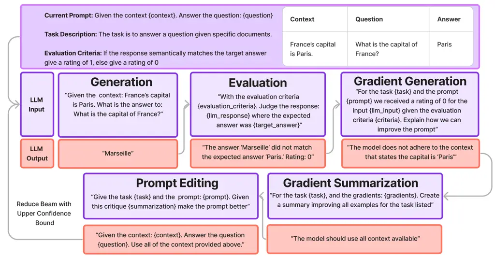
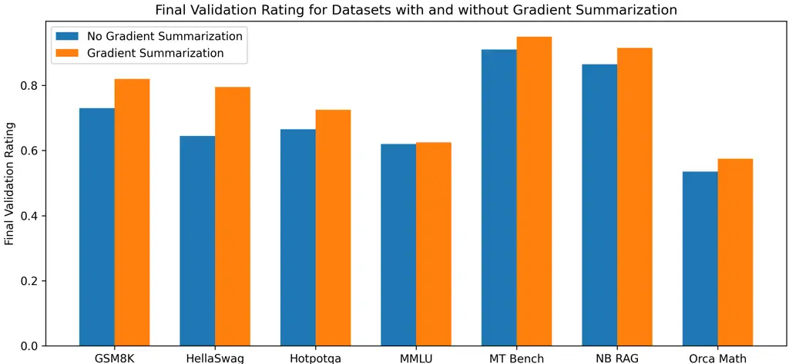

# GRAD-SUM: Leveraging Gradient Summarization for Optimal Prompt Engineering

Derek Austin ^(†)^(†)thanks: Primary author. Affiliation: Galileo
Technologies    Elliott Chartock Affiliation: Galileo Technologies

###### Abstract

Prompt engineering for large language models (LLMs) is often a manual
time-intensive process that involves generating, evaluating, and
refining prompts iteratively to ensure high-quality outputs. While there
has been work on automating prompt engineering, the solutions generally
are either tuned to specific tasks with given answers or are quite
costly. We introduce GRAD-SUM, a scalable and flexible method for
automatic prompt engineering that builds on gradient-based optimization
techniques. Our approach incorporates user-defined task descriptions and
evaluation criteria, and features a novel gradient summarization module
to generalize feedback effectively. Our results demonstrate that
GRAD-SUM consistently outperforms existing methods across various
benchmarks, highlighting its versatility and effectiveness in automatic
prompt optimization.

[TABLE]

Table 1: Example GRAD-SUM optimization run using the GSM8K dataset.

## 1 Introduction

The introduction of machine learning and artificial intelligence has
automated many tasks, but creating and refining prompts for LLM
applications remains largely a manual process. Practitioners often
struggle to find the right prompt to elicit accurate and high-quality
outputs. Common practice is to judge output quality by implementing
fully automated evaluation feedback loops, where LLMs assess outputs
based on user-provided evaluation criteria, these are often called
LLM-as-a-judge methods. Seeing as evaluation is an automatic process in
LLM-as-a-judge scenarios, the main bottleneck in automating prompt
engineering is the actual refinement of the prompt. Although there have
been attempts to automate this process (Yang et al., 2023) (Pryzant
et al., 2023) (Zhou et al., 2023), we found that these methods either
could not be adapted seamlessly to all tasks or were too costly to
implement at scale.

Automatic prompt optimization methods broadly fall into two categories:
Monte Carlo search methods Yang et al. (2023) and feedback-based (or
gradient-based) methods (Pryzant et al., 2023)Fernando et al.
(2024)(Prasad et al., 2023). Monte Carlo search methods start with a
base prompt and iterate over hundreds if not thousands of possible
prompts in order to find the best performer, an inefficient process.
These methods use minimal feedback on why their responses might be
incorrect and instead search somewhat blindly through prompt space to
identify the best possible prompt, making small changes along the way.
Feedback-based methods, on the other hand, use ratings and explanations
of how their answer could be improved from previous iterations to
generate new prompts. They aim to emulate a traditional optimization
process by iteratively refining prompts based on detailed feedback,
closely mimicking the approach of a human prompt engineer. As shown in
(Yang et al., 2023), Monte Carlo methods take many iterations to
converge, and thus are likely to be too costly for most practitioners.
Therefore, in approaching the problem of automatic prompt engineering we
choose to focus on feedback-based methods.



Figure 1: An illustration of one GRAD-SUM training loop. Modules are
sequential starting with generation. The prompt chosen in our prompt
editor model is then fed back to the generation module and the training
loop restarts.

One of the seminal works that inspired our feedback-based approach was
presented in "Automatic Prompt Optimization with ‘Gradient Descent’ and
Beam Search" (Pryzant et al., 2023). ‘Gradients’ in this context, refers
to natural language descriptions of errors in LLM responses and
suggestions for improving the system’s response in the future. The
method presented in the aforementioned paper uses each of these
gradients individually to generate a new prompt. Their approach
addressed classification tasks such as hate speech detection, lie
detection, jailbreak detection, and sarcasm detection, using a
restrictive matching evaluator where predictions must exactly match the
expected answers. As most LLM use cases do not have a strict expected
output we improve upon their work by introducing LLMs-as-a-judge
evaluations - which enable accurate judgment of any response for all
possible tasks.

Our approach, GRAD-SUM, introduces a task description input that allows
models to incorporate high-level, domain-specific information provided
by the user. Additionally, we introduce natural language evaluation
criteria also provided by the user, enabling our method to use
LLM-as-a-judge metrics, extending (Pryzant et al., 2023) method to all
possible use cases. We also improve upon (Pryzant et al., 2023) method,
by introducing a new gradient summarization module after discovering
that editing the prompt based on feedback from a single output, as done
in (Pryzant et al., 2023) often resulted in highly specific candidates
prompts that failed to generalize to the broader dataset population. To
address this, our gradient summarization module takes all computed
gradients and produces a generalized summary of the feedback, akin to
averaging gradients over many samples, a common practice in machine
learning. Overall, our approach combines a novel gradient summarization
module, user-provided task descriptions and evaluation criteria to
create a more flexible, scalable and performant solution for automated
prompt engineering than any existing today.

## 2 Related Work

Customizing an LLM to a user’s specific task can fit into two broad
categories: parametric and non-parametric approaches. Parametric
approach’s usually consist of parameter efficient fine-tuning (Hu
et al., 2022) (Li and Liang, 2021) where only a portion of parameters
are updated based on backpropagating gradients. Prefix tuning introduces
new learnable tokens that one can think of as a prompt in continuous
space, that are learned for specific tasks (Li and Liang, 2021).
However, as these tokens defined in continuous space they are not easily
interpretable. Other approaches like (Shin et al., 2020) backpropagate
gradients and choose the best discrete prompts. However, even this
technique suffers from interpretability as most prompts are not
grammatically correct or coherent sentences.

Most practitioners currently rely on black box API based LLM’s for
language generation where there is no potential for backpropagation of
any kind (Brown et al., 2020). Therefore, prompt optimization becomes a
discrete optimization problem over an extraordinarily large search
space. Some methods attempt to tackle this problem through the use of
complementary models. (Deng et al., 2022) attempt to use a policy
network that receives rewards from an evaluator function in order to
update a discrete prompt. (Chen et al., 2023) uses an open source model
to convert a soft-prompt defined in embedding space into a discrete
prompt that was then fed to the LLM API. Others use evolutionary
algorithms in order to modify, delete and add a list of candidate
prompts that are evaluated each iteration (Fernando et al., 2024)
(Prasad et al., 2023). Simple Monte Carlo sampling around candidate
prompts (Yang et al., 2023) can complement these methods or be
implemented entirely on their own.

Most of these methods attempt to use some sort of signal from an
evaluator LLM in order to asses the quality of the output. However, it
has been shown that LLMs are not great at self-correction without use of
auxiliary knowledge or tools (Stechly et al., 2023) (Ma et al., 2024)
(Huang et al., 2024) (Gou et al., 2024). Therefore the introduction of
specific evaluation criteria, as in our method, the use of tools, as in
(Gou et al., 2024), or modifying LLM critiques to better find the root
of the errors (Ma et al., 2024) becomes of paramount importance to
finding an optimized prompt.

## 3 Method

Our method consists of 5 distinct modules as seen in Figure 1:
generation, evaluation, gradient generation, gradient summarization, and
prompt editing. Throughout our optimization process, we utilize beam
search with a beam size of three candidate prompts, feeding each
potential prompt to the modules introduced below. Figure 1 showcases one
iteration for one potential prompt.

### 3.1 Generation

The generation module necessitates a dataset, a prompt, and an LLM with
which to generate outputs. In usual workflows the prompt will consist of
formatting ‘slots’ where the dataset will provide text that will be used
to fill in the slots as shown in Figure 1. For instance, a prompt for a
retrieval augmented generation (RAG) workflow could be:

> “Given the following context: {context}. Answer the question
> {question}."

The dataset should then consist of the columns ‘context’, ‘question’ and
optionally target outputs which can be used in the evaluate module. We
then feed these formatted prompts to the generation function and receive
LLM generated responses.

### 3.2 Evaluation

Our evaluation module then takes in the generations from the generation
function, user-defined evaluation criteria, and optionally an expected
answer. The module in turn returns a rating as to how well the response
performs as judged by the evaluation criteria as well as an explanation
for the rating. We ask for the explanation before the evaluator module
returns a rating as chain of thought has been shown to dramatically
improve LLM performance, especially on reasoning tasks (Wei et al.,
2022). For use cases with an expected answer, evaluation criteria can be
as simple as:

> “Does the LLM generated response semantically match the expected
> answer? If a reasonable human would judge it to, give the response a
> 1, otherwise a 0."

We note that we only ask for a binary indicator as empirically we found
LLM’s are far better and more consistent at binary indicators than a
sliding numeric scale.

### 3.3 Gradients

The gradient module receives the current prompt, the evaluation
criteria, a description of the task at hand, and a maximum of 5
generation responses that received a rating of 0 from the evaluation
module. Note that any generation receiving a rating of 1 in the evaluate
step will be excluded from this process as it cannot be improved, thus
it is possible the gradient module will receive less than 5 inputs. An
LLM is then asked to evaluate the input and output for the specific
prompt and provide actionable methods for improving the prompts to
address deficiencies noted in the rating explanation. The gradient
module leverages all available information—the task description, input
to the generation function, the LLM response from the generate function,
evaluation criteria, and explanations for poor ratings—to identify areas
for improvement. Below is a sample of what a gradient will look like:

> “The model should draw upon the entire context and state its reasoning
> explicitly."

This step aims to emulate human evaluation of generations, determining
how to adjust the prompt to achieve the desired outcomes.

|                   |                  |                     |                           |                         |
| ----------------- | ---------------- | ------------------- | ------------------------- | ----------------------- |
| Dataset           | Generating Model | Optimization Method | Initial Validation Rating | Final Validation Rating |
| GSM8K             | GPT 3.5          | DSPY                | 0.635                     | 0.755                   |
| GSM8K             | GPT 3.5          | GRAD-SUM            | 0.635                     | 0.82                    |
| Orca Math         | GPT 3.5          | DSPY                | 0.395                     | 0.455                   |
| Orca Math         | GPT 3.5          | GRAD-SUM            | 0.395                     | 0.575                   |
| Neural Bridge RAG | GPT 3.5          | DSPY                | 0.605                     | 0.885                   |
| Neural Bridge RAG | GPT 3.5          | GRAD-SUM            | 0.605                     | 0.915                   |
| HellaSwag         | GPT 3.5          | DSPY                | 0.575                     | 0.48                    |
| HellaSwag         | GPT 3.5          | GRAD-SUM            | 0.575                     | 0.795                   |
| HotPot QA         | GPT 3.5          | DSPY                | 0.575                     | 0.626                   |
| HotPot QA         | GPT 3.5          | GRAD-SUM            | 0.575                     | 0.725                   |
| MMLU              | GPT 3.5          | DSPY                | 0.45                      | 0.56                    |
| MMLU              | GPT 3.5          | GRAD-SUM            | 0.45                      | 0.625                   |
| MT & Vicuna Bench | GPT 3.5          | DSPY                | 0.831                     | 0.823                   |
| MT & Vicuna Bench | GPT 3.5          | GRAD-SUM            | 0.831                     | 0.95                    |

Table 2: Model Performance Comparison for GPT-3.5 and DSPY. We bold the
highest final validation rating on equivalent models (GPT 3.5) between
our method and DSPY. Our method outperforms DSPY on all use cases and by
an average of 6%.

### 3.4 Gradient Summarization

While methods like (Pryzant et al., 2023) use the gradients individually
to then generate new prompts (ie. 5 gradients would lead to generating 5
new prompts), we find that this leads to prompts that are far too
specific to certain questions. Additionally, the task of evaluating
these candidate prompts consumes API calls that can lead to costly
compute bills. Therefore, we found the most effective way of generating
new general-purpose prompts was to summarize all gradient feedback into
one general paragraph that could apply to the dataset as whole. We feed
the task description and the gradients computed in the previous step to
the gradient summarization module and use an LLM to generate a
one-paragraph summary of the critiques taking into consideration the
task at hand. This step can be thought of as analogous to averaging
gradients over a mini-batch to stabilize training.

### 3.5 Prompt Editor

Our prompt editor module then takes in the current prompt, the
summarized gradient, and the task description and outputs a candidate
prompt for each prompt within our beam (doubling our beam size
momentarily). The new prompts should likely address the critiques
provided in the previous iteration. Each candidate prompt is checked to
ensure every slot in the current prompt is present in the new prompt in
order to avoid information loss of any kind. We then perform an
evaluation of each new candidate prompt. Specifically, we take a
randomly sampled subset (five rows) of the dataset and feed the
responses to our generate and evaluate modules, choosing the two
candidate prompts with the highest average rating. As our beam is now 5
prompts wide we reduce to a beam size of 3 through selecting the top 3
performers as given by the upper confidence bound (Kuleshov and Precup,
2014). This reduction step thus always retains the best-performing
prompt from previous iterations, reducing the variance from evaluating
candidate prompts on a small sample size.



Figure 2: Our gradient summarization approach outperforms no gradient
summarization by 5%.

## 4 Experiments & Results

In order to benchmark our method we utilize common datasets: GSM8k
(Cobbe et al., 2021), Orca Math (Mitra et al., 2024), Neural Bridge RAG
(AI, ), Hella Swag (Zellers et al., 2019), HotPot QA (Yang et al.,
2018), MMLU (Hendrycks et al., 2021) and a mixture of the first turn
from MT Bench and Vicuna Bench (Zheng et al., 2023). We do not use any
expected answers in our MT Bench and Vicuna Bench results, highlighting
our use of user-provided evaluation criteria extends our technique to
datasets without expected answers. For each dataset if there is an
available training dataset we extract 30 random samples for our training
set and 200 random samples from the validation or test set in order to
simulate typical industry evaluation flows. If there is no available
test or validation set we sample 200 from the train set and hold them
out during training. 10 iterations are run over the train set with 10
rows being evaluated each iteration for each prompt (thus 30 calls for 3
candidate prompts) and the best prompt (the best performing prompt left
in our beam), is extracted and used in our final validation. All
datasets used can found on our GitHub.¹¹ 1
https://github.com/rungalileo/prompt_optimization_datasets Seeing as
(Pryzant et al., 2023) is not directly comparable to our approach on
these benchmarks due to their classification / exact-matching
framework²² 2 Figure 2 compares to the method introduced in (Pryzant
et al., 2023) after extending their work to use LLM-as-a-judge metrics,
showcasing the gradient summarization module improves upon their
approach., we instead compare to the popular prompt optimizer, DSPY
(Khattab et al., 2023). As DSPY is an abstracted prompting tool that
does not allow users to directly control the initial prompt, we
extracted DSPY’s initial prompt and used it as the starting point for
our method to ensure a fair comparison. The same evaluation criteria is
used with DSPY and we create a custom LLM-as-a-judge metric within their
system in order to make our methods as comparable as possible. We
utilize the DSPY COPRO optimizer and allow for 10 passes over the
dataset to ensure a fair comparison. For our method we conduct
evaluation, gradient generation and summarization with GPT 3.5
(‘gpt-3.5-turbo-0125’). Prompt editing is performed with GPT4o
(‘gpt-4o-2024-05-13’) in order to ensure high-quality new prompts. The
initial prompts, the final prompts, the task descriptions and evaluation
criteria used for the respective tasks are provided in the appendix.

As you can see in Table 2 our method improves and outperforms DSPY on
all use cases. We average an improvement of 14% over our initial
prompts, showcasing the robustness and strength of our optimizer.

#### Gradient Summarization

We also conduct an ablation where we remove the summarization module in
order to assess it’s efficacy. Removing the summarization module is
analogous to comparing our method with (Pryzant et al., 2023) after
extending their method to use LLM-as-a-judge evaluation. We note an
average validation increase of 5% with the introduction of the
summarization module. Upon examining the HotPot QA final prompt, it
became obvious the prompt became far too specific to single gradients
found throughout the training loop. Below is an extract from the final
HotPot QA prompt that clearly attaches to information relevant to
individual examples:

> “Reasoning: Let’s think step by step to logically deduce the answer.
> Focus on the relevant information in the context to arrive at the
> correct answer. Ensure you consider all details, specific terms, and
> names mentioned in the context, such as the regiment within the Guards
> Division, the term ’shorts,’ the founding year of Image Comics, middle
> names, the specific crime Brian Nichols was on trial for, and the full
> names of individuals. Provide a comprehensive response covering all
> individuals mentioned in the context where applicable."

Thus, we find that the gradient summarization module is essential for
maintaining high-quality prompts that can generalize to a validation
dataset.

## 5 Conclusion

We introduce a scalable, flexible prompt optimization framework that
improves LLM performance by an average of 14% across many popular
datasets. In all scenarios our framework is also able to find a better
prompt than our initial prompt. Finally, our framework can be used
across many of scenarios including those without expected answers,
illustrating the flexibility of our framework. By automating the prompt
engineering process and demonstrating consistent performance gains
across multiple datasets and models, our work enables efficient,
flexible and scalable utilization of LLMs in real-world applications,
reducing the time and effort required to achieve high-quality outputs.

## 6 Limitations

Our system currently supports only LLM-as-a-judge metrics. While these
metrics are effective in many scenarios, they may not be suitable for
all tasks. Expanding the system’s capability to support any user-defined
metric, including numerical and domain-specific metrics, is left for
future work. The use of LLMs for evaluation also introduces potential
biases inherent in the models themselves. This has the potential to
affect the accuracy of the evaluation process. Finally, there is still a
dependence on the user to define the task descriptions and evaluation
criteria, which have a large impact on final prompt quality.
Streamlining these aspects to require minimal user input while
maintaining effectiveness remains a challenge.

## References

- (1) Neural Bridge AI. [Neural-bridge/rag-dataset-12000 · datasets at
  hugging
  face](https://huggingface.co/datasets/neural-bridge/rag-dataset-12000).
- Brown et al. (2020) Tom Brown, Benjamin Mann, Nick Ryder, Melanie
  Subbiah, Jared D Kaplan, Prafulla Dhariwal, Arvind Neelakantan, Pranav
  Shyam, Girish Sastry, Amanda Askell, et al. 2020. Language models are
  few-shot learners. _Advances in neural information processing
  systems_, 33:1877–1901.
- Chen et al. (2023) Lichang Chen, Jiuhai Chen, Tom Goldstein, Heng
  Huang, and Tianyi Zhou. 2023. Instructzero: Efficient instruction
  optimization for black-box large language models.
- Cobbe et al. (2021) Karl Cobbe, Vineet Kosaraju, Mohammad Bavarian,
  Mark Chen, Heewoo Jun, Lukasz Kaiser, Matthias Plappert, Jerry Tworek,
  Jacob Hilton, Reiichiro Nakano, et al. 2021. Training verifiers to
  solve math word problems. _arXiv preprint arXiv:2110.14168_.
- Deng et al. (2022) Mingkai Deng, Jianyu Wang, Cheng-Ping Hsieh, Yihan
  Wang, Han Guo, Tianmin Shu, Meng Song, Eric Xing, and Zhiting
  Hu. 2022. Rlprompt: Optimizing discrete text prompts with
  reinforcement learning. In _Proceedings of the 2022 Conference on
  Empirical Methods in Natural Language Processing_, pages 3369–3391.
- Fernando et al. (2024) Chrisantha Fernando, Dylan Sunil Banarse,
  Henryk Michalewski, Simon Osindero, and Tim Rocktäschel. 2024.
  [Promptbreeder: Self-referential self-improvement via prompt
  evolution](https://openreview.net/forum?id=HKkiX32Zw1).
- Gou et al. (2024) Zhibin Gou, Zhihong Shao, Yeyun Gong, yelong shen,
  Yujiu Yang, Nan Duan, and Weizhu Chen. 2024. [CRITIC: Large language
  models can self-correct with tool-interactive
  critiquing](https://openreview.net/forum?id=Sx038qxjek). In _The
  Twelfth International Conference on Learning Representations_.
- Hendrycks et al. (2021) Dan Hendrycks, Collin Burns, Steven Basart,
  Andy Zou, Mantas Mazeika, Dawn Song, and Jacob Steinhardt. 2021.
  [Measuring massive multitask language
  understanding](https://openreview.net/forum?id=d7KBjmI3GmQ). In
  _International Conference on Learning Representations_.
- Hu et al. (2022) Edward J Hu, yelong shen, Phillip Wallis, Zeyuan
  Allen-Zhu, Yuanzhi Li, Shean Wang, Lu Wang, and Weizhu Chen. 2022.
  [LoRA: Low-rank adaptation of large language
  models](https://openreview.net/forum?id=nZeVKeeFYf9). In
  _International Conference on Learning Representations_.
- Huang et al. (2024) Jie Huang, Xinyun Chen, Swaroop Mishra,
  Huaixiu Steven Zheng, Adams Wei Yu, Xinying Song, and Denny
  Zhou. 2024. [Large language models cannot self-correct reasoning
  yet](https://openreview.net/forum?id=IkmD3fKBPQ). In _The Twelfth
  International Conference on Learning Representations_.
- Khattab et al. (2023) Omar Khattab, Arnav Singhvi, Paridhi Maheshwari,
  Zhiyuan Zhang, Keshav Santhanam, Sri Vardhamanan A, Saiful Haq,
  Ashutosh Sharma, Thomas T. Joshi, Hanna Moazam, Heather Miller, Matei
  Zaharia, and Christopher Potts. 2023. [DSPy: Compiling declarative
  language model calls into self-improving
  pipelines](https://openreview.net/forum?id=PFS4ffN9Yx). In
  _R0-FoMo:Robustness of Few-shot and Zero-shot Learning in Large
  Foundation Models_.
- Kuleshov and Precup (2014) Volodymyr Kuleshov and Doina Precup. 2014.
  Algorithms for multi-armed bandit problems. _arXiv preprint
  arXiv:1402.6028_.
- Li and Liang (2021) Xiang Lisa Li and Percy Liang. 2021.
  Prefix-tuning: Optimizing continuous prompts for generation. In
  _Proceedings of the 59th Annual Meeting of the Association for
  Computational Linguistics and the 11th International Joint Conference
  on Natural Language Processing (Volume 1: Long Papers)_, pages
  4582–4597.
- Ma et al. (2024) Ruotian Ma, Xiaolei Wang, Xin Zhou, Jian Li, Nan Du,
  Tao Gui, Qi Zhang, and Xuanjing Huang. 2024. Are large language models
  good prompt optimizers? _arXiv preprint arXiv:2402.02101_.
- Mitra et al. (2024) Arindam Mitra, Hamed Khanpour, Corby Rosset, and
  Ahmed Awadallah. 2024. Orca-math: Unlocking the potential of slms in
  grade school math. _arXiv preprint arXiv:2402.14830_.
- Prasad et al. (2023) Archiki Prasad, Peter Hase, Xiang Zhou, and Mohit
  Bansal. 2023. Grips: Gradient-free, edit-based instruction search for
  prompting large language models. In _Proceedings of the 17th
  Conference of the European Chapter of the Association for
  Computational Linguistics_, pages 3845–3864.
- Pryzant et al. (2023) Reid Pryzant, Dan Iter, Jerry Li, Yin Lee,
  Chenguang Zhu, and Michael Zeng. 2023. Automatic prompt optimization
  with “gradient descent” and beam search. In _Proceedings of the 2023
  Conference on Empirical Methods in Natural Language Processing_, pages
  7957–7968.
- Shin et al. (2020) Taylor Shin, Yasaman Razeghi, Robert L Logan IV,
  Eric Wallace, and Sameer Singh. 2020. Autoprompt: Eliciting knowledge
  from language models with automatically generated prompts. In
  _Proceedings of the 2020 Conference on Empirical Methods in Natural
  Language Processing (EMNLP)_, pages 4222–4235.
- Stechly et al. (2023) Kaya Stechly, Matthew Marquez, and Subbarao
  Kambhampati. 2023. [GPT-4 doesn’t know it’s wrong: An analysis of
  iterative prompting for reasoning
  problems](https://openreview.net/forum?id=PMtZjDYB68). In _NeurIPS
  2023 Foundation Models for Decision Making Workshop_.
- Wei et al. (2022) Jason Wei, Xuezhi Wang, Dale Schuurmans, Maarten
  Bosma, Fei Xia, Ed Chi, Quoc V Le, Denny Zhou, et al. 2022.
  Chain-of-thought prompting elicits reasoning in large language models.
  _Advances in neural information processing systems_, 35:24824–24837.
- Yang et al. (2023) Chengrun Yang, Xuezhi Wang, Yifeng Lu, Hanxiao Liu,
  Quoc V Le, Denny Zhou, and Xinyun Chen. 2023. Large language models as
  optimizers. _arXiv preprint arXiv:2309.03409_.
- Yang et al. (2018) Zhilin Yang, Peng Qi, Saizheng Zhang, Yoshua
  Bengio, William Cohen, Ruslan Salakhutdinov, and Christopher D
  Manning. 2018. Hotpotqa: A dataset for diverse, explainable multi-hop
  question answering. In _Proceedings of the 2018 Conference on
  Empirical Methods in Natural Language Processing_, pages 2369–2380.
- Zellers et al. (2019) Rowan Zellers, Ari Holtzman, Yonatan Bisk, Ali
  Farhadi, and Yejin Choi. 2019. Hellaswag: Can a machine really finish
  your sentence? In _Proceedings of the 57th Annual Meeting of the
  Association for Computational Linguistics_, pages 4791–4800.
- Zheng et al. (2023) Lianmin Zheng, Wei-Lin Chiang, Ying Sheng, Siyuan
  Zhuang, Zhanghao Wu, Yonghao Zhuang, Zi Lin, Zhuohan Li, Dacheng Li,
  Eric. P Xing, Hao Zhang, Joseph E. Gonzalez, and Ion Stoica. 2023.
  [Judging llm-as-a-judge with mt-bench and chatbot
  arena](https://arxiv.org/abs/2306.05685). _Preprint_,
  arXiv:2306.05685.
- Zhou et al. (2023) Yongchao Zhou, Andrei Ioan Muresanu, Ziwen Han,
  Keiran Paster, Silviu Pitis, Harris Chan, and Jimmy Ba. 2023. [Large
  language models are human-level prompt
  engineers](https://openreview.net/forum?id=92gvk82DE-). In _The
  Eleventh International Conference on Learning Representations_.

## Appendix A Prompt Optimization Results

For each dataset we list out the initial prompt, the task description,
the evaluation criteria and the final prompt obtained. We provide the
final prompt for all methods: GPT 3.5 with DSPY, and GPT 3.5 with our
method.

### A.1 GSM8k

Task Description:  
The task is answering grade school math questions.

Evaluation Criteria:  
Does the output align with the expected answer? The questions are math
questions. Check if the answer matches the expected answer. Give it a 1
if a math teacher would consider the answer correct. Give it a 0 if the
answer is incorrect. Do not worry about intermediate calculations, only
the final answer.

Initial prompt for our method & DSPY:  
The task is to answer math questions.

—

Follow the following format.

Question:

```ltx_verbatim
${question}
```

Reasoning: Let’s think step by step in order to

```ltx_verbatim
${produce the answer}
```

We …  
Answer: the answer to the question provided

—

Question: {question}  
Reasoning: Let’s think step by step in order to Answer:

```ltx_verbatim
${answer}
```

Answer:

Best Prompt GPT 3.5 (DSPY):  
Follow the following format.

Question:

```ltx_verbatim
${question}
```

Reasoning: Let’s think step by step in order to

```ltx_verbatim
${produce the answer}
```

We …  
Step-by-Step Explanation:» the answer to the question provided

—

Question: {question}  
Reasoning: Letś think step by step in order to find the solution. We
will break down the equation and solve for the unknown variable.
Step-by-Step Explanation: \[Insert detailed steps and calculations
here\]  
Step-by-Step Explanation:»

Best Prompt GPT 3.5 (Our method):  
The task is to answer grade school math questions accurately and
clearly. Follow these detailed steps to ensure clarity and correctness
in your response.

Question:

```ltx_verbatim
{question}
```

Reasoning: Let’s think through the problem step by step to produce the
correct answer. Follow these instructions carefully:

1. Identify Key Information:

- Read the

```ltx_verbatim
{question}
```

carefully.

- Identify and list the key pieces of information given.
- Clearly state what the question is asking for.

2. Choose the Appropriate Method:

- Determine which mathematical methods or formulas are needed to solve
  the problem.
- Explain why this method or formula is appropriate for the given
  question.  


3. Apply the Method:

- Carefully apply the chosen method or formula to the problem.
- Show each step of your calculation clearly and in order.
- Explain your reasoning at each stage to ensure clarity.

4. Double-Check:

- After arriving at a solution, double-check your calculations to
  confirm their accuracy.
- Review your explanation to ensure it is logical and easy to
  understand.
- Revisit the question to make sure your solution addresses exactly what
  was asked.  


Answer:

### A.2 Orca Math

Task Description:  
The task involves solving math word problems.

Evaluation Criteria:  
Does the output align with the expected answer? The questions are math
questions. Check if the answer matches the expected answer. Give it a 1
if a math teacher would consider the answer correct. Give it a 0 if the
answer is incorrect. Do not worry about intermediate calculations, only
the final answer.

Initial prompt for our method & DSPY:  
The task is to answer math questions.

—

Follow the following format.

Question:

```ltx_verbatim
${question}
```

Reasoning: Let’s think step by step in order to

```ltx_verbatim
${produce the answer}
```

We …  
Answer: the answer to the question provided

—

Question: {question}  
Reasoning: Let’s think step by step in order to Answer:

```ltx_verbatim
${answer}
```

Answer:

Best Prompt GPT 3.5 (DSPY):  
Take advantage of the large size of the language model and generate
detailed explanations for the math questions instead of just the
answers.»

—

Follow the following format.

Question:

```ltx_verbatim
${question}
```

Reasoning: Let’s think step by step in order to

```ltx_verbatim
${produce the answer}
```

We …  
Explanation: the answer to the question provided

—

Question: {question}  
Reasoning: Let’s think step by step in order to

Best Prompt GPT 3.5 (Our method):  
The task involves solving math word problems accurately by following a
clear and logical reasoning process. Please adhere to the following
format to ensure a coherent and cogent response:

—

Question:

```ltx_verbatim
{question}
```

Reasoning: Let’s think step by step in order to produce the answer. We
will break down the problem into smaller parts, perform the necessary
calculations, and show all work and thought processes clearly. Ensure
each step logically follows from the previous one and aligns with the
evaluation criteria of correctness, completeness, and clarity.

Answer: Provide the final answer to the question based on the reasoning
process above.

—

Question: {question}  
Reasoning: Let’s think step by step in order to produce the answer.
We…  
Answer:

### A.3 Neural Bridge RAG

Task Description:  
The task is a question answering task given specific context that should
have the answer.

Evaluation Criteria:  
Does the llm output match the expected answer? If the model says it does
not have enough context to answer the question give it a 0. Otherwise
judge whether a human would grade the output as matching the expected
answer. Adding context around the answer is fine as long as the answer
is correct according to the expected answer within the brackets
\<EXPECTED ANSWER\>. If it does match give it a 1. If it does not give
it a 0.

Initial prompt for our method & DSPY:  
The task is a question answering task given context that should have the
answer.

—

Follow the following format.

Question:

```ltx_verbatim
${question}
```

Context:

```ltx_verbatim
${context}‘
```

Reasoning: Let’s think step by step in order to

```ltx_verbatim
${produce the answer}
```

We …

Answer: the answer to the question given the context provided

—

Question: {question}  
Context: {context}  
Reasoning: Let’s think step by step in order to

Best Prompt GPT 3.5 (DSPY):  
Guide the model to closely examine the question through context, utilize
advanced inference techniques to deduce implicit information
effectively, and generate a comprehensive and sophisticated response
geared towards enhancing overall understanding and insights.»

—

Follow the following format.

Question:

```ltx_verbatim
${question}
```

Context:

```ltx_verbatim
${context}
```

Reasoning: Let’s think step by step in order to

```ltx_verbatim
${produce the answer}
```

We …  
Sophisticated Answer: the answer to the question given the context
provided

—

Question: {question}  
Context: {context}  
Reasoning: Let’s think step by step in order to

Best Prompt GPT 3.5 (Our method):  
You are tasked with answering a question based on a given context.
Follow the detailed steps below to ensure your response is specific,
comprehensive, and derived solely from the context provided.

1. Carefully read and fully understand the question. Clarify exactly
   what information is being sought by the question.
2. Thoroughly analyze the given context. Identify and extract all
   relevant pieces of information that directly pertain to the question.
3. Think logically and proceed step-by-step to connect the extracted
   details from the context to the question. Clearly explain your reasoning
   process, ensuring it is detailed, coherent, and directly related to the
   context.
4. Provide the final answer based on your detailed reasoning process,
   ensuring it directly addresses the question.

Use the following format for your response:

Question:

```ltx_verbatim
{question}
```

Context:

```ltx_verbatim
{context}
```

Reasoning: Let’s think step by step to understand and find the answer.
First, identify specific details from the context that are relevant to
the question. Then, logically connect these details to derive the
answer. Ensure your reasoning is clear, detailed, and coherent.

Answer: The answer to the question based on the context provided

### A.4 HellaSwag

Task Description:  
The task is to complete a sentence with the most logical of 4 possible
options.

Evaluation Criteria:  
Does the output match the the expected answer? If it does give it a 1.
If it does not give it a 0. It does not have to match exactly but it
should be close enough that a reasonable human would consider the output
to match the expected answer. Make sure that the chosen completion is
the correct completion.

Initial prompt for our method & DSPY:  
The task is to complete a sentence with the most logical of 4 possible
options.

—

Follow the following format.

Context:

```ltx_verbatim
Context for the question
```

Ending 1:

```ltx_verbatim
First possible ending for the question
```

Ending 2:

```ltx_verbatim
Second possible ending for the question
```

Ending 3:

```ltx_verbatim
Third possible ending for the question
```

Ending 4:

```ltx_verbatim
Fourth possible ending for the question
```

Reasoning: Let’s think step by step in order to

```ltx_verbatim
${produce the answer}
```

We …

Answer: the answer to the question given the possible endings provided

—

Context: {context}  
Ending 1: {ending1}  
Ending 2: {ending2}  
Ending 3: {ending3}  
Ending 4: {ending4}  
Reasoning: Let’s think step by step in order to

Best Prompt GPT 3.5 (DSPY): The task is to complete a sentence with the
most logical of 4 possible options.

—

Follow the following format.

Context:

```ltx_verbatim
Context for the question
```

Ending 1:

```ltx_verbatim
First possible ending for the question
```

Ending 2:

```ltx_verbatim
Second possible ending for the question
```

Ending 3:

```ltx_verbatim
Third possible ending for the question
```

Ending 4:

```ltx_verbatim
Fourth possible ending for the question
```

Reasoning: Let’s think step by step in order to

```ltx_verbatim
${produce the answer}
```

We …

Answer: the answer to the question given the possible endings provided

—

Context: {context}  
Ending 1: {ending1}  
Ending 2: {ending2}  
Ending 3: {ending3}  
Ending 4: {ending4}  
Reasoning: Let’s think step by step in order to

Best Prompt GPT 3.5 (Our method):  
Your task is to complete a sentence with the most logical of 4 possible
options. Follow these detailed instructions to ensure the best possible
output.

\### Task Instructions

1. Understand the Context: Carefully read the provided context to grasp
   the situation, the main idea, and any underlying nuances. Pay close
   attention to the details that are crucial for understanding the
   sentence.
2. Analyze Each Option: Evaluate each possible ending individually.
   Consider its relevance, logical consistency, and coherence with the
   context. Think about how each option fits with the main idea and details
   provided in the context.
3. Compare Against the Context: Cross-check each ending with the context
   to ensure it fits seamlessly and supports the overall meaning. Eliminate
   any options that do not make sense or disrupt the flow of the
   sentence.
4. Reasoning Process: Explain your thought process step-by-step.
   Consider the context and evaluate each ending thoroughly. Justify why
   each ending is or isn’t suitable, providing clear reasons for your
   choices.
5. Select the Most Logical Ending: Choose the ending that best completes
   the sentence in a coherent and meaningful way. Ensure that the chosen
   ending aligns perfectly with the context and enhances the overall
   understanding of the sentence.

\### Format

Context:

```ltx_verbatim
{context}
```

Ending 1:

```ltx_verbatim
{ending1}
```

Ending 2:

```ltx_verbatim
{ending2}
```

Ending 3:

```ltx_verbatim
{ending3}
```

Ending 4:

```ltx_verbatim
{ending4}
```

Reasoning: Let’s think step-by-step to produce the answer. We need to
consider the context and evaluate each ending one by one to determine
which is the most logical. We should look for consistency, relevance,
and coherence in the story.

Answer: The answer to the question given the possible endings
provided.

—

Context: {context}  
Ending 1: {ending1}  
Ending 2: {ending2}  
Ending 3: {ending3}  
Ending 4: {ending4}  
Reasoning: Let’s think step-by-step in order to…

### A.5 Hotpot QA

Task Description:  
The task is to reason over context given a question that will require
logical deduction.

Evaluation Criteria:  
Does the llm output answer the question correctly while only the context
provided? Ensure that the model adheres to the context while providing a
correct answer. If it does give it a 1. If it does not give it a 0. If
the answer is that the context is not provided give the answer a 0.

Initial prompt for our method & DSPY:  
The task is a question answering task given context that should have the
answer.

—

Follow the following format.

Question:

```ltx_verbatim
${question}
```

Context:

```ltx_verbatim
${context}
```

Reasoning: Let’s think step by step in order to

```ltx_verbatim
${produce the answer}
```

We …

Answer: the answer to the question given the context provided

—

Question: {question}  
Context: {context}  
Reasoning: Let’s think step by step in order to

Best Prompt GPT 3.5 (DSPY):  
Follow the following format.

Question:

```ltx_verbatim
${question}
```

Context:

```ltx_verbatim
${context}
```

Reasoning: Let’s think step by step in order to

```ltx_verbatim
${produce the answer}
```

We …

ANSWER: the answer to the question given the context provided

—

Question: {question}  
Context: {context}  
Reasoning: Let’s think step by step in order to

Best Prompt GPT 3.5 (Our method):  
You need to address a question using the given information through
logical reasoning.

—

Use the structure below to deliver a comprehensive and precise answer.

Question:

```ltx_verbatim
{question}
```

Context:

```ltx_verbatim
{context}
```

Reasoning: Let’s break this down systematically to arrive at the
solution. Begin by pinpointing the essential points in the context
relevant to the question. Clearly enumerate each critical point. Then,
interpret these points logically, elaborating on how each one aids in
establishing a link between the context and the question. Ensure careful
consideration of how each point bolsters your argument. Conclusively,
infer the answer based on this logical link, ensuring your explanation
is consistent, detailed, and specifically addresses the question.

Answer: the answer to the question given the context provided

### A.6 MMLU

Task Description:  
The task is to choose the correct answer from a list of possible answers
on a variety of knowledge questions.

Evaluation Criteria:  
Does the output match the the expected answer? If it does give it a 1.
If it does not give it a 0. It does not have to match exactly but it
should be close enough that a reasonable human would consider the output
to match the expected answer. Make sure that the chosen completion is
the correct completion.

Initial Prompt for our method & DSPY  
The task is a question answering task given specific context that should
have the answer.

—

Follow the following format.

Question:

```ltx_verbatim
${question}
```

Choices:

```ltx_verbatim
${choices}
```

Reasoning: Let’s think step by step in order to

```ltx_verbatim
${produce the answer}
```

We …

Answer: the answer to the question given the context provided

—

Question: {question}  
Choices: {choices}  
Reasoning: Let’s think step by step in order to

Best Prompt GPT 3.5 (DSPY):  
Follow the following format.

Question:

```ltx_verbatim
${question}
```

Choices:

```ltx_verbatim
${choices}
```

Reasoning: Let’s think step by step in order to

```ltx_verbatim
${produce the answer}
```

We …

Acquire comprehensive knowledge by exploring the prompt» the answer to
the question given the context provided

—

Question: {question}  
Choices: {choices}  
Reasoning: Let’s think step by step in order to determine the correct
response. We need to carefully analyze the information provided in the
question and consider all possible options before making a decision. By
breaking down the question and examining each choice thoughtfully, we
can arrive at the most accurate answer. This approach will not only help
us select the correct response but also deepen our understanding of the
topic at hand.  
Acquire comprehensive knowledge by exploring the prompt»

Best Prompt GPT 3.5 (Our method):  
The task is to choose the correct answer from a list of possible answers
on a variety of knowledge questions. Follow the guidelines below to
ensure a logical and accurate response.

—

Follow this format:

Question:

```ltx_verbatim
‘question‘
```

Choices:

```ltx_verbatim
‘choices‘
```

Reasoning: Let’s think step by step in order to produce the answer.
First, carefully read the question to understand what it is asking.
Next, analyze the context and identify key pieces of information that
relate to the question. Then, evaluate each choice using logical
reasoning. Eliminate the choices that do not match the context or are
less likely to be correct. Finally, select the best answer based on the
analysis.

Answer: the answer to the question given the context provided

—

Example:

Question: What is the capital of France?

Choices: A) Berlin B) Madrid C) Paris D) Rome

Reasoning: Let’s think step by step in order to produce the answer. The
question asks for the capital of France. From the context of general
knowledge, we know that Berlin is the capital of Germany, Madrid is the
capital of Spain, Paris is the capital of France, and Rome is the
capital of Italy. Therefore, the correct answer must be Paris.

Answer: C) Paris

—

Now, let’s proceed with the task.

Question: {question}  
Choices: {choices}  
Reasoning: Let’s think step by step in order to

### A.7 MT & Vicuna Bench

Task Description:  
The task is to be a chat bot assistant that provides helpful answers to
questions.

Evaluation Criteria:  
Act as an impartial judge and evaluate the quality of the response
provided by an AI assistant to the user question displayed below. Your
evaluation should consider how helpful, thoughtful, informative and
thorough an answer is. Only give perfect answers a 1.

Initial Prompt for our method & DSPY:  
The task is to be a chat bot assistant that provides helpful answers to
questions.

—

Follow the following format.

Question:

```ltx_verbatim
${question}
```

Reasoning: Let’s think step by step in order to

```ltx_verbatim
${produce the answer}
```

We …

Answer: the chat bot answer to the question posed by the user

—

Question: {question}  
Reasoning: Let’s think step by step in order to

Best Prompt GPT 3.5 (DSPY):  
Engage with users in a friendly and informative manner to address their
inquiries accurately and efficiently.

—

Follow the following format.

Question:

```ltx_verbatim
${question}
```

Reasoning: Let’s think step by step in order to

```ltx_verbatim
${produce the answer}
```

We …

```ltx_verbatim
‘‘‘ChatBot Assistant:‘‘‘
```

the chat bot answer to the question posed by the user

—

Question: {question}  
Reasoning: Let’s think step by step in order to

Best Prompt GPT 3.5 (Our method):  
You are a chat bot assistant that provides helpful answers to questions
in a personalized, engaging, and conversational tone. Follow the format
below to ensure your responses are detailed, structured, and
informative. Provide specific examples and offer in-depth analysis to
enhance the overall quality of your answers.

—

Question: {question}

Reasoning: Let’s think step by step to produce the answer. First, we …
\[Provide a detailed, structured explanation, including specific
examples where relevant to illustrate your points. Offer in-depth
analysis and insights to enhance the overall informative value of your
answer.\]

Answer: \[Provide the final, clear, and concise answer to the question
posed by the user.\]

—

Question: {question}  
Reasoning: Let’s think step by step in order to …
