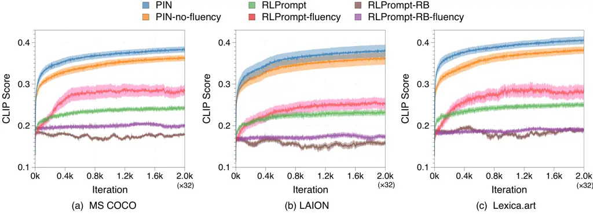
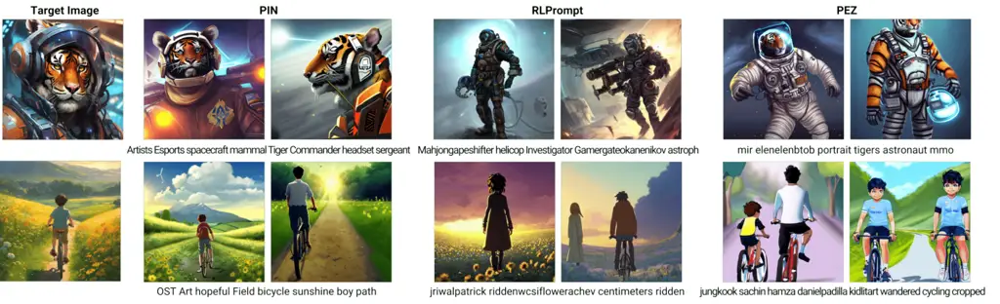
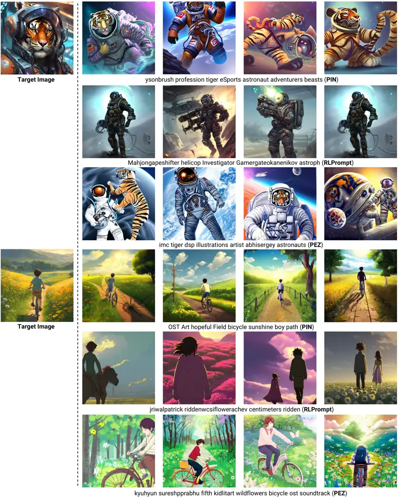
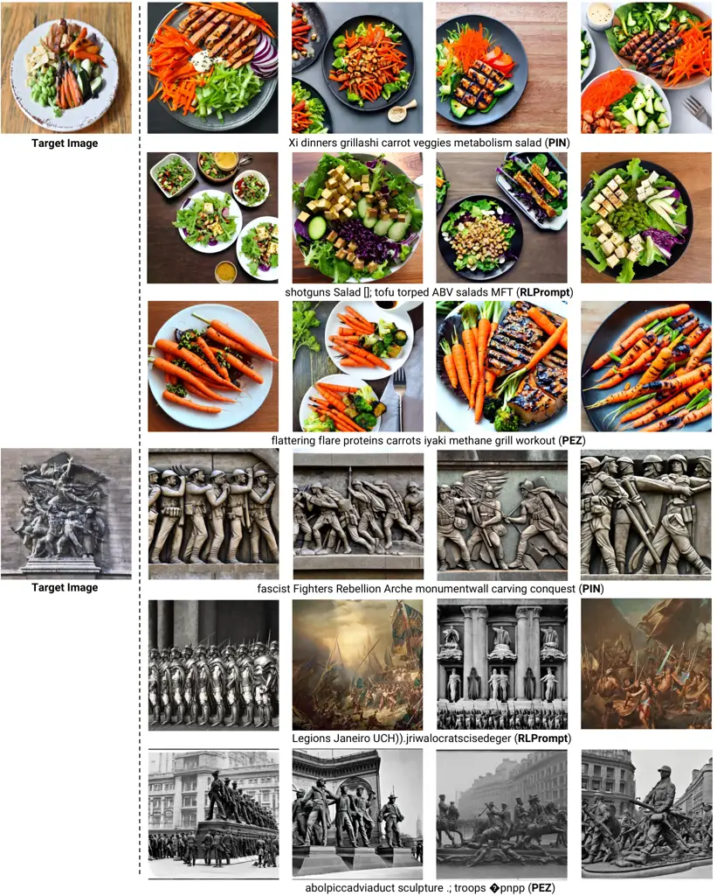

# Hard Prompts Made Interpretable: Sparse Entropy Regularization for Prompt Tuning with RL

Yunseon Choi    Sangmin Bae    Seonghyun Ban    Minchan Jeong    Chuheng
Zhang Affiliation: Microsoft Research Asia {cys9506, kekim}@kaist.ac.kr
   Lei Song Affiliation: Microsoft Research Asia {cys9506,
kekim}@kaist.ac.kr    Li Zhao Affiliation: Microsoft Research Asia
{cys9506, kekim}@kaist.ac.kr    Jiang Bian Affiliation: Microsoft
Research Asia {cys9506, kekim}@kaist.ac.kr    Kee-Eung Kim    KAIST AI

###### Abstract

With the advent of foundation models, prompt tuning has positioned
itself as an important technique for directing model behaviors and
eliciting desired responses. Prompt tuning regards selecting appropriate
keywords included into the input, thereby adapting to the downstream
task without adjusting or fine-tuning the model parameters. There is a
wide range of work in prompt tuning, from approaches that directly
harness the backpropagated gradient signals from the model, to those
employing black-box optimization such as reinforcement learning (RL)
methods. Our primary focus is on RLPrompt, which aims to find optimal
prompt tokens leveraging soft Q-learning. While the results show
promise, we have observed that the prompts frequently appear unnatural,
which impedes their interpretability. We address this limitation by
using sparse Tsallis entropy regularization, a principled approach to
filtering out unlikely tokens from consideration. We extensively
evaluate our approach across various tasks, including few-shot text
classification, unsupervised text style transfer, and textual inversion
from images. The results indicate a notable improvement over baselines,
highlighting the efficacy of our approach in addressing the challenges
of prompt tuning. Moreover, we show that the prompts discovered using
our method are more natural and interpretable compared to those from
other baselines Deng et al. (2022) ¹¹ 1 Code available at
[https://github.com/Youseob/PIN](https://github.com/Youseob/PIN).

## 1 Introduction

While the use of large-scale language models (LMs) and vision-language
models (VLMs), pre-trained on a massive amount of data, is becoming a
dominant paradigm in machine learning Rombach et al. (2022); Touvron
et al. (2023); Radford et al. (2021), fine-tuning the model parameters
for adaptation to downstream tasks requires a vast amount of
computational time and resources. In this sense, prompt tuning has
emerged as a promising low-cost solution Brown et al. (2020); Lester
et al. (2021), discovering input prompts that effectively guide the
pre-trained models to generate the desired outputs, while keeping the
model parameters frozen. Prompt tuning is generally categorized into two
approaches, soft and hard prompting methods, based on their
representation of prompts.

Soft prompt methods Lester et al. (2021); Li and Liang (2021) primarily
focus on learning continuous embedding vectors at the token level, which
are called as soft prompts. They usually perform the gradient descent to
optimize these continuous embedding vectors Wu et al. (2023); Zhu et al.
(2023). However, the prompts learned through soft tuning are opaque to
human interpretation and are not compatible with other pre-trained
models that do not share the same embedding spaces. Moreover, computing
internal gradients for models is highly resource-intensive, especially
as the number of model parameters increases, or even infeasible in cases
where models are accessible only through APIs OpenAI (2023). These
limitations necessitate an alternative approach: discovery of the
prompts composed of human-readable discrete tokens, referred to as hard
prompts Prasad et al. (2023); Shin et al. (2020); Deng et al. (2022).

Hard prompts offer numerous advantages over soft prompts: they are
transferable from one pre-trained model to another since they are
agnostic to the embedding. Moreover, they confer compositional control
by facilitating manual merging and modification Wen et al. (2023).
Despite the benefits, they require large-scale discrete optimization in
principle. Approaches for finding optimal hard prompts often employ
backpropagated gradients from models as with soft prompt methods, while
circumventing the discrete optimization by, roughly speaking, mapping
the soft prompt to the similar discrete tokens in the embedding
space Wen et al. (2023); Shin et al. (2020). However, particularly when
the model is black-box, reinforcement learning (RL) serves as a powerful
alternative tool for optimization, as exemplified by RLPrompt Deng
et al. (2022) that uses soft Q-learning Haarnoja et al. (2017).

One of the key ideas behind RLPrompt is an efficient parameterization
leveraging a frozen pre-trained LM. However, as we show later in the
paper, this is accompanied by detrimental approximation error, leading
to undesirable results. In this paper, we address this limitation in a
principled manner. Our approach leverages sparse Tsallis entropy
regularization for RL Lee et al. (2018) to ignore very unlikely tokens
from consideration. We demonstrate the effectiveness of our algorithm
across various tasks, including few-shot text classification,
unsupervised text style transfer, and textual inversion from images,
comparing it against various baselines. Most importantly, unlike hard
prompts learned by baselines which are often referred to as the ‘secret
language’ of models due to their opacity for human interpretation, our
learned prompts are more natural and straightforward. Our contributions
are outlined as follows:

- •
  We first identify the problem associated with the parameterization
  employed in RLPrompt that potentially leads to suboptimal and
  unnatural prompts.
- •
  We propose a principled solution to the problem using sparse Tsallis
  entropy Lee et al. (2018), referred to as PIN (Prompts made
  INterpretable).
- •
  We show extensive experimental results that demonstrate the
  effectiveness of our algorithm across various downstream tasks.

## 2 Related Works

#### Prompting in Language Models

Pioneering work by Brown et al. (2020) highlighted the efficacy of using
prompts for task adaptation in pre-trained language models, a technique
now commonly referred to as instruction tuning. This approach has become
standard in enhancing the ability of large models to execute complex,
task-specific instructions. Despite its success, the automated
generation of effective text prompts, particularly hard prompts, remains
a challenge. The work by Lester et al. (2021) to simplify prefix tuning
led to the establishment of standard soft prompt tuning, which optimizes
continuous embeddings that are appended to embeddings of input tokens.
However, Khashabi et al. (2022) pinpointed a limitation of this
approach: the resulting embedding sequences often lack clear semantic
interpretation. To address these limitations, our work focuses on the
hard prompts optimization within a selected set of tokens, thereby
generating task-specific and interpretable tokens.

#### Discrete Optimization for Hard Prompts

AutoPrompt Shin et al. (2020) is an initial framework for discrete
prompt optimization in transformer-based language models, inspiring a
range of diverse methods. These include a gradient-free phrase editing
method (Prasad et al., 2023), a reinforcement learning-based
approach (Deng et al., 2022), and an embedding optimization approach
based on Langevin dynamics Shi et al. (2023). In our work, we first
benchmark gradient-based methods like AutoPrompt (Shin et al., 2020) and
PEZ Wen et al. (2023) for hard prompt tuning. AutoPrompt employs the
HotFlip algorithm (Ebrahimi et al., 2018) to greedily identifies optimal
tokens for each position based on model gradients, while PEZ performs
gradient re-projection during its continuous optimization within the
embedding space. However, both methods require substantial computational
cost in calculating gradients and are unsuitable for black-box models.
On the other hand, RLPrompt Deng et al. (2022) employs a gradient-free
RL-based method, serving as our primary baseline. RLPrompt introduces an
efficiently parameterized network that maps continuous embedding vectors
to adaptive vectors within the same space. Despite its simplicity,
RLPrompt struggles with accurately representing Q-values across all
tokens, potentially leading to sub-optimal prompts as we discuss in
Section 4.1.

## 3 Preliminaries

#### Hard Prompt Tuning with RL

Hard prompt tuning is the process of discovering an optimal prompt
within the token space $`\mathcal{V}`$, to efficiently tackle specific
downstream tasks. Assuming a fixed-length prompt of $`L`$ tokens, this
optimization can be formally defined as RL problem:

```math
\max_{\boldsymbol{z}\in\mathcal{V}^{L}}R(\boldsymbol{y}(\boldsymbol{z},\boldsymbol{x})). \tag{1}
```

Here, the objective is to find a discrete prompt $`\boldsymbol{z}`$ from
the solution space of length-$`L`$ token sequences $`\mathcal{V}^{L}`$,
which maximizes a task-specific reward function $`R`$ when concatenated
with input $`\boldsymbol{x}`$. This reward function measures the
appropriateness of the model output
$`\boldsymbol{y}(\boldsymbol{z},\boldsymbol{x})`$, i.e., the output from
LMs or VLMs when prompted with $`\boldsymbol{z}`$ for input
$`\boldsymbol{x}`$. For example, in a few-shot text classification task
utilizing masked LMs as task model, the reward function can be defined
as a binary signal that indicate the correctness of model output based
on available few-shot data, where model output refers to the predicted
class for the \[MASK\] token position²² 2 The task of textual inversion
from images requires a slight deviation from the standard formulation.
Instead of the reward based on the model output, it is defined as the
similarity between the embedding of a target image and the text prompt..

Eq. (1) can be approached using a bandit algorithm, which aims to
identify a length-$`L`$ token sequence $`\boldsymbol{z}`$ that maximizes
the reward $`R`$ without gradient information. However, to cope with the
exponentially large action space $`\mathcal{O}(|\mathcal{V}|^{L})`$ for
the bandit algorithm, we can treat the optimization as a sequential
decision-making process, as in RLPrompt Deng et al. (2022). More
concretely, at each time step $`t`$, the algorithm chooses the token
$`z_{t}`$ based on the tokens $`z_{0:t-1}`$ chosen at previous time
steps, denoted as policy $`\pi(z_{t}|z_{0:t-1})`$. The calculation of
reward $`R`$ is delayed until the completion of the entire prompt
sequence $`\boldsymbol{z}`$ to obtain the model output. Thus, we
optimize the policy $`\pi`$ with the reformulation of Eq. (1), given by

```math
\max_{\pi}\mathbb{E}_{\boldsymbol{z}\sim\prod_{t=0}^{L-1}\pi(z_{t}|z_{0:t-1})}[R(\boldsymbol{y}(\boldsymbol{z},\boldsymbol{x}))].
```

#### Soft Q-Learning (SQL) and RLPrompt

RLPrompt Deng et al. (2022) employs SQL (Haarnoja et al., 2017), an RL
algorithm that incorporates entropy regularization. It aims to maximize
the expected cumulative reward with the bonus given by the entropy of
the action distribution in order to balance the trade-off between
exploitation and exploration. More formally, at each time step $`t`$,
RLPrompt trains the policy with the objective:

```math
\max_{\pi}\mathbb{E}_{z\sim\pi(z|z_{0:t\text{-1}})}\!\left[Q(z_{0:t\text{-1}},z)-\alpha\log\pi(z|z_{0:t\text{-1}})\right]\!, \tag{2}
```

where $`Q`$ is the action-value function capturing long-term reward
effects as follows:

```math
Q(z_{0:t\text{-1}},z)\!\triangleq\!\mathbb{E}_{z_{t\text{+1}:L\text{-1}}\sim\pi}[R(\boldsymbol{y}(z_{0:t\text{-1}},z,z_{t\text{+1}:L\text{-1}},\boldsymbol{x})],
```

and $`\alpha`$ is the regularization coefficient.

Eq. (2) yields an analytical solution for the optimal policy, expressed
as

```math
\pi^{*}(z|z_{0:t-1})=\text{softmax}\left(\frac{{Q(z_{0:t-1},z)}}{\alpha}\right)\!.
```

However, since the action-value function $`Q`$ is not readily available,
it is estimated by a neural network parameterized by $`\theta`$,
referred to as $`Q`$-network.

One of the main contributions of RLPrompt is the introduction of an
efficient parameterization for the $`Q`$-network. This involves
integrating a frozen and pre-trained language model (LM), referred to as
the policy LM, into the lower layers of the $`Q`$-network. Besides, a
trainable multi-layer perceptron (MLP) layer is augmented at the upper
level for the adaptation to the downstream task. Thus, the trainable
parameter $`\theta`$ of the $`Q`$-network is only the parameters of the
MLP layer.

Formally, given the prefix of prompt $`z_{0:t-1}`$, the encoding vector
$`e_{t}\in\mathcal{E}`$ obtained from the policy LM is passed through
MLP layer $`\psi_{\theta}`$ to compute an adapted embedding
$`\hat{e}_{t}\in\mathcal{E}`$, where $`\mathcal{E}`$ denote the real
vector space of embeddings. Subsequently, this adapted embedding
$`\hat{e}_{t}`$ is multiplied with the LM-head matrix of policy LM,
$`W^{\text{LM}}\in\mathbb{R}^{|\mathcal{V}|\times\text{dim}(\mathcal{E})}`$,
to get the next prompt token probabilities.

```math
\displaystyle\hat{e}_{t}=\psi_{\theta}(e_{t})=\psi_{\theta}(\text{LM}(z_{0:t-1}))
```

```math
\displaystyle Q_{\theta}(z_{0:t-1},\cdot)=W^{\text{LM}}\hat{e}_{t}
```

```math
\displaystyle\pi_{\theta}(z_{t}|z_{0:t-1}):=\text{softmax}\left(\frac{Q_{\theta}(z_{0:t-1},z_{t})}{\alpha}\right)\!,
```

where $`W^{\text{LM}}`$ is kept fixed. Thus, this particular
parameterization makes $`W^{\text{LM}}\hat{e}_{t}`$ collectively
represent the scaled Q-values for all tokens. In other words, for token
$`z\in\mathcal{V}`$ and its index $`i_{z}`$, its action value is
calculated by
$`w_{i_{z}}^{\top}\psi_{\theta}(e_{t})=Q_{\theta}(z_{0:t-1},z)`$, where
$`w_{i}`$ denotes the $`i`$-th row vector of $`W^{\text{LM}}`$.

To optimize the parameter $`\theta`$, the objective is to minimize the
temporal difference error,

```math
\mathbb{E}_{\boldsymbol{z}\sim\pi_{\theta}}[\big(Q_{\theta}(z_{0:t-1},z_{t})-\hat{Q}(z_{0:t-1},z_{t})\big)^{2}]. \tag{3}
```

Here, the target value $`\hat{Q}`$ is the bootstrapped estimate of the
action value, given by:

```math
\displaystyle\hat{Q} \displaystyle(z_{0:t-1},z_{t})
```

```math
\displaystyle=\begin{cases}\gamma\alpha\log\sum_{z\in\mathcal{V}}\exp(\frac{Q_{\theta}(z_{0:t},z)}{\alpha})&\text{if }t<L-1\\
R(\boldsymbol{y}(\boldsymbol{z},\boldsymbol{x}))&\text{if }t=L-1\end{cases}\,
```

where $`\gamma\in(0,1]`$ denotes the discount factor.

#### Sparse Tsallis Entropy Regularized Q-Learning

Given a policy $`\pi(\cdot|z_{0:t-1})`$ that represents a probability
distribution on $`z`$, the Tsallis entropy Amari and Ohara (2011) with
entropic index $`q`$ is defined as
$`S_{q}(\pi)=k\frac{1}{q-1}(1-\sum_{z}\pi^{q}(z|z_{0:t-1}))`$, where
$`k`$ is a positive scalar value. It generalizes various types of
entropy via the entropic index $`q`$. Specifically, as $`q\to 1`$, it
becomes Shannon entropy,
$`S_{1}(\pi)=\mathbb{E}_{\pi}[-\log\pi(z|z_{0:t-1})]`$, which is
employed by SQL for regularizing policy. This results in an optimal
policy that is softmax function over Q-values, a feature known to
promote exploration within the decision-making. However, as mentioned
earlier, an intrinsic characteristic of a softmax policy is its
distribution of nonzero probability mass across all actions. On the
other hand, $`q=2`$ yields sparse Tsallis entropy,
$`S_{2}(\pi)=\mathbb{E}_{\pi}[\frac{1}{2}(1-\pi(z|z_{0:t-1}))]`$, which
is the focus of this paper. Employing sparse Tsallis entropy as
regularization Lee et al. (2018) leads to an sparse optimal policy that
concentrates probability mass on a subset set of actions.

Analogous to Eq. (2), the analytical formula of the optimal policy with
the sparse Tsallis entropy regularization with the regularization
coefficient $`\alpha`$ is given by

```math
\displaystyle\pi^{*}(z|z_{0:t-1}) \tag{4}
```

```math
\displaystyle=\max\left(\frac{Q(z_{0:t-1},z)}{\alpha}-\tau\left(\frac{Q(z_{0:t-1},\cdot)}{\alpha}\right),0\right)\!,
```

where $`\tau`$ is the thresholding function that sets the action
probabilities to zero when their $`\alpha`$-scaled action values fall
below $`\tau(Q(z_{0:t-1},\cdot)/\alpha)`$ and ensures the sum of these
probabilities equals 1:

```math
\tau\!\left(\frac{Q(z_{0:t-1},\cdot)}{\alpha}\right)\!=\!\frac{\sum_{z\in S_{Q(z_{0:t-1},\cdot)/\alpha}}\!\!\!\frac{Q(z_{0:t-1},z)}{\alpha}-1}{|S_{Q(z_{0:t-1},\cdot)/\alpha}|},
```

where the set $`S_{Q(z_{0:t-1},\cdot)/\alpha}`$, referred to as the
supporting set, consists of $`z_{(n)}\in\mathcal{V}`$ that satisfy

```math
\displaystyle S_{Q(z_{0:t-1},\cdot)/\alpha}=
```

```math
\displaystyle\{z_{(n)}|1+n\frac{Q(z_{0:t-1},z_{(n)})}{\alpha}>\!\sum_{m=1}^{n}\frac{Q(z_{0:t-1},z_{(m)})}{\alpha}\},\vskip-4.0pt
```

with $`z_{(m)}`$ indicating the action with the $`m`$-th largest value
of $`Q(z_{0:t-1},z)`$. Thus, the supporting set
$`S_{Q(z_{0:t-1},\cdot)/\alpha}`$ consists of top-$`K_{\alpha}`$ tokens
with the highest action values, and the coefficient $`\alpha`$ controls
the cardinality $`K_{\alpha}:=|S_{Q(z_{0:t-1},\cdot)/\alpha}|`$.
Consequently, the sparse policy from Eq. (4) assigns non-zero
probabilities for only $`K_{\alpha}`$-actions, where smaller $`\alpha`$
makes the policy sparser.

For training $`Q_{\theta}(z_{0:t-1},z)`$, we minimize the temporal
difference error using the target value $`\hat{Q}`$:

```math
\displaystyle\hat{Q} \displaystyle(z_{0:t-1},z_{t}) \tag{5}
```

```math
\displaystyle=\begin{cases}\gamma\alpha\,\text{\text{sparsemax}}\left(\frac{Q(z_{0:t},\cdot)}{\alpha}\right)&\text{if }t<L-1\\
R(\boldsymbol{y}(\boldsymbol{z},\boldsymbol{x}))&\text{if }t=L-1\end{cases}.
```

where the sparsemax operator is defined as

```math
\displaystyle\text{\text{sparsemax}}\left(\frac{Q(z_{0:t},\cdot)}{\alpha}\right)
```

```math
\displaystyle=\frac{1+\!\!\displaystyle\sum_{z\in S_{Q(z_{0:t,\cdot})/\alpha}}\textstyle\left(\frac{Q(z_{0:t},z)}{\alpha}\right)^{2}-\tau\left(\frac{Q(z_{0:t},\cdot)}{\alpha}\right)^{2}}{2},
```

which limits the target value estimation to top-$`K_{\alpha}`$ actions.

## 4 Method

### 4.1 Overdetermined Linear Systems

While the $`Q`$-network utilized by RLPrompt provides efficient
parameterization, it also possesses a fundamental limitation. Training
the $`Q`$-network is essentially solving for an extremely overdetermined
linear system, where approximation error is inevitable. In order to
observe this, we fix $`z_{0:t-1}`$ and rewrite Eq. (3) as the weighted
least-squares problem

```math
\min_{\boldsymbol{\psi}}\|W^{\text{LM}}\boldsymbol{\psi}-\hat{\boldsymbol{q}}\|^{2}_{\pi(\cdot|z_{0:t-1})}, \tag{6}
```

where $`\boldsymbol{\psi}=\psi_{\theta}(\text{LM}(z_{0:t-1}))`$ is the
optimization variable, and
$`\hat{\boldsymbol{q}}=\hat{Q}(z_{0:t-1},\cdot)`$ is the right-hand-side
vector. The coefficient matrix, which is the LM-head matrix from the
policy LM,
$`W^{\text{LM}}\in\mathbb{R}^{|\mathcal{V}|\times\dim(\mathcal{E})}`$
has many more rows than columns since it is common that
$`|\mathcal{V}|\gg\dim(\mathcal{E})`$ (e.g., $`|\mathcal{V}|=50272`$ and
$`\dim(\mathcal{E})=768`$ for OPT-125M), corresponding to many more
constraints than variables resulting in inevitable approximation error.

Together with the probabilities of tokens as weights in the
least-squares formulation, the issue of approximation error becomes more
critical. Tokens with high probabilities, as estimated by $`\pi`$,
receive larger weights in the least-squares, leading to smaller
approximation errors for them. On the other hand, the vast number of
low-probability tokens are assigned with smaller weights, resulting in
relatively larger approximation errors. Consequently, the estimated
action value could become unreasonably high for these low-probability
tokens, promoting the RL algorithm to excessively try out these
improbable tokens. This results in an RL approach that is overly biased
towards exploration, specifically favoring the selection of
insignificant low-probability tokens. The detrimental impact of this
unfortunate behavior is clearly observed by the unnatural prompts chosen
by RLPrompt.

### 4.2 PIN (Prompts made INterpretable)

One of the straightforward solutions to mitigate the challenge of the
overdetermined linear system is to drop the constraints that are less
important. To achieve this, we introduce the ignorable token set
comprised of tokens deemed improbable from a general language model. The
key concept is to sidestep evaluating the action values of these tokens,
as they may adversely impact the value estimations of high-probability
tokens. The construction of the ignorable token set entails utilizing
the logit of the predictive probability of tokens derived from the
policy LM with the original embedding, and choosing those that score
below the $`k`$-th largest logit. Formally, given the prompt prefix
$`z_{0:t-1}`$, the ignorable token set is defined by

```math
\mathcal{I}_{z_{0:t-1}}=\{z\in\mathcal{V}\,|\,w_{i_{z}}^{\top}e_{t}<w_{i_{(k)}}^{\top}e_{t}\},
```

where $`e_{t}`$ is the embedding vector of $`z_{0:t-1}`$ obtained from
the policy LM, $`w_{i}`$ is the $`i`$-th row vector of its LM-head
matrix, and $`i_{(k)}`$ is the index of the token with $`k`$-th largest
logit.

Deciding the number of $`k`$ is important for learning effective hard
prompts, as demonstrated by our experimental results. If we set $`k`$
aggressively (i.e., small) to avoid constraint violation, we may end up
ignoring strong candidate tokens. On the other hand, if we set $`k`$
conservatively (i.e., large), we suffer from the original challenge of
approximation error. Therefore, we empirically chose $`k=10000`$ to
ensure a sufficiently diverse set of tokens, disregarding about 80% of
the vocabulary tokens. Nevertheless, we observed that the ignorable
token set dose not work well alone because $`k`$ is significantly larger
than $`\text{dim}(\mathcal{E})`$, which is 768, even in case of
OPT-125M.

Now, the remaining challenge is to address the approximation error still
existent due to more constraints than variables for training the
$`Q`$-network. If we adopt SQL as the baseline RL method, we will end up
with the same undesirable behavior due to the dense probability over the
tokens. We thus instead employ the sparse Tsallis entropy regularized
Q-learning described in the previous section, which yields a sparse
policy that naturally suppresses the probability of choosing many
unimportant tokens with errors in the action value estimation.

Our algorithm, PIN (Prompts made INterpretable), is presented in
Algorithm 1. We remark that the algorithm employs operator
$`\mathcal{F}_{\mathcal{I}}`$ that systematically filters out the action
values of ignorable tokens. More formally,

```math
\!\!\mathcal{F}_{\mathcal{I}}[Q(z_{0:t-1},\cdot)](z)\!=\!\begin{cases}Q(z_{0:t-1},z)&\!\!\text{if }z\notin\mathcal{I}_{z_{0:t-1}}\\
-\infty&\!\!\text{if }z\in\mathcal{I}_{z_{0:t-1}}\end{cases}\!.
```

This filter operation is used for computing the policy as well as for
the training target of $`Q`$-network.

Require : Replay buffer $`\mathcal{D}`$, parameters $`\theta`$ for
$`\psi`$ network, parameters $`\theta^{\prime}`$ for target
$`\psi^{\prime}`$ network, and target network update rate $`\rho`$.  
Set parameters of target $`\psi^{\prime}`$ network $`\theta^{\prime}`$
equal to $`\theta`$: $`\theta^{\prime}\leftarrow\theta`$  
for $`iter=1,2,...`$ do  
  for $`t=0,...,L-1`$ do  
    Sample $`z_{t}\sim\pi_{\theta}(\cdot|z_{0:t-1})`$ in Eq. (4) with  
    $`\mathcal{F}_{\mathcal{I}}[Q_{\theta}(z_{0:t-1},\cdot)]`$.  
  end for  
  Observe $`R(\boldsymbol{y}(\boldsymbol{z},\boldsymbol{x}))`$ from task
model.  
  Add
$`\{z_{0},...z_{L-1},R(\boldsymbol{y}(\boldsymbol{z},\boldsymbol{x}))\}`$
to $`\mathcal{D}`$.  
  Sample sequence
$`\{z_{0},...z_{L-1},R(\boldsymbol{y}(\boldsymbol{z},\boldsymbol{x}))\}`$
from $`\mathcal{D}`$  
  for $`t=0,1,....,L-1`$ do  
   Estimate the target value $`\hat{Q}`$ in Eq. (5) with  
   $`\mathcal{F}_{\mathcal{I}}[Q_{\theta^{\prime}}(z_{0:t},\cdot)]`$.  
   Update $`\theta`$ by minimizing
$`(Q_{\theta}(z_{0:t-1},z_{t})-\hat{Q})^{2}`$.  
  end for  
  Update target network with
$`\theta^{\prime}\leftarrow\rho\theta^{\prime}+(1-\rho)\theta`$  
end for

Algorithm 1 PIN (Prompts made INterpretable)

## 5 Experiments

|                               |                                      |            |            |            |            |            |            |      |
| ----------------------------- | ------------------------------------ | ---------- | ---------- | ---------- | ---------- | ---------- | ---------- | ---- |
|                               | Few-Shot Text Classification Dataset |            |            |            |            |            |            |      |
| Method                        | SST-2                                | Yelp P.    | MR         | CR         | AG’s News  | Yahoo      | Subj       | Avg. |
| Manual Prompt                 | 82.8                                 | 83.0       | 80.9       | 79.6       | 76.9       | 18.1       | 51.5       | 67.5 |
| Instructions                  | 89.0                                 | 84.4       | 85.2       | 80.8       | 54.8       | 21.4       | 50.4       | 66.6 |
| In-Context Demonstration      | 85.9                                 | 89.6       | 80.6       | 85.5       | 74.9       | 36.7       | 73.0       | 77.3 |
| Soft Prompt Tuning            | 73.8                                 | 88.6       | 74.1       | 75.9       | 82.6       | 59.7       | 73.0       | 75.4 |
| GrIPS                         | 87.1                                 | 88.2       | 86.1       | 80.0       | 65.4       | 22.5       | 74.8       | 72.0 |
| AutoPrompt                    | 75.0                                 | 79.8       | 62.0       | 57.5       | 65.7       | 35.5       | 78.9       | 64.9 |
| $`\text{PEZ}^{\dagger}`$      | 70.0 (1.2)                           | 85.9 (0.5) | 67.9 (0.4) | 70.1 (0.8) | 43.7 (0.4) | 27.0 (0.7) | 53.1 (0.8) | 59.7 |
| $`\text{RLPrompt}^{\dagger}`$ | 91.5 (0.2)                           | 94.7 (0.1) | 87.1 (0.2) | 89.5 (0.1) | 77.5 (0.8) | 48.6 (0.1) | 82.2 (0.4) | 81.6 |
| PIN (ours)                    | 92.0 (0.1)                           | 95.0 (0.4) | 87.2 (0.3) | 88.3 (0.2) | 82.6 (0.1) | 49.5 (0.3) | 85.1 (0.4) | 82.8 |

Table 1: Comparison between PIN and baselines on various few-shot text
classification datasets. $`\dagger`$ denotes our reproduced results, and
we refer to the results from Deng et al. (2022) for other methods. Bold
and underline indicate the best and the second best accuracy for each
dataset, respectively. The accuracy on the test dataset is reported as
the average score over 5 few-shot train datasets with the standard
error.

### 5.1 Few-Shot Text Classification

The goal of these tasks is to find the optimal prompt that assigns input
text $`\boldsymbol{x}`$ to the class label, given a few examples in the
context. We employ the same experimental setting in Schick and Schütze
(2021); Deng et al. (2022), which addresses the classification tasks via
prompting the task LM and mapping the predicted token to the class
label.

#### Experiment Setup

We employ RoBERTa-large Liu et al. (2020) as the task LM and OPT-125M as
our policy LM. We experiment with an extensive range of few-shot text
classification task to assess the effectiveness of our approach. The
datasets encompass various domains, including sentiment classification,
such as SST-2 Socher et al. (2013), Yelp Polarity Zhang et al. (2015),
MR Pang and Lee (2005), CR Hu and Liu (2004), and subjectivity
classification like Subj Pang and Lee (2004). Furthermore, we also
extend to topic classification, such as AG’s News and Yahoo Zhang et al.
(2015).

#### Baselines

We compare our algorithm against various baselines, including heuristic
methods such as: (1) Manual Prompt, (2) Instructions, and (3) In-Context
Demonstration. Furthermore, we consider soft / hard prompt tuning
algorithms, comprising (4) Soft Prompt Tuning Li and Liang (2021) that
performs gradient descent directly on continuous embedding vectors, (5)
GrIPS Prasad et al. (2023) that is a gradient-free and edit-based search
method, (6) AutoPrompt Shin et al. (2020) that modifies discrete prompts
using the gradient information from LM, (7) PEZ Wen et al. (2023) that
involves gradient descent on continuous embedding vectors, then
projection onto human-readable tokens, and (8) RLPrompt Deng et al.
(2022), the on-policy soft Q-learning, that obviates the need for
gradient signal of task LM in the optimization process.

#### Results

The results are summarized in Table 1. To ensure a fair comparison with
RLPrompt, we use the same reward function and policy LM (i.e.,
OPT-125M). As shown in Table 1, our approach demonstrates competitive or
superior performance compared to RLPrompt across all datasets. A notable
aspect of our PIN method is its efficiency: it achieves these strong
results while necessitating fewer trials than required by RLPrompt. This
is demonstrated in the learning curves, depicted in Figure 4 in
Appendix. Furthermore, when compared to various soft / hard prompt
algorithms, PIN shows robust performance across the datasets. This is
especially important given that our algorithm relies on a weaker
feedback and reward, as opposed to the direct back-propagated gradients
used in Soft Prompt Tuning, AutoPrompt, and PEZ. However, PIN
underperforms relative to Soft Prompt Tuning on Yahoo dataset. The
number of classes on Yahoo dataset is 10, which is relatively larger
compared to other datasets. Since the reward feedback does not directly
reveal the ground-truth label, it poses a harder challenge than using
the back-propagated gradient feedback. This is also the reason why
RLPrompt did not perform well.

The examples of learned prompts from baselines and PIN are in Table 4 in
Appendix. Our prompts not only exhibit effectiveness in the task
performance but also provide the benefit of enhanced interpretability.



Figure 1: Training curves on textual inversion from images task. For
each dataset, training was conducted on 10 target images across 3 random
seeds. The solid curves show the average CLIP Score across target
images, with the shaded areas representing the standard error.

### 5.2 Unsupervised Text Style Transfer

The text style transfer task Jin et al. (2022) aims to rephrase an input
text $`\boldsymbol{x}`$ to match a desired style. For example, in the
sentiment transfer task, the goal is to alter a negative sentence “The
movie was disappointing” into its positive counterpart, e.g., “The movie
was awesome”. We focus on unsupervised text style transfer task, where
there are no input-output pair examples for training.

#### Experiment Setup

We employ OPT-125M as our policy LM and OPT-125M / 350M / 1.3B Zhang
et al. (2022) as the task LM. We conduct the experiments on Yelp Shen
et al. (2017) that is a widely-used dataset for the sentiment transfer
task, focusing on negative-to-positive and positive-to-negative
sentiment transfer. For the rest of the settings, we adhere to the
experiment setup outlined in Deng et al. (2022).

#### Baselines

The output is evaluated by a combined metric that measures content
preservation as well as style alignment, which is given as the scalar
reward feedback. Assuming that the metric is not differentiable, prompt
tuning methods that directly rely on gradients are not applicable.
Therefore, we only compare our method against RLPrompt in this
experiment. Further details regarding our experimental setup and the
reward function used in this task can be found in Appendix C.

#### Results

The results are summarized in Table 2, where evaluations are conducted
on three specific aspects, including content, style, and fluency of
output text and two comprehensive metrics like J and GM on test dataset.
For details on the evaluation metrics, refer to Appendix C.3 and Deng
et al. (2022). Our experiments, conducted with various sizes of task
models under the same policy LM, consistently demonstrate the
superiority of our algorithm, as evidenced by the overall metrics, J and
GM. Furthermore, because the reward function primarily focuses on the
content and style, our PIN algorithm has notably enhanced performance in
relation to these metrics.

However, the fluency of the generated text drops in PIN. This occurs
because the reward function does not account for the generated text
fluency, instead it is defined as the sum of content preservation and
the target style intensity of the generated text. Thus, there is no
guarantee that the fluency will be improved by optimizing the reward,
and it may even be possible to achieve higher rewards at the expense of
fluency score. We also remark that there is a trade-off, making the
generated text aligned closer with the desired style leads to diminished
fluency in the generated texts.

| \# Param | Method   | Content    | Style      | Fluency    | J          | GM         |
| -------- | -------- | ---------- | ---------- | ---------- | ---------- | ---------- |
| 125M     | PIN      | 55.6 (3.2) | 95.4 (0.3) | 89.4 (0.9) | 46.2 (2.3) | 77.6 (1.1) |
|          | RLPrompt | 53.5 (3.4) | 93.7 (0.4) | 85.2 (2.5) | 41.4 (2.1) | 74.8 (1.1) |
| 350M     | PIN      | 58.9 (2.7) | 94.2 (0.8) | 83.4 (5.7) | 46.8 (4.3) | 76.0 (2.7) |
|          | RLPrompt | 52.1 (1.3) | 93.9 (0.3) | 85.3 (1.7) | 41.0 (0.7) | 74.6 (0.5) |
| 1.3B     | PIN      | 69.1 (2.7) | 95.7 (0.5) | 84.9 (1.6) | 56.0 (3.3) | 82.4 (1.6) |
|          | RLPrompt | 67.6 (2.4) | 91.6 (1.1) | 89.2 (0.9) | 54.1 (2.4) | 81.9 (1.0) |

Table 2: Comparison between PIN and RLPrompt on different sizes of OPT
model. The reported scores are the average values with the standard
error of 4 different runs for each transfer task. We assess the output
text from the task LM using various metrics.



Figure 2: Generated images from Stable Diffusion-v2 Rombach et al.
(2022), using the learned hard prompts (bottom) for the target image
(left). We also showcase more qualitative examples in Appendix E.

### 5.3 Textual Inversion From Images

Hard prompts are also useful in the vision-language domains Wen et al.
(2023). A salient task in these domain is textual inversion, which
entails identifying the caption that describe target images using VLMs,
such as CLIP Radford et al. (2021). The caption can then serve as a
prompt for generating similar images via text-guided diffusion models.
To learn the prompt, we make use of the CLIP Score Hessel et al. (2021)
as the reward that measures the similarity between the target image and
the prompt.

#### Experiment Setup

We set OpenCLIP-ViT/H Cherti et al. (2023) as the task model and
OPT-350M as our policy LM. We use a range of image datasets for textual
inversion, including MS COCO Lin et al. (2014), LAION Schuhmann (2021),
and Lexica.art Gustavosta (2022). For each dataset, we randomly select
10 target images to learn the prompt, and calculate the average CLIP
Score of the target image and the generated prompt over 3 seeds. For the
rest of the settings, we adhere to the experimental setup outlined
in Wen et al. (2023).

#### Baselines

For the evaluation of training efficiency, we compare the training
curves against a range of RL-based algorithms. These baselines include:
(1) RLPrompt, (2) RLPrompt-fluency, a variant of RLPrompt with a
filtering method akin to our own, (3) RLPrompt-RB, which incorporates
the replay buffer, (4) RLPrompt-RB-fluency, which incorporates both
filtering and the replay buffer, (5) PIN-no-fluency, which trains
Q-network with the sparse Tsallis entropy regularization but without
filtering. Further details about these baselines can be found in
Appendix D.3.

#### Results

The training curves, as depicted in Figure 1, illustrate that PIN is
most effective in discovering high-quality prompts with fewer
interactions, particularly compared to RLPrompt. This efficiency is
primarily due to addressing the overdetermined issue discussed in
Section 4.1. Furthermore, when compared with RLPrompt-fluency, which
employs the same filtering operator to eliminate unlikely tokens, PIN
clearly demonstrates better performance. This can be explained as
follows: To ensure that RLPrompt-fluency works properly, we had to
filter out tokens aggressively due to the dense nature of the softmax
distribution. This resulted in excluding tokens that are potentially
important for task performance. In contrast, the sparse Tsallis entropy
regularization employed by PIN enabled to handle a larger token search
space.

On the other hand, we note that RLPrompt-RB and RLPrompt-RB-fluency
struggle to learn the prompt. At first glance, it is a surprising
contradiction to the common practice in deep RL that the replay buffer
generally improves performance. However, this is a very natural result:
replay buffers help when training non-linear function approximators such
as deep neural networks that can potentially overfit. Since the
$`Q`$-network is designed to resolve an exceedingly overdetermined
linear system, the replay buffer offers minimal benefit. Instead, the
weights in the least squares formulation over tokens in Eq. (6)
correspond to the mixed distribution of previous policies during
training, including poor ones. Thus, the problem with the overdetermined
linear system for training the $`Q`$-network is compounded by the fact
that some effort will be put on reducing the approximation error for
tokens that are now found to be unimportant, in sacrifice of accurate
estimation for important tokens. We suspect that this is why the
original implementation of RLPrompt, although based on SQL that employs
replay buffer, does not include the replay buffer. RLPrompt-RB-fluency
falls short in discovering effective prompts due to their limited search
space as mentioned earlier. In contrast, PIN and PIN-no-fluency do not
suffer from the aforementioned problem related to replay buffers. We
provide some qualitive examples of the generated images and learn
prompts in Figure 2.

|            |             |             |                  |             |
| ---------- | ----------- | ----------- | ---------------- | ----------- |
|            | Relevance   |             | Interpretability |             |
| Dataset    | PIN         | PEZ         | PIN              | PEZ         |
| MS COCO    | 3.29 (0.17) | 2.53 (0.24) | 2.29 (0.16)      | 1.70 (0.18) |
| LAION      | 4.46 (0.18) | 3.33 (0.23) | 3.60 (0.20)      | 2.10 (0.21) |
| Lexica.art | 4.30 (0.12) | 2.90 (0.34) | 3.40 (0.18)      | 2.10 (0.27) |

Table 3: Human-like evaluation on PIN and PEZ by using the GPT-4V API.
The reported numbers are average over 10 target images with the standard
error for each dataset. We omitted the RLPrompt results because all the
scores were 1.

#### Human-like Evaluation

For evaluating the interpretability of the learned hard prompts and
their relevance to the target images, we adopt Human-like ChatGPT
evaluation method inspired by Gao et al. (2023). We request GPT-4V to
assign a score ranging from 1 (worst) to 5 (best), assessing the
relevance between the target image and the hard prompt, as well as the
prompt’s interpretability for human understanding. We provide the
template for this in Figure 7 in Appendix. To provide a comparative
baseline, we conduct the same evaluation with prompts learned by PEZ.
The results, presented in Table 3, suggest that the prompts learned by
PIN are more interpretable to humans and more accurately capture the
content of the target images.

### 5.4 Analysis on Hyperparameters

#### Length $`L`$ of Prompts

To further evaluate the effectiveness of our algorithm relative to
PIN-no-fluency, we conducted experiments with varying lengths of
prompts. The results, as illustrated in Figure 3(a), reveal that the
performance gap between our method and PIN-no-fluency widens with
increasing prompt length up to $`L=2^{5}`$. There are two primary
reasons for this observed trend. Firstly, our algorithm reduces the
search action space to a set of familiar tokens. As prompt length
increases, the search space expands exponentially; thus, our approach to
narrowing the action space results in enhanced performance compared to
PIN-no-fluency. Secondly, PIN-no-fluency attempts to estimate the
ground- truth Q-value across all tokens at every state. With increasing
prompt length, the state space also expands, which can lead to
inaccuracies in Q-value estimation at each state. Our method, by
contrast, mitigates this challenge, leading to more reliable and
effective prompt optimization, particularly in scenarios with longer
prompts.

For prompts of length $`L=2^{5}`$, PIN achieves the highest Clip Score.
However, for $`L=2^{6},2^{7}`$, the score drops. We remark that longer
prompts pose the challenge of combinatorial search space of hard prompts
for RL-based methods, and we believe that we need more information-rich
feedback other than just reward signals for making the methods more
effective. This would be nontrivial for our setting where the LM is
assumed to be a black-box model, but it is a promising direction for
future work.

(a) Analysis on prompt length

(b) Analysis on top-k

Figure 3: (a) Comparison with PIN-no-fluency at varying prompt length,
and (b) Analysis on the effect of $`k`$.

#### $`k`$ For Determining $`\mathcal{I}`$

An important determinant of the performance of our algorithm is the
number of tokens ignored at each state. We conduct an analysis focusing
on the hyperparameter $`k`$, which represents the number of tokens
considered for Q-values estimation. The findings are presented in
Figure 3(b), where the last datapoint, indicating $`50k`$ is the same
with PIN-no-fluency. A smaller action space
($`|\mathcal{I}|\approx\mathcal{V}`$), can exclude tokens that are
crucial for discovering optimal prompts. Such an exclusion risks
limiting our algorithm’s ability to identify the most effective prompts
as potentially valuable tokens could be filtered out prematurely.
Conversely, an excessively large action space
($`|\mathcal{I}|\ll\mathcal{V}`$) from fewer ignored tokens, diminished
the impact of our filtering technique. In such cases, the benefit of
reducing search space is lost, as the algorithm still needs to evaluate
a vast number of tokens. Our empirical investigations across various
tasks indicate that maintaining the number of tokens that are not to be
ignored within the range of 10000 to 20000 yields the most favorable
results, particularly when the coefficient $`\alpha=1`$.

## 6 Limitations

PIN can discover prompts that are more interpretable compared to
baselines. However, we acknowledge a couple of inherent limitations.
Firstly, the algorithm exhibits a relatively higher time consumption for
training when compared to gradient-based methods. Secondly, despite its
advanced capabilities in discovering interpretable prompts, our
algorithm does not guarantee the consistent discovery of grammatically
perfect sentences. We would leave discovering grammatically perfect
prompts as future work.

## 7 Conclusion

In this paper, we firstly discuss the overdetermined issue encounterd in
the efficiently parameterized network. To address this issue, we propose
PIN algorithm, which uses sparse Tsallis entropy regularization to
systematically exclude ignorable tokens from constraints. Prompts
learned by PIN exhibit better performance in various tasks. Future work
could explore alternative strategies for identifying ignorable tokens to
improve interpretability further, like leveraging task-specific domain
knowledge.

## Acknowledgments

This work was supported by Institute for Information & communications
Technology Promotion (IITP) grant funded by MSIT (No.RS-2019-II190075
Artificial Intelligence Graduate School Program(KAIST); No.2020-0-00940
Foundations of Safe Reinforcement Learning and Its Applications to
Natural Language Processing; No.RS-2024-00343989 Enhancing the Ethics of
Data Characteristics and Generation AI Models for Social and Ethical
Learning).

## References

- Amari and Ohara (2011) Shun-ichi Amari and Atsumi Ohara. 2011.
  [Geometry of q-exponential family of probability
  distributions](https://doi.org/10.3390/e13061170). _Entropy_,
  13(6):1170–1185.
- Brown et al. (2020) Tom Brown, Benjamin Mann, Nick Ryder, Melanie
  Subbiah, Jared D Kaplan, Prafulla Dhariwal, Arvind Neelakantan, Pranav
  Shyam, Girish Sastry, Amanda Askell, Sandhini Agarwal, Ariel
  Herbert-Voss, Gretchen Krueger, Tom Henighan, Rewon Child, Aditya
  Ramesh, Daniel Ziegler, Jeffrey Wu, Clemens Winter, Chris Hesse, Mark
  Chen, Eric Sigler, Mateusz Litwin, Scott Gray, Benjamin Chess, Jack
  Clark, Christopher Berner, Sam McCandlish, Alec Radford, Ilya
  Sutskever, and Dario Amodei. 2020. [Language models are few-shot
  learners](https://proceedings.neurips.cc/paper_files/paper/2020/file/1457c0d6bfcb4967418bfb8ac142f64a-Paper.pdf).
  In _Advances in Neural Information Processing Systems_, volume 33,
  pages 1877–1901. Curran Associates, Inc.
- Cherti et al. (2023) Mehdi Cherti, Romain Beaumont, Ross Wightman,
  Mitchell Wortsman, Gabriel Ilharco, Cade Gordon, Christoph Schuhmann,
  Ludwig Schmidt, and Jenia Jitsev. 2023. Reproducible scaling laws for
  contrastive language-image learning. In _IEEE/CVF Conference on
  Computer Vision and Pattern Recognition, CVPR 2023, Vancouver, BC,
  Canada, June 17-24, 2023_, pages 2818–2829. IEEE.
- Deng et al. (2021) Mingkai Deng, Bowen Tan, Zhengzhong Liu, Eric Xing,
  and Zhiting Hu. 2021. [Compression, transduction, and creation: A
  unified framework for evaluating natural language
  generation](https://doi.org/10.18653/v1/2021.emnlp-main.599). In
  _Proceedings of the 2021 Conference on Empirical Methods in Natural
  Language Processing_, pages 7580–7605, Online and Punta Cana,
  Dominican Republic. Association for Computational Linguistics.
- Deng et al. (2022) Mingkai Deng, Jianyu Wang, Cheng-Ping Hsieh, Yihan
  Wang, Han Guo, Tianmin Shu, Meng Song, Eric Xing, and Zhiting
  Hu. 2022. RLPrompt: Optimizing discrete text prompts with
  reinforcement learning. In _Proceedings of the 2022 Conference on
  Empirical Methods in Natural Language Processing_, Abu Dhabi, United
  Arab Emirates. Association for Computational Linguistics.
- Ebrahimi et al. (2018) Javid Ebrahimi, Anyi Rao, Daniel Lowd, and
  Dejing Dou. 2018. [HotFlip: White-box adversarial examples for text
  classification](https://doi.org/10.18653/v1/P18-2006). In _Proceedings
  of the 56th Annual Meeting of the Association for Computational
  Linguistics (Volume 2: Short Papers)_, pages 31–36, Melbourne,
  Australia. Association for Computational Linguistics.
- Gao et al. (2023) Mingqi Gao, Jie Ruan, Renliang Sun, Xunjian Yin,
  Shiping Yang, and Xiaojun Wan. 2023. [Human-like summarization
  evaluation with chatgpt](https://doi.org/10.48550/ARXIV.2304.02554).
  _CoRR_, abs/2304.02554.
- Gustavosta (2022) Santana Gustavosta. 2022.
  Gustavosta/stable-diffusion-prompts · datasets at hugging face.
  https://huggingface.co/datasets/Gustavosta/Stable-Diffusion-Prompts.
- Haarnoja et al. (2017) Tuomas Haarnoja, Haoran Tang, Pieter Abbeel,
  and Sergey Levine. 2017. Reinforcement learning with deep energy-based
  policies. In _International conference on machine learning_, pages
  1352–1361. PMLR.
- Hessel et al. (2021) Jack Hessel, Ari Holtzman, Maxwell Forbes,
  Ronan Le Bras, and Yejin Choi. 2021. Clipscore: A reference-free
  evaluation metric for image captioning. _arXiv preprint
  arXiv:2104.08718_.
- Hu and Liu (2004) Minqing Hu and Bing Liu. 2004. Mining and
  summarizing customer reviews. In _Proceedings of the Tenth ACM SIGKDD
  International Conference on Knowledge Discovery and Data Mining,
  Seattle, Washington, USA, August 22-25, 2004_, pages 168–177. ACM.
- Jin et al. (2022) Di Jin, Zhijing Jin, Zhiting Hu, Olga Vechtomova,
  and Rada Mihalcea. 2022. [Deep learning for text style transfer: A
  survey](https://doi.org/10.1162/COLI_A_00426). _Comput. Linguistics_,
  48(1):155–205.
- Khashabi et al. (2022) Daniel Khashabi, Xinxi Lyu, Sewon Min, Lianhui
  Qin, Kyle Richardson, Sean Welleck, Hannaneh Hajishirzi, Tushar Khot,
  Ashish Sabharwal, Sameer Singh, and Yejin Choi. 2022. [Prompt
  waywardness: The curious case of discretized interpretation of
  continuous prompts](https://doi.org/10.18653/v1/2022.naacl-main.266).
  In _Proceedings of the 2022 Conference of the North American Chapter
  of the Association for Computational Linguistics: Human Language
  Technologies_, pages 3631–3643, Seattle, United States. Association
  for Computational Linguistics.
- Krishna et al. (2020) Kalpesh Krishna, John Wieting, and Mohit
  Iyyer. 2020. [Reformulating unsupervised style transfer as paraphrase
  generation](https://doi.org/10.18653/v1/2020.emnlp-main.55). In
  _Proceedings of the 2020 Conference on Empirical Methods in Natural
  Language Processing (EMNLP)_, pages 737–762, Online. Association for
  Computational Linguistics.
- Lee et al. (2018) Kyungjae Lee, Sungjoon Choi, and Songhwai Oh. 2018.
  Sparse markov decision processes with causal sparse tsallis entropy
  regularization for reinforcement learning. _IEEE Robotics and
  Automation Letters_, 3(3):1466–1473.
- Lester et al. (2021) Brian Lester, Rami Al-Rfou, and Noah
  Constant. 2021. [The power of scale for parameter-efficient prompt
  tuning](https://doi.org/10.18653/v1/2021.emnlp-main.243). In
  _Proceedings of the 2021 Conference on Empirical Methods in Natural
  Language Processing_, pages 3045–3059, Online and Punta Cana,
  Dominican Republic. Association for Computational Linguistics.
- Li et al. (2018) Juncen Li, Robin Jia, He He, and Percy Liang. 2018.
  [Delete, retrieve, generate: a simple approach to sentiment and style
  transfer](https://doi.org/10.18653/v1/N18-1169). In _Proceedings of
  the 2018 Conference of the North American Chapter of the Association
  for Computational Linguistics: Human Language Technologies, Volume 1
  (Long Papers)_, pages 1865–1874, New Orleans, Louisiana. Association
  for Computational Linguistics.
- Li and Liang (2021) Xiang Lisa Li and Percy Liang. 2021.
  Prefix-tuning: Optimizing continuous prompts for generation. In
  _Proceedings of the 59th Annual Meeting of the Association for
  Computational Linguistics and the 11th International Joint Conference
  on Natural Language Processing (Volume 1: Long Papers)_, Online.
  Association for Computational Linguistics.
- Lin et al. (2014) Tsung-Yi Lin, Michael Maire, Serge J. Belongie,
  James Hays, Pietro Perona, Deva Ramanan, Piotr Dollár, and C. Lawrence
  Zitnick. 2014. [Microsoft COCO: common objects in
  context](https://doi.org/10.1007/978-3-319-10602-1_48). In _Computer
  Vision - ECCV 2014 - 13th European Conference, Zurich, Switzerland,
  September 6-12, 2014, Proceedings, Part V_, volume 8693 of _Lecture
  Notes in Computer Science_, pages 740–755. Springer.
- Liu et al. (2020) Yinhan Liu, Myle Ott, Naman Goyal, Jingfei Du,
  Mandar Joshi, Danqi Chen, Omer Levy, Mike Lewis, Luke Zettlemoyer, and
  Veselin Stoyanov. 2020. Roberta: A robustly optimized bert pretraining
  approach.
- Mishra et al. (2022) Swaroop Mishra, Daniel Khashabi, Chitta Baral,
  and Hannaneh Hajishirzi. 2022. [Cross-task generalization via natural
  language crowdsourcing
  instructions](https://doi.org/10.18653/V1/2022.ACL-LONG.244). In
  _Proceedings of the 60th Annual Meeting of the Association for
  Computational Linguistics (Volume 1: Long Papers), ACL 2022, Dublin,
  Ireland, May 22-27, 2022_, pages 3470–3487. Association for
  Computational Linguistics.
- OpenAI (2023) OpenAI. 2023. [Gpt-4 technical
  report](http://arxiv.org/abs/2303.08774).
- Pang and Lee (2004) Bo Pang and Lillian Lee. 2004. A sentimental
  education: Sentiment analysis using subjectivity summarization based
  on minimum cuts. In _Proceedings of the 42nd Annual Meeting of the
  Association for Computational Linguistics, 21-26 July, 2004,
  Barcelona, Spain_, pages 271–278. ACL.
- Pang and Lee (2005) Bo Pang and Lillian Lee. 2005. Seeing stars:
  Exploiting class relationships for sentiment categorization with
  respect to rating scales. In _ACL 2005, 43rd Annual Meeting of the
  Association for Computational Linguistics, Proceedings of the
  Conference, 25-30 June 2005, University of Michigan, USA_, pages
  115–124. The Association for Computer Linguistics.
- Prasad et al. (2023) Archiki Prasad, Peter Hase, Xiang Zhou, and Mohit
  Bansal. 2023. GrIPS: Gradient-free, edit-based instruction search for
  prompting large language models. In _Proceedings of the 17th
  Conference of the European Chapter of the Association for
  Computational Linguistics_, Dubrovnik, Croatia. Association for
  Computational Linguistics.
- Radford et al. (2021) Alec Radford, Jong Wook Kim, Chris Hallacy,
  Aditya Ramesh, Gabriel Goh, Sandhini Agarwal, Girish Sastry, Amanda
  Askell, Pamela Mishkin, Jack Clark, Gretchen Krueger, and Ilya
  Sutskever. 2021. Learning transferable visual models from natural
  language supervision. In _Proceedings of the 38th International
  Conference on Machine Learning, ICML 2021, 18-24 July 2021, Virtual
  Event_, volume 139 of _Proceedings of Machine Learning Research_,
  pages 8748–8763. PMLR.
- Rombach et al. (2022) Robin Rombach, Andreas Blattmann, Dominik
  Lorenz, Patrick Esser, and Björn Ommer. 2022. [High-resolution image
  synthesis with latent diffusion
  models](https://doi.org/10.1109/CVPR52688.2022.01042). In _IEEE/CVF
  Conference on Computer Vision and Pattern Recognition, CVPR 2022, New
  Orleans, LA, USA, June 18-24, 2022_, pages 10674–10685. IEEE.
- Schick and Schütze (2021) Timo Schick and Hinrich Schütze. 2021. It’s
  not just size that matters: Small language models are also few-shot
  learners. In _Proceedings of the 2021 Conference of the North American
  Chapter of the Association for Computational Linguistics: Human
  Language Technologies_, Online. Association for Computational
  Linguistics.
- Schuhmann (2021) Christoph Schuhmann. 2021. laion-400-open-dataset.
  https://laion.ai/blog/laion-400-open-dataset/.
- Shen et al. (2017) Tianxiao Shen, Tao Lei, Regina Barzilay, and
  Tommi S. Jaakkola. 2017. Style transfer from non-parallel text by
  cross-alignment. In _Advances in Neural Information Processing Systems
  30: Annual Conference on Neural Information Processing Systems 2017,
  December 4-9, 2017, Long Beach, CA, USA_, pages 6830–6841.
- Shi et al. (2023) Weijia Shi, Xiaochuang Han, Hila Gonen, Ari
  Holtzman, Yulia Tsvetkov, and Luke Zettlemoyer. 2023. [Toward human
  readable prompt tuning: Kubrick’s the shining is a good movie, and a
  good prompt too?](https://doi.org/10.18653/v1/2023.findings-emnlp.733)
  In _Findings of the Association for Computational Linguistics: EMNLP
  2023_, pages 10994–11005, Singapore. Association for Computational
  Linguistics.
- Shin et al. (2020) Taylor Shin, Yasaman Razeghi, Robert L. Logan IV,
  Eric Wallace, and Sameer Singh. 2020. AutoPrompt: Eliciting Knowledge
  from Language Models with Automatically Generated Prompts. In
  _Proceedings of the 2020 Conference on Empirical Methods in Natural
  Language Processing (EMNLP)_, Online. Association for Computational
  Linguistics.
- Socher et al. (2013) Richard Socher, Alex Perelygin, Jean Wu, Jason
  Chuang, Christopher D. Manning, Andrew Y. Ng, and Christopher
  Potts. 2013. Recursive deep models for semantic compositionality over
  a sentiment treebank. In _Proceedings of the 2013 Conference on
  Empirical Methods in Natural Language Processing, EMNLP 2013, 18-21
  October 2013, Grand Hyatt Seattle, Seattle, Washington, USA, A meeting
  of SIGDAT, a Special Interest Group of the ACL_, pages 1631–1642. ACL.
- Touvron et al. (2023) Hugo Touvron, Thibaut Lavril, Gautier Izacard,
  Xavier Martinet, Marie-Anne Lachaux, Timothée Lacroix, Baptiste
  Rozière, Naman Goyal, Eric Hambro, Faisal Azhar, Aurelien Rodriguez,
  Armand Joulin, Edouard Grave, and Guillaume Lample. 2023. [Llama: Open
  and efficient foundation language
  models](http://arxiv.org/abs/2302.13971).
- Wen et al. (2023) Yuxin Wen, Neel Jain, John Kirchenbauer, Micah
  Goldblum, Jonas Geiping, and Tom Goldstein. 2023. Hard prompts made
  easy: Gradient-based discrete optimization for prompt tuning and
  discovery. In _Thirty-seventh Conference on Neural Information
  Processing Systems_.
- Wu et al. (2023) Junda Wu, Tong Yu, Rui Wang, Zhao Song, Ruiyi Zhang,
  Handong Zhao, Chaochao Lu, Shuai Li, and Ricardo Henao. 2023.
  [Infoprompt: Information-theoretic soft prompt tuning for natural
  language understanding](https://openreview.net/forum?id=mSNfjOcDUv).
  In _Thirty-seventh Conference on Neural Information Processing
  Systems_.
- Zhang et al. (2022) Susan Zhang, Stephen Roller, Naman Goyal, Mikel
  Artetxe, Moya Chen, Shuohui Chen, Christopher Dewan, Mona T. Diab,
  Xian Li, Xi Victoria Lin, Todor Mihaylov, Myle Ott, Sam Shleifer, Kurt
  Shuster, Daniel Simig, Punit Singh Koura, Anjali Sridhar, Tianlu Wang,
  and Luke Zettlemoyer. 2022. [OPT: open pre-trained transformer
  language models](https://doi.org/10.48550/ARXIV.2205.01068). _CoRR_,
  abs/2205.01068.
- Zhang et al. (2015) Xiang Zhang, Junbo Jake Zhao, and Yann
  LeCun. 2015. Character-level convolutional networks for text
  classification. In _Advances in Neural Information Processing Systems
  28: Annual Conference on Neural Information Processing Systems 2015,
  December 7-12, 2015, Montreal, Quebec, Canada_, pages 649–657.
- Zhu et al. (2023) Beier Zhu, Yulei Niu, Yucheng Han, Yue Wu, and
  Hanwang Zhang. 2023. Prompt-aligned gradient for prompt tuning. In
  _IEEE/CVF International Conference on Computer Vision, ICCV 2023,
  Paris, France, October 1-6, 2023_, pages 15613–15623. IEEE.

## Appendix A Hyperparameter Settings

We employ 2 MLP layers with 2048 hidden states for the implementation of
$`\psi`$. During the learning of our PIN method, we sample a batch of
256 sequences from the replay buffer to update the parameters of
Q-network. We use an Adam optimizer with learning rate 5e-5. Note that
we maintain consistency with PIN and other RL algorithms in all shared
hyperparameters, such as the learning rate, except for the reward scale,
which varies across tasks. Our experiments mainly follow the setting
in Deng et al. (2022).

## Appendix B Few-Shot Text Classification

The classification process begin with integrating the input text
$`\boldsymbol{x}`$ that needs to be classified and the prompt
$`\boldsymbol{z}`$ into a templated format: ‘\[$`\boldsymbol{x}`$\]
\[$`\boldsymbol{z}`$\] \[MASK\]’. Subsequently, the classification
decision relies on selecting the predefined tokens, each representing a
specific class, that has the highest probability of filling the \[MASK\]
position.

### B.1 Experiment Setup

We use OPT-125m ($`\text{dim}(\mathcal{E})=768`$,
$`|\mathcal{V}|=50272`$) as our backbone of policy-LM, and prompt length
$`L`$ is 5 over all experiments. During training, the prompt is learned
from a training dataset containing a few pairs of input text
$`\boldsymbol{x}`$ and their corresponding labels $`c`$. Additionally, a
validation dataset is used to assess the prompts during training. The
accuracy of the predicted labels is evaluated on a test dataset using
the prompt that demonstrated the best performance on the validation
dataset. For each dataset, we sample 5 distinct sets for training and
validation, each includes 16 examples per class. We run 3 experiments
with a different random seed for each set and we report the average
accuracy. For our PIN algorithm, the reward scale ($`1/\alpha`$) is 1
and $`k`$ is 10000 ($`|\mathcal{I}|`$ is 40272).

Figure 4: Training curve between PIN (ours) and RLPrompt. For each of
the 5 few-shot training sets, 3 experiments were conducted. The graph
depicts the average reward over the validation sets with standard error
shading.

### B.2 Rewards

The objective of the text classification task is to accurately assign
input text $`\boldsymbol{x}`$ to its corresponding ground truth label
$`c`$. we employ a piecewise reward function designed to incentivize the
correct classification of each example. We use a piecewise reward
function designed to enhance prompts to classify each example correctly
as used in Deng et al. (2022). For a given prompt $`\boldsymbol{z}`$ and
a training example $`(\boldsymbol{x},c)`$, we compute the reward in a
manner akin to hinge loss. This is achieved by measuring the gap between
the probability of the correct label and the highest probability among
the other classes. we denote
$`P_{\text{LM}}(c|\boldsymbol{z},\boldsymbol{x})`$ as the probability of
label $`c`$, we can write the gap as
$`\text{Gap}_{\boldsymbol{z}}(c):=P_{\text{LM}}(c|\boldsymbol{z},\boldsymbol{x})-\max_{c^{\prime}\neq c}P_{\text{LM}}(c^{\prime}|\boldsymbol{z},\boldsymbol{x})`$.
This gap is positive when the prediction is correct and negative
otherwise. We define a binary indicator for correct predictions as
$`\text{Correct}:=\mathbbm{1}[\text{Gap}_{\boldsymbol{z}}(c)>0]`$. For
correct predictions, we amplify the positive reward by a larger factor
to emphasize its desirability. The reward function is thus formulated as
follows:

```math
R(\boldsymbol{x},c)=\lambda_{1}^{1-\text{Correct}}\lambda_{2}^{\text{Correct}}\text{Gap}_{\boldsymbol{z}}(c)
```

and $`\lambda_{1}=180,\lambda_{2}=200`$.

### B.3 Baselines

We retrained PEZ Wen et al. (2023) and RLPrompt Deng et al. (2022) using
the official repositories³³ 3
https://github.com/YuxinWenRick/hard-prompts-made-easy⁴⁴ 4
https://github.com/mingkaid/rl-prompt. For PEZ, we used 5 prompt tokens
and conducted training with a batch size 16 with the few-shot train
dataset. For a fair evaluation, we utilized the same policy LM for
training RLPrompt as was used in our method. For RLPrompt, we followed
standard setting Deng et al. (2022) by setting the reward scale
$`(1/\alpha)`$ to 5 and using top-256 sampling from the prompt policy
during training. Note that top-256 sampling is performed based on
estimated Q-values over tokens. The performance results of the other
methods are presented based on the reported in Deng et al. (2022).

### B.4 Learning Curve

Figure 4 shows the reward for the learned prompt on the validation
dataset during training. It demonstrates that our algorithm outperforms
RLPrompt across all datasets and requires fewer interactions with task
model.

## Appendix C Unsupervised Text Style Transfer

### C.1 Experiment Setup

We use OPT-125m ($`\text{dim}(\mathcal{E})=768`$,
$`|\mathcal{V}|=50272`$) as our backbone of policy-LM, and prompt length
is 5 over all experiments. The reward scale ($`1/\alpha`$) is 2 and
$`|\mathcal{I}|`$ is 40271. Our experiments follow the suggested setting
of text style transfer task in Deng et al. (2022). Dataset Statistics
Yelp Shen et al. (2017) contains 266K positive and 177K negative reviews
for training, 38K and 25K for validation, and 76K and 50K for testing,
respectively. We perform evaluation on a separate dataset consisting of
500 reviews for each sentiment, with reference outputs collected by Li
et al. (2018).

### C.2 Reward

Given input text $`\boldsymbol{x}`$, the goal of this task is to
generate output $`\boldsymbol{y}`$ that not only preserves the
information from $`\boldsymbol{x}`$ but also aligns with the desired
style, denoted by $`s`$. To quantify the success in achieving these
objectives, we define the task reward as a simple sum of content
preservation and target style intensity, described formally below:

```math
R(\boldsymbol{x},\boldsymbol{y},s)=\text{Content}(\boldsymbol{x},\boldsymbol{y})+\text{Style}(\boldsymbol{y},s)
```

We implement our content preservation reward using its CTC metric Deng
et al. (2021), which measures the bi-directional information alignment
between input $`\boldsymbol{x}`$ and output $`\boldsymbol{y}`$. For the
style reward, we compute the target style probability under a
BERT-base-uncased classifier learned from the training data.

### C.3 Baselines

For RLPrompt, we set the reward scale $`(1/\alpha)`$ to 80 and using
top-50 sampling based on Q-values from learned Q-network as the
suggestion in the origin paper. We evaluated performance using five
different evaluation metrics. ‘Content’ is the degree of content
preservation between input text and output text based on Deng et al.
(2021). ‘Style’ is measured by fine-tuned style classifiers, and
‘fluency’ is assessed by a grammatical acceptability classifier Krishna
et al. (2020). Additionally, we calculate a joint sentence-level score
(J) across test dataset, following Krishna et al. (2020), and the
geometric mean (GM) of the three aspects score.

Figure 5: Training curve between our PIN method and RLPrompt over
various task models (e.g. OPT-125M / 350M / 1.3B). For each dataset,
specifically for sentiment style transfer including negative-to-positive
(0 to 1) and positive-to-negative (1 to 0), 4 experiments were conducted
with different seeds. The graph depicts the average reward on the
validation set with standard error shading.

### C.4 Learning Curve

Figure 5 shows the average reward for the learned prompt on the
validation dataset during training. It demonstrates that our algorithm
outperforms RLPrompt across all dataset and task models, with the
exception of the positive-to-negative case on OPT-125M task LM.

(a) Analysis on reward scale $`1/\alpha`$

(b) Analysis on fluent top-$`k`$

(c) Analysis on fluent top-$`k`$

Figure 6: (a) Analysis on reward scale ($`1/\alpha`$) in RLPrompt-RB,
(b) Analysis on fluent top-$`k`$ in RLPrompt-fluency and, (c) Analysis
on fluent top-$`k`$ in RLPrompt-RB-fluency.

## Appendix D Textual Inversion from Images

### D.1 Experiment Setup

We use OPT-350m ($`\text{dim}(\mathcal{E})=1024`$,
$`|\mathcal{V}|=50272`$) as our backbone of policy-LM, and prompt length
is 8 over all experiments. The reward scale ($`1/\alpha`$) is 1 and
$`|\mathcal{I}|`$ is $`30271`$ ($`k=20000`$). PIN-no-fluency use the
same reward scale ($`1/\alpha`$). For image generation, Stable
Diffusionv2 Rombach et al. (2022) is utilized. In the configuration of
Stable Diffusion-v2, we set the guidance scale to 9 and the number of
inference steps to 25.

### D.2 Reward

We use the Clip Score as a reward. Formally, given an image encoder
function $`f:\mathcal{X}\to\mathcal{E^{\prime}}`$ for a target image
$`\boldsymbol{x}\in\mathcal{X}`$ and a text encoder function
$`g:\mathcal{Z}\to\mathcal{E^{\prime}}`$ for prompt
$`\boldsymbol{z}\in\mathcal{Z}`$, where $`\mathcal{E^{\prime}}`$ denotes
the shared embedding space in VLMs, we define reward function as the
cosine similarity between two vectors $`f(\boldsymbol{x})`$ and
$`g(\boldsymbol{z})`$.

### D.3 Baselines

#### RLPrompt and RLPrompt-fluency

For RLPrompt and RLprompt-fluency, we set the reward scale ($`\alpha`$)
as 80. This variant of RLPrompt incorporates an additional sampling
strategy during data collection. Similar to our algorithm,
RLPrompt-fluency selects from the top-$`k`$ tokens that exhibit high
logits in $`W^{\text{LM}}e_{t}`$. Deng et al. (2022) also investigated
this technique in the paper. In our experiments, we investigated various
settings for $`k`$, specifically $`k\in\{256,1024,10000,20000\}`$. The
performance outcomes for each value $`k`$ are depicted in Figure 6(b).
We observed that a relatively small value of $`k`$ (e.g. 256) restricts
the search space, thereby hindering the discovery of optimal hard
prompts. Our finding was that the most proper hyperparameter was
$`k=10000`$. Beyond this point, we show a performance degradation,
likely attributable to issues arising from Section 4.1. It is noteworthy
that while our algorithm uses $`k=20000`$ in this task, the use of this
value in RLPrompt-fluency did not yield the best results. This
discrepancy suggests that our algorithm is more proficient in estimating
Q-values and exploring a larger token space. We set $`k=10000`$ over
datasets for Figure 1 in this algorithm.

#### RLPrompt-RB

RLPrompt-RB, in our experiments, predominantly exhibited failure in
training. We conducted experiments on various settings for the value of
reward-scale (i.e. $`1/\alpha`$). The results are depicted in
Figure 6(a). We set reward-scale as $`20`$ over datasets for this
algorithm in Figure 1.

#### RLPrompt-RB-fluency

RLPrompt-RB-fluency incorporates a selective sampling strategy during
data collection, as described in RLPromopt-fluency. Specifically, this
variant samples only from the top-$`k`$ tokens, subsequently storing
them in the replay buffer $`\mathcal{D}`$. In our experiments, we
explored a range of settings for $`k`$, specifically
$`k\in\{256,1024,10000,20000\}`$. The impacts of these different $`k`$
values on performance are presented in Figure 6(c). Our observations
revealed that a smaller value of $`k`$, such as 256, yields the best
results. Conversely, as the number of $`k`$ increases, we noted a trend
towards instability in the training process. This phenomenon is
discussed in Section 4.1. Thus, we set hyperparameter, $`k`$ as $`256`$
over datasets for this algorithm in Figure 1. The reward scale
($`1/\alpha`$) is 20.

### D.4 Human-like Evaluation

We select prompts that achieve the highest Clip Score during the
training in both PEZ and PIN algorithms. These selected prompts are then
evaluated in GPT-4V using the template provided in Figure 7.


Figure 7: The template for human-like evaluation to score relevance and
interpretability of the hard prompts. We utilized GPT-4V APIs.

## Appendix E Qualitative Examples

We provide the learned hard prompts by PIN and baselines for few-shot
text classification task in Table 4. In textual inversion from images
tasks, to visually demonstrate the impact of learned hard prompts, we
have generated images based on them using a CLIP-based model. Figures 8,
 9, and  10 showcase these images.

## Appendix F Ethics Statement

We are aware of the potential for misuse, particularly in scenarios
where the algorithm could be manipulated to favor the generation of
biased or toxic content by aligning rewards with the toxicity level of
the output.

|               |                                                                                                                                    |
| ------------- | ---------------------------------------------------------------------------------------------------------------------------------- |
| Dataset       | SST-2                                                                                                                              |
| Instruction   | In this task, you are given sentences from movie reviews. The task is to classify a sentence as “great" if the sentiment           |
|               | of the sentence is positive or as “terrible" if the sentiment of the sentence is negative.                                         |
| Manual prompt | \[$`\boldsymbol{x}`$\] It was \[MASK\].                                                                                            |
| RLPrompt      | \[$`\boldsymbol{x}`$\] o overall downright just downright \[MASK\].                                                                |
| PEZ           | \[$`\boldsymbol{x}`$\] positive positive!)\<s\> \[MASK\].                                                                          |
| PIN           | \[$`\boldsymbol{x}`$\] This language delivery feels consistently \[MASK\].                                                         |
| Dataset       | Yelp P.                                                                                                                            |
| Instruction   | In this task, you are given Yelp reviews. The task is to classify a review as “great" if the overall sentiment of                  |
|               | the review is positive or as “terrible" if the overall sentiment of the review is negative.                                        |
| Manual prompt | \[$`\boldsymbol{x}`$\] It was \[MASK\].                                                                                            |
| RLPrompt      | \[$`\boldsymbol{x}`$\] thoroughly… Absolutely downright Absolutely \[MASK\].                                                       |
| PEZ           | \[$`\boldsymbol{x}`$\] He collection murderous big Faculty \[MASK\].                                                               |
| PIN           | \[$`\boldsymbol{x}`$\] Overall absolutely utter complete absolutely \[MASK\].                                                      |
| Dataset       | MR                                                                                                                                 |
| Instruction   | In this task, you are given sentences from movie reviews. The task is to classify a sentence as “great" if the sentiment           |
|               | of the sentence is positive or as “terrible" if the sentiment of the sentence is negative.                                         |
| Manual prompt | \[$`\boldsymbol{x}`$\] It was \[MASK\].                                                                                            |
| RLPrompt      | \[$`\boldsymbol{x}`$\] y overall downright just generally \[MASK\]                                                                 |
| PEZ           | \[$`\boldsymbol{x}`$\] \<s\>positive positive pharmac restores \[MASK\].                                                           |
| PIN           | \[$`\boldsymbol{x}`$\] Total grade absolutely utterly totally \[MASK\].                                                            |
| Dataset       | CR                                                                                                                                 |
| Instruction   | In this task, you are given sentences from customer reviews. The task is to classify a sentence as “great"                         |
|               | if the sentiment of the sentence is positive or as “terrible" if the sentiment of the sentence is negative.                        |
| Manual prompt | \[$`\boldsymbol{x}`$\] It was \[MASK\].                                                                                            |
| RLPrompt      | \[$`\boldsymbol{x}`$\] e pretty downright just downright \[MASK\].                                                                 |
| PEZ           | \[$`\boldsymbol{x}`$\] \<s\>immigrant positive and\<s\> \[MASK\].                                                                  |
| PIN           | \[$`\boldsymbol{x}`$\] Y word its feeling completely \[MASK\].                                                                     |
| Dataset       | AG’s News                                                                                                                          |
| Instruction   | In this task, you are given a news article. Your task is to classify the article to one out of the four topics “World", “Sports",  |
|               | “Business", “Tech" if the article"s main topic is relevant to the world, sports, business, and technology, correspondingly.        |
|               | If you are not sure about the topic, choose the closest option.                                                                    |
| Manual prompt | \[MASK\] News: \[$`\boldsymbol{x}`$\]                                                                                              |
| RLPrompt      | \[MASK\] … Mum about V \[$`\boldsymbol{x}`$\]                                                                                      |
| PEZ           | \[$`\boldsymbol{x}`$\] Sportsbusiness technology VERY\<s\> Politics Sports \[MASK\].                                               |
| PIN           | \[MASK\] news Ed Sherman Staff Interview \[$`\boldsymbol{x}`$\]                                                                    |
| Dataset       | Yahoo                                                                                                                              |
| Instruction   | You are given a passage. Using the information present in the passage, you need to classify it into one of the 10 topics:          |
|               | 0 - Culture, 1 - Science, 2 - Health, 3 - Education, 4 - Computers, 5 - Sports, 6 - Business, 7 - Music, 8 - Family, 9 - Politics. |
| Manual prompt | Topic \[MASK\]: \[$`\boldsymbol{x}`$\].                                                                                            |
| RLPrompt      | \[$`\boldsymbol{x}`$\] ever people nowadays why some \[MASK\]                                                                      |
| PEZ           | \[$`\boldsymbol{x}`$\] grow neurological the cricket Swift \[MASK\]                                                                |
| PIN           | \[$`\boldsymbol{x}`$\] to under On Most About \[MASK\]                                                                             |
| Dataset       | Subj                                                                                                                               |
| Instruction   | In this task, you are given sentences from reviews. The task is to classify a sentence as “subjective"                             |
|               | if the opinion of the sentence is subjective or as “objective" if the opinion of the sentence is objective.                        |
| Manual prompt | \[$`\boldsymbol{x}`$\] It was \[MASK\].                                                                                            |
| RLPrompt      | \[$`\boldsymbol{x}`$\] quickly ultimately already four immediately \[MASK\]                                                        |
| PEZ           | \[$`\boldsymbol{x}`$\] \<s\> organizationally crimson contexts \[MASK\].                                                           |
| PIN           | \[$`\boldsymbol{x}`$\] Daniel is however already is \[MASK\]                                                                       |

Table 4: Hard prompts that learned by RLPrompt, PEZ, PIN, and Manual
instructions following natural instructions Mishra et al. (2022).



Figure 8: Generated images using learned hard prompts (bottom) through
Stable Diffusion-v2 Rombach et al. (2022) for a given target image
(left).



Figure 9: Generated images using learned hard prompts (bottom) through
Stable Diffusion-v2 Rombach et al. (2022) for a given target image
(left).


Figure 10: Generated images using learned hard prompts (bottom) through
Stable Diffusion-v2 Rombach et al. (2022) for a given target image
(left).
