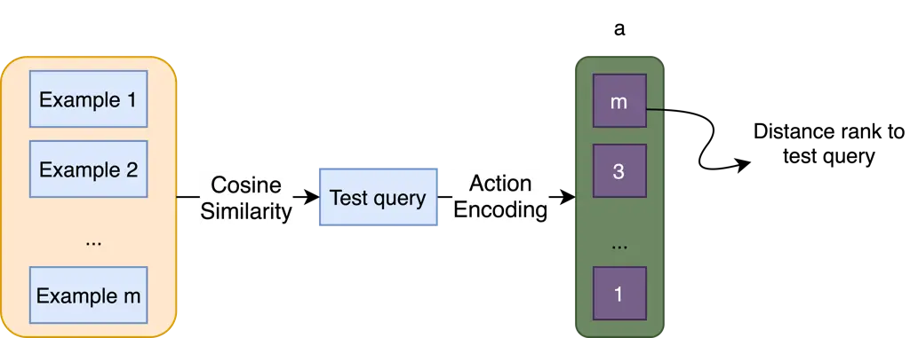

# Large Language Model Prompting With Episodic Memory

Dai Do ^(†)^(†)thanks: Corresponding Author. Email: v.do@deakin.edu.au.
Affiliation: Applied AI Institute, Deakin University, Australia   
Quan Tran Affiliation: ServiceNow Research, USA    Svetha Venkatesh
Affiliation: Applied AI Institute, Deakin University, Australia   
Hung Le Affiliation: Applied AI Institute, Deakin University, Australia

###### Abstract

Prompt optimization is essential for enhancing the performance of Large
Language Models (LLMs) in a range of Natural Language Processing (NLP)
tasks, particularly in scenarios of few-shot learning where training
examples are incorporated directly into the prompt. Despite the growing
interest in optimizing prompts with few-shot examples, existing methods
for prompt optimization are often resource-intensive or perform
inadequately. In this work, we propose PrOmpting with Episodic Memory
(POEM), a novel prompt optimization technique that is simple, efficient,
and demonstrates strong generalization capabilities. We approach prompt
optimization as a Reinforcement Learning (RL) challenge, using episodic
memory to archive combinations of input data, permutations of few-shot
examples, and the rewards observed during training. In the testing
phase, we optimize the sequence of examples for each test query by
selecting the sequence that yields the highest total rewards from the
top-k most similar training examples in the episodic memory. Our results
show that POEM outperforms recent techniques like TEMPERA and RLPrompt
by over 5.3% in various text classification tasks. Furthermore, our
approach adapts well to broader language understanding tasks,
consistently outperforming conventional heuristic methods for ordering
examples.

^(†)^(†)paperid: 1722

## 1 Introduction

The recent rapid advancements in Language Models (LMs) have underscored
the increasing significance of utilizing pre-trained language models,
especially when paired with appropriate prompts, as evidenced by seminal
works \[3, 4, 8\]. As Language Models increase in parameter count, they
unveil new capabilities such as In-Context Learning (ICL) \[3\],
enabling LLMs to tackle tasks with just a few example demonstrations in
the prompt. ICL offers a data-efficient approach for performing NLP
tasks, achieving remarkable few-shot performances across many downstream
tasks \[18, 20, 21\].

However, the prompt content and ICL examples necessitate meticulous
tuning to ensure consistent performance across various tasks. To
optimize prompt contents, early attempts focus on tuning the embeddings
via gradient descent ("soft prompts", \[16, 21\]). Unfortunately, soft
prompts require gradients from LLMs to construct prompts and often face
challenges with interpretability and quality \[11, 16\]. Additionally,
they struggle to handle ICL examples within the prompt, and thus can
only be used for zero-shot prompting. Consequently, the current
state-of-the-art has shifted towards discrete prompt optimization \[6,
39\], which enhances interpretability and permits ICL optimization.

Selecting the right in-context examples and their orders in prompts is
crucial for ICL optimization \[20\]. This task is challenging due to the
vast array of possible combinations and diverse instructions \[23\].
Furthermore, the arrangement of these examples may introduce biases,
including majority, recency, and primacy biases \[23, 41, 25\]. Although
reasonable example selection can be achieved through nearest neighbor
retrieval \[20\], determining the optimal order of examples remains an
unresolved research challenge.

Initial efforts employed heuristic rules to rank examples in descending
or ascending order based on their similarity to the test instance \[20,
23\]. More recent work attempts to use LLMs as black-box optimizer \[33,
26\], calibration \[41\] or applies RL-based method for generating
prompts with ICL examples \[39\].

Discrete prompt optimization presents its own set of challenges.
Heuristic methods lack optimization principles, leading to success in
some cases but failure in others \[20\]. Black-box methods are
guided-optimization and gradient-free. However, they are query-agnostic,
thus failing to incorporate any query-related context into the prompt,
which can lead to downstream performance degradation. Moreover, they
often require additional LLM computation for prompt generation,
resulting in extensive resource usage \[37, 27, 42\]. Although using
RL-based methods for prompt editing sequentially presents a potential
solution that does not require extra LLM for prompt generation \[39\],
their slow convergence and intrinsic complexity hinder effectiveness.

Figure 1: POEM Architecture. Training (left): In this phase, we select
examples from the in-context dataset $`D_{ic}`$. The training query and
the ICL example ordering are encoded into $`s`$ and $`a`$, respectively,
and are used to construct a prompt for each training query. Then, we
receive a reward $`r`$ by feeding the prompt to the downstream language
model (LM), and we store the state, action, and reward in memory
$`\mathcal{M}`$ using Memory Writing (Eq. 10). Testing (right): During
this phase, for each testing query $`s_{t}`$, we conduct Memory Reading
using nearest neighbor estimation to get the action with the highest
estimated value (Eq. 11). We then build the prompt for the test query by
producing the ICL examples that correspond to the best ordering action
$`a_{t}`$.

In this paper, we propose a novel and efficient memory-based approach to
optimize the order of ICL examples within LLM prompts. Drawing
inspiration from the rapid, model-free, and instance-based learning
evident in the hippocampus region of the human brain \[15\], our method
eliminates the necessity for complex reinforcement learning optimization
while being more reliable than heuristic methods through
performance-driven optimization. Leveraging episodic control mechanisms
in reinforcement learning \[2, 14, 12\], we formulate each evaluation of
training data as an episode and utilize an episodic memory to store the
performance of any combination of the training data and ICL orderings.
By sampling and evaluating certain training inputs and ICL order pairs,
we avoid exhaustive searches across all data-ICL order combinations,
which is particularly beneficial when LLM evaluation is costly. During
testing, this memory serves as a non-parametric nearest-neighbors model,
utilizing the recorded performance of similar training data to determine
the optimal order for the testing data.

To ensure the robust generalization of our episodic memory, we devise
specialized representations for both the text input and the ordering of
ICL examples. Specifically, we encode the input using the last hidden
states of a pre-trained language model, ensuring high-quality
similarity-based retrieval during testing. Moreover, directly encoding
the permutation as a sequence of ICL examples would result in a vast
search space. Suppose there are $`M`$ training samples in total and we
can select $`m`$ examples for each prompt, we would have
$`\frac{M!}{(M-m)!}`$ possible ICL arrangements. Instead, we represent
the ordering as a permutation of the similarity rank of the in-context
examples. Specifically, given a specific ordering of ICL examples, we
(1) gauge the similarity between the examples to the testing input, (2)
assign a rank to each example based on the similarity, and (3) encode
the ICL ordering as the sequence of the ranks. Our encoding operates
within the similarity rank space rather than the text space, effectively
reducing the search space from $`\frac{M!}{(M-m)!}`$ to $`m!`$. More
importantly, this approach also encourages generalization as the
permutation focuses solely on the arrangement of the example rank rather
than specific content.

In summary, we propose POEM, a method that optimizes in-context example
ordering during test time using an Episodic Memory. It utilizes a
similarity ranking to encode example orders based on their proximity to
the test instance. In our few-shot classification experiments across
seven datasets, POEM outperforms TEMPERA on six of these datasets.
Additionally, POEM achieves an average performance improvement of 13.4%
over RLPrompt, demonstrating a significant advantage. For tasks
requiring larger LLMs, such as Commonsense Reasoning and Question
Answering, POEM consistently outperforms heuristic baselines across all
four LLMs tested.

## 2 Method

### 2.1 Problem Formulation

Few-shot text classification. We follow the standard few-shot setting
for downstream tasks of language models \[3\]. In this setup, a
pretrained language model $`\mathcal{L}`$ is paired with a task-specific
dataset $`\mathcal{D}`$, where $`\mathcal{Y}`$ represents the label
space. $`\mathcal{Y}`$ may vary in form; it can be categorical, as in
classification tasks, or sequential, as in question answering and
commonsense reasoning tasks. For classification tasks, we randomly
assemble a dataset of $`L=g*\mathcal{G}`$ samples, with $`g`$ as the
samples per label and $`\mathcal{G}`$ as the total labels. In cases
without categorical labels, we randomly sample $`L`$ instances from
$`\mathcal{D}`$. This forms the training dataset, denoted as
$`D_{train}=\{x_{i},y_{i}\}_{i=1}^{L}`$, while a separate hold-out set
$`D_{test}`$ is reserved for evaluation.

In-context Learning. Following GPT-3 paper \[3\], In-context Learning is
a paradigm that allows language models to learn tasks given only a few
examples in the form of demonstration. Given a test sentence
$`x_{test}`$, template-based construction $`\Psi`$, along with an
optional task description $`t_{desc}`$ and a set of in-context examples
$`\mathcal{T}=\{x_{i},y_{i}\}_{i=1}^{m}`$, denoting $`\Gamma`$ as the
prompt construction function, we can formulate an input prompt $`p`$ as
follows:

```math
\displaystyle p \displaystyle=\Gamma\left(t_{desc},\mathcal{T},x_{test}\right) \tag{1}
```

```math
\displaystyle=t_{desc}\oplus\Psi\left(x_{1},y_{1}\right)\oplus\dots\oplus\Psi\left(x_{m},y_{m}\right)\oplus\Psi\left(x_{test},*\right)
```

where $`\oplus`$ is the concatenate function and $`m`$ is the number of
in-context examples for each prompt. In line with the few-shot setting
\[39, 6\], we consider an in-context set of $`M`$ samples, denoted as
$`\mathcal{D}_{ic}\in\mathcal{D}`$, excluding the few-shot training
data. The in-context examples will be sampled only from this set.

In-context learning facilitates the construction of the task’s output
distribution $`p_{LM}\left(y|x,p\right)`$, where $`x`$ represents the
input string and $`y`$ represents the output string. This powerful
approach allows in-context learning to play an active role in shaping
the selection and arrangement of the demonstration set $`\mathcal{T}`$
within the input prompt $`p`$. By carefully curating and organizing
these demonstrations, in-context learning can significantly enhance the
model’s ability to perform effective optimization, ultimately leading to
more accurate and reliable task outcomes.

Reinforcement Learning Formulation. We formulate in-context prompt
optimization as an RL problem where a state
$`\textbf{s}=\mathcal{E}\left(x\right)`$ is the embedding of the input
$`x`$, where $`\mathcal{E}`$ is a pre-trained encoder. During training,
given a set of $`m`$ in-context examples, the RL agent selects one of
the possible permutations as its action $`a`$ from the action space
$`\mathcal{A}`$. We then construct the prompt $`p`$ using the default
task description/instruction (if any), combined with the $`a`$-ordered
in-context examples, and query it to the downstream LM to get the reward
$`r`$. The goal of the agent is to learn a policy that maximizes the
episodic return $`R_{t}=\sum_{h=0}^{H-t}r_{t+h}`$, where $`H`$ is the
time step at which the episode ends. To simplify the formulation, our
episode consists of only one step, during which the sole action is
selecting the permutation of the in-context examples.

### 2.2 Prompting with Episodic Memory

1: Language model $`\mathcal{L}`$, State encoder $`\mathcal{E}`$,
Training set $`\mathcal{D}_{train}`$, Evaluation set
$`\mathcal{D}_{test}`$, In-context set $`\mathcal{D}_{ic}`$, Number of
iterations $`N`$, Episodic Memory $`\mathcal{M}`$, Number of neighbors
$`k`$, Task description $`t_{desc}`$, Template transformation $`\Psi`$,
Number of in-context examples per prompt $`m`$, Prompt construction
function $`\Gamma`$

2: Initialize $`\mathcal{M}=\emptyset`$

3: Training:

4: for episode $`n=1`$ to $`N`$ do

5:   Random sample batch $`\mathcal{B}`$ $`\sim`$ $`D_{train}`$

6:   for x $`\in\mathcal{B}`$ do

7:    Receive state $`s=\mathcal{E}\left(x\right)`$

8:    Receive in-context examples
$`\mathcal{T}_{s}=\Omega\left(s,\mathcal{D}_{ic}\right)`$

9:    Select permutation $`a`$ $`\leftarrow`$ linearly decaying
$`\epsilon`$-greedy policy

10:    (Eq. 9) using $`\mathcal{M}`$ (Eq. 11)

11:    Reorder the in-context examples set
$`\mathcal{T}_{s}^{a}=\nabla\left(\mathcal{T}_{s},a\right)`$

12:    Get prompt
$`p=\Gamma\left(t_{desc},\Psi\left(\mathcal{T}_{s}^{a}\right)\right)`$

13:    Receive reward $`r`$

14:    Update $`\mathcal{M}`$ using Memory writing with $`r`$ (Eq.  10)

  

15:   endfor

16: endfor

17: Testing:

18: for $`x_{t}\in\mathcal{D}_{test}`$ do

19:   Receive state $`s_{t}=\mathcal{E}\left(x_{t}\right)`$

20:   Receive in-context example set
$`\mathcal{T}_{s_{t}}=\Omega\left(s_{t},\mathcal{D}_{ic}\right)`$

21:   Obtain $`\widehat{\mathcal{M}}\left(s_{t},a\right)`$ with Memory
reading (Eq.  11)

22:   Obtain $`a_{t}`$ via Eq.  12

23:   Reorder the in-context examples set
$`\mathcal{T}_{s_{t}}^{a_{t}}=\nabla\left(\mathcal{T}_{s_{t}},a_{t}\right)`$

24:   Get prompt
$`p=\Gamma\left(t_{desc},\Psi\left(\mathcal{T}_{s_{t}}^{a_{t}}\right)\right)`$

25:   Get prediction $`\hat{y}=\mathcal{L}\left(x_{t},p\right)`$

26: endfor

Algorithm 1 In-context examples order optimization with Episodic Memory

In this section, we present the architecture of our episodic memory. The
memory is structured as a dictionary, storing the embeddings of training
sentences (states) as keys. Each key’s value is another dictionary,
mapping a permutation (action) to its respective reward. We denote a key
by $`s_{i}`$, and for each key, $`a_{j}`$ represents the $`j`$-th
permutation, while $`r_{ij}`$ denotes the associated reward. Our
episodic memory $`\mathcal{M}`$ can be represented by the following
structure:

```math
\mathcal{M}=\{s_{i}:\{a_{1}:r_{i1},a_{2}:r_{i2},\dots,a_{p}:r_{ip}\}\}_{i=1}^{L} \tag{2}
```

Here, $`p`$ signifies the total number of permutations available for the
in-context examples (with $`m`$ examples per prompt, $`p=m!`$). $`L`$ is
the total of the stored states in the episodic memory. An illustration
of our memory architecture is given in Fig. 1. Below are the detailed
components of the memory.

State representation Obtaining accurate and meaningful text
representations for the state is crucial for both memory storage and
efficient retrieval. In our approach, we leverage the power of the
encoder $`\mathcal{E}`$, specifically utilizing the SentenceTransformers
model \[28\]. This encoder is designed to generate high-quality sentence
embeddings that can be effectively applied across a wide range of NLP
tasks, ensuring that the textual data is both rich in information and
can be used effectively in various NLP tasks.

|                  | SST-2     | Boolq     | CR        | AG News   | IMDB      | QNLI      | COLA       | Average |
| ---------------- | --------- | --------- | --------- | --------- | --------- | --------- | ---------- | ------- |
| Finetune         | 80.6(3.9) | 55.3(3.1) | 73.3(7.5) | 84.9(3.6) | 85.4(5.2) | 55.4(1.6) | 55.6(9.9)  | 70.1    |
| Manual Prompt    | 82.8      | 61.0      | 79.6      | 76.9      | 85.0      | 51.0      | 32.0       | 66.9    |
| In-Context Demo. | 85.8(0.7) | 58.3(0.4) | 85.5(1.5) | 74.9(0.8) | 69.8(0.6) | 53.5(0.5) | 56.0(1.2)  | 69.1    |
| Instruction      | 89.0      | 61.0      | 80.8      | 54.8      | 89.0      | 56.0      | 61.0       | 70.2    |
| Black-box Tuning | 89.1(0.9) | 53.3(1.7) | 87.4(1.0) | 83.5(0.9) | 68.9(5.1) | 50.8(0.6) | 51.4(2.1)  | 69.2    |
| RLPrompt         | 87.7(3.6) | 41.6(3.0) | 90.4(1.7) | 73.8(5.8) | 57.3(8.9) | 50.1(0.8) | 51.6(1.5)  | 64.6    |
| TEMPERA          | 90.5(1.6) | 54.9(5.8) | 91.1(1.1) | 81.6(2.5) | 85.3(2.8) | 51.6(1.0) | 54.2(5.5)  | 72.7    |
| Random Ordering  | 81.5(0.9) | 62.7(0.9) | 87.2(0.4) | 57(0.2)   | 74.1(0.5) | 53.9(0.4) | 41.63(1.3) | 65.4    |
| POEM (Ours)      | 93.4(0.2) | 66.1(0.1) | 92.6(0.2) | 80.3(1.1) | 90.9(0.1) | 54.3(0.2) | 68.4(0.4)  | 78.0    |

Table 1: Accuracy and standard derivation (if available) of different
baselines on few-shot classification over 4 seeds. Some methods like
Manual Prompt produce the same results across seeds, and thus, have no
standard derivation to report. The highest accuracy is bolded and the
second-highest accuracy is underlined. The last column shows the average
accuracy across all datasets in this table.

Example selection To simplify the optimization, we do not aim to
optimize the example selection process. Therefore, following prior work
\[20\], from the in-context dataset $`D_{ic}`$, given input $`x`$, we
select $`m`$ in-context examples that are semantically closest to $`x`$.
We measure the semantic similarity between in-context example
$`x^{i}_{ic}`$ and the input query $`x`$ using Cosine Similarity:

```math
\small CS\left(x,x_{ic}^{i}\right)=\frac{s\cdot s_{ic}^{i}}{||s||||s_{ic}^{i}||} \tag{3}
```

In the context of a few-shot classification task, where label biases can
significantly influence the prompting outcome, it is crucial to maintain
an equal number of examples for each label. To address this, we propose
the following strategy: if there are $`\mathcal{G}`$ unique labels in
$`\mathcal{D}`$, and $`\mathcal{G}<m`$, we select
$`\left\lfloor\frac{m}{\mathcal{G}}\right\rfloor`$ closest samples from
each label. Conversely, if $`\mathcal{G}\geq m`$, we iteratively choose
one sample for each label until we have sufficient in-context examples.
We denote the above process as the function $`\Omega`$ that retrieves
context examples for each state $`s`$:

```math
\mathcal{T}_{s}=\Omega\left(s,\mathcal{D}_{ic}\right) \tag{4}
```

where $`\mathcal{T}_{s}`$ is the set of in-context example for the state
$`s`$



Figure 2: Illustration of an action being encoded.

Action encoding An action refers to a specific arrangement of in-context
examples within $`\mathcal{T}_{s}`$. As mentioned in the introduction, a
naive approach of encoding the action as a sequence of ICL examples will
lead to a huge action space. Therefore, we propose to encode the action
as a sequence of similarity ranks. Concretely, for each state $`s`$, we
measure the semantic similarity between it and the states of the
in-context examples using Eq. 3. Next, we rank each example according to
its similarity to the input query and encode the ICL ordering as a
sequence of these ranks.

For illustration, consider the action encoding process illustrated in
Fig. 2. First, we compute the cosine similarity between each in-context
example and the test query, which ranks these examples based on their
distance. To encode an action, we create a permutation of these
rankings, resulting in a unique action sequence. For instance, in Fig.
2, the action $`a=\left(m,3,\dots,1\right)`$ represents a specific
permutation of the in-context examples. Here, the first example is the
farthest from the test query, the second is the third closest, and so
on, with the $`m`$-th position being the closest to the test query. Each
action is thus a vector with $`m`$ elements. This encoding captures the
relational similarity among the in-context examples and the test query,
with the action space size being $`m!`$.

Given a set of in-context examples $`\mathcal{T}_{s}`$ and an action
$`a`$, we define a permutation function $`\nabla`$, used to reorder the
elements of $`\mathcal{T}_{s}`$ according to the sequence specified by
$`a`$. The action $`a`$ represents a specific ordering of indices that
correspond to the elements in $`\mathcal{T}_{s}`$. Formally, we have:

```math
\mathcal{T}^{a}_{s}=\nabla\left(\mathcal{T}_{s},a\right) \tag{5}
```

where $`\mathcal{T}^{a}_{s}`$ represents the sequence of in-context
examples rearranged in accordance with action $`a`$.

Reward design For classification tasks that use Masked LM such as
RoBERTa \[22\], for each query $`x`$, we define the reward based on the
log probability of the output label of the model
$`\log P_{\mathcal{L}}\left(\hat{y}|x,p\right)`$

```math
\footnotesize r\left(c,x,p\right)=\lambda_{1}\log\mathcal{P}_{\mathcal{L}}\left(\hat{\mathrm{y}}_{c}\mid x,p\right)-\lambda_{2}\max_{c\neq c^{\prime}}\log\mathcal{P}_{\mathcal{L}}\left(\hat{\mathrm{y}}_{c^{\prime}}\mid x,p\right) \tag{6}
```

where $`\lambda_{1}>0`$ and $`\lambda_{2}>0`$ are the two balance
hyperparameters for the positive and negative terms respectively.

For generative tasks (e.g: Commonsense Reasoning, Question Answering)
that use Causal LM such as Llama \[34\], where ground truth label $`c`$
is a sequence of tokens, we define the reward as:

```math
\footnotesize\begin{split}r\left(c,x,p\right)&=\lambda_{1}\sum_{i=1}^{|c|}\log\mathcal{P}_{\mathcal{L}}\left(i\mid x,p\right)-\\
&\hskip 17.00024pt\lambda_{2}\max_{c\neq c^{\prime}}\sum_{j=1}^{|c^{\prime}|}\log\mathcal{P}_{\mathcal{L}}\left(j\mid x,p\right)\end{split} \tag{7}
```

In the equations above, $`c^{\prime}`$ is the token/sequence that has
the highest probability. In Eq. 7, $`i`$ and $`j`$ are the tokens of two
sequences $`c`$ and $`c^{\prime}`$, respectively. Intuitively, for
classification tasks, the reward is positive when the prediction is
correct and negative otherwise.

For tasks that use Causal LM and Exact Match as evaluation metrics, we
define the reward as:

```math
r\left(c,x,p\right)=\left\{\begin{array}[]{@{}ll@{}}1,&\text{if}\ c=c^{\prime}\\
0,&\text{otherwise}\end{array}\right. \tag{8}
```

### 2.3 Episodic Memory Operations

Our memory operation involves two main phases. Training: The RL agent
interacts with the LLM to try actions and collect rewards for
$`\left(s,a\right)`$ pairs to fill the memory. Testing: The RL agent
uses the memory to determine the ICL ordering for testing data.

Training In this phase, we collect and store the rewards defined above
for state-action pairs $`\left(s,a\right)`$. Given an input query
$`x\in\mathcal{D}_{\text{train}}`$, we obtain its representation using
the pre-trained encoder, $`s=\mathcal{E}\left(x\right)`$. The action at
training time is selected via a linearly decaying $`\epsilon`$-greedy
policy, defined as:

```math
\epsilon_{t}=\epsilon_{\text{initial}}-\left(\epsilon_{\text{initial}}-\epsilon_{\text{final}}\right)\cdot\frac{t}{N} \tag{9}
```

where $`\epsilon_{t}`$ is the value of $`\epsilon`$ at episode $`t`$, N
is the total number of training iterations,
$`\epsilon_{\text{initial}}`$ and $`\epsilon_{\text{final}}`$ are the
initial and final values of $`\epsilon`$, respectively.

Given the a pair of state and action $`(s,a)`$ and the reward $`r`$,
following \[2\], our Episodic Memory $`\mathcal{M}`$ is updated using
Memory writing as follows:

```math
\mathcal{M}\left(s,a\right)\leftarrow\left\{\begin{array}[]{@{}ll@{}}r,&\text{if}\ \left(s,a\right)\notin\mathcal{M}\\
\max{\big\{\mathcal{M}\left(s,a\right),r\big\}},&\text{otherwise}\end{array}\right. \tag{10}
```

It is noted that the stored rewards never decrease, indicating a focus
on high-return actions. In our setting, we use the highest possible
reward that the downstream LM can achieve for the pair $`(s,a)`$ to
estimate the value of using ICL ordering $`a`$ for input $`x`$. The
motivation behind this is to emulate the brain’s specialized learning
mechanisms that exploit predictable patterns in the environment,
enabling rapid learning from high-return actions recorded in memory.

We limit the size of our memory to be equal to the size of the training
dataset $`\mathcal{D}_{train}`$. In the few-shot scenario where there
are limited training samples, it is guaranteed that our memory will not
be overflowed. However, in other settings where $`\mathcal{D}_{train}`$
is too big, our memory can have a fixed smaller size, and when a new
state-value pair has to be introduced, the least recently used state
will be discarded.

Testing In this phase, we select the optimal permutation for each
testing query. In reality, it is common to receive novel states (states
that are not seen in training). To handle this, we employ a
nearest-neighbor estimator. In particular, we obtain the approximated
value of a testing state $`s_{t}`$ and a candidate action $`a`$ using
the following Memory Reading process \[13\]:

```math
\widehat{\mathcal{M}}\left(s_{t},a\right)=\left\{\begin{array}[]{@{}ll@{}}\sum_{i=1}^{k}{\mathcal{M}\left(s^{i},a\right)}\frac{CS\left(x_{t},x^{i}\right)}{\sum_{j=1}^{k}CS\left(x_{t},x^{j}\right)},&\text{if}\ \left(s_{t},a\right)\notin\mathcal{M}\\
\mathcal{M}\left(s_{t},a\right),&\text{otherwise}\end{array}\right. \tag{11}
```

where $`s^{i},\ i=1,\dots,k`$ are the $`k`$ states with the highest
similarity to the testing state $`s_{t}`$,
$`CS\left(x_{t},x^{i}\right)`$ is the Cosine Similarity between the
neighbor $`x^{i}`$ to the test query $`x_{t}`$. The motivation behind
the weighted sum is that we believe the semantic similarity between
training data and the test query should correspondingly affect its
weight in the ordering process. After having calculated
$`\widehat{\mathcal{M}}\left(s_{t},a\right)`$, we get the action
$`a_{t}`$ for $`s_{t}`$ as follow:

```math
a_{t}=\arg\max_{a}\widehat{\mathcal{M}}\left(s_{t},a\right) \tag{12}
```

| Model name  | Baseline    | Hellaswag | PIQA  | TruthfulQA | TriviaQA |
| ----------- | ----------- | --------- | ----- | ---------- | -------- |
|             |             | acc.      | acc.  | acc.       | EM       |
|             | 0-shot      | 57.79     | 76.38 | 25.99      | 18.90    |
|             | Random      | 58.59     | 77.37 | 32.38      | 58.65    |
|             | Ascending   | 58.36     | 76.22 | 26.94      | 57.06    |
|             | Descending  | 59.61     | 78.73 | 38.90      | 59.01    |
| Llama 2 7B  | POEM (Ours) | 59.65     | 79.27 | 38.91      | 59.06    |
|             | 0-shot      | 60.73     | 77.58 | 24.63      | 27.26    |
|             | Random      | 62.40     | 79.05 | 32.79      | 65.98    |
|             | Ascending   | 61.39     | 76.77 | 26.94      | 64.00    |
|             | Descending  | 63.17     | 79.00 | 40.41      | 67.13    |
| Llama 2 13B | POEM (Ours) | 63.13     | 79.43 | 40.95      | 67.06    |
|             | 0-shot      | 63.76     | 79.27 | 28.16      | 42.69    |
|             | Random      | 65.59     | 80.72 | 38.64      | 73.09    |
|             | Ascending   | 65.59     | 80.79 | 32.24      | 72.07    |
|             | Descending  | 66.99     | 81.66 | 45.17      | 73.53    |
| Llama 2 70B | POEM(Ours)  | 67.15     | 81.12 | 45.71      | 73.56    |
|             | 0-shot      | 65.98     | 80.20 | 46.26      | 32.41    |
|             | Random      | 66.29     | 81.77 | 54.01      | 63.07    |
|             | Ascending   | 65.47     | 81.50 | 50.88      | 62.04    |
|             | Descending  | 67.00     | 83.51 | 59.46      | 63.75    |
| Mistral 7B  | POEM (k=10) | 67.14     | 83.35 | 59.46      | 63.83    |

Table 2: Comparison between POEM and other heuristic baselines. All
baselines (except for 0-shot) use 4 in-context examples for each prompt.
Bolded are the best results and underlined are the second best. The
metric for evaluation for each dataset is written below the dataset
names. acc. stands for accuracy and EM stands for exact match.

We note that with enough training steps, the actions for each state in
the memory are filled to assure Eq. 12 is valid. In addition, the
nearest neighbor estimation here is a different process from the nearest
neighbor retrieval in the example selection described in Section 2.2.
Algo. 1 summarizes the procedure of our method.

## 3 Experiments

### 3.1 Few-Shot Text Classification

Datasets. For classification tasks, we conduct experiments for sentiment
analysis, Natural Language Understanding (NLU), topic classification,
and natural language inference datasets. For sentiment analysis, we
choose SST-2 \[32\], IMDB \[24\] and CR \[9\] as datasets. For NLU task,
we select COLA \[36\]. For Reading Comprehension, we choose Boolq \[5\].
For topic classification, we use AG News \[40\]. For Natural Language
Inference (NLI), we choose QNLI \[35\]. The statistics, manual
templates, and label words of this dataset are shown in Appendix A.3.

Baselines. For few-shot classification tasks, we compare our work with
previous continuous and discrete prompt optimization methods. Finetuning
is the method that finetunes the entire language model with a
classification head using the few-shot dataset. For Manual Prompt, we
use the hand-written prompts from \[31\]. In-context Demonstration
randomly selects one example and concatenates it with the test query.
Black-box Tuning \[33\] combines a discrete component optimized through
non-gradient methods and a soft component refined via gradient descent.
RLPrompt \[6\] generates discrete prompt tokens using RL framework.
TEMPERA \[39\] trains a RL agent to edit prompt sequentially. To ensure
a fair comparison, we rerun these methods under our setting. Besides
complicated baselines, we also investigate a simple heuristic baseline.
Random Ordering adopts nearest neighbor example selection, randomly
permutes the in-context examples, and concatenates with the test query.

Experiment Setup. We use RoBERTa-large \[22\] as the downstream LM. To
ensure a fair comparison, we follow the same setting from \[6, 39\] by
testing all baselines on a few-shot text classification setting.
Training dataset $`\mathcal{D}_{train}`$ has 16 examples per class, and
we sample another 16 data points as in-context dataset
$`\mathcal{D}_{ic}`$ ($`M=16`$). For reporting the testing results, we
make use of the models having the highest performance on the validation
set and do inference on the test set $`\mathcal{D}_{test}`$ provided by
the task. We use $`m=4`$ examples for each prompt as in prior works
\[39\]. For each run, we use the same training and in-context samples
for all baselines. At test time, we select the number of
nearest-neighbor $`k=10`$ for POEM.

Results. We present our few-shot text classification results over 4 runs
in Tab.  1. We can see that on most tasks, POEM outperforms previous
baselines by a large margin. For example, we have a 2.9 % absolute gain
on SST-2 task (over TEMPERA), and 5.6 % on IMDB, and the performance is
almost comparable to finetuning the LM on QNLI task. Especially, for NLI
and NLU tasks, on harder datasets like Boolq and COLA, we have a
significance gain of 11.2 % and 14.2 % respectively. We also see that
POEM has a much smaller variance between different runs than all other
baselines, which indicates that it is more stable across different
datasets. Unlike TEMPERA, which requires sequential modification of
in-context examples, our method, POEM, enables one-step optimization.
Our approach not only simplifies the process but also overcomes
TEMPERA’s slow inference involving several numbers of edits for each
prompt. POEM also outperforms Random Ordering significantly, by nearly
13% on average, highlighting the importance of ICL optimization. More
comparisons with advanced heuristic approaches are given in Appendix
A.4.

### 3.2 General Language Understanding Tasks

We further extend experiments of our method to general language
understanding tasks that require stronger downstream LLM to generate the
answers.

Datasets. We measure performance on two main tasks with four datasets,
categorized as follows: Commonsense Reasoning. Hellaswag \[38\], PIQA
\[1\]; Question Answering. TruthfulQA-mc1 \[19\], TriviaQA \[10\]. For
more complex tasks such as Question Answering and Reading Comprehension,
which involve multiple text fields, we employ a reranking approach based
on the field containing the most relevant information. In cases like
TruthfulQA, where certain fields like type and category lack semantic
significance, we measure textual distances between examples using the
question field, which typically encapsulates the query to be answered.
For more detailed information on datasets and the fields used for
retrieval, please refer to Appendices A.3 and A.4.

Baselines. We note that complicated optimization baselines such as
RLPrompt and TEMPERA have not been designed and applied to this task.
Therefore, we compare POEM with several heuristic baselines. 0-shot only
includes the test query. Random Ordering randomly permute the examples.
Ascending Ordering arranges in-context examples by increasing relevance,
placing the most pertinent example closest to the test instance. In
contrast, Descending Ordering positions examples from most to least
relevant in relation to the test instance.

Experiment Setup. We use Llama-2-7b-chat, Llama-2-13b-chat,
Llama-2-70b-chat \[34\] with default parameters. For all datasets,
similar to classification tasks, we randomly sample 16 examples for
training and another 16 examples to form an in-context dataset. For all
baselines (except for 0-shot), we use $`m=4`$ in-context examples for
each test query. At test time, we select the number of nearest neighbors
$`k=10`$. Baselines that use ICL examples share the same example
selection mechanism described in the Method section. The details of
parameters used for these language models can be seen in Appendix A.2.

Results. We present our results for general language understanding tasks
in Tab.  2. Overall, it is clear that POEM shows superior results
compared to Random and 0-shot baselines. This suggests that our approach
is beneficial for optimizing ICL example ordering. Compared to heuristic
methods, in the context of 4 examples and for these datasets, POEM
performs slightly better. This is because in these cases, the LLMs seem
to favor the examples to be ordered descendingly. However, we note that
POEM performs better in 9 out of 12 different settings compared to the
Descending baseline. We also would like to highlight that POEM
consistently shows up in the top 2 best baselines across all datasets.
We acknowledge the challenges in replicating Llama’s evaluation setup
due to the unavailability of their system prompts. Consequently, to
maintain simplicity and consistency, our study does not incorporate
specific instructions into the prompts for LLMs. Instead, we apply
uniform templates across all baselines. This approach ensures fair
comparison between POEM and other baselines, thus showing the impact of
in-context example reordering. For further details on the templates for
this task, please see Appendix A.4.

### 3.3 Ablation Studies

#### 3.3.1 Analysis of Efficiency

|                   | SST-2 | CR   | COLA | AG News |
| ----------------- | ----- | ---- | ---- | ------- |
| Imbalanced labels | 93.5  | 92.2 | 58.6 | 69.7    |
| Balanced labels   | 93.4  | 92.6 | 68.4 | 80.3    |

Table 3: Average accuracy over 4 runs on imbalanced in-context examples
selection.

| Algorithms | Accuracy |
| ---------- | -------- |
| RLPrompt   | 52.6     |
| TEMPERA    | 88.0     |
| POEM       | 93.4     |

Table 4: Accuracy (60 iterations) of POEM, RLPrompt and TEMPERA on SST-2
dataset.

|              | SST-2 | CR   | COLA | AG News |
| ------------ | ----- | ---- | ---- | ------- |
| Naive Action | 91.0  | 91.4 | 68.0 | 79.6    |
| Rank Action  | 93.4  | 92.6 | 68.4 | 80.3    |

Table 5: Ablation on action encoding. Average accuracy over 4 runs.

| Algorithms | Training time (min) | Accuracy |
| ---------- | ------------------- | -------- |
| RLPrompt   | 3100                | 87.7     |
| TEMPERA    | 3208                | 90.5     |
| POEM       | 21                  | 93.4     |

Table 6: Comparison between POEM, RLPrompt and TEMPERA in terms of
training time until convergence (minutes, the smaller the better) and
accuracy of SST-2 dataset.

We provide empirical evidence for our claim of POEM being fast and
efficient. We compare performance and runtime on SST-2 dataset \[32\]
between POEM, RLPrompt and TEMPERA. For a fair evaluation, all
experiments were conducted with one identical GPU Nvidia A100. As shown
in Tab. 6, the training time (until convergence) of POEM is
approximately 150 times faster than that of TEMPERA and RLPrompt while
achieving better accuracy. We also compare the performance of POEM with
that of TEMPERA and RLPrompt after 60 iterations. The results in Tab. 4
reveal that POEM has attained a state of convergence, demonstrating the
effectiveness of its learning algorithm within the given iteration
frame. On the other hand, TEMPERA exhibits ongoing optimization efforts
beyond the 60-iteration mark. This observation leads us to posit that
TEMPERA’s decent performance is attributable to its initial prompt
construction methodology. RLPrompt, however, is still in the early
stages of training, reflected by its near-random accuracy. It is
expected that RLPrompt will need more iterations to properly improve its
prompt generation process.

#### 3.3.2 Analysis of POEM’s Components

Action encoding. We aim to investigate further how our action encoding
contributes to our framework. To achieve this, we design a naive action
encoding for a sequence of $`m`$ examples. This approach results in an
action space of $`\frac{M!}{(M-m)!}`$ rather than $`m!`$, where $`M`$
denotes the total number of in-context examples and $`m`$ represents the
number of examples per prompt. As demonstrated in Tab. 5, the absence of
our similarity-ranked encoding leads to a noticeable decrease in
performance across all classification tasks. Notably, on the SST-2
dataset, the accuracy drops by 2.4 percentage points, from 93.4% to
91.0%. This drop highlights the significant impact of our
similarity-ranked encoding on maintaining high performance levels.

Imbalanced labels. For few-shot classification task, we aim to
investigate how imbalanced in-context example labels can affect
performance. Instead of employing our example selection strategy
described in Section 2.2 to ensure an equal number of labels within a
prompt, we now select the top-$`m`$ closest examples to the test query
regardless of their labels and use them to construct prompts. The
results can be seen in Tab.  3. We can clearly see that for sentiment
classification datasets (SST-2 and CR), POEM with imbalanced labels can
still perform well. For datasets that require natural language
understanding (NLU) like COLA, or those with more labels like AG News,
the performances surprisingly dropped significantly. This perhaps
indicates that there might be a strong bias coming from the imbalanced
example selection for test queries.

#### 3.3.3 Hyperparameter Sensitivity

Number of iterations. We present results for different numbers of
training iterations, specifically 10, 60 (the default setting), and 120.
As shown in Tab. 7, increasing the number of iterations tends to improve
Memory Writing by allowing POEM to discover more effective permutations.
This indicates that more iterations can enhance the model’s ability to
refine its training. However, we have selected 60 iterations as the
default to balance training time with convergence stability, ensuring
that the model achieves robust performance without excessive training
duration.

Size of in-context dataset $`\mathcal{D}_{ic}`$. We aim to further
investigate how the size of the in-context dataset impacts performance.
Intuitively, a larger selection of examples should enhance the
effectiveness of the prompts, providing a richer context for generating
responses. As shown in Tab. 7, increasing the size of the in-context
dataset, denoted as $`M`$, results in a noticeable improvement in
performance. This indicates that expanding the dataset contributes
positively to the quality of the prompts,

Number of nearest neighbors $`k`$ in memory reading. We provide results
with different number of neighbors to study the robustness of POEM. With
$`k=6`$, $`k=10`$ and $`k=12`$, we obtain the results shown in Tab. 7
for few-shot classification datasets, and Tab. 8 for general language
understanding datasets. It can be seen that POEM’s performance holds for
different $`k`$, which indices our method is relatively stable. We
believe the reason behind this stability comes from the weighted sum
formula in  11, meaning that the order is predominantly determined by
test query’s closest neighbors.

Number of examples per prompt. We ablate on the number of examples $`m`$
used for demonstration in our algorithm. We choose the size of 2, 4, 6
for this analysis. For few-shot classification, as shown in Tab. 7, POEM
performs optimally with 4 examples. A similar trend is observed for
general language understanding, with results presented in Tab. 8. It is
noteworthy that, in the original study \[34\], an increment in the
number of examples from four to five also led to reduced accuracy. This
implies that an overabundance of examples might introduce noise, thereby
leading to incorrect model decisions.

## 4 Related Works

Prompt Engineering. The traditional approach to using pre-trained LMs
involves fine-tuning downstream datasets \[7, 17\], which involves
extensive updates to model parameters. However, this method has shown
limited success on downstream tasks. Another approach involves utilizing
manual prompts to guide LLMs in performing NLP tasks without requiring
additional training \[3, 30, 31\]. A different line of work in prompt
engineering aims to develop instructional prompts, which offer task
descriptions instead of fill-in-the-blank questions. In-context Learning
\[3, 20, 23\] achieves impressive performance by incorporating
in-context demonstrations. However, these prompt engineering approaches
are time-consuming and require manual tuning, which is not always
feasible.

| Parameter | Value | SST-2 | CR   | COLA | AG News |
| --------- | ----- | ----- | ---- | ---- | ------- |
|           | 10    | 92.9  | 90.8 | 67.2 | 79.7    |
| $`N`$     | 60    | 93.4  | 92.6 | 68.4 | 80.3    |
|           | 120   | 93.3  | 92.5 | 68.2 | 80.2    |
|           | 8     | 93.0  | 90.8 | 68.7 | 80.0    |
| $`M`$     | 12    | 93.1  | 91.0 | 68.7 | 80.2    |
|           | 16    | 93.4  | 92.6 | 68.4 | 80.3    |
|           | 2     | 91.8  | 92.1 | 67.9 | 59.4    |
| $`m`$     | 4     | 93.4  | 92.6 | 68.4 | 80.3    |
|           | 6     | 91.1  | 90.8 | 68.2 | 71.4    |
|           | 6     | 93.1  | 92.3 | 68.1 | 79.9    |
| $`k`$     | 10    | 93.4  | 92.6 | 68.4 | 80.3    |
|           | 12    | 93.1  | 92.5 | 68.1 | 79.5    |

Table 7: Average accuracy across different $`N`$, $`M`$, $`m`$ and $`k`$
for few-shot text classification datasets.

Prompt Optimization. Previous studies have also explored the application
of RL for prompt optimization. \[6\] propose using RL to directly
generate prompts agnostic to specific queries ; however, the generated
prompts may lack meaningfulness. Another previous RL editing method
\[39\] allowed editing task descriptions and in-context examples. Yet,
editing descriptions seldom aids optimization, and swapping examples can
be time-consuming, potentially leading back to the initial state.
Moreover, the method suits categorical tasks like classification. In the
realm of continuous embedding space, gradients derived from LMs are
employed to directly facilitate prompt optimization, a method also
referred to as soft prompt tuning \[18\]. However, due to their
continuous nature, soft prompts pose challenges in comprehension \[16\]
and lack reusability across diverse models because of disparities in
latent embedding spaces. With the expansion of LLMs in terms of both
capacity and capabilities, there has emerged a new line of research that
employs LLMs as prompt generators, prompt editors, or prompt scorers.
\[37\] propose a method utilizing LLMs as prompt optimizers, where the
generated prompts rely on the prior knowledge encoded within the LLMs.
\[42\] utilize two distinct LLMs, one as a zero-shot instruction
generator and the other as a scorer to optimize instructions . However,
these approaches share the drawback of relying heavily on the prior
knowledge encoded within LLMs, necessitating high-quality LLMs, which
can be resource-intensive. Furthermore, the variability in generated
outputs by LLMs can be unpredictable and challenging to interpret.

Examplars retrieval and ordering in In-context learning. Research has
demonstrated the significant influence of in-context example selection
and arrangement on the performance of LMs. For instance, \[29\] utilize
a retriever to select in-context examples . Additionally, \[20\] propose
a heuristic approach to ordering examples, ranking them based on the
textual similarity between the test query and in-context examples.
Recently, \[39\] have applied RL to enable the swapping of in-context
examples within their action space. These studies underscore the impact
of selecting and arranging in-context examples on downstream task
performance. Compared to heuristics, RL solutions are theoretically
guaranteed. Unfortunately, existing RL-based methods are complicated and
slow during training. Our study is the first RL-based prompt
optimization method that is both simple and efficient, demonstrating
superior performance compared to existing counterparts.

| Model       | $`m`$ | $`k`$ | TruthfulQA | PIQA  |
| ----------- | ----- | ----- | ---------- | ----- |
|             | 2     | 10    | 35.10      | 78.67 |
|             | 4     | 10    | 38.91      | 79.27 |
| Llama 2 7B  | 6     | 10    | 38.64      | 78.73 |
|             | 2     | 10    | 36.33      | 78.94 |
|             | 4     | 10    | 40.95      | 79.43 |
| Llama 2 13B | 6     | 10    | 40.27      | 79.00 |
|             | 4     | 6     | 39.46      | 78.78 |
|             | 4     | 10    | 38.91      | 79.27 |
| Llama 2 7B  | 4     | 12    | 38.37      | 79.00 |
|             | 4     | 6     | 40.54      | 79.43 |
|             | 4     | 10    | 40.95      | 79.43 |
| Llama 2 13B | 4     | 12    | 40.41      | 78.84 |

Table 8: Accuracy across different $`m`$ and $`k`$ for general language
understanding datasets.

## 5 Discussion

We have introduced POEM, a novel approach to prompt optimization within
the RL paradigm. By strategically reordering few-shot examples using
episodic memory, POEM significantly enhances the performance of LLMs
across a wide range of NLP tasks. Our method consistently outperforms
existing techniques in few-shot classification on various datasets and
demonstrates clear advancements over heuristic baselines in general
language understanding tasks. The synergy between NLP and RL in POEM
underscores the potential for future innovations in test-time prompt
optimization algorithms, which could prove pivotal for real-world
applications.

## References

- \[1\] Y. Bisk, R. Zellers, J. Gao, Y. Choi, et al. Piqa: Reasoning
  about physical commonsense in natural language. In Proceedings of the
  AAAI conference on artificial intelligence, volume 34, pages
  7432–7439, 2020.
- \[2\] C. Blundell, B. Uria, A. Pritzel, Y. Li, A. Ruderman, J. Z.
  Leibo, J. Rae, D. Wierstra, and D. Hassabis. Model-free episodic
  control. arXiv preprint arXiv:1606.04460, 2016.
- \[3\] T. Brown, B. Mann, N. Ryder, M. Subbiah, J. D. Kaplan,
  P. Dhariwal, A. Neelakantan, P. Shyam, G. Sastry, A. Askell, et al.
  Language models are few-shot learners. Advances in neural information
  processing systems, 33:1877–1901, 2020.
- \[4\] A. Chowdhery, S. Narang, J. Devlin, M. Bosma, G. Mishra,
  A. Roberts, P. Barham, H. W. Chung, C. Sutton, S. Gehrmann, et al.
  Palm: Scaling language modeling with pathways. Journal of Machine
  Learning Research, 24(240):1–113, 2023.
- \[5\] C. Clark, K. Lee, M.-W. Chang, T. Kwiatkowski, M. Collins, and
  K. Toutanova. Boolq: Exploring the surprising difficulty of natural
  yes/no questions. In Proceedings of the 2019 Conference of the North
  American Chapter of the Association for Computational Linguistics:
  Human Language Technologies, 2019.
- \[6\] M. Deng, J. Wang, C.-P. Hsieh, Y. Wang, H. Guo, T. Shu, M. Song,
  E. Xing, and Z. Hu. Rlprompt: Optimizing discrete text prompts with
  reinforcement learning. In Proceedings of the 2022 Conference on
  Empirical Methods in Natural Language Processing, 2022.
- \[7\] J. Devlin, M.-W. Chang, K. Lee, and K. Toutanova. Bert:
  Pre-training of deep bidirectional transformers for language
  understanding. In North American Chapter of the Association for
  Computational Linguistics, 2019.
- \[8\] W. Fedus, B. Zoph, and N. Shazeer. Switch transformers: Scaling
  to trillion parameter models with simple and efficient sparsity.
  Journal of Machine Learning Research, 23(120):1–39, 2022.
- \[9\] M. Hu and B. Liu. Mining and summarizing customer reviews. KDD
  ’04, page 168–177, New York, NY, USA, 2004.
- \[10\] M. Joshi, E. Choi, D. S. Weld, and L. Zettlemoyer. Triviaqa: A
  large scale distantly supervised challenge dataset for reading
  comprehension. In Proceedings of the 55th Annual Meeting of the
  Association for Computational Linguistics (Volume 1: Long Papers),
  pages 1601–1611, 2017.
- \[11\] D. Khashabi, X. Lyu, S. Min, L. Qin, K. Richardson, S. Welleck,
  H. Hajishirzi, T. Khot, A. Sabharwal, S. Singh, et al. Prompt
  waywardness: The curious case of discretized interpretation of
  continuous prompts. In Proceedings of the 2022 Conference of the North
  American Chapter of the Association for Computational Linguistics:
  Human Language Technologies, pages 3631–3643, 2022.
- \[12\] H. Le, M. Abdolshah, T. K. George, K. Do, D. Nguyen, and
  S. Venkatesh. Episodic policy gradient training. In Proceedings of the
  AAAI Conference on Artificial Intelligence, volume 36, pages
  7317–7325, 2022.
- \[13\] H. Le, T. Karimpanal George, M. Abdolshah, T. Tran, and
  S. Venkatesh. Model-based episodic memory induces dynamic hybrid
  controls. Advances in Neural Information Processing Systems,
  34:30313–30325, 2021.
- \[14\] H. Le and S. Venkatesh. Neurocoder: General-purpose computation
  using stored neural programs. In International Conference on Machine
  Learning, pages 12204–12221. PMLR, 2022.
- \[15\] M. Lengyel and P. Dayan. Hippocampal contributions to control:
  the third way. Advances in neural information processing systems,
  20, 2007.
- \[16\] B. Lester, R. Al-Rfou, and N. Constant. The power of scale for
  parameter-efficient prompt tuning. In Proceedings of the 2021
  Conference on Empirical Methods in Natural Language Processing, 2021.
- \[17\] M. Lewis, Y. Liu, N. Goyal, M. Ghazvininejad, A. Mohamed,
  O. Levy, V. Stoyanov, and L. Zettlemoyer. Bart: Denoising
  sequence-to-sequence pre-training for natural language generation,
  translation, and comprehension. In Proceedings of the 58th Annual
  Meeting of the Association for Computational Linguistics, pages
  7871–7880, 2020.
- \[18\] X. L. Li and P. Liang. Prefix-tuning: Optimizing continuous
  prompts for generation. In Proceedings of the 59th Annual Meeting of
  the Association for Computational Linguistics and the 11th
  International Joint Conference on Natural Language Processing (Volume
  1: Long Papers), pages 4582–4597, 2021.
- \[19\] S. Lin, J. Hilton, and O. Evans. Truthfulqa: Measuring how
  models mimic human falsehoods. In Proceedings of the 60th Annual
  Meeting of the Association for Computational Linguistics, 2022.
- \[20\] J. Liu, D. Shen, Y. Zhang, W. B. Dolan, L. Carin, and W. Chen.
  What makes good in-context examples for gpt-3? In Proceedings of Deep
  Learning Inside Out (DeeLIO 2022), 2022.
- \[21\] X. Liu, K. Ji, Y. Fu, W. Tam, Z. Du, Z. Yang, and J. Tang.
  P-tuning: Prompt tuning can be comparable to fine-tuning across scales
  and tasks. In Proceedings of the 60th Annual Meeting of the
  Association for Computational Linguistics (Volume 2: Short Papers),
  pages 61–68, 2022.
- \[22\] Y. Liu, M. Ott, N. Goyal, J. Du, M. Joshi, D. Chen, O. Levy,
  M. Lewis, L. Zettlemoyer, and V. Stoyanov. Roberta: A robustly
  optimized bert pretraining approach. arXiv preprint
  arXiv:1907.11692, 2019.
- \[23\] Y. Lu, M. Bartolo, A. Moore, S. Riedel, and P. Stenetorp.
  Fantastically ordered prompts and where to find them: Overcoming
  few-shot prompt order sensitivity. In Proceedings of the 60th Annual
  Meeting of the Association for Computational Linguistics, pages
  8086–8098, 2022.
- \[24\] A. L. Maas, R. E. Daly, P. T. Pham, D. Huang, A. Y. Ng, and
  C. Potts. Learning word vectors for sentiment analysis. In D. Lin,
  Y. Matsumoto, and R. Mihalcea, editors, Proceedings of the 49th Annual
  Meeting of the Association for Computational Linguistics: Human
  Language Technologies, June 2011.
- \[25\] P. Pezeshkpour and E. Hruschka. Large language models
  sensitivity to the order of options in multiple-choice questions. In
  Findings of the Association for Computational Linguistics: NAACL
  2024, 2024.
- \[26\] A. Prasad, P. Hase, X. Zhou, and M. Bansal. Grips:
  Gradient-free, edit-based instruction search for prompting large
  language models. In Proceedings of the 17th Conference of the European
  Chapter of the Association for Computational Linguistics, pages
  3845–3864, 2023.
- \[27\] R. Pryzant, D. Iter, J. Li, Y. Lee, C. Zhu, and M. Zeng.
  Automatic prompt optimization with “gradient descent” and beam search.
  In Proceedings of the 2023 Conference on Empirical Methods in Natural
  Language Processing, pages 7957–7968, 2023.
- \[28\] N. Reimers and I. Gurevych. Sentence-bert: Sentence embeddings
  using siamese bert-networks. In Proceedings of the 2019 Conference on
  Empirical Methods in Natural Language Processing, 2019.
- \[29\] O. Rubin, J. Herzig, and J. Berant. Learning to retrieve
  prompts for in-context learning. In Proceedings of the 2022 Conference
  of the North American Chapter of the Association for Computational
  Linguistics: Human Language Technologies, pages 2655–2671, 2022.
- \[30\] V. Sanh, A. Webson, C. Raffel, S. Bach, L. Sutawika,
  Z. Alyafeai, A. Chaffin, A. Stiegler, A. Raja, M. Dey, et al.
  Multitask prompted training enables zero-shot task generalization. In
  International Conference on Learning Representations, 2021.
- \[31\] T. Schick and H. Schütze. Exploiting cloze-questions for
  few-shot text classification and natural language inference. In
  Proceedings of the 16th Conference of the European Chapter of the
  Association for Computational Linguistics: Main Volume, pages
  255–269, 2021.
- \[32\] R. Socher, A. Perelygin, J. Wu, J. Chuang, C. D. Manning, A. Y.
  Ng, and C. Potts. Recursive deep models for semantic compositionality
  over a sentiment treebank. In Proceedings of the 2013 conference on
  empirical methods in natural language processing, pages
  1631–1642, 2013.
- \[33\] T. Sun, Y. Shao, H. Qian, X. Huang, and X. Qiu. Black-box
  tuning for language-model-as-a-service. In International Conference on
  Machine Learning, pages 20841–20855. PMLR, 2022.
- \[34\] H. Touvron, L. Martin, K. Stone, P. Albert, A. Almahairi,
  Y. Babaei, N. Bashlykov, S. Batra, P. Bhargava, S. Bhosale, et al.
  Llama 2: Open foundation and fine-tuned chat models. arXiv preprint
  arXiv:2307.09288, 2023.
- \[35\] A. Wang, Y. Pruksachatkun, N. Nangia, A. Singh, J. Michael,
  F. Hill, O. Levy, and S. Bowman. Superglue: A stickier benchmark for
  general-purpose language understanding systems. Advances in neural
  information processing systems, 32, 2019.
- \[36\] A. Wang, A. Singh, J. Michael, F. Hill, O. Levy, and S. Bowman.
  Glue: A multi-task benchmark and analysis platform for natural
  language understanding. In Proceedings of the 2018 EMNLP Workshop
  BlackboxNLP: Analyzing and Interpreting Neural Networks for NLP, 2018.
- \[37\] C. Yang, X. Wang, Y. Lu, H. Liu, Q. V. Le, D. Zhou, and
  X. Chen. Large language models as optimizers. In The Twelfth
  International Conference on Learning Representations, 2024.
- \[38\] R. Zellers, A. Holtzman, Y. Bisk, A. Farhadi, and Y. Choi.
  Hellaswag: Can a machine really finish your sentence? arXiv preprint
  arXiv:1905.07830, 2019.
- \[39\] T. Zhang, X. Wang, D. Zhou, D. Schuurmans, and J. E. Gonzalez.
  Tempera: Test-time prompt editing via reinforcement learning. In The
  Eleventh International Conference on Learning Representations, 2022.
- \[40\] X. Zhang, J. Zhao, and Y. LeCun. Character-level convolutional
  networks for text classification. Advances in neural information
  processing systems, 28, 2015.
- \[41\] Z. Zhao, E. Wallace, S. Feng, D. Klein, and S. Singh. Calibrate
  before use: Improving few-shot performance of language models.
  ICML, 2021.
- \[42\] Y. Zhou, A. I. Muresanu, Z. Han, K. Paster, S. Pitis, H. Chan,
  and J. Ba. Large language models are human-level prompt engineers. In
  The Eleventh International Conference on Learning
  Representations, 2023.

## Appendix A Appendix

### A.1 Additional results

We provide additional results for comparing POEM with heuristic
baselines in Tab.  11. We note that our method consistently surpasses
heuristic baselines. We also notice that the heuristic trend varies
between different datasets.

### A.2 Training details

We provide the training details in Tab.  9. We also include the
parameters for LLMs such as top p and temperature.

| Training details                                          |        |
| --------------------------------------------------------- | ------ |
| Minibatch size                                            | 16     |
| Number of iterations ($`N`$)                              | 60     |
| Number of examples per label ($`g`$)                      | 16     |
| Number of in-context examples in total ($`M`$)            | 16     |
| Number of training samples for non-categorical tasks      | 80     |
| Number of in-context examples per prompt ($`m`$)          | 4      |
| Number of nearest neighbors ($`k`$)                       | 10     |
| Positive lambda coefficient $`\left(\lambda_{1}\right)`$  | 2.0    |
| Negative lambda coefficient $`\left(\lambda_{2}\right)`$  | 1.8    |
| Initial epsilon value $`\left(\epsilon_{initial}\right)`$ | 1.0    |
| Final epsilon value $`\left(\epsilon_{final}\right)`$     | 0.0001 |
| LLMs’ top p                                               | 0.9    |
| LLMs’ temperature                                         | 0.6    |

Table 9: Hyperparameters used in our experiments.

### A.3 Dataset details

We provide information for all datasets in Tab.  14 and Tab.  15. For
Finetuning, we use standard finetuning of the RoBERTa model from
huggingface for 100 epochs, a learning rate of 0.0003 and the optimizer
of Adam.

|                  |            |                        |
| ---------------- | ---------- | ---------------------- |
| Task             | Dataset    | Field name             |
|                  | Boolq      | {question} + {passage} |
| Classification   | QNLI       | {text1} + {text2}      |
|                  | Hellaswag  | {question}             |
|                  | PIQA       | {goal}                 |
| General Language | TruthfulQA | {question}             |
| Understanding    | TriviaQA   | {question}             |

Table 10: Selected fields for nearest neighbor retrieval for datasets
with multiple fields

### A.4 Prompting details

For datasets that have more than one text field, we provide the fields
used for retrieve nearest neighbor in  10.

|                     | SST-2     | Boolq     | CR        | AG News   | IMDB      | QNLI      | COLA      | Average |
| ------------------- | --------- | --------- | --------- | --------- | --------- | --------- | --------- | ------- |
| Ascending Ordering  | 92.5      | 64.8      | 92.4      | 80.9      | 90.8      | 54.0      | 66.7      | 77.4    |
| Descending Ordering | 92.7      | 65.9      | 86.1      | 74.5      | 54.6      | 55.3      | 67.9      | 71      |
| POEM (Ours)         | 93.4(0.2) | 66.1(0.1) | 92.6(0.2) | 80.3(1.1) | 90.9(0.1) | 54.3(0.2) | 68.4(0.4) | 78      |

Table 11: Accuracy and standard derivation of POEM over 4 seeds versus
advanced heuristic baselines on few-shot classification. The highest
accuracy is bolded and the second-highest accuracy is underlined. The
last column shows the average accuracy across all datasets in this
table.

| Dataset | Natural Instructions                                                                                                                                                                                                      |
| ------- | ------------------------------------------------------------------------------------------------------------------------------------------------------------------------------------------------------------------------- |
| SST-2   | "In this task, you are given sentences from movie reviews. The task is to classify a sentence as "great" if the sentiment of the sentence is positive or as "terrible" if the sentiment of the sentence is negative. "    |
| IMDB    | "In this task, you are given a review of movie. Your task is to classify given movie review into two categories: 1) great, and 2) terrible based on its content. "                                                        |
| CR      | "In this task, you are given sentences from customer reviews. The task is to classify a sentence as "great" if the sentiment of the sentence is positive or as "terrible" if the sentiment of the sentence is negative. " |
| COLA    | "You will be given a sentence. Check whether the sentence is grammatically correct and is meaningful. If the sentence is grammatically correct, then answer with "yes", otherwise answer with "no". "                     |
| AG News | "Classify the news articles into the categories of World, Sports, Business, and Technology. "                                                                                                                             |
| QNLI    | "You are given two sentences. Your task is to determine if sentence 1 entails sentence 2. If sentence 1 entails sentence 2, answer with "yes", otherwise answer with "no". "                                              |
| Boolq   | "In this task you will be given a passage and a yes/no question based on the passage. You should answer the question using the information from the passage. "                                                            |

Table 12: Natural instructions used for few-shot classification
datasets.

| Task       | Templates                                                                                                                                                                                                              |
| ---------- | ---------------------------------------------------------------------------------------------------------------------------------------------------------------------------------------------------------------------- |
| SST-2      | "Does the following sentence have a {"great"} or {"terrible"} sentiment? {sentence}. Sentiment: {answer_choices\[label\]}"                                                                                             |
| IMDB       | "Review: {sentence}. Sentiment: {answer_choices\[label\]}"                                                                                                                                                             |
| CR         | "Review: {sentence}. Sentiment: {answer_choices\[label\]}"                                                                                                                                                             |
| COLA       | "I’m copy-editing a story for publication. It has the following sentence in it: {sentence}. Does this sentence make sense and is it grammatically correct? Please answer yes or no. Answer: {answer_choices\[label\]}" |
| AG News    | "What label best describes this news article? {sentence}. Answer: {answer_choices\[label\]}"                                                                                                                           |
| QNLI       | "Passage: {passage}. After reading this passage, I have a question: {question}? yes or no? Answer: {answer_choices\[label\]}"                                                                                          |
| Boolq      | "Passage: {passage}. After reading this passage, I have a question: {question}? True or False? {answer_choices\[label\]}"                                                                                              |
| Hellaswag  | "{activity_label}: {ctx_a} {ctx_b}"                                                                                                                                                                                    |
| PIQA       | "Question: {goal}. Answer:"                                                                                                                                                                                            |
| TruthfulQA | "Q: {question} A:"                                                                                                                                                                                                     |
| TriviaQA   | "Question: {question}? Answer:"                                                                                                                                                                                        |

Table 13: Templates used for in-context examples for all datasets.

|                 |         |                  |                             |                            |           |                                                               |                               |
| --------------- | ------- | ---------------- | --------------------------- | -------------------------- | --------- | ------------------------------------------------------------- | ----------------------------- |
| Dataset details |         |                  |                             |                            |           |                                                               |                               |
| Category        | Dataset | Number of labels | \|$`\mathcal{D}_{train}`$\| | \|$`\mathcal{D}_{test}`$\| | Type      | Manual Prompt                                                 | Verbalizers                   |
|                 | SST-2   | 2                | 32                          | 1.8k                       | Sentiment | $`\langle S\rangle`$ It was $`[mask]`$.                       | great, terrible               |
|                 | IMDB    | 2                | 32                          | 2k                         | Sentiment | It was $`[mask]`$.                                            | great, terrible               |
| Single sentence | CR      | 2                | 32                          | 2k                         | Sentiment | It was $`[mask]`$.                                            | great, terrible               |
|                 | COLA    | 2                | 32                          | 1.1k                       | NLU       | It was $`[mask]`$.                                            | yes, no                       |
|                 | AG News | 4                | 64                          | 7.6k                       | Topic     | $`[mask]`$ News: $`\langle S\rangle`$                         | World, Sports, Business, Tech |
| Sentence-pair   | QNLI    | 2                | 32                          | 9.8k                       | NLI       | $`\langle S_{1}\rangle`$? $`[mask]`$,$`\langle S_{2}\rangle`$ | yes, no                       |
|                 | Boolq   | 2                | 32                          | 3.3k                       | MRC       | $`\langle S_{1}\rangle`$? $`[mask]`$,$`\langle S_{2}\rangle`$ | yes, no                       |

Table 14: Classification dataset details

| Dataset details |                             |                          |                            |                       |
| --------------- | --------------------------- | ------------------------ | -------------------------- | --------------------- |
| Dataset         | \|$`\mathcal{D}_{train}`$\| | \|$`\mathcal{D}_{ic}`$\| | \|$`\mathcal{D}_{test}`$\| | Type                  |
| Hellaswag       | 16                          | 16                       | 10k                        | Commonsense Reasoning |
| PIQA            | 16                          | 16                       | 1.8k                       | Commonsense Reasoning |
| TruthfulQA      | 16                          | 16                       | 0.7k                       | Question Answering    |
| TriviaQA        | 16                          | 16                       | 18k                        | Question Answering    |

Table 15: General Language Understanding dataset details
