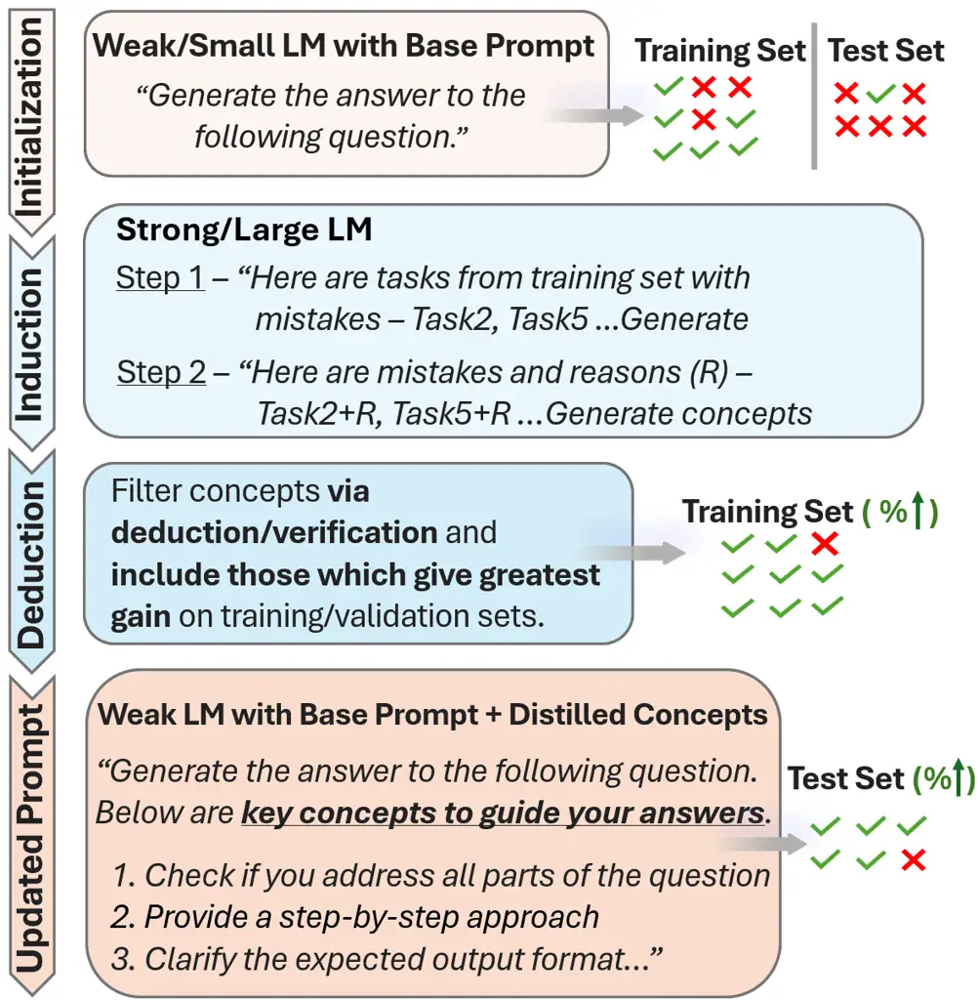
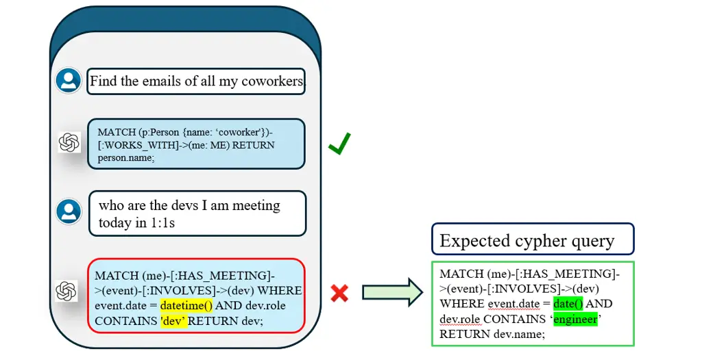
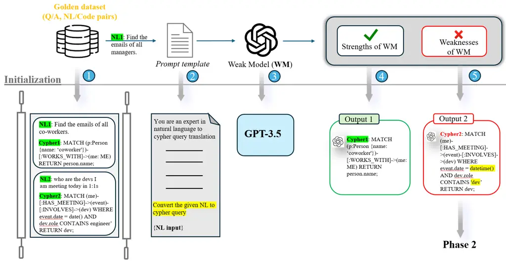
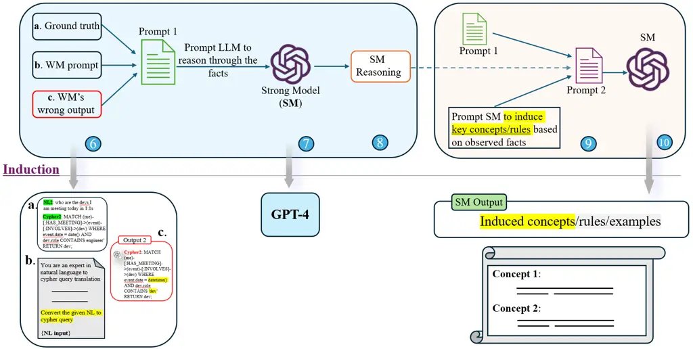
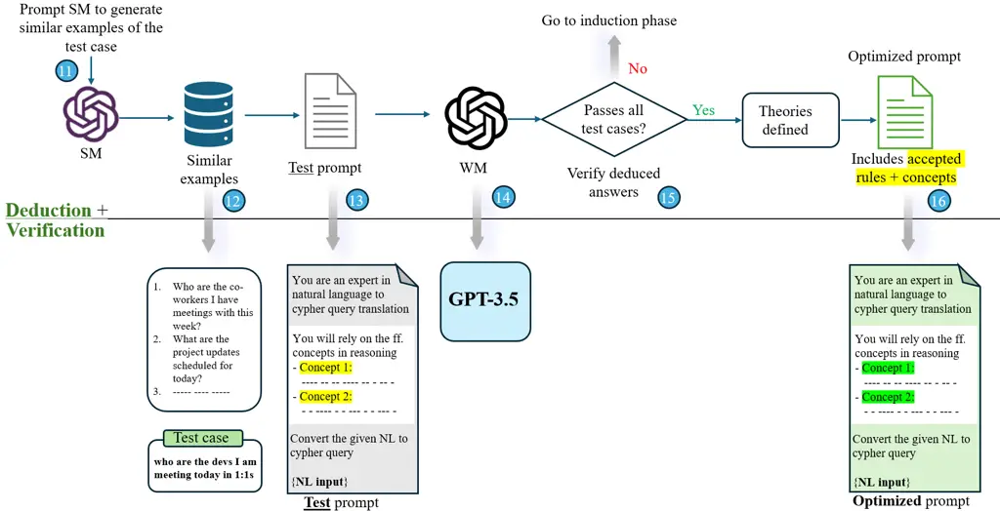
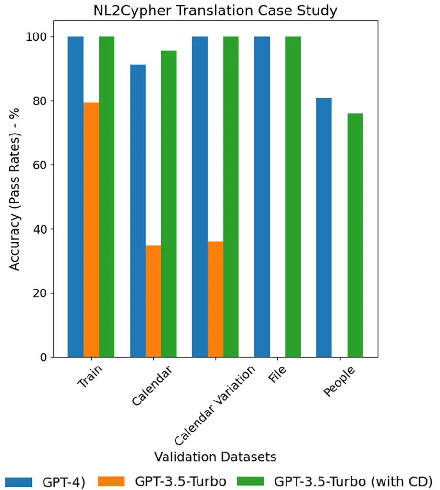

# Concept Distillation from Strong to Weak Models via Hypotheses-to-Theories Prompting

Emmanuel Aboah Boateng Affiliation: Ashwin Srinivasan, Ehi Nosakhare,
Soundar Srinivasan, Victor Dibia    Cassiano O. Becker
Affiliation: Microsoft    Nabiha Asghar Affiliation: {emmanuelab,
casbecker, kabirwalia, ashwinsr, ehinosakh,    Kabir Walia
Affiliation: sosrini, victordibia}@microsoft.com

###### Abstract

Hand-crafting high quality prompts to optimize the performance of
language models is a complicated and labor-intensive process.
Furthermore, when migrating to newer, smaller, or weaker models
(possibly due to latency or cost gains), prompts need to be updated to
re-optimize the task performance. We propose Concept Distillation (CD),
an automatic prompt optimization technique for enhancing weaker models
on complex tasks. CD involves: (1) collecting mistakes made by weak
models with a base prompt (initialization), (2) using a strong model to
generate reasons for these mistakes and create rules/concepts for weak
models (induction), and (3) filtering these rules based on validation
set performance and integrating them into the base prompt
(deduction/verification). We evaluated CD on NL2Code and mathematical
reasoning tasks, observing significant performance boosts for small and
weaker language models. Notably, Mistral-7B’s accuracy on Multi-Arith
increased by 20%, and Phi-3-mini-3.8B’s accuracy on HumanEval rose by
34%. Compared to other automated methods, CD offers an effective,
cost-efficient strategy for improving weak models’ performance on
complex tasks and enables seamless workload migration across different
language models without compromising performance.

## 1 Introduction

Large language models (LLMs) have shown remarkable capabilities for
various downstream tasks. An inexpensive alternative to training and
fine-tuning, _prompt engineering_ has emerged as a powerful method to
control and optimize the outputs from LLMs. Prompt engineering is
enabled by the in-context learning (ICL) capability of LLMs Dong et al.
(2022), which allows us to apply LLMs to new tasks by providing them
with a suitable input prompt that contains relevant information and
instructions Xie et al. (2021).

Figure 1: High-level illustration of concept distillation for prompt
construction.

As such, crafting high-quality prompts can be a challenging and
labor-intensive process. Finding the right instructions can require
several rounds of trial-and-error experimentation. Further, the same
prompt may not work for different tasks, models, or domains Lu et al.
(2023); Rubin et al. (2021). Importantly, weak models such as GPT-3.5 or
Mistral-7B often lack the same reasoning capabilities as strong models
such as GPT-4o, and as a result, struggle with complex and
high-reasoning tasks Edwards and Camacho-Collados (2024); Liang et al.
(2023). This leads to significant performance gaps between stronger and
weaker models for such tasks. Conversely, practical reasons (e.g., lower
runtime latency, cost, and memory footprint) may still motivate and
impose the use of weak models in practical applications Xia et al.
(2023); Hadi et al. (2023). While fine-tuning methods such as LoRA Hu
et al. (2022) may close this gap, they involve modifying the model’s
parameters — thus making it task-specific and limiting its reuse across
different contexts. In particular, these approaches require fine tuning
infrastructure and know-how, which may not be available or accessible in
many practical scenarios. In contrast, our CD approach preserves the
model’s parameters, allowing the model to remain flexible for various
tasks, and requiring only prompt-engineering level of access.

Another key area that the current work addresses is the efficient
adaptation of prompts for various models. A primary challenge is
transitioning prompts from an existing model, such as GPT-4, to a newly
released variant like GPT-4o. It is essential to recognize that
different models may respond uniquely to the same prompts. As such,
there is the need for strategies that effectively modify and tailor
existing prompts to maintain alignment with new or evolving models.

In this paper, we introduce concept distillation (CD), an automated
prompt optimization technique. CD improves the performance of weak/small
language models on complex tasks by distilling key rules, concepts, or
examples from a strong/large model via hypotheses-to-theories prompting.
These distilled concepts are then verified and used to guide a weak
model, enabling it to produce more accurate responses, all without the
need for fine-tuning. The structured approach within the CD framework
ensures that these distilled concepts are sufficiently general to be
transferable across various other language models. Figure 1 shows a
high-level illustration of the concept distillation for prompt
optimization approach. Overall, this paper makes the following
contributions:

- •
  We introduce the notion of concept distillation, in which a strong
  model is used to derive new concepts (i.e., specific prompt
  instructions) to help a weak model improve its performance on complex
  tasks, thereby enabling greater adaptability of the weak model in
  various applications (see Fig. 3).
- •
  Building on time-tested principles of scientific discovery, we propose
  the hypotheses-to-theories prompt optimization framework, which
  leverages the strong model’s ability to perform inductive and
  deductive reasoning over the weak model’s deficiencies (see Sections 3
  and 4).
- •
  We demonstrate that the prompt optimization framework enables
  efficient adaptation of prompts across different language models
  (LMs). The distilled concepts are transferable, allowing for quick and
  effective updates in response to new model releases or changes,
  ensuring continued optimal performance (see Section B.2).
- •
  We perform a systematic experimental evaluation on different tasks
  (NL2Code: HumanEval, Mathematical Reasoning: GSM8K/Multi-Arith) with
  various weak models (GPT-3.5 Turbo, Claude 2.1, Phi-3-mini-3.8B,
  Mixtral-8x7B, and Mistral-7B), and show that the proposed approach
  significantly reduces the performance gap between the weak and strong
  models (see Sections 5 and 6).

## 2 Related Work

Given the significance and broad-scale effectiveness of prompt
engineering, there have been several efforts to perform automated prompt
optimization and generation. These methods typically involve an
iterative algorithm consisting of several steps - an initially generated
prompt, scoring of the prompt, and regeneration of the prompt using the
score as an improvement signal, till a stopping criteria is met Zhou
et al. (2022a); Hu et al. (2023); Pryzant et al. (2023a); Ye et al.
(2023); Wang et al. (2023); Deng et al. (2023); Guo et al. (2023). We
propose an approach that augments this framework for prompt optimization
through the distillation of concepts, and introduces an explicit
verification step to demonstrate relative performance improvements for a
small model.

Our method is inspired by several recent works. APE Zhou et al. (2022a)
deduces an initial prompt from training samples, and then uses an LLM to
refine and generate new semantically similar prompt candidates. However,
prompts are simply paraphrased during the refinement process, which is
akin to random search in the prompt space. Evoke Hu et al. (2023) uses
the same LLM to review and score the quality of a prompt, as well as to
refine the prompt based on the reviewer feedback. Zhu et al. (2023)
first uses an LLM to induce a rule library from a set of training
examples, which are later sampled for dynamic prompt construction. This
is followed by a deduction phase where these rules are evaluated based
on their coverage and confidence. Zhang et al. (2024) generates high and
low-level concepts from mistakes using an LLM, and later uses the same
LLM for solving tasks. There is no deduction phase to filter out the
generated concepts. PE2 Ye et al. (2023) explores meta-prompt variants
to guide LLMs to perform automatic prompt engineering. They introduce 3
meta-prompt components - two-step task description, context
specification and step-by-step reasoning template to improve task
performance.

In contrast to all these works, our method focuses on transferring
capability from a large/strong model to a small/weak one by inducing
concepts mainly from the mistakes made on a task by the weak model.
Additionally, our deduction phase filters out the generated concepts in
a metric-driven way, which is a crucial additional step in our framework
that improves task adaptability and performance of weak models.

Many other works explore various fundamentally different frameworks for
automatic prompt optimization, and are noteworthy to mention here. There
are text-based error-propagation techniques such as PromptAgent Wang
et al. (2023) which uses Monte Carlo Tree Search, and ProTeGi Pryzant
et al. (2023b) which mirrors the steps of gradient descent-like updates
for prompts. TRAN Yang et al. (2023) takes a different approach by
accumulating failure-driven rules at inference time, enabling LLMs to
iteratively improve without fine-tuning. Another category of related
works employs parametric (non-interpretable) prompt optimization
techniques, as opposed to edit-based ones Su et al. (2022); Zhong et al.
(2024); Wen et al. (2024).

## 3 Background

In this section, we explore the foundational concepts and terminologies
central to this paper. This technique draws inspiration from human
cognitive processes Hunt (2003); Cherukunnath and Singh (2022),
particularly in how we acquire, refine, and apply knowledge and concepts
across various domains.

Figure 2: Workflow of concept distillation for prompt optimization.

Concept Distillation: distinction from Knowledge Distillation depicted
in Fig. 2. The core of our technique is encapsulated in the process of
‘concept distillation’. This process involves the transfer of concepts
from a stronger LM (referred to as the ‘teacher’) to a weaker LM
(referred to as the ‘student’). The differentiation between knowledge
and concept distillation is critical. Unlike traditional knowledge
distillation Phuong and Lampert (2019), which focuses on the explicit
transfer/update of learned weights and biases through intensive training
or fine-tuning procedures, concept distillation emphasizes the induction
of general concepts, rules, examples, or key ideas from the teacher
model, applying them to the student model solely via in-context learning
(ICL), without necessitating extensive training or fine-tuning. Figure 3
depicts the distinction between knowledge and concept distillation.

Hypotheses, Theories, and Reasoning: frameworks for conceptual transfer.
Our approach is deeply rooted in the scientific methodologies of
hypothesis generation, experimental validation, and theory Scerbo et al.
(2019). A hypothesis, in this context, is a proposition based on limited
evidence, serving as a foundation for further investigation that could
culminate in a theory, i.e., a well-substantiated explanation of a
phenomenon. This framework is critical in concept distillation, where
hypotheses derived from observations are validated through experimental
evidence to form theories that explain the underlying principles or
phenomena.

The transformation from hypotheses to theories is facilitated by two
modes of reasoning: inductive and deductive reasoning. Inductive
reasoning involves deriving general rules from specific observed facts,
whereas deductive reasoning entails deriving new facts from established
facts and rules. Deductive reasoning allows us to apply general
principles to specific cases to derive accurate conclusions. These modes
of reasoning allow the extrapolation of concepts from inductive
reasoning and the application of these concepts to new, unseen
instances.

Drawing parallels to the human process of scientific discovery Bradford
and Hamer (2022), our technique mirrors the iterative cycle of
observation, hypothesis formulation, experimentation, and theory
development. This analogy highlights the integration of inductive and
deductive reasoning in forming robust concepts that not only explain
observed phenomena but also predict outcomes in unseen scenarios.

## 4 Concept Distillation Framework

Our technique consists of three main phases: initialization, induction,
and deduction from verification.

Initialization phase. Phase 1 starts with a base prompt template, which
can be either an existing prompt we aim to modify (for a strong, large
model we aim to replace), a generated prompt using an off-the-shelf
algorithm, or one manually crafted by domain experts, serving as a
foundation for subsequent refinement. In this phase, we assess the
strengths and weaknesses (mistakes) of the weaker model regarding the
intended task. The primary goal here is to pinpoint areas and examples
where the weaker model struggles, enabling us to induce concepts that
aid in reasoning in these specific areas. It is important to focus on
the model’s weaknesses, avoiding unnecessary adjustments in areas where
the model already performs well.

Induction phase. Phase 2 involves the induction of concepts from a
strong model, such as GPT-4, tailored to address the identified
weaknesses and mistakes of the weaker model. The aim is to enhance the
weaker model’s performance by equipping it with these newly induced
concepts. During this process, we use the strong model to reason through
the facts or questions presented to the weak model, the incorrect
responses it generated, and the correct answers, in order to generate
general concepts that can overcome the mistakes of the weak model.

Deduction from verification phase. Phase 3 is the
deduction-from-verification process. The assumption is that not all
induced rules/concepts or examples qualify as useful distilled concepts.
This phase uses a deduction process to verify the induced rules and
examples. Rules that qualify as having broad coverage and high
prediction confidence are accepted as distilled concepts. Consequently,
they are added to the initial prompt template that we started with to
form an improved, updated prompt. After adding the induced concepts to
the base prompt template, a verification process is applied to filter
the concepts. Either the strong model can be used to generate test
examples similar to the weaknesses identified earlier or similar
examples from a validation set can be used for the verification. The
weaker model is required to accurately address all validation examples
with a level of certainty or probability that meets or exceeds a
specific predefined threshold before we accept the induced concepts as
distilled concepts and integrate them into its prompt. This ensures that
the final prompt effectively addresses the weak model’s shortcomings,
leading to improved performance.

Figure 3: Distinction between knowledge and concept distillation.

Algorithm 1 succinctly captures the proposed CD framework. It details
the three key phases—initialization (see Fig. 5), induction (see Fig.
6), and deduction/verification (see Fig. 7). The definitions and
descriptions of the notations and processes as well as the prompts used
in the algorithm are provided in Appendix A. A detailed description of
the concept distillation process with a walk-through example is provided
in Appendix C.

1: Strong model $`M_{s}`$, Weak model $`M_{w}`$, Training set $`D`$,
Initial prompt $`p_{0}`$

2: (i) Initialization:

3: $`C\leftarrow\emptyset`$ $`\triangleright`$ Set of distilled concepts

4: $`p\leftarrow p_{0}`$ $`\triangleright`$ Initialize prompt

5: for each $`(x_{i},y_{i})\in D`$ do

6:   $`y_{w}\leftarrow M_{w}(x_{i},p)`$

7:   if $`y_{w}\neq y_{i}`$ then

8: (ii) Induction:

9:    $`R\!\leftarrow\!\text{InduceConcept}(M_{s},x_{i},y_{i},y_{w},p)`$

10:    $`C\!\leftarrow\!C\cup R`$

11:   end if

12: end for

13: (iii) Deduction --\> Verification:

14: for each concept $`c\in C`$ do

15:   $`\text{ValidateConcept}(M_{s},M_{w},c,D)`$

16: end for

17: Prompt Update:

18: $`p\leftarrow\text{UpdatePrompt}(p_{0},C)`$

19: return $`p`$

Algorithm 1 Hypotheses-to-Theories CD

## 5 Experiments

We focus on three benchmark datasets: NL2Code (HumanEval) Chen et al.
(2021), Multi-Arith Roy and Roth (2015), and GSM8K Cobbe et al. (2021).
HumanEval involves generating code from natural language prompts, while
Multi-Arith and GSM8K evaluate arithmetic and mathematical reasoning,
requiring step-by-step solutions.

We compare our approach with methods such as Automatic Prompt
Engineering (APE) Zhou et al. (2022b), Iterative APE Zhou et al.
(2022b), Chain of Thought (CoT) Wei et al. (2022), Prompt Engineering a
Prompt Engineer (PE2) Ye et al. (2023), and Automatic Prompt
Optimization (APO) Pryzant et al. (2023b). We evaluate CD using GPT-3.5
Turbo, Claude 2.1, Phi-3-mini-3.8B, Mixtral-8x7B\*, and Mistral-7B, with
GPT-4o for concept distillation. Our experiments focus on improving weak
models’ performance through CD and testing the transferability of
optimized prompts across models. We split each dataset into training and
test sets for prompt optimization and evaluation, comparing our method
with state-of-the-art techniques.

## 6 Results and Analyses

In Table 1 we summarize the performance of various models on the
HumanEval test set, using only the base prompt and after CD (using the
updated prompt with concepts). Notably, with base prompt alone, the
strong model GPT-4o achieved a perfect score (100%); in comparison, the
weak models performed poorly. However, when using the updated prompt
with concepts distilled using the CD technique, we observe significant
performance boosts for the weak models.

| Model           | Base prompt | CD             |
| --------------- | ----------- | -------------- |
| GPT-3.5         | 0.85        | 0.96\_((+11%)) |
| Claude 2.1      | 0.89        | 0.99\_((+10%)) |
| Phi-3-mini-3.8B | 0.48        | 0.82\_((+34%)) |
| Mixtral-8x7B\*  | 0.83        | 0.95\_((+12%)) |
| Mistral-7B      | 0.89        | 0.96\_((+7%))  |

.

Table 1: Accuracy results on the HumanEval dataset for each model using
both a base prompt and its optimized prompt based on CD. Corresponding
results for the GSM8K dataset are presented in Appendix B.1

| Model           | Base prompt | CD             |
| --------------- | ----------- | -------------- |
| GPT-3.5         | 0.89        | 0.95\_((+6%))  |
| Claude 2.1      | 0.62        | 0.91\_((+29%)) |
| Phi-3-mini-3.8B | 0.81        | 0.83\_((+2%))  |
| Mixtral-8x7B\*  | 0.72        | 0.88\_((+16%)) |
| Mistral-7B      | 0.41        | 0.67\_((+20%)) |

Table 2: Accuracy results on the Multi-Arith dataset: Results are
presented for each model using both a base prompt and its corresponding
optimized prompt based on CD.

|        |         |            |                 |                |            |
| ------ | ------- | ---------- | --------------- | -------------- | ---------- |
|        | Model   |            |                 |                |            |
| Method | GPT-3.5 | Claude-2.1 | Phi-3-mini-3.8B | Mixtral-8x7B\* | Mistral-7B |
| APE    | 0.93    | 0.96       | 0.83            | 0.73           | 0.71       |
| CoT    | 0.45    | 0.82       | 0.91            | 0.88           | 0.87       |
| CD     | 0.96    | 0.99       | 0.82            | 0.95           | 0.96       |

Table 3: Accuracy comparison on the HumanEval dataset between APE, CoT,
and CD. Comparison with alternative methods based on specifically-built
method implementations.

|               |         |            |                 |                |            |
| ------------- | ------- | ---------- | --------------- | -------------- | ---------- |
|               | Model   |            |                 |                |            |
| Method        | GPT-3.5 | Claude-2.1 | Phi-3-mini-3.8B | Mixtral-8x7B\* | Mistral-7B |
| APE           | 0.63    | 0.43       | 0.78            | 0.84           | 0.65       |
| CoT           | 0.71    | 0.48       | 0.83            | 0.85           | 0.72       |
| Iterative APE | 0.69    | 0.39       | 0.79            | 0.83           | 0.69       |
| APO           | 0.79    | 0.53       | 0.77            | 0.86           | 0.68       |
| PE2           | 0.78    | 0.49       | 0.83            | 0.86           | 0.67       |
| CD            | 0.95    | 0.91       | 0.83            | 0.88           | 0.67       |

Table 4: Accuracy comparison on the _Multi-Arith_ dataset of different
models and methods. Comparison with alternative methods based on
optimized prompts as reported in Ye et al. (2023).

Firstly, we observe a performance increase of 11% for the GPT-3.5 Turbo
model, raising its accuracy from 0.85 to 0.96. Claude 2.1 nearly
achieved a perfect score, improving from 0.89 to 0.99, an increase of
10%, indicating that CD is effective in optimizing prompts even for
models that initially perform well. The most notable performance gain
was observed with the smallest model, Phi-3-mini-3.8B, which saw a
substantial improvement of 32%, from 0.48 to 0.82. Across all models
evaluated, there was a significant performance increase compared to the
base prompt evaluation, with an average performance increase of  13%.

In Table 2 we summarize the results on the Multi-Arith dataset. We
observe a 6% performance gain for the GPT-3.5 Turbo model, a
significantly larger gain for the Claude 2.1 model with a 29% increase
in accuracy from 0.62 to 0.91, and a similarly large 20% accuracy gain
for the Mistral-7B model. On average, weak models observed a performance
lift of  15% on the Multi-Arith mathematical reasoning task.

The results in Table 1 and 2 provide evidence that Concept Distillation
enhances the capabilities of weaker and smaller models, helping them
overcome mistakes, and boosting their performance on complex, structured
tasks like code generation and mathematical reasoning.

Table 3 presents a comparative analysis of accuracy on the HumanEval
dataset among three different methods: APE, CoT, and our work (CD). The
results demonstrate that CD consistently outperforms both APE and CoT
across multiple models. For instance, GPT-3.5 shows an increase in
accuracy from 0.93 with APE, 0.45 with CoT, but it observes the greatest
lift to 0.96 with CD. Similarly, Claude-2 achieves near-perfect accuracy
with CD at 0.99, compared to 0.96 with APE and 0.82 with CoT.

The results also highlight significant improvements for Mixtral-8x7B\*
and Mistral-7B, where CD boosts their accuracies to 0.95 and 0.96,
respectively, compared to lower accuracies with APE (0.73 and 0.71) and
CoT (0.88 and 0.87). Notably, Phi-3-mini-3.8B’s accuracy slightly
decreases with CD compared to CoT due to its initial weaknesses during
training, which resulted in a lower baseline accuracy of 38% on the
training set. As a result, the extensive concept distillation required
to address these weaknesses introduced slight confusion in some edge
cases. Despite this, Phi-3-mini-3.8B still maintains competitive
performance.

Table 4 provides a comprehensive comparison of different models and
methods, including APE, CoT, Iterative APE, APO, PE2, and CD, across the
various models on the Multi-Arith dataset. The results demonstrate that
CD consistently outperforms other methods across most models.
Particularly, GPT-3.5 achieves the highest accuracy with CD at 0.95,
compared to 0.63 with APE and 0.71 with CoT. Similarly, Claude-2 shows a
substantial improvement with CD, reaching an accuracy of 0.91, while
other methods like APE and CoT achieve lower accuracies of 0.43 and
0.48, respectively.

Mixtral-8x7B\* also benefits significantly from CD, achieving an
accuracy of 0.88, compared to 0.84 with APE and 0.85 with CoT. However,
Mistral-7B’s performance slightly decreases with CD, achieving an
accuracy of 0.67, compared to 0.72 with CoT. Similar to Phi-3-mini-3.8B
in the previous section, we observed that the introduced concepts led to
confusion for the Mistral-7B model on certain edge cases. Overall, Table
4 highlights the effectiveness of the CD framework, demonstrating its
superior performance in enhancing model accuracy compared to other
prompt optimization methods.

We also evaluated the transferability of optimized prompts from GPT-3.5
Turbo to other models like Claude 2.1, Phi-3-mini-3.8B, Mixtral-8x7B\*,
and Mistral-7B. Results show significant performance gains, with smaller
models like Phi-3-mini-3.8B improving by 34% and Claude 2.1 achieving
100% accuracy. Detailed results and further analysis are provided in the
Appendix B.2. These findings highlight the generalizability of the
distilled concepts across models.

Finally, in Appendix B.3, we provide a qualitative analysis of the
prompt changes generated for the HumanEval benchmark. This analysis
demonstrates how CD extracts generalizable concepts to improve reasoning
and adaptability in weak models, achieving substantial performance gains
while addressing the limitations of rigid few-shot demonstrations.

## 7 Conclusion

In conclusion, our study demonstrates the robustness of Concept
Distillation in significantly enhancing the performance of weaker
language models across various tasks, as evidenced by substantial
accuracy improvements on the HumanEval, Multi-Arith, and GSM8K datasets.
By distilling and transferring essential concepts from stronger models,
CD not only boosts the capabilities of smaller models but also ensures
the transferability of these improvements across different models. Our
extensive experiments show that CD consistently outperforms various
state-of-the-art prompt optimization methods. This robust framework,
therefore, addresses critical challenges in prompt engineering, offering
a scalable and resource-efficient solution that advances the
state-of-the-art in prompt optimization for language models.

## References

- Bradford and Hamer (2022) Alina Bradford and Ashley Hamer. 2022.
  Science and the scientific method: Definitions and examples.
  _Published January_, 17:2022.
- Chen et al. (2021) Mark Chen, Jerry Tworek, Heewoo Jun, Qiming Yuan,
  Henrique Ponde de Oliveira Pinto, Jared Kaplan, Harri Edwards, Yuri
  Burda, Nicholas Joseph, Greg Brockman, et al. 2021. Evaluating large
  language models trained on code. _arXiv preprint arXiv:2107.03374_.
- Cherukunnath and Singh (2022) Deepa Cherukunnath and Anita Puri
  Singh. 2022. Exploring cognitive processes of knowledge acquisition to
  upgrade academic practices. _Frontiers in Psychology_, 13:682628.
- Cobbe et al. (2021) Karl Cobbe, Vineet Kosaraju, Mohammad Bavarian,
  Mark Chen, Heewoo Jun, Lukasz Kaiser, Matthias Plappert, Jerry Tworek,
  Jacob Hilton, Reiichiro Nakano, et al. 2021. Training verifiers to
  solve math word problems. _arXiv preprint arXiv:2110.14168_.
- Deng et al. (2023) Yihe Deng, Weitong Zhang, Zixiang Chen, and
  Quanquan Gu. 2023. Rephrase and respond: Let large language models ask
  better questions for themselves. _arXiv preprint arXiv:2311.04205_.
- Dong et al. (2022) Qingxiu Dong, Lei Li, Damai Dai, Ce Zheng, Zhiyong
  Wu, Baobao Chang, Xu Sun, Jingjing Xu, and Zhifang Sui. 2022. A survey
  on in-context learning. _arXiv preprint arXiv:2301.00234_.
- Edwards and Camacho-Collados (2024) Aleksandra Edwards and Jose
  Camacho-Collados. 2024. Language models for text classification: Is
  in-context learning enough? _arXiv preprint arXiv:2403.17661_.
- Guo et al. (2023) Qingyan Guo, Rui Wang, Junliang Guo, Bei Li, Kaitao
  Song, Xu Tan, Guoqing Liu, Jiang Bian, and Yujiu Yang. 2023.
  Connecting large language models with evolutionary algorithms yields
  powerful prompt optimizers. _ICLR 2024_.
- Hadi et al. (2023) Muhammad Usman Hadi, Rizwan Qureshi, Abbas Shah,
  Muhammad Irfan, Anas Zafar, Muhammad Bilal Shaikh, Naveed Akhtar, Jia
  Wu, Seyedali Mirjalili, et al. 2023. A survey on large language
  models: Applications, challenges, limitations, and practical usage.
  _Authorea Preprints_.
- Hu et al. (2022) Edward J Hu, Yelong Shen, Phillip Wallis, Zeyuan
  Allen-Zhu, Yuanzhi Li, Shean Wang, Lu Wang, and Weizhu Chen. 2022.
  [LoRA: Low-rank adaptation of large language
  models](https://openreview.net/forum?id=nZeVKeeFYf9). In
  _International Conference on Learning Representations_.
- Hu et al. (2023) Xinyu Hu, Pengfei Tang, Simiao Zuo, Zihan Wang, Bowen
  Song, Qiang Lou, Jian Jiao, and Denis Charles. 2023. Evoke: Evoking
  critical thinking abilities in llms via reviewer-author prompt
  editing. _ICLR 2024_.
- Hunt (2003) Darwin P Hunt. 2003. The concept of knowledge and how to
  measure it. _Journal of intellectual capital_, 4(1):100–113.
- Liang et al. (2023) Tian Liang, Zhiwei He, Wenxiang Jiao, Xing Wang,
  Yan Wang, Rui Wang, Yujiu Yang, Zhaopeng Tu, and Shuming Shi. 2023.
  Encouraging divergent thinking in large language models through
  multi-agent debate. _arXiv preprint arXiv:2305.19118_.
- Lu et al. (2023) Sheng Lu, Hendrik Schuff, and Iryna Gurevych. 2023.
  How are prompts different in terms of sensitivity? _arXiv preprint
  arXiv:2311.07230_.
- Phuong and Lampert (2019) Mary Phuong and Christoph Lampert. 2019.
  Towards understanding knowledge distillation. In _International
  conference on machine learning_, pages 5142–5151. PMLR.
- Pryzant et al. (2023a) Reid Pryzant, Dan Iter, Jerry Li, Yin Tat Lee,
  Chenguang Zhu, and Michael Zeng. 2023a. Automatic prompt optimization
  with" gradient descent" and beam search. _arXiv preprint
  arXiv:2305.03495_.
- Pryzant et al. (2023b) Reid Pryzant, Dan Iter, Jerry Li, Yin Tat Lee,
  Chenguang Zhu, and Michael Zeng. 2023b. Automatic prompt optimization
  with" gradient descent" and beam search. _arXiv preprint
  arXiv:2305.03495_.
- Roy and Roth (2015) Subhro Roy and Dan Roth. 2015. [Solving general
  arithmetic word problems](https://doi.org/10.18653/v1/D15-1202). In
  _Proceedings of the 2015 Conference on Empirical Methods in Natural
  Language Processing_, pages 1743–1752, Lisbon, Portugal. Association
  for Computational Linguistics.
- Rubin et al. (2021) Ohad Rubin, Jonathan Herzig, and Jonathan
  Berant. 2021. Learning to retrieve prompts for in-context learning.
  _arXiv preprint arXiv:2112.08633_.
- Scerbo et al. (2019) Mark W Scerbo, Aaron W Calhoun, and Joshua
  Hui. 2019. Research and hypothesis testing: Moving from theory to
  experiment. _Healthcare Simulation Research: A Practical Guide_, pages
  161–167.
- Su et al. (2022) Yusheng Su, Xiaozhi Wang, Yujia Qin, Chi-Min Chan,
  Yankai Lin, Huadong Wang, Kaiyue Wen, Zhiyuan Liu, Peng Li, Juanzi Li,
  Lei Hou, Maosong Sun, and Jie Zhou. 2022. [On transferability of
  prompt tuning for natural language
  processing](https://doi.org/10.18653/v1/2022.naacl-main.290). In
  _Proceedings of the 2022 Conference of the North American Chapter of
  the Association for Computational Linguistics: Human Language
  Technologies_, pages 3949–3969, Seattle, United States. Association
  for Computational Linguistics.
- Wang et al. (2023) Xinyuan Wang, Chenxi Li, Zhen Wang, Fan Bai,
  Haotian Luo, Jiayou Zhang, Nebojsa Jojic, Eric P Xing, and Zhiting
  Hu. 2023. Promptagent: Strategic planning with language models enables
  expert-level prompt optimization. _ICLR 20247_.
- Wei et al. (2022) Jason Wei, Xuezhi Wang, Dale Schuurmans, Maarten
  Bosma, Fei Xia, Ed Chi, Quoc V Le, Denny Zhou, et al. 2022.
  Chain-of-thought prompting elicits reasoning in large language models.
  _Advances in neural information processing systems_, 35:24824–24837.
- Wen et al. (2024) Yuxin Wen, Neel Jain, John Kirchenbauer, Micah
  Goldblum, Jonas Geiping, and Tom Goldstein. 2024. Hard prompts made
  easy: Gradient-based discrete optimization for prompt tuning and
  discovery. _Advances in Neural Information Processing Systems_, 36.
- Xia et al. (2023) Haojun Xia, Zhen Zheng, Yuchao Li, Donglin Zhuang,
  Zhongzhu Zhou, Xiafei Qiu, Yong Li, Wei Lin, and Shuaiwen Leon
  Song. 2023. Flash-llm: Enabling cost-effective and highly-efficient
  large generative model inference with unstructured sparsity. _arXiv
  preprint arXiv:2309.10285_.
- Xie et al. (2021) Sang Michael Xie, Aditi Raghunathan, Percy Liang,
  and Tengyu Ma. 2021. An explanation of in-context learning as implicit
  bayesian inference. _arXiv preprint arXiv:2111.02080_.
- Yang et al. (2023) Zeyuan Yang, Peng Li, and Yang Liu. 2023. Failures
  pave the way: Enhancing large language models through tuning-free rule
  accumulation. _arXiv preprint arXiv:2310.15746_.
- Ye et al. (2023) Qinyuan Ye, Maxamed Axmed, Reid Pryzant, and Fereshte
  Khani. 2023. Prompt engineering a prompt engineer. _arXiv preprint
  arXiv:2311.05661_.
- Zhang et al. (2024) Tianjun Zhang, Aman Madaan, Luyu Gao, Steven
  Zheng, Swaroop Mishra, Yiming Yang, Niket Tandon, and Uri Alon. 2024.
  In-context principle learning from mistakes. _arXiv preprint
  arXiv:2402.05403_.
- Zhong et al. (2024) Qihuang Zhong, Liang Ding, Juhua Liu, Bo Du, and
  Dacheng Tao. 2024. Panda: Prompt transfer meets knowledge distillation
  for efficient model adaptation. _IEEE Transactions on Knowledge and
  Data Engineering_.
- Zhou et al. (2022a) Yongchao Zhou, Andrei Ioan Muresanu, Ziwen Han,
  Keiran Paster, Silviu Pitis, Harris Chan, and Jimmy Ba. 2022a. Large
  language models are human-level prompt engineers. _arXiv preprint
  arXiv:2211.01910_.
- Zhou et al. (2022b) Yongchao Zhou, Andrei Ioan Muresanu, Ziwen Han,
  Keiran Paster, Silviu Pitis, Harris Chan, and Jimmy Ba. 2022b. Large
  language models are human-level prompt engineers. _arXiv preprint
  arXiv:2211.01910_.
- Zhu et al. (2023) Zhaocheng Zhu, Yuan Xue, Xinyun Chen, Denny Zhou,
  Jian Tang, Dale Schuurmans, and Hanjun Dai. 2023. Large language
  models can learn rules. _arXiv preprint arXiv:2310.07064_.

## Appendix A Notations and Prompt Templates

A detailed explanation of the notations used in Algorithm 1 is presented
in Table 5. The prompt templates are organized by the three phases of
the algorithm: Initialization, Induction, and Deduction/Verification,
and are presented next.

| Notation        | Meaning                     | Description                                                                                                                                                                                |
| --------------- | --------------------------- | ------------------------------------------------------------------------------------------------------------------------------------------------------------------------------------------ |
| $`M_{s}`$       | Strong Model                | The larger or more capable model (e.g. GPT-4o) used for generating and reasoning over concepts based on presented facts.                                                                   |
| $`M_{w}`$       | Weak Model                  | The smaller or less capable model (e.g. Mistral-7B) whose performance on a given task is being optimized through concept distillation.                                                     |
| $`D`$           | Training Dataset            | The dataset containing pairs of inputs ($`x_{i}`$) and expected outputs ($`y_{i}`$) used for assessing and optimizing the weak model performance on a given task.                          |
| $`p_{0}`$       | Initial Prompt              | The base prompt template used as a starting point for the Weak Model before optimization.                                                                                                  |
| $`p`$           | Updated Prompt              | The prompt updated with distilled concepts during the optimization process.                                                                                                                |
| $`x_{i}`$       | Input Example               | A single example from the training dataset used as input for the weak ($`M_{w}`$) and strong model ($`M_{s}`$).                                                                            |
| $`y_{i}`$       | Expected Output             | The correct output corresponding to an input example, $`x_{i}`$.                                                                                                                           |
| $`y_{w}`$       | Weak Model’s output         | The output generated by the weak model for a given output example using the current prompt $`p`$ in a given iteration of the CD process.                                                   |
| $`C`$           | Set of Distilled Concepts   | A collection of rules or concepts derived from the Strong Model that aim to address the Weak Model’s deficiencies.                                                                         |
| $`R`$           | Induced Concepts            | Key concepts, rules, or examples generated by the Strong Model ($`M_{s}`$) during the induction phase to improve the Weak Model’s performance.                                             |
| ValidateConcept | Concept Validation Function | A process that verifies the relevance and generalizability of the induced concepts $`R`$ based on validation set performance                                                               |
| InduceConcept   | Concept Induction Function  | The function that leverages the strong model ($`M_{s}`$) to generate high-level, generalizable concepts from the failure reasons identified during the weak model’s ($`M_{w}`$) evaluation |
| UpdatePrompt    | Prompt Update Function      | A function that incorporates distilled concepts $`C`$ into the weak model’s initial prompt ($`p_{0}`$) to create the updated prompt ($`p`$) which is then used for further evaluation      |

Table 5: CD Algorithm notations with their meanings and descriptions

### A.1 Initialization Prompt

The initialization prompt ($`p_{0}`$) depends on the specific task. It
can either be a baseline starting prompt or an existing production
prompt for the weak model ($`M_{w}`$). The baseline prompt could be
manually crafted or automatically generated to evaluate the weak model.
An example of an initial prompt for a code generation task on HumanEval
benchmark is shown in B.3.

### A.2 Induction Prompts

The induction phase consists of two steps: _(i)_ generating the reasons
for failures and _(ii)_ generating concepts. In both steps, the strong
model ($`M_{s}`$) is used to identify the issues in the weak model’s
responses and then induce the concepts for improvements. These prompts
take inputs such as the original task ($`x_{i}`$), the initial
instruction prompt ($`p_{0}`$), the generated response ($`y_{w}`$) by
the weak model, and the ground truth ($`y_{i}`$) to guide the process.
The generated list of reasons for the weak model’s failure from step 1
is also added to step 2’s prompt to aid in the generation of key
concepts.

### A.3 Deduction/Verification Prompts

The deduction/verification phase refines the induced concepts ($`R`$) in
order to minimize overfitting. This phase uses the strong model
($`M_{s})`$ to analyze, and validate the induced concepts for the task
before they are introduced into the weak model’s ($`M_{w}`$) prompt
$`p`$.

After refining and validating the induced concepts, an optional
verification step is conducted. In this step, similar examples (task) to
the negative sample are selected either from the validation set or from
synthetically generated examples using the strong model ($`M_{s}`$). The
refined concepts are then introduced into the weak model’s ($`M_{w}`$)
prompt and tested against these similar examples. This step assesses
whether the weak model can not only address the original mistake but
also generalize to similar cases by achieving a predefined performance
threshold. Only if this threshold is met are the refined concepts
accepted as part of the final set of distilled concepts ($`C`$). The
recommended threshold for this method is 80%, ensuring that the weak
model achieves consistent performance improvements across both the
original mistake (negative sample) and similar examples.

During the verification process, if a newly introduced concept does not
contribute to a measurable performance improvement, it is more likely to
be discarded. This ensures that only useful concepts are retained,
effectively filtering out detrimental refinements. Redundant concepts,
on the other hand, are handled explicitly through instructions provided
in the deduction phase prompt, which ensure that semantically similar
concepts are merged or eliminated while preserving generalizability. By
combining empirical validation with structured filtering mechanisms, the
framework optimally refines distilled concepts without compromising
useful knowledge.

## Appendix B Additional Results

In this section, we provide further quantitative and qualitative results
complementing our experiments.

### B.1 GSM8K Dataset

Table 6 presents the accuracy comparison on the GSM8K dataset between CD
and APE. The results demonstrate that CD consistently outperforms APE
across multiple models. For instance, the GPT-3.5 model shows a
significant improvement in accuracy from 0.67 with APE to 0.76 with CD.
Similarly, GPT-4’s accuracy increases from 0.84 with APE to 0.90 with
CD, highlighting the effectiveness of CD in enhancing model performance
on mathematical reasoning tasks.

Despite these improvements, the Claude 2.1 model experienced a slight
decrease in performance, dropping from 0.86 with APE to 0.84 with CD.
This suggests that while CD is generally effective, it may introduce
prompt overload that can sometimes negatively impact certain models,
particularly in scenarios involving highly comprehensive datasets like
GSM8K. Future work will explore methods to encourage the consolidation
of distilled concepts or the development of a hierarchical structure of
concepts to enhance their effectiveness.

| Model      | APE  | CD   |
| ---------- | ---- | ---- |
| GPT-3.5    | 0.67 | 0.76 |
| Claude 2.1 | 0.86 | 0.84 |
| GPT-4      | 0.84 | 0.90 |

Table 6: Accuracy comparison on the GSM8K dataset between CD and APE

### B.2 Transferability of Distilled Concepts

We tested how well the optimized prompts, originally designed for
GPT-3.5 Turbo, work on other models like Claude 2.1, Phi-3-mini-3.8B,
Mixtral-8x7B\*, Mistral-7B, and GPT-4. This helped us see if the
distilled concepts are effective across different language models.

Table 7 provides compelling evidence for our hypothesis that distilled
concepts from CD are transferable and generalizable across different
models. In this experiment, GPT-3.5 Turbo served as the base model for
distilling concepts using a strong model (GPT-4o), and the optimized
prompts were then transferred to other models for evaluation. We observe
significant performance improvements across all models. Notably, Claude
2.1 achieved a perfect score of 100%, demonstrating an 11% improvement.
The smallest model, Phi-3-mini-3.8B, exhibited the most remarkable
improvement, with a performance boost of 34%, increasing its accuracy
from 0.45 to 0.79. This result further validates the observation that
smaller models gain substantial benefits from the CD process. Overall,
the results show an average performance increase, confirming that the
distilled concepts are not only effective for the base model but also
enhance the performance of other models significantly.

| Model           | Base prompt | CD             |
| --------------- | ----------- | -------------- |
| GPT-3.5         | 0.85        | 0.96\_((+11%)) |
| Claude 2.1      | 0.89        | 1.00\_((+11%)) |
| Phi-3-mini-3.8B | 0.45        | 0.79\_((+34%)) |
| Mixtral-8x7B\*  | 0.83        | 0.87\_((+5%))  |
| Mistral-7B      | 0.89        | 0.96\_((+7%))  |
| GPT-4           | 0.90        | 0.94\_((+4%))  |

Table 7: Accuracy results on the HumanEval dataset: The results
demonstrate the effectiveness of transferring an optimized prompt (with
distilled concepts) based on the GPT-3.5-Turbo model to other models

Table 8 provides a comparative analysis of the accuracy improvements
achieved through distilled concepts transfer from GPT-3.5 Turbo prompt
optimized using CD to both smaller and larger models, compared to APE on
the HumanEval dataset. The CD method significantly outperforms APE, with
notable improvements in models such as Mistral-7B, which saw a
substantial increase of 25% (from 0.71 to 0.96). Mixtral-8x7B\* also
benefited greatly, with a 14% boost in accuracy (from 0.73 to 0.87).
These results show the superior performance of the CD approach in
enhancing model performance by distilling and transferring essential
concepts from stronger to weaker models.

| Method | GPT-3.5       | Claude 2.1    | Phi-3-mini-3.8B | Mixtral-8x7B\* | Mistral-7B     | GPT-4         |
| ------ | ------------- | ------------- | --------------- | -------------- | -------------- | ------------- |
| APE    | 0.93          | 0.96          | 0.83\_((+4%))   | 0.73           | 0.71           | 0.91          |
| CD     | 0.96\_((+3%)) | 1.00\_((+4%)) | 0.79            | 0.87\_((+14%)) | 0.96\_((+25%)) | 0.94\_((+3%)) |

Table 8: Accuracy comparison on the HumanEval dataset between CD
(evaluated by transferring the optimized prompt with distilled concepts
from the GPT-3.5-Turbo model to other models) and APE.

### B.3 Qualitative analysis for the HumanEval Benchmark

Below, we present the simple prompt initially used for completing the
HumanEval task, followed by the optimized prompt enriched with distilled
concepts for GPT-3.5-Turbo from the HumanEval benchmark. The optimized
prompt includes specific examples of distilled concepts that highlight
CD’s ability to generalize and improve model performance.

![[Uncaptioned
image]](arxiv-2408-09365v2--460bf85cd85e.figures/figure-2.webp)

![[Uncaptioned
image]](arxiv-2408-09365v2--460bf85cd85e.figures/figure-3.webp)

As shown in the optimized prompt for the case of HumanEval benchmark
above, these distilled concepts are insightful yet concise concepts that
address several non-trivial dimensions of the problem at hand. The
distilled concepts ensure that explicit constraints, such as ensuring
type compatibility in arithmetic operations, are enforced to minimize
errors. Furthermore, our additional experiments (refer to Appendix B.2)
demonstrate the transferability of distilled concepts from GPT-3.5 Turbo
to other models such as Claude 2.1, Phi-3-mini-3.8B, Mixtral-8x7B, and
Mistral-7B. Results show that Phi-3-mini-3.8B improved by 34%, while
Claude 2.1 achieved 100% accuracy on key benchmarks. These findings
indicate that the distilled concepts enable weaker models to perform
well on complex reasoning tasks, thus validating that CD introduces
meaningful reasoning improvements beyond simple formatting error
corrections.

## Appendix C Natural Language to Cypher Translation: Case Study

In this section, we present an industry case study covering a task
aiming to translate natural language queries to a graph database query
language (Cypher).

### C.1 Walk-through of the method

To illustrate our proposed method, we employ a hypothetical example,
guiding you through the three phases of the concept distillation process
shown in Fig. 2.

The example involves a chatbot designed to translate natural language
into Cypher query commands. Cypher is a declarative graph query language
used for querying and managing data in graph databases, such as Neo4j.
It enables users to efficiently and intuitively query, update, and
manage graph data by expressing patterns in the graph structure through
a readable syntax. This chatbot utilizes an LLM, specifically GPT-3.5,
to interpret a user’s natural language query and generate a
corresponding Cypher query based on a predefined graph schema. This
example will demonstrate how our technique optimizes the prompt of the
assumed weak model in question (GPT-3.5). Figure 4 depicts the
hypothetical natural language to Cypher query translator utilized for
the purpose of explaining the method.

Figure 4: A hypothetical natural language to cypher query translator

#### C.1.1 Initialization

In this initial phase, we set up essential components for our technique.
This includes defining the task (natural language to Cypher query
translation in this case), preparing a ’golden dataset’ which contains
pairs of natural language queries and their corresponding Cypher queries
(serving as the task’s ground truth), and creating a prompt template
with basic information and instructions for the task. This template
might include a few examples, and specify the input-output format. The
golden dataset represents the training dataset for the method. Depending
on the size of the training dataset set, we cluster it into various
entities and then use stratified sampling technique to split the dataset
into train and validation sets The initial task-specific prompt used for
this phase could be generated by an off-the-shelf algorithm, manually
crafted, or an already existing prompt being used by a different LM.

We then evaluate the weak model, in this case, GPT-3.5, using this
golden dataset of NL-Cypher pairs, as illustrated in Fig. 5. We start by
selecting a pair of natural language and Cypher queries from the dataset
and feeding them to the weak model using the prompt template. We then
observe the output of the weak model and compare it to the ground truth.
If the output is correct, we move on to the next pair. If the output is
wrong, we record the error and proceed to the next step. In our
hypothetical example, the first data point is deemed a strength of
GPT-3.5 as it correctly generates the expected Cypher query. However,
the second data point reveals a weakness, with the model failing to
generate the correct Cypher query in response to the natural language
query “who are the devs I am meeting in 1:1s.”

#### C.1.2 Induction

In this phase, we use the strong model to induce key concepts and rules
from the given task and dataset, by prompting it to reason through the
facts. Here, we start constructing the prompt for the strong model by
going through the following steps:

- •
  First, we define the persona of the strong model, for example, “you
  are an expert in generating and reasoning over natural language to
  Cypher queries translation…”
- •
  Next, we present to the strong model the accurate NL-Cypher pair -
  specifically, the one that the weak model failed to predict correctly.
  Along with this, we include in the strong model’s prompt the incorrect
  Cypher query generated by the weak model, as well as the original
  prompt template that was used for the weak model.
- •
  Following this, we request the strong model to analyze and identify
  the reasons behind the weak model’s incorrect response. This analysis
  is based on all the information and facts that have been included in
  the prompt.
- •
  The strong model then reasons through the facts presented and tries to
  provide a sense of meaning into why the weak model is struggling with
  the input query, which we are considering in this case as “who are the
  devs I am meeting in 1:1s.” Here, we ask the strong model to explain
  why the response of the weak model is wrong, and what are the missing
  or incorrect concepts or rules that the weak model should have used.
- •
  We then follow up with another turn of discussion, in this case, we
  prompt the strong model to induce some concepts (concepts here could
  be rules, examples, etc. depending on the application) to guide the
  weak model in explicit reasoning, in such a way that it is able to
  answer all similar questions correctly.
- •
  The strong model finally induces these concepts based on the presented
  facts and its reasoning over the cause of the weak model’s inability
  to generate the correct response.

Figure 5: Initialization phase of concept distillation

Figure 6 illustrates the induction phase of the concept distillation
method. As noted earlier in the preceding sections, not all induced
concepts are general enough to be considered as distilled concepts and
so we got through the final step of this approach, which is deduction
from verification, to verify these concepts to either accept or reject
them.

Figure 6: Induction phase of concept distillation

Figure 7: Deduction from Verification phase of concept distillation

#### C.1.3 Deduction from Verification

The final phase, Deduction from Verification, employs deductive
reasoning to validate the concepts induced in the previous phase. This
involves using the strong model to generate test cases that are similar
to the incorrectly predicted input in questions (as “who are the devs I
am meeting in 1:1s.”). The generated test cases mimic the initial
failure but with varied contexts or phrasings. Alternatively, a sample
from the same entity in the validation dataset that closely resembles
this test case could be used for this process. Similar examples
generated in this scenario could be “Who are the co-workers I have
meetings with this week?”, and “What are the project updates scheduled
for today?” We then observe the output of the strong model, and select a
subset of the generated examples that are valid and relevant for the
task.

Following this, we incorporate the concepts derived from the induction
phase into the weak model’s (GPT-3.5) original prompt template, creating
what we’ll refer to as the ’test prompt.’ Using this test prompt, we
then re-evaluate the weak model on both the original incorrectly
predicted input and all the newly generated similar examples. The aim is
to verify whether the model’s responses, now informed by the revised
test prompt, correctly align with the expected answers. If the weak
model is now able to deduce correct responses for all test examples with
a level of certainty or probability that meets or exceeds a specific
predefined threshold, the we have our theories defined and as a result,
we can go ahead and accept the induced concepts as distilled concepts;
otherwise, the induced concepts are rejected and we go back to the
induction phase, and generate more concepts and rules from the strong
model, until the weak model passes all the test cases. Figure 7

We repeat this process for different pairs of queries that the weak
model struggles with until we have a sufficient number of distilled
concepts for the task, that can significantly boost the performance of
the weak model for the task-specific domain. In practice, an intriguing
observation we have made is that distilling concepts for one specific
negative sample in the golden dataset often corrected not only that
particular sample but also other negative samples where the weaker model
had previously failed.

This iterative process of distilling concepts from a strong model to a
weak model forms the cornerstone of our methodology. It enables a
precise, targeted enhancement of the weak model’s capabilities,
addressing specific deficiencies with tailored improvements. Through
this approach, we not only rectify isolated errors but also fortify the
model’s overall performance for the given task.

### C.2 Quantitative Analysis

In this study, we also employed the concept distillation approach on a
dataset designed for Natural Language to Cypher (NL2Cypher) query
translation, aiming to leverage the generative capabilities of LLMs for
producing syntactically correct Cypher codes from natural language
queries. The dataset encompassed various subsets, including queries
pertaining to calendars (e.g., "when is my next meeting with person"),
files, and people, structured according to a specific schema.

Our observations highlighted that the GPT-4 model demonstrated superior
performance across all dataset subsets during validation, with its
lowest accuracy—approximately 80%—occurring in NL2Cypher query
translations concerning people. Conversely, the GPT-3.5 Turbo model,
utilizing identical prompts to GPT-4, exhibited markedly lower
performance across these subsets. Notably, it failed entirely to
translate queries related to files and people within an organization,
resulting in zero accuracy for these categories. Figure 8 shows the
accuracy comparison between GPT-3.5-Turbo (with baseline prompt),
GPT-3.5 Turbo model (with optimized prompt) and GPT-4 model (with
baseline prompt).

Figure 8: Accuracy (pass rate) comparison between GPT-3.5 Turbo model
(with and without CD) and GPT-4

Subsequent to the application of concept distillation from GPT-4 into
the prompt optimization process for GPT-3.5 Turbo—the performance of the
latter model saw substantial improvements across all validation
datasets. In particular, for queries related to the calendar category,
the GPT-3.5 Turbo model not only improved but also exceeded GPT-4’s
performance, achieving an accuracy rate of 95.65%. Moreover, in
scenarios involving people-related queries, where the GPT-3.5 Turbo
model initially failed to translate correctly any query, the
incorporation of distilled concepts significantly enhanced its accuracy
to approximately 76%. For the GPT-3.5 Turbo model, the optimization of
the prompt involved exclusively the incorporation of distilled concepts,
resulting in what is termed the "optimized prompt." This approach
demonstrates how the process of concept distillation can effectively
guide a weaker model to regress towards the expected output during ICL.

### C.3 Qualitative Analysis

In this section, we present a qualitative analysis of CD’s behavior in
comparison to conventional few-shot demonstrations for the NL2Cypher
case study. By examining the limitations of few-shot demonstrations and
comparing them to CD’s approach, we illustrate how CD enhances
generalization and improves reasoning.

In this work, we initially started with a baseline prompt which did
contain few-shot demonstrations, an example of which is shown below,
with about 125 tokens:

![[Uncaptioned
image]](arxiv-2408-09365v2--460bf85cd85e.figures/figure-9.webp)

The specificity of these few-shot demonstrations in the prompt led to
poor performance across several benchmarks due to its lack of
generalization to different entities. The weaker model (in this case,
GPT-3.5 Turbo model) tended to overfit to such specific scenarios,
limiting its reasoning ability when handling other queries with
different entity mentions.

In contrast, by applying CD, we distilled general, high-level concepts
that helped the weaker model understand how to utilize demonstrations in
a more flexible and general way. For example, one distilled concept for
this case study took the forms of an improved example:

![[Uncaptioned
image]](arxiv-2408-09365v2--460bf85cd85e.figures/figure-10.webp)

In this case, the distilled concept abstracts away the specifics of the
demonstration by introducing a placeholder, \[Person Name\] which can
dynamically accommodate any person’s name. The corresponding Cypher
query also uses similar placeholder logic, enabling it to match to any
name. This makes the distilled concept generalizable, enabling the
weaker model to apply the same reasoning to a wide variety of queries
involving different entity mentions without overfitting to specific
examples or requiring additional examples for each case. Other concepts
took the form of rules at different form of generality, as can be seen
for the three examples below:

![[Uncaptioned
image]](arxiv-2408-09365v2--460bf85cd85e.figures/figure-11.webp)

Also, the above four concepts had a smaller token footprint: 96, 19, 32,
and 74 tokens respectively. By employing CD in this case study, we
observed significant performance improvements across all benchmarks,
including increase in pass rate from 0% with few shot demonstrations to
100% with distilled concepts as shown in Fig. 8. This shows how CD
enhances the weaker model’s reasoning ability by providing it with
general, reusable rules instead of rigid demonstrations.

This practical case demonstrates how CD offers a more efficient and
scalable solution that complements adding specific demonstrations, both
in terms of token cost and performance improvements.
