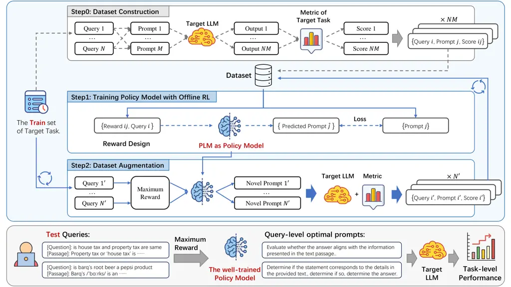
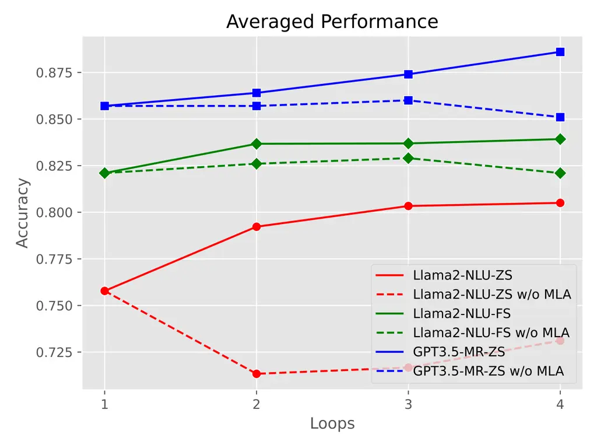

# QPO: Query-dependent Prompt Optimization via Multi-Loop Offline Reinforcement Learning

Yilun Kong ^(†)^(†)thanks: Work done during an internship at SenseTime
Research.    Hangyu Mao ^(†)^(†)thanks: corresponding authors: Hangyu
Mao\<maohangyu@sensetime.com\>; Xueqian
Wang\<wang.xq@sz.tsinghua.edu.cn\>    Qi Zhao    Bin Zhang    Jingqing
Ruan    Li Shen Affiliation: Sun Yat-Sen University;    Yongzhe Chang   
Xueqian Wang²²footnotemark: 2    Rui Zhao    Dacheng Tao
Affiliation: Nanyang Technological University Affiliation: Tsinghua
University; SenseTime Research; Institute of automation,Chinese academy
of science; Affiliation: School of Artificial Intelligence,University of
Chinese Academy of Sciences;

###### Abstract

Prompt engineering has demonstrated remarkable success in enhancing the
performance of large language models (LLMs) across diverse tasks.
However, most existing prompt optimization methods only focus on the
task-level performance, overlooking the importance of query-preferred
prompts, which leads to suboptimal performances. Additionally, these
methods rely heavily on frequent interactions with LLMs to obtain
feedback for guiding the optimization process, incurring substantial
redundant interaction costs. In this paper, we introduce Query-dependent
Prompt Optimization (QPO), which leverages multi-loop offline
reinforcement learning to iteratively fine-tune a small pretrained
language model to generate optimal prompts tailored to the input
queries, thus significantly improving the prompting effect on the large
target LLM. We derive insights from offline prompting demonstration
data, which already exists in large quantities as a by-product of
benchmarking diverse prompts on open-sourced tasks, thereby
circumventing the expenses of online interactions. Furthermore, we
continuously augment the offline dataset with the generated prompts in
each loop, as the prompts from the fine-tuned model are supposed to
outperform the source prompts in the original dataset. These iterative
loops bootstrap the model towards generating optimal prompts.
Experiments on various LLM scales and diverse NLP and math tasks
demonstrate the efficacy and cost-efficiency of our method in both
zero-shot and few-shot scenarios.

Reviewed on OpenReview:
[https://openreview.net/forum?id=bqMJToTkvT](https://openreview.net/forum?id=bqMJToTkvT)

## 1 Introduction

Large Language Models (LLMs) have exhibited impressive prowess in
various domains of natural language processing (NLP) (Ouyang et al.,
2022; Touvron et al., 2023; Achiam et al., 2023). Prompt engineering, a
method that simply adds an instruction to the input query, emerges as a
lightweight and promising solution for adapting LLMs to downstream tasks
without the need for parameter tuning (Liu et al., 2023a; Ajith et al.,
2023). Since the performance of LLMs towards a particular task is
significantly influenced by the quality of the prompt, the key challenge
of prompting lies in how to design the optimal prompts.

Numerous prompt engineering algorithms have been proposed in recent
years. Some algorithms (Zhou et al., 2022; Wang et al., 2023b; Guo
et al., 2023; Wang et al., 2024b) leverage LLMs as a prompt optimizer,
employing black-box optimization to derive the best prompts. Others
utilize reinforcement learning (RL) (Deng et al., 2022; Zhang et al.,
2022; Kong et al., 2024) to train a policy model to generate the optimal
prompts. Despite these advances, prompt engineering still grapples with
great challenges:

1.  (1)
    Most of previous algorithms only focus on obtaining task-level
    optimal prompts, aiming to attain an optimal average performance
    across all queries within a specific task. However, they overlook
    the critical insight that no single prompt can be ideal for every
    possible query (Sun et al., 2023).
2.  (2)
    All the aforementioned methods require frequent interactions with
    the target LLMs to obtain feedback on the current prompts to guide
    optimization, incurring significant costs due to the high expense of
    inferences with target LLMs.

In fact, query-level optimal prompts can yield better performance (Zhang
et al., 2022). Meanwhile, offline optimization can serve as a promising
method for reducing the costs associated with LLM interactions based on
the existence of a wealth of prompt optimization datasets, which can be
easily available as by-products during the evaluation of existing
prompting strategies. However, research on the two important domains
remains critically scarce.

Figure 1: QPO delivers state-of-the-art performance across a wide
variety of tasks, superior to existing query-dependent and
query-agnostic prompt optimization methods.

To tackle the above challenges, we propose QPO, a Query-dependent Prompt
Optimization method through multi-loop offline reinforcement learning.
The overall process of our framework is illustrated in Figure 2.
Firstly, we employ offline RL for the initial loop to fine-tune a
small-scale pretrained language model (PLM) as a policy model on the
pre-collected dataset, enabling it to generate specific prompts based on
input queries and given rewards for the target LLM. Subsequently, we
utilize the trained policy model to efficiently explore new queries and
prompts to augment the dataset, as the generated novel prompts are
supposed to be more suitable for the current queries than other prompts
in the dataset. This process eliminates the necessity to evaluate all
collected prompts for each query, while suffices to assess only a few
query-specific high-quality prompts, significantly reducing the required
interactions with the target LLM. The augmented dataset, enriched with
more queries and superior prompts, can further train the policy model
and enhance its performance. Consequently, we establish the iterative
process wherein the policy model, fine-tuned via offline reinforcement
learning, efficiently generates improved data, which is then utilized to
further fine-tune the model, creating a cyclical feedback loop. This
bootstrapping learning process can achieve substantial improvements in
limited loops with minimal interactions with the LLMs.

We evaluate our method across different LLM scales on various neural
language understanding and math reasoning tasks using both zero-shot and
few-shot settings. As shown in Figure 1, QPO reaches state-of-the-art
performance, superior to both query-dependent and query-agnostic
prompting methods. Compared to online optimization approaches, our
method only needs a minimal number of interactions with the target LLM
to augment the dataset after each loop of offline optimization, which
strikes a great balance between performance and LLM interaction costs.
In addition, we perform extensive ablations on different aspects of the
proposed algorithm. The policy model demonstrates great cross-model
generalization ability, further enhancing the value of our approach. In
conclusion, our contributions are three-fold:

1.  •
    We identify the overlooked query-dependent prompt optimization
    problem, and introduce an Offline RL paradigm to fine-tune a PLM to
    generate query-specific optimal prompts.
2.  •
    We propose a comprehensive framework, QPO, which leverages the
    existence of offline datasets and employs a novel Multi-Loop
    Augmentation technique to facilitate data augmentation with minimal
    interactions, and ultimately bootstrap the performance of prompt
    optimization through offline RL fine-tuning.
3.  •
    We benchmark our method across various LLMs on extensive datasets,
    demonstrating its superiority and great potential in broader
    applications.



Figure 2: The overview of our framework. We aim at training a small
pretrained language model (PLM) as the policy model, which can generate
query-level optimal prompts based on the given queries, and ultimately
improve the target LLM’s task-level performance. In the training phase,
depicted by the blue frame above, the blue arrows represent our primary
iterative process, while the gray arrows indicate the initial steps.
Specifically, in Step0, the offline dataset is constructed as a
by-product of evaluating existing prompts. The below frame with gray
background indicates the testing phase.

## 2 Methodology

To automatically generate query-level optimal prompts in a
cost-efficiency method, we propose QPO, a novel query-dependent prompt
optimization framework. The overall process is shown in Figure 2. In the
first round, QPO harnesses the readily existing datasets to fine-tune a
pre-trained language model into a policy model through offline
reinforcement learning, enabling it to generate query-specific optimal
prompts based on input queries. Subsequently, this policy model
efficiently explores a broader query space and enriches the prompt space
with more diverse and high-quality prompts, both of which contribute to
the augmentation of the dataset. The augmented dataset, in turn, further
refines the policy model for the next loop. Consequently, through
multi-loop training and data augmentation, the performance of prompt
optimization is bootstrapped for improvement.

### 2.1 Problem Formulation

This study focuses on training the policy model to generate prompts,
which can instruct a target LLM to output expected answers that fulfill
the query-dependent objective, based on the given queries.

Query and Answer. We consider the task of answering queries
$`\bm{q}\in\mathcal{Q}=\mathcal{V}^{\infty}`$ expressed in a natural
language, where $`\mathcal{V}`$ denotes the vocabulary. Each query
$`\bm{q}`$ is supposed to have an expected answer
$`y^{*}\in\mathcal{Y}`$ as ground truth. Queries annotated with
ground-truth answers can be employed as demonstrations $`\bm{d}`$ for
few-shot scenario.

Prompt and Policy Model. The performance of an LLM can be significantly
enhanced through appropriate prompts. The prompt
$`\bm{p}\in\mathcal{P}=\mathcal{V}^{\infty}`$ is a natural language
instruction that explains to the LLM how to complete the query and
output the predicted answer. In this paper, we utilize a fine-tuned
policy model $`\pi:\mathcal{Q}\rightarrow\mathcal{P}`$ to generate
query-specific prompts based on the given queries:
$`\bm{\hat{p}}=\pi(\bm{q})`$.

Target LLM. These tasks are performed by employing a target LLM
$`\ell:\mathcal{Q}\rightarrow\mathcal{Y}`$, feeding queries $`\bm{q}`$
into the LLM to get answers. With prompts, the answers can be obtained
by $`\hat{y}^{(i,j,k)}=\ell(\bm{p}^{(j)},\bm{d}^{(k)},\bm{q}^{(i)})`$,
where $`\bm{q}^{(i)},\bm{p}^{(j)},\bm{d}^{(k)}`$ denote the $`i`$-th
query, $`j`$-th prompt, and $`k`$-th combination of demonstrations,
respectively. For zero-shot setting, $`\bm{d}`$ is null, so we use
$`\hat{y}^{(i,j)}`$ as a shorthand unless otherwise specified.

Query-dependent Objective. Given a task with queries and ground-truth
answers, the quality of the predicted answers can be evaluated by a
metric $`\rho(y^{*},\hat{y})`$, such as correctness. The objective of
query-dependent prompt optimization can be formulated as below:

```math
\pi^{*}=\arg\max_{\pi}\rho(y^{*(i)},\ell(\pi(\bm{q}^{(i)}),\bm{q}^{(i)}))_{i\in[N]}, \tag{1}
```

which aims to optimize the policy model to generate a query-specific
prompt that enhance the target LLM’s performance on this particular
query. As its performance improves across each single query, the overall
task performance will consequently improve.

### 2.2 Model Query-dependent Prompt Optimization as Offline RL

Reinforcement Learning Formulation. As a text generation problem, prompt
generation can be formulated as a Markov Decision Process (MDP)
$`\langle\mathcal{S},\mathcal{A},r,f\rangle`$ with a finite state space
$`\mathcal{S}`$, action space $`\mathcal{A}`$, reward function $`r`$,
and state-transition probability function $`f`$, where a sparse reward
can be obtained only after the complete prompt is generated. Instead of
dedicatedly designing intricate proxy rewards, we formulate the MDP as a
single-step decision-making process. In offline RL (Levine et al.,
2020), given the dataset:

```math
\mathcal{D}={\{\bm{q}^{(i)},\bm{p}^{(j)},r^{(i,j)}=\mathcal{R}(\bm{q}^{(i)},\bm{p}^{(j)})\}}_{i\in[N],j\in[M]},
```

where the initial state $`\bm{q}\in\mathcal{S}`$ is the input query with
$`n`$ tokens $`\bm{q}=(q_{1},...,q_{n})`$ and the corresponding action
$`\bm{p}\in\mathcal{A}`$ represents the generated prompt with $`m`$
tokens $`\bm{p}=(p_{1},...,p_{m})`$, where each token $`q,p`$ is from
the vocabulary $`\mathcal{V}`$. In a single-step decision episode, the
policy model generates a complete prompt based on the given expected
reward and query $`\bm{p}\sim\pi(\bm{p}|r,\bm{q})`$. The reward guides
the quality of the generated prompt. To achieve this, we adopt Decision
Transformer (DT) (Chen et al., 2021) approach to fine-tune the policy
model, which is aligned with the autoregressive predicting paradigm of
language models. For further discussion on why prompt generation is
formulated as a single-step decision process, please refer to
Appendix A.2.

Reward Design. In our single-step prompt generation process, the reward
plays a crucial role in aligning with the true capabilities of the
prompt. In this paper, we mainly focus on neural language understanding
tasks and math reasoning tasks rather than generative tasks, which are
challenging to assess objectively because of the poor correlation
between the evaluation metrics and human preferences (Liang et al.,
2022; Goyal et al., 2022). We design the reward based on two dimensions:
query-level and task-level. Query-level reward measures whether the
prompt can instruct LLM to answer the specific question correctly, while
task-level reward measures the prompt’s average prompting ability for
all queries in one task. In particular, we adopt the average accuracy of
the prompt for all test questions as the task-level reward for both
zero-shot and few-shot settings,

```math
\mathcal{R}_{task}(\bm{q}^{(i)},\bm{p}^{(j)})=\frac{1}{N}\sum_{i=1}^{N}\mathbbm{1}\{\hat{y}^{(i,j)}={y^{*}}^{(i)}\}. \tag{2}
```

For query-level rewards, the design differs between zero-shot and
few-shot scenarios due to the variations in evaluating approaches. For
zero-shot evaluation, we utilize the prediction correctness as a
coarse-grained measure for the prompt-query pair and additionally
introduce the output perplexity (PPL) as a fine-grained penalty, which
can be easily calculated by the Log-likelihood from the black-box API or
directly obtained through the open-source LLM. During few-shot
evaluation, the result of a query is obtained by voting or averaging
across $`K`$ different in-context demonstration combinations to
eliminate the inherent instability and randomness of few-shot setup (Gao
et al., 2020; Ajith et al., 2023). We use the average correctness across
demonstration combinations of the prompt-query pair as the fine-grained
query-level reward in few-shot setting, which is more stable than PPL.
As the query-level rewards are supposed to accurately reflect the
distinctions in prompting effectiveness for various prompts across
different queries, both the perplexity penalty in zero-shot setting and
the averaged correctness in few-shot setting, which are decimals rather
than binary integers, exhibits greater variability across different
query-prompt pairs compared to the binary correctness, thus enable a
more fine-grained alignment:

```math
\mathcal{R}_{query}(\bm{q}^{(i)},\bm{p}^{(j)})=\left\{\begin{aligned} &\mathbbm{1}\{\hat{y}^{(i,j)}={y^{*}}^{(i)}\}-\frac{1}{10}\text{PPL}(\hat{y}^{(i,j)}),&\text{Zero-Shot},\\
&\frac{1}{K}\sum_{k=1}^{K}\mathbbm{1}\{\hat{y}^{(i,j,k)}={y^{*}}^{(i)}\},&\text{Few-Shot}.\end{aligned}\right. \tag{3}
```

The overall reward is the sum of the query-level and task-level reward.
Due to significant differences in reward scales across different tasks,
we normalize the overall reward using the Min-Max Normalization
method (Patro, 2015) for convenience, mapping it to the range of 0-100.

```math
\mathcal{R}(\bm{q}^{(i)},\bm{p}^{(j)})=\mathcal{R}_{query}(\bm{q}^{(i)},\bm{p}^{(j)})+\mathcal{R}_{task}(\bm{q}^{(i)},\bm{p}^{(j)}). \tag{4}
```

Training Objective. To enable the model to output appropriate prompts
based on expected rewards and input questions, we maximize the
log-likelihood with teacher forcing through DT training paradigm:

```math
\mathcal{L}_{prompt}=-\mathbb{E}_{(\bm{q},\bm{p},r)\sim\mathcal{D}}\log p(\bm{p}|r,\bm{q}), \tag{5}
```

where we input reward as return-to-go and the complete query as state,
and allow the policy model to autoregressively predict the entire
prompt’s tokens as an action.

To further enhance the model to distinguish the prompting abilities of
different prompts for the various queries, we introduce the reward
prediction loss. We directly predict the expected reward based on the
output of the transformer at the first token, regarding the model as an
autoencoder (Liou et al., 2014) by encoding an reconstructing the input
reward. This approach can extract more information from the given
reward, impose constraints on the model weights, and significantly
reduce training difficulty compared to predict reward based on the
output prompt at the last token. Further discussion on implementing
autoencoder functionality is illustrated in Appendix A.4.

```math
\mathcal{L}_{r}=\mathbb{E}_{(\bm{q},\bm{p},r)\sim\mathcal{D}}{(\hat{r}-r^{*})}^{2} \tag{6}
```

We define the overall objective function by combining the above
objectives with a balancing hyperparameter:

```math
\mathcal{L}=\mathcal{L}_{prompt}+\lambda\mathcal{L}_{r} \tag{7}
```

Model Architecture. To achieve the aforementioned functionality,
enabling the model to fully leverage reward information and temporal
dynamics in reinforcement learning, we also refine the architecture of
the pre-trained language model, elevating it to serve as our policy
model. We introduce a distinct reward embedding layer, separate from the
natural language token embeddings, to facilitate a deeper comprehension
of reward signals by the model. Furthermore, during training, we
incorporate an additional reward prediction layer to implement the
reward prediction loss, thereby imposing constraints on the optimization
of the model’s primary network. The combined enhancements in both
algorithm and model structure culminate in the successful implementation
of offline prompt optimization.

### 2.3 QPO Framework for Multi-Loop Augmentation

#### 2.3.1 Initial Demonstration Construction

Dataset Construction. We start by emphasizing the presence and
significance of prompt demonstrations generated by previous research of
prompt optimization. In the domain of prompt engineering, abundant
prompts have been proposed to improve the LLMs’ performance on
downstream tasks. Generally, their efficacy is assessed at the task
level. However, different queries exhibit varied preferences for
different prompts. Query-level score, obtained before calculating
task-level score but ignored by previous research, can play a great role
in teaching the query-dependent prompting ability. As the prompts have
been evaluated on open-sourced datasets, the following query-level
demonstrations can be constructed as by-products. The process for
constructing the offline dataset is as follows: first, we sample queries
from the task dataset, then combine them with the collected prompts and
input the query-prompt pairs into the target LLM to obtain answers.
Through the designed reward function, we calculate the reward value for
each query-prompt pair. These query-prompt-reward triplets form the
samples in our offline dataset:

```math
\mathcal{D}={\{\bm{q}^{(i)},\bm{p}^{(j)},y^{*(i)},\hat{y}^{(i,j)},\mathcal{R}(y^{*(i)},\hat{y}^{(i,j)})\}}_{i\in[N],j\in[M]},
```

where $`M,N`$ denote the number of collected prompts and queries,
respectively. To enrich the initial exploration of the prompt space and
simplify prompt acquisition, we leverage ChatGPT-3.5 to rewrite prompts,
resulting in a diverse vocabulary and yielding a substantial number of
prompts in our dataset. Details of rewriting prompts are demonstrated in
Appendix B.2. While as each query requires testing with all prompts, we
only utilize a small collection of queries as the initial dataset to
strike a balance between algorithm performance and computational cost.

Data Filtering. Similar to popular offline reinforcement learning’s need
to differentiate expert, medium, and random datasets, in this work, we
simply remove the less-quality examples with rewards below the expert
threshold, defined as the 66.7th percentile of the reward range in the
dataset. Notably, this approach does not discard two-thirds of the data
since we use rewards as the filtering metric rather than data volume,
and most samples fall within the expert interval. Almost all prompts are
retained without wastage; even if a prompt performs poorly on average,
it may still enable the LLM to answer correctly on specific questions,
and it is retained at this query. The specific data wastage resulting
from data filtering is detailed in Section 3.3.

#### 2.3.2 Multi-Loop Augmentation

After fine-tuning with the initial dataset, the policy model is supposed
to generate prompts that are better suited for specific problems than
any existing prompts in the dataset. Therefore, a natural and efficient
approach is to use these prompts to enrich the dataset as a form of data
augmentation. Moreover, as the model generates high-quality prompts
tailored to specific queries, there is little concern about filtering
out evaluation samples and wasting data, which presents a great
opportunity to extensively assess various queries, expanding exploration
of the query space.

Query Augmentation. As our initial dataset covers only a limited number
of queries, we randomly collect both overlapped and uncovered queries
from the task’s training set, simultaneously focusing on optimizing
prompts on existing problems and exploring unknown ones. Since only one
specifically generated prompt needs to be evaluated for each problem,
rather than testing all prompts, it significantly reduces computational
overhead caused by the number of queries and candidate prompts. Hence,
it enables large-scale exploration of new problems, avoiding the test
performance degradation caused by the distribution shift of the limited
initial training queries.

Prompt Augmentation. Based on the newly collected queries, we utilize
the maximum expected reward to instruct the fine-tuned model to generate
novel and superior prompts. In order to guarantee the quality and
diversity of prompt exploration, we adopt the sampling generation
approach with the policy model in this phase.

Dataset Augmentation. For augmented query-prompt pairs, the calculation
of the query-level rewards remains consistent with the original formula
(3), while task-level rewards are determined by the model’s overall
generation capability in the current loop, that is, the average accuracy
of all prompts generated in the current augmentation stage. Then, we
obtain the new training examples:

```math
\mathcal{D}_{A}={\{\bm{q}^{(i^{\prime})},\bm{p}^{(i^{\prime})},r^{(i^{\prime})}\}}_{i\in[N^{\prime}]},
```

where $`N^{\prime}`$ denotes the number of new queries. This dataset is
finally supplemented into the original dataset for the next loop’s
training.

After data augmentation, the updated dataset is enriched with a greater
variety of queries and higher-quality prompts, which can be utilized to
fine-tune the model to further improve its performance. We structure
these processes into a continuous bootstrapping loop, where both offline
RL and data augmentation cyclically feedback to each other. The
algorithm stops when the number of iterations reaches a predefined
value. Our method achieves incremental improvements utilizing offline
optimization with significantly minimal interactions with LLMs. The
detailed algorithm of QPO are outlined in Algorithm 1 in Appendix A.5.

## 3 Experiments

### 3.1 Experimental Setup

Tasks. We perform experiments on 6 language understanding tasks and 2
math reasoning tasks to validate our methods, including topic
classification (AG’s News (Zhang et al., 2015)), natural language
inference (BoolQ (Clark et al., 2019)), sentiment classification
(IMDB (Maas et al., 2011), TweetEval Emotion (Mohammad et al., 2018)),
multi-choice QA (CosmosQA (Huang et al., 2019), HellaSwag (Zellers
et al., 2019)), and math reasoning (GSM8K (Cobbe et al., 2021),
SVAMP (Patel et al., 2021)). These tasks are widely studied in prompting
settings, and hence many expert-crafted and machine-generated prompts
are available, which facilitates our offline data collection procedure.

Baselines. We compare our method with three types of baselines,
including manual prompt engineering (PromptSource (Bach et al., 2022),
Chain-of-Thought (Wei et al., 2022)), online prompt optimization (Low
Perplexity (Gonen et al., 2022), RLPrompt (Deng et al., 2022), APE (Zhou
et al., 2022)) and offline prompting approach (Prompt-OIRL (Sun et al.,
2023)). We also compare the prompts rewritten by ChatGPT. We reproduce
the online methods based on InstructEval (Ajith et al., 2023). Rather
than making a direct while unfair comparison between the performance of
QPO and newer online algorithms, our primary focus is to demonstrate
that QPO can further enhance performance by optimizing prompts at
query-level based on the prompts obtained through online optimization.
Notably, for fair comparison, we use a larger dataset in Prompt-OIRL
than ours after final loop data augmentation to eliminate our advances
in additional interactions.

LLMs. Our method is model-agnostic for policy model, and we use
GPT-2 (Radford et al., 2019) in this paper, which is compact while has
sufficient text generation capability. For the target LLMs, we use
publicly available Llama2-7b-chat (Touvron et al., 2023) for natural
language understanding tasks, while for the more challenging math
reasoning tasks, we opt for GPT-3.5-turbo (OpenAI, 2023) and
GPT-4o (OpenAI, 2024). Moreover, to evaluate the cross-model
generalization ability of our trained policy model, we employ models at
different abilities, scaling from the GPTNeo-1.3b (Black et al., 2021)
to Llama2-13b-chat (Touvron et al., 2023) and Vicuna-13b (Zheng et al.,
2024).

Implementation Details. For the initial data collection, we utilize 30
expert prompts obtained from InstructEval and 120 prompts rewritten from
ChatGPT-3.5 to construct the dataset. We set the QPO with 3 loops. For
all the tasks, we use a unified hyperparameter set and do not need
complex hyperparameter design for specific task. We do not cherry-pick
checkpoints and directly use the final checkpoint in each loop for
evaluation and next loop’s training. For NLU tasks, we evaluate our
method on both zero-shot and few-shot settings, while for math reasoning
tasks for GPT-3.5 and GPT-4o, we only test its zero-shot performance due
to budget limitation. Both training and testing are conducted on 3
seeds. We set the maximum expected reward as 100 and pick the model with
the highest score on the development set and report its score on the
test set. For data augmentation, we adopt sampling generation with a
top-k of 2 and top-p of 0.9, while for evaluation, we adopt greedy
generation. Few-shot evaluations are conducted separately for 3-shot and
6-shot, where the few-shot demonstrations are randomly sampled from the
training set of the tasks. We measure the algorithm’s performance using
accuracy, defined as the ratio of correctly answered queries by the LLM
to the total number of tested queries. More details are demonstrated in
Appendix B.1. The code is available at
[here](https://github.com/KongYilun/QPO).

### 3.2 Main Results

|                    |            |            |            |            |            |            |      |
| ------------------ | ---------- | ---------- | ---------- | ---------- | ---------- | ---------- | ---- |
| Method             | AG News    | BoolQ      | IMDB       | Emotion    | CosmosQA   | HellaSwag  | Avg. |
| Zero-shot Accuracy |            |            |            |            |            |            |      |
| PromptSource       | 68.3       | 59.0       | 86.3       | 57.3       | 42.9       | 68.8       | 63.8 |
| ChatGPT            | 64.2(0.84) | 62.0(2.41) | 85.0(2.19) | 62.4(2.68) | 42.6(0.51) | 68.8(0.51) | 64.2 |
| Low Perplexity     | 70.3(1.04) | 61.0(2.65) | 78.7(2.21) | 57.6(1.71) | 42.0(0.67) | 69.6(0.69) | 63.2 |
| RLPrompt           | 47.8(4.67) | 64.9(2.27) | 86.4(2.04) | 49.8(1.17) | 44.7(0.33) | 68.6(0.19) | 60.4 |
| APE                | 66.5(1.12) | 64.4(1.50) | 77.0(3.84) | 58.3(2.73) | 43.2(1.17) | 68.3(0.84) | 62.9 |
| Prompt-OIRL        | 78.3       | 65.0       | 89.0       | 68.3       | 42.3       | 68.3       | 68.5 |
| QPO                | 79.0(0.44) | 71.0(1.02) | 91.2(2.12) | 68.7(1.07) | 45.3(0.42) | 69.7(0.71) | 70.9 |
| Few-shot Accuracy  |            |            |            |            |            |            |      |
| PromptSource       | 83.3       | 67.1       | 89.4       | 66.4       | 45.6       | 70.3       | 70.4 |
| ChatGPT            | 83.8(0.75) | 68.1(0.39) | 89.2(0.25) | 67.2(1.78) | 45.5(0.62) | 69.8(0.52) | 70.6 |
| Low Perplexity     | 82.9(0.20) | 68.5(0.47) | 89.1(0.09) | 67.6(1.49) | 45.4(0.41) | 70.4(0.13) | 70.7 |
| RLPrompt           | 82.8(0.24) | 71.2(0.50) | 89.1(0.54) | 65.4(0.70) | 46.2(0.32) | 70.2(0.57) | 70.8 |
| APE                | 83.1(0.33) | 68.4(0.79) | 89.2(0.45) | 67.9(0.58) | 45.8(0.70) | 70.2(0.12) | 70.8 |
| Prompt-OIRL        | 83.8       | 73.3       | 89.5       | 67.6       | 48.1       | 70.4       | 72.1 |
| QPO                | 85.6(0.29) | 76.5(0.62) | 91.4(0.16) | 69.1(1.13) | 51.2(0.41) | 71.0(0.29) | 74.2 |

Table 1: Main results (accuracy) of QPO and baselines on Llama2 on NLU
tasks.

|             |            |            |      |
| ----------- | ---------- | ---------- | ---- |
| Method      | GSM8K      | SVAMP      | Avg. |
| CoT         | 88.0(0.49) | 81.0(0.52) | 84.5 |
| ChatGPT     | 82.1(1.07) | 79.5(2.24) | 80.8 |
| APE         | 85.8(0.74) | 81.3(1.62) | 83.6 |
| Prompt-OIRL | 87.5       | 83.7       | 85.6 |
| QPO         | 90.3(0.68) | 86.8(0.41) | 88.6 |

Table 2: Main results (accuracy) of QPO and baselines on GPT-3.5 on math
reasoning (MR) tasks.

Natural Understanding tasks. Table 1 presents a comprehensive comparison
of query-dependent optimized prompts generated by QPO against human
prompts, query-agnostic prompt optimization methods, and SOTA offline
query-dependent prompt selection method on Llama2-7b-chat on zero-shot
and 6-shot settings. The results show that: (1) QPO delivers
significantly better results on zero-shot metric (avg. +7.2% over other
baselines) and also outperforms other baselines on few-shot setting
(avg. +3.3%), where the contextual demonstrations slightly diminish the
critical role of prompts, as evidenced by the standard deviation in
few-shot scenarios being significantly smaller than in zero-shot
scenarios. The 3-shot results in Table 11 further illustrate that our
algorithm’s advantage becomes more pronounced as the information
provided by contextual demonstrations decreases (avg. +6.1%). (2) Based
on the dataset constructed from these online algorithms, both QPO and
Prompt-OIRL exhibit better performance to those optimized at the task
level on all three settings (avg. +7.2%, +2.3%, +4.9%, respectively),
which underscores the effectiveness of optimizing prompts at the query
level. (3) Despite the comparative strength of Prompt-OIRL as a
discriminative model over our generative model, our algorithm
outperforms Prompt-OIRL, demonstrating that learning to generate optimal
prompts for specific queries is superior to merely selecting the most
suitable ones.

Math Reasoning tasks. The experimental results of GPT-3.5 on zero-shot
math reasoning tasks are presented in Table 2. When applied to more
powerful models for solving complex tasks, QPO exhibits the same leading
capabilities. Specifically, QPO achieves up to 7.8% improvement with an
average of 5.0% over other baselines, which demonstrates that QPO is a
good method for prompting fancy LLMs for these challenging tasks. The
results of GPT-4o are shown in Appendix C.2.

### 3.3 Analysis



Figure 3: Comparison of QPO and QPO w/o MLA.

Multi-loop augmentation can bootstrap to improve performance in a
interaction-cost-efficient way. Multi-Loop Augmentation (MLA) in our
method is supposed to improve the exploration of the query space and
prompt space efficiently, so that the augmented dataset can enhance the
policy model in turn. The average number of queries in datasets
increases from 283 in original dataset to 673 in the final augmented
dataset, and the average number of prompts rises from 150 to 829, which
obtains 138% and 453% increases in question coverage and prompt
diversity with only a 17.1% increase in total data volume. We limit the
amount of data augmented in each loop, as research (Wang et al., 2024c)
indicates that generated data comprising 10% of the real data provides
the maximum training benefit, whereas excessive generated data can be
counterproductive. To further quantify the effect of MLA, we conduct
ablation experiments that finetune the model the same iterations without
data augmentation. As shown in Figure 3, in 3 NLU tasks (AG News, BoolQ,
IMDB) and 2 math reasoning (MR) tasks (GSM8K and SVAMP), MLA can
consistently improve the performance in all settings, while training
with more epochs without data augmentation results in significant drops
due to overfitting. To be specific, multi-loop augmentation and training
lead to a performance improvement of 6.7% and 2.3% for Llama2 in
zero-shot and few-shot settings in NLU tasks, respectively, while in the
zero-shot math reasoning tasks for GPT-3.5, the performance improved by
3.5%.

|        |                       |
| ------ | --------------------- |
| Method | Model Cost (GPU Hour) |
| APE    | 1.761                 |
| Ours   | 0.291                 |

Table 3: Interaction costs of QPO and APE on Llama2-7b-chat on AG News.

Despite the introduction of online LLM interactions in MLA, our method:
(1) only engages new interactions to supplement the dataset after the
training convergence in each loop, rather than requiring interactions at
each step to provide real-time guidance for optimization direction; (2)
requires significantly fewer interactions compared to other online
methods. Therefore, QPO is considered an offline approach. To
demonstrate this, we compared our method with the classic online
algorithm APE, which is a paradigm for many online prompt optimization
methods. Table 3 presents the LLM inference time costs, which is
operated locally on NVIDIA V100 GPU. To be specific, for 4 loops of
training, 3 data augmentation processes are employed, resulting in each
MLA requiring approximately 0.097h of computational resources. Given an
average performance improvement of around 2% per loop, this expense for
interaction is relatively justified and valuable. Thus, employing QPO
for prompt optimization is substantially more cost-efficient than
methods reliant on LLMs as critics. We analyse the specific number of
required interactions for these methods in Appendix C.3.

|        |           |          |           |          |           |          |           |          |
| ------ | --------- | -------- | --------- | -------- | --------- | -------- | --------- | -------- |
| Method | AG News   |          | BoolQ     |          | IMDB      |          | Avg.      |          |
|        | zero-shot | few-shot | zero-shot | few-shot | zero-shot | few-shot | zero-shot | few-shot |
| SFT    | 76.0      | 84.2     | 70.7      | 74.9     | 90.7      | 89.6     | 79.1      | 82.9     |
| RL     | 78.7      | 84.3     | 65.0      | 75.2     | 91.0      | 89.6     | 78.2      | 83.1     |
| QPO    | 79.0      | 85.6     | 71.0      | 76.5     | 91.2      | 91.4     | 80.4      | 84.5     |

Table 4: Comparison between SFT, RL and QPO (RL+Reward Loss).

Reward Matters. To validate the effects of RL and our proposed reward
prediction loss, we conduct ablation experiments comparing supervised
fine-tuning (SFT), RL, and QPO (RL+Reward Loss). Table 4 presents that
RL+Reward Loss consistently surpasses others in all evaluation tasks,
which confirms the effects of the additional reward loss. It instruct
the model focus more on the rewards, enabling it to determine which
query-prompt pairs can achieve higher rewards, allowing the policy model
to generate optimal prompts given the maximum expected reward. Compared
with SFT, RL also achieves better performance (5/6) because of the high
data utilization, which is also thanks to the introduction of the
reward. Detailed reason is analysed in Appendix A.1. The reason for the
drop between QPO and RL can be attributed to the underestimation of
rewards. As the reward and each query token have equal weight
contributing to the prompt generation, excessively long queries may
cause the model to overlook the single-token reward. Notably, SFT also
yields strong results, indicating that fine-tuning PLMs to generate
optimal prompts can serve as a general paradigm, regardless of the
specific fine-tuning method. The success of SFT also implies that each
query does not necessarily need multiple prompts in the dataset; as our
data augmentation approach, to balance interaction frequency with query
exploration, each new query might only be accessed minimal times,
resulting in a limited number of different corresponding prompts
generated by sampling. Such augmented data can still positively
contribute to the training process. For more details on ablation
experiments related to reward design, including the contributions of
$`\mathcal{R}_{query}`$ and $`\mathcal{R}_{task}`$, the importance of
fine-grained perplexity penalty in $`\mathcal{R}_{query}`$, and the
difference between reward predicting positions, please refer to
Appendix C.4.

|        |           |          |           |          |           |          |           |          |
| ------ | --------- | -------- | --------- | -------- | --------- | -------- | --------- | -------- |
| Method | AG News   |          | BoolQ     |          | IMDB      |          | Avg.      |          |
|        | zero-shot | few-shot | zero-shot | few-shot | zero-shot | few-shot | zero-shot | few-shot |
| NN     | 70.3      | 82.4     | 64.3      | 76.7     | 83.7      | 89.1     | 72.8      | 82.7     |
| QPO    | 79.0      | 85.6     | 71.0      | 76.5     | 91.2      | 91.4     | 80.4      | 84.5     |

Table 5: Performance comparison between Nearest Neighbor and QPO.

Ablation on Prompt Generation. To further validate the rationality of
using transformer for query encoding and prompt generation
simultaneously, we additionally employ a direct query-dependent baseline
for comparison. Specifically, we ablate the text generation component of
the policy model, only utilize it to encode queries into query
embeddings, select the training query most similar to the testing query
using Nearest Neighbor (NN) criterion, and directly choose the prompt
with the highest reward associated with the matched training query. The
results are depicted in Table 5. Generating specific prompts (QPO)
significantly outperforms merely selecting suitable ones (NN),
indicating the effectiveness of the main training objective. Notably, NN
also achieves higher scores than those query-agnostic prompts shown in
Table 1, which illustrates that the trained policy model can accurately
obtain the input query embeddings, even without the specific training
objective for encoding. And query-specific prompts, whether selected or
generated, indeed outperform query-agnostic prompts.

|             |           |          |
| ----------- | --------- | -------- |
| \# prompt   | Avg.      |          |
|             | zero-shot | few-shot |
| scarce (5)  | 72.8      | 83.1     |
| middle (30) | 77.8      | 84.2     |
| rich (150)  | 80.4      | 84.5     |

Table 6: Performance under different prompt availability. "# prompts"
demonstrates the number of initial prompts used for training.

Ablation on Dataset. We investigate the effect of initial prompt
quantity and overall data quality in the offline dataset on QPO.
Firstly, we compare the performance with different numbers of prompts
shown in Table 6 , where the 30 prompts are from online algorithms
without ChatGPT rewriting and the 5 prompts are randomly selected from
the 30 prompts. The results reveal an overall trend that more prompts
lead to better final performance, while an exceptionally large number of
initial prompts is not necessary, as a moderate amount can already yield
good results. This is because once the dataset contains a sufficient
number of high-quality prompts, subsequent data augmentation phase can
also effectively enhance prompt diversity. It also validates the
effectiveness of supplementing prompts with lower-quality GPT-rewritten
prompts, as a prompt with a lower average accuracy can still perform
well on specific queries. This experiment demonstrates QPO’s potential
to perform well with a smaller number of prompts. Detailed results are
shown in Table 16.

|               |           |          |
| ------------- | --------- | -------- |
| Dataset       | Avg.      |          |
|               | zero-shot | few-shot |
| expert        | 80.4      | 84.5     |
| medium-expert | 77.9      | 82.6     |

Table 7: Performance under different data quality. QPO with
medium-expert dataset can already achieve comparable or better results
to SOTA Prompt-OIRL.

Next, we discuss the impact of data quality on our method to illustrate
the importance of data filtering. We view the filtered dataset as expert
dataset and the original dataset as medium-expert one, for all the
prompts within the dataset are capable of achieving at least moderate
performances. Table 7 demonstrates that QPO on expert dataset after data
filtering outperforms that on medium-expert dataset. By filtering 34.4%
of the lower-quality data, our method achieves a 2.1% performance
improvement. While when trained on an unfiltered medium-expert dataset,
our algorithm still achieves comparable or better results to the SOTA
Prompt-OIRL, which demonstrates that QPO exhibits strong robustness to
prompt quality and data filtering can further enhance its performance.
The detailed results are presented in Table 18.

|                 |              |           |          |           |          |           |          |         |
| --------------- | ------------ | --------- | -------- | --------- | -------- | --------- | -------- | ------- |
| Model           | Method       | AG News   |          | BoolQ     |          | IMDB      |          | \# wins |
|                 |              | zero-shot | few-shot | zero-shot | few-shot | zero-shot | few-shot |         |
| GPTNeo-1.3b     | PromptSource | 58.5      | 63.0     | 50.3      | 49.8     | 80.9      | 82.9     | 2       |
|                 | Prompt-OIRL  | 65.3      | 65.1     | 48.3      | 49.0     | 78.3      | 84.0     | 2       |
|                 | QPO          | 61.7      | 63.4     | 50.3      | 49.1     | 83.3      | 87.5     | 3       |
| LlaMa2-13b-chat | PromptSource | 75.1      | 83.7     | 79.1      | 82.8     | 89.8      | 92.2     | 1       |
|                 | Prompt-OIRL  | 80.3      | 82.4     | 78.0      | 83.0     | 88.3      | 91.2     | 1       |
|                 | QPO          | 80.3      | 84.4     | 80.7      | 83.9     | 90.3      | 92.1     | 5       |
| Vicuna-13b      | PromptSource | 74.3      | 80.3     | 79.4      | 80.8     | 89.5      | 92.2     | 1       |
|                 | Prompt-OIRL  | 76.0      | 81.4     | 82.7      | 84.1     | 88.3      | 92.5     | 1       |
|                 | QPO          | 75.0      | 82.6     | 86.0      | 84.6     | 87.3      | 92.9     | 4       |

Table 8: Cross-model generalization on different models.

Cross-Model Generalization. We investigate whether QPO can be used to
steer the target LLMs which are not involved in the dataset collection
and augmentation. In this section, the policy model are trained on
datasets collected by Llama2-7b-chat. As shown in Table 8, QPO
demonstrates excellent cross-model transferability compared with human
designed prompts, which are generally considered high-quality and can be
employed on any LLMs. Compared to the results with GPTNeo-1.3B, our
algorithm demonstrates greater advantages on two larger LLMs (3 wins
v.s. 5 wins & 4 wins). This cross-model generalization significantly
enhances the value of our approach: We can train the policy model using
existing data tested on different models and then apply it to the target
model. Additionally, we can collect data using a cost-effective smaller
LLM and train the policy model, then directly apply it to a more
expensive larger LLM.

Case Study. The prompts generated by QPO in NLU tasks are presented in
Table 19, which showcase the versatility of our approach. Notably, while
their individual accuracies on all testing questions are relatively low,
their collective application significantly enhances task-level
performance when aligned with specific queries. Although a single
generated prompt may not be suitable for all queries, it is certainly
the best for the specific query.

## 4 Related Works

Prompt Optimization. Automatic prompt optimization has become a pivotal
issue in domain of LLMs. Recently, there has been a growing interest in
this area. Soft prompts (Li & Liang, 2021; Zhang et al., 2021; Lester
et al., 2021; Liu et al., 2023b) achieve effective performance by tuning
the parameters of the input tokens, while exhibit two significant
drawbacks. They require parameters of the target LLM, which are
inaccessible for black-box APIs, and their vector representation lacks
interpretability for humans. Discrete prompts, also known as prompt
engineering, eliminate the shortcomings and also achieve great success.
Most of these methods are query-agnostic. Automatic Prompt Engineering
(APE)(Zhou et al., 2022) induces prompts by instructing a LLM to
describe the given task and refines the set of generated prompts. Low
Perplexity (SPELL)(Gonen et al., 2022) finds the perplexity is
negatively correlated with the performance and select the least
perplexity instructions. RLPrompt (Deng et al., 2022) employs RL to
optimize a prompt policy. Recently, more studies focus on leveraging LLM
as prompt optimizer using black-box optimization method for swift prompt
engineering, such as evolution algorithm (Guo et al., 2023; Fernando
et al., 2023), alternate sampling (Zhou et al., 2022; Xu et al., 2023;
Pryzant et al., 2023; Kong et al., 2023), and RL (Kong et al., 2024;
Wang et al., 2023b). However, studies (Wu et al., 2022; Jiang et al.,
2022; Zhang et al., 2022; Sun et al., 2023) have shown that
query-dependent prompts can obtain better results. TEMPERA (Zhang
et al., 2022) designs the action space to be editing operations to
achieve test-time query-dependent edit. Prompt-OIRL (Sun et al., 2023)
utilize inverse RL to learn a proxy reward model and thus select the
best prompt based on the query from a candidate prompt set. Another
advantage of Prompt-OIRL is it makes full use of offline dataset,
significantly reducing the inference cost by interactions with LLMs.
Promptist (Hao et al., 2023) also collect an offline dataset and employ
SFT to fine-tune the policy model, while the main performance
improvements are from the subsequent online RL.

Learning from Human Feedback. Our method is related to the research on
reinforcement learning from human feedback, which has shown promising
results on a wide range of tasks, including NLP (Rajpurkar et al., 2018;
Wang et al., 2023a; Ouyang et al., 2022; Stiennon et al., 2020; Klie
et al., 2020; Wang et al., 2024a) and classical RL (Christiano et al.,
2017; Ibarz et al., 2018; Xia et al., 2024). Another similar category is
reinforcement learning form AI feedback (RLAIF) (Bai et al., 2022; Lee
et al., 2023), which leverages the feedback typically from LLMs to
facilitate RL. Differently, we directly use the feedback from LLM to
shape rewards rather than learning a reward model. Our method is akin to
imitation learning (Torabi et al., 2018; Chen et al., 2021; Janner
et al., 2021), directly learning a policy from a batch of behavioral
demonstrations and their corresponding rewards. This distinctive
approach sets our method apart from existing prompt optimization
techniques.

## 5 Conclusion and Future Work

We propose QPO, a novel query-dependent prompt optimization method
through a multi-loop offline RL framework, which is cost-efficient. This
method leverages offline datasets from existing evaluations and employs
offline RL to fine-tune a small-scale language model as the policy
model, generating query-level optimal prompts. Experimental results
demonstrate the superiority and cross-model generalization ability of
QPO, significantly enhancing the value of our method. Besides, we
conduct extensive ablation studies to analyse our method’s insights and
rationale. While our method has substantially reduced the required
online interactions, we can entirely eliminate these interactions if
necessary. For instance, in certain business scenarios where only a
fixed amount of reward-labeled data is available and the reward labeling
rules are unknown, it is impossible to use LLMs to obtain new labeled
data as our exploration. We can employ inverse reinforcement learning to
derive a reward model from the original dataset to score the new
query-prompt pairs obtained through the multiple-loop data augmentation.
This approach completely eliminates the need for online interactions
with LLMs, which we consider for future work. Furthermore, in the
domains of text-to-image and text-to-video generation, where LLMs have
slower inference speeds, interactions are more expensive, and user
queries are more unique, our offline query-dependent prompt optimization
methods will show greater potential and advantages.

## 6 Broader Impact Statements

This paper presents work whose goal is to advance the field of Machine
Learning. There are many potential societal consequences of our work,
none which we feel must be specifically highlighted here.

## References

- Achiam et al. (2023) Josh Achiam, Steven Adler, Sandhini Agarwal, Lama
  Ahmad, Ilge Akkaya, Florencia Leoni Aleman, Diogo Almeida, Janko
  Altenschmidt, Sam Altman, Shyamal Anadkat, et al. Gpt-4 technical
  report. _arXiv preprint arXiv:2303.08774_, 2023.
- Ajith et al. (2023) Anirudh Ajith, Mengzhou Xia, Ameet Deshpande, and
  Karthik R Narasimhan. Instructeval: Systematic evaluation of
  instruction selection methods. In _R0-FoMo: Robustness of Few-shot and
  Zero-shot Learning in Large Foundation Models_, 2023.
- Bach et al. (2022) Stephen H Bach, Victor Sanh, Zheng-Xin Yong, Albert
  Webson, Colin Raffel, Nihal V Nayak, Abheesht Sharma, Taewoon Kim,
  M Saiful Bari, Thibault Fevry, et al. Promptsource: An integrated
  development environment and repository for natural language prompts.
  _arXiv preprint arXiv:2202.01279_, 2022.
- Bai et al. (2022) Yuntao Bai, Saurav Kadavath, Sandipan Kundu, Amanda
  Askell, Jackson Kernion, Andy Jones, Anna Chen, Anna Goldie, Azalia
  Mirhoseini, Cameron McKinnon, et al. Constitutional ai: Harmlessness
  from ai feedback. _arXiv preprint arXiv:2212.08073_, 2022.
- Black et al. (2021) Sid Black, Leo Gao, Phil Wang, Connor Leahy, and
  Stella Biderman. Gpt-neo: Large scale autoregressive language modeling
  with mesh-tensorflow. _If you use this software, please cite it using
  these metadata_, 58:2, 2021.
- Chen et al. (2021) Lili Chen, Kevin Lu, Aravind Rajeswaran, Kimin Lee,
  Aditya Grover, Misha Laskin, Pieter Abbeel, Aravind Srinivas, and Igor
  Mordatch. Decision transformer: Reinforcement learning via sequence
  modeling. _Advances in neural information processing systems_,
  34:15084–15097, 2021.
- Christiano et al. (2017) Paul F Christiano, Jan Leike, Tom Brown,
  Miljan Martic, Shane Legg, and Dario Amodei. Deep reinforcement
  learning from human preferences. _Advances in neural information
  processing systems_, 30, 2017.
- Clark et al. (2019) Christopher Clark, Kenton Lee, Ming-Wei Chang, Tom
  Kwiatkowski, Michael Collins, and Kristina Toutanova. Boolq: Exploring
  the surprising difficulty of natural yes/no questions. _arXiv preprint
  arXiv:1905.10044_, 2019.
- Cobbe et al. (2021) Karl Cobbe, Vineet Kosaraju, Mohammad Bavarian,
  Mark Chen, Heewoo Jun, Lukasz Kaiser, Matthias Plappert, Jerry Tworek,
  Jacob Hilton, Reiichiro Nakano, et al. Training verifiers to solve
  math word problems. _arXiv preprint arXiv:2110.14168_, 2021.
- Deng et al. (2022) Mingkai Deng, Jianyu Wang, Cheng-Ping Hsieh, Yihan
  Wang, Han Guo, Tianmin Shu, Meng Song, Eric Xing, and Zhiting Hu.
  Rlprompt: Optimizing discrete text prompts with reinforcement
  learning. In _Proceedings of the 2022 Conference on Empirical Methods
  in Natural Language Processing_, pp. 3369–3391, 2022.
- Fernando et al. (2023) Chrisantha Fernando, Dylan Banarse, Henryk
  Michalewski, Simon Osindero, and Tim Rocktäschel. Promptbreeder:
  Self-referential self-improvement via prompt evolution. _arXiv
  preprint arXiv:2309.16797_, 2023.
- Gao et al. (2020) Tianyu Gao, Adam Fisch, and Danqi Chen. Making
  pre-trained language models better few-shot learners. _arXiv preprint
  arXiv:2012.15723_, 2020.
- Gonen et al. (2022) Hila Gonen, Srini Iyer, Terra Blevins, Noah A
  Smith, and Luke Zettlemoyer. Demystifying prompts in language models
  via perplexity estimation. _arXiv preprint arXiv:2212.04037_, 2022.
- Goyal et al. (2022) Tanya Goyal, Junyi Jessy Li, and Greg Durrett.
  News summarization and evaluation in the era of gpt-3. _arXiv preprint
  arXiv:2209.12356_, 2022.
- Guo et al. (2023) Qingyan Guo, Rui Wang, Junliang Guo, Bei Li, Kaitao
  Song, Xu Tan, Guoqing Liu, Jiang Bian, and Yujiu Yang. Connecting
  large language models with evolutionary algorithms yields powerful
  prompt optimizers. _arXiv preprint arXiv:2309.08532_, 2023.
- Hao et al. (2023) Yaru Hao, Zewen Chi, Li Dong, and Furu Wei.
  Optimizing prompts for text-to-image generation. In _Thirty-seventh
  Conference on Neural Information Processing Systems_, 2023.
- Huang et al. (2019) Lifu Huang, Ronan Le Bras, Chandra Bhagavatula,
  and Yejin Choi. Cosmos qa: Machine reading comprehension with
  contextual commonsense reasoning. _arXiv preprint
  arXiv:1909.00277_, 2019.
- Ibarz et al. (2018) Borja Ibarz, Jan Leike, Tobias Pohlen, Geoffrey
  Irving, Shane Legg, and Dario Amodei. Reward learning from human
  preferences and demonstrations in atari. _Advances in neural
  information processing systems_, 31, 2018.
- Janner et al. (2021) Michael Janner, Qiyang Li, and Sergey Levine.
  Offline reinforcement learning as one big sequence modeling problem.
  _Advances in neural information processing systems_,
  34:1273–1286, 2021.
- Jiang et al. (2022) Yuezihan Jiang, Hao Yang, Junyang Lin, Hanyu Zhao,
  An Yang, Chang Zhou, Hongxia Yang, Zhi Yang, and Bin Cui.
  Instance-wise prompt tuning for pretrained language models. _arXiv
  preprint arXiv:2206.01958_, 2022.
- Klie et al. (2020) Jan-Christoph Klie, Richard Eckart De Castilho, and
  Iryna Gurevych. From zero to hero: Human-in-the-loop entity linking in
  low resource domains. In _Proceedings of the 58th annual meeting of
  the association for computational linguistics_, pp. 6982–6993, 2020.
- Kong et al. (2024) Weize Kong, Spurthi Amba Hombaiah, Mingyang Zhang,
  Qiaozhu Mei, and Michael Bendersky. Prewrite: Prompt rewriting with
  reinforcement learning. _arXiv preprint arXiv:2401.08189_, 2024.
- Kong et al. (2023) Yilun Kong, Jingqing Ruan, Yihong Chen, Bin Zhang,
  Tianpeng Bao, Shiwei Shi, Guoqing Du, Xiaoru Hu, Hangyu Mao, Ziyue Li,
  et al. Tptu-v2: Boosting task planning and tool usage of large
  language model-based agents in real-world systems. _arXiv preprint
  arXiv:2311.11315_, 2023.
- Lee et al. (2023) Harrison Lee, Samrat Phatale, Hassan Mansoor, Kellie
  Lu, Thomas Mesnard, Colton Bishop, Victor Carbune, and Abhinav
  Rastogi. Rlaif: Scaling reinforcement learning from human feedback
  with ai feedback. _arXiv preprint arXiv:2309.00267_, 2023.
- Lester et al. (2021) Brian Lester, Rami Al-Rfou, and Noah Constant.
  The power of scale for parameter-efficient prompt tuning. _arXiv
  preprint arXiv:2104.08691_, 2021.
- Levine et al. (2020) Sergey Levine, Aviral Kumar, George Tucker, and
  Justin Fu. Offline reinforcement learning: Tutorial, review, and
  perspectives on open problems. _arXiv preprint
  arXiv:2005.01643_, 2020.
- Li & Liang (2021) Xiang Lisa Li and Percy Liang. Prefix-tuning:
  Optimizing continuous prompts for generation. _arXiv preprint
  arXiv:2101.00190_, 2021.
- Liang et al. (2022) Percy Liang, Rishi Bommasani, Tony Lee, Dimitris
  Tsipras, Dilara Soylu, Michihiro Yasunaga, Yian Zhang, Deepak
  Narayanan, Yuhuai Wu, Ananya Kumar, et al. Holistic evaluation of
  language models. _arXiv preprint arXiv:2211.09110_, 2022.
- Liou et al. (2014) Cheng-Yuan Liou, Wei-Chen Cheng, Jiun-Wei Liou, and
  Daw-Ran Liou. Autoencoder for words. _Neurocomputing_,
  139:84–96, 2014.
- Liu et al. (2023a) Pengfei Liu, Weizhe Yuan, Jinlan Fu, Zhengbao
  Jiang, Hiroaki Hayashi, and Graham Neubig. Pre-train, prompt, and
  predict: A systematic survey of prompting methods in natural language
  processing. _ACM Computing Surveys_, 55(9):1–35, 2023a.
- Liu et al. (2023b) Xiao Liu, Yanan Zheng, Zhengxiao Du, Ming Ding,
  Yujie Qian, Zhilin Yang, and Jie Tang. Gpt understands, too. _AI
  Open_, 2023b.
- Maas et al. (2011) Andrew Maas, Raymond E Daly, Peter T Pham, Dan
  Huang, Andrew Y Ng, and Christopher Potts. Learning word vectors for
  sentiment analysis. In _Proceedings of the 49th annual meeting of the
  association for computational linguistics: Human language
  technologies_, pp. 142–150, 2011.
- Mohammad et al. (2018) Saif Mohammad, Felipe Bravo-Marquez, Mohammad
  Salameh, and Svetlana Kiritchenko. Semeval-2018 task 1: Affect in
  tweets. In _Proceedings of the 12th international workshop on semantic
  evaluation_, pp. 1–17, 2018.
- OpenAI (2023) OpenAI. Gpt-3.5-turbo.
  [https://platform.openai.com/docs/models/gpt-3-5-turbo#gpt-3-5-turbo](https://platform.openai.com/docs/models/gpt-3-5-turbo#gpt-3-5-turbo), 2023.
- OpenAI (2024) OpenAI. Gpt-4o.
  [https://platform.openai.com/docs/models/gpt-4o#gpt-4o](https://platform.openai.com/docs/models/gpt-4o#gpt-4o), 2024.
- Ouyang et al. (2022) Long Ouyang, Jeffrey Wu, Xu Jiang, Diogo Almeida,
  Carroll Wainwright, Pamela Mishkin, Chong Zhang, Sandhini Agarwal,
  Katarina Slama, Alex Ray, et al. Training language models to follow
  instructions with human feedback. _Advances in neural information
  processing systems_, 35:27730–27744, 2022.
- Patel et al. (2021) Arkil Patel, Satwik Bhattamishra, and Navin Goyal.
  Are nlp models really able to solve simple math word problems? _arXiv
  preprint arXiv:2103.07191_, 2021.
- Patro (2015) S Patro. Normalization: A preprocessing stage. _arXiv
  preprint arXiv:1503.06462_, 2015.
- Pryzant et al. (2023) Reid Pryzant, Dan Iter, Jerry Li, Yin Tat Lee,
  Chenguang Zhu, and Michael Zeng. Automatic prompt optimization with"
  gradient descent" and beam search. _arXiv preprint
  arXiv:2305.03495_, 2023.
- Radford et al. (2019) Alec Radford, Jeffrey Wu, Rewon Child, David
  Luan, Dario Amodei, Ilya Sutskever, et al. Language models are
  unsupervised multitask learners. _OpenAI blog_, 1(8):9, 2019.
- Rajpurkar et al. (2018) Pranav Rajpurkar, Robin Jia, and Percy Liang.
  Know what you don’t know: Unanswerable questions for squad. _arXiv
  preprint arXiv:1806.03822_, 2018.
- Stiennon et al. (2020) Nisan Stiennon, Long Ouyang, Jeffrey Wu, Daniel
  Ziegler, Ryan Lowe, Chelsea Voss, Alec Radford, Dario Amodei, and
  Paul F Christiano. Learning to summarize with human feedback.
  _Advances in Neural Information Processing Systems_,
  33:3008–3021, 2020.
- Sun et al. (2023) Hao Sun, Alihan Hüyük, and Mihaela van der Schaar.
  Query-dependent prompt evaluation and optimization with offline
  inverse rl. In _The Twelfth International Conference on Learning
  Representations_, 2023.
- Torabi et al. (2018) Faraz Torabi, Garrett Warnell, and Peter Stone.
  Behavioral cloning from observation. _arXiv preprint
  arXiv:1805.01954_, 2018.
- Touvron et al. (2023) Hugo Touvron, Thibaut Lavril, Gautier Izacard,
  Xavier Martinet, Marie-Anne Lachaux, Timothée Lacroix, Baptiste
  Rozière, Naman Goyal, Eric Hambro, Faisal Azhar, et al. Llama: Open
  and efficient foundation language models. _arXiv preprint
  arXiv:2302.13971_, 2023.
- Wang et al. (2023a) Haoyu Wang, Guozheng Ma, Cong Yu, Ning Gui, Linrui
  Zhang, Zhiqi Huang, Suwei Ma, Yongzhe Chang, Sen Zhang, Li Shen,
  et al. Are large language models really robust to word-level
  perturbations? _arXiv preprint arXiv:2309.11166_, 2023a.
- Wang et al. (2024a) Haoyu Wang, Guozheng Ma, Ziqiao Meng, Zeyu Qin,
  Li Shen, Zhong Zhang, Bingzhe Wu, Liu Liu, Yatao Bian, Tingyang Xu,
  et al. Step-on-feet tuning: Scaling self-alignment of llms via
  bootstrapping. _arXiv preprint arXiv:2402.07610_, 2024a.
- Wang et al. (2024b) Ruochen Wang, Sohyun An, Minhao Cheng, Tianyi
  Zhou, Sung Ju Hwang, and Cho-Jui Hsieh. One prompt is not enough:
  Automated construction of a mixture-of-expert prompts. _arXiv preprint
  arXiv:2407.00256_, 2024b.
- Wang et al. (2023b) Xinyuan Wang, Chenxi Li, Zhen Wang, Fan Bai,
  Haotian Luo, Jiayou Zhang, Nebojsa Jojic, Eric Xing, and Zhiting Hu.
  Promptagent: Strategic planning with language models enables
  expert-level prompt optimization. In _The Twelfth International
  Conference on Learning Representations_, 2023b.
- Wang et al. (2024c) Yifei Wang, Jizhe Zhang, and Yisen Wang. Do
  generated data always help contrastive learning? _arXiv preprint
  arXiv:2403.12448_, 2024c.
- Wei et al. (2022) Jason Wei, Xuezhi Wang, Dale Schuurmans, Maarten
  Bosma, Fei Xia, Ed Chi, Quoc V Le, Denny Zhou, et al. Chain-of-thought
  prompting elicits reasoning in large language models. _Advances in
  neural information processing systems_, 35:24824–24837, 2022.
- Wu et al. (2022) Zhuofeng Wu, Sinong Wang, Jiatao Gu, Rui Hou, Yuxiao
  Dong, VG Vydiswaran, and Hao Ma. Idpg: An instance-dependent prompt
  generation method. _arXiv preprint arXiv:2204.04497_, 2022.
- Xia et al. (2024) Bo Xia, Yilun Kong, Yongzhe Chang, Bo Yuan, Zhiheng
  Li, Xueqian Wang, and Bin Liang. Deer: A delay-resilient framework for
  reinforcement learning with variable delays. _arXiv preprint
  arXiv:2406.03102_, 2024.
- Xu et al. (2023) Weijia Xu, Andrzej Banburski-Fahey, and Nebojsa
  Jojic. Reprompting: Automated chain-of-thought prompt inference
  through gibbs sampling. _arXiv preprint arXiv:2305.09993_, 2023.
- Zellers et al. (2019) Rowan Zellers, Ari Holtzman, Yonatan Bisk, Ali
  Farhadi, and Yejin Choi. Hellaswag: Can a machine really finish your
  sentence? _arXiv preprint arXiv:1905.07830_, 2019.
- Zhang et al. (2021) Ningyu Zhang, Luoqiu Li, Xiang Chen, Shumin Deng,
  Zhen Bi, Chuanqi Tan, Fei Huang, and Huajun Chen. Differentiable
  prompt makes pre-trained language models better few-shot learners.
  _arXiv preprint arXiv:2108.13161_, 2021.
- Zhang et al. (2022) Tianjun Zhang, Xuezhi Wang, Denny Zhou, Dale
  Schuurmans, and Joseph E Gonzalez. Tempera: Test-time prompt editing
  via reinforcement learning. In _The Eleventh International Conference
  on Learning Representations_, 2022.
- Zhang et al. (2015) Xiang Zhang, Junbo Zhao, and Yann LeCun.
  Character-level convolutional networks for text classification.
  _Advances in neural information processing systems_, 28, 2015.
- Zheng et al. (2022) Boyuan Zheng, Sunny Verma, Jianlong Zhou, Ivor W
  Tsang, and Fang Chen. Imitation learning: Progress, taxonomies and
  challenges. _IEEE Transactions on Neural Networks and Learning
  Systems_, 2022.
- Zheng et al. (2024) Lianmin Zheng, Wei-Lin Chiang, Ying Sheng, Siyuan
  Zhuang, Zhanghao Wu, Yonghao Zhuang, Zi Lin, Zhuohan Li, Dacheng Li,
  Eric Xing, et al. Judging llm-as-a-judge with mt-bench and chatbot
  arena. _Advances in Neural Information Processing Systems_, 36, 2024.
- Zhou et al. (2022) Yongchao Zhou, Andrei Ioan Muresanu, Ziwen Han,
  Keiran Paster, Silviu Pitis, Harris Chan, and Jimmy Ba. Large language
  models are human-level prompt engineers. In _The Eleventh
  International Conference on Learning Representations_, 2022.

## Appendix A Extended Discussion on QPO

### A.1 Advantages of offline RL compared to SFT

Supervised fine-tuning (SFT) can be regarded as a form of imitation
learning (Zheng et al., 2022), similar to behavior cloning (Torabi
et al., 2018), where it mimics expert actions (i.e., the query-specific
optimal prompts) based on given states (i.e., input questions). While
offline reinforcement learning introduces reward values, guiding the
generation of prompts based on the given queries and associated rewards.
In prompt generation task, directly employing SFT results in low data
utilization because it is unknown in advance that which prompt is
optimal for specific problems. This necessitates massive prior
evaluation of all prompts before selecting the best one as the expert
behavior to construct the dataset, leading to significant resource
wastage. Specifically, in the final SFT dataset, each query should
ideally have only one prompt label. All $`M`$ prompts must be evaluated
but only one optimal prompt is retained as the label for SFT ultimately,
wasting the remaining $`(M-1)/M`$ evaluation data. While for offline RL,
the prediction of prompt is based on both reward and query, leading to a
much more diversity in input. Since different prompts have various
rewards, most of them can be utilized for training. Offline RL offers
significant advantages through the introduction of the rewards, which
allows each query to be associated with multiple prompts and their
corresponding rewards in the dataset. On one hand, the rewards improves
the utilization of collected suboptimal prompts for training,
significantly boosting exploration of the prompt space while avoiding
resource wastage caused by prompt selection. On the other hand, rewards
in RL enable the policy model to distinguish the prompting abilities of
different prompts for various queries at the token level, leading to the
generation of novel prompts for unknown queries.

### A.2 Prompt Generation as Single-step Decision Process

In the reinforcement learning setup, prompt generation is a sparse
reward task. The complete prompt is evaluated with the target LLM to
obtain a reward value only after it is fully generated. Given the
availability of substantial amounts of such test data, offline
reinforcement learning is an effective approach for prompt optimization.
For offline RL, there are two methods for collecting token-wise rewards
which can be used for multi-step decision-making processes:

1.  (1)
    Manually designing token-level rewards, which not only requires
    extensive prior expert knowledge but also introduces additional
    errors, making it unreliable.
2.  (2)
    Iteratively deleting the prompt’s tokens from end to beginning and
    re-evaluating to obtain rewards from
    $`s_{m-1}=(\bm{q},p_{1},...,p_{m-1})`$ to
    $`s_{m}=(\bm{q},p_{1},...,p_{m})`$, where $`p_{m}`$ denotes the
    $`m`$-th token in the complete prompt. However, this approach
    significantly increases the cost of collecting datasets and is thus
    impractical.

Therefore, we do not introduce additional proxy rewards and directly
utilize the sparse rewards. At this point, instead of modeling the
prompt generation task as a multi-step decision-making process
$`\{r,s_{0},p_{1},r,s_{1},p_{2},...\}`$, where each $`r`$ is the same
sparse reward and additional methods are required to encode long texts
$`(q_{1},...,q_{n},p1,...,p_{i})`$ into the single token state
$`s_{i}`$, we simplify the task modeling based on the principle of
Occam’s Razor. Thus, the prompt generation is formulated into a
single-step decision process $`(r,\bm{q},\bm{p})`$. Notably, the
single-step decision-making process refers to the reward and state,
taking only one action (i.e., generating the prompt), while the inner
prompt generation process remains an autoregressive prediction
$`\bm{p}\sim\prod_{t}\pi(p_{t}|r,\bm{q},\bm{p}_{<t})`$. The single-step
decision process also resembles the offline contextual bandit setup, as
actions do not interact with the environment.

### A.3 The Architecture of Policy Model

Compared to the standard GPT-2 model with 124M parameters, we make three
modifications to the model architecture: a reward embedding layer, a
reward prediction layer, and a timestep embedding layer. Both the reward
embedding layer and reward prediction layer are single-layer MLPs at the
first token of the policy model. The reward is encoder into a reward
encoding through the reward embedding layer, then input as the first
token into the transformer to obtain the output at the first token
position, which is then passed through the reward prediction layer to
generate the predicted reward. This process can be viewed as an
autoencoder designed to extract more information from the reward. The
additional timestep embedding layer encoding three timesteps into three
embeddings, which are added with reward embedding, query token
embedding, and prompt token embedding, respectively. This helps the
policy model better learn the positional relationships and distinctions
between reward, question and prompt.

### A.4 Autoencoder with reward prediction loss

Autoencoder encodes the input into a low-dimensional latent state
through an encoder and subsequently learns to reconstruct the original
input from this low-dimensional latent state via a decoder. In this
process, the latent state can effectively represent the original input.
In our approach, the reward embedding layer and the transformer map the
reward value into a hidden state. During training, the additionally
introduced reward prediction layer acts as a decoder to predict the
original input reward based on this hidden state, and the
encoder-decoder is updated through the reward prediction loss. In the
inference phase, we no longer utilize the reward prediction layer
(decoder); instead, we leverage the hidden state (related to the reward)
obtained from the encoder to perform another task, that is, predicting
the prompt. This process mirrors the autoencoder’s principle, thus
introducing the reward prediction loss and the reward prediction layer
into the PLM essentially makes it serve as an autoencoder. Notably, the
reward prediction loss does not directly contribute to reinforcement
learning process, as its optimization objective is not to generate
actions.

### A.5 Detailed Algorithm

1: Initial dataset $`\mathcal{D}_{0}`$, a collection set for task
queries $`\mathcal{Q}`$, the number of loops $`T`$, a pre-trained
language model $`\pi_{0}`$, ORL$`(\cdot)`$ denotes the offline RL
fine-tuning process, $`\mathcal{R}(\cdot)`$ presents evaluating the new
query-prompt pairs on the target LLM and calculating the reward.

2: Offline RL: $`\pi_{1}\leftarrow\text{ORL}(\pi_{0},\mathcal{D}_{0})`$

3: for $`t=1`$ to $`T-1`$ do

4:   Query Augmentation:
$`q\leftarrow\text{random}\_\text{sample}(\mathcal{Q})`$

5:   Prompt Augmentation: $`p\leftarrow\pi_{t}(q)`$

6:   Dataset Augmentation:
$`\mathcal{D}_{A}\leftarrow\{q,p,\mathcal{R}(q,p)\}`$

7:               
$`\mathcal{D}_{t}\leftarrow\{\mathcal{D}_{t-1},\mathcal{D}_{A}\}`$

8:   Offline RL:
$`\pi_{t+1}\leftarrow\text{ORL}(\pi_{t},\mathcal{D}_{t})`$

9: end for

10: return the policy model $`\pi_{T}`$, which can generate optimal
query-dependent prompts during testing.

Algorithm 1 Query-Dependent Prompt Optimization

## Appendix B Supplemental Experiment Detials

### B.1 Hyperparameters and Details

For the task datasets with default testing or development set, we use
their original split to obtain our testing set. If there is no official
training/development/testing split, we randomly sample a reasonably
large set for stable evaluating and testing. Additionally, for all
tasks, we split 10% training samples as collection set for initial query
collection and subsequent query augmentation, ensuring that the
collected queries for training the policy model do not appear in the
in-context examples during few-shot evaluation, and simultaneously
simulating a scenario where very few questions are available. In each
loop in query augmentation, 1,000 queries are sampled, which may include
repeated queries. For repeated queries, the sampling prompt generation
approach ensures different prompts are generated, allowing for the
exploration of varying prompt effectiveness for each query. We do not
explicitly aim for uniqueness in the sampled 1,000 queries per loop,
opting instead for a fully random sampling approach.

The parameters for the experiments are shown in Table 9. Notably, QPO
consists of 4 loops, indicating there are 4 times of offline
reinforcement learning fine-tuning stage and 3 times of data
augmentation between each fine-tuning stage. Since we introduce
additional networks into the policy model, the number of training epochs
and the learning rate required for the first loop of training are
relatively high.

|                                 |                                        |
| ------------------------------- | -------------------------------------- |
| Hyperparameters                 | Values                                 |
| Loops                           | 4                                      |
| Batchsize                       | 128                                    |
| Learning Rate                   | 1e-3 for the 1st loop, 1e-4 for others |
| Train Epochs                    | 100 for the 1st loop, 20 for others    |
| Optimizer                       | AdamW                                  |
| Weight Decay                    | 1e-4                                   |
| Balancing Parameter $`\lambda`$ | 0.1                                    |

Table 9: Hyperparameter settings of QPO

### B.2 Offline Dataset Collection

For the initial dataset collection, testing 150 prompts on too many
queries incurs excessive computational costs. Therefore, we test 100
queries for every group of 40 prompts (with the last group containing 30
prompts). Each group sampled different queries, achieving a balance
between query coverage and computational cost. Since queries are
randomly sampled for each test group, there are overlapped queries
across different groups. In the end, our dataset consists of 15,000
paired examples, comprising 150 prompts and approximately 350 queries.
This dataset size is significantly lower than that required by other
offline algorithms, such as Prompt-OIRL for averages 56,900 examples and
Promptist for averages 360,000 examples.

For the specific prompts, the initial 30 prompts are derived from
various previous approaches, including PromptSource, ChatGPT Rewrite,
Low Perplexity, RLPrompt and APE, which are all produced by
InstructEval (Ajith et al., 2023), and we leverage ChatGPT-3.5 chat box
to rewrite 120 new prompts based on these 30 prompts through in-context
learning. Specifically, we provide 5 existing prompts to ChatGPT-3.5,
and ask it to generate other 30 effective prompts for 4 times. The
prompt we use for rewriting is demonstrated in Table 10.

In practice, people find the following prompts help improving the
classification abilities of language models like LlaMa-7b-chat on the
\<TASK\> dataset. Rewrite the following instructions via rephrasing
and/or adding specific requirements. Use illustrative description if
needed. $`\#\#\#\#\#\#\#\#\#`$ Prompts: \<PROMPT1\> \<PROMPT2\>
\<PROMPT3\> \<PROMPT4\> \<PROMPT5\> Please provide 30 more prompts
different from those prompts that may improve the classification ability
of language models. Diversity is much appriciated!

Table 10: Template used for ChatGPT rewriting prompts (Sun et al.,
2023)).

### B.3 Codes and Hardware

Our code, as well as the offline datasets, is now publicly available at
[here](https://github.com/KongYilun/QPO). All experiments are conducted
on a single NVIDIA V100 32g GPU.

## Appendix C Additional Results

### C.1 Main Results on 3-shot Evaluation

|                |         |       |      |         |          |           |      |
| -------------- | ------- | ----- | ---- | ------- | -------- | --------- | ---- |
| Method         | AG News | BoolQ | IMDB | Emotion | CosmosQA | HellaSwag | Avg. |
| PromptSource   | 76.0    | 58.5  | 90.3 | 42.2    | 39.3     | 69.8      | 62.7 |
| Low Perplexity | 53.5    | 58.0  | 90.1 | 48.0    | 39.0     | 70.0      | 59.8 |
| RLPrompt       | 76.2    | 69.4  | 89.7 | 56.1    | 41.1     | 69.9      | 67.1 |
| APE            | 58.6    | 59.9  | 89.9 | 57.6    | 40.2     | 70.2      | 62.7 |
| Prompt-OIRL    | 76.9    | 67.1  | 89.2 | 52.7    | 40.6     | 70.4      | 66.2 |
| QPO            | 82.3    | 71.1  | 90.5 | 62.7    | 41.5     | 70.7      | 69.8 |

Table 11: Main results of QPO and baselines on NLU tasks on 3-shot
settings

### C.2 Main Results on GPT-4o.

As demonstrated in Table 12, our method also outperforms other baselines
on most updated models.

|             |       |
| ----------- | ----- |
| Method      | GSM8K |
| CoT         | 95.8  |
| ChatGPT     | 94.7  |
| APE         | 95.0  |
| Prompt-OIRL | 93.5  |
| QPO         | 96.5  |

Table 12: Main results of QPO and baselines on GPT-4o on GSM8K.

### C.3 Cost Analysis

In this section, we analyse the specific number of interactions required
by different algorithms. APE requires a total of $`M*|D|*T`$
interactions with LLMs to obtain the feedback for optimization, while
QPO only requires $`|C|*T^{\prime}`$ interactions for data augmentation,
where $`M`$ is the candidate population under evaluation, $`|D|`$ is the
size of development set, $`|C|`$ is the size of collection set, and
$`T`$ and $`T^{\prime}`$ are the number of iterations needed. Though
$`|C|`$ is slightly larger than $`|D|`$ for better exploration, QPO
significantly reduces computational overhead due to its minimal
iteration $`T^{\prime}`$ and the absence of the need for evaluate $`M`$
candidate prompts.

### C.4 Analysis on reward design

Both $`\mathcal{R}_{query}`$ and $`\mathcal{R}_{task}`$ contribute to
the performance. By separately removing $`\mathcal{R}_{query}`$ and
$`\mathcal{R}_{task}`$ and compare the results with the full reward
design($`\mathcal{R}_{query}`$+$`\mathcal{R}_{task}`$), results in
Table 13 indicate that for most of tasks, the combined design of
$`\mathcal{R}_{query}`$+$`\mathcal{R}_{task}`$ yields superior
performance. Thus, both $`\mathcal{R}_{query}`$ and
$`\mathcal{R}_{task}`$ contribute to the performance. Notably, the use
of either $`\mathcal{R}_{query}`$ or $`\mathcal{R}_{task}`$ alone also
demonstrates commendable results, which underscores the rationality of
employing these two metrics as rewards. Furthermore, the comparison
between using $`\mathcal{R}_{query}`$ and $`\mathcal{R}_{task}`$
individually highlights the advantage of $`\mathcal{R}_{query}`$,
suggesting that query-based prompt optimization is more effective than
task-level prompt optimization.

|                                                |           |          |           |          |           |          |           |          |
| ---------------------------------------------- | --------- | -------- | --------- | -------- | --------- | -------- | --------- | -------- |
| Method                                         | AG News   |          | BoolQ     |          | IMDB      |          | Avg.      |          |
|                                                | zero-shot | few-shot | zero-shot | few-shot | zero-shot | few-shot | zero-shot | few-shot |
| $`\mathcal{R}_{query}`$                        | 78.3      | 84.5     | 71.4      | 77.2     | 89.0      | 90.9     | 79.6      | 84.2     |
| $`\mathcal{R}_{task}`$                         | 76.3      | 81.6     | 71.0      | 75.3     | 84.7      | 91.2     | 77.3      | 82.7     |
| $`\mathcal{R}_{query}`$+$`\mathcal{R}_{task}`$ | 79.0      | 85.6     | 71.0      | 76.5     | 91.2      | 91.4     | 80.4      | 84.5     |

Table 13: Comparisons between $`\mathcal{R}_{query}`$,
$`\mathcal{R}_{task}`$ and
$`\mathcal{R}_{query}`$+$`\mathcal{R}_{task}`$.

Perplexity penalty is important. We compare the performance of rewards
with and without perplexity (PPL) to validate the importance of the
fine-grained penalty in $`\mathcal{R}_{query}`$. The experimental
results are presented in Table 14. For all tasks, incorporating PPL
consistently yields better performance. This is because the introduction
of PPL transforms the $`\mathcal{R}_{query}`$ from a binary value into a
fractional value, enhancing the discrimination among different
query-prompt pairs. Consequently, the policy model can better learn
which prompts are more effective for specific queries.

|               |         |       |      |         |          |           |      |
| ------------- | ------- | ----- | ---- | ------- | -------- | --------- | ---- |
| Method        | AG News | BoolQ | IMDB | Emotion | CosmosQA | HellaSwag | Avg. |
| QPO (w/ PPL)  | 79.0    | 71.0  | 91.2 | 68.7    | 45.3     | 69.7      | 70.9 |
| QPO (w/o PPL) | 75.0    | 65.7  | 90.3 | 62.7    | 42.7     | 69.0      | 67.6 |

Table 14: Comparisons between with and without perplexity (PPL).

Predicting reward at the first token helps learn better. We introduce
the reward prediction loss to enhance the model’s ability to discern the
reward values across different query-prompt pairs, while simultaneously
preventing the policy model from overemphasizing rewards to the extent
that it neglects the distinctions between queries and prompts,
potentially leading to overfitting on the prompt with the highest reward
value across all samples in the dataset. Predicting the reward at the
first token can simplify the attention calculation process and mitigate
excessive updates to the query and prompt embedding layers, thereby
reducing the risk of overfitting. Our experimental validation in
Table 15 confirms the effectiveness of predicting the reward value at
the first token, as evidenced by its better performance compared to
predicting at the last token.

|                   |           |          |           |          |           |          |           |          |
| ----------------- | --------- | -------- | --------- | -------- | --------- | -------- | --------- | -------- |
| Method            | AG News   |          | BoolQ     |          | IMDB      |          | Avg.      |          |
|                   | zero-shot | few-shot | zero-shot | few-shot | zero-shot | few-shot | zero-shot | few-shot |
| QPO (first token) | 79.0      | 85.6     | 71.0      | 76.5     | 91.2      | 91.4     | 80.4      | 84.5     |
| QPO (last token)  | 79.3      | 81.2     | 69.7      | 76.1     | 89.3      | 90.9     | 79.4      | 82.7     |

Table 15: Comparisons between reward predicting positions.

### C.5 Results on Different Prompt Quantity

The detailed results are shown in Table 16

|            |           |          |           |          |           |          |           |          |
| ---------- | --------- | -------- | --------- | -------- | --------- | -------- | --------- | -------- |
| Prompt Num | AG News   |          | BoolQ     |          | IMDB      |          | Avg.      |          |
|            | zero-shot | few-shot | zero-shot | few-shot | zero-shot | few-shot | zero-shot | few-shot |
| scarce     | 65.3      | 83.3     | 65.7      | 76.3     | 87.3      | 89.6     | 72.8      | 83.1     |
| middle     | 70.7      | 83.9     | 70.7      | 78.4     | 91.5      | 89.7     | 77.6      | 84.0     |
| rich       | 79.0      | 85.6     | 71.0      | 76.5     | 91.2      | 91.4     | 80.4      | 84.5     |

Table 16: Performance under different prompt availability.

### C.6 Results on Different Prompt Quality

We conduct experiments on the dataset where all prompts were rewritten
by ChatGPT to validate the robustness of QPO to prompt quality within
the dataset. The results are presented in Table 17. The absence of
initial high-quality prompts has minimal impact on QPO’s performance, as
the method focuses on the score of each query-prompt pair rather than
the performance of individual prompts. Consequently, even without expert
prompts, there are still other prompts perform well for each specific
query.

|                     |           |          |           |          |           |          |           |          |
| ------------------- | --------- | -------- | --------- | -------- | --------- | -------- | --------- | -------- |
| Datase              | AG News   |          | BoolQ     |          | IMDB      |          | Avg.      |          |
|                     | zero-shot | few-shot | zero-shot | few-shot | zero-shot | few-shot | zero-shot | few-shot |
| QPO                 | 79.0      | 85.6     | 71.0      | 76.5     | 91.2      | 91.4     | 80.4      | 84.5     |
| only ChatGPT prompt | 74.3      | 85.9     | 67.0      | 76.4     | 90.7      | 90.9     | 77.3      | 84.4     |

Table 17: Performance under different prompt quality in dataset.

The detailed results on different query-prompt pair quality is shown in
Table 18.

|               |           |          |           |          |           |          |           |          |
| ------------- | --------- | -------- | --------- | -------- | --------- | -------- | --------- | -------- |
| Datase        | AG News   |          | BoolQ     |          | IMDB      |          | Avg.      |          |
|               | zero-shot | few-shot | zero-shot | few-shot | zero-shot | few-shot | zero-shot | few-shot |
| expert        | 79.0      | 85.6     | 71.0      | 76.5     | 91.2      | 91.4     | 80.4      | 84.5     |
| medium-expert | 75.0      | 83.1     | 68.3      | 75.9     | 90.3      | 88.9     | 77.9      | 82.6     |

Table 18: Performance under different query-prompt pair quality.

### C.7 Case Study

|                                                                                                                                                                    |         |          |
| ------------------------------------------------------------------------------------------------------------------------------------------------------------------ | ------- | -------- |
| Generated Query-level Prompt                                                                                                                                       | I. Acc. | QPO Acc. |
| AG News                                                                                                                                                            |         |          |
| In which part of a newspaper, World News, Sports, Business, or Science and Technology? Innov., Sports.., or., or.,.,., or.,                                        | 69.0    | 79.0     |
| Assign this news report to the most suitable newspaper segment: World News, Sports, Business, or Technology. and Sports, or Sports, or                             | 70.0    |          |
| …                                                                                                                                                                  | …       |          |
| BoolQ                                                                                                                                                              |         |          |
| Analyze if the passage validates the true/false claim in the question.                                                                                             | 64.0    | 71.0     |
| Confirm the correctness of a true/false question using the text excerpt…….                                                                                         | 63.0    |          |
| …                                                                                                                                                                  | …       |          |
| IMDB                                                                                                                                                               |         |          |
| Decipher the overall sentiment conveyed by the reviewer’s critique of the movie. or or negative?                                                                   | 89.3    | 91.2     |
| Interpret the reviewer’s emotional stance towards the film: positive or negative???                                                                                | 87.7    |          |
| …                                                                                                                                                                  | …       |          |
| Emotion                                                                                                                                                            |         |          |
| receive full credit, choose the emotion that best fits the sentiment expressed in the tweet from the following options: anger, joy, optimism, or sadness. sadness. | 49.7    | 68.7     |
| From the given options, determine the emotion that best captures the essence of the tweet’s sentiment: anger, joy, optimism, or sadness… tweet. best               | 60.0    |          |
| …                                                                                                                                                                  | …       |          |
| CosmosQA                                                                                                                                                           |         |          |
| Analyze the contextual details to select the response that offers the most compre- hensive understanding. the.                                                     | 43.3    | 45.3     |
| Synthesize the information provided below to formulate a well-supported response                                                                                   |         |          |
| to the upcoming question. question.                                                                                                                                | 42.3    |          |
| …                                                                                                                                                                  | …       |          |
| HellaSwag                                                                                                                                                          |         |          |
| Explore the passage’s thematic depth and devise an ending that explores those themes further………                                                                    | 68.0    | 69.7     |
| EnIm with the passage and them and incorporate them into the ending. engaged. engagedates. their comple their expectations.                                        | 67.7    |          |
| …                                                                                                                                                                  | …       |          |

Table 19: Prompts generated by QPO. "I.Acc." denotes the individual
accuracy.
