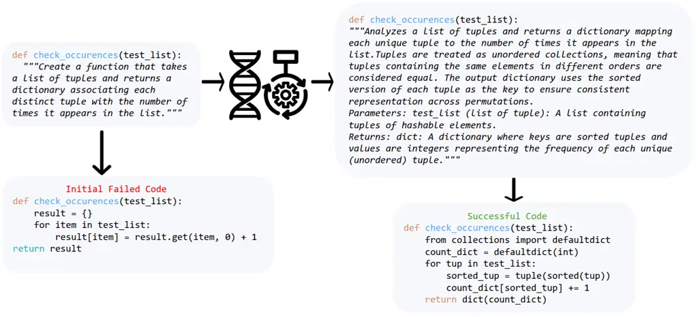
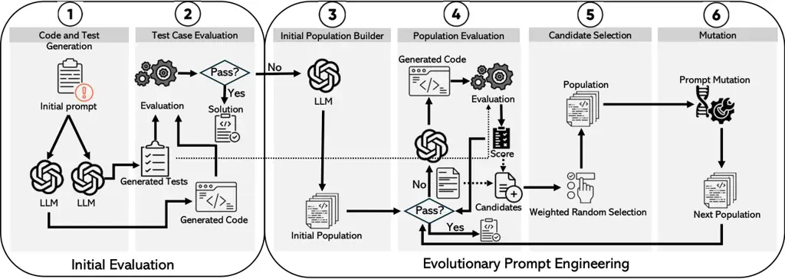
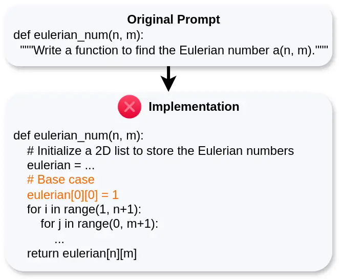
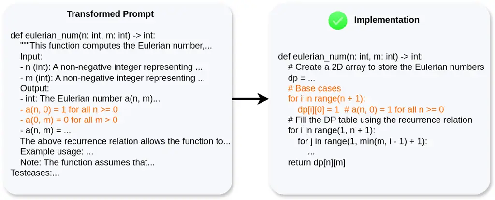

# Automated Prompt Engineering for Cost-Effective Code Generation Using Evolutionary Algorithm

Hamed Taherkhani
[](https://orcid.org/0009-0004-0897-4800)
email: <hamedth@yorku.ca> Affiliation: York University, Toronto,
Ontario, Canada , Melika Sepidband
[](https://orcid.org/0009-0006-3015-490X)
Affiliation: York University, Toronto, Canada email: <melikasp@yorku.ca>
, Hung Viet Pham
[](https://orcid.org/0000-0003-0861-8326)
Affiliation: York University, Toronto, Canada email: <hvpham@yorku.ca> ,
Song Wang
[](https://orcid.org/0000-0003-0617-2877)
Affiliation: York University, Toronto, Canada email: <wangsong@yorku.ca>
and Hadi Hemmati
[](https://orcid.org/0000-0003-0204-9812)
Affiliation: York University, Toronto, Canada email: <hemmati@yorku.ca>

###### Abstract.

Large Language Models (LLMs) have seen increasing use in various
software development tasks, especially in code generation. The most
advanced recent methods attempt to incorporate feedback from code
execution into prompts to help guide LLMs in generating correct code in
an iterative process. While effective, these methods could be costly due
to numerous interactions with the LLM and extensive token usage. To
address this issue, we propose an alternative approach named
Evolutionary Prompt Engineering for Code (EPiC), which leverages a
lightweight evolutionary algorithm to refine the original prompts into
improved versions that generate high-quality code, with minimal
interactions with the LLM. Our evaluation against state-of-the-art
(SOTA) LLM-based code generation agents shows that EPiC not only
achieves up to 6% improvement in pass@k but is also 2–10 times more
cost-effective than the baselines.

###### Keywords: 

Prompt Engineering, Code Generation, Large Language Models, Evolutionary
Algorithm

## 1. Introduction

LLMs have been used in many software development activities such as
software testing (Dakhel et al., 2024; Guilherme and Vincenzi, 2023),
design (Dhar et al., 2024; Kolthoff et al., 2023), requirement
engineering (Luo et al., 2022), code generation (Liu et al., 2023b;
Shinn et al., 2023; Zhou et al., 2023; Huang et al., 2023b; Zhong
et al., 2024), maintenance (Kang et al., 2023), etc. (Fan et al., 2023;
Wang et al., 2024). Among these activities, code generation using LLMs
has demonstrated significant potential.

In LLM-based code generation, various prompt engineering techniques,
including zero-shot (Radford et al., 2019), in-context learning (Brown
et al., 2020; Liu et al., 2021b), RAG (Retrieval Augmented
Generation) (Lewis et al., 2020), and task-specific methods (He et al.,
2022; Carta et al., 2023), have been employed. The most advanced prompt
engineering methods for code generation employ various agent-based
approaches (Shin et al., 2023). SOTA methods such as Reflexion (Shinn
et al., 2023), Language Agent Tree Search (LATS) (Zhou et al., 2023),
AgentCoder (Huang et al., 2023b), Large Language Model Debugger (LDB)
(Zhong et al., 2024), and MetaGPT (Hong et al., 2023) are either
planning-based or multi-collaborative agents. While effective, these
methods can be costly due to numerous interactions with LLMs, which
result in extensive token usage, making them less attractive in
practical settings. For instance, as we found in our study
(Section 5.2), on the MBPP dataset, LATS requires on average an
additional 234k tokens to find the correct implementation of a function
that involves multiple interactions with the LLM.



Figure 1. The initial failed prompt (left) and the evolved successful
prompt (right)

One key limitation of these approaches is that the initial prompt fed to
the LLM is often suboptimal. If we had an approach that systematically
improves the prompt with minimal LLM calls, we could find the optimal
prompt. For instance, consider a scenario (Figure 1) where a developer’s
original prompt is ambiguous. The LLM may repeatedly generate incorrect
code until the user (or an agent) clarifies the instructions in
subsequent prompts. Each clarification adds new token usage. By
contrast, if we systematically evolve the initial prompt and test it, we
can converge on correct code more efficiently.

To accomplish this, we propose Evolutionary Prompt Engineering for Code
(EPiC) to refine prompts in a structured and cost-effective way. An
Evolutionary Algorithm (EA), in broad terms, maintains a population of
candidate solutions (in our case, candidate prompts). It repeatedly
evaluates these candidates, selects them based on fitness (test success
rate), and mutates them. Our approach consists of two phases: Initial
Evaluation (IE) and Evolutionary Prompt Engineering (EPE). The first
phase involves primary code generation using an initial prompt and its
evaluation using a set of test cases. If a correct solution is not
achieved, the process moves to the second (EPE) phase, where an initial
population of prompts is augmented using the original prompt. For each
prompt in the initial population, LLM generates the corresponding code.
The generated code is then evaluated against a set of test cases to
determine its fitness score. Candidate prompts are selected from the
population using a weighted random selection approach and then mutated
to form the next generation of prompts. The mutation is carried out
using two approaches: one utilizes an LLM guided by a prompt that
specifies how to perform the mutation, and the other employs vector
embeddings of words to find and replace similar words.

To evaluate the effectiveness of EPiC, we select three widely used code
generation benchmark datasets, i.e., Humaneval+ (Liu et al., 2023a),
MBPP+ (Liu et al., 2023a), and BigCodeBench (Zhuo et al., 2024). We
implement EPiC using three SOTA LLMs: OpenAI’s o3-mini, Deepseek-v3, and
Sonnet 3.7. We also compare EPiC against three SOTA LLM-based agentic
code generation tools, i.e., Reflexion (Shinn et al., 2023), LATS (Zhou
et al., 2023), and LDB (Zhong et al., 2024).

We use the $`pass@k`$ metric, as introduced in (Chen et al., 2021), for
accuracy (effectiveness), which estimates the probability that at least
one of the top k generated code samples is correct. To evaluate the
cost-effectiveness, we introduce a new metric called Additional Token
Usage per Solved Problem (ATSP in Section  4.3), which quantifies the
additional tokens consumed for each extra problem solved relative to a
baseline prompting method, where lower values indicate better
cost-effectiveness. Our experiments demonstrate that our approach not
only consumes fewer tokens per additional solved problem, resulting in
lower ATSP scores, but also outperforms the baseline in terms of pass@k
by up to 6%. In addition, in terms of ATSP, EPiC is twice as
cost-effective as the most cost-effective baseline, Reflexion (Shinn
et al., 2023), and almost 10 times more cost-effective than LATS (Zhou
et al., 2023).

The main contributions of this paper are as follows:

1.  (1)
    To the best of our knowledge, we are the first to explore the code
    generation task from the cost-effectiveness perspective.
2.  (2)
    We propose a novel framework EPiC that leverages a lightweight
    evolutionary algorithm to evolve the original prompts toward better
    ones that produce high-quality code.
3.  (3)
    We have demonstrated the cost-effectiveness of EPiC in code
    generation compared to baseline methods.
4.  (4)
    We release the data and source code of our experiments to enable
    other researchers to replicate and extend our study
    ([https://github.com/HamedTaherkhani/EPiC](https://github.com/HamedTaherkhani/EPiC)).

## 2. Background and Related Work

In this section, we briefly explain prompt engineering for LLMs in
general and report the most related work in the context of prompt
engineering of LLM for code. In the end, we discuss evolutionary
algorithm in general and how it aligns with EPiC.



Figure 2. Diagram of EPiC. On the left, the initial evaluation for the
initial prompt assessment is depicted, and on the right, the
evolutionary process of EPiC is illustrated.

### 2.1. Prompt Engineering for LLMs

A prompt is an input or query provided to a model to generate a response
or perform a task. Prompt engineering refers to the process of designing
and refining prompts to achieve desired outcomes when using LLMs¹¹ 1
https://platform.openai.com/docs/guides/prompt-engineering.

There are multiple categories of prompt engineering, including
approaches without training, reasoning and logic, reducing
hallucination, and evolutionary-based methods (Sahoo et al., 2024).
Zero-shot (Radford et al., 2019) and few-shot (Brown et al., 2020)
prompting fall under the category of approaches without training.
Techniques such as chain-of-thought (CoT) prompting (Wei et al., 2022),
Automatic Chain-of-Thought (Auto-CoT) (Zhang et al., 2022),
Self-Consistency (Wang et al., 2022), and knowledge prompting (Liu
et al., 2021a) exemplify reasoning and logic-based methods. To reduce
hallucination for prompt engineering, techniques such as Retrieval
Augmented Generation (RAG) (Lewis et al., 2020), ReAct Prompting (Yao
et al., 2023), and Chain-of-Knowledge (CoK) Prompting (Li et al., 2023)
are employed. Evolutionary algorithms are utilized to optimize prompts,
as demonstrated by EvoPrompt (Yang et al., 2023) and PromptBreeder
(Fernando et al., 2023). There are other solutions, such as Automated
Prompt Engineering (Zhou et al., 2022) and Prompt Optimization with
Textual Gradients (ProTeGi) (Pryzant et al., 2023).

Zero-shot prompting (Radford et al., 2019) enables task execution
without training data by using well-designed prompts, relying on the
model’s pre-existing knowledge. Few-shot prompting (Brown et al., 2020)
provides limited examples to guide understanding but requires more
tokens, making it less practical for long texts and susceptible to bias
from example selection. CoT (Wei et al., 2022) improves LLM reasoning by
integrating intermediate steps and breaking down complex tasks to
improve arithmetic, common sense, and symbolic reasoning, especially in
larger models. Auto-CoT (Zhang et al., 2022) automates reasoning step
generation using diversity-based sampling to create multiple reasoning
paths. Automated prompt engineering leverages agents to refine prompts
based on LLM feedback. Zhou et al. (Zhou et al., 2022) introduced APE,
which generates and selects instructions by optimizing a scoring
function. Pryzan et al. (Pryzant et al., 2023) proposed ProTeGi, a
non-parametric method using natural language gradients and beam search
to enhance prompt editing, improving efficiency across NLP tasks.
Evolutionary algorithms have been used for LLM prompt engineering in NLP
tasks. EvoPrompt (Yang et al., 2023) automates this by iteratively
refining prompts using mutation and crossover. Similarly, PromptBreeder
(Fernando et al., 2023) employs task and mutation prompts for iterative
improvement. Similar approaches for prompt enhancement using LLMs
through EAs are also proposed in (Li and Wu, 2023) and (Yang and Li,
2023).

In contrast to existing evolutionary prompt engineering techniques, EPiC
is particularly tailored for prompt engineering in coding tasks, with a
fitness function defined based on the pass rate of test cases. In
addition, it focuses on cost-effectiveness throughout the process. To
achieve this, it minimizes the calls to external LLMs and implements the
mutation operator using local lightweight word embeddings libraries.

### 2.2. Prompt Engineering of LLMs for Code Generation

DyLAN (Liu et al., 2023b) enhances LLM performance by dynamically
assembling agent teams based on task queries, unlike fixed-agent
methods. It improves efficiency with inference-time agent selection,
early stopping, and an unsupervised Agent Importance Score for
optimizing agent selection. Reflexion (Shinn et al., 2023) is a
reinforcement-based framework in which language agents learn from
linguistic feedback. By reflecting on task feedback and storing
reflective text in memory, agents improve decision-making in future
trials. LATS (Zhou et al., 2023) (Language Agent Tree Search) is a
framework that integrates the planning, acting, and reasoning abilities,
inspired by Monte Carlo tree search. It utilizes LLMs as agents, value
functions, and optimizers while incorporating external feedback for more
adaptive problem-solving. AgentCoder (Huang et al., 2023b) employs a
multi-agent framework with specialized roles: the programmer generates
and refines code, the test designer creates test cases, and the test
executor runs tests and provides feedback. This collaborative approach
enhances code generation efficiency, surpassing single-agent models.
Zhong et al. (Zhong et al., 2024) introduced Large Language Model
Debugger (LDB), a framework that segments programs into basic blocks and
tracks intermediate variable values during runtime. LDB enables LLMs to
focus on simpler code units and verify their correctness block by block.

In contrast to existing methods and to the best of our knowledge, EPiC
is the first evolutionary-based prompt engineering method for code
generation. It employs a lightweight process to identify the optimal
solution in a cost-effective manner. To achieve this, EPiC utilizes a
local embedding function to implement mutation operators on text to
reduce the cost of iterative prompt engineering for code generation. It
also guides the search over iterations using the fitness function in
Section 4.4, which helps in finding the best prompts.

### 2.3. Evolutionary Algorithms

Evolutionary algorithms (EA) are population-based metaheuristics
inspired by natural selection. One key advantage of EA is that it can
optimize using only a fitness function without requiring gradient
information, making it particularly suitable for problems where
gradients are difficult or impossible to compute, such as prompt
optimization, where the pass rate of generated code is a discrete and
non-differentiable function. EA typically follows a cycle of
initialization, evaluation, selection, variation, and iteration. The
process begins with an initial population of candidate solutions, which,
in EPiC, are variations of the original prompt. Each candidate is
evaluated using a fitness function that measures quality based on the
pass rate of test cases. Selection then occurs through a weighted random
strategy that prioritizes prompts demonstrating higher pass rate.
Variation operators, such as mutation, introduce modifications to
candidates, and this iterative cycle continues until convergence or a
predefined stopping criterion is met.

While EA is effective in navigating complex search spaces, it also has
drawbacks, such as potential inefficiency when fitness evaluations are
expensive and the risk of premature convergence. However, for optimizing
prompts—where evaluating fitness is relatively straightforward but
computing gradient information is non-trivial—EA is a natural and
effective choice. Over time, this process refines the prompt by focusing
on those that lead to code passing more test cases, ultimately producing
an optimized prompt whose generated code passes all test cases.

## 3. Evolutionary Prompt Engineering for Code

1: procedure EvoALG($`prompt,tests,popSize`$)

2:    $`evaluations\leftarrow[]`$

3:    $`population\leftarrow[]`$

4:    $`code,fitness\leftarrow evaluatePrompt(prompt,tests)`$

5:    if $`fitness`$ is $`1`$ then

6:     $`return`$ $`code`$

7:    else

8:     $`population\leftarrow generateFirstPopulation(popSize,prompt)`$

9:    end if

10:    while not $`convergecriteriaMet(evaluations)`$ do

11:     $`candidates\leftarrow[]`$

12:     for $`indPrompt`$ in $`population`$ do

13:       $`code,fitness\leftarrow evaluatePrompt(indPrompt,tests)`$

14:       if $`fitness`$ is $`1`$ then

15:        $`return`$ $`code`$

16:       else

17:        $`candiates.append([indPrompt,code,fitness])`$

18:       end if

19:     end for

20:     $`evaluations.append(candiates)`$

21:     $`mutatedPrompts\leftarrow[]`$

22:     $`muCandidates\leftarrow chooseCandidates(candidates,N-1)`$

23:     for $`candid`$ in $`muCandidates`$ do

24:       $`mutatedPrompts.append(mutate(candid))`$

25:     end for

26:     $`elitePrompt\leftarrow chooseCandidates(candidates,1)`$

27:     $`population\leftarrow elitePrompt+mutatedPrompts`$

28:    end while

29:    $`return`$ $`chooseBestCandidate(candidates)`$

30: end procedure

Algorithm 1 Evolutionary algorithm

1: procedure mutate($`prompt,sim\_t,num\_t,mutation\_probability`$)

2:    $`sentence\leftarrow extract\_description(prompt)`$

3:    $`words\leftarrow sentence.split()`$

4:    $`sent\_comb\leftarrow[]`$

5:    for $`word`$ in $`words`$ do

6:     if $`word`$ is $`proper\_noun`$ or $`stop\_word`$ then

7:       $`sent\_comb.append([word])`$

8:     else

9:       $`word\_lem\leftarrow lemmatize(word)`$

10:       $`sent\_comb.append(get\_related\_words(word\_lem`$,
$`sim\_t,num\_t))`$

11:     end if

12:    end for

13:    $`alt\_sentence\leftarrow""`$

14:    for $`j`$ in $`sent\_comb`$ do

15:     if $`random.random()>mutation\_probability`$
then$`\triangleright`$ Use original word

16:       $`alt\_sentence\leftarrow alt\_sentence+j[0]`$

17:     else$`\triangleright`$ Use related word

18:
      $`alt\_sentence\leftarrow alt\_sentence+random.choices(j[1:],k=1)`$

19:     end if

20:    end for

21:    return $`alt\_sentence`$

22: end procedure

Algorithm 2 Mutation process in $`sim\_words\_as\_mutator`$

This section provides a detailed elaboration of EPiC. As depicted in
Figure 2, our approach comprises two phases, i.e., the Initial
Evaluation (IE) phase and the Evolutionary Prompt Engineering (EPE)
phase. The process begins with a user providing an initial prompt that
describes the intended functionality of the code to be generated. In the
IE phase, we evaluate the prompt by generating the code based on the
original prompt using an LLM. This evaluation determines whether the
prompt is sufficient to generate the correct implementation or if it
requires a further process in the EPE phase. EPiC’s algorithm is
presented in Algorithm 1, which will be elaborated upon in the
subsequent sections. Lines 2 to 6 in Algorithm 1 correspond to the IE
phase of EPiC and lines 7 to 30 are the implementaion of the EPE phase.

### 3.1. Initial Evaluation

Initial evaluation (IE) is intended for an early stop in the code
generation process if a correct solution is identified. In Step

of the IE phase, the initial prompts for code and test case generation
are provided to the LLM (the choice of LLM to be used in our case will
be discussed in the Section 4) to generate the corresponding code and
test cases. In Step
,
the generated code is evaluated against the generated test cases.
evaluatePrompt in Line 4 of Algorithm 1 is responsible for generating
the code and evaluating the test cases. If any test case fails on the
code, we continue with the EPE phase. If all test cases pass, we report
the generated code as the final answer.

Note that test cases can be provided in various ways. One approach is to
use developer-provided test cases for evaluation, while another is to
generate test cases using the LLM. The challenge with developer-provided
test cases is that, typically, users do not have test cases before
implementation, making the approach impractical for a code generation
task. On the other hand, the advantage of using LLM-generated test cases
is that it makes the process fully automated. This method is currently
used in most SOTA code generation tools (Shinn et al., 2023), (Zhou
et al., 2023), (Huang et al., 2023b), (Huang et al., 2023a), and (Hong
et al., 2023), as part of their internal evaluation. Consequently, we
also opted to use LLMs for test case generation to ensure a fully
automated approach, assuming no developer-provided test cases. To ensure
the functional correctness of these test cases, we validated them by
parsing their Abstract Syntax Trees (AST). A test case is considered
valid if it successfully parses into a syntactically correct AST. This
approach is the same approach used in Reflexion (Shinn et al., 2023).

The prompts for code and test case generation that are used in our
experiments are provided below. These prompts can be modified if
necessary, depending on the dataset.


### 3.2. Evolutionary Prompt Engineering

Evolutionary Prompt Engineering (EPE) is a systematic approach that
leverages EA to iteratively refine and optimize prompts for code
generation. In the EPE phase, the first step (Step
)
involves populating the first generation of individuals, where each
individual is a distinct prompt to generate the same code. In Step
,
we generate multiple prompts by modifying the initial prompt using an
LLM agent. Generating this prompt population forms an important part of
our evolutionary algorithm. A more detailed description of this process
will be provided in Section 3.2.1. This step corresponds to line 8 of
Algorithm 1.

In Step

of EPE, which corresponds to lines 12 to 20 in Algorithm 1, we generate
code for each prompt and evaluate each generated code sample using the
same test cases. We define a fitness function based on the ratio of test
cases passed. If any of the prompts achieves the maximum fitness score,
the process stops. If not, the process continues until all prompts are
validated and given a fitness score, which will guide the selection
process. The fitness function is the passing rate of each prompt. The
mathematical formula is explained in Section 4.4.

This fitness function is used to select the candidate prompts for
mutation in Step
.
This is implemented in chooseCandidate function in Algorithm 1 (Lines 22
and 26), where a weighted random selection algorithm selects candidates
randomly, with the probability of selection being proportional to their
respective fitness score (Section 4.4). This selection occurs with
substitution, allowing the same prompt to be chosen multiple times. In
Step
,
we select $`N-1`$ candidates for mutation and one prompt for “elitism”.

Following prompt selection, in Step
,
EPiC randomly mutates the selected prompt candidates to better explore
the search space of potential prompts in the next generation. The prompt
mutation which is detailed in Algorithm 2, is elaborated in Section
3.2.2. The next generation is formed by adding the elite prompt to the
pool of mutated prompts. Lines 21 to 27 in Algorithm 1 correspond to
Steps

and
.

The process of EPE is repeated iteratively until a solution achieves
maximum fitness score or until predefined stopping criteria, i.e.,
reaching the maximum number of iterations or observing no improvement in
the fitness scores, are met. In such cases, the best-generated code,
determined by its fitness, is chosen and returned (line 29 of Algorithm
1).

In the next two subsections, we will explain the details of Step

(Initial Population Builder) and Step

(Prompt Mutation).



(a) Original prompt and its result



(b) Transformed prompt and its result

Figure 3. An unsuccessful original prompt on the left and the
transformed successful version of it on the right. The main issue with
the original implementation is the incorrect initialization of the
Eulerian number. The orange text in both figures highlights the code and
text related to the initialization of the function.

#### 3.2.1. Initial Population Builder

This subsection provides a detailed explanation of Step

in Figure 2. Human-written prompts are often very brief and lack the
necessary information or context. This results in insufficient
descriptions and a failure to adhere to a well-defined format (Mu
et al., 2023). Thus, manual prompting typically results in several
back-and-forth interactions with LLM until all necessary details are
given (Shin et al., 2023). Providing the initial prompt in a structured
and elaborate format will guide the LLM to generate better results with
fewer interactions (Jin et al., 2024).

In our evolutionary algorithm (Algorithm 1), we require an initial
population of prompts. We utilize the LLM to augment multiple prompts
based on the initial given prompt. The prompt we use is as follows:


We employ a high-temperature setting (0.6) for the LLM to stimulate
creativity in prompt generation. Elaborate prompts, which include
explicit input-output types and test cases, more effectively direct the
language model to produce the desired behavior compared to the original
prompts. Figures 3(a) and 3(b) show an example of such an elaborate
prompt.

Figure 3(a) illustrates the original prompt provided to an LLM, i.e.,
GPT-4o, which results in an implementation that fails to pass the test
cases. Conversely, Figure 3(b) depicts a transformed version of the
prompt that successfully guides the LLM toward the correct
implementation. The primary issue with the original implementation is
the incorrect initialization of the Eulerian number. In contrast, the
transformed prompt includes specific instructions on how to properly
initialize the Eulerian number, leading to a correct implementation. The
orange text in both figures highlights the code and text related to the
initialization.

After generating the elaborate prompt, we add the previously generated
test cases (Step

in Figure 2) to each prompt. These test cases will also be used during
the evolutionary algorithm’s fitness evaluation in Step
.


Figure 4. An example of a mutation generated by
$`sim\_words\_as\_mutator`$. The orange words highlight the selected and
mutated words in this example.

#### 3.2.2. Prompt Mutation

This subsection provides a detailed explanation of Step

in Figure 2. We employed two kinds of prompt mutation approaches. In the
first approach, EPiC uses an LLM to facilitate the mutation process
($`LLM\_as\_mutator`$). This approach is inspired by a framework named
EvoPrompt (Yang et al., 2023). In $`LLM\_as\_mutator`$, we provide LLMs
with predefined instructions on how to implement the prompt mutation. In
the second approach, we employ Natural Language Processing (NLP)
techniques using the NLTK and Gensim libraries to alter the prompts by
substituting words with their synonyms ($`sim\_words\_as\_mutator`$).
Synonym replacement, when applied with controlled probability, can
improve model performance without altering the fundamental semantics of
a sentence (Wei and Zou, 2019). We extend this concept by integrating
$`sim\_words\_as\_mutator`$ into our prompt evolution framework,
reducing computational cost while making meaningful mutations. Since the
evolutionary algorithm involves iterative prompt refinement, the
cost-effectiveness and linguistic validity of this approach make it an
ideal mutation operator. This prompt mutation algorithm
($`sim\_words\_as\_mutator`$) is described in Algorithm 2. We will
compare the performance of both approaches in Section 6. We use the
following prompt for the mutation process in $`LLM\_as\_mutator`$:


In the $`sim\_words\_as\_mutator`$ (Algorithm 2), we first extract the
description part of the prompt. For each word in the sentence, if the
word is not a stop word or proper noun, it is lemmatized, and the
get_related_words() function (line 10 in Algorithm 2) is called to get
its related words. To obtain the related words for a given $`word`$, we
use $`WordNet`$ and $`gensim`$’s $`GloVevectors`$
($`fasttext-wiki-news-subwords-300`$) to calculate the cosine similarity
between the word and other related words. We rank the related words to
create a list of the most similar words to the original word, and based
on the specified $`num\_t`$ or $`sim\_t`$, we filter out the least
related words and keep words that pass the given threshold. Then, we
randomly substitute the word with one of the related words based on a
$`mutation\_probability`$. Figure 4 illustrates an example of mutation
performed by $`sim\_words\_as\_mutator`$. In this example, selected
words are highlighted and replaced with their related synonyms by this
algorithm. For instance, the word “takes” is randomly chosen for
mutation. The algorithm first identifies similar words for this word,
resulting in the following list: \[“take”, “make”, “require”, “have”,
“carry”, “get", “bring", “accept”, “lead”, “hold"\]. The algorithm then
randomly selects the word “accept” and replaces it with “take”. This
process is similarly applied to other randomly selected words, such as
“iterates”, “returns”, “containing”, “collection”, and “elements”.

## 4. Experiment Design

### 4.1. Research Questions

We define the following research questions to evaluate the performance
of EPiC:

RQ1: How does EPiC perform across different SOTA LLMs and datasets in
terms of pass@1 and token usage? Motivation: Evaluating EPiC on the SOTA
LLMs provides us with insights into their performance and token usage in
code generation. This evaluation also helps us find the best-performing
LLM for the next RQ. In addition, it also shows that EPiC’s performance
is not limited to one LLM.

RQ2: How does EPiC compare to other iterative-based agents (Reflexion,
LATS, and LDB) in terms of pass@1, token usage, and cost-effectiveness
across different benchmarks? Motivation: cost and pass@1 are the two
major factors in identifying the most effective agent. In this RQ, we
analyze the cost-effectiveness of the SOTA code generation agents and
compare them with EPiC.

### 4.2. Datasets and Models

We used three datasets for our experiments: HumanEval+ (Liu et al.,
2023a), MBPP+ (Liu et al., 2023a), and BigCodeBenchHard (Zhuo et al.,
2024).

HumanEval+ (Chen et al., 2021) is a collection of 164 programming
problems designed to evaluate the functional correctness of code
generated by AI models. Each problem includes a function signature, a
detailed description of the task (docstring), the function body, and
multiple unit tests to verify the solution. HumanEval+ extends the
original HumanEval dataset by increasing the number of test cases by 80
times using both LLM-based and mutation-based automated test generation
techniques. This augmentation helps uncover incorrect LLM-generated code
that was previously misclassified as correct due to inadequate testing,
leading to more accurate pass@k performance evaluations for LLMs.

MBPP+ (Liu et al., 2023a) builds upon the MBPP (Mostly Basic Python
Programming) dataset, which consists of 974 crowd-sourced programming
problems, each with a problem statement, function signature, and three
test cases. MBPP+ enhances this dataset by incorporating additional,
automatically generated test cases to improve the robustness of
functional correctness evaluations for LLMs. Similar to HumanEval+, this
augmentation ensures that LLM-generated code is tested against a wider
variety of scenarios, including edge cases, leading to more reliable
performance assessments.

BigCodeBenchHard (Zhuo et al., 2024) is a challenging subset of
BigCodeBench designed to evaluate LLMs on complex programming tasks
requiring diverse function calls, compositional reasoning, and precise
instruction following. Covering 139 libraries across seven domains, it
includes rigorous execution-based evaluation with an average of 5.6 test
cases per task. Compared to benchmarks such as HumanEval, it presents
longer prompts, higher cyclomatic complexity, and broader tool use.

We employed three SOTA LLMs from different vendors in our study:
OpenAI’s O3-mini²² 2 https://openai.com/index/openai-o3-mini/,
Antropic’s Claude 3.7 Sonnet³³ 3
https://www.anthropic.com/claude/sonnet, and Deepseek V3⁴⁴ 4
https://github.com/deepseek-ai/DeepSeek-V3.

### 4.3. Evaluation Metrics

#### 4.3.1. pass@k

To evaluate the quality of the code generated by LLMs, we utilized the
pass@k metric. This metric, introduced in (Chen et al., 2021), is
advantageous over metrics such as CodeBLEU and ROUGE because it
evaluates code behavior rather than text semantics, which are the focus
of the latter metrics. The formula for pass@k is presented in Equation

1. In this equation, $`E`$ denotes the expected value over the problems,
   $`n`$ is the total number of generated samples per task (code samples),
   and $`c`$ is the number of correct samples. For a single problem, this
   metric estimates the probability that at least one of the top $`k`$
   samples is correct. When applied to multiple problems, it evaluates the
   expectation across all problems.

```math
pass@k:=\underset{\text{ Problems }}{\mathbb{E}}\left[1-\frac{\left(\begin{array}[]{c}n-c\\
k\end{array}\right)}{\left(\begin{array}[]{c}n\\
k\end{array}\right)}\right] \tag{1}
```

#### 4.3.2. ATSP

To measure the cost-effectiveness, we compare the token usage of a
code-generation agent against a baseline approach. Specifically, we
define a new metric, Additional Token usage per Solved Problem (ATSP),
which quantifies the additional token consumption required to solve more
problems compared to the baseline. For the baseline, we use a zero-shot
prompting approach. Given a code generation agent $`m`$ and a baseline
method $`b`$, the ATSP metric is formally defined as:

```math
\text{ATSP}(m,b)=\frac{T_{m}-T_{b}}{\left(P_{m}-P_{b}\right)\times N}
```

where:

- •
  $`T_{m},T_{b}`$: Total token usage for method $`m`$ and
  baseline $`b`$, respectively
- •
  $`P_{m},P_{b}`$: pass@1 scores (fraction of problems solved) for
  method $`m`$ and baseline $`b`$, respectively
- •
  $`N`$: Total number of evaluation problems

The numerator ($`T_{m}-T_{b}`$) represents the token cost difference,
while the denominator ($`(P_{m}-P_{b})\times N`$) reflects the absolute
increase in solved problems. Lower ATSP values indicate better
cost-effectiveness, as fewer additional tokens are consumed per
additional solved problem compared to the baseline. Note: ATSP is only
meaningful when $`P_{m}>P_{b}`$; methods failing to outperform the
baseline are trivially less cost-effective.

### 4.4. Objective Function

We use $`\mathcal{X}`$ and $`\mathcal{Z}`$ to denote the prompt space
and output responses respectively. Let
$`S:\mathcal{X}\rightarrow\mathcal{Z}`$ be the LLM that takes an input
$`x\in\mathcal{X}`$ and outputs a response $`z\in\mathcal{Z}`$. The
output response is the code implementation of the given prompt. Let’s
say we have $`n`$ number of test cases. Consider $`\mathcal{T}`$ as a
set of test case functions. A test case $`t_{i}\in\mathcal{T}`$ is a
function that maps any output response $`z`$ to either $`0`$ or $`1`$.
It can be formally defined as $`t_{i}:\mathcal{Z}\rightarrow\{0,1\}`$.
The fitness function which is denoted as
$`\mathcal{F}:\mathcal{X},\mathcal{T}\rightarrow[0,1]`$, maps any input
prompt to a value between $`0`$ and $`1`$. The fitness function is
defined as follows:

```math
\mathcal{F}(x,\mathcal{T})=\frac{\sum_{i=1}^{i=n}t_{i}(\mathcal{S}(x))}{n} \tag{2}
```

The goal of the EPiC framework is to optimize the fitness function
$`\mathcal{F}`$ based on the provided test cases $`\mathcal{T}`$ by
identifying the optimal input $`x`$ within the prompt space
$`\mathcal{X}`$.

### 4.5. Baselines

To evaluate the performance of EPiC, we first identified the most
relevant papers in code generation that utilized a common benchmark for
comparison, i.e., papers that used HumanEval or MBPP, either exclusively
or as part of their benchmarks. These two benchmarks were chosen due to
their popularity in the field. Further narrowing down the selection, we
applied three additional criteria: (1) whether their results were
competitive (more than 90% pass@1 on HumanEval), (2) whether their
GitHub repository is available online, and (3) their cost is not
disproportionately high. The third criterion was specifically defined to
exclude SOTA tools with excessively high costs, ensuring that the
selected tools remained competitive in terms of cost-effectiveness. For
comparison, we used the pass@1 metric. As a result, four papers are
selected as our baselines, i.e., Reflexion (Shinn et al., 2023),
LATS (Zhou et al., 2023), LDB (Zhong et al., 2024), and
AgentCoder (Huang et al., 2023b) (details are in Section 2). For each
baseline, we ran the experiments with the recommended configuration
provided in its GitHub repository or provided in its paper. After the
initial evaluation, AgentCoder (Huang et al., 2023b) was excluded from
further analysis as we found that it is 6 times more expensive than the
second most expensive alternative. The baseline configurations used in
our experiments are as follows:

Reflexion (Shinn et al., 2023): We ran Reflexion with $`max\_iters`$ set
to 2, $`strategy`$ set to “reflexion”, $`pass\_at\_k`$ set to 1, and
$`model`$ set to “o3-mini”. Note that we have adapted Reflexion’s code
base to support the “o3-mini” model and tracking of token usage as these
features were unavailable in Reflexion’s original version.

LATS (Zhou et al., 2023): We ran the experiments with $`max\_iters`$ set
to eight, $`number\_of\_tests`$ set to two, $`strategy`$ set to “mctc”,
$`language`$ set to “py”, $`pass@k`$ set to 1, and $`model`$ set to
“o3-mini”. We also implemented the “o3-mini” model and tracking of token
usage features in its codebase.

LDB (Zhong et al., 2024): We set $`pass@k`$ to $`1`$, $`n\_proc`$ to
$`1`$, $`max\_iters`$ to $`10`$, $`strategy`$ to “ldb”, and the model to
“o3-mini”. Consistent with previous works, we implemented the “o3-mini”
model and tracking of token usage features as they were unavailable in
the original version. The authors used Reflexion’s generated solutions
as seed programs to enhance their results. The seed programs served as
the initial implementation of the code. We removed these seed files to
ensure fairness, as other baselines do not use any seeds (an initial
solution) to boost the performance. LDB uses the provided ground truth
tests in the dataset for internal evaluation and feedback to the LLM. To
enable a fairer comparison among the agents, we adopted a consistent
test generation approach to produce test cases rather than using the
ground-truth tests for internal evaluation. Using the original test
cases for internal evaluation would be unfair to other baselines and
impractical, as these test cases are meant solely for final evaluation,
and are not typically available before code development. Consequently,
we modified their test cases to use the generated test cases produced by
the method employed in LATS and Reflexion (and ours).

### 4.6. Experimental Setup

|                           |                      |            |                             |                 |
| ------------------------- | -------------------- | ---------- | --------------------------- | --------------- |
| $`mutation\_probability`$ | $`population\_size`$ | $`top\_n`$ | $`mutation\_alg`$           | $`temperature`$ |
| $`0.4`$                   | $`5`$                | $`10`$     | $`sim\_words\_as\_mutator`$ | $`0.0`$         |

Table 1. Default configuration parameters for EPiC

For the first RQ, we used HumanEval+, MBPP+, and BigCodeBenchHard. We
used O3-mini, Sonnet 3.7, and Deepseek-v3 as the backend LLM for this
RQ. For the second RQ, we used the same three datasets and O3-mini as
the backend LLM. For the ablation study in Section 6, we used
BigCodeBenchHard dataset and o3-mini as the LLM. We used o3-mini for RQ2
and Section 6 as we found it to be the best-performing LLM in RQ1.

We used the default configuration setup for EPiC presented in Table 1.
The Mutation_probability parameter specifies the likelihood of a word
being substituted with a similar word. The Population_size refers to the
number of populations processed for each dataset instance, while Top_n
indicates the top number of related words considered for the mutation
process. The temperature is the LLM temperature for code and test case
generation. The defaults maintain a balance between exploration and
stability. A mutation probability of 0.4 introduces sufficient variation
while preserving the prompt’s intent. A population size of 5 ensures
diversity without being overwhelming, and considering the top 10 related
words keeps substitutions semantically relevant. Using
$`sim\_words\_as\_mutator`$ is cost-effective, and a temperature of 0.0
guarantees reliable results.

## 5. Experiment Results

| Dataset          | LLM         | Zero-shot | Zero-shot Token Usage | EPiC          | EPiC Token Usage     | EPiC Cost |
| ---------------- | ----------- | --------- | --------------------- | ------------- | -------------------- | --------- |
|                  |             | (pass@1)  | (thousand tokens)     | (pass@1)      | (thousand tokens)    | (\$)      |
| HumanEval+       | o3-mini     | 0.880     | 170                   | 0.945 (+6.5%) | 410 ($`2.4\times`$)  | 1.55      |
|                  | claude 3.7  | 0.817     |                       | 0.914 (+9.7%) | 370 ($`2.2\times`$)  | 3.74      |
|                  | deepseek v3 | 0.866     |                       | 0.932 (+6.6%) | 540 ($`3.2\times`$)  | 1.26      |
| MBPP+            | o3-mini     | 0.680     | 300                   | 0.743 (+6.3%) | 1000 ($`3.3\times`$) | 4.03      |
|                  | claude 3.7  | 0.674     |                       | 0.724 (+5%)   | 800 ($`2.7\times`$)  | 9         |
|                  | deepseek v3 | 0.682     |                       | 0.748 (+6.6%) | 1040 ($`3.5\times`$) | 2.53      |
| BigCodeBenchHard | o3-mini     | 0.350     | 200                   | 0.419 (+6.9%) | 1660 ($`8\times`$)   | 5.9       |
|                  | claude 3.7  | 0.328     |                       | 0.356 (+2.8%) | 1180 ($`6\times`$)   | 9.98      |
|                  | deepseek v3 | 0.338     |                       | 0.356 (+1.8%) | 1320 ($`7\times`$)   | 2.72      |

Table 2. Performance comparison of various LLMs on HumanEval+, MBPP+,
and BigCodeBenchHard datasets under Zero-shot and EPiC. The table
presents pass@1 accuracy, token usage (in thousand), and associated
costs for both Zero-shot and EPiC. The $`\times`$ symbol indicates the
factor by which the token usage in EPiC exceeds that in the zero-shot
setting.

| Dataset          | Method    | Token usage       | Cost      | Performance | Cost Effectiveness |
| ---------------- | --------- | ----------------- | --------- | ----------- | ------------------ |
|                  |           | (thousand tokens) | (\$)      | (Pass@1)    | (ATSP)             |
| HumanEval+       | EPiC      | 407               | $`1.55`$  | 0.95        | 20                 |
|                  | Reflexion | 422               | $`1.54`$  | 0.92        | 38                 |
|                  | LATS      | 2429              | $`9.30`$  | 0.93        | 275                |
|                  | LDB       | 489               | $`1.43`$  | 0.89        | 196                |
|                  | Zero-shot | 167               | $`0.66`$  | 0.88        | -                  |
| MBPP+            | EPiC      | 1003              | $`4.03`$  | 0.74        | 31                 |
|                  | Reflexion | 970               | $`3.48`$  | 0.72        | 44                 |
|                  | LATS      | 5614              | $`17.58`$ | 0.74        | 234                |
|                  | LDB       | 1223              | $`3.62`$  | 0.71        | 81                 |
|                  | Zero-shot | 298               | $`1.25`$  | 0.68        | -                  |
| BigCodeBenchHard | EPiC      | 1666              | $`5.90`$  | 0.42        | 141                |
|                  | Reflexion | 1023              | $`3.02`$  | 0.37        | 277                |
|                  | LATS      | 6773              | $`19.00`$ | 0.39        | 1110               |
|                  | LDB       | 2204              | $`5.90`$  | 0.38        | 450                |
|                  | Zero-shot | 202               | $`0.87`$  | 0.35        | -                  |

Table 3. Comparison of different approaches on HumanEval+, MBPP+, and
BigCodeBenchHard datasets in terms of Pass@1 accuracy, token usage, and
cost-effectiveness (ATSP). The best Pass@1 and ATSP values for each
dataset are highlighted in bold.

### 5.1. RQ1: How does EPiC perform across different SOTA LLMs?

In this RQ, we evaluate EPiC’s performance in terms of functional
correctness (measured by pass@1) and token usage across three benchmark
datasets and using three SOTA LLMs (o3-mini, claude 3.7, and deepseek
v3). The results, as summarized in Table 2, indicate that EPiC
consistently outperforms the baseline prompting approach across all
settings while maintaining low costs.

For example, on the HumanEval+ dataset, pass@1 increases by
approximately 6%, 10%, and 7% for the respective LLMs, while token usage
increases by a factor of 2.2 to 3.2 compared to zero-shot prompting. On
the MBPP dataset, improvements in pass@1 range from 5% to 7%, with token
usage rising by a factor of 2.7 to 3.5. In the case of BigCodeBench,
pass@1 increases by 2% to 7%, and token usage increases by a factor of 6
to 8. Evidently, the more challenging the dataset, the greater the
increase in token usage; for instance, HumanEval exhibits the lowest
increase, whereas BigCodeBenchHard, the most challenging dataset, shows
the highest token usage.

When comparing the LLMs, Claude 3.7 shows the lowest pass@1 and the
highest cost, suggesting that it is less cost-effective than both
o3-mini and deepseek v3. Meanwhile, o3-mini outperforms deepseek v3 on
two datasets but incurs higher token costs. This pattern indicates that
higher cost does not necessarily correlate with higher performance.

The results highlight a clear trade-off: EPiC achieves higher functional
correctness at the cost of increased token usage. However, this
trade-off should be interpreted in the context of cost-effectiveness.
Even though more tokens are used per instance, the incremental token
consumption (and associated monetary cost) per additional problem solved
remains low. For instance, despite o3-mini’s increased token usage on
HumanEval+ (from 170 to 410 thousand tokens), the overall cost remains
modest (\$1.55). Similar analyses for Claude 3.7 and deepseek v3
indicate that the additional cost is justified by the improved accuracy.
Nonetheless, to fully assess the cost-effectiveness of EPiC, it must be
compared to SOTA code generation agents that employ iterative loops for
code enhancement like EPiC. In the next research question, we will
compare the cost-effectiveness of EPiC with these SOTA baselines.


### 5.2. RQ2: How does EPiC compare to other iterative-based agents?

To evaluate EPiC’s performance relative to Reflexion, LATS, and LDB, we
compare pass@1 accuracy, token usage, and cost-effectiveness across
three benchmark datasets: HumanEval+, MBPP+, and BigCodeBench (see Table
3).

EPiC consistently outperforms the baselines in terms of functional
correctness across all datasets. In HumanEval+, EPiC achieves a pass@1
of 0.95, surpassing Reflexion (0.92), LATS (0.93), and LDB (0.89).
Similarly, in MBPP+, EPiC attains a pass@1 of 0.74, slightly
outperforming Reflexion (0.72), LATS (0.74), and LDB (0.71). In
BigCodeBench, EPiC achieves a pass@1 of 0.42, which is higher than
Reflexion (0.37), LATS (0.39), and LDB (0.38). These results indicate
that EPiC consistently generates more functionally correct solutions
compared to the iterative-based code generation agents. Overall, LATS
ranks second, Reflexion third, and LDB fourth in terms of pass@1
accuracy.

While EPiC demonstrates strong accuracy, it achieves this with a lower
token usage than LATS and LDB, and it’s comparable to Reflexion. For
HumanEval+, EPiC utilizes 407k tokens, which is less than LATS (2,429k)
and LDB (490k), and only marginally less than Reflexion (422k). In
MBPP+, EPiC uses 1,003k tokens, while LATS consumes 5,614k tokens,
Reflexion 970k, and LDB 1,223k. For BigCodeBench, EPiC’s token usage is
1,666k, significantly lower than LATS (6,773k) and LDB (2,204k), but
higher than Reflexion (1,023k). From a cost perspective, EPiC is also
highly efficient. In HumanEval+, EPiC brings a total cost of \$1.55,
similar to Reflexion (\$1.54) and lower than LATS (\$9.30). In MBPP+,
EPiC costs \$4.03, compared to Reflexion (\$3.48), LATS (\$17.58), and
LDB (\$3.62). In BigCodeBench, EPiC maintains cost-effectiveness at
\$5.90, on par with LDB but significantly lower than LATS (\$19.00).

The most critical metric, however, is cost-effectiveness, measured as
Incremental Token Usage per Solved Problem (ATSP), as defined in Section
4.3. This metric accounts for both cost and effectiveness by comparing
token usage and pass@1 accuracy relative to a zero-shot prompting
baseline. EPiC demonstrates the best cost-effectiveness (lowest ATSP
score) across all datasets. For example, on HumanEval+, EPiC consumes
20k extra tokens to find an additional correct solution relative to the
zero-shot baseline, whereas Reflexion requires 38k, LATS 275k, and LDB
196k tokens. Thus, EPiC is almost twice as cost-effective as Reflexion,
13 times more cost-effective than LATS, and 10 times more cost-effective
than LDB. Reflexion ranks second, followed by LDB, with LATS being the
least cost-effective.

A similar trend is observed for MBPP+ and BigCodeBenchHard. On MBPP+,
EPiC requires 31k tokens per additional correct solution, while
Reflexion uses 44k, LATS 234k, and LDB 81k, making EPiC 1.5 times more
cost-effective than Reflexion, 7 times more cost-effective than LATS,
and 2.5 times more cost-effective than LDB. On BigCodeBenchHard, EPiC’s
ATSP is 141k, whereas Reflexion, LATS, and LDB have ATSP values of 277k,
1,110k, and 450k, respectively, further demonstrating EPiC’s better
cost-effectiveness in the benchmark.


| Row | Mutator                              | Pass@1 | Token Usage (thousand tokens) | Effectiveness (ATSP) | Population Size |
| --- | ------------------------------------ | ------ | ----------------------------- | -------------------- | --------------- |
| 1   | $`\mathit{sim\_words\_as\_mutator}`$ | 0.42   | 1666                          | 141                  | 5               |
| 2   | $`LLM\_as\_mutator`$                 | 0.41   | 2457                          | 253                  | 5               |
| 3   | $`\mathit{sim\_words\_as\_mutator}`$ | 0.37   | 2618                          | 816                  | 8               |

Table 4. Ablation study on the different mutation strategy and
population size on EPiC using BigCodeBenchHard dataset and o3-mini

## 6. Discussion

In this section, we conduct two concise ablation studies to compare the
two mutation generator methods and to find the effect of changing the
population size in EPiC. LLM_as_mutator utilizes an LLM in the mutation
process, whereas sim_words_as_mutator employs locally calculated
similarity matrices for mutation. The first method is more advanced but
more costly too, while the second approach, significantly simpler,
incurs minimal cost. The first row in Table 4 uses the default
sim_words_as_mutator and the second row uses $`LLM\_as\_mutator`$. This
finding suggests that a simple mutation tool is more cost-effective than
an LLM-based tool, although this may not hold for all datasets. The
third row uses a larger population size than the base in row one. By
setting the population size to 8, we observe a drop in pass@1 and a
decrease in effectiveness (higher ATSP value). This suggests that
increasing population size beyond a certain threshold can make the
results deviate from the optimal solution and unnecessarily inflates
computational cost. These observations may change on different datasets
or LLMs. One can use the preferred strategy on the desired dataset for
optimal results.

## 7. Limitations and Threats to Validity

External: One external limitation of this research is that the datasets
used (HumanEval+, MBPP+, and BigCodeBench) may not fully represent the
diversity of real-world coding tasks, which may limit the
generalizability of our findings. Another potential threat is that our
findings, based on specific LLMs such as o3-mini, Sonnet 3.7, and
DeepSeek-V3, may not generalize to LLMs from other vendors, such as
Google’s Gemini models. However, we chose LLMs from three different
vendors to mitigate this threat.

Construct: One construct threat we face is that our evaluation metrics
rely on LLM-generated test cases for intermediate evaluations which
could lead to misleading results if these test cases are not
representative of the intended tasks. To ensure a fair evaluation, we
deliberately use the same test generation process in both the baselines
and EPiC. Since the risk of invalid tests is present in all methods, the
evaluation of the code generation process remains fair and valid. This
limitation does not invalidate the results of the paper in any way.

Internal: In this research, we compared our approach with baseline
methods by using their publicly available code and default
configurations, assuming they were optimized for best performance. For
our implementation, we leveraged existing open-source packages for
mutation to minimize internal validity concerns. However, we did not
fine-tune our hyper-parameters. A fine-tuned EPiC could potentially
achieve even better performance than the baselines. Nevertheless, this
does not pose any threats to the validity of our general findings.

## 8. Conclusion and Future Work

In this paper, we introduced EPiC, an evolutionary prompt engineering
framework designed for cost-effective LLM-based code generation. Our
approach leverages a lightweight evolutionary algorithm to optimize
prompts, minimizing the number of interactions with LLMs while enhancing
the functional correctness of generated code. Through extensive
evaluations on benchmark datasets (HumanEval+, MBPP+, and
BigCodeBenchHard), we demonstrated that EPiC consistently outperforms
SOTA methods in terms of cost-effectiveness, achieving a higher pass@1
score while consuming fewer tokens. Additionally, we introduced ITSP
(Incremental Token usage per Solved Problem) as a new metric to quantify
the cost-effectiveness for code generation, showing that EPiC
outperforms the baselines.

Despite its promising results, EPiC opens several avenues for future
research. First, while our approach has proven effective for code
generation, it can be extended to other software applications, such as
automated debugging, software documentation, and test case generation.
Second, further exploration of multi-objective evolutionary algorithms
could refine the prompt optimization process, simultaneously optimizing
for accuracy, efficiency, and robustness. Additionally, integrating
reinforcement learning could enhance EPiC’s adaptability, enabling it to
dynamically adjust mutation strategies based on real-time feedback.
Finally, while our current implementation utilizes a predefined set of
test cases, future work could explore self-improving evaluation methods
that iteratively refine test case selection based on failure patterns
observed during prompt evolution.

## References

- Brown et al. (2020) Tom Brown, Benjamin Mann, Nick Ryder, Melanie
  Subbiah, Jared D Kaplan, Prafulla Dhariwal, Arvind Neelakantan, Pranav
  Shyam, Girish Sastry, Amanda Askell, et al. 2020. Language models are
  few-shot learners. _Advances in neural information processing systems_
  33 (2020), 1877–1901.
- Carta et al. (2023) Salvatore Carta, Alessandro Giuliani, Leonardo
  Piano, Alessandro Sebastian Podda, Livio Pompianu, and Sandro Gabriele
  Tiddia. 2023. Iterative zero-shot llm prompting for knowledge graph
  construction. _arXiv preprint arXiv:2307.01128_ (2023).
- Chen et al. (2021) Mark Chen, Jerry Tworek, Heewoo Jun, Qiming Yuan,
  Henrique Ponde De Oliveira Pinto, Jared Kaplan, Harri Edwards, Yuri
  Burda, Nicholas Joseph, Greg Brockman, et al. 2021. Evaluating large
  language models trained on code. _arXiv preprint arXiv:2107.03374_
  (2021).
- Dakhel et al. (2024) Arghavan Moradi Dakhel, Amin Nikanjam, Vahid
  Majdinasab, Foutse Khomh, and Michel C Desmarais. 2024. Effective test
  generation using pre-trained large language models and mutation
  testing. _Information and Software Technology_ 171 (2024), 107468.
- Dhar et al. (2024) Rudra Dhar, Karthik Vaidhyanathan, and Vasudeva
  Varma. 2024. Can llms generate architectural design decisions?-an
  exploratory empirical study. In _2024 IEEE 21st International
  Conference on Software Architecture (ICSA)_. IEEE, 79–89.
- Fan et al. (2023) Angela Fan, Beliz Gokkaya, Mark Harman, Mitya
  Lyubarskiy, Shubho Sengupta, Shin Yoo, and Jie M Zhang. 2023. Large
  language models for software engineering: Survey and open problems. In
  _2023 IEEE/ACM International Conference on Software Engineering:
  Future of Software Engineering (ICSE-FoSE)_. IEEE, 31–53.
- Fernando et al. (2023) Chrisantha Fernando, Dylan Banarse, Henryk
  Michalewski, Simon Osindero, and Tim Rocktäschel. 2023. Promptbreeder:
  Self-referential self-improvement via prompt evolution. _arXiv
  preprint arXiv:2309.16797_ (2023).
- Guilherme and Vincenzi (2023) Vitor Guilherme and Auri Vincenzi. 2023.
  An initial investigation of ChatGPT unit test generation capability.
  In _Proceedings of the 8th Brazilian Symposium on Systematic and
  Automated Software Testing_. 15–24.
- He et al. (2022) Yun He, Steven Zheng, Yi Tay, Jai Gupta, Yu Du, Vamsi
  Aribandi, Zhe Zhao, YaGuang Li, Zhao Chen, Donald Metzler,
  et al. 2022. Hyperprompt: Prompt-based task-conditioning of
  transformers. In _International conference on machine learning_. PMLR,
  8678–8690.
- Hong et al. (2023) Sirui Hong, Xiawu Zheng, Jonathan Chen, Yuheng
  Cheng, Jinlin Wang, Ceyao Zhang, Zili Wang, Steven Ka Shing Yau,
  Zijuan Lin, Liyang Zhou, et al. 2023. Metagpt: Meta programming for
  multi-agent collaborative framework. _arXiv preprint arXiv:2308.00352_
  3, 4 (2023), 6.
- Huang et al. (2023a) Di Huang, Ziyuan Nan, Xing Hu, Pengwei Jin,
  Shaohui Peng, Yuanbo Wen, Rui Zhang, Zidong Du, Qi Guo, Yewen Pu,
  et al. 2023a. ANPL: towards natural programming with interactive
  decomposition. _Advances in Neural Information Processing Systems_ 36
  (2023), 69404–69440.
- Huang et al. (2023b) Dong Huang, Jie M Zhang, Michael Luck, Qingwen
  Bu, Yuhao Qing, and Heming Cui. 2023b. Agentcoder: Multi-agent-based
  code generation with iterative testing and optimisation. _arXiv
  preprint arXiv:2312.13010_ (2023).
- Jin et al. (2024) Kailun Jin, Chung-Yu Wang, Hung Viet Pham, and Hadi
  Hemmati. 2024. Can chatgpt support developers? an empirical evaluation
  of large language models for code generation. In _Proceedings of the
  21st International Conference on Mining Software Repositories_.
  167–171.
- Kang et al. (2023) Sungmin Kang, Gabin An, and Shin Yoo. 2023. A
  preliminary evaluation of llm-based fault localization. _arXiv
  preprint arXiv:2308.05487_ (2023).
- Kolthoff et al. (2023) Kristian Kolthoff, Christian Bartelt, and
  Simone Paolo Ponzetto. 2023. Data-driven prototyping via
  natural-language-based GUI retrieval. _Automated software engineering_
  30, 1 (2023), 13.
- Lewis et al. (2020) Patrick Lewis, Ethan Perez, Aleksandra Piktus,
  Fabio Petroni, Vladimir Karpukhin, Naman Goyal, Heinrich Küttler, Mike
  Lewis, Wen-tau Yih, Tim Rocktäschel, et al. 2020. Retrieval-augmented
  generation for knowledge-intensive nlp tasks. _Advances in neural
  information processing systems_ 33 (2020), 9459–9474.
- Li et al. (2023) Xingxuan Li, Ruochen Zhao, Yew Ken Chia, Bosheng
  Ding, Shafiq Joty, Soujanya Poria, and Lidong Bing. 2023.
  Chain-of-knowledge: Grounding large language models via dynamic
  knowledge adapting over heterogeneous sources. _arXiv preprint
  arXiv:2305.13269_ (2023).
- Li and Wu (2023) Yujian Betterest Li and Kai Wu. 2023. Spell: Semantic
  prompt evolution based on a llm. _arXiv preprint arXiv:2310.01260_
  (2023).
- Liu et al. (2021a) Jiacheng Liu, Alisa Liu, Ximing Lu, Sean Welleck,
  Peter West, Ronan Le Bras, Yejin Choi, and Hannaneh Hajishirzi. 2021a.
  Generated knowledge prompting for commonsense reasoning. _arXiv
  preprint arXiv:2110.08387_ (2021).
- Liu et al. (2021b) Jiachang Liu, Dinghan Shen, Yizhe Zhang, Bill
  Dolan, Lawrence Carin, and Weizhu Chen. 2021b. What Makes Good
  In-Context Examples for GPT-$`3`$? _arXiv preprint arXiv:2101.06804_
  (2021).
- Liu et al. (2023a) Jiawei Liu, Chunqiu Steven Xia, Yuyao Wang, and
  Lingming Zhang. 2023a. Is your code generated by chatgpt really
  correct? rigorous evaluation of large language models for code
  generation. _Advances in Neural Information Processing Systems_ 36
  (2023), 21558–21572.
- Liu et al. (2023b) Zijun Liu, Yanzhe Zhang, Peng Li, Yang Liu, and
  Diyi Yang. 2023b. Dynamic llm-agent network: An llm-agent
  collaboration framework with agent team optimization. _arXiv preprint
  arXiv:2310.02170_ (2023).
- Luo et al. (2022) Xianchang Luo, Yinxing Xue, Zhenchang Xing, and
  Jiamou Sun. 2022. Prcbert: Prompt learning for requirement
  classification using bert-based pretrained language models. In
  _Proceedings of the 37th IEEE/ACM international conference on
  automated software engineering_. 1–13.
- Mu et al. (2023) Fangwen Mu, Lin Shi, Song Wang, Zhuohao Yu, Binquan
  Zhang, Chenxue Wang, Shichao Liu, and Qing Wang. 2023. Clarifygpt:
  Empowering llm-based code generation with intention clarification.
  _arXiv preprint arXiv:2310.10996_ (2023).
- Pryzant et al. (2023) Reid Pryzant, Dan Iter, Jerry Li, Yin Tat Lee,
  Chenguang Zhu, and Michael Zeng. 2023. Automatic prompt optimization
  with" gradient descent" and beam search. _arXiv preprint
  arXiv:2305.03495_ (2023).
- Radford et al. (2019) Alec Radford, Jeffrey Wu, Rewon Child, David
  Luan, Dario Amodei, Ilya Sutskever, et al. 2019. Language models are
  unsupervised multitask learners. _OpenAI blog_ 1, 8 (2019), 9.
- Sahoo et al. (2024) Pranab Sahoo, Ayush Kumar Singh, Sriparna Saha,
  Vinija Jain, Samrat Mondal, and Aman Chadha. 2024. A systematic survey
  of prompt engineering in large language models: Techniques and
  applications. _arXiv preprint arXiv:2402.07927_ (2024).
- Shin et al. (2023) Jiho Shin, Clark Tang, Tahmineh Mohati, Maleknaz
  Nayebi, Song Wang, and Hadi Hemmati. 2023. Prompt engineering or fine
  tuning: An empirical assessment of large language models in automated
  software engineering tasks. _arXiv preprint arXiv:2310.10508_ (2023).
- Shinn et al. (2023) Noah Shinn, Federico Cassano, Ashwin Gopinath,
  Karthik Narasimhan, and Shunyu Yao. 2023. Reflexion: Language agents
  with verbal reinforcement learning. _Advances in Neural Information
  Processing Systems_ 36 (2023), 8634–8652.
- Wang et al. (2024) Junjie Wang, Yuchao Huang, Chunyang Chen, Zhe Liu,
  Song Wang, and Qing Wang. 2024. Software testing with large language
  models: Survey, landscape, and vision. _IEEE Transactions on Software
  Engineering_ (2024).
- Wang et al. (2022) Xuezhi Wang, Jason Wei, Dale Schuurmans, Quoc Le,
  Ed Chi, Sharan Narang, Aakanksha Chowdhery, and Denny Zhou. 2022.
  Self-consistency improves chain of thought reasoning in language
  models. _arXiv preprint arXiv:2203.11171_ (2022).
- Wei et al. (2022) Jason Wei, Xuezhi Wang, Dale Schuurmans, Maarten
  Bosma, Fei Xia, Ed Chi, Quoc V Le, Denny Zhou, et al. 2022.
  Chain-of-thought prompting elicits reasoning in large language models.
  _Advances in neural information processing systems_ 35 (2022),
  24824–24837.
- Wei and Zou (2019) Jason Wei and Kai Zou. 2019. EDA: Easy Data
  Augmentation Techniques for Boosting Performance on Text
  Classification Tasks. In _Proceedings of the 2019 Conference on
  Empirical Methods in Natural Language Processing and the 9th
  International Joint Conference on Natural Language Processing
  (EMNLP-IJCNLP)_, Kentaro Inui, Jing Jiang, Vincent Ng, and Xiaojun Wan
  (Eds.). Association for Computational Linguistics, Hong Kong, China,
  6382–6388.
  [https://doi.org/10.18653/v1/D19-1670](https://doi.org/10.18653/v1/D19-1670)
- Yang et al. (2023) Chengrun Yang, Xuezhi Wang, Yifeng Lu, Hanxiao Liu,
  Quoc V Le, Denny Zhou, and Xinyun Chen. 2023. Large language models as
  optimizers. _arXiv preprint arXiv:2309.03409_ (2023).
- Yang and Li (2023) Heng Yang and Ke Li. 2023. Instoptima: Evolutionary
  multi-objective instruction optimization via large language
  model-based instruction operators. _arXiv preprint arXiv:2310.17630_
  (2023).
- Yao et al. (2023) Shunyu Yao, Jeffrey Zhao, Dian Yu, Nan Du, Izhak
  Shafran, Karthik Narasimhan, and Yuan Cao. 2023. React: Synergizing
  reasoning and acting in language models. In _International Conference
  on Learning Representations (ICLR)_.
- Zhang et al. (2022) Zhuosheng Zhang, Aston Zhang, Mu Li, and Alex
  Smola. 2022. Automatic chain of thought prompting in large language
  models. _arXiv preprint arXiv:2210.03493_ (2022).
- Zhong et al. (2024) Li Zhong, Zilong Wang, and Jingbo Shang. 2024.
  Debug like a human: A large language model debugger via verifying
  runtime execution step-by-step. _arXiv preprint arXiv:2402.16906_
  (2024).
- Zhou et al. (2023) Andy Zhou, Kai Yan, Michal Shlapentokh-Rothman,
  Haohan Wang, and Yu-Xiong Wang. 2023. Language agent tree search
  unifies reasoning acting and planning in language models. _arXiv
  preprint arXiv:2310.04406_ (2023).
- Zhou et al. (2022) Yongchao Zhou, Andrei Ioan Muresanu, Ziwen Han,
  Keiran Paster, Silviu Pitis, Harris Chan, and Jimmy Ba. 2022. Large
  language models are human-level prompt engineers. In _The Eleventh
  International Conference on Learning Representations_.
- Zhuo et al. (2024) Terry Yue Zhuo, Minh Chien Vu, Jenny Chim, Han Hu,
  Wenhao Yu, Ratnadira Widyasari, Imam Nur Bani Yusuf, Haolan Zhan,
  Junda He, Indraneil Paul, et al. 2024. Bigcodebench: Benchmarking code
  generation with diverse function calls and complex instructions.
  _arXiv preprint arXiv:2406.15877_ (2024).
