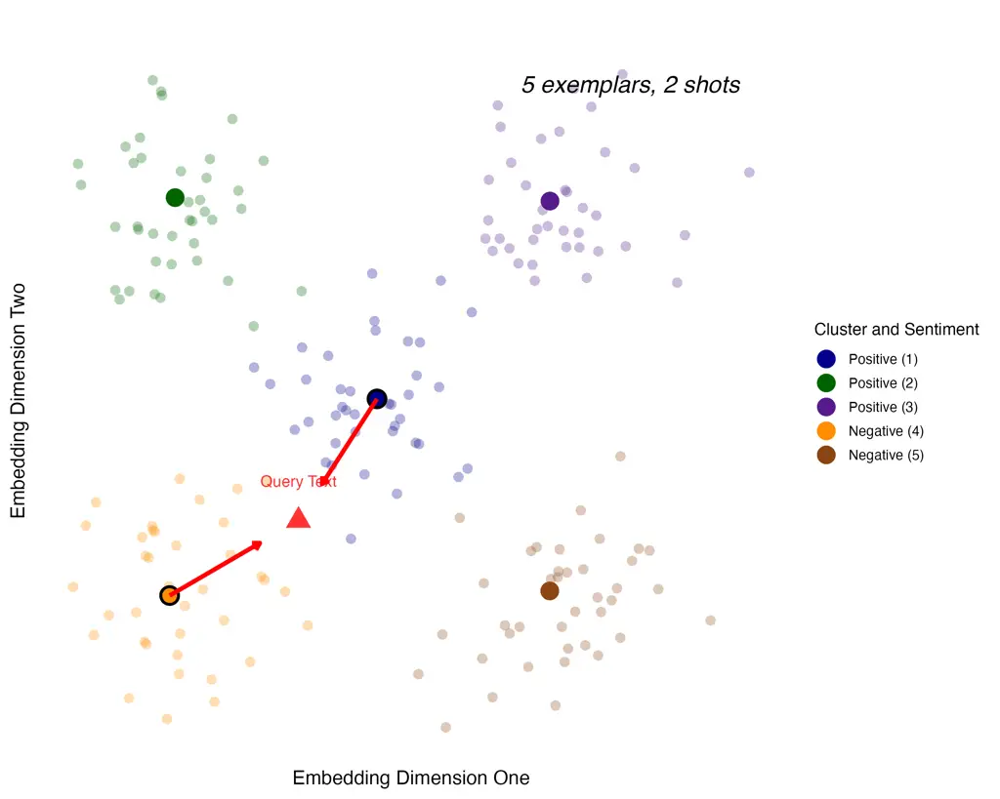
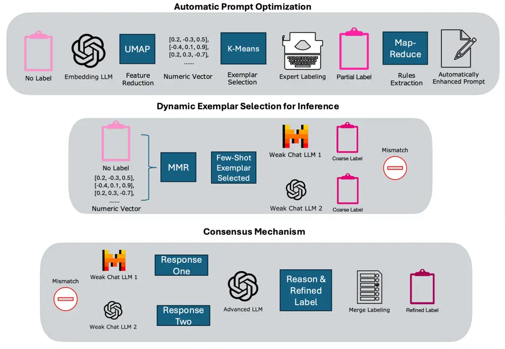
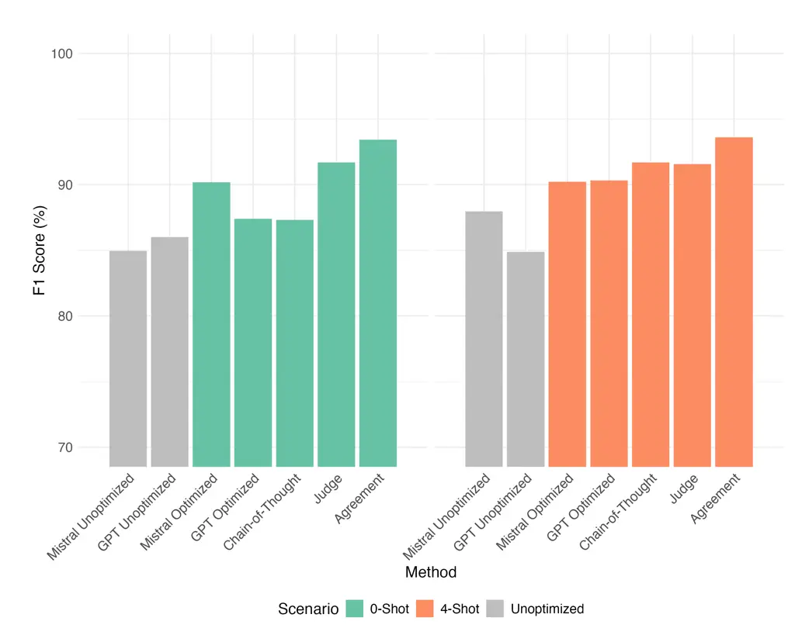
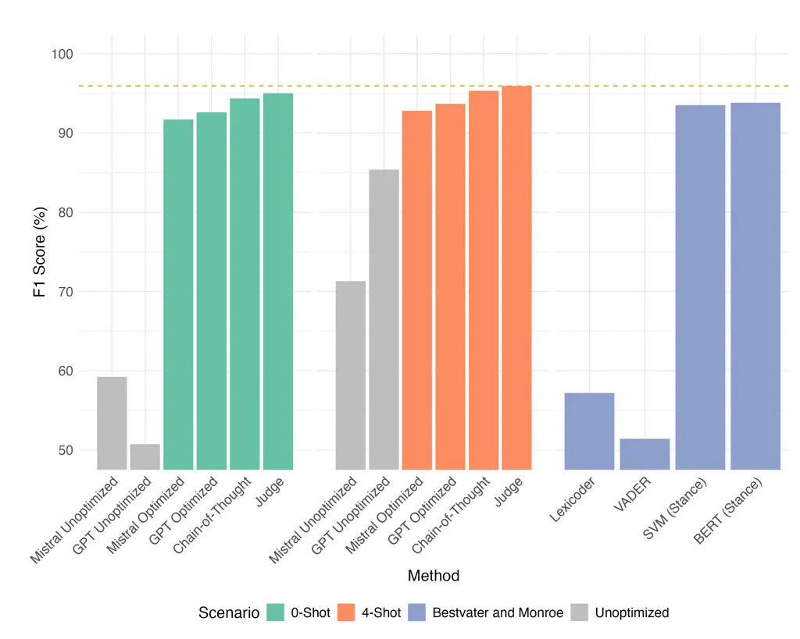
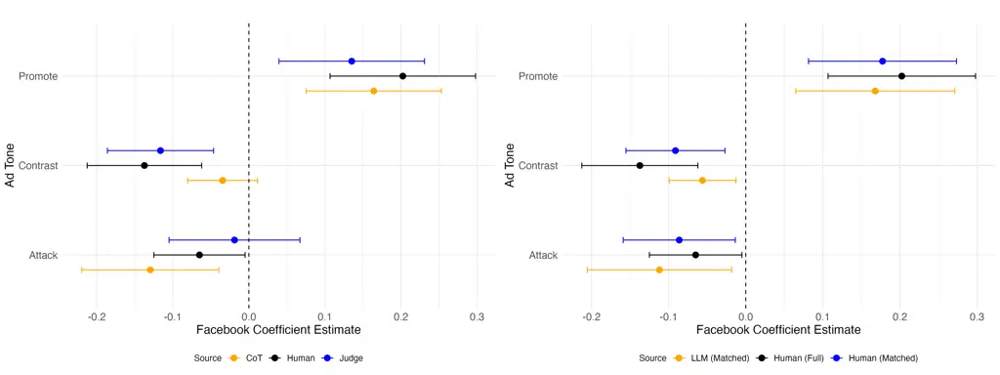
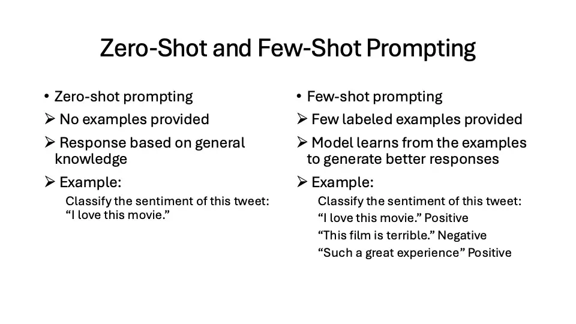
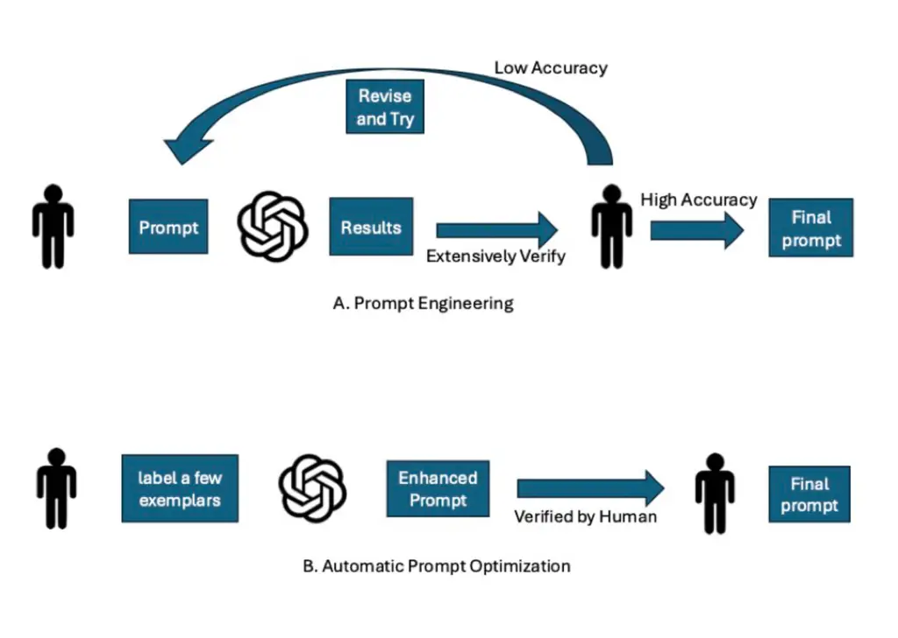
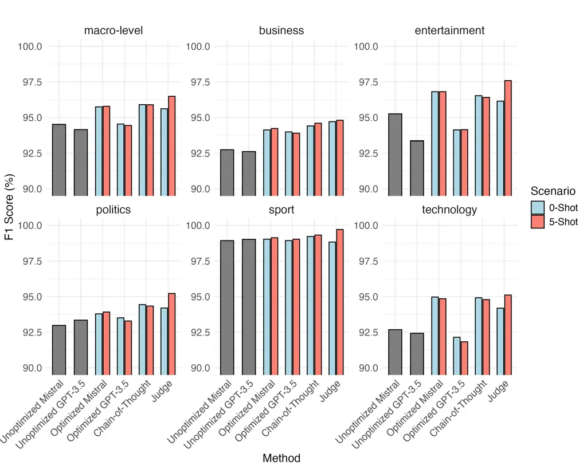
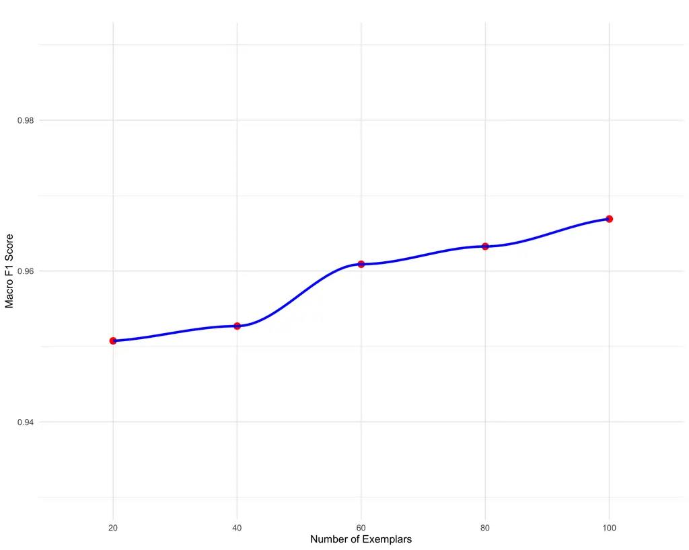

F. Author\]mliliu@ucdavis.edu \alsoaffiliationUniversity of California,
Davis \]geshi@ucdavis.edu

# Enhancing LLM-Based Text Classification in Political Science: Automatic Prompt Optimization and Dynamic Exemplar Selection for Few-Shot Learning

Menglin Liu Affiliation: University of California, Davis Email: <%5B>   
Ge Shi Email: <%5B>

###### Abstract

Large language models (LLMs) offer substantial promise for text
classification in political science, yet their effectiveness often
depends on high-quality prompts and exemplars. To address this, we
introduce a three-stage framework that enhances LLM performance through
automatic prompt optimization, dynamic exemplar selection, and a
consensus mechanism. Our approach automates prompt refinement using
task-specific exemplars, eliminating speculative trial-and-error
adjustments and producing structured prompts aligned with human-defined
criteria. In the second stage, we dynamically select the most relevant
exemplars, ensuring contextually appropriate guidance for each query.
Finally, our consensus mechanism mimics the role of multiple human
coders for a single task, combining outputs from LLMs to achieve high
reliability and consistency at a reduced cost. Evaluated across tasks
including sentiment analysis, stance detection, and campaign ad tone
classification, our method enhances classification accuracy without
requiring task-specific model retraining or extensive manual adjustments
to prompts. This framework not only boosts accuracy, interpretability
and transparency but also provides a cost-effective, scalable solution
tailored to political science applications. An open-source Python
package (PoliPrompt) is available on GitHub.

###### keywords

text classification, sentiment analysis, stance detection, in-context
learning, automatic prompt optimization, large language models (LLMs)

## 1 Introduction

Text data is a key resource in political science, where text
classification tasks—such as stance detection, sentiment analysis, and
topic classification—are widely used to study political discourse and
public opinion. For example, sentiment analysis of campaign ads can
track trends in messaging tone, helping researchers understand their
impact on voter perception (Fowler, 2021). In authoritarian contexts,
text classification sheds light on public opinion about government
actions, as demonstrated by Pan & Chen (2018), who categorize online
posts in China by support or criticism of local governance, and by King
& Roberts (2013), who analyze censorship patterns in Chinese social
media. Text classification also plays an essential role in legislative
studies. Grimmer & Stewart (2013)) show how categorizing legislative
texts and party manifestos helps quantify ideological shifts over time,
while Slapin & Proksch (2008) develop a model to track party positions
by analyzing speeches in parliamentary debates. On social media,
classification has been used to examine political polarization and
public engagement. Bond & Messing (2015) analyze social media topics to
assess voter engagement, and Barberá & Rivero (2015) uses Twitter data
to reveal ideological clustering. Collectively, these studies
demonstrate how text classification is a common method in political
science for analyzing complex data and understanding political behavior.

Political scientists have long relied on training-based methods for text
classification, including Statistical Language Models (SLMs) and, more
recently, Pre-trained Language Models (PLMs) (Qader et al., 2019; Yan et
al., 2020; Basu et al., 2003; Devlin et al., 2019; Sun et al., 2020).
SLMs, often paired with classifiers like Support Vector Machines (SVMs),
capture basic word patterns but require extensive manual feature
engineering, making them labor-intensive. Importantly, SLMs are highly
task-specific: a model trained for one purpose, such as topic
classification, must be retrained for a different task like sentiment
analysis or for application on new types of text, such as social media
posts versus news articles. PLMs, like BERT, offer advancements by
generating context-aware word representations that require less manual
feature engineering and capture more subtle relationships between words.

In recent years, Large Language Models (LLMs) have revolutionized text
classification by enabling flexible and efficient learning without
extensive task-specific training. A key mechanism driving this
capability is in-context learning (ICL), where LLMs perform
classification using only a well-crafted prompt, eliminating the need
for extensive task-specific training or fine-tuning on labeled data.¹¹ 1
A prompt typically consists of four main components: (1) task
description, which provides context for the model, (2) few-shot
examples, which guide the model’s responses based on prior cases, (3)
the query, where the model generates predictions based on the given
input question or context, and (4) the prefix, which serves as an
additional guiding phrase or instruction to shape the model’s output
format (Brown et al., 2020).²² 2 A detailed comparison between
in-context learning and fine-tuning is presented in Table A2 in the
appendix, highlighting their respective advantages, limitations, and use
cases.This allows LLMs to be applied seamlessly across diverse
classification tasks (Kaplan et al., 2020). While ICL offers significant
advantages, its effectiveness heavily depends on handcrafted prompts
which introduce several challenges. Manually designed prompts through
prompt engineering remain an ad-hoc and trial-and-error process,
requiring domain expertise to craft effective inputs. Despite its
accessibility, prompt engineering exhibits black-box characteristics, as
the exact way in which LLMs interpret and respond to prompts is often
opaque. Small modifications in wording or structure can lead to
unpredictable variations in output, making it difficult to establish
clear causal relationships. Additionally, the effectiveness of a prompt
is often model-specific, meaning that a well-performing prompt for one
LLM may not generalize across different architectures. These limitations
underscore the need for systematic and automated prompt optimization to
improve consistency and performance.

Our proposed three-stage LLM-based framework addresses key limitations
of existing text classification approaches by introducing automatic
prompt optimization, dynamic exemplar selection, and a consensus
mechanism. These methods, which have been adopted and adapted from
computer science, are systematically integrated into political science
research to enhance LLM performance. Our contributions include
introducing these concepts to political science, integrating them into a
unified framework, providing a simple and accessible implementation, and
streamlining techniques by excluding unnecessary complexity for this
task. This framework directly addresses critical challenges in LLM-based
text classification. Automatic prompt optimization overcomes the
trial-and-error nature of prompt engineering by systematically refining
prompts, reducing reliance on manual tuning, and improving consistency.
Dynamic exemplar selection mitigates the issue of LLM sensitivity to
few-shot examples³³ 3 Figure A1 presents a comparison of zero-shot and
few-shot prompting, demonstrating how structured inputs guide LLM
decision-making. by ensuring that the most relevant examples are
selected for each classification task, leading to more stable and
reliable outputs. The consensus mechanism improves classification
reliability by reducing variability in LLM-generated responses,
addressing inconsistencies, and improving agreement across model
outputs.⁴⁴ 4 A summary of how our framework differs from current
practices in political science is provided in Table A1 in the appendix.

Existing prompt engineering relies on intuition-driven trial and error,
offering little feedback on where and how prompts fail, making
generalization difficult. To address this, we propose using automatic
prompt optimization in the first stage, which systematically refines
prompts using human-labeled exemplars rather than subjective
adjustments. Our data-driven approach curates a small set of labeled
examples (typically ¡100) to generate an optimized prompt tailored to
task requirements. This method minimizes guesswork, enhances
replicability, and improves classification accuracy over prompt
engineering. The effectiveness of our method is demonstrated through
quantitative and qualitative evaluations.

The second stage, dynamic exemplar selection, tailors the prompt
exemplars to the most contextually relevant cases for each query rather
than relying on a fixed set. This adaptation enhances classification
accuracy by making the model’s inference process more context-sensitive.
Importantly, the selected exemplars are not only the most relevant to
the query text but also representative of the dataset as a whole,
ensuring that the model learns from diverse and structurally significant
examples. This is particularly crucial when dealing with complex data
structures, where certain underrepresented patterns or relationships
could otherwise be overlooked. By maintaining both query relevance and
dataset representativeness, this method strengthens the model’s ability
to handle subtle conceptual boundaries more effectively and generalize
across diverse classification tasks.

In the final stage, our framework employs a consensus mechanism in which
two LLMs independently generate predictions, and a third LLM serves as a
judge to resolve any disagreements. Rather than simply aggregating
outputs, the judge model evaluates the reasoning behind each
prediction—often through a Chain-of-Thought (CoT) process—and determines
the more accurate classification. This approach mirrors human annotation
workflows, where a third reviewer adjudicates conflicts between two
coders, thereby increasing reliability and interpretability. By
incorporating a structured resolution step, the LLM-as-judge mechanism
reduces classification noise and improves robustness, offering a
scalable solution for tasks that require high precision and consistency.

We apply our framework to three classification tasks: sentiment
analysis, stance detection, and multi-category campaign ad tone
classification. Our results show that automatic prompt optimization
provides a clear alternative to trial-and-error prompt engineering,
offering structured guidance to distinguish commonly conflated
concepts—such as sentiment versus stance—without requiring new model
training. In the tone classification task, our consensus mechanism
further enhances reliability by mimicking multi-coder setups and
flagging labeling inconsistencies, a key feature for ensuring data
quality in subjective tasks. These applications demonstrate the
versatility and robustness of our method for a wide range of political
science classification problems.

## 2 Literature Review

#### Large Language Models for Text Classification.

The evolution of BERT’s ”pre-training and fine-tuning” paradigm led to
the creation of Large Language Models (LLMs), a subset of Pre-trained
Language Models (PLMs) characterized by an immense scale of parameters
and training data. Following a principle known as the scaling law
(Kaplan et al., 2020), researchers observed that increasing both the
size of the model (in terms of parameters) and the amount of training
data leads to significant improvements in the model’s overall
performance across a wide variety of tasks. A key outcome of scaling is
what are termed emergent abilities—complex skills such as interpreting
complex instructions and performing multi-step reasoning (Wei et al.,
2022). Among these abilities is in-context learning, which allows LLMs
to interpret and execute tasks based solely on prompt instructions,
eliminating the need for task-specific re-training or fine-tuning (Dong
et al., 2022). This capability enables LLMs like GPT-3 to leverage their
pre-trained knowledge directly for new tasks, distinguishing them from
earlier models that rely heavily on additional training to adapt to
different applications.

One subcategory of in-context learning is zero-shot learning (Brown et
al., 2020; Radford et al., 2019), where LLMs can perform tasks based
purely on a description of the task, without requiring any labeled
exemplars. For instance, GPT-3 can classify the sentiment of a sentence
(positive or negative) based solely on a prompt describing the task.
Additionally, LLMs support few-shot learning (Brown et al., 2020; Min et
al., 2022), where the inclusion of a handful of exemplars in the prompt
enables the model to better understand and generalize the task, further
improving accuracy. This flexibility makes LLMs especially valuable in
fields like political science, where labeled data is often scarce. By
generating text token by token, they maintain coherent context across
long passages, enabling them to handle a range of tasks based on a
single prompt. This capability provides political scientists with a
powerful, adaptable tool for text analysis without the need for
fine-tuning, positioning LLMs as a resource-efficient alternative to
traditional methods (Radford et al., 2019).

LLMs offer powerful capabilities for text classification, yet their
effectiveness often depends heavily on well-designed prompts, a reliance
that has led to the labor-intensive practice of prompt engineering
(Khattab et al., 2023). Research applying LLMs to social science tasks
has underscored this challenge, showing that LLMs alone may not
consistently achieve sufficient accuracy without tailored prompt
adjustments or additional human oversight. For example, ChatGPT, when
used to classify social media sentiment on HPV vaccination, exhibited
higher accuracy for anti-vaccination messages but struggled with
pro-vaccination sentiment, particularly for longer formats, indicating
the model’s sensitivity to both content type and length (Kim et al.,
2024). Similarly, efforts to classify policy documents into specific
issue categories using GPT-3.5 and GPT-4 revealed that LLMs achieved
only moderate accuracy without human intervention—ranging from
65–83%—and required significant manual oversight for contentious or
complex cases (Gunes & Florczak, 2023). These studies suggest that while
LLMs offer promising automation potential, optimal results often require
extensive prompt customization and careful selection of exemplar data.

A key characteristic of in-context learning (ICL) is its ability to
optimize the context provided before generation rather than modifying
model parameters. Instead of requiring additional training, ICL
conditions the model through carefully structured prompts that influence
its responses. Studies have shown that well-structured few-shot prompts
can significantly improve LLM performance in text classification (Min et
al., 2022), reinforcing the importance of effective context design in
achieving reliable results.

The prompt engineering workflow (illustrated in Figure A2) involves
three main stages: creating an initial prompt, testing the prompt on the
model to generate results, and then verifying those results extensively.
If the output yields low accuracy, the user re-enters a Revise and Try
loop, repeatedly adjusting the prompt without clear feedback on how each
change impacts model behavior. This blind, trial-and-error process can
be time-consuming and uncertain, as users often lack systematic guidance
for prompt refinement. Once a satisfactory level of accuracy is
achieved, the final prompt is established for consistent application.

Despite its utility, prompt engineering has notable limitations.
Ensuring that a prompt is both clear and accurately interpreted by the
model remains challenging, as users often rely on summary metrics like
F1 scores to assess quality. However, these metrics offer little
guidance on how to improve prompts, leading to an iterative cycle of
speculative revisions without assurance of improved performance.
Moreover, prompt effectiveness tends to be model-specific; a prompt
optimized for one LLM may perform poorly on another, limiting
generalizability across different models and data contexts (Khattab et
al., 2023). Although in-context learning increases adaptability by using
exemplars within the prompt, it often relies on static exemplars. As the
model encounters varied or new text data, these static exemplars may not
align well, potentially reducing output accuracy.

Recent work has introduced automatic prompt optimization methods like
DSPy (Khattab et al., 2023), APE (Zhou et al., 2022), OPRO (Yang et al.,
2024), and EvoPrompt (Guo et al., 2024), which aim to improve prompt
performance by searching for high-performing strings. For instance, DSPy
organizes tasks into step-by-step pipelines using modules called
”teleprompters” that fine-tune model behavior at each step. These
multi-stage approaches work well for tasks requiring structured
reasoning or complex retrieval, like multi-hop question answering, but
are often computationally intensive and may not translate effectively to
political science text classification. DSPy’s complex decomposition and
reliance on advanced models make it resource-demanding, limiting its
practicality for more context-sensitive text analysis, like assessing
sentiment or stance in political texts, which often requires careful
contextual interpretation and is common in smaller-scale research
projects.

To meet the specific demands of political science text analysis, we
introduce a novel approach incorporating automatic prompt optimization,
dynamic exemplar selection, and a consensus mechanism, which we will
explain in detail in the following methodology section.

## 3 Methodology

### 3.1 Data Preprocessing

Before applying automatic prompt optimization, we first process and
structure the dataset to enable efficient exemplar selection. This
preparation stage includes two key steps: converting texts into
embeddings and reducing feature dimensionality. These transformations
help organize the dataset to support dynamic exemplar selection while
optimizing use of the LLM’s context window.

#### Converting Texts into Embeddings.

LLMs convert natural language into fixed-size embedding vectors,
enabling comparison of semantic similarity. We apply this transformation
to all unlabeled texts using models such as OpenAI’s
”text-embedding-3-small.” Following (Steck et al., 2024), we use cosine
distance to quantify similarity between embeddings:

```math
\text{cosine\_distance}(\mathbf{x}_{i},\mathbf{x}_{j})=1-\frac{\mathbf{x}_{i}\cdot\mathbf{x}_{j}}{\|\mathbf{x}_{i}\|\|\mathbf{x}_{j}\|}
```

#### Feature Reduction with UMAP.

Uniform Manifold Approximation and Projection (UMAP) is a widely used
dimensionality reduction technique that preserves relationships in
high-dimensional data. Conceptually, it builds on traditions in
political science like factor analysis (Kim, 1978), multidimensional
scaling (Borg & Groenen, 2007), and correspondence analysis (Greenacre,
2017), which have been used to uncover latent dimensions in political
behavior, such as ideological scaling from roll-call votes (Poole &
Rosenthal, 1985) and survey data (Aldrich & McKelvey, 1977). UMAP
advances these techniques using non-linear methods, enabling detection
of complex structure in text embeddings while remaining compatible with
established scaling approaches.

In practice, UMAP is also widely supported in computer science,
especially for high-dimensional data. We use UMAP (McInnes et al., 2020)
with cosine distance to reduce text embeddings, improving efficiency in
later stages. The reduced representations also enable Euclidean distance
calculations, which are faster and more broadly supported in downstream
applications. For further implementation details, see Appendix C.⁵⁵ 5
While we use UMAP here, our method supports alternative techniques such
as Principal Component Analysis (PCA) (Wold et al., 1987), t-SNE
(maaten2008visualizing), and Independent Component Analysis (ICA)
(Hyvärinen & Oja, 2000), depending on dataset and task requirements.

### 3.2 Automatic Prompt Optimization

After structuring the dataset through embedding generation and feature
reduction, we apply automatic prompt optimization. LLMs face a
significant constraint in their context window size, which limits the
number of tokens ⁶⁶ 6 In a Large Language Model (LLM), a ”token” is the
smallest unit of text that the model processes, essentially representing
a word or a sub-word, which is used as the building block for
understanding and generating language the model can process
simultaneously in few-shot learning scenarios. Moreover, within this
window, earlier tokens in a long sequence may receive less attention,
further constraining the effective use of examples for inference. This
limitation necessitates a method that not only selects exemplars that
are highly relevant and representative of the broader dataset but also
minimizes the number of tokens used. Such a method can mitigate the risk
of earlier tokens being underweighted, thereby preserving their
contribution to inference. To achieve this, we propose a novel approach:
first, we select a pool of $`M`$ representative examples for human
labeling, where $`k<M\ll N`$, with $`N`$ representing the total number
of examples under study and $`k`$ denoting the number of exemplars
included in the context window for few-shot in-context learning. Then,
at inference time, when calling the commercial API to classify unlabeled
query text, we dynamically select the most relevant $`k`$ examples to
augment the prompt. In the automatic prompt optimization stage, we
systematically curate this exemplar pool for human labeling. This
curated set serves two critical purposes: first, it provides the LLM
with a structured reference to infer the underlying labeling rules,
reducing ambiguity in classification. Second, it enables an adaptive
selection mechanism, ensuring that the most contextually relevant
examples are incorporated for each query, thereby enhancing
classification accuracy and robustness. By creating this initial pool of
human-annotated examples, we lay the foundation for more effective and
efficient use of the LLM in subsequent stages, balancing the need for
comprehensive knowledge injection with the constraints of the model’s
context window. In this stage, we prepare this exemplar pool, and here
are the steps.

#### Labeling Sample Selection.

To create a diverse and representative pool of examples, we employ an
exemplar selection method (Bien & Tibshirani, 2011) based on the
manifold structure of the reduced embeddings. While various approaches
exist for exemplar or prototype selection, such as set cover algorithms
and density-based sampling, we opt for the k-means selector due to its
simplicity and effectiveness. This method involves performing k-means
clustering on the embeddings and then designating the text whose
embedding is nearest to each cluster center as an exemplar. This
approach ensures that every distinct group within the data is
represented by one example, allowing for easy control over the number of
exemplars selected while maintaining a comprehensive coverage of the
embedding space. We keep $`M`$ such texts as an exemplar pool and engage
a human expert to label them. Typically, $`M<100`$, requiring minimal
human effort. The process of labeling sample selection using k-means
clustering is illustrated in Figure 1. In this figure, we demonstrate a
scenario where a pool of 5 exemplars is selected by k-means clustering
for labeling, indicating that $`M=5`$.⁷⁷ 7 For further implementation
details of the clustering and selection process, including the use of
UMAP and k-means, see Appendix C.

#### Enhanced task description generation.

To enhance the initial task description, we leverage the LLM’s
analytical capabilities on the labeled exemplar pool. For each
input-output pair from the pool, the LLM examines the rationale behind
the human-assigned label. We then employ a Map-Reduce approach, where
the LLM first ”maps” by analyzing individual examples, and then
”reduces” by summarizing the labeling rules for each class. This process
ensures the generated rules are LLM-interpretable. Human experts can
verify these rules for accuracy and intent. Typically, humans copy and
append these generated rules to the initial prompt, creating an enhanced
task description. In cases of inaccuracies, humans shall explicitly
instruct the LLM to oppose specific incorrect rules in the prompt.



Figure 1: Exemplar Selection Process for Few-Shot Learning:
Demonstrating k-means Clustering to Identify Representative Samples for
Labeling

Our automatic prompt optimization method moves beyond prompt engineering
by creating refined prompts based on human-labeled exemplars, rather
than relying on intuition or trial and error.⁸⁸ 8 Figure A2 in the
Appendix illustrates two workflows for finding optimal prompts in LLM
applications: Prompt Engineering and our Automatic Prompt Optimization
method. A detailed comparison between the two approaches is also
available in Table A3 in the Appendix, highlighting their respective
processes. Prompt engineering starts with an initial prompt, which is
then tested in LLMs to generate results. These results are manually
checked by researchers for consistency and accuracy. If accuracy is low,
the researcher enters a ”Revise and Try” loop, making adjustments based
on intuition. This trial-and-error process is time-consuming and lacks
clear feedback on where and how the prompt may have fallen short. As a
result, creating a final satisfactory prompt often requires multiple
speculative revisions, making it inefficient and hard to replicate.

In contrast, our automatic prompt optimization method offers a
systematic and transparent approach by using human-labeled exemplars
rather than relying on intuition or trial and error. This process begins
with researchers labeling a small set of curated examples, typically
fewer than 100, which serve as a foundation for the model to generate an
enhanced prompt tailored to the specific task criteria. This optimized
prompt undergoes human verification, where it is assessed not only by
numerical performance metrics, such as F1 scores, but also by its
ability to accurately reflect human-labeled criteria and consistently
produce reliable outputs. By grounding the prompt on well-defined
exemplars, this workflow eliminates guesswork and minimizes trial and
error. This structured, exemplar-based approach ensures effective and
transparent prompt refinement.

### 3.3 Dynamic Exemplar Selection

In this stage, to address the limitations of using fixed exemplars in
few-shot learning and their potential negative impact on classification
outcomes, we propose a method to ensure that exemplars are both relevant
to the specific query text and representative of the broader dataset.
This dynamic selection process enhances the effectiveness of few-shot
learning by tailoring exemplars to the specific input while maintaining
comprehensive coverage of the dataset.

#### Few-shot example retrieval.

When calling LLM API for text classification, in a few-shot prompt
setup, we retrieve an unlabeled query text and utilize its pre-computed
embeddings to search for the top-k texts from a pool, selecting those
with the highest scores using the Maximal Marginal Relevance (MMR)
algorithm. The MMR (Parmar et al., 2007) algorithm balances relevance
and diversity by considering both the similarity between embeddings and
the uniqueness of the selected examples, ensuring that the retrieved
examples are not only relevant to the query but also varied enough to
provide a comprehensive context.

Given a query embedding $`\mathbf{x}_{q}`$, a pool $`R`$ of exemplar
texts, the MMR score for a candidate item $`\mathbf{x}_{j}`$ from the
pool $`R`$ is defined as:

```math
\mathbf{x}_{j}=\argmax_{\mathbf{x}_{j}\in R\setminus S}\text{MMR}(R)\coloneqq\argmax_{\mathbf{x}_{j}\in R\setminus S}[\lambda\cdot\text{Sim}(\mathbf{x}_{q},\mathbf{x}_{j})-(1-\lambda)\cdot\max_{\mathbf{x}_{i}\in S}\text{Sim}(\mathbf{x}_{j},\mathbf{x}_{i})],
```

where $`S`$ is the set of already selected items that is initially
empty, and $`\lambda`$ is a trade-off parameter between relevance and
diversity ($`0\leq\lambda\leq 1`$). In this way, we retrieve exemplars
that are either semantically close to the query text with the same
correct label or hard negatives that share some similarity with
$`\mathbf{x}_{q}`$ but from a different class. 1 illustrates a scenario
where a query text is to be labeled, and the MMR (Maximal Marginal
Relevance) algorithm selects two representative exemplars from the pool
of five previously selected exemplars. This approach, known as two-shot
learning, identifies the most relevant and similar exemplars to the
query text, ensuring a contextually informed labeling process for
few-shot learning.

#### Coarse Annotation with a Consensus Mechanism.

Using a prompt enhanced with clearer task descriptions and carefully
selected exemplars, we employ two LLMs to assign labels from predefined
options. To improve accuracy and ensure reliability, we run the labeling
process twice using two separate LLMs, allowing for comparison and
verification of results. This approach reduces labeling inconsistencies
by capturing high-confidence agreements while identifying hard cases
where the models disagree. Discrepancies are tracked in a mismatch
collection for further review, making the results more robust and
interpretable.

### 3.4 Consensus Mechanism

In this stage, we utilize LLMs with in-context learning techniques to
address mismatches identified in the dynamic exemplar selection stage.
The prompts used here are refined versions of those from the previous
stage, incorporating enhancements for fine-grained annotation and
versatility. While these prompts may be computationally intensive, they
are applied only to a limited number of queries in the mismatch
collection, ensuring cost efficiency.

#### Chain-of-Thought Prompting.

A chain-of-thought (CoT) prompt guides a large language model (LLM)
through a step-by-step reasoning process to enhance its ability to
tackle complex tasks (Wei et al., 2023). To implement it, the LLM is
instructed to first analyze the content according to the task
description, providing reasoning at each step before delivering the
final answer. This approach works by mimicking human problem-solving,
breaking down tasks into smaller components, which helps the model grasp
the underlying logic and produce more accurate responses by not only
assigning a label but also offering the reasoning behind it. CoT
prompting has emerged as one of the most successful methods for
improving the reasoning and inferential abilities of LLMs, making it a
cornerstone of advanced prompt engineering (Kojima et al., 2022). The
output of CoT is a sequence $`y=(y_{1},y_{2},\dots,y_{t})`$ tokens,
where $`y_{t}`$ is the desired prediction and $`y_{<t}`$ are the
reasons:

```math
P(y_{t}|y_{<t},\mathbf{x},\text{prompt};\theta)
```

#### LLM-Based Consensus Arbitration.

An LLM can serve as a judge (Zheng et al., 2023), leveraging its
reasoning capabilities to evaluate and validate the outputs of other
models. In our approach, two LLMs first annotate and reason through a
small mismatch set using a Chain-of-Thought (CoT) process. The judging
LLM then analyzes the reasoning steps provided by both models, assessing
the quality, accuracy, and consistency of their responses. By evaluating
the justification behind each prediction, rather than just the final
label, this process enhances interpretability and ensures a more
rigorous validation. This arbitration mechanism mirrors a multi-coder
scenario, where two coders may disagree, and a third adjudicates
discrepancies to ensure classification reliability. Previous research
has demonstrated that incorporating LLMs as evaluators improves
performance in high-precision tasks requiring structured reasoning and
interpretability (Zheng et al., 2023). By integrating CoT reasoning with
systematic judgment, our approach enhances consistency, reduces
ambiguity, and strengthens the robustness of model outputs.

### 3.5 Summary of Framework

In this section, we summarize the entire framework, outlining each
module’s input-output and the human involvement required throughout the
process as illustrated in Figure 2. The “automatic prompt optimization”
stage prepares a pool of representative and diverse examples for human
annotation in the subsequent stages. The input is human-collected,
unlabeled texts, which we process using LLM embedding models, saving
selected indices as an exemplar pool. Following this stage, human
experts accurately annotate the texts in the pool and draft an initial
prompt that includes only a task description. The “dynamic exemplar
selection” stage focuses on enhancing this initial prompt with a refined
task description and more appropriate examples. Here, two LLMs generate
coarse annotations for the unlabeled examples. Users are responsible for
running the task description generator, verifying its validity, and
appending it to the initial prompt. After labeling, humans clean the
predictions, identify mismatches, and record their indices in the
dataset. The consensus mechanism then refines the predictions for these
mismatches and provides reasoning for the adjustments. Humans review and
clean the responses, replacing coarse predictions with fine-grained
labels or conducting manual evaluations supported by LLM-generated
reasoning.

By following this framework, we first leverage the in-context learning
capabilities of large language models (LLMs), eliminating the need for
intensive feature engineering, large labeled training datasets,
task-specific training or fine-tuning, and high computational resources
like GPUs. Therefore, this method addresses the limitations of commonly
used text classification methods in political science. Second, we
overcome two key limitations of LLMs: their heavy reliance on
well-crafted prompts and the static nature of exemplars in few-shot
learning. Our method dynamically optimizes prompts and selects relevant
exemplars, making LLMs a more powerful and reliable tool for text
classification in political science research.



Figure 2: Overview of the three core stages of our PoliPrompt framework

## 4 Experiments

#### Overview.

We evaluated our method across three classification tasks in political
science: sentiment analysis and stance detection on Twitter data related
to Brett Kavanaugh’s Supreme Court confirmation, and multi-category tone
classification for campaign ads from the 2018 U.S. elections. The
Twitter experiments demonstrate that our method can reliably distinguish
between closely related concepts such as sentiment and stance—an area
where many classifiers traditionally struggle. Furthermore, the campaign
ad experiments highlight how the consensus mechanism enhances label
consistency and helps detect potential noise in human annotations,
particularly in more subjective or complex multi-category settings.

For sentiment and stance detection, Twitter was chosen for several key
reasons. First, as one of the most widely used social media platforms,
Twitter provides a wealth of real-time information during major events.
For example, it has been a primary source of breaking news, especially
during recent U.S. Presidential Elections (Allcott & Gentzkow, 2017).
The unstructured data on Twitter offers valuable insights into public
opinion and attitudes toward political figures and events (Evans et al.,
2014). Second, sentiment analysis and stance detection are crucial in
political science for understanding public views on significant
political topics or figures (Hopkins & King, 2010, Grimmer & Stewart,
2013, Gentzkow et al., 2019). Studies like those by Hopkins & King
(2010) and Bond & Messing (2015) show how analyzing sentiment and stance
can reveal shifts in political attitudes and patterns of polarization.
Finally, applying sentiment analysis and stance detection to the same
dataset presents unique challenges, especially in distinguishing between
the two. Bestvater & Monroe (2023) argue that classifiers trained for
sentiment analysis often struggle with stance classification,
highlighting the challenge of distinguishing these frequently conflated
political concepts. Our goal is to test whether our method can overcome
this challenge, effectively separating sentiment from stance with high
reliability. Specifically, we aim to achieve accurate stance detection
through prompt optimization alone, without the need for retraining.

We further applied our method to a multi-category classification task-
analyzing campaign ads from the 2018 elections, categorizing them as
contrast, attack, or promote. This task was chosen for several reasons.
First, substantively, analyzing campaign ads provides valuable insights
into campaign strategies and behavior across different media, including
social media and traditional broadcast (Fowler, 2021). Second, this task
allows us to evaluate our method’s performance in multi-class
classification, expanding beyond binary classification. Third, the
longer text format of campaign ads compared to social media posts adds a
layer of complexity, testing our method’s capacity to handle extended
text⁹⁹ 9 We conducted one last experiment involving multi-category topic
classification on lengthy BBC news reports. This experiment demonstrates
that our method is versatile and effective for classifying various types
and lengths of text data, extending beyond short texts such as tweets.
Detailed methodology and results are available in E. .

#### Setup.

Each dataset used in our experiments was manually labeled, serving as
the ground-truth benchmark. In our experiments, we initially treated all
texts as unlabeled, tasking the LLMs with predicting labels using our
proposed method. We then compared the predicted labels to the
human-labeled benchmark to evaluate the accuracy of our approach. For
each dataset, we used the ”text-embedding-3-small” model from OpenAI to
convert all texts into embedding vectors. To reduce the dimensionality
and improve efficiency, we applied UMAP to shrink each vector to 24
dimensions. We then selected 80 exemplars from each dataset using
k-Means clustering. These exemplars formed the example pool, which was
leveraged to generate optimized prompts for LLM-based text
classification¹⁰¹⁰ 10 We conducted hyperparameter tuning experiments to
assess the impact of varying the number of exemplars, testing sample
sizes of 20, 40, 60, 80, and 100. Although F1 scores consistently
improved as the number of exemplars increased, the rate of improvement
slowed beyond a certain point. For our analysis, we chose to use only 80
exemplars in all experiments, deliberately demonstrating that our method
can outperform traditional ML approaches even with a relatively modest
number of examples. As a result, the performance metrics we report are
conservative estimates, not reflecting the highest potential
performance. Full results from the hyperparameter experiments can be
found in Appendix 3.. In our analysis, we define unoptimized application
as the direct application of LLMs without our optimization techniques
and refer to their corresponding output as unoptimized results. In
contrast, results produced through the first two stages of our
method—incorporating automatic prompt optimization and dynamic exemplar
selection—are referred to as optimized results for Mistral and GPT
models.

In our experiments on sentiment analysis and stance detection, we
applied our method to classify over 3,660 tweets related to Brett
Kavanaugh’s Supreme Court confirmation, labeling each tweet as either
”positive” or ”negative” for sentiment and ”support” or ”oppose” for
stance. We chose this task because prior research highlights the
challenges of distinguishing sentiment from stance, as emphasized in the
seminal article ”Sentiment is Not Stance: Target-Aware Opinion
Classification for Political Text Analysis” (Bestvater & Monroe, 2023).
By using automatic prompt optimization and supplying the model with 80
exemplars labeled for both sentiment and stance, we demonstrated that
LLMs can effectively generate and refine clear definitions for these two
dimensions. Additionally, the optimized prompt includes illustrative
examples where sentiment and stance diverge, providing researchers with
a reliable reference for crafting prompts that classify sentiment and
stance independently. For researchers aware of the confusion surrounding
concepts like sentiment and stance, our method shows that LLMs can
effectively differentiate and summarize classification rules for these
concepts when provided with a limited set of labeled exemplars. This
demonstrates a significant advantage in transparency and explainability
for researchers.

For sentiment classification, we implemented our three-stage method.
Initially, the unoptimized LLMs, yielded low F1 scores. After applying
automatic prompt optimization and dynamic exemplar selection, we
observed a marked improvement, with F1 scores increasing by over 15%. In
the final stage, our consensus mechanism further enhanced accuracy,
pushing F1 scores to nearly 92%. These findings show that directly
applying LLMs for political text classification often leads to
suboptimal results, while each stage of our method delivers measurable
gains in accuracy. Most importantly, the transparency offered by prompt
optimization allows researchers to pinpoint possible sources of error in
the prompts and revise them precisely, without relying on
trial-and-error associated prompt engineering.

Following sentiment classification, we applied our method to stance
detection, highlighting our approach’s effectiveness in classifying
complex, often conflated concepts. Initially, the LLMs struggled to
differentiate sentiment from stance, resulting in frequent
misclassifications. Through automatic prompt optimization, however, the
models dynamically generated an enhanced prompt that clarified the
distinctions between ”support” and ”oppose,” based on a set of 80
human-labeled tweets. This refinement yielded a dramatic improvement,
with F1 scores increasing from 57% to 95%.

In our final experiment, we attempted to replicate Fowler et al.’s
(2021) study on how the medium of campaign ads influences tone. However,
we encountered a highly noisy, human-labeled dataset, where labeling
inconsistencies among human annotators became apparent. Our third stage
of consensus mechanism effectively identified these conflicts,
particularly in cases involving challenging or conceptually ambiguous
classifications. This experiment highlights the significant impact a
noisy dataset can have on downstream political analysis and demonstrates
how our method can serve as a safeguard, flagging problematic labels and
helping to prevent unreliable estimates early in the analysis process.

### 4.1 Sentiment Analysis and Stance Detection toward Brett Kavanaugh’s SCOTUS Nomination Using Twitter Data

In their 2023 study, Bestvater and Monroe analyzed a hand-coded dataset
of 3,660 tweets, labeling each for both sentiment (positive or negative
emotional tone) and stance (support or oppose regarding an issue). To
evaluate the ability of large language models (LLMs) to differentiate
these two closely related dimensions, we selected a subset of 80 tweets
from this dataset, containing both sentiment and stance labels, as input
for automatic prompt optimization. This setup tested whether the LLM,
guided by our approach, could generate an optimized prompt that
effectively clarifies sentiment and stance.

Our initial prompt was straightward and unoptimized, as illustrated in
Figure 3. Through automatic prompt optimization, our method transformed
this prompt into an enhanced version with guidelines, which not only
provides definitions of sentiment and stance but also provides four
clear examples illustrating different scenarios. This approach goes
beyond basic instructions by integrating guidelines on special cases
that commonly lead to confusion between sentiment and stance, such as
instances where criticism of political opponents (rather than the
primary subject, Brett Kavanaugh) could imply a negative sentiment
without necessarily indicating opposition to Kavanaugh’s confirmation.
By providing specific instructions for cases where sentiment and stance
may diverge, this prompt allows the LLM to handle complex examples, such
as sarcasm or irony, more effectively.

This prompt provides clear, interpretable distinctions between stance
and sentiment, offering a reliable reference for researchers who may
want to classify these concepts independently in future work. The prompt
allows researchers to easily verify clarity in definitions, reducing the
need for trial-and-error adjustments and enabling consistent, accurate
classification.


Note: Red sections represent definitions and explanations for sentiment,
while blue sections represent stance. This figure illustrates how, when
prompted to treat sentiment and stance as distinct concepts, LLMs—guided
by 80 carefully selected labeled exemplars—successfully differentiate
between these two dimensions. The LLM-generated prompt provides detailed
guidelines and examples, demonstrating a clear understanding of the
unique characteristics of sentiment and stance.

Figure 3: Comparison of Simple Heuristic and Enhanced Prompts for
Sentiment and Stance Classification.

In the next step, we used the same dataset as our ground-truth benchmark
and tasked both GPT-3.5-turbo and Mistral-medium-latest with classifying
only sentiment, starting with an unoptimized heuristic prompt based on
the original instructions given to human coders by Bestvater and Monroe
(Bestvater & Monroe, 2023). This unoptimized prompt is illustrated in
Figure 4.


Note: Italicized sections were generated after applying automatic prompt
optimization. The enhanced prompt succinctly summarizes the criteria for
labeling text as ”positive” or ”negative,” providing clarity and
reducing ambiguity in sentiment classification.

Figure 4: Prompts for Sentiment Analysis about Brett Kavanaugh

Using this unoptimized prompt, GPT-3.5-turbo and Mistral-medium-latest
achieved moderate F1 scores of 84% and 88%, respectively, as illustrated
in Figure 5. We then applied automatic prompt optimization. This
enhanced prompt in Figure 4 provided clearer criteria for identifying
sentiment, focusing on emotional tone to improve classification
precision. The optimized prompt increased GPT-3.5-turbo’s F1 score by
over 5% and Mistral’s by 3%. When both models aligned in their
predictions, the F1 score reached 94%, as shown in the Agreement columns
in Figure 5. A third-stage consensus mechanism further refined
classification reliability, highlighting the importance of structured
prompt optimization and exemplar selection. This process illustrates the
limitations of using unoptimized LLM outputs.

A notable outcome in applying our automatic prompt optimization method
is the transparency it provides in distinguishing between stance and
sentiment in prompts. Initially, the enhanced prompt generated for
sentiment analysis included terms like “text expresses opposition,
criticism…” for “negative” and “text shows approval, support, or uses
favorable language” for “positive.” Even after using 80 representative,
human-labeled exemplars, the LLMs continued to confuse stance with
sentiment.

Thanks to the transparency of our method, we were able to directly
examine the enhanced prompt, pinpoint the source of confusion, if any,
and adjust the language accordingly. Specifically, we revised terms from
“opposition” to “condemnation” and “approval” to “affirmation,” guiding
the model to focus on emotional tone rather than political stance. This
refinement aligned the prompt with the definitions established in our
previous application of automatic prompt optimization, as shown in
Figure 3, where positive sentiment encompasses happiness and
affirmation, and negative sentiment includes terms indicating
condemnation and anger. This example of sentiment classification
highlights a clear advantage of our approach: by generating prompts
grounded in structured, task-specific logic, our method allows
researchers to systematically inspect and validate prompts without
relying on the blind trial-and-error cycles typical of traditional
prompt engineering. This transparency ensures that sentiment
classification remains centered on emotional tone, enhancing
interpretability, accuracy, and explainability by allowing researchers
to understand what qualifies texts as positive or negative, including
the specific emotions they express and the reasoning behind each
classification.



Note: The gray bars represent the classification results using LLMs
directly, without any enhancement from our method. The green and orange
bars indicate the results after applying our three-stage method,
demonstrating the effectiveness of each stage in improving
classification performance.

Figure 5: Measuring Sentiment toward Kavanaugh: Comparison of F1 Scores
across Different Methods

Following sentiment classification, we extended our method to stance
detection. Bestvater and Monroe’s study evaluated multiple text
classifiers for stance detection and concluded that models or
dictionaries initially designed for sentiment analysis often perform
poorly on stance tasks, suggesting a need for models specifically
trained for stance recognition. These findings are summarized in Table
D0. Contrary to Bestvater and Monroe’s recommendation that a newly
trained model is essential for accurate stance classification, our
method demonstrates that reliable classification can be achieved by
simply changing and optimizing prompts.

As in the previous analysis, we began with the unoptimized heuristic
prompt shown in Figure 6. Using this unoptimized prompt, both
Mistral-medium-latest and GPT-3.5-turbo achieved scores below 60%,
highlighting their difficulty in distinguishing between sentiment and
stance. For example, both models incorrectly labeled the following tweet
as “oppose”:

”RT @atensnut Democrats can’t just ’move on’ and jump on the bandwagon
of sketchy allegations against Kavanaugh without accepting the
egregiousness of turning their backs on the victims of Bill Clinton.”

The LLMs mistakenly categorized this as “oppose” because the tweet
carries a tone of negativity and distrust, implicitly criticizing the
Democratic Party for supporting the allegations against Kavanaugh while
highlighting perceived hypocrisy. This example illustrates how LLMs,
when prompted with a simple heuristic, can conflate sentiment with
stance—misinterpreting negative sentiment toward a third party as
opposition to the main subject. It underscores the importance of using
structured, task-specific prompts that are designed to capture the
nuanced distinctions required for accurate stance detection.

We then provided LLMs with enhanced prompts produced by our automatic
prompt optimization method (Figure 6), offering clear and structured
guidance that significantly improved their classification accuracy.
Notably, the enhanced prompt goes beyond simple factual classification;
for instance, it correctly identifies tweets as “approve” when they
present evidence undermining Kavanaugh’s accusers. It also effectively
captures and summarizes emotional cues that may imply support for
Kavanaugh—such as mocking his opponents or expressing frustration at
those obstructing his confirmation—nuances that are often misclassified
as opposition when using heuristic-based prompting. These cases
highlight how negative tone or sentiment alone can misleadingly suggest
stance, underscoring the importance of prompts that distinguish between
emotional expression and political position.

This refined prompt ensures both factual and emotional content are
considered, leading to more accurate and nuanced classifications. We
further validated the enhanced prompt against the definitions
established in Figure 3 and found strong alignment, reinforcing the
conceptual distinction between sentiment and stance. The enhanced prompt
yielded substantial performance improvements: Mistral-medium and GPT-3.5
achieved F1 scores of 91.69% and 92.59%, respectively—representing a
~36% increase over the initial zero-shot performance using a simple
heuristic prompt, as shown in Figure 7. In the four-shot¹¹¹¹ 11 Detailed
few-shot prompts are provided in Appendix D2. prompting scenario, the
enhanced prompt enabled these models to achieve over a 20% improvement,
further demonstrating its value in producing accurate
classifications.¹²¹² 12 The detailed resulting performance metrics for
four-shot prompting are presented in Appendix D2. Notably, by
incorporating chain-of-thought reasoning and a final validation step
using the Mistral-large-latest model as a judge, our approach surpassed
traditional supervised classifiers, with F1 scores exceeding 95%.


Note: Italicized sections reflect additions made after applying
automatic prompt optimization. The optimized prompt succinctly outlines
conditions under which text should be classified as “oppose” or
“support.”

Figure 6: Zero-Shot Prompts for Analyzing Tweets about Brett Kavanaugh

Our method demonstrates superior performance compared to unoptimized LLM
predictions, largely due to the optimized prompt generated in the second
stage of our approach. This shows an important consideration for
political scientists: when using LLMs for text classification, relying
on unoptimized labeling alone can lead to significant
misclassifications, as LLMs may struggle with complex concepts like
sentiment and stance. However, by providing a few exemplars and
instructing the LLM to generate a more refined prompt with simple,
targeted guidelines, we achieve outstanding results. Furthermore, our
method outperforms both dictionary-based and traditional supervised
learning approaches, all without the need to train a new model—contrary
to the recommendation by Bestvater and Monroe (2023) for improved
classification. We successfully minimized the cost associated with model
training while maximizing classification accuracy.



Figure 7: Stance Detection toward Kavanaugh: Comparison of F1 Scores
across Different Methods

We further assessed the relationship between sentiment and stance in our
results by coding sentiment (positive as 1, negative as 0) and stance
(support as 1, oppose as 0), using both Pearson correlation and the
Jaccard Index to capture alignment between these two dimensions.¹³¹³ 13
The Jaccard Index, which measures similarity by dividing the size of the
intersection by the size of the union between sets, indicates greater
overlap when higher, suggesting potential confusion in classifications
between sentiment and stance (Levandowsky & Winter, 1971). Detailed
formulas and interpretation for both metrics are provided in D. For
zero-shot results, the unoptimized application of LLMs showed a Pearson
correlation of 0.38, whereas the optimized model returned a considerably
lower correlation of 0.14, indicating weaker association between
sentiment and stance. Similarly, the Jaccard Index for unoptimized
zero-shot was 0.349, while optimization reduced it to 0.28, reinforcing
that our method more effectively distinguishes stance from sentiment. A
similar pattern emerged in the four-shot results: the unoptimized
correlation was 0.31 compared to 0.07 in the optimized version, and the
Jaccard Index dropped from 0.374 to 0.20. A statistical test confirmed
that the difference in correlation coefficients was significant
($`p<0.05`$), demonstrating that the optimized approach more effectively
separates the two constructs.

### 4.2 Classifying Campaign Ads Tones in the 2018 Election

The medium through which political communication is delivered plays a
critical role in shaping the message’s tone and its audience reach. In a
recent study, Fowler (2021) examined the impact of Facebook as a medium
on the tone of political advertisements. They proposed that ads on
Facebook are more likely to adopt a negative tone compared to other
platforms¹⁴¹⁴ 14 For a broader discussion on the prevalence and dynamics
of negative campaign tone across various media, see Lau and Rovner’s
review article ”Negative Campaigning” in the Annual Review of Political
Science (lau2009negative)..

To explore this hypothesis, the researchers collected data from
political advertisements by all federal, statewide, and state
legislative candidates during the 2018 elections. A team of research
assistants then classified a sample of these ads based on their
tone—whether they were promoting, contrasting, or attacking. The dataset
comprises a total of 14,642 advertisements, with 9,073 originating from
Facebook and 5,569 from television ads, offering a comprehensive basis
for comparing online and offline political messaging. We randomly
selected a sample of 3,000 observations from the coded training set.
Within this sample, 2,374 ads were classified as promoting a candidate,
448 as contrasting between candidates, and 178 as attacking a
candidate¹⁵¹⁵ 15 The original dataset exhibits a similar imbalance, with
a significantly higher proportion of ads expressing a promotional tone.
Importantly, our analysis shows that sampling 3,000 observations does
not compromise the validity of downstream political analysis, as
regression estimates derived from this subset are consistent with those
reported in the original study..

We applied the same three-stage approach as in sentiment analysis and
stance detection, this time focusing solely on reporting consensus
mechanism results of the Chain-of-Thought (CoT) and Judge prompting
methods. We evaluated their performance under both zero-shot and
few-shot prompting conditions¹⁶¹⁶ 16 Detailed unoptimized and optimized
results are available in the Appendix.. The final F1 scores, as shown in
Table 1, indicate notably low performance in the ”attack” and ”contrast”
categories. Specifically, the average F1 score for ”attack” is
approximately 55%, while for ”contrast,” it is even lower, averaging
around 50%. It is important to note that these F1 scores were calculated
against gold-standard human labels, which are particularly noisy in this
dataset, potentially contributing to the reduced accuracy.

| Class    | 0-Shot CoT | 0-Shot Judge | 6-Shot CoT | 6-Shot Judge |
| -------- | ---------- | ------------ | ---------- | ------------ |
| promote  | 92.85%     | 93.23%       | 92.60%     | 93.14%       |
| contrast | 53.85%     | 45.67%       | 51.80%     | 49.78%       |
| attack   | 57.19%     | 53.68%       | 56.48%     | 58.56%       |

- Notes: The reported figures represent the F1 scores across different
  categories, calculated after applying the third-stage chain-of-thought
  method and the judge model for labeling campaign advertisements. We
  noted that the F1 scores for both ”contrast” and ”attack” are
  particularly low.

Table 1: Analyzing Ads Tones: Summary of F1 Scores across Different
Methods

Despite these lower F1 scores, we proceeded to use the predicted labels
generated by zero-shot chain-of-thought prompting to re-estimate the
same fixed-effect regression model described in Fowler’s study.
Specifically, we utilized a candidate-level fixed effects model, where
the dependent variable is the average tone of the candidate’s ads across
various media platforms¹⁷¹⁷ 17 Following Fowler et al. (2021), we
computed expenditure-weighted averages of the message content for each
candidate.. Figure 8 illustrates the impact of different labeling
strategies on downstream regression estimates. The left panel shows
results obtained using zero-shot chain-of-thought prompting and the
judge model, compared to fully human-labeled data. We observe that,
except for the prompt tone, the estimates derived from LLM-labeled data
diverge significantly from those obtained with human-labeled data. This
divergence is expected, given that the F1 scores for these two
categories are particularly low.

These findings facilitated a re-examination of the data, particularly in
cases where labels generated by multiple LLMs differ, mimicking a
scenario with multiple human coders who occasionally disagree. Such
discrepancies can highlight conceptual confusion or subtle ambiguities
in the text, which may lead to controversial or inconsistent labeling
decisions. Examples of such label inconsistencies, as shown in Table 2,
highlighting the need to question the consistency and reliability of the
so-called gold standard human labels. In the first text, which was
labeled as ”contrast” by human coders, the primary focus is on
criticizing career politicians for failing to prevent the destruction of
industries, without directly contrasting specific policies with those
proposed by others. On the contrary, the second piece, labeled as
”promote” by human coders, explicitly criticizes the Republican Party in
the state legislature while calling for support for other candidates.
This message could reasonably be interpreted as both a promotion of
alternatives and a contrast with the criticized party. Despite the
similarities between these two ads—both of which criticize opponents and
call for the support of others—the human labels differed. On the other
hand, GPT and the final chain-of-thought method remained consistent in
their classifications, demonstrating a more stable and coherent approach
to labeling.



Figure 8: Analyzing Ad Tones: Comparison of Estimates Using Different
Labeling Approaches.  
Notes: The left panel of this figure shows the effect of medium on
campaign ad tones across different labeling approaches, including
initial human-labeled data before removing controversial labels

Given the noise within the human-labeled data, we proceeded to remove
all controversial observations—those instances where two LLMs produced
conflicting labels. Table 3 highlights the substantial improvements in
F1 scores across all categories following this adjustment. Notably, the
contrast and attack categories saw over a 30% increase in F1 scores,
demonstrating how filtering ambiguous cases can enhance label quality
and model evaluation.

After this refinement, we reran the downstream fixed-effects model using
outcomes exclusively from the optimized LLM classification on both
matched data. The yellow line in the right panel of Figure 8 illustrates
this estimator across each category. Additionally, we applied the
fixed-effects model to this matched sample using human-labeled outcomes,
shown by the blue lines in the same panel. The black line continues to
represent estimates derived from human labels across the full sample.
Notably, we observed that the estimates produced by LLM labeling on the
matched sample closely align with those from human labeling on the
matched sample. This similarity between LLM and human labeling on
non-controversial data indicates the reliability of optimized LLM
classifications in producing consistent results. Moreover, when
comparing estimates derived from human labeling on the full sample of
only 3,000 campaign ads to those based only on the matched sample, we
observed notable differences, particularly for the Contrast category.
This finding indicates that even within a full sample of 3,000
human-labeled ads, labeling inconsistencies can introduce noise that
affects downstream analyses. Consequently, ensuring consistency in human
labeling is crucial for achieving reliable estimates and minimizing
potential biases in subsequent analysis.

Additionally, Table 1 revealed that zero-shot metrics surpassed few-shot
performance. This anomaly can be attributed to the sampling of 80
examples for few-shot prompting during the dynamic exemplar selection
stage. Given the noise within the human labels, these samples might have
included incorrectly labeled examples, impacting the accuracy of
few-shot promptings. This reliance on potentially flawed data could
degrade the performance of few-shot prompts to levels below that of
zero-shot prompts, which remain uninfluenced by human input.

This experiment reveals a significant advantage of our method: its
capacity to identify and flag inconsistencies in human labeling.
Although human-coded data is often considered the “gold standard,” our
findings reveal that this assumption can be problematic, particularly
when dealing with contentious classifications. Human-coded
classifications of ad tone are especially prone to noise due to the
subjective nature of tone interpretation and the nuanced distinctions
between categories like ”attack” and ”contrast.” These categories often
involve overlapping criteria, with small variations in content or
emphasis leading to disagreements among coders. Additionally, individual
biases, contextual interpretations, and a lack of universally
agreed-upon definitions exacerbate inconsistencies in human
annotations.¹⁸¹⁸ 18 Inconsistencies among human coders are
well-documented in the literature; see, for example, Lombard et al.
(2002), Neuendorf (2002), and Artstein & Poesio (2008). For ad tone
classifications, the overlap between categories such as ”attack” and
”contrast” can further complicate consistent labeling, as highlighted in
studies of political communication.This analysis demonstrates that
absolute reliance on human coding can be risky, especially when only a
single coder is used. By detecting and flagging these discrepancies, our
method enhances the robustness of classification results and allows
researchers to address biases inherent in human-coded data before they
affect downstream interpretations.

Furthermore, this experiment also reveals a potential pitfall of our
approach. Specifically, when using our method—especially in few-shot
prompting scenarios—researchers must ensure the accuracy of the exemplar
text labeling. If the exemplars are noisy, it is highly likely to
degrade the overall accuracy of the method.

| Text                                                                                                                                                                                                               | Human    | GPT     | Mistral  | GPT-4 CoT                                                                                                                                                                                                                                                                                                       |
| ------------------------------------------------------------------------------------------------------------------------------------------------------------------------------------------------------------------ | -------- | ------- | -------- | --------------------------------------------------------------------------------------------------------------------------------------------------------------------------------------------------------------------------------------------------------------------------------------------------------------- |
| They wanted jobs - - - NOT HANDOUTS. It was the Career Politicians job to prevent the destruction of an industry in his District. Vote ArtforCongress.com                                                          | Contrast | Promote | Attack   | Attack: The ad criticizes ”Career Politicians” for failing to protect an industry, implying negligence or incompetence. It promotes ”ArtforCongress.com” as an alternative, suggesting a vote for change. The focus is more on attacking the incumbents than contrasting policies or promoting Art extensively. |
| These are many of the common sense pieces of legislation that the GOP controlled Colorado Senate has killed, instead of working for Coloradans. This Tuesday, let’s elect folks who represent our Colorado values. | Promote  | Promote | Contrast | Attack: The ad criticizes the GOP controlled Colorado Senate for killing legislation, implying they do not represent Colorado values, and calls for electing representatives who do. It does not promote a specific candidate or contrast multiple candidates directly.                                         |

Table 2: Analyzing Ads Tones: Examples of Inconsistencies and
Controversies among Human and LLM Labels

| Class    | CoT Prompting |        |          | Judge Prompting |        |          |
| -------- | ------------- | ------ | -------- | --------------- | ------ | -------- |
|          | Precision     | Recall | F1 Score | Precision       | Recall | F1 Score |
| Promote  | 0.9895        | 0.9520 | 0.9704   | 0.9838          | 0.9608 | 0.9721   |
| Contrast | 0.7163        | 0.7984 | 0.7551   | 0.7398          | 0.7280 | 0.7339   |
| Attack   | 0.7051        | 0.9322 | 0.8029   | 0.7094          | 0.9379 | 0.8078   |

- Notes: The reported figures represent the F1 scores across different
  categories, recalculated after removing the controversial human
  labels.

Table 3: Analyzing Ads Tones: F1 Scores after Addressing Discrepancies:
CoT Prompting vs. Judge Prompting (Zero-Shot)

## 5 Discussion and Conclusion

In this paper, we introduce a novel three-stage LLM-based framework for
text classification specifically tailored to political science research.
Our approach addresses the challenges of traditional supervised learning
and language models, which often require labor-intensive and
computationally expensive feature engineering and fine-tuning. By
leveraging inherent capabilities of in-context learning provided by
LLMs, our method eliminates the need for such manual interventions.

Crucially, our framework offers an innovative solution to one of the
biggest challenges in using LLMs for text classification: the heavy
reliance on prompt quality to achieve accurate outputs. Through
automatic prompt optimization, our method allows LLMs to generate
task-specific prompts that are precisely tailored to the task at hand,
ensuring that models accurately interpret and classify the text. This
optimization greatly improves the accuracy and reliability of
classification results, minimizing the need for extensive human
intervention in prompt design.

Additionally, our approach incorporates dynamic exemplar selection,
which resolves the issue of irrelevant exemplar selection in few-shot
learning. By dynamically choosing exemplars most relevant to the query
text, our method prevents suboptimal classification results, further
enhancing the overall performance and adaptability of the LLMs in
diverse text classification tasks.

Finally, to ensure robustness and interpretability, our framework
integrates a consensus mechanism in which multiple LLMs are used to
cross-validate predictions. When discrepancies arise, a judging LLM
evaluates the reasoning behind conflicting outputs to determine the most
accurate classification. This structured adjudication process mirrors
human multi-coder workflows and significantly reduces noise and
uncertainty in model predictions, providing greater confidence in the
final results.

Our method offers significant extensibility, making it a highly
adaptable tool for political science research. One key advantage is its
modular design, allowing researchers to easily customize or replace the
algorithms within our framework to suit specific research needs. For
example, although we utilized UMAP, k-means, and MapReduce for exemplar
selection and prompt generation in our experiments, these components are
not fixed; they can be replaced with alternative algorithms tailored to
the type of data or research objectives at hand. This flexibility makes
the framework applicable to a wide variety of political science tasks
and data types.

Moreover, our approach is designed to seamlessly integrate with the
latest advancements in LLM technology, ensuring it remains cutting-edge
without the need for significant modifications or added costs. For
instance, if a newer model like GPT-x were to be released, researchers
could easily incorporate it into our framework without any coding
adjustments. This adaptability effectively future-proofs the method,
enabling it to continually leverage state-of-the-art LLM capabilities.
As long as LLMs are used, our method will remain applicable and
relevant, providing a sustainable and up-to-date tool for political
science research.

Last but not least, our method offers a cost-effective framework that
achieves high accuracy through a consensus mechanism, making it a
valuable tool for researchers seeking reliable yet accessible
classification solutions.¹⁹¹⁹ 19 Table A4 presents a cost and
performance comparison between GPT-4-turbo and GPT-3.5-turbo. Our
method, which relies on a consensus mechanism using GPT-3.5-turbo calls,
achieves similar accuracy to GPT-4-turbo while reducing costs by more
than a factor of 5 with three stages combined.

#### Future Directions.

While our method demonstrates strong performance in categorical text
classification, it also opens up several avenues for future research.
One promising direction involves extending the framework to tasks that
require measuring intensity, degrees, or rankings—such as estimating
political ideology on a continuous scale. For example, distinguishing
between strong Democrats, moderate Democrats, Independents, Republicans,
and strong Republicans on a 5-point Likert scale remains a challenge.
This is due in part to the fact that large language models (LLMs) do not
natively encode ordinal relationships during pre-training. Although they
are highly effective at generating and classifying categorical language
patterns, they lack a built-in understanding of ordinal or continuous
gradations—a limitation that has long been recognized in the field of
text scaling (see Grimmer & Stewart, 2013; Lowe & Benoit, 2013).
Developing methods that integrate ordinal awareness or continuous
scaling into prompt-based classification could be especially impactful
for political science applications.

Another important future direction is the extension of this framework
beyond text to support multimodal data types such as images, videos, and
audio, which are increasingly central to political communication and
behavior research (e.g., Torres & Cantú, 2022; Girbau et al., 2024;
Torres, 2024). Adapting the principles of automatic prompt optimization,
dynamic exemplar selection, and LLM-based consensus to handle these
diverse data forms would expand the utility of our approach and enable
researchers to analyze a broader range of political content in
real-world contexts.

#### Conclusion.

In conclusion, our proposed method leverages Large Language Models
(LLMs) to enhance text classification in political science, addressing
key limitations found in both traditional and LLM-based approaches.
Unlike existing models that typically require task-specific retraining,
our method achieves high accuracy through prompt adjustments alone. It
uses automatic prompt optimization to produce task-specific prompts that
clearly define complex political concepts, such as distinguishing
sentiment from stance. This approach removes the guesswork typically
associated with prompt engineering, providing researchers with a direct
pathway to verify and refine prompts.

In addition, our dynamic exemplar selection method curates the most
contextually relevant examples, enabling the model to adapt responsively
to varying inputs. Together, the transparency and adaptability of our
method ensure more reliable and interpretable classifications,
streamlining the path from prompt design to application.

Moreover, our consensus mechanism combines the outputs of multiple LLMs
to validate predictions and resolve conflicts. Rather than relying on a
single model’s output, the method introduces a structured adjudication
step that improves accuracy, interpretability, and robustness. This
process is also valuable for detecting labeling
inconsistencies—particularly in settings where only one human coder is
available. By mimicking a multi-coder setup, our framework helps flag
discrepancies early in the pipeline, ultimately enhancing both data
quality and classification reliability. Finally, our method is
implemented in an open-source Python package, PoliPrompt, ensuring
accessibility and ease of use for researchers seeking to integrate these
tools into their workflows.

#### Data Availability Statement

Replication code and data for this article are available on GitHub. The
materials will be uploaded to the Harvard Dataverse, and the
corresponding citation and DOI will be provided in an updated version of
this statement.

#### Competing Interests

The authors declare none

## Appendix A Resources for PoliPrompt Package Implementation

This appendix provides direct links to the PoliPrompt package resources,
including its GitHub repository, tutorial documentation, and PyPI
listing for easy access and implementation.

- •
  GitHub Repository:
  [https://github.com/geshijoker/PoliPrompt](https://github.com/geshijoker/PoliPrompt)  
  The GitHub repository includes the latest source code, detailed
  instructions for installation, and examples for using the package.
- •
  Tutorial Documentation:
  [https://poliprompt-tutorial.readthedocs.io/en/latest/](https://poliprompt-tutorial.readthedocs.io/en/latest/)  
  Comprehensive tutorial documentation is available, guiding users
  through the implementation, setup, and features of PoliPrompt.
- •
  PyPI Page:
  [https://pypi.org/project/PoliPrompt/](https://pypi.org/project/PoliPrompt/)  
  The package is available for installation via PyPI, making it
  straightforward to integrate PoliPrompt in Python projects.

These resources collectively provide a complete guide to installing,
configuring, and utilizing PoliPrompt for research and analysis.

## Appendix B Background on Large Language Models and Text Processing

|                   | Current Common Practices in Political Science  | Our framework                                   |
| ----------------- | ---------------------------------------------- | ----------------------------------------------- |
| Task Description  | Manually Composed                              | Summarized by LLM from representative exemplars |
| Few-shot examples | Static examples across queries picked by human | Dynamically select examples for each query      |
| Solving Conflicts | Simple average of predictions                  | Reaching consensus with an LLM as judge         |

Table A1: The contributions of our framework

|                           | In-Context Learning                                | Fine-Tuning                                             |
| ------------------------- | -------------------------------------------------- | ------------------------------------------------------- |
| How it Works              | Uses prompts to guide the model                    | Modifies model parameters with training data            |
| Flexibility               | Adaptable to many tasks without retraining         | Specializes the model for specific tasks                |
| Computational Requirement | Doesn’t require additional computational resources | Requires more computational power and data (e.g., GPUs) |
| When to Use               | Good for prototyping and quick experimentation     | Good for specialized domains and long-term use          |

Table A2: Comparison between In-Context Learning and Fine-Tuning



Figure A1: Comparisons of Zero-Shot and Few-Shot Prompting

| Aspect            | Prompt Engineering                         | Automatic Prompt Optimization                            |
| ----------------- | ------------------------------------------ | -------------------------------------------------------- |
| Process           | Manual crafting by humans                  | Algorithmic/computational search                         |
| Approach          | Trial and error, intuition-based           | Systematic search using formal methods                   |
| Based on          | Human expertise and domain knowledge       | Quantitative metrics and objectives                      |
| Time investment   | More time-intensive per prompt             | Higher upfront compute cost, faster iteration            |
| Methods           | Templates, examples, specific instructions | Gradient-based optimization, RL, evolutionary algorithms |
| Exploration scope | Limited by human creativity                | Can explore larger solution space                        |

Table A3: Comparison between Prompt Engineering and Automatic Prompt
Optimization



Figure A2: The overview of Prompt Engineering and Automatic Prompt
Optimization

| Feature              | GPT-4-turbo      | GPT-3.5-turbo     |
| -------------------- | ---------------- | ----------------- |
| Input Token Pricing  | \$10 / 1M tokens | \$0.5 / 1M tokens |
| Output Token Pricing | \$30 / 1M tokens | \$1.5 / 1M tokens |
| Tokens per Minute    | 10,000           | 200,000           |
| Batch Queue Limit    | 100,000          | 2,000,000         |

Table A4: Comparison of GPT-4-turbo and GPT-3.5-turbo at the time of
writing (1, 1).

## Appendix C Details of Methods

This appendix provides additional details on the components used in our
framework for exemplar selection and feature reduction.

#### UMAP with Cosine Distance.

To structure high-dimensional text embeddings, we apply Uniform Manifold
Approximation and Projection (UMAP) for dimensionality reduction. UMAP
preserves the semantic structure of the embedding space while reducing
it to 2D or 3D (if specified) for clustering and visualization. We use
cosine distance as the similarity metric during UMAP reduction, as it
aligns better with how semantic similarity is distributed in text
embeddings than Euclidean distance. Cosine distance is particularly
suitable when working with normalized embedding vectors, capturing
orientation rather than magnitude.

#### K-means Clustering with Euclidean Distance.

After dimensionality reduction, we apply K-means clustering to group
embedding vectors into clusters of semantically similar examples.
K-means minimizes within-cluster variance based on Euclidean distance,
which is appropriate in the reduced space generated by UMAP. The
resulting clusters guide the selection of a diverse yet representative
pool of exemplars, ensuring better coverage of the data distribution.

#### Class-based Maximum Marginal Relevance (MMR).

To select the final set of $`k`$ exemplars for few-shot prompting, we
implement a class-based Maximum Marginal Relevance (MMR) algorithm. MMR
balances relevance to the current query (measured by cosine similarity
in embedding space) with diversity among selected exemplars. We select
examples that are both highly similar to the query and minimally
redundant with one another. For each exemplar being selected, we
prioritize the exemplars with the maximum MMR score but do not share the
same class label with any selected exemplar in the set. This ensures
that the prompt includes representative examples that capture
intra-class variation while remaining relevant to the classification
task.

## Appendix D Metrics for Measurement

We use a variety of standard metrics to evaluate the performance and
alignment of LLM-based classification tasks. Below are definitions and
interpretations for each metric reported in the paper.

#### Accuracy.

Accuracy is the proportion of correct predictions among the total number
of predictions:

```math
\text{Accuracy}=\frac{\text{Number of Correct Predictions}}{\text{Total Number of Predictions}}
```

It provides a general sense of model performance, but may be misleading
in imbalanced datasets.

#### Precision.

Precision measures how many of the predicted positive instances are
actually correct:

```math
\text{Precision}=\frac{\text{True Positives}}{\text{True Positives + False Positives}}
```

It reflects the model’s reliability when it predicts the positive class.

#### Recall.

Recall (or Sensitivity) measures how many of the actual positive
instances the model correctly identifies:

```math
\text{Recall}=\frac{\text{True Positives}}{\text{True Positives + False Negatives}}
```

It reflects the model’s ability to find all relevant cases in the
dataset.

#### F1 Score.

The F1 Score is the harmonic mean of precision and recall, balancing the
two:

```math
\text{F1 Score}=2\cdot\frac{\text{Precision}\cdot\text{Recall}}{\text{Precision + Recall}}
```

It is especially useful for imbalanced classification tasks, where
neither precision nor recall alone is sufficient.

#### Pearson Correlation.

The Pearson correlation coefficient $`r`$ measures the linear
relationship between two variables. For binary classification tasks, it
quantifies the extent to which two label sets co-vary:

```math
r=\frac{\sum_{i=1}^{n}(x_{i}-\bar{x})(y_{i}-\bar{y})}{\sqrt{\sum_{i=1}^{n}(x_{i}-\bar{x})^{2}}\cdot\sqrt{\sum_{i=1}^{n}(y_{i}-\bar{y})^{2}}}
```

$`r`$ ranges from $`-1`$ (perfect negative correlation) to $`1`$
(perfect positive correlation), with $`r=0`$ indicating no linear
relationship.

#### Jaccard Index.

The Jaccard Index measures the similarity between two sets by comparing
the size of their intersection over union:

```math
J(A,B)=\frac{|A\cap B|}{|A\cup B|}
```

It ranges from 0 (no overlap) to 1 (perfect overlap). In binary
classification, a lower Jaccard Index between different label types
(e.g., sentiment vs. stance) suggests better conceptual separation.

## Appendix E Topic Classification Experiment: Classifying BBC News Reports Topics

We also applied our method to a multi-category classification task
involving extensive and lengthy text. We chose to label the topics of
BBC news reports due to their diversity and relevance in benchmarking
machine learning models. The dataset comprises 2,225 news articles
sourced from the BBC News website, covering stories across five topical
areas—business, entertainment, politics, sport, and tech—from the years
2004-2005. This dataset, originally compiled by Greene and Cunningham
(2006), has been widely used in machine learning research as a benchmark
for evaluating the performance of various classification algorithms. The
diversity and structure of this dataset make it an ideal candidate for
testing the robustness and accuracy of our proposed method in a
real-world, multi-class classification scenario.

Starting with a simple heuristic prompt, as depicted in Figure B1, we
guided two weak LLMs to identify the primary topic of a news report from
five categories: politics, business, sport, entertainment, and
technology. Next, we employed a prompt generator, feeding the LLM with
80 exemplars labeled with accurate human classifications and asking the
LLM to summarize the rules for categorizing news reports. This newly
generated prompt was then fed back to the weak LLMs. As a result, the
models not only corrected some of their initial misclassifications but
also provided justifications for their decisions. In both zero-shot and
five-shot settings²⁰²⁰ 20 We employed five-shot prompting, providing the
LLMs with one example per category since there are five topics to
classify., these weaker models showed significant improvement in
performance when we dynamically selected 80 exemplars compared to their
initial unoptimized predictions²¹²¹ 21 Detailed results are provided in
Tables D3 and D4.. For example, as illustrated in Figure B2 when using
zero-shot prompting, both GPT-3.5 and Mistral-medium initially achieved
F1 scores of approximately 0.89 in the ”politics” category. However,
these scores increased to around 0.94 after an enhanced prompt was
generated. In categories like ”sport,” where the LLMs already performed
exceptionally well with the naïve prompt—achieving F1 scores above
0.97—our method further boosted their performance. we were able to raise
the F1 scores to around 0.99 putting into the enhanced prompt.


Figure B1: An Example of Zero-Shot Prompts for Analyzing BBC News
Reports



Figure B2: Analyzing BBC Topics: Comparison of F1 Scores Across
Different Methods

In Figure B1, we present an example where the two weak LLMs continued to
differ in their classifications even after prompt enhancement. The full
text of this news report example is available below in the B3. In this
case, one model classified the news report as related to technology,
while the other identified it as business. To resolve this discrepancy,
we applied our third stage, which involved chain-of-thought prompting
combined with a judge model. “GPT-4-turbo”, as the judge model,
ultimately classified the report as business, aligning with the human
label. This decision was well-justified, as the judge model highlighted
that the report, while contextualized within technology, primarily
focused on business aspects.

The implementation of the third stage led to a notable improvement in
performance metrics across all categories. For instance, when
categorizing ”politics,” both chain-of-thought and judge prompting
significantly boosted F1 scores in both zero-shot and five-shot
scenarios, with an increase of approximately 0.1. Overall, the
macro-level F1 score for all categories saw a substantial increase,
reaching nearly 0.97.

In a dataset with accurate human labels, our method shows a progressive
improvement in labeling accuracy, requiring only 80 labeled news reports
to attain such high performance. This experiment underscores the
efficiency and effectiveness of every stage in our approach.


Figure B3: Yahoo’s Potential Dominance in the Next Decade

## Appendix F Hyperparamter Experiments on Analyzing BBC Topics

| Class         | Precision | Recall | F1 Score |
| ------------- | --------- | ------ | -------- |
| business      | 0.9767    | 0.9039 | 0.9389   |
| entertainment | 0.9163    | 0.9922 | 0.9527   |
| politics      | 0.9031    | 0.9832 | 0.9414   |
| sport         | 0.9808    | 1.0000 | 0.9903   |
| technology    | 0.9833    | 0.8828 | 0.9304   |

Table C1: Optimized Results of Mistral with 20 Exemplars

| Class         | Precision | Recall | F1 Score |
| ------------- | --------- | ------ | -------- |
| business      | 0.9783    | 0.8843 | 0.9289   |
| entertainment | 0.9433    | 0.9922 | 0.9672   |
| politics      | 0.9000    | 0.9712 | 0.9343   |
| sport         | 0.9715    | 1.0000 | 0.9855   |
| technology    | 0.9712    | 0.9252 | 0.9476   |

Table C2: Optimized Results of Mistral with 40 Exemplars

| Class         | Precision | Recall | F1 Score |
| ------------- | --------- | ------ | -------- |
| Business      | 0.9552    | 0.9197 | 0.9371   |
| Entertainment | 0.9793    | 0.9819 | 0.9806   |
| Politics      | 0.9146    | 0.9760 | 0.9443   |
| Sport         | 0.9751    | 0.9980 | 0.9865   |
| Technology    | 0.9842    | 0.9302 | 0.9564   |

Table C3: Optimized Results of Mistral with 60 Exemplars

| Class         | Precision | Recall | F1 Score |
| ------------- | --------- | ------ | -------- |
| Business      | 0.9646    | 0.9078 | 0.9354   |
| Entertainment | 0.9843    | 0.9741 | 0.9804   |
| Politics      | 0.8965    | 0.9760 | 0.9358   |
| Sport         | 0.9922    | 1.0000 | 0.9961   |
| Technology    | 0.9772    | 0.9601 | 0.9686   |

Table C4: Optimized Results of Mistral with 80 Exemplars

| Class         | Precision | Recall | F1 Score |
| ------------- | --------- | ------ | -------- |
| Business      | 0.9713    | 0.9294 | 0.9499   |
| Entertainment | 0.9719    | 0.9845 | 0.9781   |
| Politics      | 0.9292    | 0.9760 | 0.9520   |
| Sport         | 0.9827    | 1.0000 | 0.9913   |
| Technology    | 0.9794    | 0.9476 | 0.9632   |

Table C5: Optimized Results of Mistral with 100 Exemplars



Figure C1: BBC News Report Classification: F1 Scores of Different
Numbers of Exemplars

## Appendix G Detailed Results across All Three Experiments

| Approach              | F1 Score (predicting stance) |
| --------------------- | ---------------------------- |
| Lexicoder             | 0.572                        |
| VADER                 | 0.514                        |
| SVM (stance-trained)  | 0.935                        |
| BERT (stance-trained) | 0.938                        |

Table D0: Performance Metrics in Bestvater and Monroe (2023)

| Approach               | Accuracy (%) | Precision (%) | Recall (%) | F1 Score (%) |
| ---------------------- | ------------ | ------------- | ---------- | ------------ |
| Mistral (Unoptimized)  | 0.6839       | 0.9882        | 0.4230     | 0.5925       |
| GPT-3.5 (Unoptimized)  | 0.6333       | 0.9389        | 0.3476     | 0.5073       |
| Mistral (Optimized)    | 0.9154       | 0.9801        | 0.8614     | 0.9169       |
| GPT-3.5 (Optimized)    | 0.8887       | 0.9448        | 0.9078     | 0.9259       |
| CoT (153 Mismatches)   | 0.9404       | 0.9717        | 0.9168     | 0.9434       |
| JUDGE (153 Mismatches) | 0.9473       | 0.9726        | 0.9291     | 0.9503       |

Table D1: Brett Kavanaugh Experiment: Zero-Shot Performance Metrics


Figure D2: Four-Shot Prompt for Analyzing Tweets about Brett Kavanaugh

| Approach               | Accuracy (%) | Precision (%) | Recall (%) | F1 Score (%) |
| ---------------------- | ------------ | ------------- | ---------- | ------------ |
| Mistral (Unoptimized)  | 0.75660      | 0.9875        | 0.5578     | 0.7130       |
| GPT-3.5 (Unoptimized)  | 0.8530       | 0.9290        | 0.7897     | 0.8537       |
| Mistral (Optimized)    | 0.9262       | 0.9864        | 0.8763     | 0.9281       |
| GPT-3.5 (Optimized)    | 0.9331       | 0.9609        | 0.9140     | 0.9368       |
| CoT (271 Mismatches)   | 0.9508       | 0.9808        | 0.9274     | 0.9533       |
| JUDGE (271 Mismatches) | 0.9568       | 0.9796        | 0.9401     | 0.9594       |

Table D2: Brett Kavanaugh Experiment: Four-Shot Performance Metrics

| Approach                        | Business | Entertainment | Politics | Sport  | Technology |
| ------------------------------- | -------- | ------------- | -------- | ------ | ---------- |
| Mistral (Unoptimized)           | 0.8953   | 0.8966        | 0.8951   | 0.9733 | 0.8285     |
| GPT-3.5 (Unoptimized)           | 0.9022   | 0.9337        | 0.8822   | 0.9731 | 0.9020     |
| Mistral (Optimized)             | 0.9413   | 0.9681        | 0.9379   | 0.9903 | 0.9497     |
| GPT-3.5 (Optimized)             | 0.9399   | 0.9413        | 0.9351   | 0.9893 | 0.9215     |
| CoT Prompting (87 mismatches)   | 0.9441   | 0.9653        | 0.9444   | 0.9922 | 0.9492     |
| Judge Prompting (87 mismatches) | 0.9471   | 0.9615        | 0.9420   | 0.9883 | 0.9419     |

Table D3: BBC Classification Experiment: F1 Scores for Zero-Shot
Prompting

| Approach                        | Business | Entertainment | Politics | Sport  | Technology |
| ------------------------------- | -------- | ------------- | -------- | ------ | ---------- |
| Mistral (Unoptimized)           | 0.9274   | 0.9526        | 0.9298   | 0.9893 | 0.9268     |
| GPT-3.5 (Unoptimized)           | 0.9261   | 0.9335        | 0.9335   | 0.9902 | 0.9243     |
| Mistral (Optimized)             | 0.9403   | 0.9681        | 0.9392   | 0.9913 | 0.9485     |
| GPT-3.5 (Optimized)             | 0.9370   | 0.9415        | 0.9329   | 0.9903 | 0.9183     |
| CoT Prompting (84 mismatches)   | 0.9460   | 0.9641        | 0.9434   | 0.9932 | 0.9479     |
| Judge Prompting (84 mismatches) | 0.9451   | 0.9759        | 0.9522   | 0.9971 | 0.9511     |

Table D4: BBC Classification Experiment: F1 Scores for 5-Shot Prompting

| Class    | Precision | Recall | F1 Score |
| -------- | --------- | ------ | -------- |
| attack   | 0.3157    | 0.9719 | 0.4766   |
| contrast | 0.5098    | 0.1741 | 0.2596   |
| promote  | 0.9352    | 0.9056 | 0.9202   |

Table D5: Campaign Ads Experiment: Optimized Class Metrics for GPT-3.5
Predictions (0-Shot)

| Class    | Precision | Recall | F1 Score |
| -------- | --------- | ------ | -------- |
| attack   | 0.4319    | 0.9438 | 0.5926   |
| contrast | 0.6910    | 0.4442 | 0.5408   |
| promote  | 0.9410    | 0.9208 | 0.9308   |

Table D6: Campaign Ads Experiment: Optimized Class Metrics for Mistral
Predictions (0-Shot)

| Class    | Precision | Recall | F1 Score |
| -------- | --------- | ------ | -------- |
| attack   | 0.4620    | 0.9213 | 0.6154   |
| contrast | 0.6257    | 0.5223 | 0.5693   |
| promote  | 0.9498    | 0.9086 | 0.9287   |

Table D7: Campaign Ads Experiment: Optimized Performance Metrics for
Mistral Predictions(6-Shot)

| Class    | Precision | Recall | F1 Score |
| -------- | --------- | ------ | -------- |
| attack   | 0.3012    | 0.9663 | 0.4593   |
| contrast | 0.4085    | 0.2143 | 0.2811   |
| promote  | 0.9444    | 0.8728 | 0.9072   |

Table D8: Campaign Ads Experiment: Optimized Performance Metrics for
GPT-3.5 Predictions(6-Shot)

| Class    | Precision | Recall | F1 Score |
| -------- | --------- | ------ | -------- |
| attack   | 0.4135    | 0.9270 | 0.5719   |
| contrast | 0.6591    | 0.4552 | 0.5385   |
| promote  | 0.9453    | 0.9122 | 0.9285   |

Table D9: CoT (328 Mismatches): Chain-of-Thought Performance Metrics for
GPT-3.5 and Mistral (0-Shot)

| Class    | Precision | Recall | F1 Score |
| -------- | --------- | ------ | -------- |
| promote  | 0.9404    | 0.9242 | 0.9323   |
| contrast | 0.7323    | 0.3318 | 0.4567   |
| attack   | 0.3755    | 0.9409 | 0.5368   |

Table D10: JUDGE (328 Mismatches): Chain-of-Thought Performance Metrics
for Mistral and GPT-3.5 Predictions (0-Shot)

| Class    | Precision | Recall | F1 Score |
| -------- | --------- | ------ | -------- |
| attack   | 0.4009    | 0.9551 | 0.5648   |
| contrast | 0.6403    | 0.4350 | 0.5180   |
| promote  | 0.9470    | 0.9058 | 0.9260   |

Table D11: CoT (424 Mismatches): Chain-of-Thought Performance Metrics
for GPT-3.5 and Mistral Predictions(6-Shot)

| Class    | Precision | Recall | F1 Score |
| -------- | --------- | ------ | -------- |
| attack   | 0.4191    | 0.9716 | 0.5856   |
| contrast | 0.6811    | 0.3923 | 0.4978   |
| promote  | 0.9404    | 0.9225 | 0.9314   |

Table D12: Judge (424 Mismatches): Post-process Performance Metrics for
GPT-3.5 and Mistral Predictions(6-Shot)

## References

- Aldrich & McKelvey (1977) John Aldrich and Richard McKelvey “A Method
  of Scaling with Applications to the 1968 and 1972 Presidential
  Elections” In _American Political Science Review_ 71.1 Cambridge
  University Press, 1977, pp. 111–130
- Allcott & Gentzkow (2017) Hunt Allcott and Matthew Gentzkow “Social
  media and fake news in the 2016 election” In _Journal of economic
  perspectives_ 31.2 American Economic Association 2014 Broadway, Suite
  305, Nashville, TN 37203-2418, 2017, pp. 211–236
- Artstein & Poesio (2008) Ron Artstein and Massimo Poesio “Inter-coder
  agreement for computational linguistics” In _Computational
  linguistics_ 34.4 MIT Press One Rogers Street, Cambridge, MA
  02142-1209, USA journals-info …, 2008, pp. 555–596
- Barberá & Rivero (2015) Pablo Barberá and Gonzalo Rivero
  “Understanding the Political Representativeness of Twitter Users” In
  _Social Science Computer Review_ 33.6, 2015, pp. 712–729
- Basu et al. (2003) A. Basu, C. Walters and M. Shepherd “Support vector
  machines for text categorization” In _36th Annual Hawaii International
  Conference on System Sciences, 2003. Proceedings of the_, 2003, pp. 7
  pp.- DOI:
  [10.1109/HICSS.2003.1174243](https://dx.doi.org/10.1109/HICSS.2003.1174243)
- Bestvater & Monroe (2023) Samuel. Bestvater and Burt. Monroe
  “Sentiment is Not Stance: Target-Aware Opinion Classification for
  Political Text Analysis” In _Political Analysis_ 31.2, 2023, pp.
  235–256
- Bien & Tibshirani (2011) Jacob Bien and Robert Tibshirani “Prototype
  selection for interpretable classification” In _The Annals of Applied
  Statistics_ 5.4 Institute of Mathematical Statistics, 2011 DOI:
  [10.1214/11-aoas495](https://dx.doi.org/10.1214/11-aoas495)
- Bond & Messing (2015) Robert Bond and Solomon Messing “Quantifying
  social media’s political space: Estimating ideology from publicly
  revealed preferences on Facebook” In _American Political Science
  Review_ 109.1 Cambridge University Press, 2015, pp. 62–78
- Borg & Groenen (2007) Ingwer Borg and Patrick Groenen “Modern
  multidimensional scaling: Theory and applications” Springer Science &
  Business Media, 2007
- Brown et al. (2020) Tom. Brown et al. “Language Models are Few-Shot
  Learners”, 2020 arXiv:
  [https://arxiv.org/abs/2005.14165](https://arxiv.org/abs/2005.14165)
- Devlin et al. (2019) Jacob Devlin, Ming-Wei Chang, Kenton Lee and
  Kristina Toutanova “BERT: Pre-training of Deep Bidirectional
  Transformers for Language Understanding”, 2019 arXiv:
  [https://arxiv.org/abs/1810.04805](https://arxiv.org/abs/1810.04805)
- Dong et al. (2022) Qingxiu Dong et al. “A survey on in-context
  learning” In _arXiv preprint arXiv:2301.00234_, 2022
- Evans et al. (2014) Heather Evans, Victoria Cordova and Savannah
  Sipole “Twitter style: An analysis of how house candidates used
  Twitter in their 2012 campaigns” In _PS: Political Science & Politics_
  47.2 Cambridge University Press, 2014, pp. 454–462
- Fowler (2021) Erika Fowler “Political advertising online and offline”
  In _American Political Science Review_ 115.1, 2021, pp. 130–149
- Gentzkow et al. (2019) Matthew Gentzkow, Jesse Shapiro and Matt Taddy
  “Measuring group differences in high-dimensional choices: method and
  application to congressional speech” In _Econometrica_ 87.4 Wiley
  Online Library, 2019, pp. 1307–1340
- Girbau et al. (2024) Andreu Girbau et al. “Face Detection, Tracking,
  and Classification from Large-Scale News Archives for Analysis of Key
  Political Figures” In _Political Analysis_ 32.2, 2024, pp. 221–239
  DOI: [10.1017/pan.2023.33](https://dx.doi.org/10.1017/pan.2023.33)
- Greenacre (2017) Michael Greenacre “Correspondence analysis in
  practice” chapmanhall/crc, 2017
- Grimmer & Stewart (2013) Justin Grimmer and Brandon. Stewart “Text as
  Data: The Promise and Pitfalls of Automatic Content Analysis Methods
  for Political Texts” In _Political Analysis_ 21.3, 2013, pp. 267–297
- Gunes & Florczak (2023) Erkan Gunes and Christoffer Florczak
  “Multiclass classification of policy documents with large language
  models” In _arXiv preprint arXiv:2310.08167_, 2023
- Guo et al. (2024) Zixian Guo et al. “Two Optimizers Are Better Than
  One: LLM Catalyst Empowers Gradient-Based Optimization for Prompt
  Tuning”, 2024 arXiv:
  [https://arxiv.org/abs/2405.19732](https://arxiv.org/abs/2405.19732)
- Hopkins & King (2010) Daniel. Hopkins and Gary King “A Method of
  Automated Nonparametric Content Analysis for Social Science” In
  _American Journal of Political Science_ 54.1, 2010, pp. 229–247
- Hyvärinen & Oja (2000) Aapo Hyvärinen and Erkki Oja “Independent
  component analysis: algorithms and applications” In _Neural networks_
  13.4-5 Elsevier, 2000, pp. 411–430
- Kaplan et al. (2020) Jared Kaplan et al. “Scaling laws for neural
  language models” In _arXiv preprint arXiv:2001.08361_, 2020
- Khattab et al. (2023) Omar Khattab et al. “Dspy: Compiling declarative
  language model calls into self-improving pipelines” In _arXiv preprint
  arXiv:2310.03714_, 2023
- Kim (1978) JO Kim “Introduction to factor analysis: What it is and how
  to do it” Sage, 1978
- Kim et al. (2024) Soojong Kim, Kwanho Kim and Claire Jo “Accuracy of a
  large language model in distinguishing anti-and pro-vaccination
  messages on social media: The case of human papillomavirus
  vaccination” In _Preventive Medicine Reports_ 42 Elsevier, 2024, pp.
  102723
- King & Roberts (2013) Jennifer King and Margaret. Roberts “How
  Censorship in China Allows Government Criticism but Silences
  Collective Expression” In _American Political Science Review_ 107.2,
  2013, pp. 326–343
- Kojima et al. (2022) Takeshi Kojima et al. “Large language models are
  zero-shot reasoners” In _Advances in neural information processing
  systems_ 35, 2022, pp. 22199–22213
- Levandowsky & Winter (1971) Michael Levandowsky and David Winter
  “Distance between sets” In _Nature_ 234.5323 Nature Publishing Group
  UK London, 1971, pp. 34–35
- Lombard et al. (2002) Matthew Lombard, Jennifer Snyder-Duch and Cheryl
  Bracken “Content analysis in mass communication: Assessment and
  reporting of intercoder reliability” In _Human communication research_
  28.4 Wiley Online Library, 2002, pp. 587–604
- Lowe & Benoit (2013) Will Lowe and Kenneth Benoit “Validating
  estimates of latent traits from textual data using human judgment as a
  benchmark” In _Political analysis_ 21.3 Cambridge University Press,
  2013, pp. 298–313
- McInnes et al. (2020) Leland McInnes, John Healy and James Melville
  “UMAP: Uniform Manifold Approximation and Projection for Dimension
  Reduction”, 2020 arXiv:
  [https://arxiv.org/abs/1802.03426](https://arxiv.org/abs/1802.03426)
- Min et al. (2022) Sewon Min et al. “Rethinking the Role of
  Demonstrations: What Makes In-Context Learning Work?” In _Proceedings
  of the 2022 Conference on Empirical Methods in Natural Language
  Processing_ Abu Dhabi, United Arab Emirates: Association for
  Computational Linguistics, 2022, pp. 11048–11064 DOI:
  [10.18653/v1/2022.emnlp-main.759](https://dx.doi.org/10.18653/v1/2022.emnlp-main.759)
- Neuendorf (2002) K Neuendorf “The content analysis guidebook sage
  publications, Inc” In _Library of Congress. CA: United States_, 2002
- (1) OpenAI “API pricing” Accessed: 2024-08-22,
  [https://openai.com/api/pricing/](https://openai.com/api/pricing/)
- Pan & Chen (2018) Jennifer Pan and Kaiping Chen “Concealing
  corruption: How Chinese officials distort upward reporting of online
  grievances” In _American Political Science Review_ 112.3 Cambridge
  University Press, 2018, pp. 602–620
- Parmar et al. (2007) Darshit Parmar, Teresa Wu and Jennifer Blackhurst
  “MMR: An algorithm for clustering categorical data using Rough Set
  Theory” 25th International Conference on Conceptual Modeling (ER 2006)
  In _Data And Knowledge Engineering_ 63.3, 2007, pp. 879–893 DOI:
  [https://doi.org/10.1016/j.datak.2007.05.005](https://dx.doi.org/https://doi.org/10.1016/j.datak.2007.05.005)
- Poole & Rosenthal (1985) Keith Poole and Howard Rosenthal “A spatial
  model for legislative roll call analysis” In _American journal of
  political science_ JSTOR, 1985, pp. 357–384
- Qader et al. (2019) Wisam. Qader, Musa. Ameen and Bilal. Ahmed “An
  Overview of Bag of Words;Importance, Implementation, Applications, and
  Challenges” In _2019 International Engineering Conference (IEC)_,
  2019, pp. 200–204 DOI:
  [10.1109/IEC47844.2019.8950616](https://dx.doi.org/10.1109/IEC47844.2019.8950616)
- Radford et al. (2019) Alec Radford et al. “Language models are
  unsupervised multitask learners” In _OpenAI blog_ 1.8, 2019, pp. 9
- Slapin & Proksch (2008) Jonathan Slapin and Sven-Oliver Proksch “A
  scaling model for estimating time-series party positions from texts”
  In _American Journal of Political Science_ 52.3 Wiley Online Library,
  2008, pp. 705–722
- Steck et al. (2024) Harald Steck, Chaitanya Ekanadham and Nathan
  Kallus “Is Cosine-Similarity of Embeddings Really About Similarity?”
  In _Companion Proceedings of the ACM on Web Conference 2024_ 201, WWW
  ’24 ACM, 2024, pp. 887–890 DOI:
  [10.1145/3589335.3651526](https://dx.doi.org/10.1145/3589335.3651526)
- Sun et al. (2020) Chi Sun, Xipeng Qiu, Yige Xu and Xuanjing Huang “How
  to Fine-Tune BERT for Text Classification?”, 2020 arXiv:
  [https://arxiv.org/abs/1905.05583](https://arxiv.org/abs/1905.05583)
- Torres (2024) Michelle Torres “A Framework for the Unsupervised and
  Semi-Supervised Analysis of Visual Frames” In _Political Analysis_
  32.2, 2024, pp. 199–220 DOI:
  [10.1017/pan.2023.32](https://dx.doi.org/10.1017/pan.2023.32)
- Torres & Cantú (2022) Michelle Torres and Francisco Cantú “Learning to
  See: Convolutional Neural Networks for the Analysis of Social Science
  Data” In _Political Analysis_ 30.1, 2022, pp. 113–131 DOI:
  [10.1017/pan.2021.9](https://dx.doi.org/10.1017/pan.2021.9)
- Wei et al. (2022) Jason Wei et al. “Emergent abilities of large
  language models” In _arXiv preprint arXiv:2206.07682_, 2022
- Wei et al. (2023) Jason Wei et al. “Chain-of-Thought Prompting Elicits
  Reasoning in Large Language Models”, 2023 arXiv:
  [https://arxiv.org/abs/2201.11903](https://arxiv.org/abs/2201.11903)
- Wold et al. (1987) Svante Wold, Kim Esbensen and Paul Geladi
  “Principal component analysis” In _Chemometrics and intelligent
  laboratory systems_ 2.1-3 Elsevier, 1987, pp. 37–52
- Yan et al. (2020) Dongyang Yan, Keping Li, Shuang Gu and Liu Yang
  “Network-Based Bag-of-Words Model for Text Classification” In _IEEE
  Access_ 8, 2020, pp. 82641–82652 DOI:
  [10.1109/ACCESS.2020.2991074](https://dx.doi.org/10.1109/ACCESS.2020.2991074)
- Yang et al. (2024) Chengrun Yang et al. “Large Language Models as
  Optimizers”, 2024 arXiv:
  [https://arxiv.org/abs/2309.03409](https://arxiv.org/abs/2309.03409)
- Zheng et al. (2023) Lianmin Zheng et al. “Judging LLM-as-a-Judge with
  MT-Bench and Chatbot Arena”, 2023 arXiv:
  [https://arxiv.org/abs/2306.05685](https://arxiv.org/abs/2306.05685)
- Zhou et al. (2022) Yongchao Zhou et al. “Large language models are
  human-level prompt engineers” In _arXiv preprint arXiv:2211.01910_,
  2022
