# Benchmarking Uncertainty Metrics for LLM Prompt Optimization

Pei-Fu Guo Affiliation: National Taiwan University Affiliation: 
E-mail <r12922217@csie.ntu.edu.tw>    Yun-Da Tsai Affiliation: National
Taiwan University Affiliation:  E-mail <f08946007@csie.ntu.edu.tw>   
Shou-De Lin Affiliation: National Taiwan University Affiliation: 
E-mail <sdlin@csie.ntu.edu.tw>

###### Abstract

Prompting methods for LLMs like Chain of Thought (CoT) and Tree of
Thought (ToT) improve reasoning through single- or multi-step processes.
These methods can be enhanced by search algorithms, such as Monte Carlo
Tree Search (MCTS) and Bandit methods, which rely on accurate
uncertainty estimation. However, current uncertainty metrics for text
generation—based on token-level likelihoods or verbalized
confidence—primarily focus on output variability and do not align with
the needs of optimization.

In this work, we first highlight the different requirements for
uncertainty metrics in prompt optimization versus text generation. We
outline four key uncertainties—Answer, Correctness, Aleatoric, and
Epistemic—that are beneficial for prompt optimization and introduce a
novel benchmarking pipeline to evaluate how well current NLG uncertainty
metrics estimate these target uncertainties.

Our experiments using GPT-3.5-Turbo and Meta-Llama-3.1-8B-Instruct on
two reasoning datasets reveal a significant limitation in current
uncertainty metrics, as they predominantly capture Answer Uncertainty
but fail to effectively measure other types of uncertainty. This gap
highlights the need for a broader range of optimization-aware
uncertainty estimators to effectively guide search in prompt
optimization tasks with different objectives. Our code and data are
available at [github
link](https://github.com/0Frett/PO-Uncertainty-Benchmarking).

###### Keywords: 

Uncertainty Metric Evaluation Prompt Optimization

## 1 Introduction

Prompting methods for large language models (LLMs) have gained
significant attention for their ability to enhance reasoning
capabilities through multi-step processes, such as Chain of Thought
(CoT)\[12\], Tree of Thought(ToT)\[15\], and ReAct\[16\]. These
approaches can be extended by incorporating search algorithms to
optimize prompts, utilizing techniques like Monte Carlo Tree Search
(LATS, STaR)\[18, 17\], bandit algorithms (LongPO)\[7\], and
gradient-style search (OPRO)\[14\]. A key element in these search and
optimization algorithms is uncertainty estimation, which is vital for
guiding decisions, balancing exploration and exploitation, and improving
algorithm efficiency. Uncertainty estimation techniques, such as those
used in Bandit algorithms or Bayesian optimization, can dynamically
adjust learning rates or hyperparameters. In combinatorial optimization
(e.g., genetic algorithms or simulated annealing), uncertainty
estimation informs heuristic decisions like mutation rates or
temperature adjustments. Hence, developing robust methods to quantify
uncertainty in LLMs, particularly for prompt optimization, is essential.

Previous approaches to measuring uncertainty in LLMs primarily rely on
token-level or sentence-level generation likelihoods, often represented
by metrics like token disparity probability \[11\], predictive
entropy \[1\] and reciprocal of perplexity \[3\]. These techniques have
been used for bias calibration \[19\], controllable decoding \[20\], and
LLM planning \[9\]. However, we argue that such token-level or
sentence-level uncertainty measurements are more indicative of model
output confidence or output diversity, which may not align with the
needs of prompt optimization tasks. In these contexts, uncertainty
estimation should guide the search process itself. For example, in
tree-based reasoning, the uncertainty at each node should help steer the
search direction in line with the search objectives rather than simply
reflecting model confidence or output variability.

Figure1(a) justify our hypothesis and illustrates the relationship
between LLM correctness uncertainty, answer uncertainty (see section
 2), and response accuracy in the GSM8K dataset. In prompt optimization
tasks focused on searching correct answer, a reliable uncertainty metric
targeting this objective should exhibits 50% response
accuracy(correct/wrong) when its value is at its highest. This objective
conflicts with answer uncertainty, which is designed to measure
diversity of responses but may reflect an incorrect majority answer.

In this work, we first highlight the differing requirements for
uncertainty metrics in prompt optimization versus text generation. We
outline four key uncertainties that are beneficial to prompt
optimization—Answer, Correctness, Aleatoric, Epistemic and propose a
novel benchmarking pipeline designed to evaluate the effectiveness of
current NLG uncertainty metrics in prompt optimization setting. By
performing extensive sampling on LLMs, our pipeline construct large,
tree-structured reasoning traces from model outputs. Once these traces
are built, we can compute accurate estimation of the uncertainties,
which can serve as ground truth values for comparison with metric
predictions. Our evaluation shows that current uncertainty metrics
mainly capture Answer Uncertainty and fail to measure other uncertainty
types, emphasizing the need for more diverse, optimization-aware
estimators to guide prompt optimization for different objectives.

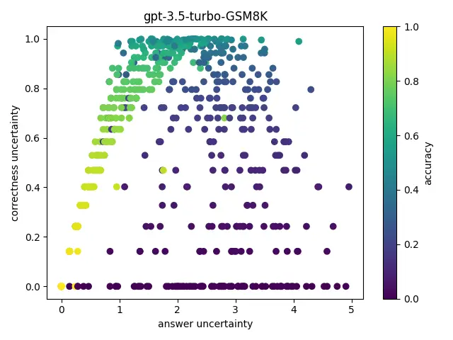

(a) Relationship between correctness uncertainty, answer uncertainty and
response accuracy. Each spot is a node within reasoning traces. See
section  4.

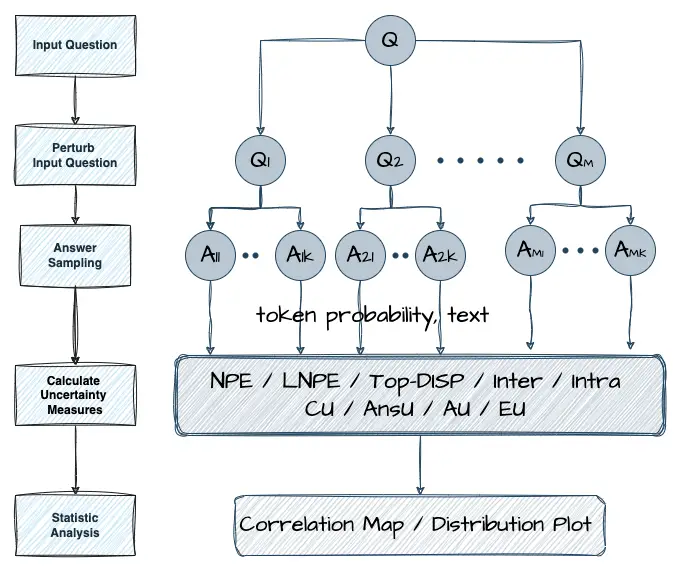

(b) Overview of our benchmarking pipeline. Detail of each step is shown
at Algorithm  1.

## 2 Different Uncertainties for Prompt Optimization

Uncertainty can arise from various aspects and express in different
forms. For instance, uncertainty about the input question might reflect
ambiguity or lack of clarity in the prompt itself, whereas uncertainty
about the output answer concerns the model fidelity or diversity of the
responses generated. Each type of uncertainty represents different
dimensions of the problem and can guide the optimization process in
unique ways. In this section, we outline four types of uncertainty, each
playing a distinct role and offering unique benefits for prompt
optimization across tasks.

Answer Uncertainty (AnsU) reflects the model’s confidence and the
diversity of possible answers. AnsU describes how consistently the model
produces the same answer after repeated sampling, but it does not
guarantee correctness. If the model lacks necessary knowledge to answer
the given question, it is reasonable for the output answers to be
incorrect, even if low AnsU is observed after repeated sampling.

AnsU is measured as the entropy of the output answer distribution.

```math
AnsU(x)=-\sum_{i}p(y_{i}|x)\log p(y_{i}|x)
```

where $`p(y_{i}|x)`$ is the probability of output answer $`y_{i}`$
obtain from $`\{\mathbf{x}_{j}\}`$ given the input $`x`$. AnsU can guide
prompt algorithms to explore a richer solution space, increasing the
variability of generated content. This can be particularly beneficial
for tasks like creative writing, idea generation and open-ended
problem-solving, where diversity and originality are highly valued.

Correctness Uncertainty (CU) provides insights into the likelihood of
answer correctness. For example, in a medical diagnosis system, high CU
indicates that the model’s prediction may be unreliable, suggesting the
need for additional verification or consultation. Note that this differs
from AnsU; CU is directly related to the accuracy of the diagnosis. When
CU is low, the model’s predictions are less likely to include a majority
of false positives.

CU is calculated as the entropy of the output correctness distribution.

```math
CU(x)=-\sum_{i}p(c_{i}|x)\log p(c_{i}|x)
```

where $`p(c_{i}|x)`$ represents the probability of correctness $`c_{i}`$
(whether an answer is correct or incorrect) obtain from
$`\{\mathbf{x}_{j}\}`$ given the input $`x`$. CU can guide prompt
algorithms to effectively narrow down the solution space and acquire the
correct answer. In question-answering tasks with a ground truth answer,
CU helps the model focus on more accurate responses, reducing the
likelihood of incorrect or irrelevant answers.

Aleatoric Uncertainty (AU) and Epistemic Uncertainty (EU) are two
distinct sources of model uncertainty. AU arises from the inherent
vagueness or noise in the data itself. For example, if asked "What time
is the meeting?", even if the LLM has access to a detailed schedule, it
may still be uncertain because the question doesn’t specify which
meeting is being referred to, making it inherently ambiguous. EU, on the
other hand, originates from the model’s limitations and is related to
its knowledge and understanding. This uncertainty can be reduced by
training the model with more data or refining its algorithms. For
instance, a language model trained on a limited dataset might show high
EU in underrepresented domains or languages.

AU and EU are calculated using the Deep-Ensemble-Decomposition method
\[2\], where total model uncertainty is the sum of AU and EU. In our
context, $`\theta`$, which represents model parameters in the original
paper, corresponds to the perturbed question in our setting. EU captures
the disagreement between different perturbations, measured by the mutual
information $`I(Y;\theta|X)`$. AU reflects the inherent data noise and
is represented as $`\mathbb{E}_{q(\theta|D)}[H(q(Y|X,\theta))]`$, where
the expectation is taken over the perturbed questions $`\theta`$.

The total model uncertainty is expressed as :

```math
H(q(Y|X))=\underbrace{I(Y;\theta|X)}_{\text{EU}}+\underbrace{\mathbb{E}_{q(\theta|D)}[H(q(Y|X,\theta))]}_{\text{AU}}
```

The advantage of AU and EU is that they explain the underlying causes of
uncertainty(due to data noise or model limitations). This understanding
enables more targeted improvements during prompt optimization, such as
rephrasing the question or providing additional few-shot examples.

## 3 Current NLG Uncertainty Metrics

Current NLG uncertainty metrics measure the uncertainty in a model’s
output and aim to improve correctness by favoring answers with lower
uncertainty, under the assumption that more model confident answers are
more likely to be correct. In this section, we outline four commonly
used black-box metrics, primarily based on decoding probabilities and
verbalized confidence. We further evaluate their effectiveness in
quantifying different uncertainties through our benchmarking pipeline in
section 4.

Normalized Predictive Entropy (NPE)\[1\] measures the uncertainty of
generated text by calculating the average entropy of possible output
sequences given a input context $`\mathbf{x}`$.

```math
\displaystyle\text{NPE}(\mathbf{x}) \displaystyle=\frac{1}{N}\sum_{n}\sum_{i}\ln p(s_{i}|s_{<i})
```

where $`N`$ is the number of generations and $`s_{i}`$ is the $`i`$-th
token of sentence $`\mathbf{s}`$.

Length-Normalized Predictive Entropy (LNPE)\[1\] adjusts for sentence
length by normalizing the entropy with the number of tokens. This
ensures fair comparison across different sentence lengths $`S_{n}`$ .

```math
\displaystyle\text{LNPE}(\mathbf{x}) \displaystyle=\frac{1}{N}\sum_{n}\left(\frac{1}{S_{n}}\right)\sum_{i}\ln p(s_{i}|s_{<i})
```

TopK-Token Disparity (Top-DISP) is based on the concept introduced by
\[13\], which suggests that a larger difference between the top-1 and
top-2 token probabilities correlates with higher confidence in the model
answer. The metric calculates the average difference in probability
between the top-1 and top-2 tokens for each token within the output
sequence and further averages them across multiple outputs.

```math
\displaystyle\text{Top-DISP}(\mathbf{x}) \displaystyle=-\frac{1}{N}\sum_{n}\left(\frac{1}{S_{n}}\right)\sum_{i}\left|\ln\frac{p(s_{i,\text{top1}}|s_{<i})}{p(s_{i,\text{top2}}|s_{<i})}\right|
```

Intra-Sample Similarity (Intra)\[5\] computes the average of the
uncertainties discerned individually for each sample output. Following
the approach used in SPUQ, we utilize verbalized uncertainty method
\[10\] to obtain the uncertainty articulated by the LLM for each
perturbed input and output pair $`c(x_{i},y_{i})`$.

```math
\displaystyle\text{Intra}(\mathbf{x}) \displaystyle=-\frac{\sum_{i=0}^{k}c(x_{i},y_{i})}{k+1}
```

## 4 Benchmarking Pipeline

A reliable uncertainty metric should serve as an accurate estimator of
its target uncertainty. In this study, we introduce a novel benchmarking
pipeline designed to assess the effectiveness of uncertainty metrics in
estimating target uncertainties within the context of prompt
optimization. Our pipeline focuses on evaluating metrics in
tree-structured reasoning traces, which represent a predominant approach
in current prompting algorithms. The following sections outline the
conceptual foundation and steps of our pipeline.

### 4.1 Design Concept

To evaluate how well a metric quantifies its target uncertainty in
prompt optimization, we first need to establish the ground truth values
for the target uncertainty at each reasoning step. This requires
constructing a comprehensive set of reasoning traces for input
questions.

We generate large tree-structured reasoning traces for each question by
perturbing input prompts and sampling outputs multiple times in each
node of traces. This servies two key purposes. First, these traces align
with prompt optimization algorithms, as they emulate how such algorithms
explore possible reasoning paths, making them highly relevant for
evaluating metrics in realistic scenarios. Second, they enable a
thorough exploration of the solution space by considering diverse
reasoning paths. This approach allows the tree-structured traces to
approximate the complete solution space, facilitating robust estimation
of target uncertainty ground truth values using Monte Carlo methods.

After obtaining the ground truth values, we calculate the metric
estimates at each reasoning node based on the formula in section  3. We
then evaluate the alignment between uncertainty metrics and ground truth
values using statistical methods. This involves measuring the
correlation, bias, and variance of the metric estimates relative to the
ground truth. Figure 1(b) shows an overview of our benchmarking
pipeline.

### 4.2 Detailed Workflow

Given a dataset of questions, our pipeline builds a reasoning tree for
each question, ultimately producing a large number of
$`(U_{\text{metric}},U_{\text{true}})`$ pairs. Algorithm 1 outlines the
process in detail. Increasing $`M`$ and $`K`$ improves the approximation
to the underlying solution space, yielding more accurate ground truth
values and consequently improving the quality of the evaluation.

foreach _input question $`Q`$_ do

   Initialize a reasoning tree with a root node containing $`Q`$;

   while _the reasoning tree is not fully constructed_ do

      foreach _node in the tree that has not yet terminated_ do

         Step 1: Input Perturbation

         Generate $`M`$ rephrased inputs $`\{x_{j}\}_{j=1}^{M}`$ from
the current node’s input $`\mathbf{x}`$;

         Step 2: Random Sampling

         For each rephrased input $`\mathbf{x}_{j}`$, sample $`K`$
responses $`\{y_{jk}\}_{k=1}^{K}`$;

      Expand the tree by adding child nodes using the newly generated
responses;

   Step 3: Ground Truth Uncertainty Calculation

   For each node, calculate the ground truth uncertainty using the
answers in its subtree’s leaves, as described in Section 2;

   Step 4: Uncertainty Metric Calculation

   For each node, compute the estimated uncertainty metric based on its
own input and output, following the formulas in Section 3;

Step 5: Statistical Analysis

Collect all $`(U_{\text{metric}},U_{\text{true}})`$ pairs from every
node across all trees.;

Compute $`\text{Corr}(U_{\text{metric}},U_{\text{true}})`$ and visualize
these relationships to assess how well the estimated metrics align with
the ground truth.;

Algorithm 1 Benchmarking Pipeline Workflow

## 5 Experiments

In this section, we use our benchmarking pipeline to evaluate the
uncertainty metrics introduced in Section 3 against the target
uncertainty defined in Section 2. Our evaluation focuses on the
correlation map (see  2) and visualization plots (see  0.B) between
uncertainty metrics and ground truth uncertainty values. By analyzing
these relationships, we can determine which metrics serve as better
estimators of the four target uncertainties, guiding prompt optimization
more effectively. Prompt templates are shown in  0.A.

### 5.1 Dataset and LLMs

We conduct experiments on two reasoning datasets: GSM8K \[4\] and
StrategyQA \[6\], which involve solving math problems and complex
strategic reasoning, respectively. We selected these datasets because
they provide exact ground truth answers and encompass diverse types of
knowledge and problem-solving tasks. While both are reasoning datasets,
GSM8K features an infinite range of possible answers, whereas StrategyQA
is constrained to binary answers: "true" or "false". We use two large
language models, GPT-3.5-Turbo\[8\] and Meta-Llama-3.1-8B-Instruct, to
showcase that our benchmarking pipeline is suitable for both commercial
and open-source LLMs of varying sizes.

### 5.2 Results and Analysis

Figure 2 presents correlation maps illustrating the relationships
between uncertainty metrics and target uncertainties. Each map is
divided into three sections: the upper-left shows correlations among the
uncertainty metrics, the upper-right shows how well each metric aligns
with the target uncertainties, and the lower-right shows correlations
among the target uncertainties themselves. A strong correlation between
a metric and a target uncertainty indicates that the metric serves as an
effective estimator, which can be used to guide search in prompting
algorithms. Below, we summarize key findings:

1.  1.  Current metrics estimate AnsU well but struggle with CU. As shown in
        Figure 2, the correlation maps demonstrate that evaluated metrics
        are more correlated with AnsU and AU. As for CU, we can see zero or
        negative correlation in all the maps. This implies most uncertainty
        metrics predominantly capture uncertainty of answer diversity and
        model confidence, but fail to estimate the correctness, which is
        important in prompting algorithms targeting answer correctness.
2.  2.  Uncertainty metrics show strong inter-correlation. The upper-left
        section of each map shows that token-likelihood-based metrics (NPE,
        LNPE, Top-DISP) are highly correlated, while INTRA, a verbalized
        confidence metric, exhibits little correlation with them. This high
        correlation indicates that these estimators capture similar
        uncertainties, highlighting a lack of diversity in metrics for other
        uncertainty types, such as CU.
3.  3.  AnsU’s weak link to CU reveals fundamental differences of the two.
        The lower-right section of the correlation maps shows a strong
        relationship between AnsU, AU, and EU, suggesting that these
        uncertainties can potentially share common estimators in prompting
        algorithms. However, CU displays a much weaker or even negative
        correlation with AnsU, especially in the GSM8K dataset when solution
        space are really large. This highlights a key distinction: AnsU
        reflects answer diversity, CU measures answer correctness. Metrics
        designed to estimate AnsU are not effective for capturing CU.
        Therefore, tailored estimators for correctness uncertainty are
        needed to better support tasks focused on accuracy.

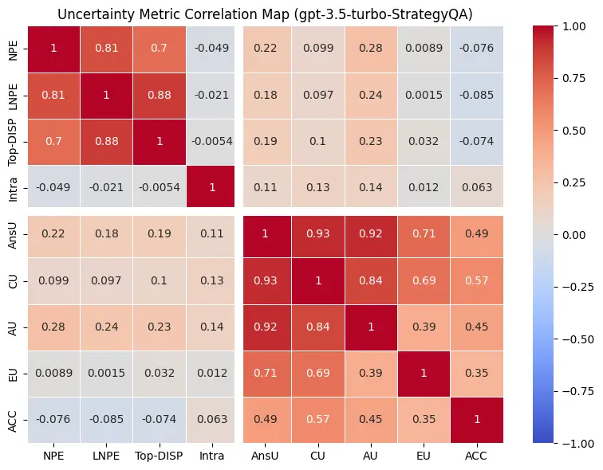

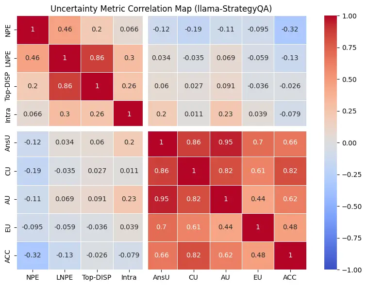

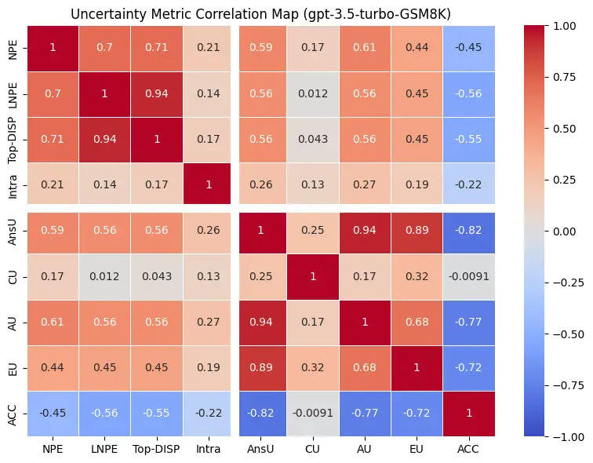

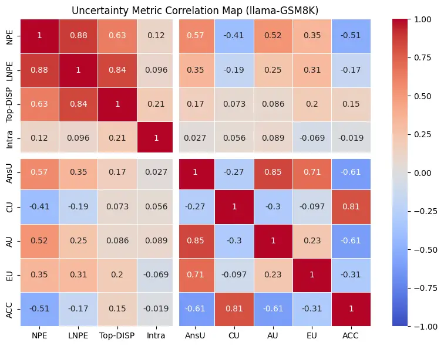

Figure 2: Correlation Maps of uncertainty metrics and target uncertainty
on different datasets and models.

## 6 Conclusion

In this work, we emphasize the different requirements for uncertainty
metrics in prompt optimization versus text generation. We propose a
novel benchmarking pipeline to assess how well current NLG uncertainty
metrics estimate various types of uncertainty in prompt optimization
settings. Through experiments on two datasets and multiple LLMs, we find
that most NLG uncertainty metrics primarily capture uncertainty related
to answer diversity or model confidence, but fail to estimate
uncertainty related to correctness, which is an essential factor for
prompting algorithms targeting accurate answers. This gap underscores
the need for optimization-aware uncertainty metrics that can better
guide prompt optimization in LLMs.

## References

- \[1\] Andrey Malinin, M.G.: Uncertainty estimation in autoregressive
  structured prediction arXiv:2002.07650 (2020),
  [http://arxiv.org/abs/2002.07650](http://arxiv.org/abs/2002.07650),
  version 5
- \[2\] Balaji Lakshminarayanan, Alexander Pritzel, C.B.: Simple and
  scalable predictive uncertainty estimation using deep ensembles
  arXiv:1612.01474 (2016),
  [http://arxiv.org/abs/1612.01474](http://arxiv.org/abs/1612.01474),
  version 3
- \[3\] Chen, S.F., Beeferman, D., Rosenfeld, R.: Evaluation metrics for
  language models (1998)
- \[4\] Cobbe, K., Kosaraju, V., Bavarian, M., Chen, M., Jun, H.,
  Kaiser, L., Plappert, M., Tworek, J., Hilton, J., Nakano, R., et al.:
  Training verifiers to solve math word problems. arXiv preprint
  arXiv:2110.14168 (2021)
- \[5\] Gao, X., Zhang, J., Mouatadid, L., Das, K.: Spuq:
  Perturbation-based uncertainty quantification for large language
  models arXiv:2403.02509 (2024),
  [http://arxiv.org/abs/2403.02509](http://arxiv.org/abs/2403.02509),
  version 1
- \[6\] Geva, M., Khashabi, D., Segal, E., Khot, T., Roth, D., Berant,
  J.: Did aristotle use a laptop? a question answering benchmark with
  implicit reasoning strategies. Transactions of the Association for
  Computational Linguistics 9, 346–361 (2021)
- \[7\] Hsieh, C.J., Si, S., Yu, F.X., Dhillon, I.S.: Automatic
  engineering of long prompts. arXiv preprint arXiv:2311.10117 (2023)
- \[8\] OpenAI: Openai models api (2023),
  [https:platform.openai.com/docs/models](https:platform.openai.com/docs/models)
- \[9\] Ren, A.Z., Dixit, A., Bodrova, A., Singh, S., Tu, S., Brown, N.,
  Xu, P., Takayama, L., Xia, F., Varley, J., et al.: Robots that ask for
  help: Uncertainty alignment for large language model planners. arXiv
  preprint arXiv:2307.01928 (2023)
- \[10\] Stephanie Lin, Jacob Hilton, O.E.: Teaching models to express
  their uncertainty in words. arXiv:2205.14334 (2022),
  [http://arxiv.org/abs/2205.14334](http://arxiv.org/abs/2205.14334),
  version 2
- \[11\] Wang, X., Zhou, D.: Chain-of-thought reasoning without
  prompting. arXiv preprint arXiv:2402.10200 (2024)
- \[12\] Wei, J., Wang, X., Schuurmans, D., Bosma, M., Xia, F., Chi, E.,
  Le, Q.V., Zhou, D., et al.: Chain-of-thought prompting elicits
  reasoning in large language models. Advances in neural information
  processing systems 35, 24824–24837 (2022)
- \[13\] Xuezhi Wang, D.Z.: Chain-of-thought reasoning without prompting
  arXiv:2402.10200 (2024),
  [http://arxiv.org/abs/2402.10200](http://arxiv.org/abs/2402.10200),
  version 2
- \[14\] Yang, C., Wang, X., Lu, Y., Liu, H., Le, Q.V., Zhou, D., Chen,
  X.: Large language models as optimizers. ArXiv abs/2309.03409 (2023),
  [https://api.semanticscholar.org/CorpusID:261582296](https://api.semanticscholar.org/CorpusID:261582296)
- \[15\] Yao, S., Yu, D., Zhao, J., Shafran, I., Griffiths, T., Cao, Y.,
  Narasimhan, K.: Tree of thoughts: Deliberate problem solving with
  large language models. Advances in Neural Information Processing
  Systems 36 (2024)
- \[16\] Yao, S., Zhao, J., Yu, D., Du, N., Shafran, I., Narasimhan, K.,
  Cao, Y.: React: Synergizing reasoning and acting in language models.
  arXiv preprint arXiv:2210.03629 (2022)
- \[17\] Zelikman, E., Wu, Y., Mu, J., Goodman, N.: Star: Bootstrapping
  reasoning with reasoning. Advances in Neural Information Processing
  Systems 35, 15476–15488 (2022)
- \[18\] Zhou, A., Yan, K., Shlapentokh-Rothman, M., Wang, H., Wang,
  Y.X.: Language agent tree search unifies reasoning acting and planning
  in language models. arXiv preprint arXiv:2310.04406 (2023)
- \[19\] Zhou, H., Wan, X., Proleev, L., Mincu, D., Chen, J., Heller,
  K., Roy, S.: Batch calibration: Rethinking calibration for in-context
  learning and prompt engineering. arXiv preprint
  arXiv:2309.17249 (2023)
- \[20\] Zhu, Y., Li, J., Li, G., Zhao, Y., Jin, Z., Mei, H.: Hot or
  cold? adaptive temperature sampling for code generation with large
  language models. In: Proceedings of the AAAI Conference on Artificial
  Intelligence. vol. 38, pp. 437–445 (2024)

## Appendix 0.A Prompt Templates


Figure 3: Example prompt for question perturbation.


Figure 4: Example prompt for StrategyQA. We random pick 4 few shot
samples from pool.


Figure 5: Example prompt for GSM8K. We random pick 4 few shot samples
from pool.

## Appendix 0.B Additional Results

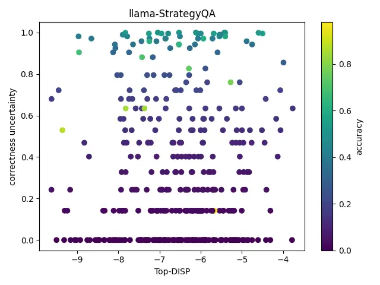

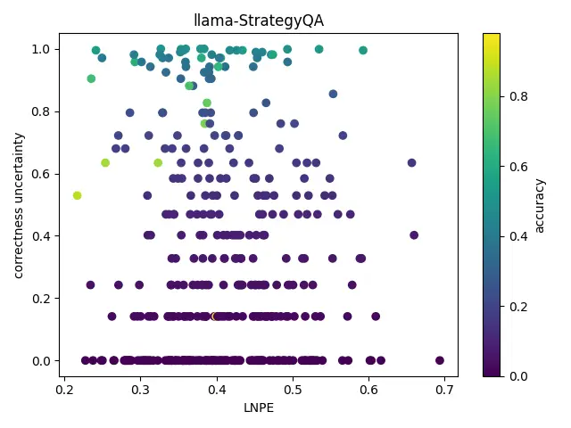

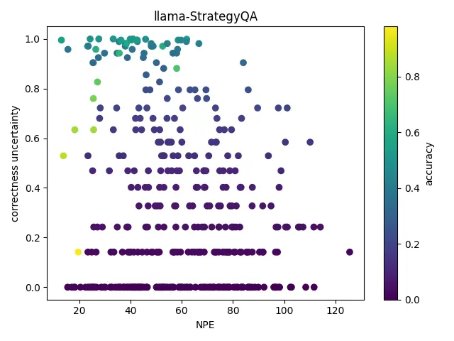

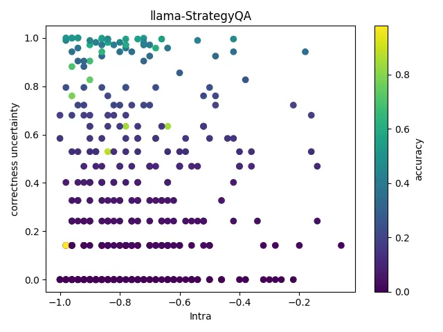

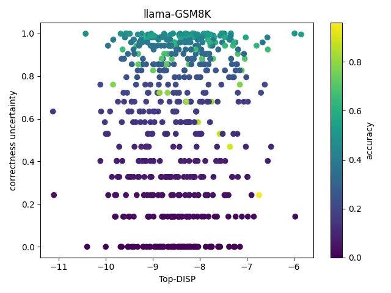

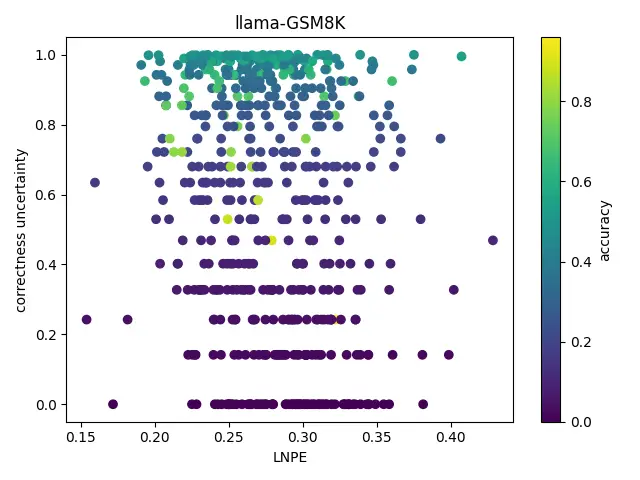

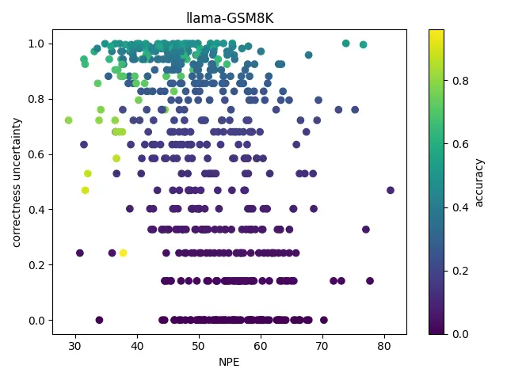

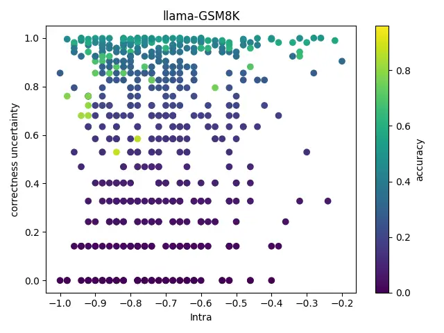

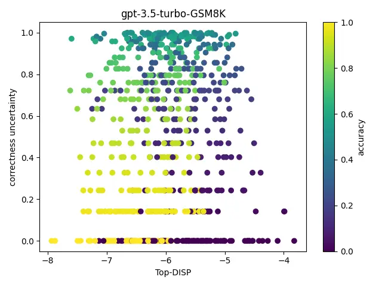

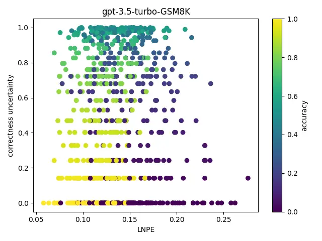

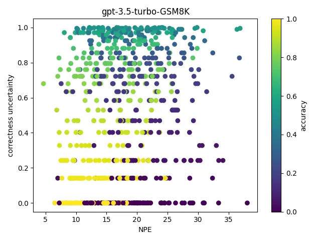

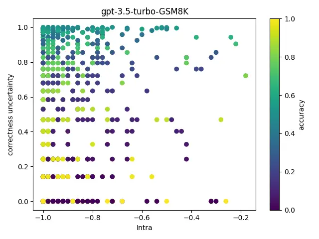

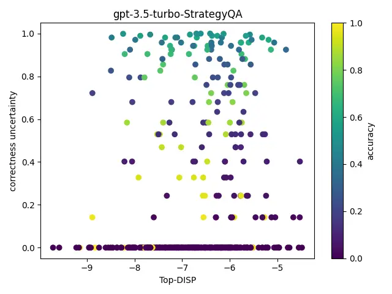

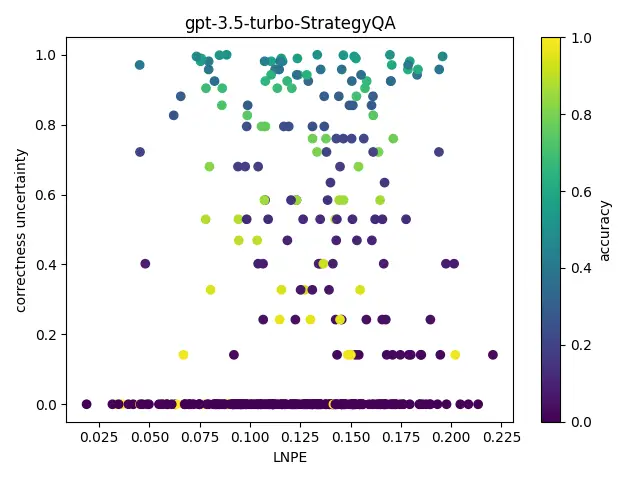

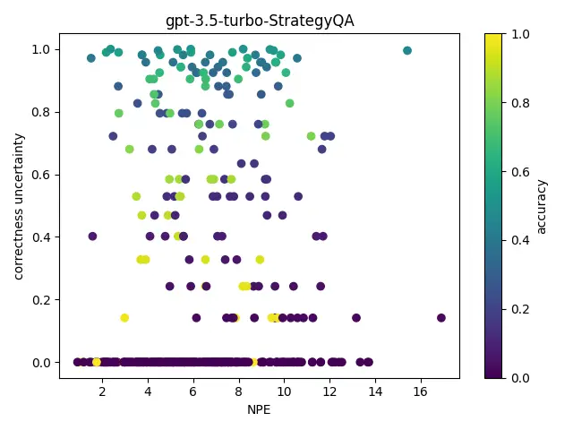

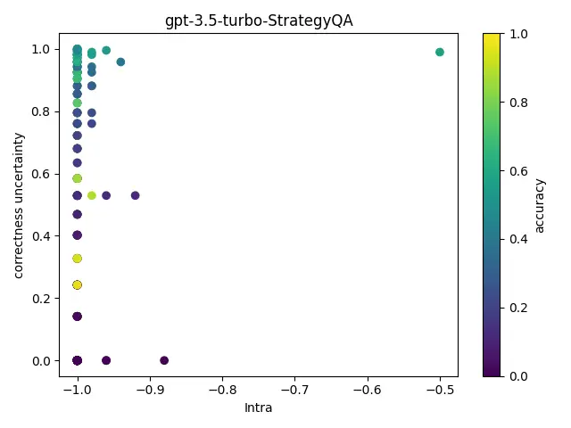

Figure 6: Scatter plots show the evaluation results of metrics on Llama
(StrategyQA and GSM8K) and GPT-3.5-Turbo (GSM8K and StrategyQA), with
each point representing a reasoning node. The plots illustrate the
relationship between CU, uncertainty metrics, and response accuracy. As
shown, most metrics fail to estimate CU effectively, as there is no
clear trend of higher metric values(x-axis) corresponding to higher
correctness uncertainty(y-axis).
