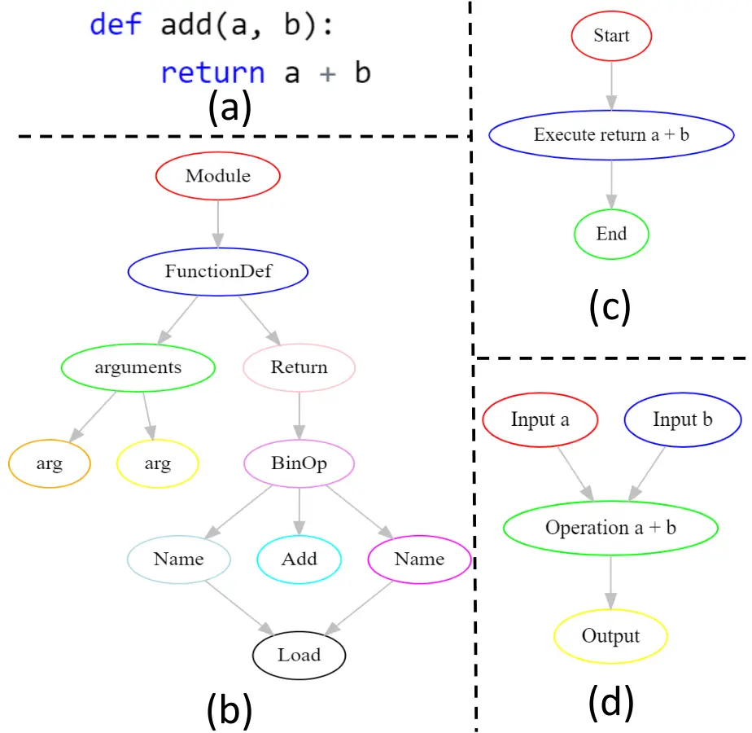
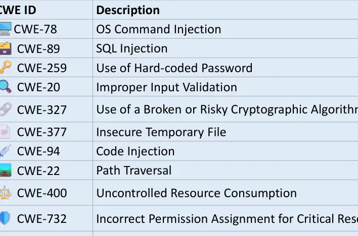
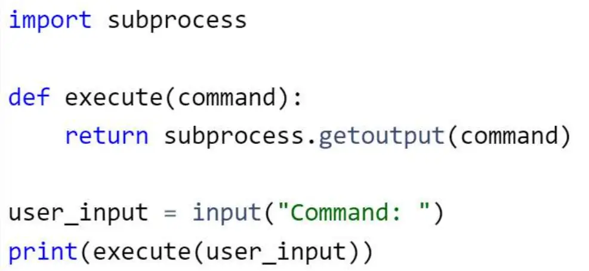
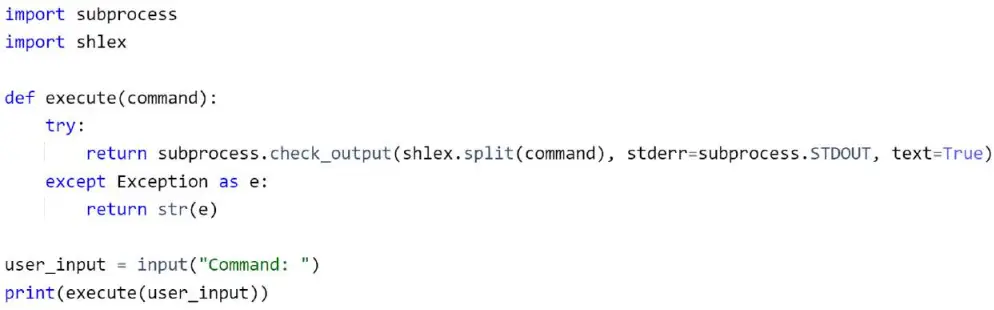

# PromSec: Prompt Optimization for Secure Generation of Functional Source Code with Large Language Models (LLMs)

Conference: Proceedings of the 2024 ACM SIGSAC Conference on Computer
and Communications Security; October 14–18, 2024; Salt Lake City, UT,
USAProceedings of the 2024 ACM SIGSAC Conference on Computer and
Communications Security (CCS ’24), October 14–18, 2024, Salt Lake City,
UT,
USADOI: [10.1145/3658644.3690298](https://doi.org/10.1145/3658644.3690298)ISBN: 979-8-4007-0636-3/24/10CCS: Security
and privacyCCS: Security and privacy File system securityCCS: Security
and privacy Software security engineeringCCS: Security and
privacy Vulnerability scannersCCS: Security and privacy Formal security
modelsCCS: Security and privacy Domain-specific security and privacy
architectures

Mahmoud Nazzal
[](https://orcid.org/0000-0003-3375-0310)
email: <mn69@njit.edu> Affiliation: New Jersey Institute of Technology,
Newark, NJ, USA , Issa Khalil
[](https://orcid.org/0000-0002-7660-9512)
email: <ikhalil@hbku.edu.qa> Affiliation: Qatar Computing Research
Institute, Doha, Qatar , Abdallah Khreishah
[](https://orcid.org/0000-0003-1583-713X)
email: <abdallah@njit.edu> Affiliation: New Jersey Institute of
Technology, University Heights, Newark, NJ, USA and NhatHai Phan
[](https://orcid.org/0000-0002-1032-8275)
email: <phan@njit.edu> Affiliation: New Jersey Institute of Technology,
University Heights, Newark, NJ, USA

© rightsretained

###### Abstract.

The capability of generating high-quality source code using large
language models (LLMs) reduces software development time and costs.
However, recent literature and our empirical investigation in this work
show that while LLMs can generate functioning code, they inherently tend
to introduce security vulnerabilities, limiting their potential. This
problem is mainly due to their training on massive open-source corpora
exhibiting insecure and inefficient programming practices. Therefore,
automatic optimization of LLM prompts for generating secure and
functioning code is a demanding need. This paper introduces PromSec, an
algorithm for prompt optimization for secure and functioning code
generation using LLMs. In PromSec, we combine 1) code vulnerability
clearing using a generative adversarial graph neural network, dubbed as
gGAN, to fix and reduce security vulnerabilities in generated codes and 2) code generation using an LLM into an interactive loop, such that the
outcome of the gGAN drives the LLM with enhanced prompts to generate
secure codes while preserving their functionality. Introducing a new
contrastive learning approach in gGAN, we formulate the code-clearing
and generation loop as a dual-objective optimization problem, enabling
PromSec to notably reduce the number of LLM inferences. As a result,
PromSec becomes a cost-effective and practical solution for generating
secure and functioning codes.

Extensive experiments conducted on Python and Java code datasets confirm
that PromSec effectively enhances code security while upholding its
intended functionality. Our experiments show that despite the
comprehensive application of a state-of-the-art approach, it falls short
in addressing all vulnerabilities within the code, whereas PromSec
effectively resolves each of them. Moreover, PromSec achieves more than
an order-of-magnitude reduction in operational time, number of LLM
queries, and security analysis costs. Furthermore, prompts optimized
with PromSec for a certain LLM are transferable to other LLMs across
programming languages and generalizable to unseen vulnerabilities in
training. This study presents an essential step towards improving the
trustworthiness of LLMs for secure and functioning code generation,
significantly enhancing their large-scale integration in real-world
software code development practices.

## 1. Introduction

Large language models (LLMs) are at the forefront of machine learning
(ML), demonstrating exceptional performance in various natural language
processing (NLP) tasks. These models, including the generative
pre-trained transformer (GPT) series by OpenAI (Radford et al., 2018;
Brown et al., 2020), utilize a large-scale, transformer-based
architecture (Vaswani et al., 2017) trained on diverse NLP datasets.
Recently, LLMs have attracted attention for generating high-quality
source code, significantly benefiting software development by reducing
time and expertise costs (Ziegler et al., 2022). Their growing
popularity is evident, with tools like GitHub’s Copilot attracting over
a million paid subscribers across 37,000 organizations (GitHub, 2023).
The effectiveness of these LLMs stems from their extensive training
using vast source code databases. However, this reliance on open-source
training data introduces significant security risks (Siddiq et al.,
2022). The LLMs often replicate security flaws present in their training
examples, leading to vulnerabilities in the generated code (Pearce
et al., 2022; Henderson and Henderson, 2018; Charalambous et al., 2023;
Siddiq et al., 2023; Perry et al., 2022; Sandoval et al., 2022). This
issue raises concerns about the reliability of LLMs for secure code
generation, also known as program synthesis, and highlights the
necessity to address and mitigate these inherent security
vulnerabilities effectively.

Challenges. The generation of secure and functionally correct code with
LLMs faces the fundamental challenge of prompt optimization. Significant
research efforts (Qin and Eisner, 2021; Zhou et al., 2022; Pryzant
et al., 2023; Xu et al., 2022; Li et al., 2023) have been directed
towards engineering and optimizing LLM prompts for specific
applications, highlighting the vast prompt search space and developing
heuristics to navigate this space effectively. Similarly, in code
generation, a recent state-of-the-art (SoTA) approach (Pearce et al., 2023) shows the diversity in security and functionality of code
generated with respect to variations in hand-crafted prompts. However,
the search space challenge is more severe in the code generation
application due to the need for external tools to assess code security
and functional fidelity, making prompt optimization more complex.
Moreover, the lack of differentiability of LLM prompts with respect to
these security and functionality metrics, coupled with the absence of
intuitive heuristics for maintaining security and functionality, adds to
the challenge. Also, as detailed in Section 4, the one-to-many nature of
function-code implementation further complicates the application of
traditional, data-driven security solutions, particularly those based on
a supervised learning approach. PromSec addresses these challenges using
a graph generative adversarial network (gGAN) model, trainable on a
differentiable contrastive loss that synergizes security reduction while
upholding intended functionality. As elaborated in Section 4, this model
effectively guides the LLM in generating better prompts that enhance
security without compromising functionality. The model’s effectiveness
is demonstrated through an iterative interaction loop with the LLM,
progressively fine-tuning the generation process to meet these dual
objectives.

Prior Approaches and Limitations. As pictorially depicted in Fig. 1,
LLMs are inclined to produce functional and insecure code bases if one
depends on regular prompts by average users. This is especially the case
whenever the intended code’s application has any security notation, as
we empirically validate in Section 3. Efforts in prompt engineering for
secure code generation, such as hand-crafted templates by Pearce et al.
(Pearce et al., 2023), are exhaustive and time-consuming. Methods like
bounded model checking (BMC) (Charalambous et al., 2023) are restricted
to memory access issues. Other works (Islam and Najafirad, 2024; Islam
et al., 2024) apply reinforcement learning to improve the security of
LLM-generated code. However, these operate directly on source code
rather than prompts. The only effort attempting prompt optimization is
in (He and Vechev, 2023), but it requires white-box access, limiting its
applicability to proprietary models like GPT and Bard. Overall, these
approaches fall short of offering a unified framework for optimizing
prompts for security and functionality, as depicted in Fig. 1.

Figure 1. With prompts from average users, LLMs tend to generate codes
with security vulnerabilities.

PromSec Overview. Based on the previous discussion, we formulate prompt
optimization in code generation as a two-objective optimization problem
aiming at code security and functionality preservation. To meet these
objectives despite the non-differentiable nature of prompts with respect
to their quantifications, we follow an iterative approach where we
improve the code and then improve the prompt in each iteration. Code
improvement is achieved by utilizing a gGAN model specially designed for
this purpose; given an input code, it generates an output code with
semantic similarity and reduced vulnerability. The model is trained to
do so by minimizing a novel (differentiable) contrastive loss that
involves the number of common weakness enumerations (CWE)¹¹ 1 Common
weakness enumerations (CWEs) are standardized categories that identify
common software weaknesses and vulnerabilities. These are annually
released by MITRE (The MITRE Corporation, 2023), serving as a
comprehensive reference to help organizations understand, identify, and
address security issues in software. as defined by MITRE (The MITRE
Corporation, 2023) and the graph embedding distance. The LLM is then
used to produce an improved prompt based on the improved code. In
essence, the key difference this approach has over existing methods is
the use of actual code fixes to steer the generation of improved
prompts, rather than leaning on diagnostic tools such as what is done in
(Pearce et al., 2023; Charalambous et al., 2023). Our approach is
anticipated to guide prompts toward a more thorough exploration of the
solution space, as evidenced in performance assessments where
vulnerabilities are swiftly resolved with minimal iterations at a low
cost. Our focus is on fixing identified vulnerabilities, rather than
vulnerability detection which is a distinct problem.

Summary of Contributions. The contributions in this paper are as
follows.

- •
  Introduction of PromSec, an algorithm for automatically optimizing
  prompts in LLM to generate secure source code while upholding its
  intended functionality.
- •
  Development of a graph generative neural adversarial network (gGAN)
  model, characterizing semantic-preserving, and security-enforcing
  source code fixing as a two-objective optimization problem. This
  model, trained by minimizing a novel contrastive loss function,
  enables the application of semantic-preserving security fixes to the
  code graph.
- •
  Demonstrating the efficacy of PromSec through comprehensive empirical
  validation, which confirms its capability in enhancing security and
  functionality in code generation using LLMs, and transferability
  across different LLMs, CWEs, and programming languages.

Paper Outline. Section 2 presents relevant preliminaries. An empirical
study of the need for code securing with LLMs is articulated in Section 3. Section 4 details the proposed PromSec algorithm. Experiments and
results are presented in Section 5. Section 6 summarizes related work. A
discussion is provided in Section 7 with the conclusions in Section 8.

## 2. Background

Code Generation with LLMs. The idea of code generation traces back to
sequence-to-sequence models, such as recurrent neural networks (RNN) and
long short-term memory (LSTM). Here, the model takes a user’s natural
language prompt that represents their intent and produces a sequence of
tokens representing the desired code. Subsequently, Transformer models
(Vaswani et al., 2017), and later LLMs (Radford et al., 2018; Brown
et al., 2020; OpenAI, 2023a; CodeLlama, 2023; Google, 2023) have
contributed to better code generation. Today, LLMs have gained
prominence in this field. Trained on extensive datasets encompassing
various programming languages and patterns, LLMs excel in producing
syntactically correct, logically consistent, and functioning source code
in many programming languages (Chen et al., 2021; Austin et al., 2021).
Their use extends beyond code generation to debugging, code translation,
and even full software application development (Lu et al., 2021; Chen
et al., 2021). As a result, employing LLMs can boost productivity by 30%
to 50% in software development and reduce the costs of Information
Technology (IT) by up to 65% (sou, 2023c; sou, 2023b; sou, 2023a).
However, concerns remain about their ability to generate secure and
vulnerability-free code consistently (Pearce et al., 2022; Henderson and
Henderson, 2018; Charalambous et al., 2023; Siddiq et al., 2023; Perry
et al., 2022; Sandoval et al., 2022). The existence of such
vulnerabilities in code can enable malicious exploitation, potentially
leading to cyberattacks, data breaches, and system instability. Code
vulnerabilities, including buffer overflow, injection attacks, and
authentication bypass, can lead to unauthorized access and data theft
(com, 2020; pen, 2020).

Graph Representation of Source Code. Graph representation of code
abstracts relationships among different program elements and serves as
input for a wide range of software analysis tasks (Wang et al., 2023;
Liu et al., 2023b; Allamanis et al., 2018; Dinella et al., 2020; Wang
et al., 2020). The three widely used types of graph representations of
code are abstract syntax trees (ASTs), control flow graphs (CFGs), and
data flow graphs (DFGs) (Kavi et al., 1986). Appendix A.1 illustrates
constructing these graphs from a given code example. ASTs provide a
hierarchical and structured representation of the syntactic elements
within a program, enabling in-depth examination of code syntax and
organization (White et al., 2016). CFGs, on the other hand, capture the
control flow within a program, representing how control is transferred
between different code blocks and aiding in understanding program
execution paths (Zhao and Huang, 2018). DFGs represent data dependencies
and the flow of information within the program, offering insights into
data-centric aspects of code behavior.

| Topic                          | Description                                                                   |
| ------------------------------ | ----------------------------------------------------------------------------- |
| Database Interaction           | Interacting with databases, searching, deleting records, and data retrieval.  |
| Security and Encryption        | Data and file security, encryption, password hashing, and API key management. |
| Network and System Management  | Network diagnostics, remote system monitoring, and IoT device control.        |
| User Authentication            | User login features and authentication with Python Flask.                     |
| File and Data Processing       | Custom file managers, file operations, and user data processing.              |
| Web Scraping and Web Apps      | Web scraping, rendering HTML content, and automating web-related tasks.       |
| Mathematical and Data Analysis | Calculators, data processing tools, and mathematical operations.              |

Table 1. Summary of major topics covered by our 50 prompts.

Graph-based code repair has emerged as a useful tool mainly applied for
detecting malfunctioning portions of source code (patches) and
suggesting remedies to them. As leading graph representation models,
GNNs can effectively capture the complex relationships and dependencies
inherent in programming languages (Allamanis et al., 2018; Dinella
et al., 2020). In the context of automatic code repair, GNNs are mainly
used to identify buggy portions of source code thereby hinting at
potential fixes (Tufano et al., 2019; Chen et al., 2019). These fixes
can range from minor syntax corrections to significant structural
changes aimed at closing security gaps.

GNNs and Generative GNNs. Graph neural networks (GNNs) extend deep
learning to graph data, utilizing neural network layers for message
passing and aggregation (Welling and Kipf, 2016). Efficiently
transforming graph information into node embeddings, GNNs excel in
capturing complex relationships within graphs, leading to SoTA
performance in various applications (Wu et al., 2020). Among generative
GNNs, graph generative adversarial networks (gGANs) and graph
variational autoencoders (gVAEs) are particularly noteworthy. A gGAN
(Wang et al., 2018) employing adversarial frameworks consists of a
generator and a discriminator, for complex network synthesis. The
generator creates graphs, while the discriminator assesses their
authenticity. Conversely, a gVAE (Kipf and Welling, 2016) uses a
variational autoencoder architecture, encoding graph data into a latent
space and then decoding it to generate new graphs.

Contrastive Learning. Contrastive learning is a model training technique
that emerged as a remedy for the data-labeling requirement of supervised
learning. Instead of using specific data labels, a contrastive learning
scheme identifies positive and negative data pairs. A positive pair
comprises two data points of relatively strong similarity as opposed to
a negative pair. Therefore, the model is trained to minimize the
differences between items in a positive pair and maximize it for items
in a negative pair. A clear advantage of this learning scheme is
alleviating the need for data labels explicit supervision (Chen et al.,
2020; He et al., 2020). Contrastive learning has shown notable
advantages in tasks like image and text representation (Chen et al.,
2020), and its applicability extends to the domain of GNNs. In GNNs,
specifically generative GNNs, contrastive learning facilitates the
learning of node and graph embeddings that accurately capture the
underlying structure and features of graph data (Veličković et al.,
2018; You et al., 2020; Wang et al., 2020). As a result, contrastive
learning and generative GNNs are particularly suitable for tasks where
understanding the relationships and structures within data is crucial,
such as in social network analysis, recommendation systems, and
bioinformatics.

|     |     |
| --- | --- |
|     |     |
| (a) | (b) |
|     |     |
| (c) | (d) |
|     |     |
| (e) | (f) |
|     |     |
| (g) | (h) |

Figure 2. Histogram of CWEs in 100 generated code bases according to the
prompts summarized in Table 1 (left) and the histogram of the CWE count
per code base (right), for Bard (Google, 2023), CodeLlama-70B-Instruct
(CodeLlama, 2024), GPT-3.5 Turbo (OpenAI, 2023a), and GPT4 (OpenAI,
2023b) row-wise, respectively.

## 3. How Secure are LLMs in Code Generation?

Since LLMs are commonly perceived to generate code bases prone to
security vulnerabilities (Pearce et al., 2022; Henderson and Henderson,
2018; Charalambous et al., 2023; Siddiq et al., 2023; Perry et al.,
2022; Sandoval et al., 2022), our initial focus is to assess this
concern on modern LLMs. To achieve this objective, we conducted the
following experiment. We manually design 50 prompts, each asking the LLM
to generate a code base that performs a specific task. While tasks have
some security notions, these prompts do not explicitly ask the LLMs to
beware of security issues, nor do they represent bad programming
practices. They are just subtle verbal descriptions of what an LLM is
requested to generate, and they are aimed to represent the skill level
of an ordinary LLM user without security expertise. Table 1 summarizes
the main topics covered by these prompts. These topics cover a wide
range of Python scripting and application development areas, including
database access, security, encryption, network and system management,
user authentication, file and data processing, web scraping, and
mathematical and data analysis.

We feed the prompts to a set of prominent LLMs including Google’s Bard
(Google, 2023), Meta’s CodeLlama-70B-Instruct (CodeLlama, 2024),
OpenAI’s GPT-3.5 Turbo (OpenAI, 2023a), and OpenAI’s GPT4 (OpenAI,
2023b), and observe their generated codes. Then, we analyze the security
of the generated code bases using widely applied tools such as Bandit
(Developers, 2022) and SpotBugs (spo, 2023). Each prompt is fed to each
LLM twice, resulting in 100 generated code bases per LLM. Fig. 2 shows
the outcomes of the security analysis across these LLMs presented in
rows, respectively. For each LLM (row), we first plot a histogram of the
identified CWEs in the generated codes (left) and a histogram of the
counts of CWEs in each code base (right). The figure supports previous
studies (Pearce et al., 2022; Henderson and Henderson, 2018;
Charalambous et al., 2023; Siddiq et al., 2023; Perry et al., 2022;
Sandoval et al., 2022) that LLMs generate codes prone to security
vulnerabilities as evidenced by the identified CWEs.

We note that CWE 78 stands out as the most frequently recurring security
vulnerability among the identified ones. There is a noticeable overlap
in the identified CWEs across the four LLMs. Moreover, with Bard,
GPT-3.5 Turbo, and GPT-4.0, the security analysis reveals that no more
than 40% of the generated code bases are entirely secure, according to
the security analysis tools we use for Python and Java codes. It is
noted that CodeLlama-70B-Instruct generates code bases in 61 of the
times it is prompted. This is consistent with the common belief that
Llama models are overly protective and tend to have a high false
rejection rate (Bhatt et al., 2024). However, the code bases generated
still have similar vulnerability occurrences. We emphasize that these
findings are derived without prompting the LLMs to explicitly or
implicitly create CWEs. CWEs surfaced solely because the LLMs were
instructed to generate code for security-related tasks. This experiment
illustrates that SoTA LLMs often produce insecure code when tackling
security-related tasks. Hence, it is crucial not to unquestionably rely
on their outputs.

Figure 3. An overview of PromSec’s pipeline.

## 4. PromSec

The key idea behind PromSec is applying contrastive learning within a
graph generative adversarial network (gGAN) combined with static
security analysis. This unified method aims to direct the LLM in
producing secure and functioning code as an alternative to conventional
optimization approaches that are hindered by the non-differentiable
nature of generating secure and functioning code.

Fig. 3 shows the main steps of our proposed PromSec approach. First, an
initial prompt is obtained. Such a prompt is taken directly from the
user as a verbal description characterizing her/his intent (Le et al.,
2020). The initial prompt is forwarded to the LLM and a code is
generated. The generated code is then forwarded to the Security Analysis
module, which is a static security tool to identify the number of CWEs
in the code. Alternatively, if the input is source code $`c`$, it is
passed directly to the Security Analysis module. The code is considered
the final output if the security analysis identifies no CWEs, denoted as
“$`k=0`$” (where ‘$`k`$’ represents the count of identified CWEs by the
security analysis tool). Otherwise, the code is transformed into a graph
representation $`g`$ (e.g., AST) using the Graph Construction module,
then forwarded to a gGAN. This gGAN model aims to enhance the input
graph representation, striving for a more secure (with reduced CWEs)
one, $`\hat{g}`$, while maintaining the intended functionality. Once
generated, the graph $`\hat{g}`$ is converted back into code $`\hat{c}`$
through a Code Reconstruction module. This reconstructed code is then
reverse-engineered by the LLM²² 2 By explicitly instructing the LLM to
analyze the codebase and estimate a detailed prompt that could have
generated it. to generate a prompt corresponding to $`\hat{c}`$,
$`\hat{p}`$. The new prompt $`\hat{p}`$ is fed back into the LLM,
generating new code versions in a loop that continues until the CWE
count reduces to a small desired value ($`\epsilon`$), which ideally is
zero) or for a prescribed number of cycles.

In this section, we first establish the suitability of a contrastive
learning framework for the training of the aforementioned gGAN model.
Then, we provide the architectural details and the proposed contrastive
loss to be used in the training of this model along with its training
algorithm.

### 4.1. Code Fixes are One-to-Many

Function-implementation relationship in code bases is well-known to be a
one-to-many mapping, i.e., the same semantic function can be implemented
as a code in many ways (Lee et al., 2021; Trisovic et al., 2022).
Furthermore, code similarity detection systems like Facebook’s Aroma and
Intel’s Machine Inferred Code Semantics Analysis (MISIM) illustrate the
ability to recognize different code implementations fulfilling identical
functions, supporting the one-to-many mapping (Lee et al., 2021).

It is interesting to discuss the implication of the one-to-many
function-to-code relationship on suitable learning of generative models
on code graphs. Let us recall that a code can be represented as a graph.
Thus, it is possible to obtain an improved code by utilizing a
generative GNN model trained to generate better code graphs. In
supervised learning of generative models, model training requires
labeled data, where a data point label represents the desired outcome
that the model needs to generate. In an application like source code
fixing, an immediate approach is to simply feed a generative model with
an input code graph and train it to generate a secure version of this
code graph. However, recalling the aforementioned one-to-many
function-code mapping, it is evident that the same code can have many
secure versions. In other words, for a given insecure code snippet,
there could be multiple and structurally diverse but functionally
equivalent secure versions. Accordingly, there is no notion of a single
desired outcome or, equivalently, no notion of a unique data label.

To demonstrate this limitation, we conduct the following experiment. We
consider a set of 100 Python codebases, each containing multiple CWEs.
For each codebase, we generate three CWE-free versions. Specifically,
each test codebase is provided to the LLM, which is instructed to
generate a secure version that retains the same functionality. This
secure version is analyzed using a security tool to ensure it is free of
CWEs and is manually verified to maintain the same functionality. This
process repeats until three secure versions are obtained per sample.
Next, we define and calculate the average inter-version distance, which
is the mean graph edit distance between the code graph of the original
test codebase and that of its corresponding CWE-free versions. We also
calculate the average intra-version distance, which denotes the average
graph edit distance among the graph representations of the CWE-free
versions of each codebase. We calculate these metrics for the 100
considered codebases.

Figure 4. A comparison of the average inter-version and average
intra-version graph edit distances per code base.

Fig. 4 illustrates the results of those two metrics per code base
(normalized by the maximum value). It is worth noting that the average
inter-version and average intra-version distances are comparable.
Furthermore, on many occasions, the inter-version distance is even less
than the intra-version distance. This observation indicates that the
edit distance between the original code base and its CWE-free versions
is less than or at least comparable to the distance among its CWE-free
versions.

The observed diversity in secure and functioning code versions suggests
the viability of integrating contrastive learning in the gGAN model for
code improvement alongside static security analysis. This combination
provides an effective alternative approach for guiding LLMs in
generating secure and functioning code using optimized prompts.
Contrastive learning’s strength lies in distinguishing between various
examples, making it suitable for scenarios with multiple valid outcomes.
It can train models to recognize a broad range of secure coding patterns
beyond replicating a single secure version, expanding their
understanding of diverse secure coding practices.

### 4.2. The Training and Operation Pipeline

We formulate prompt optimization for secure and functioning code
generation with LLMs as follows:

```math
p^{*}=\argmin_{p}\big[\alpha k(c)+\beta d(c,c_{0})\big], \tag{1}
```

where $`p`$ is a prompt, $`p^{*}`$ is the optimal prompt, $`c`$ is the
code to be generated, $`c_{0}`$ is the original code either given as a
code starting point or the code generated with an initial prompt
$`p_{0}`$. The term $`k(c)`$ denotes the CWE count in the code $`c`$,
and $`d(c,c_{0})`$ is a metric representing the functional discrepancy
between $`c_{0}`$ and $`c`$. Also, $`\alpha`$ and $`\beta`$ are weight
parameters.

As highlighted in the Introduction Section, the essential challenge in
this optimization is that $`p`$ is not differentiable with respect to
$`k(c)`$ and $`d(c,c_{0})`$. Even modeling these functions in terms of
$`p`$ is challenging since it requires modeling the LLM with external
security analysis tools. To address this challenge, we approximate the
optimal prompt $`p^{*}`$ in Eq. 1 by using a gGAN model to generate
improved code graphs that lead to improved prompts for generating secure
and functioning code in an iterative manner, as follows.

gGAN rectifies code issues by altering its graph representations, which
are then translated into prompt adjustments. Operating on graph data,
this model follows the framework akin to the generator-discriminator
setup in classical GAN networks. Here, inputs drive the generator to
produce outputs meeting specific criteria, while the discriminator
evaluates the adherence of these outputs to the defined requirements. As
it operates on graph data, it is classified as a GNN-based GAN.
Architectures such as the graph convolutional network (GCN)-based GAN
(Lei et al., 2019) can be utilized in this context.

The proposed learning mechanism for the gGAN is outlined in Algorithm 1.
We train the model using a unique contrastive loss for the generator,
ensuring the generation of secure and functioning code graphs. We
formulate the contrastive loss of the gGAN as follows:

The generator loss is composed of adversarial and contrastive losses,
denoted as $`\mathcal{L}_{\text{adv}}`$ and
$`\mathcal{L}_{\text{contrastive}}`$ respectively, balanced by a
hyperparameter $`\lambda`$ as

```math
\mathcal{L}_{G}=\mathcal{L}_{\text{contrastive}}+\lambda\mathcal{L}_{\text{adv}}. \tag{2}
```

- •
  Adversarial Loss (Goodfellow et al., 2014). The adversarial loss
  $`\mathcal{L}_{\text{adv}}`$ evaluates how effectively the generator
  $`G`$ can deceive the discriminator $`D`$. It is defined as

  ```math
  \mathcal{L}_{\text{adv}}=-\mathbb{E}[\log D(G(g_{i}))]. \tag{3}
  ```

- •
  Contrastive Loss. The contrastive loss
  $`\mathcal{L}_{\text{contrastive}}`$ is incorporated in terms of the
  number of CWEs (denoted by $`k`$) and an embedding similairty measure
  $`S`$:

```math
\displaystyle\mathcal{L}_{\text{contrastive}}=-\log(x), \tag{4}
```

```math
\displaystyle\text{s.t. }x=\frac{e(\alpha\Delta k_{i}+\beta S_{i})}{e(\alpha\Delta k_{i}+\beta S_{i})+\sum_{j\neq i}e(\alpha\Delta k_{ij}+\beta S_{ij})}, \tag{5}
```

where $`\Delta k_{i}=k(c_{i})-k(\hat{c}_{i})`$ is the difference in CWE
counts between the code $`c_{i}`$ represented by an input graph
$`g_{i}`$ and its fixed counterpart $`\hat{c}_{i}`$ represented by the
generated graph $`\hat{g}_{i}`$, $`S_{i}`$ is a graph embedding
similarity measure between the two graphs $`g_{i}`$ and $`\hat{g}_{i}`$,
$`\Delta k_{ij}`$ is the difference in CWE counts of the code bases
represented by graphs $`g_{i}`$ and $`g_{j}`$, $`S_{ij}`$ is their graph
similarity, and $`e(z)\triangleq\exp(-z)`$, $`\alpha`$ and $`\beta`$ are
used to control balancing code security and functional similarity, and
the summation is over graphs in the training dataset.

The design of the contrastive loss function aims to encourage the
generation of graphs with fewer CWEs and greater similarity in
embeddings between the original and generated graphs, thereby
maintaining code functionality (Zhao and Huang, 2018; Fang et al., 2020;
Wang et al., 2020; Liu et al., 2023b).

Discriminator Loss. The discriminator loss $`\mathcal{L}_{D}`$ follows
the standard GAN format, being the binary cross-entropy loss between
real and generated graphs (Goodfellow et al., 2014), as follows:

```math
\mathcal{L}_{D}=-\mathbb{E}[\log D(g_{i})]-\mathbb{E}[\log(1-D(G(g_{i})))]. \tag{6}
```

Gradient Updates. For the discriminator and generator modules, gradients
of these loss functions are computed and used for updating the
respective parameters through stochastic gradient descent (SGD) (Robbins
and Monro, 1951), as follows:

```math
\theta_{D}\leftarrow\theta_{D}-\eta\nabla_{\theta_{D}}\mathcal{L}_{D}, \tag{7}
```

```math
\theta_{G}\leftarrow\theta_{G}-\eta\nabla_{\theta_{G}}\mathcal{L}_{G}, \tag{8}
```

where $`\eta`$ represents the learning rate.

1: Input: Training graphs $`g_{1},g_{2},\ldots,g_{n}`$, number of
iterations $`T`$

2: Initialize: generator parameters $`\theta_{G}`$ and discriminator
parameters $`\theta_{D}`$

3: for $`t=1`$ to $`T`$ do

4:   for $`i=1`$ to $`n`$ do

5:    Sample a graph $`g_{i}`$

6:    Generate an improved graph $`\hat{g}_{i}`$ using $`\theta_{G}`$

7:    Update $`\theta_{D}`$ according to Equation (7)

8:    Update $`\theta_{G}`$ according to Equation (8)

9:   end for

10: end for

11: Output: Trained generator and discriminator ($`\theta_{G}`$ and
$`\theta_{D}`$)

Algorithm 1 Training of the gGAN Model

Code-to-Graph Conversion. In the proposed pipeline, code can be easily
converted into a graph representation (e.g., AST, CFG, DFG) using
off-the-shelf parser packages such as (Python Software Foundation, 2023;
astunparse Contributors, 2023). Similarly, converting an AST graph into
code is a straightforward task, achieved by unparsing the AST. However,
converting a CFG to code is more complicated.

To overcome this challenge, we employ a method that considers the
initial code, its AST, and CFG graphs alongside the new CFG to
reconstruct the updated code as illustrated by the flowchart in Fig. 5.
This approach involves modifying elements of the original code based on
discrepancies between the CFG and AST graphs of the original and updated
versions. These modifications are guided by the need for the new code to
align with the new CFG while maintaining consistency. This strategy
ensures the integration of the new code changes while upholding the
foundational style and structure of the original code. DFG to code
conversion follows a process similar to that of CFG.

Figure 5. Code reconstruction from CFG graph edits.

## 5. Experiments

We present here the results of the experiments conducted to evaluate
PromSec’s performance. In summary, the results validate that PromSec
outperforms existing baselines in terms of security, functionality
preservation, and various aspects of cost-effectiveness. Importantly,
prompt optimizations obtained with PromSec are generalizable to
unforeseen CWEs, across different types of LLMs, and different
programming languages. The source code and data are available at the
link:
[https://github.com/mahmoudkanazzal/PromSec](https://github.com/mahmoudkanazzal/PromSec).
In the following subsection, we aim to answer the research questions
listed in Table 2.

| Q   | Summary                                                        | Key Result        |
| --- | -------------------------------------------------------------- | ----------------- |
| 1   | How successful is PromSec in enforcing code security?          | Highly            |
| 2   | Does PromSec need iterative LLM interaction?                   | Yes               |
| 3   | How does PromSec compare to SoTA baselines?                    | Superior          |
| 4   | How successful is PromSec in functionality preservation?       | Highly            |
| 5   | What is the impact of code graph types on PromSec?             | CFGs perform best |
| 6   | Do PromSec prompts transfer to new CWEs?                       | Yes               |
| 7   | How is PromSec’s transferability across LLMs?                  | High              |
| 8   | How is PromSec’s transferability across programming languages? | High              |

Table 2. A summary of research questions and answers.

|     |
| --- |
|     |
| (a) |
|     |
| (b) |

Figure 6. Performance evaluation plots with CFG-type graphs: (a)
per-code base CWE count and (b) the histogram CWEs before and after
applying PromSec.

### 5.1. The Setup, Dataset, and Baselines

The setup includes an LLM used for code generation. An LLM prompt is a
verbal description of the intent for generating the code. This
description is either obtained directly from an assumed user or by
instructing the LLM to generate an approximated prompt in case of
starting with source code, as detailed in Section 3. Unless stated
otherwise, the default LLM used is GPT-3.5 Turbo. The gGAN model used
has a Generator with two GraphConv layers and ReLU activations, and a
Discriminator with two GraphConv layers with ReLU and Sigmoid
activations, implemented using PyTorch Geometric. In our experiments, we
set $`\alpha`$ and $`\beta`$ appearing in equations (1) and (5) to 1. We
found that increasing $`\alpha`$ over $`\beta`$ slightly enhances
security but reduces code functional similarity, and vice-versa. We use
two datasets. The first is a Python code base set obtained from (Pearce
et al., 2023) and comprising source codes from MITRE’s (The MITRE
Corporation, 2023) documentation, CodeQL documentation (Inc., 2021), and
hand-crafted codes by the authors of (Pearce et al., 2023). We refer the
reader to Appendix A.2 for more details on this dataset. The second is a
dataset of Java prompts collected from (Hao et al., 2022; Yu et al.,
2023). For the security analysis, we select Bandit (Developers, 2022)
for Python and SpotBugs (spo, 2023) for Java, for their wide popularity
and outstanding performance in terms of detection quality and time
complexity. However, any other static security tools can be used for
this purpose.

| Template | Security Context                      |
| -------- | ------------------------------------- |
| 1        | None (No help)                        |
| 2        | CWE line numbers                      |
| 3        | CWEs IDs                              |
| 4        | CWE line numbers, CWEs IDs            |
| 5        | CWE line numbers, confidence          |
| 6        | CWEs IDs, confidence                  |
| 7        | CWE line numbers, CWE IDs, confidence |

Table 3. Context degree across prompt templates in BLs.

We compare the performance of PromSec with the following baselines
(BLs):

- •
  BL1 characterizes Pearce et al.’s work (Pearce et al., 2023)
  accustomed to code generation. We define 7 prompt templates with
  increasing context. The contexts of templates are summarized in Table 3. It is because security analysis tools typically return the IDs of
  identified CWEs, the lines of code where they occur, and the
  confidence in their detection.
- •
  BL2 applies BL1 iteratively and at each iteration, greedily selecting
  the solution with the minimal CWEs count.

We consider the following metrics in our experiments:

1.  (1)
    Security Enhancement. Quantified by the reduction in the number of
    CWEs ($`k`$) as commonly employed in (Pearce et al., 2022; Pearce
    et al., 2023; Siddiq et al., 2023; Siddiq and Santos, 2023; He and
    Vechev, 2023). This metric is computed based on the outcomes of
    static security analysis techniques that detect and enumerate CWEs.
2.  (2)
    Preservation of Code Functionality. Quantified by the similarity
    between code graphs as commonly employed in many works such as (Zhao
    and Huang, 2018; Fang et al., 2020; Wang et al., 2020; Liu et al.,
    2023b). To supplement this, we conduct fuzzing tests (Li et al., 2018) on a randomly selected subset of generated code bases,
    providing an additional layer of evaluation.
3.  (3)
    Operational Cost. Evaluated based on three parameters, including the
    time taken for code execution (execution time delay), the financial
    and delay implications of utilizing LLMs, and the costs of static
    security analysis.

### 5.2. Performance Evaluation of PromSec

In this subsection, we answer Q1 through Q4 (Table 2) considering CFG as
the graph representation. We examine the other two code graph types
(AST, DFG) in Subsection 5.3.

First, we address Q1: How successful is PromSec in code security
enforcement? We train the gGAN model with 500 training graphs. Then, we
feed 100 test code bases to PromSec and set the maximum number of
iterations to 20. First, with a CFG graph type, Fig. 6(a) shows the
number of CWEs for each code base before (denoted by “Original”) and
after processing with PromSec. Next, Fig. 6(b) presents a histogram of
the CWEs in the code bases before and after applying PromSec. It is
clearly noticed from both figures that PromSec resolves the majority of
CWEs within 20 iterations. In Appendix A.3, we trace the evolution in
prompt and code and how a CWE is resolved through a toy example.

Next, we address Q2: Does PromSec need iterative LLM interaction? For
this purpose, we plot a histogram of the number of secured code bases
versus iteration reporting at the last iteration the number of code
bases that still have at least one CWE in Fig. 7 (a). We also plot a
histogram of the count of code bases that still have remaining CWEs
after one PromSec iteration in Fig. 7(b). The two histograms confirm
that one iteration is not sufficient to secure the majority of code
bases (68%). On the other hand, around 49% of the code bases are fully
cleaned from CWEs within the first two iterations.

|     |     |
| --- | --- |
|     |     |
| (a) | (b) |

Figure 7. (a) The number of cleansed (fully secured) codebases versus
iteration (b) the count of remaining CWEs after the first iteration with
CFG graphs.

|     |
| --- |
|     |
| (a) |
|     |
| (b) |
|     |
| (c) |

Figure 8. (a) Comparing PromSec and BL1 in terms of per-code CWE counts,
(b) remaining CWE distribution, and (c) code graph similarity.

To answer Q3: How does PromSec perform relative to the baselines
regarding security, functionality preservation, and cost? we replicate
the experiment of Q1 and compare PromSec’s performance with that of the
Baseline 1 (BL1). The results are shown in Fig. 8. The number of CWEs
per code base is shown in 8(a), the CWE distribution in 8(b), and the
comparison of the graph similarity metric (a proxy for functionality
preservation) in Fig. 8(c).

We observe how well BL1 does in the best and worst scenarios in terms of
reducing the number of CWEs. In the best scenario, we chose the prompt
template in BL1 that leads to the fewest CWEs. Conversely, in the worst
scenario, we chose the one that leads to the maximum CWE count. The
results show that PromSec is significantly better than BL1 in resolving
CWEs. BL1 does fix some CWEs, but the code it produces is still not
completely secure. In terms of preserving code functionality, especially
in its best situation, BL1 does not do as well as PromSec. This result
shows that PromSec has superior performance both in fixing security bugs
(CWEs) as well as upholding the intended code functionality.

Figure 9. The best template distribution across code bases for BL1. For
34% of the codes, no context is required.

|     |
| --- |
|     |
| (a) |
|     |
| (b) |
|     |
| (c) |

Figure 10. (a) Comparing PromSec with BL2 in terms of per-code CWE
count, (b) remaining CWE distribution, and (c) code graph similarity.

Pearce et al. (Pearce et al., 2023) (BL1) report that adding more
context does not always make code completions more secure. To examine
this observation in code generation, we show in Fig. 9 how often each
prompt template is the most effective for a given test code. Note that
we index the templates according to the increase in the context. The
histogram in this figure reveals an interesting observation: Template 1,
which does not use any security report context, turns out to be the best
choice 33% of the time. This result suggests that while including some
context is beneficial, adding too much does not always help. In fact, we
notice a decrease in preference for templates with more context. This
observation is consistent with Pearce et al.’s observation in code
completion.

Next, we compare the effectiveness of PromSec against the other
baseline, BL2, and present the results in Fig. 10. This figure reveals
that BL2 outperforms BL1 in terms of security enhancement, as evidenced
by a notably lower count of remaining CWEs. However, this improvement in
security enforcement comes at the expense of a reduction in code
functionality preservation as shown in Fig. 10(c), where BL2 results in
a greater degeneration in code functionality.

Fuzzing Tests. In this experiment, we address Q4: How effective is
PromSec in preserving the intended code functionality? In software
engineering, fuzzing testing (FT) (Li et al., 2018) is a procedure
typically used to compare the functionality of two source codes. It
involves giving the same inputs to both codes and then measuring
differences in their outputs. However, FT usually requires a lot of
manual work and can be time-consuming, especially for large numbers of
code bases. Also, FT only works well when the code bases have clear and
measurable inputs and outputs. Because of these limitations, we use FT
as a secondary method to check how well PromSec preserves the original
semantics and function of code while improving its security. We compare
PromSec with the BL1 and show the results in Table 4.

For conducting FT, we use 20 specially designed code bases that can be
tested with fuzzing. Each code base has a main function with specific
input and output parameters and calls several internal functions. This
setup allows us to quantify any changes in the outputs caused by
PromSec. We repeat these tests for 1,000 trials. In each trial, we
sample random inputs and calculate the differences in outputs. Then, we
calculate the average value of the output differences. An FT is passed
if the output changes on average, are smaller than a small threshold
value (we set it to 0.01 to account for minor numeric variations from
floating-point calculations, ensuring functional equivalence). Despite
this threshold, differences are technically zero in the experiments.

|               |                   |               |     |     |
| ------------- | ----------------- | ------------- | --- | --- |
| Initial $`k`$ | No. of Code bases | No. of Passes |     |     |
|               |                   | PromSec       | BL1 | BL2 |
| 78            | 10                | 10            | 6   | 3   |
| 89            | 10                | 10            | 5   | 2   |
| Overall       | 20                | 20            | 11  | 5   |

Table 4. FT comparison of PromSec, BL1, and BL2. Code bases are fully
secured by each method, and the number of FT passes is shown.

In Table 4 we process a total of 20 code bases that exhibit CWEs 78
and/or 89 with PromSec, BL1, and BL2. Security-wise all these methods
fully secure the code bases in the experiment. The table shows that
PromSec fully passes the test for all the samples considered. On the
other hand, BL1 exhibits some degree of functionality preservation but
lower than that achieved by PromSec, whereas BL2 severely fails. This is
consistent with the finding on BL2’s functionality preservation in the
previous experiment.

| Cost Aspect            |                             | BL1     | PromSec(1) | BL2      | PromSec(20) |
| ---------------------- | --------------------------- | ------- | ---------- | -------- | ----------- |
| Time Cost (seconds)    | Overall Time                | 35.62   | 9.95       | 649.16   | 70.92       |
| LLM Query Cost         | Number of LLM Queries       | 7.00    | 2.00       | 127.48   | 14.36       |
|                        | Input Token Count           | 1153.10 | 359.20     | 22755.80 | 2359.94     |
|                        | Output Token Count          | 574.90  | 256.00     | 10348.20 | 1904.46     |
|                        | LLM Model Query Time        | 33.94   | 9.50       | 604.92   | 66.70       |
| Security Analysis Cost | Number of Security Analyses | 7.00    | 1.00       | 127.48   | 6.92        |
|                        | Security Analysis Time      | 1.652   | 0.237      | 29.738   | 1.756       |

Table 5. Empirical cost of BL1, PromSec(1), BL2, and PromSec(20).

Empirical Cost Analysis The third aspect of comparing PromSec to the
baselines is the operational cost. We compare the costs of BL1 along
with one iteration of PromSec denoted by (PromSec(1)), and BL2 with a
20-iteration PromSec (denoted by PromSec(10)). The results are shown in
Table 5. As seen in the table, PromSec(1) demonstrates improvements over
BL1. The overall time cost is notably lower with PromSec(1), with a mean
of 9.95 seconds, in contrast to 70.92 seconds. The LLM query cost
category shows a reduction in the number of queries, input and output
token counts, and LLM model query time, with PromSec(1) requiring 2
queries versus 7 in BL1, and token counts of 359.2 and 256 compared to
1,153.1 and 574.9, respectively. The query time is also reduced to 9.5
seconds from 33.94 seconds. In the security analysis cost, PromSec(1)
requires fewer security analysis queries (1 vs. 7) and less time (0.237
seconds vs. 1.652 seconds). These results indicate that PromSec(1) is
more efficient in terms of both time and resource management compared to
the existing BL1 baseline. It is noted that this is still the case even
though PromSec needs on average 3 iterations, since even with
multiplying the cost of PromSec(1) by 3, it is still superior to that of
BL1. A more obvious advantage is observed for PromSec(20) over BL2,
where PromSec(20) has around an order of magnitude reduction compared
with BL2.

### 5.3. Different Code Graph Types

Here, we answer Q5: What is the impact of the code graph type on
performance? We evaluate the performance of PromSec when it utilizes
either AST or DFG graph types instead of CFG. Fig. 11 shows the
performance analysis based on AST and DFG graphs. First, consider the
AST performance, we note that this performance is acceptable but
inferior when compared to the scenario involving CFG graphs. Part of the
reason for this is that although ASTs encapsulate the code’s syntax,
they lack the depth needed to encompass control flow and operational
semantics, crucial for a comprehensive security analysis. On the other
hand, the performance with DFG-type code graphs is inferior to that of
AST-type graphs. Also, both are inferior to CFG graphs. DFGs focus on
data flows and dependencies but do not capture the logic and behavior of
codes as done by CFGs.

|     |
| --- |
|     |
| (a) |
|     |
| (b) |

Figure 11. Performance evaluation with AST- and DFG-type graphs: (a) per
code base CWE count before and after applying PromSec and (b) CWE counts
before and after applying PromSec.

### 5.4. PromSec’s Transferability to Unseen CWEs

As shown in our experiments, the ability of the trained gGAN model to
fix CWEs is established. Now, we address Q6: Can PromSec transfer to
unforeseen CWEs in its training process? For this purpose, we conduct
the following experiment. We exclude a given test CWE from the training
set of the gGAN model and refer to it as a masked CWE. Then, we pick
test examples that exhibit this masked CWE. In other words, the model
does not see any training examples exhibiting the masked CWE.

Fig. 12 depicts the effects of masking specific CWEs, namely, CWE 259,
CWE 89, and CWE 78, on PromSec’s performance. Several observations can
be drawn from this figure. First, masking a given CWE results in a
slight decrease in PromSec’s effectiveness against it and a minor
reduction in handling some other related CWEs. This observation
validates PromSec’s ability to transfer its security-enhancing
capabilities to CWEs not directly included in its training. We attribute
this transferability to the generalization capability of the gGAN model.
Furthermore, it is intuitive to assume that resolving a specific CWE may
have a beneficial impact on mitigating related CWEs, especially if they
originate from similar underlying issues. For example, prompt
optimizations directed to prevent CWE 78 (input injection) might
implicitly also mitigate CWE 89 (SQL injection) risks. This result is
because both vulnerabilities typically stem from inadequate control of
user input, whether it be in operating system commands (in CWE 78) or
database queries (in CWE 89). This analysis hints at the possibility of
mitigating new security vulnerabilities not explicitly included in the
training process of the gGAN.

Figure 12. Cross-CWE transferability: The histogram CWEs before and
after applying PromSec with masking: CWE 78, both CWE 78 and CWE 89, and
CWE 259.

### 5.5. PromSec’s Transferability across LLMs

Considering the pipeline in Fig. 3, we address Q7: Are prompt fixes
obtained with a given LLM exclusively valid for that LLM or can they be
transferable to other LLMs? For this purpose, we carry out the following
experiment. We assume GPT-3.5 Turbo as the base LLM used for optimizing
the prompts while we feed these optimized prompts to another LLM to
generate the code. We consider Google’s Bard and Meta’s
CodeLlama-13B-Instruct as these LLMs and show the corresponding results
in Fig. 13. In both figures, prompts optimized with GPT-3.5 Turbo work
well with both Bard and CodeLlama-13B-Instruct. The performance exhibits
negligibly small remaining CWEs. This result validates the ability of
PromSec’s prompt optimizations to transfer across LLMs.

|     |
| --- |
|     |
| (a) |
|     |
| (b) |

Figure 13. Cross-LLM Transferability: Prompts optimized with GPT-3.5
Turbo are used to generate code with Bard (GPT-to-BARD) and Code Llama
(GPT-to-CodeLlama). (a) CWE counts per code base, and (b) CWE counts
before and after applying PromSec.

### 5.6. PromSec’s Transferability across Programming Languages

In this subsection we answer Q8: How successfully can PromSec’s
optimized prompts generalize across different programming languages? For
this purpose, we collect a dataset of Java prompts from (Hao et al.,
2022; Yu et al., 2023). Next, we consider these prompts as inputs to
PromSec’s pipeline illustrated in Fig. 3. We intentionally employ these
prompts to examine the operation of this pipeline starting with prompts,
rather than source code as done in the tests considered so far. Next, we
train a gGAN model over 200 code bases generated from these prompts.
After that, we use the remaining 100 prompts to test the operation of
PromSec (we denote this scenario by SC1). To examine the generalization
of PromSec across programming languages, we test this prompt dataset
with the previous gGAN trained on Python code (we denote this scenario
by SC2). Fig. 14 shows a histogram of the CWEs in the test set before
and after applying PromSec for these two scenarios in (a) and (b),
respectively. Fig14(a) clearly shows that PromSec perfectly resolves the
CWEs, similar to the case with Python code experiments. Note that we use
the same hyperparameters and number of iterations. Next, Fig14(b) shows
almost the same performance is attainable with PromSec despite being
trained using codes from another language. The result in Fig14(b)
showcases the transferability of PromSec across source code of different
programming languages.

|     |
| --- |
|     |
| (a) |
|     |
| (b) |
|     |
| (c) |

Figure 14. For SC1 (training and testing with Java), and SC2 (training
with Python and testing with Java): (a) the CWE count before and after
applying PromSec, (b) the CWE ID histograms before and after applying
PromSec, and (c) graph similarity.

### 5.7. An Ablation Study

To examine the individual roles of the gGAN and the LLM components in
the PromSec pipeline, we conduct ablation studies comparing PromSec to
two scenarios. In the first scenario (A1), PromSec operates without the
gGAN, iterating solely with the LLM. In the second scenario (A2), we
exclude the LLM, applying only the gGAN in the pipeline. The outcomes
are presented in Fig. 15. As shown, excluding the gGAN significantly
impairs the pipeline’s ability to reduce CWE counts while maintaining
code functionality, indicated by high code graph similarity scores.
Conversely, omitting the LLM does not notably affect CWE reduction but
significantly undermines code functionality, demonstrated by reduced
code graph similarity.

The drop in graph similarity without the LLM is due to the gGAN’s lack
of contextual understanding. LLMs capture and preserve the code’s
semantics and functionality, continuously emphasizing its intent.
Without LLMs, the gGAN alters code graphs recursively, losing original
functionality. LLMs ensure prompts reflect and emphasize the code’s
functionality and structure, guiding the gGAN to produce precise
outputs. These results highlight the interplay between the two
components in achieving PromSec’s goal: enhancing code security without
sacrificing functionality.

Figure 15. An ablation study comparing CWE counts and code graph
similarity across PromSec, scenario A1 (without gGAN), and scenario A2
(without LLM).

## 6. Related Work

This section briefly revisits prompt optimization for LLMs, especially
for secure code generation, and GNNs for code analysis.

Prompt Optimization for General LLM Tasks. Prompt engineering and
optimization are crucial in maximizing the potential of LLMs. Works in
this area vary by the assumed degree of LLM access and prompt treatment
methods. Broadly, they can be divided into two main categories (Liu
et al., 2023a). The first category considers soft prompts. These works
consider a continuous prompt space represented as embeddings for the
model (Qin and Eisner, 2021; Liu et al., 2023c; Shin et al., 2020). This
approach involves employing differentiable prompts for these soft
embeddings. However, these studies presume familiarity with the latent
embeddings of the LLM, leading to limitations in scalability. The second
category involves hard prompts and adopts a discrete prompt treatment.
This approach starts with an initial prompt and focuses on prompt
engineering or optimization by generating a candidate set of feasible
prompts and selecting the most suitable one. Examples along this line
include the use of Monte-Carlo sampling by Zho et al. (Zhou et al.,
2022), gradient-based and beam search by Pryzant et al. (Pryzant et al.,
2023), and genetic algorithm by Xu et al. (Xu et al., 2022). However,
these methods, while accomplishing some success, remain computationally
intensive and lack assured convergence guarantees. Li et al. (Li et al., 2023) offer another instance where reinforcement learning agents
dynamically enhance provided prompts within textual LLM tasks, like
translation and text summarization. While these endeavors advance prompt
engineering, they underscore the persistent hurdle of crafting
universally effective prompts. However, these efforts do not address
prompt optimization for utilizing LLMs for source code generation.
Furthermore, none of these studies delve into optimizing prompts for
bolstering security measures.

Prompt Engineering and Optimization for Secure Code Generation. Recent
research exhibits efforts for securing source code generation with LLMs.
Along this line, Pearce et al. (Pearce et al., 2023) use prompt
engineering to guide LLMs with manually created prompt templates
enriched with context from static security tools. However, this approach
struggles with preserving the original functionality of the code and is
constrained by the limitations of static security tools (Charalambous
et al., 2023; Gadelha et al., 2019). Besides, incorporating more context
from security reports does not necessarily improve performance.
Charalambous et al. (Charalambous et al., 2023) use bounded model
checking (BMC) to direct LLMs in generating memory-safe code. While
successfully repairing buffer overflow and pointer dereference issues,
this method is restricted to fixing memory safety issues detectable by
BMCs. Other studies (Islam and Najafirad, 2024; Islam et al., 2024) use
reinforcement learning to enhance the security of code generated by
LLMs, focusing on source code instead of prompts. Also, (He and Vechev, 2023) employs trainable prefixes for influencing LLMs in either defense
(security hardening) or offense (vulnerability creation). The
optimization of a prefix requires access to the model’s parameters and
hidden states. It thus restricts the applicability of this method to
open-source models, excluding proprietary models like GPT, Bard, and
Llama. Collectively, these studies underscore the need for more
versatile and reliable methods in ensuring the security and
functionality desiderata of code generated by LLMs.

GNNs for Source Code Analysis. Software engineering has significantly
benefited from ML and deep learning advancements, with ASTs commonly
used as input data (White et al., 2016). GNNs have recently gained
attention for semantic code analysis, marking a shift from traditional
syntax-based methods. GNNs are effective in representing complex code
structures and semantics, aiding in several tasks. In practical
applications, GNNs have shown promise in software bug detection and
correction. HOPPITY (Dinella et al., 2020) uses GNNs for bug detection
and fixing through graph transformations. Devgin (Zhou et al., 2019)
employs a heterogeneous GNN for vulnerability detection in source code
by constructing a heterogeneous code graph. Code clone detection is
another area where GNNs excel. They can uncover semantic similarities in
clones that appear syntactically different. DeepSim (Zhao and Huang, 2018) uses CFGs for clone detection, while (Wang et al., 2020; Liu
et al., 2023b) combine various code graphs like ASTs, CFGs, and DFGs to
improve clone detection accuracy. Additionally, (Fang et al., 2020)
blends syntactic and semantic information for clone detection. This
research body highlights the crucial role of GNNs and graph embeddings
in source code analysis.

## 7. Discussion

Impact of the Study. This research represents a significant step toward
the widespread and practical utilization of LLMs in software development
at a real-world and large-scale level. The effectiveness of PromSec
across various code bases and its potential to generalize to unforeseen
vulnerabilities and diverse LLMs highlight its ability to instill
confidence in LLMs for secure and dependable code generation. This
effectiveness, in turn, paves the way for their expanded application in
real-world software development contexts.

Limitations. As also acknowledged in other works like (Pearce et al.,
2023; He and Vechev, 2023), a limitation to the validity of this work’s
findings is the limited coverage of static security tools. Also, despite
the adoption of code graph similarity as a proxy quantification for
functional similarity (Zhao and Huang, 2018; Fang et al., 2020; Wang
et al., 2020; Liu et al., 2023b), techniques like FT (Li et al., 2018)
are more accurate in doing so. Nonetheless, their applicability is
challenged by requirements of measurable code inputs and outputs and
entails manual preparation of the tests. This limited our ability to
apply FT at a large scale. Another issue could be raised about the
coverage of the CWEs considered based on the ones exhibited in the
training datasets we use. However, our experiment shows strong
generalizability and transferability of PromSec which enables it to
cover a wider range of unseen CWEs. Finally, in scenarios where PromSec
is applied to excessively large code bases with lengths exceeding the
LLMs’ context size, it may face a scalability issue. However, it is
uncommon for code bases to reach such extensive lengths. A promising
solution is dividing large codes into manageable units (based on modular
or structural criteria), and then focusing on divisions with
vulnerabilities. This approach requires further research on optimizing
the division. Also, advancements in LLM’s prompt window widths are
expected to mitigate this concern progressively.

Future Work. Future research can explore various paths to enhance the
applicability and effectiveness of PromSec. A promising extension is to
further improve the prompts aiming at reducing the number of PromSec
iterations. This can be done by aggregating prompt fixes either from
multiple LLMs and/or from multiple gGANs utilizing different types of
code graphs. Another extension may involve exploiting the corpus of
prompt tuples (the initial prompt, intermediate prompts, and the final
prompt) generated by PromSec to train an end-to-end ML-based prompt
optimization approach, potentially using a smaller-scale LLM for this
purpose. Even though we opted to operate PromSec autonomously, an
interesting point is to consider a human-in-the-loop which can be
permitted in certain applications like conversational chatbot usage of
the LLMs.

## 8. Conclusion

We develop an innovative approach, PromSec, aimed at fortifying the
security of code generated by LLM models through prompt optimization
while upholding the intended functionality of the resulting code. Our
investigations reveal vulnerabilities in the code generated by the LLM
models we examined due to their training data. Earlier approaches relied
on manual prompt engineering, however, this method is labor-intensive
and does not guarantee the intended code functionality. At the core of
PromSec lies gGAN, a graph generative adversarial neural network. This
component rectifies code issues by altering its graph representations,
which are then translated into prompt adjustments. We train gGAN using a
unique contrastive loss for the generator, ensuring the generation of
secure and functioning code graphs. Our extensive experiments across
diverse code bases demonstrate PromSec’s effectiveness in optimizing
prompts that successfully generate secure and functioning code.
Importantly, our study demonstrates PromSec’s adaptability to unforeseen
vulnerabilities, different LLMs, and different programming languages.

## Acknowledgment

The authors would like to thank the anonymous reviewers for their
valuable comments. Special thanks also to kheim Ton for his support in
implementing the experimental setup of the paper.

## References

- pen (2020) 2020. Breaking down the 5 most common SQL injection
  threats.
  [https://www.pentest-tools.com/blog/sql-injection-threats](https://www.pentest-tools.com/blog/sql-injection-threats)
  Accessed: 2024-04-04.
- com (2020) 2020. Buffer Overflow Attacks Explained (with Examples).
  [https://www.comparitech.com](https://www.comparitech.com) Accessed:
  2024-04-04.
- sou (2023a) 2023a. Company tech functions leveraging off-the-shelf
  coder augmentation solutions.
  [https://www.bcg.com](https://www.bcg.com)
- sou (2023b) 2023b. How CIOs Can Leverage GenAI for Software
  Development. [https://www.bcg.com](https://www.bcg.com)
- spo (2023) 2023. SpotBugs: Find Bugs in Java Programs.
  [https://spotbugs.github.io](https://spotbugs.github.io). Accessed:
  2024-04-04.
- sou (2023c) 2023c. Thoughts on the Impact of Large Language Models on
  Software Development.
  [https://e-dorigatti.github.io](https://e-dorigatti.github.io)
- Allamanis et al. (2018) Miltiadis Allamanis, Marc Brockschmidt, and
  Mahmoud Khademi. 2018. Learning to Represent Programs with Graphs. In
  _International Conference on Learning Representations_.
- astunparse Contributors (2023) astunparse Contributors. 2023.
  astunparse Documentation.
  [https://astunparse.readthedocs.io/en/latest/](https://astunparse.readthedocs.io/en/latest/)
  Accessed: 2024-04-04.
- Austin et al. (2021) Jacob Austin, Hanna Hajishirzi, Daniel S. Weld,
  and Luke Davis. 2021. Program Synthesis with Large Language Models. In
  _NeurIPS_.
- Bhatt et al. (2024) Manish Bhatt, Sahana Chennabasappa, Yue Li, Cyrus
  Nikolaidis, Daniel Song, Shengye Wan, Faizan Ahmad, Cornelius
  Aschermann, Yaohui Chen, Dhaval Kapil, et al. 2024. Cyberseceval 2: A
  wide-ranging cybersecurity evaluation suite for large language models.
  _arXiv preprint arXiv:2404.13161_ (2024).
- Brown et al. (2020) Tom B Brown, Benjamin Mann, Nick Ryder, Melanie
  Subbiah, Jared Kaplan, Prafulla Dhariwal, Arvind Neelakantan, Pranav
  Shyam, Girish Sastry, Amanda Askell, et al. 2020. Language models are
  few-shot learners. _Advances in neural information processing systems_
  33 (2020), 1877–1901.
- Charalambous et al. (2023) Yiannis Charalambous, Norbert Tihanyi,
  Ridhi Jain, Youcheng Sun, Mohamed Amine Ferrag, and Lucas C
  Cordeiro. 2023. A New Era in Software Security: Towards Self-Healing
  Software via Large Language Models and Formal Verification. _arXiv
  preprint arXiv:2305.14752_ (2023).
- Chen et al. (2021) Mark Chen et al. 2021. Evaluating Large Language
  Models Trained on Code. In _NeurIPS_.
- Chen et al. (2020) Ting Chen, Simon Kornblith, Mohammad Norouzi, and
  Geoffrey Hinton. 2020. A Simple Framework for Contrastive Learning of
  Visual Representations. _arXiv preprint arXiv:2002.05709_ (2020).
- Chen et al. (2019) Zimin Chen, Steve Kalra, Luc Luc, Michael Pradel,
  and Koushik Sen. 2019. Sequencer: Sequence-to-Sequence Learning for
  End-to-End Program Repair. In _IEEE Transactions on Software
  Engineering_.
- CodeLlama (2023) CodeLlama. 2023. CodeLlama-13B-Instruct: Advanced
  Coding Assistant.
  [https://codellama.com/13b-instruct](https://codellama.com/13b-instruct).
  Accessed: 2024-04-04.
- CodeLlama (2024) CodeLlama. 2024. CodeLlama-70B-Instruct: Advanced
  Coding Assistant.
  [https://codellama.com/13b-instruct](https://codellama.com/13b-instruct).
  Accessed: 2024-04-04.
- Developers (2022) B. Developers. 2022. _Welcome to Bandit — Bandit
  documentation_.
  [https://bandit.readthedocs.io/en/latest/](https://bandit.readthedocs.io/en/latest/)
  \[Online; accessed 1. June 2023\].
- Dinella et al. (2020) Elizabeth Dinella, Hanjun Dai, Ziyang Li, Mayur
  Naik, Le Song, and Ke Wang. 2020. Hoppity: Learning graph
  transformations to detect and fix bugs in programs. In _International
  Conference on Learning Representations (ICLR)_.
- Fang et al. (2020) Chunrong Fang, Zixi Liu, Yangyang Shi, Jeff Huang,
  and Qingkai Shi. 2020. Functional code clone detection with syntax and
  semantics fusion learning. In _Proceedings of the 29th ACM SIGSOFT
  international symposium on software testing and analysis_. 516–527.
- Gadelha et al. (2019) Mikhail R Gadelha, Enrico Steffinlongo, Lucas C
  Cordeiro, Bernd Fischer, and Denis Nicole. 2019. SMT-based refutation
  of spurious bug reports in the clang static analyzer. In _2019
  IEEE/ACM 41st International Conference on Software Engineering:
  Companion Proceedings (ICSE-Companion)_. IEEE, 11–14.
- GitHub (2023) GitHub. 2023. GitHub Community Discussion.
  [https://github.com/orgs/community/discussions/72942](https://github.com/orgs/community/discussions/72942).
  Accessed: 2024-04-04.
- Goodfellow et al. (2014) Ian Goodfellow, Jean Pouget-Abadie, Mehdi
  Mirza, Bing Xu, David Warde-Farley, Sherjil Ozair, Aaron Courville,
  and Yoshua Bengio. 2014. Generative adversarial nets. In _Advances in
  neural information processing systems_. 2672–2680.
- Google (2023) Google. 2023. Google Bard: Revolutionary Language AI.
  [https://bard.google.com](https://bard.google.com). Accessed:
  2024-04-04.
- Hao et al. (2022) Yiyang Hao, Ge Li, Yongqiang Liu, Xiaowei Miao, He
  Zong, Siyuan Jiang, Yang Liu, and He Wei. 2022. Aixbench: A code
  generation benchmark dataset. _arXiv preprint arXiv:2206.13179_
  (2022).
- He and Vechev (2023) Jingxuan He and Martin Vechev. 2023. Large
  language models for code: Security hardening and adversarial testing.
  In _Proceedings of the 2023 ACM SIGSAC Conference on Computer and
  Communications Security_. 1865–1879.
- He et al. (2020) Kaiming He, Haoqi Fan, Yuxin Wu, Saining Xie, and
  Ross Girshick. 2020. Momentum Contrast for Unsupervised Visual
  Representation Learning. _Proceedings of the IEEE/CVF Conference on
  Computer Vision and Pattern Recognition_ (2020), 9726–9735.
- Henderson and Henderson (2018) Michael Henderson and Lynette
  Henderson. 2018. Ethical issues in web-based learning. In _The
  International Handbook of Information Technology in Primary and
  Secondary Education_. Springer, 1223–1234.
- Inc. (2021) GitHub Inc. 2021. CodeQL Documentation.
  [https://codeql.github.com/docs/](https://codeql.github.com/docs/)
  \[Online; accessed 4-Dec-2023\].
- Islam et al. (2024) Nafis Tanveer Islam, Joseph Khoury, Andrew Seong,
  Gonzalo De La Torre Parra, Elias Bou-Harb, and Peyman Najafirad. 2024.
  LLM-Powered Code Vulnerability Repair with Reinforcement Learning and
  Semantic Reward. _arXiv preprint arXiv:2401.03374_ (2024).
- Islam and Najafirad (2024) Nafis Tanveer Islam and Peyman
  Najafirad. 2024. Code Security Vulnerability Repair Using
  Reinforcement Learning with Large Language Models. _arXiv preprint
  arXiv:2401.07031_ (2024).
- Kavi et al. (1986) Kavi, Buckles, and Bhat. 1986. A formal definition
  of data flow graph models. _IEEE Transactions on computers_ 100, 11
  (1986), 940–948.
- Kipf and Welling (2016) Thomas N Kipf and Max Welling. 2016.
  Variational Graph Auto-Encoders. In _Neural Information Processing
  Systems (NIPS)_.
- Le et al. (2020) Triet HM Le, Hao Chen, and Muhammad Ali Babar. 2020.
  Deep learning for source code modeling and generation: Models,
  applications, and challenges. _ACM Computing Surveys (CSUR)_ 53, 3
  (2020), 1–38.
- Lee et al. (2021) Celine Lee, Justin Gottschlich, and Dan Roth. 2021.
  Toward code generation: A survey and lessons from semantic parsing.
  _arXiv preprint arXiv:2105.03317_ (2021).
- Lei et al. (2019) Kai Lei, Meng Qin, Bo Bai, Gong Zhang, and Min
  Yang. 2019. GCN-GAN: A non-linear temporal link prediction model for
  weighted dynamic networks. In _IEEE INFOCOM 2019-IEEE conference on
  computer communications_. IEEE, 388–396.
- Li et al. (2018) Jun Li, Bodong Zhao, and Chao Zhang. 2018. Fuzzing: a
  survey. _Cybersecurity_ 1, 1 (2018), 1–13.
- Li et al. (2023) Zekun Li, Baolin Peng, Pengcheng He, Michel Galley,
  Jianfeng Gao, and Xifeng Yan. 2023. Guiding Large Language Models via
  Directional Stimulus Prompting. _arXiv preprint arXiv:2302.11520_
  (2023).
- Liu et al. (2023b) Jiahao Liu, Jun Zeng, Xiang Wang, and Zhenkai
  Liang. 2023b. Learning graph-based code representations for
  source-level functional similarity detection. In _2023 IEEE/ACM 45th
  International Conference on Software Engineering (ICSE)_. IEEE,
  345–357.
- Liu et al. (2023a) Pengfei Liu, Weizhe Yuan, Jinlan Fu, Zhengbao
  Jiang, Hiroaki Hayashi, and Graham Neubig. 2023a. Pre-train, prompt,
  and predict: A systematic survey of prompting methods in natural
  language processing. _Comput. Surveys_ 55, 9 (2023), 1–35.
- Liu et al. (2023c) Xiao Liu, Yanan Zheng, Zhengxiao Du, Ming Ding,
  Yujie Qian, Zhilin Yang, and Jie Tang. 2023c. GPT understands, too.
  _AI Open_ (2023).
- Lu et al. (2021) Shuai Lu, Daya Li, Shuming Fang, Chaojie Xu, Shao
  Guo, Ming Zhang, Nan Zou, and Zhoujun Huang. 2021. CodeXGLUE: A
  Benchmark Dataset and Open Challenge for Code Intelligence. _arXiv
  preprint arXiv:2102.04664_ (2021).
- OpenAI (2023a) OpenAI. 2023a. GPT-3.5 Turbo: Enhanced Language Model.
  [https://openai.com/gpt-3.5-turbo](https://openai.com/gpt-3.5-turbo).
  Accessed: 2024-04-04.
- OpenAI (2023b) OpenAI. 2023b. GPT-4: Next Generation Language Model.
  [https://openai.com/gpt-4](https://openai.com/gpt-4). Accessed:
  2024-04-04.
- Pearce et al. (2022) Hammond Pearce, Baleegh Ahmad, Benjamin Tan,
  Brendan Dolan-Gavitt, and Ramesh Karri. 2022. Asleep at the keyboard?
  assessing the security of github copilot’s code contributions. In
  _2022 IEEE Symposium on Security and Privacy (SP)_. IEEE, 754–768.
- Pearce et al. (2023) Hammond Pearce, Benjamin Tan, Baleegh Ahmad,
  Ramesh Karri, and Brendan Dolan-Gavitt. 2023. Examining zero-shot
  vulnerability repair with large language models. In _2023 IEEE
  Symposium on Security and Privacy (SP)_. IEEE, 2339–2356.
- Perry et al. (2022) Neil Perry, Megha Srivastava, Deepak Kumar, and
  Dan Boneh. 2022. Do users write more insecure code with AI assistants?
  _arXiv preprint arXiv:2211.03622_ (2022).
- Pryzant et al. (2023) Reid Pryzant, Dan Iter, Jerry Li, Yin Tat Lee,
  Chenguang Zhu, and Michael Zeng. 2023. Automatic prompt optimization
  with" gradient descent" and beam search. _arXiv preprint
  arXiv:2305.03495_ (2023).
- Python Software Foundation (2023) Python Software Foundation. 2023.
  Python 3.9 Documentation: parser — Access Python parse trees.
  [https://docs.python.org/3.9/library/parser.html](https://docs.python.org/3.9/library/parser.html)
  Accessed: 2024-04-04.
- Qin and Eisner (2021) Guanghui Qin and Jason Eisner. 2021. Learning
  how to ask: Querying LMs with mixtures of soft prompts. _arXiv
  preprint arXiv:2104.06599_ (2021).
- Radford et al. (2018) Alec Radford, Karthik Narasimhan, Tim Salimans,
  Ilya Sutskever, et al. 2018. _Improving language understanding by
  generative pre-training_.
- Robbins and Monro (1951) Herbert Robbins and Sutton Monro. 1951. A
  stochastic approximation method. _The annals of mathematical
  statistics_ (1951), 400–407.
- Sandoval et al. (2022) Gustavo Sandoval, Hammond Pearce, Teo Nys,
  Ramesh Karri, Brendan Dolan-Gavitt, and Siddharth Garg. 2022. Security
  implications of large language model code assistants: A user study.
  _arXiv preprint arXiv:2208.09727_ (2022).
- Shin et al. (2020) Taylor Shin, Yasaman Razeghi, Robert L Logan IV,
  Eric Wallace, and Sameer Singh. 2020. Autoprompt: Eliciting knowledge
  from language models with automatically generated prompts. _arXiv
  preprint arXiv:2010.15980_ (2020).
- Siddiq et al. (2023) Mohammed Latif Siddiq, Beatrice Casey, and Joanna
  Santos. 2023. A Lightweight Framework for High-Quality Code
  Generation. _arXiv preprint arXiv:2307.08220_ (2023).
- Siddiq et al. (2022) Mohammed Latif Siddiq, Shafayat H Majumder,
  Maisha R Mim, Sourov Jajodia, and Joanna CS Santos. 2022. An Empirical
  Study of Code Smells in Transformer-based Code Generation Techniques.
  In _2022 IEEE 22nd International Working Conference on Source Code
  Analysis and Manipulation (SCAM)_. IEEE, 71–82.
- Siddiq and Santos (2023) Mohammed Latif Siddiq and Joanna
  Santos. 2023. Generate and Pray: Using SALLMS to Evaluate the Security
  of LLM Generated Code. _arXiv preprint arXiv:2311.00889_ (2023).
- The MITRE Corporation (2023) The MITRE Corporation. 2023. MITRE
  Corporation. [https://www.mitre.org](https://www.mitre.org). Accessed:
  2024-04-04.
- Trisovic et al. (2022) Ana Trisovic, Matthew K Lau, Thomas Pasquier,
  and Mercè Crosas. 2022. A large-scale study on research code quality
  and execution. _Scientific Data_ 9, 1 (2022), 60.
- Tufano et al. (2019) Michele Tufano, Cody Watson, Gabriele Bavota,
  Massimiliano Di Penta, Martin White, and Denys Poshyvanyk. 2019.
  Empirical Study on the Discrepancy Between Performance and Reusability
  of Code Transformation Models. In _2019 IEEE/ACM 27th International
  Conference on Program Comprehension (ICPC)_. IEEE, 347–357.
- Vaswani et al. (2017) Ashish Vaswani, Noam Shazeer, Niki Parmar, Jakob
  Uszkoreit, Llion Jones, Aidan N Gomez, Lukasz Kaiser, and Illia
  Polosukhin. 2017. Attention is all you need. In _Advances in neural
  information processing systems_. 5998–6008.
- Veličković et al. (2018) Petar Veličković, William Fedus, William L
  Hamilton, Pietro Lió, Yoshua Bengio, and R Devon Hjelm. 2018. Deep
  Graph Infomax. _arXiv preprint arXiv:1809.10341_ (2018).
- Wang et al. (2018) Hongwei Wang, Jia Wang, Jialin Wang, Miao Zhao,
  Weinan Zhang, Fuzheng Zhang, Xing Xie, and Minyi Guo. 2018. GraphGAN:
  Graph Representation Learning with Generative Adversarial Nets. In
  _AAAI Conference on Artificial Intelligence_.
- Wang et al. (2023) Shu Wang, Xinda Wang, Kun Sun, Sushil Jajodia,
  Haining Wang, and Qi Li. 2023. GraphSPD: Graph-based security patch
  detection with enriched code semantics. In _2023 IEEE Symposium on
  Security and Privacy (SP)_. IEEE, 2409–2426.
- Wang et al. (2020) Wenhan Wang, Ge Li, Bo Ma, Xin Xia, and Zhi
  Jin. 2020. Detecting code clones with graph neural network and
  flow-augmented abstract syntax tree. In _2020 IEEE 27th International
  Conference on Software Analysis, Evolution and Reengineering (SANER)_.
  IEEE, 261–271.
- Welling and Kipf (2016) Max Welling and Thomas N Kipf. 2016.
  Semi-supervised classification with graph convolutional networks. In
  _J. International Conference on Learning Representations (ICLR 2017)_.
- White et al. (2016) Martin White, Michele Tufano, Christopher Vendome,
  and Denys Poshyvanyk. 2016. Deep learning code fragments for code
  clone detection. In _Proceedings of the 31st IEEE/ACM international
  conference on automated software engineering_. 87–98.
- Wu et al. (2020) Zonghan Wu, Shirui Pan, Fengwen Chen, Guodong Long,
  Chengqi Zhang, and S Yu Philip. 2020. A comprehensive survey on graph
  neural networks. _IEEE transactions on neural networks and learning
  systems_ 32, 1 (2020), 4–24.
- Xu et al. (2022) Hanwei Xu, Yujun Chen, Yulun Du, Nan Shao, Yanggang
  Wang, Haiyu Li, and Zhilin Yang. 2022. GPS: Genetic Prompt Search for
  Efficient Few-shot Learning. _arXiv preprint arXiv:2210.17041_ (2022).
- You et al. (2020) Yuning You, Tianlong Chen, Yongduo Sui, Ting Wang,
  Yang Shen, and Zhangyang Wang. 2020. Graph Contrastive Learning with
  Augmentations. _arXiv preprint arXiv:2010.13902_ (2020).
- Yu et al. (2023) Hao Yu, Bo Shen, Dezhi Ran, Jiaxin Zhang, Qi Zhang,
  Yuchi Ma, Guangtai Liang, Ying Li, Tao Xie, and Qianxiang Wang. 2023.
  CoderEval: A Benchmark of Pragmatic Code Generation with Generative
  Pre-trained Models. _arXiv preprint arXiv:2302.00288_ (2023).
- Zhao and Huang (2018) Gang Zhao and Jeff Huang. 2018. Deepsim: deep
  learning code functional similarity. In _Proceedings of the 2018 26th
  ACM Joint Meeting on European Software Engineering Conference and
  Symposium on the Foundations of Software Engineering_. 141–151.
- Zhou et al. (2019) Yaqin Zhou, Shangqing Liu, Jingkai Siow, Xiaoning
  Du, and Yang Liu. 2019. Devign: Effective vulnerability identification
  by learning comprehensive program semantics via graph neural networks.
  _Advances in neural information processing systems_ 32 (2019).
- Zhou et al. (2022) Yongchao Zhou, Andrei Ioan Muresanu, Ziwen Han,
  Keiran Paster, Silviu Pitis, Harris Chan, and Jimmy Ba. 2022. Large
  language models are human-level prompt engineers. _arXiv preprint
  arXiv:2211.01910_ (2022).
- Ziegler et al. (2022) Albert Ziegler, Eirini Kalliamvakou, X Alice Li,
  Andrew Rice, Devon Rifkin, Shawn Simister, Ganesh Sittampalam, and
  Edward Aftandilian. 2022. Productivity assessment of neural code
  completion. In _Proceedings of the 6th ACM SIGPLAN International
  Symposium on Machine Programming_. 21–29.



Figure 16. A visual representation of: (a) a source code, and its
corresponding (b) AST, (c) CFG, and (d) DFG graphs.

## Appendix A Supplementary Information

### A.1. Exemplifying Code Graphs

As a toy example illustrating on code graphs, Fig.16 shows an example
code snippet in (a) with its AST, CFG, and DFG graphs in (b), (c), and
(d), respectively. Part (b) constructs the AST showing a hierarchical
tree structure that represents its syntactic organization, including
nodes for functions, arguments, and operations. Part (c) shows the CFG,
which captures the possible paths of execution. It outlines the sequence
of operations and decision points, revealing how the control flows
through the program. Part (d) displays the DFG, which focuses on the
flow and usage of data within the code. It maps out where data is
generated (inputs), how it is manipulated (through operations), and
where it ends up (outputs). Together, these graphs provide a
multi-faceted view of the source code, each emphasizing a different
aspect of its structure and execution logic.

### A.2. Python Dataset Information

|     |     |
| --- | --- |
|     |     |
| (a) | (b) |
|     |     |
| (c) | (d) |

Figure 17. For the Python dataset, histograms of: (a) the CWE count per
code base, (b) the CWEs in the dataset, (c) the line count per code
base, and (d) the function count per code base.

Fig. 17 summarizes key information about the Python dataset used in the
majority of the experiments. Fig. 17(a) shows a histogram of the CWE
count per code base while Fig. 17(b) shows a histogram of the CWEs
available in the entire dataset. These CWEs are clarified in Fig. 18.
Also, Fig. 17(c) shows a histogram of the number of lines per code base,
whereas Fig. 17(d) shows a histogram of the number of functions per code
base.



Figure 18. A brief explanation of the CWEs in the dataset.

|                                                             |
| ----------------------------------------------------------- |
|  |
| \(a\)                                                       |
|  |
| \(b\)                                                       |
|                                                             |
| \(c\)                                                       |
|                                                             |
| \(d\)                                                       |

Figure 19. Comparison between (a) the original insecure code having
CWE-78 (Command Injection) and (b) a secured version mitigating CWE-78
by isolating user input from commands. The difference in security arises
from distinct prompts provided for code generation in (c) and (d).

### A.3. A Tracing Example

In addition to the numerical experiments on code security enhancement
with PromSec, it is interesting to trace the evolution of a prompt and
how that leads to code security. We exemplify this with the following
code snippet. The code shown in Figure 19(a) exhibits a security
vulnerability characterized by CWE-78 (Command Injection). This is clear
as it allows direct execution of user-provided commands without proper
validation or separation of user input from the commands. This
implementation enables attackers to potentially inject malicious
commands, posing a significant security risk. Conversely, Figure 19(b)
presents the secured code, which effectively mitigates the CWE-78
vulnerability. It achieves this by utilizing the shlex module to safely
parse user input and separate it from the commands, ensuring that only
intended commands are executed. In Figure 19(c), we show the original
prompt leading to the generation of the original code, and in Figure
19(d), is the optimized prompt that leads to the generation of the
secure code. The optimized prompt differs in asking for separating the
user input from the actual commands, thereby resolving CWE 78.
