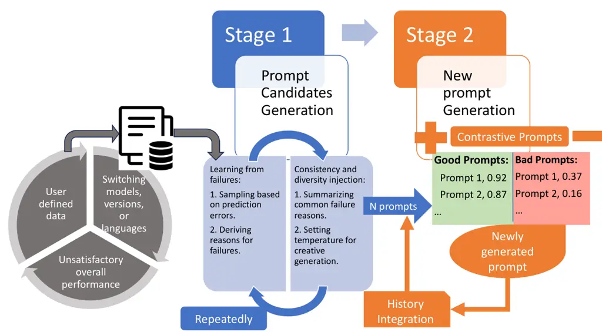
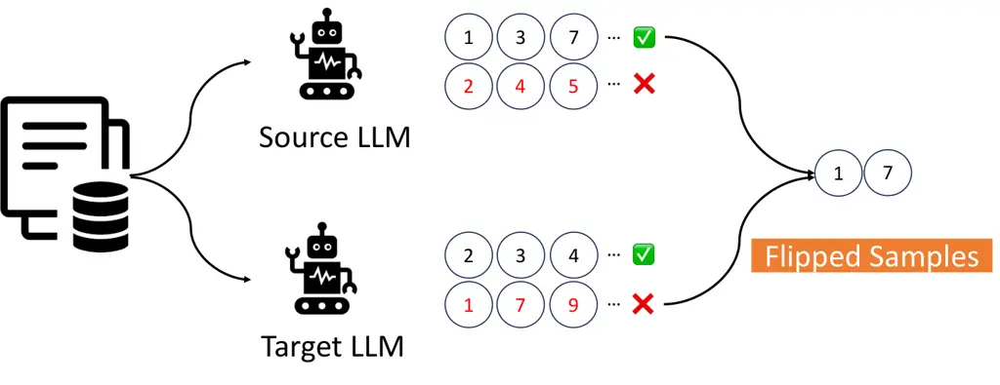
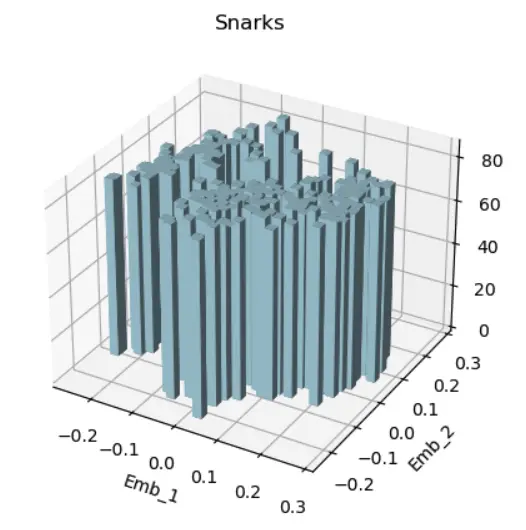

# Learning from Contrastive Prompts: Automated Optimization and Adaptation

Mingqi Li ^(†)^(†)thanks: This work was done during author’s internship
at Amazon. Affiliation: Clemson University
Email: [mingqil@clemson.edu](mailto:)    Karan Aggarwal
Affiliation: Amazon Services LLC Email: [kagg@amazon.com](mailto:)   
Yong Xie Affiliation: Amazon Services LLC
Email: [yonxie@amazon.com](mailto:)    Aitzaz Ahmad Affiliation: Amazon
Services LLC Email: [aitzaza@amazon.com](mailto:)    Stephan Lau
Affiliation: Amazon Services LLC Email: [lausteph@amazon.com](mailto:)

###### Abstract

As LLMs evolve, significant effort is spent on manually crafting
prompts. While existing prompt optimization methods automate this
process, they rely solely on learning from incorrect samples, leading to
a sub-optimal performance. Additionally, an unexplored challenge in the
literature is prompts effective for prior models may not perform well on
newer versions or different languages. We propose the Learning from
Contrastive Prompts (LCP) framework to address these gaps, enhancing
both prompt optimization and adaptation. LCP employs contrastive
learning to generate effective prompts by analyzing patterns in good and
bad prompt examples. Our evaluation on the Big-Bench Hard dataset shows
that LCP has a win rate of over 76% over existing methods in prompt
optimization and demonstrates strong adaptability across different model
versions, families, and languages. LCP offers a systematic approach to
prompt engineering, reducing manual effort in deploying LLMs across
varied contexts.

## 1 Introduction

The current approach to utilize Large Language Models (LLMs) begins with
users providing their queries. These queries are then augmented with
additional instructions, called prompts, by the system to enhance
response quality. Prompts often include contextual information or
instructions that help the model better understand and respond to a
query. Prompts may also include guidelines to restrict the LLM from
generating harmful or inappropriate content, ensuring safer and more
reliable interactions. The process of writing these prompts typically
involves trial-and-error. This intermediate step, known as _prompt
engineering_, is crucial for optimizing the performance of LLMs.

Recent advancements in prompt engineering have introduced various
techniques to enhance the effectiveness of prompts. One notable example
is zero-shot chain-of-thought prompting (Kojima et al., 2022), where
simply adding the phrase “Let’s think step-by-step” can stimulate the
LLMs’ reasoning capabilities, encouraging it to think aloud and process
the query in a logical sequence. However, this seemingly magical and
straightforward phrase is hard to come up with, as current LLMs are very
sensitive to phrasing prompts. Semantically similar prompts can lead to
significant performance variations (Kojima et al., 2022; Zhou et al.,
2023; Salinas & Morstatter, 2024), with minor modifications resulting in
a performance drop. This variation requires numerous experiments to find
the optimal prompt, resulting in a labor-intensive and time-consuming
prompt engineering process.

Prior works in literature (Yang et al., 2024; Guo et al., 2024; Wang
et al., 2024; Zhou et al., 2023; Sun et al., 2023) have addressed these
limitations by automatically optimizing prompts. For instance,
AutoHint (Sun et al., 2023) proposed learning from wrong samples by
using LLMs to generate hints for selected incorrect samples, which are
used to refine prompts. However, learning from only incorrect samples
can make the prompts too specific to the wrong samples, losing an
understanding of what worked. Another approach by OPRO (Yang et al., 2024) involves using LLMs as optimizers, where the model generates new
prompts iteratively based on a ranking list of previous prompts and
their corresponding scores. However, OPRO lacks the incorporation of
feedback from incorrect samples, potentially limiting its ability to
achieve optimal performance.

While prompt optimization has prior art, an unexplored and significant
challenge in prompt engineering is _prompt adaptation_. As LLMs are
continually updated and more capable LLMs are introduced, existing
prompts often need to be rewritten and tailored to align with the new
model version or an entirely new model. This constant adaptation is
necessary to maintain the effectiveness of the prompts to ensure they
produce high-quality results. Additionally, prompt adaptation across
various languages is crucial for ensuring performance in multilingual
contexts. However, this area remains unexplored in the literature.

To address these gaps, we propose _Learning from Contrastive Prompts
(LCP)_, an automatic prompt optimization and adaptation framework. In
particular, our framework consists of two stages: prompt candidate
generation and new prompt generation. We inject diverse prompts into
prompt optimization by generating multiple prompt candidates to explore
the prompt space. To overcome the shortcomings of existing methods, we
take an inspiration from the principle of contrastive learning (Chen
et al., 2020) by allowing the LLM to contrast between good and bad
prompts from the generated prompt candidates while learning to improve
on error cases. This helps the LLM reason on the prompts that work
versus those that do not, using exploration, to incorporate good prompts
without being too specific to the error cases.

We demonstrate the effectiveness of our approach for both the scenarios
of prompt optimization and prompt adaptation. We evaluate our framework
on the Big-Bench Hard dataset (Suzgun et al., 2022), which comprises
diverse tasks considered challenging even for human evaluators. Our
framework achieves a win rate of over 76% versus OPRO (Yang et al., 2024) and AutoHint (Sun et al., 2023) on prompt optimization. It
especially excels at algorithmic and multi-step arithmetic reasoning
tasks.

Our prompt adaptation framework leverages feedback from the target model
to enhance performance on the prompts from the source model. It achieves
comparable or better results than prompt optimization from scratch on
the target model when the target model is a weaker model. Our results
show that prompt adaptation is a delicate balance between the target
model’s abilities and the source model’s abilities. It can slightly
degrade performance on tasks where the source model excels, while
improving performance on tasks where the target model is stronger. This
observation holds true across model versions and families, _with our
framework creating a balance between the strengths of the source and
target models_. Results on the XCOPA dataset further demonstrate our
framework’s capability to adapt prompts across languages with a better
performance on 7 out of 11 languages versus prompt refinement baselines,
especially for low resource languages like Swahilli and Southern
Quechua.

In summary, we present a novel framework using contrastive learning for
prompt optimization and an unexplored problem of prompt adaptation. Our
results show promising results on both the prompt optimization and
prompt adaptation across model versions, families, and languages.

## 2 Methodology

Figure 1: Learning from Contrastive Prompts (LCP) framework. Given an
initial prompt and a small training set, LCP generates multiple prompt
candidates derived from summaries of common failure reasons for
different sample combinations. It leverages the inherent capabilities of
LLMs to understand the underlying patterns through contrastive prompts
to generate a new prompt.

Our proposed framework is illustrated in Figure 1. Both prompt
optimization and prompt adaptation utilize the same framework with minor
modifications. The framework is designed to enhance the effectiveness of
prompts across various scenarios, including adapting to different model
versions, model families, and languages. In this section, we will
explain the processes of prompt optimization and prompt adaptation
separately, detailing the specific stages and mechanisms involved in
each.

### 2.1 Motivation

In line with recent advancements, our work harnesses the reasoning
capabilities of LLMs to automatically optimize prompts. However, a
significant challenge persists in effectively instructing LLMs to
maximize their potential for generating high-quality prompts.

Our approach emulates how humans learn: by understanding failures and
their reasons, as well as contrasting good and bad examples to grasp
what works and what does not. We provide LLMs with error case feedback
and a spectrum of prompt quality. We expose them to failures, their
reasons, and ask them to contrast between good and bad prompts. This
enables learning from diverse perspectives for an improved prompt
generation. This unexplored avenue holds significant potential for
gaining a comprehensive understanding and unlocking LLMs’ full
capabilities in generating high-quality prompts.

The concept of contrasting high-quality prompts with low-quality ones
draws parallels to the principles of contrastive learning, which has
gained significant traction across various domains (Chen et al., 2020).
Contrastive learning aims to learn meaningful representations by
maximizing the similarity between positive pairs (analogous to
high-quality prompts) while minimizing the similarity between negative
pairs (analogous to low-quality prompts). By leveraging contrastive
learning techniques in our context, we can potentially guide LLMs to
capture the essential characteristics of effective prompts. In
particular, given a list of prompts with their corresponding quality
scores, we compare a batch of high-quality prompts to a batch of
low-quality prompts, drawing conclusions about the patterns that
characterize effective prompts.

### 2.2 Prompt Optimization

Prompt optimization improves the performance of prompts starting with a
simple initial prompt and iteratively refining it to enhance the
performance of the LLM on the tasks at hand. We present our two main
components next: Prompt Candidate Generation to generate candidate
prompts and New Prompt Generation to generate a final prompt using the
insights from the candidate prompts.

#### 2.2.1 Prompt Candidate Generation

We start with a small training set and an initial prompt, which is
appended to each query. Given an input and its expected output, LLMs are
capable of understanding how to achieve the expected output. We evaluate
the LLM generated outputs on the small training set to identify failure
cases. Taking a motivation from AutoHint (Sun et al., 2023), we use LLMs
to learn from failures by understanding the failures, and generating
reasons behind the failures. The prompt template in this step is shown
in Appendix A.5.

Consistency and diversity injection. A problem with generating the
reason for each wrong sample and crafting a prompt candidate based on
it, is that the candidate prompt can be biased towards that sample,
making it too specific. To inject some consistency, we select multiple
incorrectly predicted samples and summarize the common failure reasons
(See Appendix A.5). _AutoHint also summarized feedback on incorrect
samples, but they directly used these summaries as new prompts, which
led to their performance being significantly influenced by the selected
samples._ This presents a dilemma; if we select samples which are quite
similar, this could lead to model over-fitting on these samples,
trapping the generated prompt in a local minimum. To address this, we
add diversity to the generated summary by setting a more creative
temperature and repeating this step multiple times to generate $`N`$
prompts, referred to as _prompt candidates_. This approach helps the
model to explore the prompt space. We use $`N=10`$ based on our
experiments.

History integration. The generated prompts from previous iterations can
also influence the optimization process, leading to a better
performance. Therefore, we integrate these prompts into the prompt
candidates, ensuring that the accumulated knowledge from past iterations
contributes to the ongoing optimization process.

#### 2.2.2 New Prompt Generation

Now that we have $`N`$ prompt candidates, our goal is to generate a new
prompt using them. First, we assign a score to each candidate based on
its inference performance on the training set. We then rank all the
candidates according to their scores. Inspired by contrastive learning,
we instruct the LLM to identify the underlying patterns that distinguish
good prompts from bad prompts. Specifically, we define the top-$`K`$
prompts as the good prompts and the bottom-$`K`$ prompts as the bad
prompts, and we use the meta-prompt shown in Appendix A.5 to instruct
the LLM to generate a new prompt that follows the underlying pattern of
good prompts while improving the performance.

_This approach simplifies the learning process for LLMs compared to
OPRO, which directly learns from a ranked list and also did not provide
any error case feedback._ Viewing batches of good or bad prompts can
also be considered as injecting the consistency. Additionally, since we
integrate prompts generated in previous iterations, the differentiation
between good and bad prompts becomes more pronounced over time.

### 2.3 Prompt Adaptation

Prompt adaptation addresses the need to switch between different model
versions, model families, or languages, ensuring that optimized prompts
remain effective across diverse conditions. While our main framework
remains unchanged, we will detail the specific strategies used for
adaptation.

Figure 2: Data sampling strategy for prompt adaptation: Run inference on
the training set using the source and target LLMs. Identify correctly
and incorrectly predicted samples for each model. Select samples
correctly predicted by the prior model but incorrectly predicted by the
current model.

Cross-model version. In real-world scenarios, underlying models are
being continuously enhanced with new version roll-outs every few months.
For example, the GPT family has evolved to include ChatGPT-4o, and Meta
recently released LLAMA-3. Users can address their issues by switching
to a more advanced model when the previous version lacks the required
capabilities. Conversely, they can revert to the less capable model
version considering costs.

Our goal is to refine an optimized prompt for one model version to adapt
it effectively to another model version. Integrating feedback from the
original model version can provide valuable insights, enhancing the
adaptation process for the new model version. To facilitate this, we
improve our data sampling strategy (see Figure 2). Instead of randomly
selecting incorrectly predicted samples, we focus on samples that are
correctly predicted by the original model version but incorrectly
predicted by the current model version. This ensures the LLM pays more
attention to these critical samples, leading to a more effective
adaptation.

Cross-model. Next, we want to take it a step further. Users may want to
switch to models from other families that are more accessible or have
proven to be more effective for their specific tasks. This setting is
more challenging because the underlying models are fine-tuned with
different data distributions, tasks, and instructions, resulting in
significant variations. In this scenario, we maintain the same data
sampling strategy used in the cross-model version, while incorporating
error tolerance through wrong format rejection to accommodate less
effective models like LLAMA. In particular, if the generated prompt does
not adhere to the defined output format, we regenerate it until we reach
the maximum allowable number.

Cross-lingual. Adapting prompts across different languages presents
unique difficulties due to variations in linguistic structures,
vocabularies, and resources. To simplify the process and provide a
universal approach, we extend the same strategy to handle prompt
adaptation across languages, demonstrating its broader applicability. In
particular, we have the LLM translate samples from the target languages
into English and then conduct the inference step. We select data samples
that are correctly predicted when translated into English but
incorrectly predicted in their original languages.

## 3 Experiments

### 3.1 Setup

Benchmarks. Our evaluation benchmark is a subset of the Big-Bench Hard
dataset (Suzgun et al., 2022), consisting of 17 challenging multi-choice
tasks. The tasks are diverse, spanning across various categories like
natural language understanding, the use of world knowledge (both general
and factual), multilingual knowledge and reasoning, and algorithmic and
multi-step arithmetic reasoning, making it a comprehensive test for our
framework. We report results for each task category based on the keyword
taxonomy provided by Big-Bench Hard dataset¹¹ 1
[https://github.com/google/BIG-bench/blob/main/keywords.md](https://github.com/google/BIG-bench/blob/main/keywords.md).
For the cross-lingual setting, we use the XCOPA dataset (Ponti et al.,
2020), which demonstrates common sense reasoning ability and requires
world knowledge understanding.

Models. For our experiments, we used several state-of-the-art LLMs to
evaluate the effectiveness of our framework. These models include:
Claude-3-sonnet (Anthropic, 2024) and Claude-3-haiku, LLAMA-3-70b (Dubey
et al., 2024). Claude-3-haiku is a smaller and faster model while
Claude-3-sonnet is a more powerful model on the leaderboards²² 2
[https://chat.lmsys.org/?leaderboard](https://chat.lmsys.org/?leaderboard).

Baselines. We compare our framework with two existing methods:
AutoHint (Sun et al., 2023) and OPRO (Yang et al., 2024). AutoHint
optimizes prompts based on wrong samples in two iterations, using hint
generation and summarization. OPRO optimizes prompts by maintaining a
ranking list of historical prompts and relying solely on that. Since
these works used LLMs such as the GPT family and the PaLM family, which
we don’t have access to, we reimplemented their techniques on our target
LLMs for a fair comparison.

Prompt selection strategy. Our framework and OPRO both involve
optimizing prompts iteratively, which can lead to performance
fluctuations even upon convergence. Additionally, each task from the
Big-Bench Hard dataset consists of only 250 samples, making it
infeasible to create a validation set. This limitation is consistent
with real-world scenarios where data availability is often restricted.
We simply use the prompt generated in the last iteration and also
present the performance of the prompt with the best training set
accuracy during the process.

Implementation details We use the same data split as OPRO on the
Big-Bench Hard dataset, with 50 samples for training and 200 samples for
testing. For the XCOPA dataset, we use 50 samples from the validation
set for training, and test on 500 samples from the original testing set.
The temperature is set to 1.0. The maximum number of iterations is set
to 50, followed by a selection step. In each random sampling step, we
select 3 incorrectly predicted samples and repeat this step 10 times.
For contrastive prompts, we select 3 good prompts and 3 bad prompts from
the ranking list.

|                                                                                                                                                                                                                                    |               |               |               |
| ---------------------------------------------------------------------------------------------------------------------------------------------------------------------------------------------------------------------------------- | ------------- | ------------- | ------------- |
| TASK                                                                                                                                                                                                                               | LCP           | AutoHint      | OPRO          |
|                                                                                                                                                                                                                                    | Last / Best   | Last / Best   | Last / Best   |
| _Algorithmic and Multi-Step Arithmetic Reasoning_                                                                                                                                                                                  |               |               |               |
| geometric_shapes                                                                                                                                                                                                                   | 51.25 / 61.00 | 45.00 / 45.00 | 33.50 / 33.50 |
| logical_deduction_three_objects                                                                                                                                                                                                    | 92.50 / 90.25 | 76.00 / 76.00 | 70.50 / 76.00 |
| logical_deduction_five_objects                                                                                                                                                                                                     | 71.50 / 74.50 | 52.00 / 52.00 | 54.00 / 65.00 |
| logical_deduction_seven_objects                                                                                                                                                                                                    | 62.00 / 62.50 | 2.00 / 2.00   | 48.00 / 48.50 |
| penguins_in_a_table                                                                                                                                                                                                                | 97.86 / 96.15 | 86.30 / 86.30 | 87.20 / 94.00 |
| reasoning_about_colored_objects                                                                                                                                                                                                    | 85.30 / 84.40 | 85.50 / 85.50 | 90.50 / 90.50 |
| temporal_sequences                                                                                                                                                                                                                 | 98.25 / 97.00 | - / -         | 77.50 / 80.00 |
| tracking_shuffled_objects_three_objects                                                                                                                                                                                            | 92.00 / 99.00 | - / -         | 99.50 / 99.50 |
| tracking_shuffled_objects_five_objects                                                                                                                                                                                             | 90.50 / 95.50 | - / -         | 82.50 / 89.50 |
| tracking_shuffled_objects_seven_objects                                                                                                                                                                                            | 92.10 / 98.30 | - / -         | 72.50 / 92.00 |
| Win Rate (%)                                                                                                                                                                                                                       | 81.00 / 81.00 | 25.00 / 17.00 | 38.00 / 38.00 |
| _Natural Language Understanding_                                                                                                                                                                                                   |               |               |               |
| disambiguation_qa                                                                                                                                                                                                                  | 66.83 / 66.33 | 55.00 / 57.00 | 50.00 / 50.00 |
| hyperbaton                                                                                                                                                                                                                         | 78.25 / 84.00 | 63.00 / 63.00 | 29.00 / 42.50 |
| salient_translation_error_detection³³ 3 Note, salient_translation_error_detection task comes under both Natural Language Understanding and Multilingual Knowledge and Reasoning but is only counted once in the overall win rates. | 57.25 / 69.50 | 65.00 / 67.00 | 63.00 / 66.50 |
| snarks                                                                                                                                                                                                                             | 65.73 / 70.98 | 84.40 / 84.40 | 67.80 / 67.80 |
| Win Rate (%)                                                                                                                                                                                                                       | 50.00 / 88.00 | 75.00 / 62.00 | 25.00 / 0.00  |
| _Use of World Knowledge_                                                                                                                                                                                                           |               |               |               |
| date_understanding                                                                                                                                                                                                                 | 75.50 / 74.50 | 75.50 / 75.50 | 80.50 / 80.50 |
| movie_recommendation                                                                                                                                                                                                               | 87.75 / 85.50 | 72.00 / 72.00 | 36.00 / 36.00 |
| ruin_names                                                                                                                                                                                                                         | 76.50 / 75.25 | 76.50 / 79.50 | 68.00 / 68.00 |
| Win Rate (%)                                                                                                                                                                                                                       | 50.00 / 50.00 | 33.00 / 67.00 | 33.00 / 33.00 |
| _Multilingual Knowledge and Reasoning_                                                                                                                                                                                             |               |               |               |
| salient_translation_error_detection                                                                                                                                                                                                | 57.25 / 69.50 | 65.00 / 67.00 | 63.00 / 66.50 |
| Win Rate (%)                                                                                                                                                                                                                       | 0.00 / 100.0  | 100.0 / 50.00 | 50.00 / 0.00  |
| Overall Win Rate (%)                                                                                                                                                                                                               | 66.67 / 76.67 | 42.31 / 42.31 | 33.33 / 26.67 |

Table 1: Test accuracy of prompt optimization approaches on four types
of 17 BBH tasks for last iteration prompt (Last) versus the prompt with
best training accuracy (Best). Reported results are average across 5
runs. - indicates cases where AutoHint could not produce any meaningful
results. Blue indicates overall best results for Last or Best. Bold
indicates highest value in a row. Win rates have been calculated with
pair-wise comparisons following  Liang et al. (2022).

### 3.2 Results

#### 3.2.1 Prompt Optimization

Our prompt optimization begins with the initial prompt “Let’s solve the
problem.” in the same fashion as OPRO and AutoHint. All the experiments
in this section are conducted using Claude-3-sonnet to ensure better
performance. We report the results on last iteration from our method and
baselines as well as from the prompt with best performance on the
training set. Either choice is in line with previous works ( Yang et al.
(2024); Sun et al. (2023)) as strategies like a separate validation set,
does not provide any benefit owing to being highly correlated with
training performance. Also, we did not observe over-fitting with LCP.
For further discussion, please refer to Appendix A.1. While we report
results from both, given a relatively high variation and a slightly
lower performance using the last prompt (47% win rate versus 53% for
best training set prompt), we recommend using best prompt on the
training set as the selected prompt.

As shown in Table 1, our LCP framework achieves the best performance
with a win rate of 66.67% compared to AutoHint and OPRO when using the
last iteration prompt, and 76.67% when using the best prompt on training
set. We believe that the reason for LCP’s superior performance over
AutoHint is that our method overcomes the limitation of AutoHint which
struggles to summarize diverse hints. In contrast to OPRO, we take
advantage of LLMs’ inherent capability to contrast good prompts and bad
prompts, making the process easier and more detailed than relying on a
ranked list. Using contrastive learning directly aligns with the way
LLMs are fine-tuned with preference modeling, by learning to rank and
distinguish between better and worse options (Rafailov et al., 2024).
Additionally, we pay more attention to failures than OPRO, which solely
relies on the generated prompts and their corresponding scores. The
results highlight our framework’s strong performance particularly on
algorithmic and multi-step arithmetic reasoning tasks. This is
understandable as algorithmic and arithmetic tasks involve more detailed
instructions versus the other three categories which LCP excels through
its contrastive and diversity injection mechanisms. Evidence of this is
presented in the ablation study which shows that contrastive and
diversity injection mechanisms help especially on algorithmic and
arithmetic tasks.

|                                                            |                 |                            |                  |
| ---------------------------------------------------------- | --------------- | -------------------------- | ---------------- |
| Source $`\rightarrow`$ Target                              | LCP Adaptation  | LCP Optimization on Target | Source Optimized |
|                                                            | Last / Best     | Last / Best                | Last / Best      |
| Claude 3 Haiku $`\rightarrow`$ Claude 3 Sonnet (Table  9)  |                 |                            |                  |
| Algorithmic and Multi-Step Arithmetic Reasoning            | 55.00 / 50.00   | 75.00 / 65.00              | 20.00 / 40.00    |
| Natural Language Understanding                             | 62.5 / 100.00   | 25.00 / 0.00               | 62.5 / 50.00     |
| Use of World Knowledge                                     | 16.67 / 66.67   | 33.33 / 0.00               | 100.00 / 83.33   |
| Multilingual Knowledge and Reasoning                       | 100.00 / 100.00 | 0.00 / 0.00                | 50.00 / 50.00    |
| Overall                                                    | 50.00 / 67.65   | 55.88 / 38.24              | 44.12 / 50.00    |
| Claude 3 Sonnet $`\rightarrow`$ Claude 3 Haiku (Table  10) |                 |                            |                  |
| Algorithmic and Multi-Step Arithmetic Reasoning            | 45.00 / 50.00   | 70.00 / 45.00              | 40.00 / 65.00    |
| Natural Language Understanding                             | 50.00 / 75.00   | 25.00 / 12.5               | 75.00 / 75.00    |
| Use of World Knowledge                                     | 50.00 / 33.33   | 50.00 / 83.33              | 50.00 / 50.00    |
| Multilingual Knowledge and Reasoning                       | 50.00 / 50.00   | 0.00 / 0.00                | 100.00 / 100.00  |
| Overall                                                    | 44.12 / 52.94   | 55.88 / 44.12              | 50.00 / 64.71    |
| Claude 3 Sonnet $`\rightarrow`$ LLAMA 3 (Table  11)        |                 |                            |                  |
| Algorithmic and Multi-Step Arithmetic Reasoning            | 40.00 / 55.00   | 60.00 / 40.00              | 50.00 / 55.00    |
| Natural Language Understanding                             | 37.50 / 25.00   | 37.50 / 100.0              | 75.00 / 25.00    |
| Use of World Knowledge                                     | 50.00 / 83.33   | 16.67 / 50.00              | 83.33 / 16.67    |
| Multilingual Knowledge and Reasoning                       | 50.00 / 50.00   | 0.00 / 100.00              | 100.00/ 0.00     |
| Overall                                                    | 41.18 / 52.94   | 47.06 / 55.88              | 61.76 / 41.18    |

Table 2: Win rates of prompt adaptation and prompt optimization on model
version adaptation and model family adaptation: accuracy on BBH tasks
for last iteration prompt (Last) versus the best prompt on the training
set (Best). Blue indicates overall best results for Last or Best.

#### 3.2.2 Prompt Adaptation

Next, we present the results of our experiments on adapting prompts
across different model versions, model families, and languages from a
source model/language to target model/language.

Cross-model version and family. Table 2 presents a summary of adapting
prompts generated from Claude-3-haiku to the more advanced
Claude-3-sonnet, and vice-versa. We also present cross-model family
results with Claude-3-sonnet to LLAMA prompt adaptation. Detailed
results can be found in Table 9, Table 10, and Table 11 in appendix. We
compare LCP adaptation with directly performing the prompt optimization
process on the target model from scratch (LCP Optimization on Target)
and by using an optimized prompt (last iteration or best prompt on
training set) from source model directly without any change.

The results show that our adaptation framework effectively leverages
feedback from the prior model version (even it is less effective) to
enhance performance on the new model version — it is typically better
(best training prompt) or at par (last prompt) with prompt optimization
from scratch on the target model. From the results in task types, one
clear observation is how adaptation is a fine balance between the target
model generated prompts (LCP Optimization on Target) and source model
generated prompts (Source Optimized). For example, in Haiku
$`\rightarrow`$ Sonnet setting, LCP Adaptation works better than source
generated prompts but worse than target generated prompts for
Algorithmic and multi-step Arithmetic reasoning tasks. Situation is
completely reversed for Natural Language understanding tasks. This shows
that prompt adaptation can slightly degrade performance compared to
source on the tasks where the source model is relatively stronger while
increasing the performance compared to source where the target model is
relatively stronger. This observation is repeated even in the cross
model setting. Hence, _our LCP adaptation framework creates a balance
between strengths of source and target models_.

This observation can be attributed to our framework’s ability to
effectively leverage the strengths of the source model and transfer this
knowledge to the prompts for target model via feedback. Our approach
refines and tailors prompts to align with the nuances of the target
model, complementing the target model. This is especially beneficial for
scenarios where the tasks need target and source model’s complementary
capabilities making our approach a valuable tool that enables them to
improve response quality even with weaker but specialized models,
thereby expanding its applicability to a wider range of scenarios.

Cross-lingual. We report the results of our cross-lingual experiments in
Table 3. We categorized the methods into two groups: _prompt refinement_
and _query translation_. While our approach focuses on prompt
refinement, we also present the results of query translation to provide
additional insights. We compare our method with directly inputting the
test query (Blank Prompt), adding an optimized English prompt generated
by our prompt optimization method using the COPA dataset (Optimized
Prompt), and translating the optimized prompt to the target language.
The results indicate that our prompt adaptation approach outperforms the
prompt baselines for 7 out of 11 languages.

For query translation, we translate the input non-English language test
query into English and either use a blank prompt or use the English
prompt optimized by our method on the translated training data. Our
results show that query translation works better than prompt refinement
methods on 7 out of 11 tasks. This is in line with work from Lin et al.
(2022), where query translated worked better than human expert prompts
in the query language. This is a function of English heavy training of
current LLMs. It is important to note that query translation methods
come with an additional computational cost, as each query must be
translated into English before processing. However, as LLMs continue to
improve their performance on non-English languages, we anticipate a
narrowing of the gap between prompt refinement and query translation
methods. Important to note that on two low resource languages: Swahili
(sw) and Southern Quechua (qu), LCP even beats query translation
methods. Our study not only presents a comprehensive analysis of
cross-lingual performance but also introduces a novel prompt adaptation
technique that bridges the gap between the prompt refinement and query
translation methods.

|                   |          |      |      |      |      |      |      |      |      |      |      |
| ----------------- | -------- | ---- | ---- | ---- | ---- | ---- | ---- | ---- | ---- | ---- | ---- |
|                   | Language |      |      |      |      |      |      |      |      |      |      |
| Method            | ta       | sw   | it   | ht   | et   | tr   | zh   | id   | qu   | th   | vi   |
| Prompt Refinement |          |      |      |      |      |      |      |      |      |      |      |
| Blank Prompt      | 79.6     | 79.0 | 94.8 | 79.0 | 89.4 | 90.4 | 90.8 | 94.0 | 59.8 | 88.2 | 91.8 |
| Optimized Prompt  | 82.4     | 79.4 | 91.4 | 80.0 | 91.6 | 90.6 | 88.8 | 94.2 | 54.0 | 86.0 | 91.6 |
| Translated Prompt | 75.0     | 72.2 | 85.8 | 70.2 | 78.8 | 89.2 | 87.0 | 92.0 | 57.4 | 83.0 | 89.6 |
| LCP               | 80.8     | 80.8 | 96.8 | 83.2 | 92.2 | 92.6 | 93.4 | 93.4 | 62.0 | 85.8 | 91.2 |
| Query Translation |          |      |      |      |      |      |      |      |      |      |      |
| Blank Prompt      | 89.6     | 83.6 | 96.6 | 80.8 | 92.4 | 94.2 | 94.2 | 94.4 | 61.4 | 86.6 | 92.2 |
| Optimized Prompt  | 91.4     | 82.8 | 95.6 | 79.8 | 92.2 | 94.0 | 95.2 | 91.0 | 58.2 | 86.2 | 90.8 |

Table 3: Cross-lingual accuracy on 11 languages in XCOPA dataset. We
present the prompt with the best performance on training set.
Performance numbers in blue shows the best results for a language while
in bold show best numbers among Prompt Refinement methods.

### 3.3 Ablation Study

Figure 3: Ablation study with number of prompt candidates ($`N`$) on the
left and Effect of contrastive learning (w/ and w/o constrastive
learning) on the right. Reported are win rates on the prompt selected
with best training set performance (best). AMAR refers to Algorithmic
and Arithmetic, NLU to Natural Language Understanding, UWK to
Understanding of World Knowledge, and MKR to Multilingual Knowledge and
Reasoning categories.

##### Diversity Injection with multiple prompt candidates

We generate multiple prompt candidates ($`N=10`$) to explore the prompt
space which is used for the our contrastive learning framework to
identify the patterns between good and bad prompts from these prompt
candidates evaluated on the training set. Multiple prompt candidates
help us explore the diversity of the accuracy-prompt space, unlike
previous methods dependent on single prompts. To explore the
effectiveness of this mechanism, we use $`N=2,4`$, and $`6`$, with
top-$`\lfloor\frac{N}{2}\rfloor`$ and
bottom-$`\lfloor\frac{N}{2}\rfloor`$ prompts used for contrastive
learning. Win rates are shown in Figure 3 and detailed results in
Table 8. We clearly see that the win rates increase as we increase
$`N`$. This clearly demonstrates the effectiveness of injecting
diversity while generating the prompt using contrastive learning with
multiple prompt candidates. Increasing $`N`$ further, we saw limited
benefit and a much higher computation cost, so we use $`N=10`$.

##### Contrastive Learning

One of the key contribution of our work is using contrastive learning to
learn from both good and bad prompts, instead of just focusing on top
prompts (OPRO) or wrong samples (AutoHint). We show the effectiveness of
contrastive learning in our framework by comparing it with a setting
providing the LLM with just the $`N`$ ranked prompt candidates similar
to OPRO. Win rates are shown in Figure 3 and detailed results in
Table 7. Contrastive learning has a win rate of 76%, especially
benefiting the algorithmic and arithmetic tasks, which need more
involved instruction writing. These results combined with diversity
injection ablation clearly show the _benefit of exploring and analyzing
the prompt manifold to incorporate it in the prompt optimization_.

|                                 |             |             |
| ------------------------------- | ----------- | ----------- |
| Task                            | Optimizer   |             |
|                                 | Haiku       | Sonnet      |
|                                 | Last/Best   | Last/Best   |
| date_understanding              | 24.0 / 69.0 | 69.0 / 77.0 |
| reasoning_about_colored_objects | 67.5 / 69.0 | 70.0 / 71.0 |
| disambiguation_qa               | 61.0 / 63.5 | 62.5 / 64.5 |
| logical_deduction_three_objects | 70.0 / 68.0 | 69.0 / 71.5 |

Table 4: Cross-optimizer performance comparison on various tasks for
Claude-3-Haiku using Claude-3-Haiku (weaker version) versus
Claude-3-Sonnet (stronger model) as prompt optimizer.

Cross Optimizers. Based on the results from prompt adaptation, a natural
question arises: _can we use stronger models to optimize prompts for a
weaker model?_ We aimed to investigate whether employing a more advanced
model as the optimizer could further enhance performance. During the
prompt optimization of Claude-3-Haiku, we utilize Claude-3-Sonnet to
generate new candidate prompts, while still using Claude-3-Haiku for
evaluation. We run this on selected four tasks due to cost constraints
as shown in Table 4. We observe this approach significantly improves
performance due to the capabilities of Claude-3-Sonnet. Claude-3-Sonnet
as optimizer more effectively improved best/last prompts by 3.5%/7% on
the four selected tasks. These results demonstrate the promising
direction of leveraging more advanced models to optimize prompts for
weaker models.

(a) geometric_shapes task

(b) disambiguation_qa task

(c) reasoning colored objects

Figure 4: Accuracy as a function of number of training examples for LCP,
AutoHint, and OPRO.

Number of Training Examples. To provide insights into the number of
examples required for our method to maintain effectiveness, we report
the performance when using 5, 10, 25, and 50 examples for training, in
Figure 4 for three tasks. We notice a trend when we analyzed the
training plots. For tasks like reasoning about colored objects whose
training accuracy was relatively flat during the iterations, number of
examples had little effect, while for tasks like geometric shapes with
training curves showing considerable improvement across training
iterations, we see a consistent improvement in the performance as number
of examples increased. Further, we observe that LCP is relatively more
sample efficient, giving a relatively higher performance at lower number
of samples versus AutoHint or OPRO. This can be attributed to our
multiple candidate generation for contrastive learning that helps model
explore diverse prompts to derive insights.

## 4 Related Work

Soft prompt optimization. Recent studies have explored soft
prompt-tuning, which involves prepending continuous vectors that are out
of vocabulary and serve as prompts for specific tasks (Li & Liang, 2021;
Lester et al., 2021; Liu et al., 2022; Qin & Eisner, 2021; Ben-David
et al., 2022). These approaches are model-agnostic, but they do not
focus on adapting prompts to other models. Some work does leverage soft
prompt-tuning for cross-lingual adaptation (Li et al., 2023b; Huang
et al., 2022; Zhao et al., 2023; Park et al., 2023). However, these
methods often require access to model logits, which can be a constraint
in practical applications with the recent proprietary models.

Hard prompt optimization. Hard prompt optimization involves crafting
discrete, human-interpretable prompts. Prior works have focused on
prompt engineering, iterative refinement, and search-based techniques to
improve performance (Guo et al., 2024; Zhou et al., 2023; Pryzant
et al., 2023; Wang et al., 2024; Sun et al., 2023; Yang et al., 2024;
Wan et al., 2023; Li et al., 2023a; Yuksekgonul et al., 2024).
Specifically, APE (Zhou et al., 2023) selects the top instructions with
the highest accuracies and then prompts the LLM to generate semantically
similar variants for each selected instruction. AutoHint (Sun et al., 2023) generates hints from incorrect samples, summarizes these hints,
and uses the summary as the new prompt. OPRO (Yang et al., 2024)
generates new prompts by leveraging historical prompts and their
corresponding scores, instructing the LLM to create improved versions.

While these works focused on prompt optimization they did not explore
prompt adaptability to various model versions, model families, and
languages. Our proposed approach bridges this gap by providing a novel
comprehensive framework for prompt optimization and adaptation, ensuring
effectiveness across different models and linguistic contexts using
contrastive learning.

## 5 Conclusion

In this paper, we proposed Learning from Contrastive Prompts (LCP), a
comprehensive framework for prompt optimization and adaptation. Our
approach addresses the limitations of existing optimization methods and
addresses an unexplored but common problem of adapting prompts across
different model versions, model families, and languages. It involves a
systematic process of prompt candidate generation and new prompt
generation through contrastive learning, and feedback for prompt
adaptation setting to ensure that the prompts remain effective and
relevant in diverse scenarios. We conducted extensive experiments on the
Big-Bench Hard dataset, demonstrating that our framework significantly
outperforms existing methods.

Our results showed that our approach maintains high performance when
adapting prompts across different model versions complementing the
strengths of the source and target models. Additionally, our framework
proved robust in cross-lingual scenarios, effectively handling the
challenges posed by different linguistic contexts. Our results also show
that using a stronger model for prompt optimization and adaptation could
significantly boost performance on weaker LLMs instead of prompt
adaptation from scratch using our framework.

One of the key areas of investigation from our work is exploration and
exploiting prompt manifold in a more systematic way. The current prompt
optimization methods including ours are unstable over iterations, and
its not clear how to navigate the prompt manifold (see Appendix A.2 for
more discussion). Some avenues could include a richer feedback mechanism
across iterations, as we only rely on feedback from the prompt generated
in the preceding iteration or giving a higher weightage to better hints.
Further, letting the LLMs explain the feedback and incorporating that
reasoning could also be potentially helpful. Prompt adaptation, which
can be thought of through the lens of classical domain adaptation can be
helped by a more sophisticated feedback design to get best of both the
target model and source model, as we see it currently tries to strike
the balance between the two. Our cross-optimizer results also show a
promising direction and needs further exploration, especially in domains
like law or medical where weaker but domain specialized model could
guide or be guided in a collaborative fashion by more powerful general
LLMs to generate powerful prompts.

## References

- Anthropic (2024) AI Anthropic. The claude 3 model family: Opus,
  sonnet, haiku. _Claude-3 Model Card_, 1, 2024.
- Ben-David et al. (2022) Eyal Ben-David, Nadav Oved, and Roi Reichart.
  Pada: Example-based prompt learning for on-the-fly adaptation to
  unseen domains. _Transactions of the Association for Computational
  Linguistics_, 10:414–433, 2022.
- Chen et al. (2020) Ting Chen, Simon Kornblith, Mohammad Norouzi, and
  Geoffrey Hinton. A simple framework for contrastive learning of visual
  representations. In _International conference on machine learning_,
  pp. 1597–1607. PMLR, 2020.
- Dubey et al. (2024) Abhimanyu Dubey, Abhinav Jauhri, Abhinav Pandey,
  Abhishek Kadian, Ahmad Al-Dahle, Aiesha Letman, Akhil Mathur, Alan
  Schelten, Amy Yang, Angela Fan, et al. The llama 3 herd of models.
  _arXiv preprint arXiv:2407.21783_, 2024.
- Guo et al. (2024) Qingyan Guo, Rui Wang, Junliang Guo, Bei Li, Kaitao
  Song, Xu Tan, Guoqing Liu, Jiang Bian, and Yujiu Yang. Connecting
  large language models with evolutionary algorithms yields powerful
  prompt optimizers. In _The Twelfth International Conference on
  Learning Representations_, 2024. URL
  [https://openreview.net/forum?id=ZG3RaNIsO8](https://openreview.net/forum?id=ZG3RaNIsO8).
- Huang et al. (2022) Lianzhe Huang, Shuming Ma, Dongdong Zhang, Furu
  Wei, and Houfeng Wang. Zero-shot cross-lingual transfer of
  prompt-based tuning with a unified multilingual prompt. In Yoav
  Goldberg, Zornitsa Kozareva, and Yue Zhang (eds.), _Proceedings of the
  2022 Conference on Empirical Methods in Natural Language Processing_,
  pp. 11488–11497, Abu Dhabi, United Arab Emirates, December 2022.
  Association for Computational Linguistics. doi:
  10.18653/v1/2022.emnlp-main.790. URL
  [https://aclanthology.org/2022.emnlp-main.790](https://aclanthology.org/2022.emnlp-main.790).
- Kojima et al. (2022) Takeshi Kojima, Shixiang Shane Gu, Machel Reid,
  Yutaka Matsuo, and Yusuke Iwasawa. Large language models are zero-shot
  reasoners. _Advances in neural information processing systems_,
  35:22199–22213, 2022.
- Lester et al. (2021) Brian Lester, Rami Al-Rfou, and Noah Constant.
  The power of scale for parameter-efficient prompt tuning. In
  Marie-Francine Moens, Xuanjing Huang, Lucia Specia, and Scott Wen-tau
  Yih (eds.), _Proceedings of the 2021 Conference on Empirical Methods
  in Natural Language Processing_, pp. 3045–3059, Online and Punta Cana,
  Dominican Republic, November 2021. Association for Computational
  Linguistics. doi: 10.18653/v1/2021.emnlp-main.243. URL
  [https://aclanthology.org/2021.emnlp-main.243](https://aclanthology.org/2021.emnlp-main.243).
- Li et al. (2023a) Moxin Li, Wenjie Wang, Fuli Feng, Yixin Cao, Jizhi
  Zhang, and Tat-Seng Chua. Robust prompt optimization for large
  language models against distribution shifts. In Houda Bouamor, Juan
  Pino, and Kalika Bali (eds.), _Proceedings of the 2023 Conference on
  Empirical Methods in Natural Language Processing_, pp. 1539–1554,
  Singapore, December 2023a. Association for Computational Linguistics.
  doi: 10.18653/v1/2023.emnlp-main.95. URL
  [https://aclanthology.org/2023.emnlp-main.95](https://aclanthology.org/2023.emnlp-main.95).
- Li et al. (2023b) Shuang Li, Xuming Hu, Aiwei Liu, Yawen Yang, Fukun
  Ma, Philip S. Yu, and Lijie Wen. Enhancing cross-lingual natural
  language inference by soft prompting with multilingual verbalizer. In
  Anna Rogers, Jordan Boyd-Graber, and Naoaki Okazaki (eds.), _Findings
  of the Association for Computational Linguistics: ACL 2023_, pp.
  1361–1374, Toronto, Canada, July 2023b. Association for Computational
  Linguistics. doi: 10.18653/v1/2023.findings-acl.88. URL
  [https://aclanthology.org/2023.findings-acl.88](https://aclanthology.org/2023.findings-acl.88).
- Li & Liang (2021) Xiang Lisa Li and Percy Liang. Prefix-tuning:
  Optimizing continuous prompts for generation. In Chengqing Zong, Fei
  Xia, Wenjie Li, and Roberto Navigli (eds.), _Proceedings of the 59th
  Annual Meeting of the Association for Computational Linguistics and
  the 11th International Joint Conference on Natural Language Processing
  (Volume 1: Long Papers)_, pp. 4582–4597, Online, August 2021.
  Association for Computational Linguistics. doi:
  10.18653/v1/2021.acl-long.353. URL
  [https://aclanthology.org/2021.acl-long.353](https://aclanthology.org/2021.acl-long.353).
- Liang et al. (2022) Percy Liang, Rishi Bommasani, Tony Lee, Dimitris
  Tsipras, Dilara Soylu, Michihiro Yasunaga, Yian Zhang, Deepak
  Narayanan, Yuhuai Wu, Ananya Kumar, et al. Holistic evaluation of
  language models. _arXiv preprint arXiv:2211.09110_, 2022.
- Lin et al. (2022) Xi Victoria Lin, Todor Mihaylov, Mikel Artetxe,
  Tianlu Wang, Shuohui Chen, Daniel Simig, Myle Ott, Naman Goyal, Shruti
  Bhosale, Jingfei Du, et al. Few-shot learning with multilingual
  generative language models. In _Proceedings of the 2022 Conference on
  Empirical Methods in Natural Language Processing_, pp.
  9019–9052, 2022.
- Liu et al. (2022) Xiao Liu, Kaixuan Ji, Yicheng Fu, Weng Tam,
  Zhengxiao Du, Zhilin Yang, and Jie Tang. P-tuning: Prompt tuning can
  be comparable to fine-tuning across scales and tasks. In Smaranda
  Muresan, Preslav Nakov, and Aline Villavicencio (eds.), _Proceedings
  of the 60th Annual Meeting of the Association for Computational
  Linguistics (Volume 2: Short Papers)_, pp. 61–68, Dublin, Ireland,
  May 2022. Association for Computational Linguistics. doi:
  10.18653/v1/2022.acl-short.8. URL
  [https://aclanthology.org/2022.acl-short.8](https://aclanthology.org/2022.acl-short.8).
- Park et al. (2023) Nohil Park, Joonsuk Park, Kang Min Yoo, and Sungroh
  Yoon. On the analysis of cross-lingual prompt tuning for decoder-based
  multilingual model. _arXiv preprint arXiv:2311.07820_, 2023.
- Ponti et al. (2020) Edoardo Maria Ponti, Goran Glavaš, Olga Majewska,
  Qianchu Liu, Ivan Vulić, and Anna Korhonen. XCOPA: A multilingual
  dataset for causal commonsense reasoning. In Bonnie Webber, Trevor
  Cohn, Yulan He, and Yang Liu (eds.), _Proceedings of the 2020
  Conference on Empirical Methods in Natural Language Processing
  (EMNLP)_, pp. 2362–2376, Online, November 2020. Association for
  Computational Linguistics. doi: 10.18653/v1/2020.emnlp-main.185. URL
  [https://aclanthology.org/2020.emnlp-main.185](https://aclanthology.org/2020.emnlp-main.185).
- Pryzant et al. (2023) Reid Pryzant, Dan Iter, Jerry Li, Yin Lee,
  Chenguang Zhu, and Michael Zeng. Automatic prompt optimization with
  “gradient descent” and beam search. In Houda Bouamor, Juan Pino, and
  Kalika Bali (eds.), _Proceedings of the 2023 Conference on Empirical
  Methods in Natural Language Processing_, pp. 7957–7968, Singapore,
  December 2023. Association for Computational Linguistics. doi:
  10.18653/v1/2023.emnlp-main.494. URL
  [https://aclanthology.org/2023.emnlp-main.494](https://aclanthology.org/2023.emnlp-main.494).
- Qin & Eisner (2021) Guanghui Qin and Jason Eisner. Learning how to
  ask: Querying LMs with mixtures of soft prompts. In Kristina
  Toutanova, Anna Rumshisky, Luke Zettlemoyer, Dilek Hakkani-Tur,
  Iz Beltagy, Steven Bethard, Ryan Cotterell, Tanmoy Chakraborty, and
  Yichao Zhou (eds.), _Proceedings of the 2021 Conference of the North
  American Chapter of the Association for Computational Linguistics:
  Human Language Technologies_, pp. 5203–5212, Online, June 2021.
  Association for Computational Linguistics. doi:
  10.18653/v1/2021.naacl-main.410. URL
  [https://aclanthology.org/2021.naacl-main.410](https://aclanthology.org/2021.naacl-main.410).
- Rafailov et al. (2024) Rafael Rafailov, Archit Sharma, Eric Mitchell,
  Christopher D Manning, Stefano Ermon, and Chelsea Finn. Direct
  preference optimization: Your language model is secretly a reward
  model. _Advances in Neural Information Processing Systems_, 36, 2024.
- Reimers & Gurevych (2019) Nils Reimers and Iryna Gurevych.
  Sentence-bert: Sentence embeddings using siamese bert-networks. In
  _Proceedings of the 2019 Conference on Empirical Methods in Natural
  Language Processing and the 9th International Joint Conference on
  Natural Language Processing (EMNLP-IJCNLP)_, pp. 3982–3992, 2019.
- Salinas & Morstatter (2024) Abel Salinas and Fred Morstatter. The
  butterfly effect of altering prompts: How small changes and jailbreaks
  affect large language model performance. _arXiv preprint
  arXiv:2401.03729_, 2024.
- Sun et al. (2023) Hong Sun, Xue Li, Yinchuan Xu, Youkow Homma, Qi Cao,
  Min Wu, Jian Jiao, and Denis Charles. Autohint: Automatic prompt
  optimization with hint generation. _arXiv preprint
  arXiv:2307.07415_, 2023.
- Suzgun et al. (2022) Mirac Suzgun, Nathan Scales, Nathanael Schärli,
  Sebastian Gehrmann, Yi Tay, Hyung Won Chung, Aakanksha Chowdhery,
  Quoc V Le, Ed H Chi, Denny Zhou, et al. Challenging big-bench tasks
  and whether chain-of-thought can solve them. _arXiv preprint
  arXiv:2210.09261_, 2022.
- Wan et al. (2023) Xingchen Wan, Ruoxi Sun, Hanjun Dai, Sercan Arik,
  and Tomas Pfister. Better zero-shot reasoning with self-adaptive
  prompting. In Anna Rogers, Jordan Boyd-Graber, and Naoaki Okazaki
  (eds.), _Findings of the Association for Computational Linguistics:
  ACL 2023_, pp. 3493–3514, Toronto, Canada, July 2023. Association for
  Computational Linguistics. doi: 10.18653/v1/2023.findings-acl.216. URL
  [https://aclanthology.org/2023.findings-acl.216](https://aclanthology.org/2023.findings-acl.216).
- Wang et al. (2024) Xinyuan Wang, Chenxi Li, Zhen Wang, Fan Bai,
  Haotian Luo, Jiayou Zhang, Nebojsa Jojic, Eric Xing, and Zhiting Hu.
  Promptagent: Strategic planning with language models enables
  expert-level prompt optimization. In _The Twelfth International
  Conference on Learning Representations_, 2024. URL
  [https://openreview.net/forum?id=22pyNMuIoa](https://openreview.net/forum?id=22pyNMuIoa).
- Yang et al. (2024) Chengrun Yang, Xuezhi Wang, Yifeng Lu, Hanxiao Liu,
  Quoc V Le, Denny Zhou, and Xinyun Chen. Large language models as
  optimizers. In _The Twelfth International Conference on Learning
  Representations_, 2024. URL
  [https://openreview.net/forum?id=Bb4VGOWELI](https://openreview.net/forum?id=Bb4VGOWELI).
- Yuksekgonul et al. (2024) Mert Yuksekgonul, Federico Bianchi, Joseph
  Boen, Sheng Liu, Zhi Huang, Carlos Guestrin, and James Zou. Textgrad:
  Automatic” differentiation” via text. _arXiv preprint
  arXiv:2406.07496_, 2024.
- Zhao et al. (2023) Wanru Zhao, Yihong Chen, Royson Lee, Xinchi Qiu,
  Yan Gao, Hongxiang Fan, and Nicholas Donald Lane. Breaking physical
  and linguistic borders: Multilingual federated prompt tuning for
  low-resource languages. In _International Workshop on Federated
  Learning in the Age of Foundation Models in Conjunction with NeurIPS
  2023_, 2023. URL
  [https://openreview.net/forum?id=HyRwexERAo](https://openreview.net/forum?id=HyRwexERAo).
- Zhou et al. (2023) Yongchao Zhou, Andrei Ioan Muresanu, Ziwen Han,
  Keiran Paster, Silviu Pitis, Harris Chan, and Jimmy Ba. Large language
  models are human-level prompt engineers. In _The Eleventh
  International Conference on Learning Representations_, 2023. URL
  [https://openreview.net/forum?id=92gvk82DE-](https://openreview.net/forum?id=92gvk82DE-).

## Appendix A Appendix

### A.1 Discussion about Validation Set

(a) geometric_shapes task

(b) disambiguation_qa task

Figure 5: Accuracy as a function of number of training examples for LCP,
AutoHint, and OPRO.

We did not use a validation set for our experiments following OPRO (Yang
et al., 2024) and AutoHint (Sun et al., 2023), and based on our
experiments. We show the training and validation accuracy curves when we
do setup a validation set aside in Figure 5 on two tasks. We use a split
of 33.33% training, 33.33% validation, and 33.33% testing sets to show
these results.

We observe that there is no inherent bias-variance trade-off between the
training/validation accuracies; typically validation accuracy follows
training accuracy. We observe a moderate Spearman’s correlation between
0.45-0.55 (p-values$`<`$0.001), showing that they are quite correlated.
Further, we see that our method does not really overfit; training
accuracy is lower or similar to validation accuracy unlike overfitting
exhibited by OPRO as noted by Yang et al. (2024). Unlike traditional
fine-tuning machine learning regime where the training data gets
embedded into the model weights, it is quite clear on how to define
overfitting in prompt optimization except prompts becoming too specific
to the training samples. Since prompt accuracies change significantly
iteration-over-iteration, further exploration is needed in this space to
devise a way of final prompt selection. To keep it consistent with prior
works (Yang et al., 2024; Sun et al., 2023) and to keep things simple in
absence of an evidence of over-fitting, we chose to use last iteration
prompt and prompt with best accuracy on training set.

### A.2 Prompt Similarity Visualization

Figure 6: Visualization of prompt similarity: generated prompts in a 2D
embedding space versus the performance on snarks task on the z-axis.

We visualize the performance over prompt embeddings in Figure 6. Using
sentence transformer (Reimers & Gurevych, 2019), we embed the prompts
generated over 50 iterations on the snarks task. This three-dimensional
histogram plots the distribution of prompts in a two-dimensional
embedding space selected using the first two principal components
representing a reduced-dimensional representation of the prompt space.
The z-axis, represents the performance metric of each prompt. The
varying heights of the uniform blue-gray bars illustrate the performance
landscape across the embedding space.

Two regions appear prominently on this: low performing prompts facing us
and high performing prompts facing away from us. There is a notion of a
boundary line dividing the two regions. Our analysis of this
visualization reveals that semantically similar prompts, represented by
nearby points in the embedding space, tend to yield comparable
performance results. This is evidenced by clusters of bars with similar
heights. However, even slight changes in the prompt, especially for the
prompts closer to the boundary, can lead to significant variations in
performance, highlighting the sensitivity of optimization methods to
prompt formulation.

It demonstrates that while semantic similarity often correlates with
performance similarity, the relationship is not always straightforward.
The complex landscape depicted here emphasizes the challenges and
opportunities in prompt optimization with a hard to map prompt-accuracy
manifold. Our diversity injection and contrastive learning framework
helped explore and guide the prompt optimization through this space.
More work needs to be done to understand how to create methods to
navigate this manifold.

### A.3 Number of Contrastive Prompts

| Task                            | 2           | 3           | 4           | 5           |
| ------------------------------- | ----------- | ----------- | ----------- | ----------- |
| date_understanding              | 79.0 / 76.5 | 75.5 / 74.5 | 77.5 / 73.5 | 78.5 / 78.0 |
| reasoning_about_colored_objects | 85.5 / 83.5 | 85.3 / 84.4 | 84.5 / 81.0 | 85.5 / 84.0 |

Table 5: Performance results with ablation on number of prompts used for
Contrastive learning. We present the last / best performance for each
task.

Table 5 shows the ablation of number of selected prompts for contrastive
learning’s feedback. We observe there is some variation in the
performance across the number of prompts but no clear trend. Hence, no
clear choice of which number of prompts to select. We chose 3 as higher
number of prompts incur much more computation costs.

### A.4 Number of selected wrong data samples

AutoHint (Sun et al., 2023) observed that using no more than 3 samples
per iteration achieves the best performance, as more samples could
confuse the LLM when generating the summary. We also investigate how the
performance varies with different numbers of selected wrong samples in
Table 6. We do not observe a clear benefit of increasing the number from
three. Hence, we use three wrong samples during our experiments in
accordance with AutoHint.

| Task                            | 3           | 4           | 5           | 6           |
| ------------------------------- | ----------- | ----------- | ----------- | ----------- |
| date_understanding              | 75.5 / 74.5 | 70.5 / 75.0 | 77.0 / 72.5 | 77.0 / 74.0 |
| reasoning_about_colored_objects | 85.3 / 84.4 | 81.0 / 85.5 | 79.5 / 82.5 | 82.5 / 83.0 |

Table 6: Performance results with ablation on number of wrong samples
performance. We present the last / best performance for each task.

### A.5 Meta prompt

Given input: \[INPUT\] And its expected output: \[OUTPUT\] Explain the
reason why the input corresponds to the given expected output. The
reason should be placed within tag $`<`$reason$`>`$$`<`$/reason$`>`$.

Given input and expected output pairs, along with the reason for
generated outputs, provide a summarized common reason applicable to all
cases within tags $`<`$summary$`>`$ and $`<`$/summary$`>`$. The summary
should explain the underlying principles, logic or methodology governing
the relationship between the inputs and corresponding outputs. Avoid
mentioning any specific details, numbers, or entities from the
individual examples, and aim for a generalized explanation.

Given $`m`$ examples of good prompts and their corresponding scores and
$`m`$ examples of bad prompts and their corresponding scores, explore
the unerlying pattern of good prompts, generate a new prompt based on
this pattern. Put the new prompt within tag $`<`$prompt$`>`$ and
$`<`$/prompt$`>`$. Good prompts and scores: Prompt 1: \[PROMPT 1\]
Score: \[SCORE 1\] … Prompt $`m`$: \[PROMPT $`m`$\] Score: \[SCORE
$`m`$\]

Given $`m`$ prompt pairs and their corresponding scores, explain why one
prompt is better than others. Prompt pairs and scores: Prompt 1:
\[PROMPT 1\] Score: \[SCORE 1\] … Prompt $`m`$: \[PROMPT $`m`$\] Score:
\[SCORE $`m`$\] Summarize these explanation and generate a new prompt
accordingly. Put the new prompt within tag $`<`$prompt$`>`$ and
$`<`$/prompt$`>`$.

### A.6 Detailed Results on LCP Ablations

Table 7 and Table 8 show detailed results on accuracies and win rates
over the 17 tasks for the BBH data for the two ablation studies: w/ and
w/o contrastive learning, and number of generated prompt candidates,
respectively.

|                                                   |               |                                |
| ------------------------------------------------- | ------------- | ------------------------------ |
| TASK                                              | LCP           | LCP (w/o contrastive learning) |
|                                                   | Last / Best   | Last / Best                    |
| _Algorithmic and Multi-Step Arithmetic Reasoning_ |               |                                |
| geometric_shapes                                  | 51.25 / 61.00 | 53.50 / 56.00                  |
| logical_deduction_three_objects                   | 92.50 / 90.25 | 93.00 / 93.00                  |
| logical_deduction_five_objects                    | 71.50 / 74.50 | 71.00 / 70.00                  |
| logical_deduction_seven_objects                   | 62.00 / 62.50 | 58.00 / 53.00                  |
| penguins_in_a_table                               | 97.86 / 96.15 | 94.23 / 93.87                  |
| reasoning_about_colored_objects                   | 85.30 / 84.40 | 80.50 / 83.50                  |
| temporal_sequences                                | 98.25 / 97.00 | 94.50 / 98.50                  |
| tracking_shuffled_objects_three_objects           | 92.00 / 99.00 | 89.50 / 90.00                  |
| tracking_shuffled_objects_five_objects            | 90.50 / 95.50 | 94.50 / 92.50                  |
| tracking_shuffled_objects_seven_objects           | 92.10 / 98.30 | 89.50 / 92.50                  |
| Win Rate (%)                                      | 70.00 / 80.00 | 30.00 / 20.00                  |
| _Natural Language Understanding_                  |               |                                |
| disambiguation_qa                                 | 66.83 / 66.33 | 70.50 / 63.50                  |
| hyperbaton                                        | 78.25 / 84.00 | 79.00 / 79.50                  |
| salient_translation_error_detection               | 57.25 / 69.50 | 66.50 / 66.00                  |
| snarks                                            | 65.73 / 70.98 | 67.73 / 68.23                  |
| Win Rate (%)                                      | 0.00 / 100.00 | 100.00 / 0.00                  |
| _Use of World Knowledge_                          |               |                                |
| date_understanding                                | 75.50 / 74.50 | 77.00 / 75.00                  |
| movie_recommendation                              | 87.75 / 85.50 | 85.00 / 75.00                  |
| ruin_names                                        | 76.50 / 75.25 | 77.50 / 78.00                  |
| Win Rate (%)                                      | 33.00 / 33.00 | 67.00 / 67.00                  |
| _Multilingual Knowledge and Reasoning_            |               |                                |
| salient_translation_error_detection               | 57.25 / 69.50 | 66.50 / 66.00                  |
| Win Rate (%)                                      | 0.00 / 100.00 | 100.00 / 0.00                  |
| Overall Win Rate (%)                              | 47.06 / 76.47 | 52.94 / 23.53                  |

Table 7: Test accuracy of LCP with and w/o contrastive learning on four
types of 17 BBH tasks for last iteration prompt (Last) versus the prompt
with best training accuracy (Best). Blue indicates overall best win
rates for Last or Best.

|                                                   |               |               |               |               |
| ------------------------------------------------- | ------------- | ------------- | ------------- | ------------- |
| TASK                                              | $`N=10`$      | $`N=6`$       | $`N=4`$       | $`N=2`$       |
|                                                   | Last / Best   | Last / Best   | Last / Best   | Last / Best   |
| _Algorithmic and Multi-Step Arithmetic Reasoning_ |               |               |               |               |
| geometric_shapes                                  | 51.25 / 61.00 | 54.00 / 58.50 | 50.50 / 60.00 | 52.00 / 56.50 |
| logical_deduction_three_objects                   | 92.50 / 90.25 | 84.00 / 90.50 | 87.00 / 87.00 | 82.00 / 80.50 |
| logical_deduction_five_objects                    | 71.50 / 74.50 | 62.00 / 62.00 | 59.00 / 59.00 | 60.00 / 60.50 |
| logical_deduction_seven_objects                   | 62.00 / 62.50 | 63.00 / 58.50 | 59.00 / 55.00 | 54.50 / 55.00 |
| penguins_in_a_table                               | 97.86 / 96.15 | 94.87 / 94.87 | 96.58 / 96.58 | 95.73 / 95.73 |
| reasoning_about_colored_objects                   | 85.30 / 84.40 | 83.00 / 87.00 | 86.50 / 83.50 | 82.50 / 82.50 |
| temporal_sequences                                | 98.25 / 97.00 | 99.50 / 96.50 | 96.00 / 96.00 | 95.50 / 99.50 |
| tracking_shuffled_objects_three_objects           | 92.00 / 99.00 | 94.50 / 94.50 | 94.00 / 99.00 | 95.50 / 95.50 |
| tracking_shuffled_objects_five_objects            | 90.50 / 95.50 | 78.50 / 78.50 | 92.50 / 92.50 | 98.50 / 95.00 |
| tracking_shuffled_objects_seven_objects           | 92.10 / 98.30 | 93.50 / 96.50 | 85.00 / 88.50 | 79.00 / 79.00 |
| Win Rate (%)                                      | 63.00 / 83.00 | 60.00 / 47.00 | 43.00 / 37.00 | 33.00 / 27.00 |
| _Natural Language Understanding_                  |               |               |               |               |
| disambiguation_qa                                 | 66.83 / 66.33 | 66.00 / 68.00 | 68.00 / 71.00 | 66.00 / 63.00 |
| hyperbaton                                        | 78.25 / 84.00 | 82.00 / 81.50 | 82.00 / 82.50 | 81.50 / 83.50 |
| salient_translation_error_detection               | 57.25 / 69.50 | 70.00 / 70.00 | 65.50 / 68.50 | 67.50 / 65.50 |
| snarks                                            | 65.73 / 70.98 | 60.14 / 60.14 | 74.13 / 76.22 | 71.33 / 71.33 |
| Win Rate (%)                                      | 25.00 / 58.00 | 42.00 / 42.00 | 75.00 / 67.00 | 42.00 / 33.00 |
| _Use of World Knowledge_                          |               |               |               |               |
| date_understanding                                | 75.50 / 74.50 | 72.00 / 72.00 | 73.50 / 74.00 | 74.00 / 76.00 |
| movie_recommendation                              | 87.75 / 85.50 | 86.50 / 87.50 | 79.00 / 77.00 | 82.00 / 83.00 |
| ruin_names                                        | 76.50 / 75.25 | 76.00 / 79.50 | 79.00 / 80.00 | 80.00 / 77.50 |
| Win Rate (%)                                      | 78.00 / 44.00 | 22.00 / 56.00 | 33.00 / 44.00 | 67.00 / 56.00 |
| _Multilingual Knowledge and Reasoning_            |               |               |               |               |
| salient_translation_error_detection               | 57.25 / 69.50 | 70.00 / 70.00 | 65.50 / 68.50 | 67.50 / 65.50 |
| Win Rate (%)                                      | 0.00 / 67.00  | 100.0 / 100.0 | 33.00 / 33.00 | 67.00 / 0.00  |
| Overall Win Rate (%)                              | 56.86 / 70.59 | 49.02 / 47.06 | 49.02 / 45.10 | 41.18 / 33.33 |

Table 8: Test accuracy of LCP with different values of number of prompt
candidates ($`N`$) on four types of 17 BBH tasks for last iteration
prompt (Last) versus the prompt with best training accuracy (Best). Blue
indicates overall best win rates for Last or Best.

### A.7 Detailed Results of Model Adaptation

|                                                   |                |                  |                 |
| ------------------------------------------------- | -------------- | ---------------- | --------------- |
| TASK                                              | LCP Adaptation | LCP Optimization | Haiku Optimized |
|                                                   | Last / Best    | Last / Best      | Last / Best     |
| _Algorithmic and Multi-Step Arithmetic Reasoning_ |                |                  |                 |
| geometric_shapes                                  | 70.50 / 68.00  | 44.80 / 63.40    | 44.50 / 50.50   |
| logical_deduction_three_objects                   | 95.50 / 91.50  | 90.80 / 91.30    | 65.00 / 87.50   |
| logical_deduction_five_objects                    | 61.00 / 71.50  | 70.50 / 70.00    | 51.00 / 62.00   |
| logical_deduction_seven_objects                   | 59.50 / 58.00  | 62.80 / 63.60    | 82.50 / 57.50   |
| penguins_in_a_table                               | 93.20 / 95.70  | 97.20 / 94.40    | 85.00 / 95.70   |
| reasoning_about_colored_objects                   | 82.50 / 84.00  | 85.30 / 84.50    | 66.50 / 84.50   |
| temporal_sequences                                | 96.50 / 97.00  | 96.80 / 95.50    | 25.50 / 98.00   |
| tracking_shuffled_objects_three_objects           | 91.00 / 96.50  | 96.80 / 98.80    | 84.50 / 97.00   |
| tracking_shuffled_objects_five_objects            | 93.00 / 93.50  | 94.90 / 95.70    | 95.70 / 94.50   |
| tracking_shuffled_objects_seven_objects           | 94.50 / 96.50  | 92.10 / 98.30    | 79.50 / 89.00   |
| Win Rates (%)                                     | 55.00 / 55.00  | 75.00 / 65.00    | 20.00 / 40.00   |
| _Natural Language Understanding_                  |                |                  |                 |
| disambiguation_qa                                 | 61.50 / 73.50  | 67.00 / 61.10    | 72.50 / 70.50   |
| hyperbaton                                        | 82.00 / 83.50  | 70.00 / 59.30    | 69.00 / 76.50   |
| salient_translation_error_detection               | 68.50 / 69.00  | 53.10 / 42.40    | 63.60 / 65.00   |
| snarks                                            | 66.40 / 76.20  | 47.90 / 51.00    | 99.50 / 66.40   |
| Win Rates (%)                                     | 62.50 / 100.0  | 25.00 / 0.00     | 62.50 / 50.00   |
| _Use of World Knowledge_                          |                |                  |                 |
| date_understanding                                | 73.50 / 72.50  | 75.50 / 56.50    | 97.50 / 73.00   |
| movie_recommendation                              | 51.00 / 87.50  | 75.90 / 78.90    | 91.00 / 86.50   |
| ruin_names                                        | 76.50 / 79.50  | 65.90 / 69.30    | 87.00 / 80.00   |
| Win Rates (%)                                     | 16.67 / 66.67  | 33.33 / 0.00     | 100.0 / 83.33   |
| _Multilingual Knowledge and Reasoning_            |                |                  |                 |
| salient_translation_error_detection               | 68.50 / 69.00  | 53.10 / 42.40    | 63.60 / 65.00   |
| Win Rates (%)                                     | 100.0 / 100.0  | 0.00 / 0.00      | 50.00 / 50.00   |
| Overall Win Rates (%)                             | 50.00 / 67.65  | 55.88 / 38.24    | 44.12 / 50.00   |

Table 9: Comparison of prompt adaptation and prompt optimization on
Claude-3-Sonnet from Claude-3-Haiku: accuracy on BBH tasks for last
iteration prompt versus best prompt on the training set. Blue indicates
overall best win rates for Last or Best.

|                                                   |                |                  |                  |
| ------------------------------------------------- | -------------- | ---------------- | ---------------- |
| TASK                                              | LCP Adaptation | LCP Optimization | Sonnet Optimized |
|                                                   | Last / Best    | Last / Best      | Last / Best      |
| _Algorithmic and Multi-Step Arithmetic Reasoning_ |                |                  |                  |
| geometric_shapes                                  | 51.50 / 51.60  | 46.00 / 52.50    | 71.50 / 54.00    |
| logical_deduction_three_objects                   | 76.00 / 78.50  | 70.00 / 68.00    | 67.00 / 76.50    |
| logical_deduction_five_objects                    | 50.00 / 52.50  | 55.00 / 50.00    | 47.50 / 54.50    |
| logical_deduction_seven_objects                   | 42.50 / 47.00  | 7.00 / 41.00     | 87.00 / 43.50    |
| penguins_in_a_table                               | 82.90 / 86.30  | 79.50 / 82.90    | 78.00 / 82.90    |
| reasoning_about_colored_objects                   | 64.50 / 66.50  | 67.50 / 69.00    | 53.50 / 67.00    |
| temporal_sequences                                | 83.50 / 91.80  | 93.00 / 94.20    | 44.50 / 88.50    |
| tracking_shuffled_objects_three_objects           | 64.00 / 66.00  | 67.00 / 66.00    | 66.00 / 73.50    |
| tracking_shuffled_objects_five_objects            | 43.00 / 71.00  | 67.50 / 64.00    | 85.50 / 71.50    |
| tracking_shuffled_objects_seven_objects           | 55.00 / 60.00  | 62.50 / 64.00    | 58.00 / 62.50    |
| Win Rates (%)                                     | 40.00 / 50.00  | 70.00 / 45.00    | 40.00 / 65.00    |
| _Natural Language Understanding_                  |                |                  |                  |
| disambiguation_qa                                 | 67.00 / 66.00  | 61.00 / 63.50    | 75.00 / 65.50    |
| hyperbaton                                        | 87.00 / 86.50  | 88.00 / 86.50    | 52.50 / 88.00    |
| salient_translation_error_detection               | 56.50 / 54.00  | 51.50 / 53.50    | 67.80 / 54.50    |
| snarks                                            | 68.50 / 72.70  | 59.40 / 69.90    | 87.00 / 71.30    |
| Win Rates (%)                                     | 50.00 / 75.00  | 25.00 / 12.50    | 75.00 / 75.00    |
| _Use of World Knowledge_                          |                |                  |                  |
| date_understanding                                | 79.50 / 66.00  | 24.00 / 69.00    | 68.00 / 74.00    |
| movie_recommendation                              | 73.50 / 72.50  | 80.00 / 78.00    | 67.00 / 69.50    |
| ruin_names                                        | 48.50 / 65.00  | 60.50 / 72.50    | 63.50 / 65.00    |
| Win Rates (%)                                     | 50.00 / 33.33  | 50.00 / 83.33    | 50.00 / 50.00    |
| _Multilingual Knowledge and Reasoning_            |                |                  |                  |
| salient_translation_error_detection               | 56.50 / 54.00  | 51.50 / 53.50    | 67.80 / 54.50    |
| Win Rates (%)                                     | 50.00 / 50.00  | 0.00 / 0.00      | 100.0 / 100.0    |
| Overall Win Rates (%)                             | 44.12 / 52.94  | 55.88 / 44.12    | 50.00 / 64.71    |

Table 10: Comparison of prompt adaptation and prompt optimization on
Claude-3-Haiku from Claude-3-Sonnet: accuracy on BBH tasks for last
iteration prompt versus best prompt on the training set.

|                                                   |                |                  |                  |
| ------------------------------------------------- | -------------- | ---------------- | ---------------- |
| TASK                                              | LCP adaptation | LCP optimization | Sonnet Optimized |
|                                                   | Last / Best    | Last / Best      | Last / Best      |
| _Algorithmic and Multi-Step Arithmetic Reasoning_ |                |                  |                  |
| geometric_shapes                                  | 21.00 / 30.50  | 10.50 / 21.50    | 68.50 / 27.50    |
| logical_deduction_three_objects                   | 68.00 / 83.50  | 67.50 / 79.00    | 57.00 / 73.00    |
| logical_deduction_five_objects                    | 38.50 / 53.00  | 53.00 / 50.00    | 28.50 / 56.50    |
| logical_deduction_seven_objects                   | 40.50 / 50.50  | 37.00 / 43.00    | 58.00 / 42.50    |
| penguins_in_a_table                               | 59.80 / 66.70  | 67.50 / 72.60    | 73.50 / 73.50    |
| reasoning_about_colored_objects                   | 66.00 / 62.50  | 67.50 / 59.50    | 49.50 / 68.00    |
| temporal_sequences                                | 78.00 / 85.50  | 78.50 / 88.00    | 45.00 / 86.50    |
| tracking_shuffled_objects_three_objects           | 57.50 / 68.00  | 65.50 / 63.00    | 41.50 / 71.50    |
| tracking_shuffled_objects_five_objects            | 72.00 / 77.00  | 76.50 / 76.50    | 78.60 / 69.00    |
| tracking_shuffled_objects_seven_objects           | 38.00 / 53.50  | 59.00 / 59.50    | 71.50 / 58.00    |
| Win Rate (%)                                      | 40.00 / 55.00  | 60.00 / 40.00    | 50.00 / 55.00    |
| _Natural Language Understanding_                  |                |                  |                  |
| disambiguation_qa                                 | 56.50 / 62.50  | 51.00 / 63.50    | 67.00 / 59.50    |
| hyperbaton                                        | 52.50 / 55.50  | 53.50 / 60.50    | 36.00 / 60.00    |
| salient_translation_error_detection               | 40.00 / 44.00  | 37.50 / 48.00    | 55.20 / 25.50    |
| snarks                                            | 36.40 / 46.90  | 45.50 / 64.30    | 80.00 / 52.40    |
| Win Rate (%)                                      | 37.50 / 25.00  | 37.50 / 100.0    | 75.00 / 25.00    |
| _Use of World Knowledge_                          |                |                  |                  |
| date_understanding                                | 58.50 / 69.50  | 42.50 / 62.50    | 71.00 / 67.00    |
| movie_recommendation                              | 44.00 / 63.00  | 60.00 / 62.50    | 75.00 / 42.50    |
| ruin_names                                        | 72.00 / 70.50  | 55.00 / 74.50    | 69.00 / 65.00    |
| Win Rate (%)                                      | 50.00 / 83.33  | 16.67 / 50.00    | 83.33 / 16.67    |
| _Multilingual Knowledge and Reasoning_            |                |                  |                  |
| salient_translation_error_detection               | 40.00 / 44.00  | 37.50 / 48.00    | 55.20 / 25.50    |
| Win Rate (%)                                      | 50.00 / 50.00  | 0.00 / 100.00    | 100.00 / 0.00    |
| Overall Win Rate (%)                              | 41.18 / 52.94  | 47.06 / 55.88    | 61.76 / 41.18    |

Table 11: Comparison of prompt adaptation and prompt optimization on
from Claude 3 Sonnet $`\rightarrow`$ LLAMA 3. : accuracy on BBH tasks
for last iteration prompt versus best prompt on the training set. Blue
indicates overall best win rates for Last or Best.

### A.8 Examples of Generated Prompts

|                                         |          |                                                                                                                                                                                                                                                                                                                                                                                                                                                                                                                                                                                                                                                                                                                                                                                                                                                                                                                                                                                                                                                                                                                                                                                                                                                                                                                      |
| --------------------------------------- | -------- | -------------------------------------------------------------------------------------------------------------------------------------------------------------------------------------------------------------------------------------------------------------------------------------------------------------------------------------------------------------------------------------------------------------------------------------------------------------------------------------------------------------------------------------------------------------------------------------------------------------------------------------------------------------------------------------------------------------------------------------------------------------------------------------------------------------------------------------------------------------------------------------------------------------------------------------------------------------------------------------------------------------------------------------------------------------------------------------------------------------------------------------------------------------------------------------------------------------------------------------------------------------------------------------------------------------------- |
| TASK                                    | Method   | Generated Prompts                                                                                                                                                                                                                                                                                                                                                                                                                                                                                                                                                                                                                                                                                                                                                                                                                                                                                                                                                                                                                                                                                                                                                                                                                                                                                                    |
| geometric_shapes                        | LCP      | To determine the expected output shape from an SVG path element, follow these steps: 1. Parse the path data string and identify the distinct line segments formed by the path commands and coordinates. 2. Count the number of line segments, as each segment represents a side of the resulting polygon. 3. Map the number of sides to the corresponding polygon name (e.g., 3 sides = triangle, 4 sides = quadrilateral, 5 sides = pentagon, 6 sides = hexagon, 7 sides = heptagon, and so on). 4. Note that the path data typically starts with a moveTo (M) command to set the initial point, followed by lineTo (L) commands that define the sides of the polygon by connecting the vertices. By following this process, you can accurately identify the expected output shape based on the number of sides determined from the SVG path data.                                                                                                                                                                                                                                                                                                                                                                                                                                                                  |
|                                         | AutoHint | The summarized reason for the expected outputs is that the SVG path element with the given ”d” attribute value defines a series of line segments that connect specific points, forming a closed geometric shape. The coordinates specified in the ”d” attribute determine the vertices or corners of the shape, and the sequence of line segments connecting these points outlines the overall geometry. By analyzing the number of sides or angles formed by the connected line segments, one can identify the type of polygon or shape being drawn, such as a kite, trapezoid, or pentagon.                                                                                                                                                                                                                                                                                                                                                                                                                                                                                                                                                                                                                                                                                                                        |
|                                         | OPRO     | The SVG path element specifies a sequence of line segments and coordinates that connect to form a closed polygonal shape. By analyzing the path data, which defines the vertices and line segments, the number of sides in the resulting polygon can be determined. For example, if the path data forms a closed shape with 3 vertices and 3 line segments, the expected output would be a triangle. Similarly, shapes with 4, 5, 6, or more sides would correspond to quadrilaterals, pentagons, hexagons, and so on, respectively. The task is to examine the path data and identify the type of polygon created based on the number of line segments and vertices in the closed shape.                                                                                                                                                                                                                                                                                                                                                                                                                                                                                                                                                                                                                            |
| logical_deduction_three_objects         | LCP      | 1) Carefully analyzing the given comparative statements that describe relationships or ordering among three objects. 2) Using logical reasoning and deductive skills to establish the complete order or ranking of the objects based on the provided information. 3) Identifying the object that satisfies the specific condition or criteria mentioned in the question (e.g., second-oldest, second-most expensive) based on the deduced order or ranking. 4) The reasons should explain how the correct option is determined by logically interpreting the statements and accurately reflecting the deduced order through careful analysis and reasoning.                                                                                                                                                                                                                                                                                                                                                                                                                                                                                                                                                                                                                                                          |
|                                         | AutoHint | The summarized reasons are: In these types of questions, the key is to carefully analyze the given statements and logically deduce the order or ranking of the objects/entities based on the provided information. The statements establish relationships between the objects, such as ”newer than,” ”less expensive than,” or ”finished before/after.” By piecing together these relationships, one can infer the correct order or ranking, eliminating the incorrect options and identifying the valid answer choice.                                                                                                                                                                                                                                                                                                                                                                                                                                                                                                                                                                                                                                                                                                                                                                                              |
|                                         | OPRO     | To solve these problems, the crucial step is meticulously analyzing the provided statements that describe the comparisons or relative qualities among the three objects. By logically interpreting these clues and deducing their implications, we can establish the complete ordering or ranking of the objects. Once this order is determined, the task is to identify the object that satisfies the specified condition, such as being the second-most expensive or second-newest, to arrive at the correct solution.                                                                                                                                                                                                                                                                                                                                                                                                                                                                                                                                                                                                                                                                                                                                                                                             |
| logical_deduction_five_objects          | LCP      | To reliably solve ordering and sequence problems that require deducing the correct arrangement based on logical constraints, follow these steps: 1. Carefully read and analyze each given statement or condition to identify constraints on the ordering, such as explicit mentions of absolute positions (e.g. ”X is the first”), relative comparisons (e.g. ”Y is more expensive than Z”), or ranges (e.g. ”A is one of the three cheapest”). 2. Translate each statement into a logical constraint on the ordering and use reasoning to deduce partial orderings or relationships between objects or entities based on these constraints. 3. Systematically combine these partial orderings and relative relationships by considering all possible arrangements and eliminating any that contradict the given information. 4. Construct the complete sequence or ranking that satisfies all constraints simultaneously. 5. Map this deduced ordering to the specific condition asked in the question (e.g. third from the left, second most expensive) to determine the expected output or correct option. By methodically identifying constraints, applying logical reasoning to deduce orderings, and mapping the solution to the requested condition, you can reliably solve these types of ordering problems. |
|                                         | AutoHint | The summarized reasons are: The expected output is based on the explicit statements or logical implications provided in the given information, which establish the correct ordering or relationship among the entities involved.                                                                                                                                                                                                                                                                                                                                                                                                                                                                                                                                                                                                                                                                                                                                                                                                                                                                                                                                                                                                                                                                                     |
|                                         | OPRO     | To solve ordering problems based on logical statements, follow this systematic approach: 1. Carefully read through all the given statements that describe relationships between objects or their positions relative to each other or the ends. 2. Identify any direct statements about the exact position of an object (e.g., ”X is the third from the left”). 3. Look for comparative statements that indicate the order between two objects (e.g., ”Y is to the right of Z”). 4. Use the identified information to reconstruct the overall order by positioning objects based on their relationships and constraints. 5. While constructing the order, make valid logical inferences from the given information to deduce the positions of objects not directly specified. 6. Check if the deduced order satisfies all the given statements consistently without violating any constraints. 7. The option corresponding to this fully reconstructed order that meets all the conditions is the correct answer. By meticulously following this step-by-step approach and making careful logical deductions, you can reliably solve ordering problems based on statements describing relative positions.                                                                                                             |
| logical_deduction_seven_objects         | LCP      | To solve logical reasoning problems involving the order or relative positions of objects, follow this systematic approach: 1) Thoroughly read and comprehend all the given statements or constraints describing the relationships, positions, or orders of the objects. 2) Identify any definitive placements or orderings of objects that are explicitly stated in the constraints. 3) Use logical deduction to derive additional constraints, implications, or relationships based on the given information and the definitive placements/orderings identified in step 2. 4) Methodically evaluate each option, eliminating those that violate any of the stated constraints or logically deduced implications from step 3. 5) The remaining option(s) that adheres to all the given constraints and deduced implications is the expected correct output. The key is to diligently analyze the information, recognize logical relationships between objects, employ deductive reasoning based on the constraints, and arrive at a solution that is consistent with all the provided information.                                                                                                                                                                                                                   |
|                                         | AutoHint | Understood, I will provide a general summary of the reasons for the expected outputs without referring to any specific examples or entities mentioned in the data.                                                                                                                                                                                                                                                                                                                                                                                                                                                                                                                                                                                                                                                                                                                                                                                                                                                                                                                                                                                                                                                                                                                                                   |
|                                         | OPRO     | To solve logic problems involving the ordering of a set of objects, the key steps are: 1. Carefully read and analyze all the given statements describing the relative positions or characteristics of the objects. 2. Identify the logical constraints and relationships imposed by each statement, such as ”X is to the left of Y” or ”X is taller than Y”. 3. Use logical reasoning to deduce the implications of these constraints on the positions of the objects relative to each other. 4. Systematically combine the deduced information to reconstruct the complete order while ensuring it satisfies all the provided conditions. 5. Eliminate any options that violate the inferred order or the given constraints. 6. The option that correctly reflects the deduced order based on the given information is the solution.                                                                                                                                                                                                                                                                                                                                                                                                                                                                                |
| penguins_in_a_table                     | LCP      | To solve a problem involving tabular data, one must carefully analyze the information presented in the given table(s). Identify the specific column(s) or data points that are relevant to answering the question. Then, perform any necessary operations on that data, such as sorting, filtering, counting, or calculations, as per the requirements stated in the question. After logically processing the relevant data, you can determine the correct answer choice or expected output.                                                                                                                                                                                                                                                                                                                                                                                                                                                                                                                                                                                                                                                                                                                                                                                                                         |
|                                         | AutoHint | The summarized general reason for the expected outputs is that they are based on carefully analyzing the given information or data and applying logical reasoning to arrive at the correct answer. The expected outputs are determined by thoroughly understanding the context, identifying the relevant details, and making deductions or inferences based on the provided facts or conditions.                                                                                                                                                                                                                                                                                                                                                                                                                                                                                                                                                                                                                                                                                                                                                                                                                                                                                                                     |
|                                         | OPRO     | To effectively solve questions involving tabular data, carefully analyze the structure and contents of the given table(s). Identify the column(s) containing information pertinent to the question asked. Based on the requirements stated in the question, you may need to perform operations such as sorting the relevant column(s) in ascending or descending order, filtering the data based on certain criteria, counting specific occurrences, or calculating derived values using the data. Logically process the tabular data by applying the necessary operations, and use the resulting information to arrive at the correct answer choice.                                                                                                                                                                                                                                                                                                                                                                                                                                                                                                                                                                                                                                                                |
| reasoning_about_colored_objects         | LCP      | To determine the expected output, study the provided set of items and their descriptions (color, shape, size, etc.). Take note of the particular attribute or condition specified in the question, such as ”items of a certain color” or ”items remaining after removing a specific type.” Systematically go through each item, checking if it fulfills the stated condition. Count the total number of items that meet the criteria. The option that matches this final count represents the expected output.                                                                                                                                                                                                                                                                                                                                                                                                                                                                                                                                                                                                                                                                                                                                                                                                       |
|                                         | AutoHint | The summarized reasons for the expected outputs are: The questions provide information about a set of items arranged in a specific order or position relative to each other. The expected output is determined by carefully analyzing the given details, such as the colors of the items, their arrangement, and the specific item or position referenced in the question. By logically interpreting the spatial relationships and attributes described in the input, one can deduce the correct answer choice that satisfies the conditions stated in the question.                                                                                                                                                                                                                                                                                                                                                                                                                                                                                                                                                                                                                                                                                                                                                 |
|                                         | OPRO     | To solve the problem accurately, carefully read the given information to identify the set of items or objects described, along with their relevant attributes (such as color, type, etc.). Understand the specific condition or operation mentioned in the question (e.g., removing certain items, counting items with a particular attribute). Apply this condition or operation to the identified set of items, modifying or filtering the set as instructed. Then, logically analyze the resulting set of items to determine the option that correctly matches the final composition or count after applying the specified condition.                                                                                                                                                                                                                                                                                                                                                                                                                                                                                                                                                                                                                                                                             |
| temporal_sequences                      | LCP      | The expected output represents the sole remaining time window that is not accounted for in the person’s daily schedule and activities as described. It is determined by meticulously considering all the provided information about the person’s whereabouts and commitments throughout the day, as well as any relevant constraints like opening/closing hours of the location. By systematically eliminating all the other time slots occupied by the person’s observed activities or locations, the correct answer emerges as the only unoccupied period when the person could have potentially visited the specified destination.                                                                                                                                                                                                                                                                                                                                                                                                                                                                                                                                                                                                                                                                                |
|                                         | AutoHint | I will provide a general summary of the reasons for the expected outputs, without referring to any specific examples or entities mentioned in the data.                                                                                                                                                                                                                                                                                                                                                                                                                                                                                                                                                                                                                                                                                                                                                                                                                                                                                                                                                                                                                                                                                                                                                              |
|                                         | OPRO     | The solution involves carefully examining the timeline of events and activities provided in the problem. First, identify all the time slots where the person’s whereabouts and activities are explicitly stated. Then, determine the remaining time window that is not covered by any of these known activities or constraints, such as the operating hours of the location mentioned. This unoccupied time period represents the only available opportunity for the person to have visited the specified destination (e.g., bakery, library, movie theater) before it closed for the day. By process of elimination, this remaining time slot becomes the most logical answer for when the person could have gone to the location in question.                                                                                                                                                                                                                                                                                                                                                                                                                                                                                                                                                                      |
| tracking_shuffled_objects_three_objects | LCP      | To solve problems involving a sequence of swaps or exchanges between multiple people, it is crucial to carefully track the movement of each item or position through the entire series of swaps. Begin by noting the initial state, mapping which person or entity holds which item or position. Then, systematically follow each swap or exchange step-by-step, updating the holdings or positions after each swap according to the provided sequence. By meticulously tracking these changes through the entire set of swaps, you can determine the final state and identify the correct answer corresponding to the item or position held by the person or entity in question after the last swap involving them has occurred.                                                                                                                                                                                                                                                                                                                                                                                                                                                                                                                                                                                    |
|                                         | AutoHint | Understood, I will provide a general summary of the reasons for the expected outputs without referring to any specific examples or entities mentioned in the data.                                                                                                                                                                                                                                                                                                                                                                                                                                                                                                                                                                                                                                                                                                                                                                                                                                                                                                                                                                                                                                                                                                                                                   |
|                                         | OPRO     | In these types of questions, there are typically several individuals (say, Alex, Maya, and Sameer) who are initially assigned certain roles or possessions (e.g., playing a sport position, holding a particular object). The problem then describes a sequence of swaps or trades between pairs of these individuals, where they exchange their roles or possessions. To determine the final role or possession of a specific individual after all the swaps, it is crucial to carefully follow the entire sequence, meticulously updating each individual’s state after every swap. By accurately tracing the swaps from the initial assignments to the end, you can arrive at the correct final state or possession for the given individual.                                                                                                                                                                                                                                                                                                                                                                                                                                                                                                                                                                     |
| tracking_shuffled_objects_five_objects  | LCP      | In these types of problems involving swaps or exchanges, the key to arriving at the correct solution is to diligently track the sequence of changes that occur. By methodically following each swap or exchange step-by-step and updating the current state of assignments or positions, one can trace the path of how entities (people, objects, etc.) move from their initial state to the final outcome. Maintaining an organized record of the swaps and their effects allows you to meticulously trace the progression until the end, enabling you to determine the final configuration accurately.                                                                                                                                                                                                                                                                                                                                                                                                                                                                                                                                                                                                                                                                                                             |
|                                         | AutoHint | Understood, I will provide a general summary of the reasons for the expected outputs without referring to any specific examples or entities mentioned in the data.                                                                                                                                                                                                                                                                                                                                                                                                                                                                                                                                                                                                                                                                                                                                                                                                                                                                                                                                                                                                                                                                                                                                                   |
|                                         | OPRO     | In these types of problems involving swaps or trades, it is crucial to first understand the initial distribution of objects among a group of individuals. Then, methodically trace each swap or trade that occurs between pairs of individuals, carefully updating the ownership of objects after each step. By systematically following the given sequence of swaps from start to end, updating who holds which object after each transaction, the final state or ownership of objects can be accurately determined.                                                                                                                                                                                                                                                                                                                                                                                                                                                                                                                                                                                                                                                                                                                                                                                                |
| tracking_shuffled_objects_seven_objects | LCP      | These types of problems involve tracking the movement of objects or assignments between a set of individuals through a given sequence of swaps or trades. The key to finding the correct solution is to start from the initial state where objects or roles are assigned to individuals, and then meticulously follow each swap step-by-step, updating the associations between individuals and objects/roles as dictated by the swap instructions. By carefully applying the entire sequence of swaps to the initial state, keeping an accurate record of how objects or assignments are redistributed among the individuals, the final state can be determined, revealing the correct output option for the object or role associated with a particular individual after all swaps have occurred.                                                                                                                                                                                                                                                                                                                                                                                                                                                                                                                  |
|                                         | AutoHint | I will provide a general summary of the reasons for the expected outputs, without referring to any specific examples or entities mentioned in the data.                                                                                                                                                                                                                                                                                                                                                                                                                                                                                                                                                                                                                                                                                                                                                                                                                                                                                                                                                                                                                                                                                                                                                              |
|                                         | OPRO     | In these types of problems involving swaps or exchanges of items (e.g., gifts, positions, partners) between individuals, the key to finding the solution is to diligently track the changes that occur after each swap. Start by understanding the initial state or arrangement of items among the individuals. Then, systematically follow the given sequence of swaps, updating the state by moving the items between individuals as specified. After applying all the swaps in the correct order, you will arrive at the final state, allowing you to determine the ultimate position or ownership of the particular item or individual in question.                                                                                                                                                                                                                                                                                                                                                                                                                                                                                                                                                                                                                                                              |
| disambiguation_qa                       | LCP      | To correctly identify the antecedent (the noun or noun phrase that a pronoun refers to) in a sentence, follow these steps: 1. Examine the context and meaning of the sentence to understand the logical relationships and actions described. 2. Identify the nouns or noun phrases that the pronoun could potentially refer to based on grammatical agreement (number, gender, etc.) and proximity to the pronoun. 3. Evaluate each potential antecedent by substituting it for the pronoun. The antecedent should maintain the logical flow and coherence of the sentence. 4. If only one potential antecedent satisfies the criteria in step 3, that noun or noun phrase is the unambiguous antecedent. 5. If multiple potential antecedents satisfy the criteria, and the context does not provide enough information to disambiguate, then the pronoun usage is considered ambiguous.                                                                                                                                                                                                                                                                                                                                                                                                                            |
|                                         | AutoHint | The summarized reasons for determining the antecedent of a pronoun in a sentence are as follows: The pronoun typically refers to the subject or object of the main clause that logically connects to the clause containing the pronoun. The context and logical flow of the sentence provide clues to identify the antecedent. If the pronoun can reasonably refer to multiple entities mentioned in the sentence, then the antecedent is considered ambiguous due to a lack of sufficient contextual information.                                                                                                                                                                                                                                                                                                                                                                                                                                                                                                                                                                                                                                                                                                                                                                                                   |
|                                         | OPRO     | To correctly identify the antecedent (the entity that a pronoun refers to) within a sentence, it is crucial to analyze the context and relationships described. The pronoun should logically reference the most plausible noun or noun phrase based on the meaning conveyed by the sentence. Pay close attention to the surrounding information and flow of ideas to determine which entity performs or is associated with the actions mentioned. If there are multiple potential antecedents and the context lacks sufficient details to disambiguate, then the pronoun usage is considered ambiguous, as the referent cannot be definitively pinpointed.                                                                                                                                                                                                                                                                                                                                                                                                                                                                                                                                                                                                                                                           |
| hyperbaton                              | LCP      | In the English language, when multiple adjectives are used to describe a noun, they must follow a specific order to construct grammatically correct sentences. This conventional order is: Opinion, Size, Age, Shape, Color, Origin, Material, Qualifier/Purpose, Noun. Deviating from this standardized sequence results in unnatural and potentially incorrect phrasing.                                                                                                                                                                                                                                                                                                                                                                                                                                                                                                                                                                                                                                                                                                                                                                                                                                                                                                                                           |
|                                         | AutoHint | The summarized reason is: There are established conventions or rules for the correct order of adjectives when multiple adjectives are used to modify a noun. The expected output follows these conventions, ensuring that the adjectives are arranged in the proper sequence based on their specific categories or types.                                                                                                                                                                                                                                                                                                                                                                                                                                                                                                                                                                                                                                                                                                                                                                                                                                                                                                                                                                                            |
|                                         | OPRO     | In the English language, when multiple adjectives are used to describe a noun, they are expected to follow a specific order for clear and natural sentence construction. This established order places opinion adjectives first, followed by size, age, shape, color, origin, material, and purpose adjectives modifying the noun. Adhering to this conventional adjective order is crucial for coherence and proper comprehension of the description.                                                                                                                                                                                                                                                                                                                                                                                                                                                                                                                                                                                                                                                                                                                                                                                                                                                               |
| salient_translation_error_detection     | LCP      | The expected output category should capture the type of error or change introduced in the English translation compared to the original German text. Consider the following error categories: - Named Entities: Incorrect translation of proper names, locations, or other entities. - Numerical Values: Missing, added, or altered numbers, dates, measurements, or numerical expressions. - Modifiers/Adjectives: Changes to descriptive words, adjectives, or modifiers that alter the attributes or qualities of a noun. - Negation/Antonyms: Introduction of negation, or swapping comparatives with their opposites/antonyms, altering the intended meaning. - Trivial Factual Errors: Inaccuracies or mistakes in factual information unrelated to the other categories. - Dropped Content: Significant omission of phrases, clauses, or parts of the original text in the translation. Identify which of these error categories best describes the change or discrepancy observed in the given translation compared to the source German text.                                                                                                                                                                                                                                                                |
|                                         | AutoHint | The summarized reasons for the expected outputs in the given examples are: The errors in the translations can be categorized into different types, such as Named Entities, Numerical Values, Modifiers or Adjectives, Negation or Antonyms, Facts, and Dropped Content. The expected outputs identify the specific type of error present in each translation. The reasons provided explain how the translation deviates from the original meaning or content, leading to the identified error type. This could involve missing or altering crucial information like names, numerical values, modifiers, introducing negations or antonyms, factual inaccuracies, or omitting significant clauses or content from the original text.                                                                                                                                                                                                                                                                                                                                                                                                                                                                                                                                                                                  |
|                                         | OPRO     | 1) Clearly stating that the expected output focuses on identifying the type of error introduced in the translation compared to the original text. 2) Listing and explaining the different categories of error types, such as changes to named entities, numerical values, modifiers/adjectives, negations/antonyms, factual errors, or dropped content. 3) Emphasizing that the expected output should correctly categorize the specific type of error present in the translation.                                                                                                                                                                                                                                                                                                                                                                                                                                                                                                                                                                                                                                                                                                                                                                                                                                   |
| snarks                                  | LCP      | Sarcasm relies on creating an intentional contradiction between the literal words used and the underlying sentiment being conveyed. It leverages techniques like hyperbole, irony, and rhetorical questioning to juxtapose opposing elements that clearly contradict common sense or reality. By expressing an exaggerated or mocking version of the opposite perspective, sarcastic statements unmask their true critical or derisive meaning beneath the facade of the contradictory words themselves. This discrepancy between the stated words and intended meaning is the hallmark of sarcastic communication.                                                                                                                                                                                                                                                                                                                                                                                                                                                                                                                                                                                                                                                                                                  |
|                                         | AutoHint | The summarized general reason for the expected sarcastic outputs in the given examples is that sarcasm is expressed through statements that contradict or exaggerate the intended meaning in an ironic or critical way. Sarcastic statements often convey the opposite of their literal meaning, using exaggeration, irony, or contradiction to imply criticism, mockery, or a different intended meaning than the literal words suggest.                                                                                                                                                                                                                                                                                                                                                                                                                                                                                                                                                                                                                                                                                                                                                                                                                                                                            |
|                                         | OPRO     | Sarcastic statements rely on creating a deliberate contradiction or contrast between the literal meaning and the intended meaning conveyed through irony or mockery. They often employ techniques like exaggeration, rhetorical questions, and juxtaposing positive/negative sentiments to highlight this incongruity. The sarcasm arises from this clash between the stated words and the true critical intent behind them, suggesting the opposite of what is expressed literally.                                                                                                                                                                                                                                                                                                                                                                                                                                                                                                                                                                                                                                                                                                                                                                                                                                 |
| date_understanding                      | LCP      | 1) Emphasize carefully analyzing the provided information, such as the current or starting date, time intervals (days, months, years), and any context about leap years. 2) Outline the key steps of establishing the reference date, calculating the target date by properly applying the specified time periods forward or backward, and handling factors like the number of days in each month and year boundaries. 3) Highlight the importance of paying close attention to details and performing accurate calculations to arrive at the correct date in the specified format (MM/DD/YYYY).                                                                                                                                                                                                                                                                                                                                                                                                                                                                                                                                                                                                                                                                                                                     |
|                                         | AutoHint | The summarized general reason for the expected outputs is that the questions provide specific details about a date or event, and the correct answer corresponds to the date or day that logically follows from those details, taking into account the calendar system and conventions for representing dates.                                                                                                                                                                                                                                                                                                                                                                                                                                                                                                                                                                                                                                                                                                                                                                                                                                                                                                                                                                                                        |
|                                         | OPRO     | To accurately determine a date based on given information, it is crucial to methodically follow these steps: 1. Identify the provided reference date or starting point from the details given. This could be a birth date, anniversary, or specific calendar date. 2. Determine the time period or duration to calculate from the reference date. This may be a number of days, weeks, months, or years to be added or subtracted. 3. Consider if the time period should be added to the reference date to get a future date, or subtracted to get a past date. Carefully account for this direction. 4. Perform the date calculation, properly applying the time period while taking into account factors like number of days in each month and adjusting for leap years when necessary. 5. Ensure the final calculated date is presented in the exact format requested (e.g. MM/DD/YYYY). By diligently analyzing all provided information and implementing precise step-by-step calculations while adhering to calendar conventions, the correct date can be determined reliably.                                                                                                                                                                                                                                 |
| movie_recommendation                    | LCP      | - Highly popular and critically acclaimed - Culturally impactful and became a phenomenon - Achieved mainstream success and global recognition - From a comparable time period or era as the reference movies - Represents a significant work in the context of popular cinema with broad appeal                                                                                                                                                                                                                                                                                                                                                                                                                                                                                                                                                                                                                                                                                                                                                                                                                                                                                                                                                                                                                      |
|                                         | AutoHint | The summarized reasons for the expected outputs are: The expected output is chosen because it shares similar genres, tones, themes, and overall cinematic styles with the given examples. The selected movie aligns with the general mood, narrative elements, and target audience of the reference films, making it the most appropriate choice among the provided options. Factors like genre (drama, action, thriller, etc.), tone (serious, lighthearted, suspenseful, etc.), and thematic elements (overcoming adversity, romance, historical events, etc.) are considered to determine the most suitable option that resonates with the given examples in terms of overall cinematic experience.                                                                                                                                                                                                                                                                                                                                                                                                                                                                                                                                                                                                               |
|                                         | OPRO     | The expected output is a movie that aligns closely with the examples provided in terms of genre (e.g. action, drama, comedy), tone/mood (e.g. lighthearted, gritty, emotional), level of critical praise and cultural significance, as well as overall production values and widespread appeal. The reasoning involves identifying the commonalities between the listed movies in terms of factors like storytelling approach, themes explored, filmmaking techniques, and target audience, then selecting the option that best matches that collective profile in a way that would be considered a comparable cinematic experience for viewers familiar with the given examples.                                                                                                                                                                                                                                                                                                                                                                                                                                                                                                                                                                                                                                    |
| ruin_names                              | LCP      | The expected output involves humorous edits that playfully modify the original names or phrases through clever linguistic techniques. These may include substituting a word with one that contrasts humorously, splitting words and recombining the parts to create new meanings, or introducing elements from wildly different contexts to generate an amusing, incongruous juxtaposition with the original. The key is to introduce an element of wordplay, unexpected meaning, or absurdity that creates a comedic effect, while still maintaining enough familiarity with the source material for the reader to recognize and appreciate the creative twist.                                                                                                                                                                                                                                                                                                                                                                                                                                                                                                                                                                                                                                                     |
|                                         | AutoHint | The summarized reasons are: The expected outputs are considered humorous edits because they involve wordplay or puns created by slightly modifying the original word, phrase, or name in a clever or unexpected way. This can include replacing letters with similar-sounding ones, altering the spelling, or making slight changes to the wording. These types of edits are often used for comedic effect, as they play with the audience’s familiarity with the original text while introducing a new, humorous interpretation or meaning.                                                                                                                                                                                                                                                                                                                                                                                                                                                                                                                                                                                                                                                                                                                                                                         |
|                                         | OPRO     | The expected outputs demonstrate clever and humorous modifications of familiar names, titles, or phrases. These edits playfully replace or alter certain words or letters to create an amusing contrast or incongruity with the original source material. Through techniques like wordplay, puns, and subtle linguistic substitutions, the humorous outputs inject an element of witty absurdity while still retaining a recognizable connection to the original. This form of intelligent and creative linguistic manipulation is an effective way to subvert expectations and elicit laughter by twisting the familiar into something comically unexpected.                                                                                                                                                                                                                                                                                                                                                                                                                                                                                                                                                                                                                                                        |

Table 12: Comparison of prompts generated by our proposed LCP, AutoHint
and OPRO.
