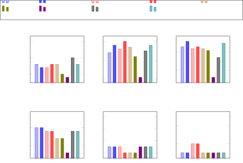
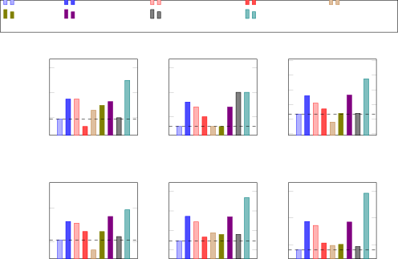

# Selection of Prompt Engineering Techniques for Code Generation through Predicting Code Complexity

DOI: [XXXXXXX.XXXXXXX](https://doi.org/XXXXXXX.XXXXXXX)CCS: Computing
methodologiesCCS: Computing methodologies Machine learningCCS: Applied
computingCCS: Computing methodologies Semantic networks

Chung-Yu Wang Affiliation: York University, Toronto, Canada email:
<cywang14@yorku.ca> , Alireza DaghighFarsoodeh Affiliation: York
University, Toronto, Canada email: <aliredaq@yorku.ca> and Hung Viet
Pham Affiliation: York University, Toronto, Canada email:
<hvpham@yorku.ca>

Date: June 2024

###### Abstract.

Large Language Models (LLMs) have demonstrated impressive performance in
software engineering tasks. However, improving their accuracy in
generating correct and reliable code remains challenging. Numerous
prompt engineering techniques (PETs) have been developed to address
this, but no single approach is universally optimal. Selecting the right
PET for each query is difficult for two primary reasons: (1) interactive
prompting techniques may not consistently deliver the expected benefits,
especially for simpler queries, and (2) current automated prompt
engineering methods lack adaptability and fail to fully utilize
multi-stage responses.

To overcome these challenges, we propose PET-Select, a PET-agnostic
selection model that uses code complexity as a proxy to classify queries
and select the most appropriate PET. By incorporating contrastive
learning, PET-Select effectively distinguishes between simple and
complex problems, allowing it to choose PETs that are best suited for
each query’s complexity level.

Our evaluations on the MBPP and HumanEval benchmarks using GPT-3.5 Turbo
and GPT-4o show up to a 1.9% improvement in pass@1 accuracy, along with
a 74.8% reduction in token usage. Additionally, we provide both
quantitative and qualitative results to demonstrate how PET-Select
effectively selects the most appropriate techniques for each code
generation query, further showcasing its efficiency in optimizing PET
selection.

###### Keywords: 

Prompt Engineering, Code Generation, Large Language Models

## 1. Introduction

Recently Large Language Models (LLMs) have shown their promising
performance in various software engineering tasks, such as unit test
case generation (Shin et al., 2024b; Schäfer et al., 2023; Shin et al.,
2024a), automated bug repair (Hossain et al., 2024; Wei et al., 2023),
API specification (Kim et al., 2024). Especially for code generation
from natural language descriptions, LLMs demonstrate their impressive
capability where code is generated with natural language
descriptions (Jiang et al., 2024; Shin and Nam, 2021).

Given the state-of-the-art LLMs are all closed-source, the most popular
way to enhance the LLM’s ability to generate accurate and reliable code
is to utilize various prompt engineering techniques (PETs) (Shin et al.,
2023; Feng and Chen, 2024). For example, Some techniques ask LLMs to
provide reasoning steps for solving problems (Brown, 2020; Yao et al.,
2024; Yang et al., 2024), while others utilize LLMs to refine their
output by prompting them to review and improve the code they
generate (Madaan et al., 2024; Chen et al., 2023). In addition to these
strategic PETs, some frameworks have been proposed that leverage
LLMs (Zhou et al., 2022a) or retrieve relevant instances from databases
to automatically generate optimal prompts for questions (Nashid et al.,
2023), a process known as automated prompt engineering.

Despite numerous studies focused on crafting the optimal prompt, not a
single technique is optimally applicable to every query and the task of
selecting a correct PET is not trivial. This is because of two key
reasons: (1) interactive prompting techniques might be too costly and do
not always provide the promised benefit especially when applied to
simpler queries (Huang et al., 2023; Chiang and Lee, 2024), and (2)
existing automatic prompt engineering does not utilize the multiple
stages of responses which is associated with the success of iterative
PETs (Zheng et al., 2023; Madaan et al., 2024). Not to mention, all of
the auto prompt engineering techniques are not easily extended.

Prior work (Zhao et al., 2023) has proposed a framework to select the
most appropriate PET for a given query based on feedback from LLMs.
However, this approach focuses on reasoning tasks and requires
implementation alongside language model execution, where the best answer
is selected based on the outputs of various techniques. This makes it
less practical and quite costly.

To provide a general low-cost solution to the PETs selection task, we
propose PET-Select, a PET agnostic selection model that is not dependant
on the pool of available PETs and can be easily adaptable and extendable
to the ever-growing list of available advanced PETs. PET-Select
integrates query complexity by using generated code complexity as a
proxy using contrastive learning (Khosla et al., 2020). Specifically, by
incorporating generated code complexity, PET-Select can differentiate
each query between simple and complex problems (i.e., requiring simple
or complex code) which can help PET-Select select the appropriate PET
that targets the relevant level of problem. Furthermore, we incorporate
a wide range of PETs representing various categories (Tony et al., 2024)
including those PETs that have multi-round interactions with language
models.

We evaluate PET-Select on two popular code generation benchmark
datasets, MBPP and HumanEval. To ensure a fair evaluation, we apply
5-fold cross-validation with 80% training and 20% testing sets. Our
evaluation on GPT-3.5 Turbo and GPT-4o shows that PET-Select achieves an
improvement of up to 1.9% in terms of pass@1 accuracy when compared with
an individual PET while using as little as 74.8% fewer tokens on the
HumanEval with GPT-4o. Our quantitative and qualitative results also
demonstrate that PET-Select effectively selects appropriate techniques
for each code generation query. This paper makes the following
contributions:

- •
  PET-Select, a novel approach that automatically selects the most
  optimal prompting engineering techniques for each code generation
  query.
- •
  An evaluation of PET-Select on two widely used benchmark datasets
  using two state-of-the-art LLMs.
- •
  Quantitative and qualitative analyses provide insights into how
  PET-Select selects the appropriate PET.

## 2. Background

### 2.1. Automated Prompt Engineering

Since Large Language Models (LLMs) are too large to fine-tune for every
downstream task, prompt engineering has become a common approach to
optimize performance across various tasks, including unseen ones.
However, designing effective prompts for each task is a challenging
process. Several studies have suggested reliable methods to improve
language model performance, such as Chain-of-Thought and Self-correction
prompting. Despite this, the question remains whether we can develop a
system that automatically generates appropriate prompts for different
queries. Previous studies (Zhou et al., 2022a; Do et al., 2024) proposed
frameworks for automatic instruction generation and selection, where
several candidate prompts are generated by LLMs, and the best prompt is
chosen from these candidates. Another approach involves retrieving
similar queries from a database and using them to create a more
effective prompt (Nashid et al., 2023). However, these automatic prompt
engineering methods primarily focus on crafting a single optimal prompt
for a given problem. There is limited research on how to design
multi-round prompting, where multiple interactions with language models
are used to refine the response. Crafting prompts based on the model’s
responses is crucial, as many state-of-the-art prompting techniques rely
on self-generated answers to achieve optimal performance. Whether used
for correction or evaluation, iterative interactions with language
models play a key role in helping them generate better responses.

Technically, prompting technique selection is also a form of automatic
prompt engineering, as it involves choosing the relatively appropriate
prompt automatically. Unlike previous approaches, prompting technique
selection considers whether the prompt should be crafted for a single or
multiple iterations, allowing for multiple rounds of interaction. A
previous study (Zhao et al., 2023) selects prompting techniques after
each execution, which is costly and impractical in real-world
applications, particularly when multiple techniques are considered as
candidates. PET-Select is the first framework to select prompting
techniques prior to execution. It employs a traditional deep learning
model with contrastive learning to select the most suitable technique
for each question, making it applicable and affordable even without the
need to run language models.

### 2.2. Prompt Engineering Challenges

With the increasing number of prompting techniques being proposed and
achieving state-of-the-art results on various benchmark datasets, a
question arises: “Can we apply the most advanced prompting techniques to
every question?” Unfortunately, the answer may be no. The first and most
obvious issue is that using these advanced prompting techniques for
every question is costly, as they often require multiple interactions
with language models or involve crafting lengthy prompts with numerous
examples. The second, and less well-known issue is that applying
advanced prompting techniques to simpler questions can sometimes lead to
incorrect answers. A recent study (Chiang and Lee, 2024) experimented on
a variant of GSM8K, where all the answers to the questions in the
dataset were explicitly stated in the questions themselves and could be
obtained without any calculations. Surprisingly, the accuracy improves
when language models are restricted from performing any calculations or
reasoning steps, compared to when no instructions are specified. This
suggests that unnecessary calculations and over-reasoning can lead to
incorrect answers. There is another study (Huang et al., 2023) suggests
that language models are not able to self-correct themselves.
Self-correction is defined as a scenario where the model attempts to
correct its initial responses purely based on its capabilities, without
relying on external feedback. Many advanced prompting techniques
leverage the self-correction ability of language models, such as
Progressive Hint (Zheng et al., 2023) and Self-refine (Madaan et al.,
2024). However, research has shown that accuracy decreases with each
iterative round. This suggests that the model struggles to identify and
correct the specific incorrect parts. When the initial answer is
correct, the model often changes the correct portion to something
incorrect, resulting in a wrong answer.

PET-Select learns to determine whether a question is easy or difficult
by predicting the code complexity of the ground-truth code. This allows
PET-Select to choose the relatively appropriate prompting techniques for
each query, applying simpler techniques to easy problems and more
advanced ones to difficult problems. This approach helps prevent
over-reasoning and redundant calculations for easy questions, while also
avoiding situations where the model changes a correct answer to an
incorrect one.

## 3. Approach

In this work, we propose PET-Select, a novel method to select suitable
prompt engineering techniques (PETs) for each query. Figure 1 provides
the overview of PET-Select. PET-Select is a supervised learning approach
and since no such record of execution is available for various prompt
engineering techniques we start off by building the data in the Dataset
Construction phase (Section 3.1). PET-Select’s model consists of two
main parts: the embedding layer (Section 3.2) and the classification
layer (Section 3.3). Finally, we conduct a n-fold cross-validation
evaluation to ensure that PET-Select is correctly evaluated.

Figure 1. PET-Select Pipeline.

### 3.1. Ranked PET Dataset Construction

PET-Select is designed to be prompt engineering technique (PET)
agnostic, we decide that unsupervised learning is the most appropriate
approach. To train PET-Select, we first need to conduct a study to
collect the dataset of execution records of various representative PETs
such as Zero-shot, and Few-shot and rank each PET given their
performance and cost for each query. Since numerous PETs could be
employed for the code generation task, we select the most representative
ones by choosing at least one technique from each fundamental strategic
design category, such as root techniques, refinement-based techniques,
and others, as defined in a recent study (Tony et al., 2024). Detailed
descriptions and implementations of these prompting techniques are
provided in Section 4.1.

#### 3.1.1. Benchmark Dataset Construction

We choose the two most popular code generation datasets MBPP and
HumanEval and benchmark the selected PETs on ChatGPT 3.5 and 4o (Step
).
The responses were recorded along with the cost of the query in terms of
the number of input and output tokens. Along with the query cost, the
generated code complexity measured by five metrics is also recorded, the
weighted sum of which is used as the overall complexity score. Details
of the metrics used are provided in Section 4.2.

#### 3.1.2. PETs Ranking

Once every technique has been benchmarked, we select the most
appropriate one for each query with the highest $`R\_Score_{i}`$ (Step
).
Where $`R\_Score_{i}`$ for technique $`i`$ is calculated as:

```math
R\_Score_{i}=log(max^{N}_{j=1}(T\_tokens_{j}))\times pass_{i}-log(T\_tokens_{i})
```

Here, $`T\_tokens`$ is the sum of the number of input and output tokens
required by PET $`i`$, and the $`max(Max^{N}_{j=1}(T\_tokens_{j}))`$
represents the highest number of required tokens across all prompting
techniques for that query. The binary number $`pass_{i}`$ is 1 (i.e.,
the generated code passes all test cases) and 2 (i.e., at least one test
case failed). Specifically, for techniques that fail to generate test
passing code, the formula ensures that the score will be negative, and
for successful techniques, the score will be positive. In all cases, the
score is always inversely proportional to the number of required tokens.
In the end, the technique that generates the correct code while
requiring the fewest number of tokens will have the highest score. Since
no technique uses the same number of tokens, there are no tied scores
between the PETs, we can always choose the most appropriate one for each
query.

After this stage, we will obtain the Ranked PETs Dataset in which each
entry includes the query string, the generated code, the number of
tokens used, the complexity measures, and the most successful PET with
the highest R_score as the label.

### 3.2. Fine-tuning CodeBERT Embedding Model

Based on their design, some PETs are better with more complex queries
than others (Khot et al., 2022). Given this finding, we want to
incorporate the generated code complexity into our model decision-making
to achieve the best prediction result. We accomplish this by tuning
CodeBERT (Feng et al., 2020) embedding model utilizing conservative
learning (Khosla et al., 2020). Specifically, the tuning process
reshapes the embedding space so that queries with similar generated code
complexity will be closer while dissimilar queries are placed farther
apart.

#### 3.2.1. Query Triplets Construction

Contrastive learning performs optimization on query triplets each
including an anchor query, a positive query, and a negative
query (Hoffer and Ailon, 2015; Wei et al., 2022a). Specifically, anchor
queries are the original natural language questions, positive queries
are either semantically equivalent to or share the same answer as the
anchor queries (Khosla et al., 2020), while negative queries are
unrelated to both the anchor and positive queries.

In this work, for a given query (i.e., the anchor query), we select
positive queries as those with similar generated code complexity and
negative queries as those with differing code complexity (Step
).
For instance, given an anchor query “Write a function to get the word
with most number of occurrences in the given strings list.” with the
generated code complexity score of 17, the positive query could be
“Write a python function to remove even numbers from a given list.” with
the same code complexity score of 17, and the negative query could be
“Write a function to find the maximum product subarray of the given
array.” with a much higher code complexity score of 58.

However, some queries may not have queries with the same code complexity
score, we instead divided the entire training set into two categories:
an easy set and a hard set. Queries with a code complexity lower than a
specified threshold are placed in the easy set, while those exceeding
the threshold are assigned to the hard set. We then randomly select a
query from the same set as the anchor query to serve as its positive
query. Conversely, a query is randomly selected from the opposite set to
serve as the anchor query’s negative query. To determine the optimal
threshold for classifying the easy and hard sets, we conduct a grid
search within the code complexity score range of 25 to 45, where more
than 70% of the scores are concentrated. The configuration that yields
the best result is selected as the optimal setting for the model.

Figure 2. An example that demonstrates contrastive learning on a single
anchor query.

#### 3.2.2. Contrastive Learning

Once the query triplets are constructed, we use them to fine-tune the
CodeBERT sentence embedding model (Step
).
The objective of contrastive learning is to bring queries with similar
features and complexity closer together while pushing unrelated queries
with differing complexity further apart (Oord et al., 2018). When
constructing the query triplets, we designate an input query as the
anchor, treating queries with similar code complexity scores as positive
examples, while those with dissimilar scores are used as negative
examples. This design allows the model to learn semantic representations
by associating anchor queries with their positive counterparts,
positioning them closer within the embedding vector space. Conversely,
we expect the model to push unrelated queries further apart from the
anchor queries. Figure 2 illustrates the examples discussed in
Section 3.2.1 to show the progress of contrastive learning in
PET-Select. Before contrastive learning, the cosine distance between the
anchor sentence (blue point) and the positive sentence (green point) is
0.013, which is greater than the distance between the anchor sentence
and the negative sentence (red point), measured at 0.01. However, after
contrastive learning, the positive sentence is brought closer to the
anchor sentence in the embedding vector space, reducing the distance to
0.01, while the negative sentence is pushed farther away, increasing the
distance to 0.05.

PET-Select’s model architecture is built with the Sentence Transformer
framework, specifically leveraging CodeBERT as a Transformer-based model
for sentence embedding. First, the pre-trained CodeBERT model is used to
extract embeddings for each word in sentences (in the anchor, positive,
and negative queries). These word embeddings are aggregated with a
pooling layer to create a fixed-size sentence-level embedding. The
embedding model is fine-tuned by minimizing a Triplet Loss, which is
computed based on the distances between the anchor-positive and
anchor-negative query pairs:

```math
L=max(0,Distance_{anchor,positive}-Distance_{anchor,negative}+margin)
```

In short, the loss function is to learn an embedding space where
semantically similar sentences are clustered together (small distance),
and dissimilar sentences are far apart (large distance) (Bredin, 2017).
The $`margin`$ is a positive value (by default set to 1 in the model)
that defines a minimum gap between the anchor-positive and
anchor-negative distances. It ensures that the negative sentence is not
simply pushed just outside the positive one but is kept at a meaningful
distance. The $`max`$ function ensures the loss is non-negative, meaning
if the distance between the negative and the anchor is already
sufficiently large, the loss will be zero (i.e., no update is needed for
this triplet).

### 3.3. Training Selection Model

Once the embedding is computed, it can be used to extract a sentence
embedding for any given query. The embedding will be used as input to
PET-Select’s three fully connected layers of neural network with ReLU
activation function (Step
).
These layers are tasked with multi-class classification (i.e., PET
selection). Specifically, the predicted technique is selected based on
the highest probability according to the softmax function. These layers
are trained normally using cross-entropy loss. It is important to note
that the data used for training both the sentence embedding model and
the selection model is within the training dataset and the model never
sees the test set which is set aside to evaluate the model. For
evaluation, we also record the probability of each class to calculate
the MRR and nDCG metrics (described in Section 5) for the results (Step
).

## 4. Experimental Setup

In this section, we introduce the setup that we used to conduct our
experiments. We first introduce the prompting techniques that are
included in PET-Select selection pool, we then discuss the code
complexity metrics, and finally, the experimental setting including the
code generation datasets and the evaluation metrics.

[TABLE]

Table 1. The prompting techniques used in the experiments. The
‘Strategic Category’ column indicates the primary strategy of each
technique, chosen from one of the five categories defined in the
previous study (Tony et al., 2024). The ‘Iteration’ column specifies
whether the technique requires multiple rounds of interaction with LLMs.
The ‘Examples’ column shows whether examples are included in the prompt
construction. Lastly, the ‘Template’ column outlines the specific prompt
template used in the experiments.

### 4.1. Prompt Engineering Techniques (PETs) for code generation

Table 1 provides a summary of the PETs used in our experiment. To ensure
a broad exploration of techniques, we selected at least one from each
category as stated in the recent work (Tony et al., 2024). These
prompting techniques are classified into five categories based on their
core concepts: root techniques, refinement-based techniques,
decomposition-based techniques, reasoning-based techniques, and priming
techniques. The “Strategic Category” column indicates the categorization
of each prompting technique, while the “Iteration” column specifies
whether the technique involves iterative interactions with the language
models. The “Examples” column shows whether the technique includes
examples in the prompt to guide the language models on how to answer the
questions. The “Template” column demonstrates the prompting templates we
used for each technique. For techniques with multiple iterations, we
provided specific prompting templates for each stage. We briefly go
through each PET and provide some pros and cons to emphasize that no one
PET is optimal for all cases.

Root PETs: Zero-shot and Few-shot Root PETs directly query LLMs for
answers. Zero-shot and Few-shot (Brown, 2020) are two examples of root
PETs where Zero-shot provides no additional example and Few-shot
includes several examples. While it is convenient and requires no
domain-specific input, Zero-shot performance may be limited when the
model encounters unfamiliar tasks. The added examples in Few-shot PET
improve LLMs’ ability to handle unseen tasks but are not trivial to
craft (Dang et al., 2022; Liu et al., 2021; Perez et al., 2021) and can
negatively impact the performance if given incorrectly (Rubin et al.,
2021; Lu et al., 2021).

Reasoning PETs: Zero-shot/Few-shot Chain-of-Thought (CoT) are
reasoning-based techniques that query LLMs to explain intermediate
reasoning steps while generating answers (Wei et al., 2022b; Kojima
et al., 2022). It enables LLMs to produce more coherent and accurate
results. The zero-shot and few-shot CoT differ in the presence of
examples: zero-shot CoT does not include examples while few-shot CoT
offers additional reasoning examples in the query. Despite the
performance improvements similar limitations persist: zero-shot CoT can
yield unreliable results on unfamiliar tasks, and the need for carefully
crafted prompts with examples remains a challenge with few-shot CoT.

Priming PETs: Persona is a PET that LLM is guided to take on a specific
identity or personality based on expertise, tone, or role. This
“persona” helps make the communication with LLMs consistent, but a too
specific persona can lead to restrictive communication.

Decomposition PETs: Self-planning involves having the LLMs create a
mental blueprint or set of steps before answering a question. This is
particularly useful for complex tasks that require a structured approach
(e.g., solving math problems) (Zhou et al., 2022b). On the one hand,
this can provide structure to the solution but on the other, if the
initial plan is incorrect, the entire response may be off track.

Refinement PETs: Self-refine, Progressive Hint, and Self-debug take a
different approach by having the LLM interact with its own response
after generating it. Specifically, Self-refine (Madaan et al., 2024),
Progressive Hint (Zheng et al., 2023), and Self-debug (Chen et al., 2023) ask the LLM to review its answers, use its answers as hints, and
correct its output based on the execution result of test cases. While
self-refine can sometimes correct itself, the errors might still pass
notice. Progressive Hint also suffers from similar pitfalls where the
first hint can be incorrect and create a domino effect. Finally, with
the help of the external test cases, self-debug can sometimes correct
itself, however, the debugging process is not perfect and sometimes LLM
can over-correct itself thus generating the wrong answer.

### 4.2. Code complexity metrics

PET-Select utilize five popular code complexity metrics: Line of Code,
Cyclomatic Complexity, Halstead Complexity, Cognitive Complexity, and
Maintainability Index (Zhang et al., 2007; Jiang et al., 2008; Shin and
Williams, 2008) to aid with the contrastive learning step: Line
Complexity is also known as Lines of Code (LOC), which measures the
number of lines in a codebase. In this study, Line Complexity is
calculated using Physical Lines of Code (PLOC), which excludes comment
lines and focuses solely on the program’s source code. Cyclomatic
Complexity (Ebert et al., 2016) counts the number of independent paths
through the code. Higher cyclomatic complexity indicates more potential
paths, increasing the testing effort and potentially reducing
maintainability. Halstead Complexity (Hariprasad et al., 2017) evaluates
code complexity from both linguistic and mathematical perspectives,
based on the number of operators and operands. Cognitive
Complexity (Campbell, 2018) measures how difficult code is for a human
to understand by considering factors like nesting depth and control
structures such as if, switch, and for loops. Unlike cyclomatic
complexity, it focuses on readability and the mental effort required to
follow the code. Maintainability Index (Welker, 2001) is a composite
metric that predicts the ease of maintaining a software system,
combining factors like cyclomatic complexity, Halstead complexity, and
lines of code. It ranges from 0 (difficult to maintain) to 100 (easy to
maintain), with higher values indicating better maintainability. In this
study, custom code was used to calculate LOC, the Radon package was used
to calculate Cyclomatic Complexity, Halstead Complexity, and
Maintainability Index, and Cognitive Complexity was computed with the
cognitive-complexity Python package.

### 4.3. Experiment Settings

Benchmark datasets We used two of the most widely used code generation
benchmark datasets to train the model and evaluate PET-Select’s
performance: HumanEval (Chen et al., 2021) and MBPP (Austin et al.,
2021). Both datasets provide test cases so that generated code can be
functionally evaluated and the pass@k metric can be calculated for
evaluation.

Ranking Evaluation Metrics Since PET-Select ranks all the prompting
techniques based on the probability of softmax layer output, we applied
two popular metrics, Mean Reciprocal Rank (MRR) (Voorhees et al., 1999;
Radev et al., 2002) and Normalized Discounted Cumulative Gain
(nDCG) (Järvelin and Kekäläinen, 2002), to evaluate PET-Select. These
metrics are used extensively in the domain of information retrieval and
they measure the ability of a system in recommendation tasks. The Mean
Reciprocal Rank measures the effectiveness of a system in returning
relevant results or answers by focusing on the rank of the first
correct. On the other hand, Normalized Discounted Cumulative Gain (nDCG)
measures the quality of ranked results based on the relevance of each
result and the position in which they appear in a ranking list. With
these two metrics, we can thoroughly evaluate PET-Select’s ability to
recommend and rank the appropriate PET.

Environmental Settings We utilize a machine with an 8-core processor AMD
Ryzen 7 pro 5845 and an NVIDIA RTX3060 to train PET-Select. To better
evaluate PET-Select we applied 5-fold cross-validation with 80-20
train-test split. Note that the sentence embedding model and the
selection model were only trained on the training set to prevent test
data leakage into the sentence embedding model, which could otherwise
impact the performance of the selection model. We fine-tune the sentence
embedding model for fifteen epochs and select the model with the best
performance (the highest value of Cosine Accuracy) on the validation set
to train the selection model. For the selection model, we train it for
10 epochs and select the model with the best performance (the highest
value of nDCG) on the validation set to choose prompting techniques for
each instance in the test set.

## 5. Result

In this section, we evaluate PET-Select and present the findings when
exploring three research questions. RQ1 explores how various PETs
perform on different types of code generation with different complexity
(Section  5.1). In RQ2, we compare PET-Select performance against other
baselines on two code generation benchmarks using two versions of GPT
(Section 5.2). Finally, we analyze PET-Select’s performance in
quantitative and qualitative analysis (Section 5.3).



Figure 3. The distribution of correct instances across nine PETs on the
HumanEval dataset using GPT-4o.

### 5.1. RQ1. How do various PETs perform on different types of code generation with different complexity?

In this research question, we aim to explore the relationship between
the code generation types and code complexity to inform our design
decisions to incorporate query embedding and generated code complexity
in PET-Select.

#### 5.1.1. RQ1.1 Do different PETs excel at generating code for different types of tasks?

To explore the first part of the question, we first manually categorize
questions from the MBPP and HumanEval datasets into six different types
of tasks for which the generated code is responsible: Algorithm Design,
String Manipulation, List Processing, Mathematical Computation, Parsing
and Formatting, and Logical Conditions.

Specifically, we applied the following definition to perform the
labeling:

- •
  Algorithm Design involves writing code to solve problems using
  specific approaches or procedures. Algorithm design includes tasks
  like designing search algorithms (e.g., binary search), sorting (e.g.,
  quicksort), and dynamic programming. The focus is on the logic and
  structure required to solve problems efficiently.
- •
  String Manipulation deals with operations related to handling text
  data, such as modifying, concatenating, splitting, and searching
  within strings. Common tasks include pattern matching (using regular
  expressions), converting cases (e.g., uppercase to lowercase), and
  formatting strings for output.
- •
  List Processing involves handling collections or arrays of data.
  Operations include iterating through lists, filtering, mapping,
  sorting, and transforming data. Tasks like merging multiple lists or
  finding elements based on specific conditions also fall under this
  category.
- •
  Mathematical Computation covers tasks that involve performing
  mathematical operations, such as arithmetic, algebra, trigonometry, or
  calculus. Examples include calculating averages, finding prime
  numbers, performing matrix operations, or solving equations.
- •
  Parsing refers to interpreting structured data, such as converting a
  string into a number, extracting values from JSON or XML, or reading
  configuration files.
- •
  Formatting involves preparing data for output, such as formatting
  dates, numbers, or aligning text for display.
- •
  Logical Conditions involves decision-making in code, where you use
  conditions to control the flow of the program (e.g., if-else
  statements, switch cases). Logical conditions help programs execute
  different paths based on input or state, such as checking if a number
  is even or odd, or deciding which function to call based on user
  input.

Figure 3 presents the distribution of correct instances across different
PETs on the HumanEval dataset using GPT-4o. For each task, some PETs are
more effective than others. For example, Progressive Hint yields the
highest number of correct instances in Algorithm Design, while for
String Manipulation, the most successful technique shifts to Few-shot
CoT. This finding suggests that each technique excels in different
tasks, indicating its unique area of expertise. As a result, we included
Category Selection as one of our baselines in RQ2 to explore whether
choosing PETs directly based on the specific code generation tasks could
help identify the most suitable technique for each question.



Figure 4. The distribution of code complexity scores for the
ground-truth code, correctly answered by each PET across six code
complexity metrics on the MBPP dataset using GPT-3.5 Turbo.

#### 5.1.2. RQ1.2 Do different PETs excel at generating code of different complexity?

Apart from task types, we also explored if code complexity can inform
the correct PET. We hypothesized that simpler techniques might perform
better on easier questions (i.e., requiring less complex code), while
more complex techniques could be more effective on harder ones (i.e.,
requiring more complex code). To test this, we applied five code
complexity metrics mentioned previously to the ground-truth code for
each instance in the MBPP and HumanEval datasets. To account for
multiple aspects of code complexity, we aggregate all the complexity
scores into a single value called Combined Complexity, which serves as
the final complexity score for each instance.

Figure 4 demonstrates the distribution of code complexity scores for the
ground-truth code, correctly answered by each PET, across six code
complexity metrics on the MBPP dataset using GPT-3.5 Turbo. We can
observe that the code complexity score of the ground truth solutions for
questions that are answered correctly in zero-shot is lower than that of
most techniques across all code complexity metrics. For example, in
terms of line complexity, all PETs except Few-shot CoT achieve higher
scores than Zero-shot. This indicates that the ground-truth code for
questions correctly answered by Zero-shot tends to have fewer lines
compared to those answered by other techniques. This finding suggests
that selecting PETs based on the code complexity score could be an
effective approach that can support our proposal of incorporating code
complexity into PET-Select.


|                    |               |         |           |         |        |         |           |         |
| ------------------ | ------------- | ------- | --------- | ------- | ------ | ------- | --------- | ------- |
| LLM                | GPT-3.5 Turbo |         |           |         | GPT-4o |         |           |         |
| Dataset            | MBPP          |         | HumanEval |         | MBPP   |         | HumanEval |         |
| Metrics            | Acc           | \#Token | Acc       | \#Token | Acc    | \#Token | Acc       | \#Token |
| Zero-shot          | 48.2          | 99      | 63.4      | 208     | 53.8   | 114     | 79.9      | 263     |
| Zero-shot CoT      | 39.5          | 107     | 65.9      | 230     | 52.7   | 135     | 83.0      | 308     |
| Few-shot           | 47.9          | 628     | 54.3      | 795     | 51.7   | 646     | 79.9      | 835     |
| Few-shot CoT       | 47.1          | 899     | 70.7      | 1142    | 49.7   | 951     | 83.5      | 1191    |
| Persona            | 47.7          | 127     | 68.3      | 251     | 52.4   | 143     | 83.0      | 345     |
| Self-planning\*    | 46.7          | 849     | 62.8      | 1365    | 49.3   | 1686    | 73.2      | 2006    |
| Self-refine\*      | 29.2          | 908     | 11.6      | 1012    | 48.3   | 1405    | 54.9      | 1731    |
| Progressive Hint\* | 47.4          | 451     | 65.2      | 882     | 52.1   | 522     | 77.4      | 1151    |
| Self-debug\*       | 65.3          | 3049    | 59.1      | 3040    | 67.6   | 4935    | 78.7      | 5518    |
| Random Selection   | 42.7          | 642     | 57.4      | 852     | 48.7   | 936     | 70.7      | 1111    |
| Category Selection | 50.4          | 264     | 65.2      | 171     | 55.7   | 355     | 79.9      | 240     |
| PET-Select W/o CL  | 48.2          | 99      | 63.4      | 208     | 53.8   | 114     | 79.9      | 263     |
| PET-Select         | 65.6          | 2647    | 70.7      | 409     | 68.2   | 4657    | 85.4      | 300     |
| Average            | 48.1          | 889     | 59.6      | 863     | 54.2   | 1374    | 77.5      | 1250    |

Table 2. Pass@1 accuracy and token usage were evaluated on benchmark
datasets using PET-Select and twelve baselines, including nine prompting
techniques and four selection baselines across different models. Prompt
engineering techniques marked with \*, indicate that these techniques
require iterative rounds to arrive at the answer for each instance. Acc
refers to the Pass@1 accuracy, while \#Token represents the average
token usage. The highest accuracy scores and the lowest token usage for
each dataset and model are highlighted in bold.

### 5.2. RQ2. How do PET-Select compare to single PETs and baselines?

In RQ2, we compare PET-Select with the individual PETs and our two
selected baselines. Table 2 presents the pass@1 accuracy and token usage
on the MBPP and HumanEval datasets for nine individual PETs, as well as
various PET selection approaches, using GPT-3.5 Turbo and GPT-4o. PETs
marked with a star, such as Self-planning, indicate that these
techniques require iterative rounds to arrive at the answer for each
instance. The ‘Random Selection’ row represents a baseline approach
where one of the nine PETs is randomly chosen as the most appropriate
for each instance. The overall accuracy and token usage are then
calculated based on the selected technique. As we mentioned in RQ1.1,
‘Category Selection’ is the baseline that randomly selects one of the
nine techniques based on the probability of each technique being the
most appropriate for a given task, as determined by the ranking score
mentioned in Section 3.1. For example, if the probability of Zero-shot
being the most appropriate technique for Algorithm Design is 60% (i.e.,
among all the questions correctly answered by the language model,
Zero-shot is the most appropriate technique for 60% of them), then
Zero-shot will have a 60% chance of being selected for questions
categorized under Algorithm Design. For the ‘PET-Select W/o CL’ row, we
train the selection model using the original CodeBERT without
contrastive learning which does not incorporate the complexity measure.
For the ‘PET-Select’ row, we present the results of selecting PETs based
on the output of the selection model.

On the MBPP dataset, PET-Select achieves 65.6% accuracy with GPT-3.5
Turbo, which is 0.3% higher than the best accuracy achieved by
Self-debug, a technique that applies the same method across all
instances. Furthermore, PET-Select uses approximately 13% fewer tokens
while achieving higher accuracy compared to Self-debug. This indicates
that PET-Select can effectively identify instances that are simple
enough for language models to generate correct code using basic
techniques. A similar result is observed when running experiments with
GPT-4o, where PET-Select’s accuracy is 0.6% higher than using only
Self-debug, while also utilizing fewer tokens. On the HumanEval dataset,
PET-Select achieves the same accuracy as Few-shot CoT but with 64.2%
fewer tokens when using GPT-3.5 Turbo. With GPT-4o, PET-Select achieves
an accuracy of 85.4%, which is 1.9% higher than the best accuracy of the
other techniques, while also saving up to 74.8% fewer tokens.

Although the Category Selection method does not achieve the highest
accuracy, it remains at least the third-best approach among all the
baselines, with the lowest token usage when applied to the HumanEval
dataset. This indicates that knowing the task category partially helps
in selecting the optimal PET.

The original CodeBERT without contrastive learning incorporating problem
complexity does not help the selection model consistently choose the
appropriate techniques. Instead, it repeatedly selects Zero-shot, as it
often appears to be the best technique among all the options. This
result suggests that contrastive learning effectively clusters questions
of similar complexity in the embedding space, and is essential in
enabling the selection model to accurately choose the optimal PET.

Complex PETs such as Self-debug, which require multiple rounds with
language models, may not always be the best choice for all questions.
For instance, aside from PET-Select, while Self-debug performs best on
the MBPP dataset, it falls short on the HumanEval dataset, where simpler
techniques like Few-shot CoT achieve the highest accuracy. This result
provides more examples which support the claim that applying complex
techniques to simpler questions can sometimes result in incorrect
answers. With PET-Select, we can identify instances that are simple
enough to not require complex techniques, while still generating the
correct answers with fewer tokens.


|                    |               |        |           |        |        |        |           |        |
| ------------------ | ------------- | ------ | --------- | ------ | ------ | ------ | --------- | ------ |
| LLM                | GPT-3.5 Turbo |        |           |        | GPT-4o |        |           |        |
| Dataset            | MBPP          |        | HumanEval |        | MBPP   |        | HumanEval |        |
| Metrics            | MRR           | nDCG   | MRR       | nDCG   | MRR    | nDCG   | MRR       | nDCG   |
| Random Selection   | 0.5218        | 0.5522 | 0.5643    | 0.6178 | 0.5215 | 0.5159 | 0.5054    | 0.7057 |
| Category Selection | 0.5832        | 0.6099 | 0.6199    | 0.6929 | 0.6180 | 0.5753 | 0.6231    | 0.7652 |
| PET-Select W/o CL  | 0.7560        | 0.5780 | 0.8638    | 0.6800 | 0.8638 | 0.5588 | 0.8954    | 0.7538 |
| PET-Select         | 0.5756        | 0.6948 | 0.6186    | 0.7270 | 0.5648 | 0.6840 | 0.6027    | 0.8269 |
| Average            | 0.6092        | 0.6087 | 0.6667    | 0.6794 | 0.6420 | 0.5835 | 0.6567    | 0.7629 |

Table 3. The ranking effectiveness of selection methods measured with
MRR and nDCG metrics

### 5.3. RQ3. How is PET-Select able to select an appropriate technique for each query?

In this section, we perform quantitative and qualitative analyses to
assess PET-Select’s ability to select the most appropriate technique for
each question.

#### 5.3.1. Quantitative Analysis

As mentioned in Experimental Setup, we utilize two metrics, Mean
Reciprocal Rank (MRR) and Normalized Discounted Cumulative Gain (nDCG),
to evaluate PET-Select’s recommendation ability. In Table 3 we present
various selection methods’ effectiveness measured by MRR and nDCG. Since
we applied 5-fold cross-validation the MRR and nDCG values are the
average results from the test set across five folds.

Without contrastive learning, PET-Select W/o CL achieves a high MRR
value across all experiments. This occurs because the selection model
consistently chooses Zero-shot as the appropriate technique. As a
result, PET-Select W/o CL tends to perform well in MRR, since Zero-shot
is often the most suitable technique for questions it answers correctly.
However, a higher MRR score does not necessarily indicate that the best
technique is selected for every instance. It simply means that for the
instances where the selected technique provides a correct answer, the
chosen method is likely one of the top-performing options. This is
further demonstrated in Table 2, where PET-Select without contrastive
learning does not achieve the highest accuracy but often uses fewer
tokens than other techniques.

On the other hand, PET-Select consistently achieves the highest
performance with respect to nDCG metric. This indicates that it can
reliably select techniques that lead to correct answers. Although
PET-Select falls short on the MRR metric, meaning it doesn’t always
choose the most appropriate technique for every instance, the selected
PET still generates the correct code that passes all test cases. This is
evidenced in Table 2, where PET-Select outperforms other approaches in
terms of accuracy across all experiments. This result indicates that
PET-Select is effective in selecting the correct technique that is
capable of generating the correct code.

|     |                                                                                                       |           |            |            |
| --- | ----------------------------------------------------------------------------------------------------- | --------- | ---------- | ---------- |
|     | Techniques                                                                                            | Zero-shot | Self-debug | PET-Select |
| 1   | Write a function to find the nested list elements which are present in another list.                  | ✗         | ✓          | Self-debug |
| 2   | Write a function to concatenate the given two tuples to a nested tuple.                               | ✗         | ✓          | Self-debug |
| 3   | Write a function to check if a nested list is a subset of another nested list.                        | ✗         | ✓          | Self-debug |
| 4   | Write a function to find the maximum of nth column from the given tuple list.                         | ✓         | ✗          | Zero-shot  |
| 5   | Write a function to find frequency of the elements in a given list of lists using collections module. | ✓         | ✗          | Zero-shot  |

Table 4. Selection result of PET-Select for example instances. ✗
indicates the technique answer correctly on the question, while ✓
indicates it answer incorrectly.

#### 5.3.2. Qualitative Analysis

This section aims to provide some additional support for the
experimental results by analyzing the queries that were only answered
correctly by Zero-shot (our most simple PET) and successfully selected
by PET-Select. Conversely, we also examined the queries that were only
answered correctly by Self-debug (our most complex PET) and were
likewise successfully selected by PET-Select. The purpose of these
analyses is to provide additional examples that explain the reason why
PET-Select is successful in selecting the correct PET in the previous
experiments.

Table 4 lists some example instances in the MBPP dataset. For instance,
questions containing the term ‘nested’ (numbers 1-3 in table 4) will
likely require complex code as it will likely involves iterative loops.
Complex PETs such as Self-debug are more likely to generate the correct
answer. while basic techniques such as Zero-shot tend to answer
incorrectly. PET-Select successfully selects the appropriate technique
between Zero-shot and Self-debug, indicating that it learns to recognize
such keywords in the queries. By placing sentences containing the word
‘nested’ closer together in the embedding space, PET-Select is able to
classify them and select the correct PETs.

In contrast, sentences that do not contain specific keywords are pushed
further away from those that do. As a result, PET-Select will select
relatively basic techniques for those questions. For example, the
queries 4-5 in table 4 are also related to the List Processing tasks,
they only require a single loop to solve. In this case, Zero-shot is a
more appropriate PET while Self-debug is too complex and sub-optimal.
Since those questions do not contain the specific keywords that indicate
complex problems (e.g., nested), PET-Select selects Zero-shot instead of
Self-debug as the appropriate technique. The above examples demonstrate
that PET-Select can effectively select the appropriate technique based
on code complexity predictions derived from keywords in the queries with
the help of contrastive learning. By selecting simpler PET when
appropriate, PET-Select not only performs well in all cases but also
reduces the overall number of tokens required when compared to complex
state-of-the-art PETs such as Self-debug.


## 6. Related work

### 6.1. Code Complexity Prediction

Code complexity prediction has emerged as a key area of focus in recent
research, with various approaches leveraging machine learning and deep
learning techniques. A notable advancement is the application of deep
learning models, such as hierarchical Transformers, which process
method-level code snippets and aggregate them into class-level
embeddings (Jeon et al., 2023). These models excel in handling longer
code sequences, surpassing previous methods through advanced multi-level
pre-training objectives that enhance the model’s understanding of
complexity-related features. Additionally, studies have explored the
effectiveness of GPT-3-based models like GitHub Copilot, highlighting
both their strengths and limitations in zero-shot complexity
prediction (Siddiq et al., 2023). While Copilot performs well with
linear complexities, specialized deep learning models demonstrate
superior overall accuracy.

In contrast, PET-Select diverges from these methods by not concentrating
on code complexity prediction directly from natural language queries.
Instead, we employ complexity prediction as an intermediate step to
determine the appropriate prompting techniques for answering natural
language questions.

### 6.2. Automated Prompt Engineering

Automated prompt engineering is an emerging method to adapt large
language models (LLMs) for specific tasks by optimizing prompts without
altering the model’s core parameters. Techniques like AutoPrompt (Shin
et al., 2020) use gradient-guided search to create prompts for tasks
such as sentiment analysis and natural language inference, achieving
results comparable to state-of-the-art models without additional
fine-tuning. Methods such as prompt tuning (Lester et al., 2021) and
prefix-tuning (Li and Liang, 2021) further improve model efficiency by
learning task-specific prompts while keeping the language model frozen,
significantly reducing the number of tunable parameters. Additionally,
approaches like Prompt-OIRL (Sun, 2023) optimize arithmetic reasoning
through offline inverse reinforcement learning, offering cost-effective
and scalable prompt recommendations. Although these automated prompt
engineering approaches optimize the prompt without executing large
language models (LLMs), they do not account for the iterative
interaction with the models.

However, these automated prompt engineering methods focus on optimizing
a single prompt without accounting for iterative interactions with LLMs
throughout the process. In contrast, PET-Select addresses this
limitation by incorporating iterative interaction techniques to select
the most suitable prompting strategies for code generation tasks.

## 7. Threats to validity

### 7.1. Internal validity

Our code has been thoroughly reviewed to ensure the implementation is
correct, and we have confirmed that the questions in the testing dataset
are not present in the question base. We also carefully craft our
prompts for each prompting technique, adhering closely to the guidelines
outlined in the original paper for each method. However, the way prompts
and examples are crafted may influence the performance of each
technique, which in turn can affect the results of PET-Select.

### 7.2. External validity

In our experiment, we use two of the most widely recognized benchmark
datasets for code generation, MBPP and HumanEval, to demonstrate the
effectiveness of PET-Select, which is primarily designed for Python
programming. The performance of PET-Select can be different on prompting
technique selection for other programming languages. In addition, we
incorporate nine fundamental prompting techniques and five
representative code complexity metrics across two datasets in our
experiments. PET-Select may perform differently with additional
techniques, metrics, and data points. Future work is needed to assess
the performance of PET-Select using a broader range of techniques,
metrics, and datasets.

### 7.3. Construct validity

We use MRR, nDCG, pass@k, and token usage calculated by the Tiktoken
package to measure the performance of PET-Select. Our approach may have
different performance under other metrics. In this work, we assume that
code generation questions with similar code complexity scores are
semantically equivalent when contrastively training our CodeBERT-based
sentence embeddings. Future research is needed to validate this
assumption using different metrics or features.

## 8. Conclusion

In this paper, we introduced PET-Select, a novel system designed to
automatically select appropriate prompt engineering techniques (PETs)
for code generation tasks based on code complexity predictions. By
leveraging contrastive learning and a CodeBERT-based sentence embedding
model, PET-Select effectively identifies simpler questions and applies
suitable techniques, achieving comparable or higher accuracy with fewer
tokens. Our evaluation of the MBPP and HumanEval datasets demonstrates
that PET-Select not only enhances performance but also reduces
computational costs. Future work will focus on refining the model and
exploring its application to other domains.

## 9. Data Availability

We release our code and data through the following link:  
[https://anonymous.4open.science/r/Prompt-Selection-B47F](https://anonymous.4open.science/r/Prompt-Selection-B47F).

## References

- Austin et al. (2021) Jacob Austin, Augustus Odena, Maxwell Nye,
  Maarten Bosma, Henryk Michalewski, David Dohan, Ellen Jiang, Carrie
  Cai, Michael Terry, Quoc Le, et al. 2021. Program synthesis with large
  language models. _arXiv preprint arXiv:2108.07732_ (2021).
- Bredin (2017) Hervé Bredin. 2017. Tristounet: triplet loss for speaker
  turn embedding. In _2017 IEEE international conference on acoustics,
  speech and signal processing (ICASSP)_. IEEE, 5430–5434.
- Brown (2020) Tom B Brown. 2020. Language models are few-shot learners.
  _arXiv preprint arXiv:2005.14165_ (2020).
- Campbell (2018) G Ann Campbell. 2018. Cognitive Complexity-A new way
  of measuring understandability. _SonarSource SA_ (2018), 10.
- Chen et al. (2021) Mark Chen, Jerry Tworek, Heewoo Jun, Qiming Yuan,
  Henrique Ponde De Oliveira Pinto, Jared Kaplan, Harri Edwards, Yuri
  Burda, Nicholas Joseph, Greg Brockman, et al. 2021. Evaluating large
  language models trained on code. _arXiv preprint arXiv:2107.03374_
  (2021).
- Chen et al. (2023) Xinyun Chen, Maxwell Lin, Nathanael Schärli, and
  Denny Zhou. 2023. Teaching large language models to self-debug. _arXiv
  preprint arXiv:2304.05128_ (2023).
- Chiang and Lee (2024) Cheng-Han Chiang and Hung-Yi Lee. 2024.
  Over-Reasoning and Redundant Calculation of Large Language Models. In
  _Proceedings of the 18th Conference of the European Chapter of the
  Association for Computational Linguistics (Volume 2: Short Papers)_.
  161–169.
- Dang et al. (2022) Hai Dang, Lukas Mecke, Florian Lehmann, Sven
  Goller, and Daniel Buschek. 2022. How to Prompt? Opportunities and
  Challenges of Zero- and Few-Shot Learning for Human-AI Interaction in
  Creative Applications of Generative Models. arXiv:2209.01390 \[cs.HC\]
- Do et al. (2024) Viet-Tung Do, Van-Khanh Hoang, Duy-Hung Nguyen,
  Shahab Sabahi, Jeff Yang, Hajime Hotta, Minh-Tien Nguyen, and Hung
  Le. 2024. Automatic Prompt Selection for Large Language Models. _arXiv
  preprint arXiv:2404.02717_ (2024).
- Ebert et al. (2016) Christof Ebert, James Cain, Giuliano Antoniol,
  Steve Counsell, and Phillip Laplante. 2016. Cyclomatic complexity.
  _IEEE software_ 33, 6 (2016), 27–29.
- Feng and Chen (2024) Sidong Feng and Chunyang Chen. 2024. Prompting is
  all you need: Automated android bug replay with large language models.
  In _Proceedings of the 46th IEEE/ACM International Conference on
  Software Engineering_. 1–13.
- Feng et al. (2020) Zhangyin Feng, Daya Guo, Duyu Tang, Nan Duan,
  Xiaocheng Feng, Ming Gong, Linjun Shou, Bing Qin, Ting Liu, Daxin
  Jiang, et al. 2020. Codebert: A pre-trained model for programming and
  natural languages. _arXiv preprint arXiv:2002.08155_ (2020).
- Hariprasad et al. (2017) T Hariprasad, G Vidhyagaran, K Seenu, and
  Chandrasegar Thirumalai. 2017. Software complexity analysis using
  halstead metrics. In _2017 International Conference on Trends in
  Electronics and Informatics (ICEI)_. IEEE, 1109–1113.
- Hoffer and Ailon (2015) Elad Hoffer and Nir Ailon. 2015. Deep metric
  learning using triplet network. In _Similarity-based pattern
  recognition: third international workshop, SIMBAD 2015, Copenhagen,
  Denmark, October 12-14, 2015. Proceedings 3_. Springer, 84–92.
- Hossain et al. (2024) Soneya Binta Hossain, Nan Jiang, Qiang Zhou,
  Xiaopeng Li, Wen-Hao Chiang, Yingjun Lyu, Hoan Nguyen, and Omer
  Tripp. 2024. A deep dive into large language models for automated bug
  localization and repair. _Proceedings of the ACM on Software
  Engineering_ 1, FSE (2024), 1471–1493.
- Huang et al. (2023) Jie Huang, Xinyun Chen, Swaroop Mishra,
  Huaixiu Steven Zheng, Adams Wei Yu, Xinying Song, and Denny
  Zhou. 2023. Large language models cannot self-correct reasoning yet.
  _arXiv preprint arXiv:2310.01798_ (2023).
- Järvelin and Kekäläinen (2002) Kalervo Järvelin and Jaana
  Kekäläinen. 2002. Cumulated gain-based evaluation of IR techniques.
  _ACM Transactions on Information Systems (TOIS)_ 20, 4 (2002),
  422–446.
- Jeon et al. (2023) Mingi Jeon, Seung-yeop Baik, Joonghyuk Hahn, Yo-Sub
  Han, and Sang-Ki Ko. 2023. Deep learning-based source code complexity
  prediction. (2023).
- Jiang et al. (2024) Juyong Jiang, Fan Wang, Jiasi Shen, Sungju Kim,
  and Sunghun Kim. 2024. A Survey on Large Language Models for Code
  Generation. _arXiv preprint arXiv:2406.00515_ (2024).
- Jiang et al. (2023) Xue Jiang, Yihong Dong, Lecheng Wang, Fang Zheng,
  Qiwei Shang, Ge Li, Zhi Jin, and Wenpin Jiao. 2023. Self-planning Code
  Generation with Large Language Models. _ACM Transactions on Software
  Engineering and Methodology_ (2023).
- Jiang et al. (2008) Yue Jiang, Bojan Cuki, Tim Menzies, and Nick
  Bartlow. 2008. Comparing design and code metrics for software quality
  prediction. In _Proceedings of the 4th international workshop on
  Predictor models in software engineering_. 11–18.
- Khosla et al. (2020) Prannay Khosla, Piotr Teterwak, Chen Wang, Aaron
  Sarna, Yonglong Tian, Phillip Isola, Aaron Maschinot, Ce Liu, and
  Dilip Krishnan. 2020. Supervised contrastive learning. _Advances in
  neural information processing systems_ 33 (2020), 18661–18673.
- Khot et al. (2022) Tushar Khot, Harsh Trivedi, Matthew Finlayson, Yao
  Fu, Kyle Richardson, Peter Clark, and Ashish Sabharwal. 2022.
  Decomposed prompting: A modular approach for solving complex tasks.
  _arXiv preprint arXiv:2210.02406_ (2022).
- Kim et al. (2024) Myeongsoo Kim, Tyler Stennett, Dhruv Shah, Saurabh
  Sinha, and Alessandro Orso. 2024. Leveraging large language models to
  improve REST API testing. In _Proceedings of the 2024 ACM/IEEE 44th
  International Conference on Software Engineering: New Ideas and
  Emerging Results_. 37–41.
- Kojima et al. (2022) Takeshi Kojima, Shixiang Shane Gu, Machel Reid,
  Yutaka Matsuo, and Yusuke Iwasawa. 2022. Large language models are
  zero-shot reasoners. _Advances in neural information processing
  systems_ 35 (2022), 22199–22213.
- Lester et al. (2021) Brian Lester, Rami Al-Rfou, and Noah
  Constant. 2021. The power of scale for parameter-efficient prompt
  tuning. _arXiv preprint arXiv:2104.08691_ (2021).
- Li and Liang (2021) Xiang Lisa Li and Percy Liang. 2021.
  Prefix-tuning: Optimizing continuous prompts for generation. _arXiv
  preprint arXiv:2101.00190_ (2021).
- Liu et al. (2021) Jiachang Liu, Dinghan Shen, Yizhe Zhang, Bill Dolan,
  Lawrence Carin, and Weizhu Chen. 2021. What Makes Good In-Context
  Examples for GPT-$`3`$? _arXiv preprint arXiv:2101.06804_ (2021).
- Lu et al. (2021) Yao Lu, Max Bartolo, Alastair Moore, Sebastian
  Riedel, and Pontus Stenetorp. 2021. Fantastically ordered prompts and
  where to find them: Overcoming few-shot prompt order sensitivity.
  _arXiv preprint arXiv:2104.08786_ (2021).
- Madaan et al. (2024) Aman Madaan, Niket Tandon, Prakhar Gupta, Skyler
  Hallinan, Luyu Gao, Sarah Wiegreffe, Uri Alon, Nouha Dziri, Shrimai
  Prabhumoye, Yiming Yang, et al. 2024. Self-refine: Iterative
  refinement with self-feedback. _Advances in Neural Information
  Processing Systems_ 36 (2024).
- Nashid et al. (2023) Noor Nashid, Mifta Sintaha, and Ali Mesbah. 2023.
  Retrieval-based prompt selection for code-related few-shot learning.
  In _2023 IEEE/ACM 45th International Conference on Software
  Engineering (ICSE)_. IEEE, 2450–2462.
- Oord et al. (2018) Aaron van den Oord, Yazhe Li, and Oriol
  Vinyals. 2018. Representation learning with contrastive predictive
  coding. _arXiv preprint arXiv:1807.03748_ (2018).
- Perez et al. (2021) Ethan Perez, Douwe Kiela, and Kyunghyun Cho. 2021.
  True few-shot learning with language models. _Advances in neural
  information processing systems_ 34 (2021), 11054–11070.
- Radev et al. (2002) Dragomir R Radev, Hong Qi, Harris Wu, and Weiguo
  Fan. 2002. Evaluating web-based question answering systems.. In
  _LREC_. Citeseer.
- Rubin et al. (2021) Ohad Rubin, Jonathan Herzig, and Jonathan
  Berant. 2021. Learning to retrieve prompts for in-context learning.
  _arXiv preprint arXiv:2112.08633_ (2021).
- Schäfer et al. (2023) Max Schäfer, Sarah Nadi, Aryaz Eghbali, and
  Frank Tip. 2023. An empirical evaluation of using large language
  models for automated unit test generation. _IEEE Transactions on
  Software Engineering_ (2023).
- Shin et al. (2024a) Jiho Shin, Sepehr Hashtroudi, Hadi Hemmati, and
  Song Wang. 2024a. Domain Adaptation for Code Model-Based Unit Test
  Case Generation. In _Proceedings of the 33rd ACM SIGSOFT International
  Symposium on Software Testing and Analysis_ (Vienna, Austria) _(ISSTA 2024)_. Association for Computing Machinery, New York, NY, USA,
  1211–1222.
  [https://doi.org/10.1145/3650212.3680354](https://doi.org/10.1145/3650212.3680354)
- Shin et al. (2024b) Jiho Shin, Hadi Hemmati, Moshi Wei, and Song Wang.
  2024b. Assessing evaluation metrics for neural test oracle generation.
  _IEEE Transactions on Software Engineering_ (2024).
- Shin and Nam (2021) Jiho Shin and Jaechang Nam. 2021. A survey of
  automatic code generation from natural language. _Journal of
  Information Processing Systems_ 17, 3 (2021), 537–555.
- Shin et al. (2023) Jiho Shin, Clark Tang, Tahmineh Mohati, Maleknaz
  Nayebi, Song Wang, and Hadi Hemmati. 2023. Prompt engineering or fine
  tuning: An empirical assessment of large language models in automated
  software engineering tasks. _arXiv preprint arXiv:2310.10508_ (2023).
- Shin et al. (2020) Taylor Shin, Yasaman Razeghi, Robert L Logan IV,
  Eric Wallace, and Sameer Singh. 2020. Autoprompt: Eliciting knowledge
  from language models with automatically generated prompts. _arXiv
  preprint arXiv:2010.15980_ (2020).
- Shin and Williams (2008) Yonghee Shin and Laurie Williams. 2008. An
  empirical model to predict security vulnerabilities using code
  complexity metrics. In _Proceedings of the Second ACM-IEEE
  international symposium on Empirical software engineering and
  measurement_. 315–317.
- Siddiq et al. (2023) Mohammed Latif Siddiq, Abdus Samee, Sk Ruhul
  Azgor, Md Asif Haider, Shehabul Islam Sawraz, and Joanna CS
  Santos. 2023. Zero-shot prompting for code complexity prediction using
  github copilot. In _2023 IEEE/ACM 2nd International Workshop on
  Natural Language-Based Software Engineering (NLBSE)_. IEEE, 56–59.
- Sun (2023) Hao Sun. 2023. Offline prompt evaluation and optimization
  with inverse reinforcement learning. _arXiv preprint arXiv:2309.06553_
  (2023).
- Tony et al. (2024) Catherine Tony, Nicolás E Díaz Ferreyra, Markus
  Mutas, Salem Dhiff, and Riccardo Scandariato. 2024. Prompting
  Techniques for Secure Code Generation: A Systematic Investigation.
  _arXiv preprint arXiv:2407.07064_ (2024).
- Voorhees et al. (1999) Ellen M Voorhees et al. 1999. The trec-8
  question answering track report.. In _Trec_, Vol. 99. 77–82.
- Wei et al. (2022b) Jason Wei, Xuezhi Wang, Dale Schuurmans, Maarten
  Bosma, Fei Xia, Ed Chi, Quoc V Le, Denny Zhou, et al. 2022b.
  Chain-of-thought prompting elicits reasoning in large language models.
  _Advances in neural information processing systems_ 35 (2022),
  24824–24837.
- Wei et al. (2022a) Moshi Wei, Nima Shiri Harzevili, Yuchao Huang,
  Junjie Wang, and Song Wang. 2022a. Clear: contrastive learning for api
  recommendation. In _Proceedings of the 44th International Conference
  on Software Engineering_. 376–387.
- Wei et al. (2023) Yuxiang Wei, Chunqiu Steven Xia, and Lingming
  Zhang. 2023. Copiloting the copilots: Fusing large language models
  with completion engines for automated program repair. In _Proceedings
  of the 31st ACM Joint European Software Engineering Conference and
  Symposium on the Foundations of Software Engineering_. 172–184.
- Welker (2001) Kurt D Welker. 2001. The software maintainability index
  revisited. _CrossTalk_ 14 (2001), 18–21.
- White et al. (2023) Jules White, Quchen Fu, Sam Hays, Michael
  Sandborn, Carlos Olea, Henry Gilbert, Ashraf Elnashar, Jesse
  Spencer-Smith, and Douglas C Schmidt. 2023. A prompt pattern catalog
  to enhance prompt engineering with chatgpt. _arXiv preprint
  arXiv:2302.11382_ (2023).
- Yang et al. (2024) Ling Yang, Zhaochen Yu, Tianjun Zhang, Shiyi Cao,
  Minkai Xu, Wentao Zhang, Joseph E Gonzalez, and Bin Cui. 2024. Buffer
  of Thoughts: Thought-Augmented Reasoning with Large Language Models.
  _arXiv preprint arXiv:2406.04271_ (2024).
- Yao et al. (2024) Shunyu Yao, Dian Yu, Jeffrey Zhao, Izhak Shafran,
  Tom Griffiths, Yuan Cao, and Karthik Narasimhan. 2024. Tree of
  thoughts: Deliberate problem solving with large language models.
  _Advances in Neural Information Processing Systems_ 36 (2024).
- Zhang et al. (2007) Hongyu Zhang, Xiuzhen Zhang, and Ming Gu. 2007.
  Predicting defective software components from code complexity
  measures. In _13th Pacific Rim International Symposium on Dependable
  Computing (PRDC 2007)_. IEEE, 93–96.
- Zhao et al. (2023) James Xu Zhao, Yuxi Xie, Kenji Kawaguchi, Junxian
  He, and Michael Qizhe Xie. 2023. Automatic model selection with large
  language models for reasoning. _arXiv preprint arXiv:2305.14333_
  (2023).
- Zheng et al. (2023) Chuanyang Zheng, Zhengying Liu, Enze Xie, Zhenguo
  Li, and Yu Li. 2023. Progressive-hint prompting improves reasoning in
  large language models. _arXiv preprint arXiv:2304.09797_ (2023).
- Zhou et al. (2022b) Denny Zhou, Nathanael Schärli, Le Hou, Jason Wei,
  Nathan Scales, Xuezhi Wang, Dale Schuurmans, Claire Cui, Olivier
  Bousquet, Quoc Le, et al. 2022b. Least-to-most prompting enables
  complex reasoning in large language models. _arXiv preprint
  arXiv:2205.10625_ (2022).
- Zhou et al. (2022a) Yongchao Zhou, Andrei Ioan Muresanu, Ziwen Han,
  Keiran Paster, Silviu Pitis, Harris Chan, and Jimmy Ba. 2022a. Large
  language models are human-level prompt engineers. _arXiv preprint
  arXiv:2211.01910_ (2022).
