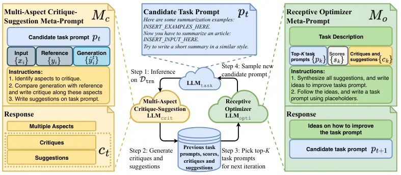
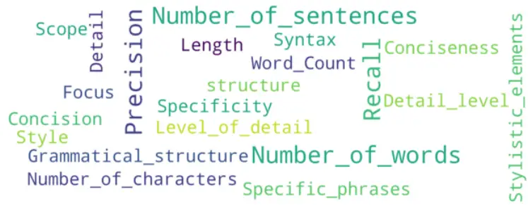

# CriSPO: Multi-Aspect Critique-Suggestion-guided Automatic Prompt Optimization for Text Generation (Extended version)

Han He    Qianchu Liu    Lei Xu    Chaitanya Shivade Affiliation: Yi
Zhang, Sundararajan Srinivasan, Katrin Kirchhoff

###### Abstract

Existing automatic prompt engineering methods are typically designed for
discriminative tasks, where new task prompts are iteratively refined
with limited feedback from a single metric reflecting a single aspect.
However, these approaches are suboptimal for generative tasks, which
require more nuanced guidance beyond a single numeric metric to improve
the prompt and optimize multiple aspects of the generated text. To
address these challenges, we propose a novel multi-aspect
Critique-Suggestion-guided automatic Prompt Optimization (CriSPO)
approach. CriSPO introduces a critique-suggestion module as its core
component. This module spontaneously discovers aspects, and compares
generated and reference texts across these aspects, providing specific
suggestions for prompt modification. These clear critiques and
actionable suggestions guide a receptive optimizer module to make more
substantial changes, exploring a broader and more effective search
space. To further improve CriSPO with multi-metric optimization, we
introduce an Automatic Suffix Tuning (AST) extension to enhance the
performance of task prompts across multiple metrics. We evaluate CriSPO
on 4 state-of-the-art LLM across 4 summarization and 5 QA (QA) datasets.
Extensive experiments show 3-4% ROUGE score improvement on summarization
and substantial improvement of various metrics on QA.

Amazon AWS AI Labs

{hankcs, liufqian, leixx, shivadc,

yizhngn, sundarsr, katrinki}@amazon.com

Code — https://github.com/amazon-science/CriSPO

## 1 Introduction

LLM have emerged as powerful tools for various natural language
processing tasks, including text generation (Brown et al. 2020). To
fully leverage their capabilities, a critical step is to design a
precise task prompt which specifies the desired behavior of the LLM to
solve a task. Manual prompt engineering is often laborious,
skill-intensive and sub-optimal, motivating the need for automatic
prompt engineering techniques which automatically tune the task prompt.

Recent research has made notable progress in automatic prompt
engineering for discriminative tasks, such as text classification (Zhou
et al. 2022; Yang et al. 2023; Pryzant et al. 2023; Sordoni et al.
2024). These methods focus on optimizing task prompts for a single
metric on a single aspect. The process typically involves instructing an
LLM optimizer with a meta-prompt to generate new task prompts based on
previously sampled task prompts and their corresponding scores. By
iteratively exploring candidates and selecting the task prompt with the
highest score, performance on the target metric improves over numerous
iterations. However, applying these methods directly to text generation
tasks, such as summarization, is sub-optimal due to challenges in
obtaining effective optimization signals. Unlike classification tasks,
where metrics are straightforward (eg. accuracy), automatic metrics for
text generation, like ROUGE (Lin 2004), provides limited guidance for
prompt refinement. For example, a lower ROUGE score may result from
aspects such as mismatched length, differences in word choice due to
formality, or varying writing formats, making it difficult to guide LLMs
in prompt modification without fine-grained feedback targeting these
individual aspects. Furthermore, evaluating text generation involves
multiple metrics (Fabbri et al. 2021; Gao and Wan 2022; Elangovan et al.
2024). In addition to reference similarity, other metrics such as
factual consistency, which can be assessed using metrics like
AlignScore (Zha et al. 2023), are also important. Balancing or utilizing
these multiple metrics is not fully addressed by existing prompt
engineering methods that focus on optimizing a single metric.

To address these challenges, we introduce CriSPO, a multi-aspect
Critique-Suggestion-guided automatic Prompt Optimization (CriSPO)
approach. Overall, our approach employs LLM to automatically identifies
multi-aspect prompt revision suggestions, based on which prompts are
automatically designed and refined (Table 8 in Appendix shows a working
example of how a prompt gets revised in CriSPO). Inspired by recent
self-reflection studies, where LLMs generate verbal feedback to aid in
self-improvement (Gero et al. 2023; Shinn et al. 2023; Madaan et al.
2024), we designed the first key component of CriSPO: the multi-aspect
critique-suggestion meta-prompt. It automatically discovers proper
aspects to compare generated text with reference, write critiques of
flaws (Pryzant et al. 2023) and suggestions to improve the task prompt
(Figure 2 shows a word cloud of aspects identified by CriSPO, including
number of words, style, and precision). Both critiques and suggestions,
written in natural language, are more helpful for prompt improvement
than a single ROUGE score. We then create a receptive optimizer
meta-prompt that generates new prompts. In addition to conditioning on
previous high-score task prompts and scores, this optimizer also reviews
the past critiques and suggestions. It then generates an overall
suggestion and an improved task prompt candidate in a CoT (CoT) (Wei
et al. 2022) manner. Our approach iteratively optimizes the task prompt
using LLM similar to previous work like OPRO (OPRO) (Yang et al. 2023),
but it enriches the training signal with multi-aspect critiques and
suggestions to better optimize a text generation metric. To further
enhance performance by allowing the prompt to access external data, we
design the task prompt template that contains placeholders for ICL (ICL)
examples or retrieved contexts. The receptive optimizer meta-prompt
generates these templates directly, so it can flexibly move components
in task prompt for better organization.

While CriSPO offers multi-aspect guidance for optimizing text generation
through critiques and suggestions, we further enhance this guidance by
incorporating multiple metrics as additional teaching signals. To this
end, we propose a novel AST (AST) extension which divides prompts into
chunks conquering different metrics. Through multi-objective learning,
we improve each new metric with little to no drop in existing metrics.

We test CriSPO on state-of-the-art LLM, including Claude (Anthropic
2023; Anthropic 2024), Mistral (Jiang et al. 2023) and Llama3 (MetaAI
2024), across 9 heterogeneous datasets. These include 4 summarization
datasets spanning various abstractiveness, formats, and domains, as well
as 5 QA datasets. Extensive experiments demonstrate that CriSPO
significantly improves prompt quality and task performance over strong
baselines as verified by human evaluation. We also conduct ablation
study to assess the effectiveness of key ingredients.

Our contributions are summarized below:

1. We propose CriSPO, an automatic prompt engineering approach tailored
   for generative tasks. It discovers aspects to critique generated text
   and write suggestions for more effective prompt revision.

2. We conduct comprehensive experiments across multiple LLM and
   datasets, demonstrating the effectiveness and robustness of our method.
   We show an overall 3-4% improvement on ROUGE scores with qualitative
   verification from human evaluation. CriSPO also obtained consistent
   improvements on various QA tasks.

3. We propose AST that enables prompt tuning for multiple metrics. We
   show that CriSPO with AST can jointly optimize AlignScore (Zha et al.
4. for faithfulness and ROUGE for reference similarity.

## 2 Related Work



Figure 1: The CriSPO workflow for text generation tasks. In each
iteration, a candidate task prompt $`p_{t}`$ is applied to
$`\mathcal{D}_{\texttt{trn}}`$ (step 1) and evaluated using a
multi-aspect critique-suggestion meta-prompt $`M_{c}`$ (step 2). We
select top-$`K`$ previously sampled task prompts (step 3) and use a
receptive optimizer $`M_{o}`$ to generate the next candidate $`p_{t+1}`$
(step 4). The automatic optimization loop runs multiple iterations,
while the best task prompt is selected based on performance on
$`\mathcal{D}_{\texttt{dev}}`$.

There is an increasing effort in the literature to explore gradient-free
automatic prompt engineering methods with off-the-shelf LLM. The focus
of these approaches is to find a good search algorithm for better prompt
candidates to solve discriminitive tasks. Earlier studies have employed
conventional paraphrasing methods for prompt generation through editing
phrases (Prasad et al. 2023) or back translation (Xu et al. 2022). More
recently, LLM themselves have been used to sample prompt candidates.
Zhou et al. (2022) proposed Automatic Prompt Engineering (APE) which
iteratively prompts an LLM to generate semantically similar variations
of the locally best prompt. Pryzant et al. (2023) add verbal feedback
based on error examples to propose better prompts in terms of accuracy.
Concurrently, Sordoni et al. (2024) learn prompts with variational
inference by considering their outputs as latent variables. Later on,
Yang et al. (2023) propose OPRO to improve over them by incorporating
the history of past prompts with their scores which stabilizes
optimization. More structured prompts have also been explored by
imposing expert-level planning (Wang et al. 2023). In a parallel thread,
Fernando et al. (2023) and Guo et al. (2023) were inspired by
evolutionary algorithms to perform mutation operations for prompt
generation. All of the existing approaches have mostly been designed to
target classification tasks using a single metric. Comparing to the
existing studies, our proposed method specifically targets the unique
challenges in text generation and approaches the prompt optimization
problem in a multi-aspect and multi-metric fashion. For practitioners,
Khattab et al. (2023) design DSPy framework to build and optimize
complex LLM pipelines in a programmatic fashion. TextGrad (Yuksekgonul
et al. 2024) further generalizes optimization to text beyond prompt. Our
CriSPO can be used as a powerful optimizer in these frameworks.

Our approach is also inspired by recent studies on using LLMs to
automatically correct its output (Pan et al. 2023; Madaan et al. 2024).
Gero et al. (2023) apply multiple self-reflection steps to improve the
performance of information extraction. Yan et al. (2024) use CoT to
generate structured comparison and preferences for two model outputs.
Shinn et al. (2023) argue the importance of the self-reflection history
and propose reflexion agent to provide verbal feedback on past trials
for better decision in the next trials. It is important to notice that
these self-reflection studies are strictly speaking not automatic prompt
engineering approaches as these studies optimize output revision rather
than directly on the prompts. CriSPO, however, automatically reflects on
the design of the prompt and uses these past reflections to revise the
prompts.

## 3 Method

Problem Formulation: In a text generation task, let
$`\mathcal{D}_{\texttt{trn}}=\{(x_{i},y_{i})\}_{i=1\ldots n}`$ be the
training set, with a development set $`\mathcal{D}_{\texttt{dev}}`$ and
a test set $`\mathcal{D}_{\texttt{tst}}`$. Here, $`x`$ represents the
input data, and $`y`$ is the corresponding ground truth reference. A
task prompt $`p`$ comprises instructions that, when filled with input
$`x`$, are fed to a black-box API $`\text{LLM}_{\text{task}}`$¹¹ 1 We
use notations
$`\text{LLM}_{\text{task}},\text{LLM}_{\text{crit}},\text{LLM}_{\text{opti}}`$
for clarity. Though they share the same underlying LLM unless specified
otherwise. to generate a completion
$`\hat{y}=\text{LLM}_{\text{task}}(p,x)`$. The goal is to optimize $`p`$
using $`\mathcal{D}_{\texttt{trn}}`$ and $`\mathcal{D}_{\texttt{dev}}`$
to identify an optimal prompt $`p^{*}`$ that maximizes performance on
one or more evaluation metrics on $`\mathcal{D}_{\texttt{tst}}`$.

CriSPO Overview: CriSPO is an automatic prompt optimization algorithm
designed to iteratively refine a task prompt $`p`$ from an initial seed
prompt $`p_{0}`$ to the optimum: $`p^{*}\leftarrow\mathcal{F}(p_{0})`$.
In each iteration $`t`$, we conduct the following steps:

- •
  Evaluate on $`\mathcal{D}_{\texttt{trn}}`$: Apply the candidate prompt
  $`p_{t}`$ on $`\mathcal{D}_{\texttt{trn}}`$, call
  $`\text{LLM}_{\texttt{task}}`$ to generate outputs
  $`\{\hat{y}^{t}_{i}\}_{i=1\ldots n}`$ and compute a primary metric
  $`s_{t}`$, which can be a single metric or an aggregation of multiple
  metrics.
- •
  Generate Critiques and Suggestions: Apply the multi-aspect
  critique-suggestion meta-prompt $`M_{c}`$ and call
  $`\text{LLM}_{\texttt{crit}}`$ to compare
  $`\{\hat{y}^{t}_{i}\}_{i=1\ldots n}`$ and
  $`\{{y}^{t}_{i}\}_{i=1\ldots n}`$ and generate critiques and
  suggestions $`c_{t}`$ (see Section 3.1).
- •
  Generate a Candidate Task Prompt: Select the top-$`K`$ task prompts
  from previous iterations based on the primary metric, and insert the
  corresponding $`K`$ triples $`\{(p_{k},s_{k},c_{k})\}`$ into the
  receptive optimizer meta-prompt $`M_{o}`$. Then call
  $`\text{LLM}_{\texttt{opti}}`$ to generate the next candidate prompt
  $`p_{t+1}`$ (see Section 3.2).

We evaluate the current prompt $`p_{t}`$ on
$`\mathcal{D}_{\texttt{dev}}`$ and select $`p^{*}`$ based on the primary
metric. Upon reaching the maximum number of iterations, we apply an
optional AST to enhance performance on secondary metrics on $`p^{*}`$
(see Section 3.3). Figure 1 demonstrates the workflow of CriSPO on
summarization tasks. Table 8 (in Appendix) shows a concrete working
example of CriSPO.

### 3.1 Multi-Aspect Critiques and Suggestions

Given a prompt $`p_{t}`$ and its outputs $`\{\hat{y}^{t}_{i}\}`$ on
$`\mathcal{D}_{\texttt{trn}}`$, we design a multi-aspect
critique-suggestion meta-prompt $`M_{c}`$ to identify critiques – flaws
of the generated outputs across multiple aspects, and suggestions –
specific edits on the task prompt to rectify each flaw.

#### Constructive critiques with spontaneous dimension discovery:

In $`M_{c}`$, we first instruct $`\text{LLM}_{\texttt{crit}}`$ to
generate several task-specific and iteration-specific aspects for a
given batch of outputs from the current $`p_{t}`$. This approach ensures
that as task prompts evolve across iterations, the focus remains on
relevant aspects, addressing specific issues that arise. Figure 2
illustrates the aspects discovered during optimization. For each aspect,
$`M_{c}`$ instructs $`\text{LLM}_{\texttt{crit}}`$ to generates a
critique highlighting potential problems of the outputs generated with
$`p_{t}`$ on the batch.



Figure 2: A word cloud showing the different aspects identified by
CriSPO when comparing generations and references.

#### Multi-aspect suggestions:

In line with each critique, a corresponding suggestion is made by
$`\text{LLM}_{\texttt{crit}}`$ to edit $`p_{t}`$. As opposed to Pryzant
et al. (2023), we decoupled the edit suggestion module from the new
prompt generation process. Rather than generating a new prompt with each
suggestion, we pack a history of critiques and suggestions into the
receptive optimizer for generating the next prompt, enabling more stable
optimization over the infinite search space.

Our $`M_{c}`$ is implemented in a single CoT meta-prompt which
generates, dimensions, critiques and suggestions in one single LLM call,
specifically

```math
c_{t}=\text{LLM}_{\text{crit}}\left(M_{c},p_{t},(x_{i},y_{i},\hat{y}^{t}_{i})_{i=1\ldots n}\right).
```

$`M_{c}`$ for different LLM and tasks are shown in Appendix H.

|             |            |        |      |      |     |          |      |                              |     |      |      |           |     |        |      |           |     |                 |      |      |
| ----------- | ---------- | ------ | ---- | ---- | --- | -------- | ---- | ---------------------------- | --- | ---- | ---- | --------- | --- | ------ | ---- | --------- | --- | --------------- | ---- | ---- |
|             |            | Manual |      |      |     |          |      | Automatic Prompt Engineering |     |      |      |           |     |        |      |           |     |                 |      |      |
|             |            | 0-shot |      |      |     | 3-shot\* |      |                              |     | OPRO |      |           |     | CriSPO |      |           |     | CriSPO 3-shot\* |      |      |
| Dataset     | LLM        | R1     | R2   | RL   |     | R1       | R2   | RL                           |     | R1   | R2   | RL        |     | R1     | R2   | RL        |     | R1              | R2   | RL   |
| CNN         | Claude In. | 37.5   | 12.5 | 22.6 |     | 40.4     | 14.8 | 24.8                         |     | 39.5 | 14.3 | 24.5      |     | 40.1   | 15.7 | 26.1      |     | 42.1            | 17.0 | 27.4 |
|             | Claude3    | 38.8   | 14.4 | 24.0 |     | 40.3     | 15.4 | 25.2                         |     | 39.7 | 15.1 | 5.1       |     | 42.2   | 17.3 | 27.9      |     | 41.6            | 16.3 | 27.1 |
|             | Mistral 7B | 30.9   | 11.0 | 20.4 |     | 30.7     | 10.6 | 20.1                         |     | 36.5 | 14.4 | 23.0      |     | 38.5   | 14.3 | 23.9      |     | 38.5            | 14.3 | 24.1 |
|             | Llama3 8B  | 37.9   | 14.4 | 23.8 |     |          |      |                              |     | 39.1 | 15.2 | 24.6^(\#) |     | 41.5   | 16.3 | 26.5^(\#) |     |                 |      |      |
| MeetingBank | Claude In. | 30.7   | 11.6 | 20.5 |     | 34.2     | 17.3 | 25.5                         |     | 39.0 | 20.3 | 29.7      |     | 41.4   | 23.7 | 33.1      |     | 50.1            | 35.4 | 44.4 |
|             | Claude3    | 31.2   | 14.2 | 22.3 |     | 37.5     | 22.0 | 29.5                         |     | 41.5 | 21.8 | 32.0      |     | 47.4   | 32.5 | 40.9      |     | 58.5            | 46.5 | 54.1 |
|             | Mistral 7B | 26.0   | 11.5 | 18.5 |     | 31.3     | 14.8 | 22.7                         |     | 33.9 | 15.4 | 24.2      |     | 39.1   | 19.5 | 29.3      |     | 35.2            | 16.7 | 26.1 |
|             | Llama3 8B  | 31.4   | 14.6 | 22.6 |     |          |      |                              |     | 40.2 | 22.3 | 31.5^(\#) |     | 44.7   | 27.6 | 36.8^(\#) |     |                 |      |      |
| SAMSum      | Claude In. | 33.9   | 11.7 | 25.6 |     | 37.8     | 14.3 | 28.8                         |     | 38.1 | 13.4 | 28.7      |     | 44.4   | 16.9 | 34.3      |     | 45.7            | 18.7 | 36.2 |
|             | Claude3    | 35.8   | 12.7 | 27.0 |     | 41.1     | 16.6 | 31.3                         |     | 39.0 | 14.7 | 30.1      |     | 43.4   | 17.1 | 34.3      |     | 47.2            | 20.8 | 38.2 |
|             | Mistral 7B | 32.0   | 10.2 | 24.1 |     | 39.5     | 14.1 | 30.3                         |     | 37.9 | 13.6 | 29.0      |     | 37.6   | 12.4 | 28.4      |     | 40.0            | 14.2 | 30.8 |
|             | Llama3 8B  | 35.7   | 12.3 | 27.1 |     |          |      |                              |     | 39.3 | 14.7 | 30.0^(\#) |     | 44.8   | 18.8 | 35.4^(\#) |     |                 |      |      |
| ACI-Bench   | Claude In. | 43.8   | 16.9 | 26.1 |     | 51.5     | 23.6 | 33.5                         |     | 45.2 | 16.3 | 25.5      |     | 53.0   | 19.7 | 26.8      |     | 58.2            | 26.7 | 35.3 |
|             | Claude3    | 47.3   | 20.3 | 29.3 |     | 59.1     | 30.1 | 38.6                         |     | 48.8 | 20.1 | 29.5      |     | 54.0   | 21.4 | 30.3      |     | 63.1            | 32.5 | 41.0 |
|             | Mistral 7B | 47.8   | 17.7 | 25.4 |     | 48.4     | 19.2 | 28.1                         |     | 45.1 | 17.0 | 25.2      |     | 50.2   | 18.2 | 25.6      |     | 50.3            | 18.7 | 26.2 |
|             | Llama3 8B  | 50.5   | 19.8 | 27.7 |     |          |      |                              |     | 54.2 | 22.0 | 29.3^(\#) |     | 56.2   | 22.8 | 29.9^(\#) |     |                 |      |      |
| Average     | Claude In. | 36.5   | 13.2 | 23.7 |     | 41.0     | 17.5 | 28.2                         |     | 40.4 | 16.1 | 27.1      |     | 44.7   | 19.0 | 30.1      |     | 49.0            | 24.4 | 35.8 |
|             | Claude3    | 38.3   | 15.4 | 25.6 |     | 44.5     | 21.0 | 31.2                         |     | 42.2 | 17.9 | 29.2      |     | 46.8   | 22.1 | 33.3      |     | 52.6            | 29.0 | 40.1 |
|             | Mistral 7B | 34.2   | 12.6 | 22.1 |     | 37.5     | 14.7 | 25.3                         |     | 38.4 | 15.1 | 25.4      |     | 41.4   | 16.1 | 26.8      |     | 41.0            | 16.0 | 26.8 |
|             | Llama3 8B  | 38.9   | 15.3 | 25.3 |     |          |      |                              |     | 43.2 | 18.6 | 28.8      |     | 46.8   | 21.4 | 32.2      |     |                 |      |      |

Table 1: Comparing CriSPO with manual prompts and OPRO on representative
summarization benchmarks. Averaged R1/R2/RL (i.e. ROUGE-1/2/L) are
reported across 3 runs. 3-shot\*: 3-shot ICL with example selection.
Claude3: Claude3 Sonnet. Claude In.: Claude Instant. Llama3 results
marked with (#) are using Claude3 Sonnet as the optimizer. 3-shot\*
results are empty for Llama3 due to its limited context window. Standard
deviation and SOTA results are in Appendix M. Claude3 Sonnet achieves
new SOTA ROUGE-1 performance on ACI-Bench.

### 3.2 Receptive Prompt Optimizer

Our receptive prompt optimizer meta-prompt $`M_{o}`$ improves over the
OPRO optimizer meta-prompt (Yang et al. 2023) by enriching its
optimization trajectory $`\{(p_{k},s_{k})\}`$ with past critiques and
suggestions $`c_{k}`$. Thus, ours samples candidate prompts for the next
iteration conditioned on an enriched optimization trajectory:

```math
p_{t+1}=\text{LLM}_{\text{opti}}\left(M_{o},\{(p_{k},s_{k},c_{k})\}\right).
```

Specifically, we enhance the OPRO optimizer module with the following
three improvements to better utilize critiques and suggestions for
achieving stronger guidance and better exploration. See Appendix I for
all $`M_{o}`$ by LLM and tasks.

#### Enriched optimization trajectory:

The critiques and suggestions generated in Section 3.1 are used in an
enriched optimization trajectory to propose new prompts via an
OPRO-style optimizer. Specifically, our enriched optimization trajectory
includes the top-$`K`$ best-performing past prompts $`\{p_{k}\}`$, their
scores $`\{s_{k}\}`$, critiques and suggestions $`\{c_{k}\}`$, sorted in
the ascending order by scores. Including critiques and suggestions in
the optimization trajectory allows the LLM to avoid common limitations
and identify common strengths from the past prompts for stable
optimization.

#### Chain-of-thought:

After enriching the optimization trajectory, we also apply CoT to the
optimization process. Specifically, $`\text{LLM}_{\texttt{opti}}`$ is
explicitly asked to first compare high-score prompts to low-score ones,
and then elicit general ideas and learnings, and finally draft a new and
better prompt. CoT further ensures the optimizer to harness collective
strength from the history and identify a promising path through
comparing the divergent past prompts.

#### Flexible task prompt template:

Instead of only tuning instruction text and fixing the input position as
in existing approaches such as OPRO, CriSPO optimizes the task prompt
structure using a template that can freely and naturally move around
input and instruction in the prompt. It uses placeholders for the input
and any external data. For example, we instruct LLM to generate example
placeholder INSERT*EXAMPLES_HERE to indicate the position of ICL
examples. In RAG (RAG) settings, we introduce a context placeholder
INSERT_CONTEXT_HERE which will be replaced by the retrieved context for
each question. When filled the placeholders with proper data, the task
prompt clearly organized all the information to help
$`\text{LLM}*{\texttt{task}}`$ better solve the task.

### 3.3 Multi-Metric Automatic Suffix Tuning

Using components in Section 3.1 and 3.2, CriSPO is ready to optimize a
primary metric. To benefit from more teaching signals, e.g.,
completeness and faithfulness, here we extend CriSPO to multi-metric
optimization by proposing a novel multi-metric learning extension named
as AST.

In AST, we propose to optimize a suffix postscript $`\sigma`$ appended
to $`p^{*}`$, which has already been trained on certain metrics.
$`p^{*}`$ will remain fixed throughout the whole tuning process for a
new metric to preserve most of its performance on existing metrics.
$`p^{*}`$ is extended with an additional suffix
$`\sigma^{*}\leftarrow\mathcal{F}(\sigma_{0})`$, which serves as a
postscript to steer the LLM toward the new metric and remedy any
potential regression in performance on existing metrics. Specifically,
we provide both the main prompt $`p^{*}`$ and each suffix $`\sigma_{t}`$
in the meta-prompts while asking the LLM to critique or refine only the
suffix. To ensure we maintain existing metrics while improving on the
additional metric, we take inspirations from the balance terms of loss
functions in multi-task learning (He and Choi 2021) and compute an
aggregated score across the multiple metrics. Since the score of each
metric is on different scales and hard to estimate before training, we
propose to use the average ranking of each metric as the ultimate basis
to score prompt candidates in the meta-prompt.

## 4 Main Experiments

### 4.1 Experiment Setup

#### Datasets

We select a diverse range of 4 summarization tasks including
conventional document summarization tasks such as CNN daily
mail (Hermann et al. 2015) (news headline summarization), and also
conversation summarization tasks such as SAMSum (Gliwa et al. 2019),
MeetingBank (Hu et al. 2023). In addition, we test on a medical-domain
clinical note summarization task, ACI-Bench (Yim et al. 2023). Detailed
data setup can be found in Appendix C. These tasks cover various
lengths, domains and styles as summarized in Table 9. We report
ROUGE-1/2/L F-measure (Lin 2004)²² 2 We report additional metrics
including AlignScore (Zha et al. 2023) and BertScore (Zhang et al. 2019)
in Appendix M. to measure output similarity to the references.

#### LLM and Baselines

We test our approach on state-of-the-art LLM including proprietary
models: Claude Instant (Anthropic 2023), Claude3 Sonnet (Anthropic
2024), and open-source LLM: Mistral 7B (Jiang et al. 2023) and Llama3 8B
(MetaAI 2024). We use the same LLM for all the 3 CriSPO modules: task
inference, critique-suggestion and receptive optimization, apart from
the Llama3 setup. Specific hyper-parameters with ablations are detailed
in Appendix D.

Our baseline methods include manual prompts with zero/few-shot ICL.
These manual prompts are carefully tuned for each task to incorporate
length constraints and task guidelines, and therefore establish a high
bar of performance from manual prompt engineering (Appendix J). Given
there are no existing automatic prompting results for text generation,
we adapted OPRO (Yang et al. 2023), a competitive established approach,
on our selected tasks. We use the same hyper-parameter setup in OPRO and
CriSPO for fair comparison.

### 4.2 Main Results

As shown in Table 1, across all the tasks and LLM, CriSPO consistently
improves over 0-shot manual prompt and OPRO baselines. Overall, there
are approximately 3-4 point improvements for all LLM. Even the strong
state-of-the-art Claude3 Sonnet model can still greatly benefit from
CriSPO. The consistent improvement shows CriSPO is a more effective
search method than existing method (OPRO) to unlock the full potential
of these LLMs, and offers an alternative solution to the more
labour-intensive manual prompt engineering.

Additionally, we found examples to be helpful as adding 3-shot ICL
significantly improves the performance. Owning to the versatile template
in CriSPO, we can easily integrate examples and we show CriSPO 3-shot
can further boost performance over CriSPO and achieves the best
performance in most setups. It is also worth noticing that the vanilla
CriSPO w/o ICL can match or even outperform manual prompt with 3-shot in
most datasets and setups, reducing latency and cost.

### 4.3 Ablating Key Ingredients

Table 2 shows the ablation results of CriSPO with Claude Instant on
SAMSum dataset. We observed that the three key components in our
approach, including flexible template, critique and step-by-step CoT
optimization, are essential for achieving optimal performance. Removing
any of these components leads to a decrease in performance. Removing
critique-suggestion module and CoT optimization altogether leads to a 5
point decrease, similar to OPRO performance. This indicates these two
elements are essential to the success of CriSPO and flexible template is
only effective when being added on top of these two elements.

|        |                           |     |          |      |     |
| ------ | ------------------------- | --- | -------- | ---- | --- |
| Method | Crit-Sugg                 | CoT | Template | avg  | std |
| CriSPO | ✓                         | ✓   | ✓        | 44.4 | 1.9 |
|        | ✗                         | ✓   | ✓        | 42.8 | 0.8 |
|        | ✓                         | ✗   | ✓        | 43.9 | 0.3 |
|        | ✓                         | ✓   | ✗        | 42.2 | 1.6 |
|        | ✗                         | ✗   | ✓        | 37.4 | 3.4 |
| OPRO   | ✗                         | ✗   | ✗        | 38.1 | 1.3 |
| Method | Changing multi-aspect     |     |          |      |     |
| CriSPO | free multi-aspects        |     |          | 44.4 | 1.9 |
|        | no multi-aspects          |     |          | 41.1 | 0.9 |
|        | pre-defined multi-aspects |     |          | 44.5 | 0.7 |

Table 2: Ablation studies of CriSPO on the SAMSum dataset with Claude
Instant. We report average and std deviation of the ROUGE-1 F results
across 3 runs.

The key novelty in our proposed novel critique-suggestion strategy in
CriSPO is that it has multi-aspect: i.e. the LLM will generate
multi-aspect comparison without enforcing predefined aspects. To
understand the effect of the multi-aspect critique-suggestion, we
provide two alternative baselines: 1. no multi-aspect: we ask LLM to
compare predictions and references in general with no explicit
requirement for generating critique and suggestions along multiple
dimensions/aspects. This is in line with the approach adopted by Pryzant
et al. (2023). 2. predefined aspects: we carefully design dimensions
potentially helpful for the summarization task and include verbosity,
comprehensiveness, precision and style along with their definitions
(Appendix L). The no multi-aspect critique-suggestion baseline performs
significantly worse, lacking critical and targeted suggestions due to
its tendency to be too general. The predefined multi-aspect approach is
as effective as CriSPO but we see no significant improvement from
explicit definitions of dimensions. This is because the critique LLM in
CriSPO is already able to identify relevant dimensions (such as
completeness, verbosity etc. as in Table 8) for each iteration without
explicit guidance.

### 4.4 Qualitative Analysis and Human Evaluation

To qualitatively compare CriSPO outputs with the baselines, we conducted
human evaluation on 20 examples from the SAMSum testset. We follow the
procedure from Liu et al. (2023) where the reference summaries are split
into atomic content units and annotators mark them as either present or
missing in the prediction summary. In total, we collected 300
annotations (100 annotations $`\times`$ 3 annotators). A final
normalized recall score is computed with a length penalty, which
indicates how similar the prediction summary is to the reference
summary. In our experiment, we asked three annotators with postgraduate
degrees to independently annotate the summaries with blinded setup. The
inter-annotator agreement is “almost perfect” (0.8679 Fleiss kappa). We
then took the majority vote, and calculated the final normalized recall
score (human rating) using a de-correlated length penalty.

As shown in Table 3, CriSPO achieves the highest rating according to our
human evaluation. Table 4 shows qualitative examples where prompts found
by CriSPO better capture the style of the reference summaries in terms
of length, what to focus on and what to skip. CriSPO outputs also look
the most similar to the references, especially in terms of being as
concise as the reference while covering all the key details.

|              |        |      |        |
| ------------ | ------ | ---- | ------ |
|              | Manual | OPRO | CriSPO |
| Human Rating | 0.58   | 0.59 | 0.63   |

Table 3: Human evaluation on sampled SAMSum test.

|                                                                                                                                                                                                                                                                                                      |
| ---------------------------------------------------------------------------------------------------------------------------------------------------------------------------------------------------------------------------------------------------------------------------------------------------- |
| OPRO \[Best Prompt\]: Generate a one to two sentence summary within the ⟨summary⟩ tags that concisely describes the key details of the conversation and any conclusions reached. INPUT_DOC                                                                                                           |
| CriSPO \[Best Prompt\]: The text below contains a discussion expressing several key facts and events. Your concise 1-sentence summary should relate only the 2 most important pieces of information stated, without assumptions or extra context. INPUT_DOC Write the summary within ⟨summary⟩ tags. |
| OPRO \[Example Output\]: Ralph asked Andrew if he heard a Polish joke, then told a joke about sinking a Polish battleship by putting it in water. Andrew responded that the joke was terrible and so unfunny that it made his mouth dry, requiring a sip of water.                                   |
| CriSPO \[Example Output\]: Ralph tells Andrew a Polish battleship joke that Andrew finds unfunny.                                                                                                                                                                                                    |
| \[Reference\]: Ralph told Andrew a joke.                                                                                                                                                                                                                                                             |

Table 4: Qualitatively comparing prompts found by OPRO and CriSPO on
SAMSum. CriSPO is able to find a prompt to generate output more similar
to the reference’s concise style.

### 4.5 Quantitative Analysis of Prompt Diversity

To verify that our design in Section 3 leads to a better exploration of
the solution space, we quantitatively analyze the diversity of prompts
found by CriSPO and OPRO (same hyper-parameters,  Section 4.1) on the
summarization datasets. We measure 4 aggregated properties on all task
prompts explored by each method during optimization: length (number of
words), vocabulary size (number of unique words used), and pairwise
ROUGE-L/semantic similarity. For pairwise semantic similarity, we employ
Sentence Transformers (Reimers and Gurevych 2019) to obtain their
embeddings and cosine distances.

As shown in Table 5, CriSPO prompts demonstrate larger variations in
length and vocabulary while being less similar in lexicons and
semantics, indicating its strength in exploring a larger space. We also
provide a visualization of the prompts found by OPRO and CriSPO
in Appendix F.

| Dataset     | Length$`\uparrow`$ | Vocab$`\uparrow`$ | ROUGE-L$`\downarrow`$ | Cosine$`\downarrow`$ |
| ----------- | ------------------ | ----------------- | --------------------- | -------------------- |
| CNN         |                    |                   |                       |                      |
| OPRO        | 41$`\pm`$6         | 36$`\pm`$5        | 57.5                  | 0.93                 |
| CriSPO      | 149$`\pm`$24       | 96$`\pm`$12       | 50.3                  | 0.90                 |
| MeetingBank |                    |                   |                       |                      |
| OPRO        | 31$`\pm`$5         | 28$`\pm`$4        | 44.9                  | 0.84                 |
| CriSPO      | 216$`\pm`$41       | 135$`\pm`$19      | 39.7                  | 0.80                 |
| SAMSum      |                    |                   |                       |                      |
| OPRO        | 34$`\pm`$6         | 30$`\pm`$5        | 57.0                  | 0.94                 |
| CriSPO      | 172$`\pm`$22       | 112$`\pm`$12      | 46.0                  | 0.88                 |
| ACI-Bench   |                    |                   |                       |                      |
| OPRO        | 58$`\pm`$11        | 46$`\pm`$8        | 62.7                  | 0.95                 |
| CriSPO      | 247$`\pm`$40       | 117$`\pm`$13      | 54.3                  | 0.93                 |

Table 5: Prompt diversity on 4 summarization datasets.

## 5 Extension with Multi-Metric Optimization

#### AST Setup

In this experiment, we extend CriSPO with our proposed AST to optimize
multiple metrics simultaneously. Specifically, we take the best prompts
optimized for ROUGE-1 F-measure from CriSPO with Claude Instant as the
seed main prompt $`p^{*}`$. We employ AST to optimize AlignScore (Zha
et al. 2023) starting from a simple seed suffix $`\sigma_{0}`$: “Every
word of your summary must be faithful to the input/conversation” across
all datasets. The AlignScore between the input text and the output
summary is used as a signal reflecting the faithfulness. With regard to
baselines, we report the initial performance in ROUGE-1 F-measure and
AlignScore of the seed main prompt w/ and w/o the seed suffix. We also
provide a strong baseline to tune both the main prompt and its suffix
together (full tuning) rather than only the suffix in AST.

#### Results

The results for multi-metric optimization are presented in Table 6. On
all datasets, our AST is able to optimize the new metric AlignScore with
a negligible or zero regression on the existing metric ROUGE, meaning
that AST can reduce LLM hallucination while maintaining relevancy in the
output. In particular, AST dramatically improves AlignScore by $`11.7`$
points on CNN. Across tasks, AST is the most effective approach to
improve AlignScore while maintaining ROUGE. Among all methods, AST is
the only one that brings consistent improvement on AlignScore for every
task, and achieves the best average overall improvement (by $`4.3`$).
The main prompt w/ suffix seed prompt slightly improves AlignScore (by
$`1.2`$) and the full-tuning baseline only meaningfully improves
AlignScore on CNN and the overall improvement is marginal (by $`0.7`$).
The superiority of AST shows that it can robustly optimize multiple
metrics across various domains.

|             |           |                         |                                   |                                   |
| ----------- | --------- | ----------------------- | --------------------------------- | --------------------------------- |
|             | Seed      |                         | CriSPO: $`\mathcal{F}(\cdot)`$    |                                   |
|             | main      | w/ suffix               | full                              | w/ AST                            |
| Dataset     | $`p^{*}`$ | $`p^{*}+\sigma_{0}`$    | $`\mathcal{F}(p^{*}+\sigma_{0})`$ | $`p^{*}+\mathcal{F}(\sigma_{0})`$ |
| CNN         |           |                         |                                   |                                   |
| ROUGE-1     | 40.7      | 40.6                    | 40.6                              | 40.4                              |
| AlignScore  | 66.5      | 69.5($`\uparrow`$3.0)   | 69.6($`\uparrow`$3.1)             | 78.1($`\uparrow`$11.7)            |
| MeetingBank |           |                         |                                   |                                   |
| ROUGE-1     | 39.6      | 39.9                    | 39.4                              | 39.7                              |
| AlignScore  | 43.6      | 43.7                    | 43.8                              | 44.4($`\uparrow`$0.9)             |
| SAMSum      |           |                         |                                   |                                   |
| ROUGE-1     | 45.5      | 45.9                    | 45.8                              | 45.1                              |
| AlignScore  | 87.2      | 86.6($`\downarrow`$0.6) | 86.6($`\downarrow`$0.6)           | 88.6($`\uparrow`$1.4)             |
| ACI-Bench   |           |                         |                                   |                                   |
| ROUGE-1     | 54.4      | 55.2($`\uparrow`$0.8)   | 54.5                              | 54.3                              |
| AlignScore  | 66.7      | 69.0($`\uparrow`$2.3)   | 66.5                              | 70.0($`\uparrow`$3.4)             |
| Average     |           |                         |                                   |                                   |
| ROUGE-1     | 45.1      | 45.4                    | 45.1                              | 44.9                              |
| AlignScore  | 66.0      | 67.2($`\uparrow`$1.2)   | 66.7($`\uparrow`$0.7)             | 70.3($`\uparrow`$4.3)             |

Table 6: Claude Instant multi-metric results on summarization tasks. In
seed block, main and w/ suffix refers to the ROUGE-1-optimized prompt
$`p^{*}`$ and its concatenation with the manual suffix $`\sigma_{0}`$
respectively. In CriSPO block, full and w/ AST refers to the full-prompt
tuning baseline and AST in Section 3.3 respectively. We show in the
parentheses the absolute differences with main $`p^{*}`$ only when
$`>0.5`$. Here we use CriSPO $`\mathcal{F}(\cdot)`$ to optimize an
aggregation of two metrics.

## 6 Generalization to Other Tasks

To confirm its generalizability, in this section, we apply CriSPO to
extractive, abstractive and multi-choice QA tasks.

#### Datasets

We benchmark CriSPO on 5 commonly used QA datasets, including 1)
Wikipedia-based QA: Natural Questions (Kwiatkowski et al. 2019),
TriviaQA (Joshi et al. 2017), Squad (Rajpurkar et al. 2016) 2)
story-based abstractive reading comprehension: NarrativeQA (Kočiskỳ
et al. 2018) and 3) medical domain multiple-choice QA: MedMCQA (Pal,
Umapathi, and Sankarasubbu 2022) . For Natural Questions and TrivialQA,
we also incorporate the RAG setup to optimize the prompt template with
inserted pre-retrieved contexts from each dataset. We retrieved the
Wikipedia pages following Izacard and Grave (2021). For NarrativeQA, we
use summaries as contexts. For MedMCQA, we cast it to text generation by
eliciting reasoning before the final answer. Following the conventions,
we report Exact Match for Natural Questions and TriviaQA, F1 for Squad,
ROUGE-L for NarrativeQA, accuracy for MedMCQA. For efficiency, we only
used a small fraction of the train and dev set for the experiments. The
specific data settings are listed in Appendix C.

#### Results

Similar to summarization tasks, we observe CriSPO significantly
outperforms the manual prompt and OPRO baseline in various QA datasets
as shown in Table 7. For NarrativeQA, CriSPO brings massive improvement
($`+10`$ ROUGE-L) compared with baselines, achieving the new SOTA
performance. For Natural Questions and TrivialQA, CriSPO has no issue
incorporating the RAG setup and achieving consistent improvement over
the manual prompt and OPRO. Surprisingly, CriSPO even outperforms OPRO
on MedMCQA despite it is not designed for classification tasks.

|       |         |        |      |                              |        |             |
| ----- | ------- | ------ | ---- | ---------------------------- | ------ | ----------- |
|       |         | Manual |      | Automatic Prompt Engineering |        |             |
| Task  | Claude  | 0-shot | 64\* | OPRO                         | CriSPO | CriSPO 64\* |
| NQ    | Instant | 34.0   | 33.4 | 8.0                          | 36.5   | 37.8        |
|       | Sonnet  | 26.6   | 32.0 | 6.7                          | 38.3   | 38.7        |
|       |         |        |      |                              |        |             |
| T-QA  | Instant | 58.6   | 59.2 | 53.7                         | 66.3   | 67.5        |
|       | Sonnet  | 58.4   | 65.0 | 41.8                         | 70.6   | 72.1        |
|       |         | 0-shot | 5\*  | OPRO                         | CriSPO | CriSPO 5\*  |
| Squad | Instant | 79.5   | 82.5 | 78.5                         | 87.8   | 89.4        |
|       | Sonnet  | 76.1   | 83.2 | 76.4                         | 85.3   | 87.9        |
|       |         |        |      |                              |        |             |
| NarQA | Instant | 64.2   | 67.0 | 59.4                         | 75.1   | 76.1        |
|       | Sonnet  | 64.0   | 66.7 | 58.6                         | 76.2   | 75.2        |
|       |         |        |      |                              |        |             |
| Med-  | Instant | 49.2   | 53.8 | 50.5                         | 52.3   | 54.4        |
| MCQA  | Sonnet  | 49.8   | 54.4 | 57.7                         | 57.9   | 57.4        |

Table 7: Comparing CriSPO with manual prompts and competitive automatic
prompt engineering baseline OPRO on representative QA benchmarks. We
report Exact matching for NQ (Natural Questions) and TQA (TrivialQA). We
report F1 for Squad, Rouge-L for NarQA (NarrativeQA), and accuracy for
MedMCQA. $`k`$\*: $`k`$-shot ICL with example selection. Standard
deviations can be found in Table 17.

## 7 Conclusion

In this paper, we tackle the challenging problem of automatic prompt
engineering for text generation. We propose CriSPO, a multi-aspect
critique-suggestion guided optimizer augmented with enriched trajectory,
CoT and flexible template. Our experiments show multi-aspect
critique-suggestion is critical for finding good task prompts. Overall,
CriSPO achieves 3-4% ROUGE score improvement and 4-5% human rating
increase compared to baseline methods for summarization, and significant
improvement for QA. We also show that CriSPO can effectively optimize
multiple metrics through a novel suffix tuning extension AST, and
incorporate ICL and RAG with flexible prompt templates. Ablation studies
confirm the effectiveness of all CriSPO components. Human evaluation and
quantitative analysis show CriSPO encourages more effective prompt
exploration and the optimized prompts can better capture task
requirements.

## Limitations

The list of LLM in our experiments is meant to be representative rather
than exhaustive. We recognize that supervised fine-tuning can outperform
prompt engineering on certain metrics. We also acknowledge the ongoing
research on the limitations of automatic evaluation metrics for text
generation. In addition, CriSPO could be costly in LLM API tokens
especially with long input. Finally, while our experiments focus on
summarization and QA, CriSPO can be adaptable to other text generation
tasks, which we leave for future research. See Appendix B for a detailed
limitations discussion.

## References

- Anthropic (2023) Anthropic. 2023. Claude instant model 1.2. Accessed:
  2024-06-13.
- Anthropic (2024) Anthropic, A. 2024. The claude 3 model family: Opus,
  sonnet, haiku. _Claude-3 Model Card_.
- Augenstein et al. (2023) Augenstein, I.; Baldwin, T.; Cha, M.;
  Chakraborty, T.; Ciampaglia, G. L.; Corney, D.; DiResta, R.; Ferrara,
  E.; Hale, S.; Halevy, A.; et al. 2023. Factuality challenges in the
  era of large language models. _arXiv preprint arXiv:2310.05189_.
- Brown et al. (2020) Brown, T.; Mann, B.; Ryder, N.; Subbiah, M.;
  Kaplan, J. D.; Dhariwal, P.; Neelakantan, A.; Shyam, P.; Sastry, G.;
  Askell, A.; et al. 2020. Language models are few-shot learners.
  _Advances in neural information processing systems_, 33: 1877–1901.
- Devlin et al. (2019) Devlin, J.; Chang, M.-W.; Lee, K.; and
  Toutanova, K. 2019. BERT: Pre-training of Deep Bidirectional
  Transformers for Language Understanding. In Burstein, J.; Doran, C.;
  and Solorio, T., eds., _Proceedings of the 2019 Conference of the
  North American Chapter of the Association for Computational
  Linguistics: Human Language Technologies, Volume 1 (Long and Short
  Papers)_, 4171–4186. Minneapolis, Minnesota: Association for
  Computational Linguistics.
- Elangovan et al. (2024) Elangovan, A.; Liu, L.; Xu, L.; Bodapati, S.;
  and Roth, D. 2024. ConSiDERS-The-Human Evaluation Framework:
  Rethinking Human Evaluation for Generative Large Language Models.
  _arXiv preprint arXiv:2405.18638_.
- Fabbri et al. (2021) Fabbri, A. R.; Kryściński, W.; McCann, B.; Xiong,
  C.; Socher, R.; and Radev, D. 2021. SummEval: Re-evaluating
  Summarization Evaluation. _Transactions of the Association for
  Computational Linguistics_, 9: 391–409.
- Fernando et al. (2023) Fernando, C.; Banarse, D.; Michalewski, H.;
  Osindero, S.; and Rocktäschel, T. 2023. Promptbreeder:
  Self-referential self-improvement via prompt evolution. _arXiv
  preprint arXiv:2309.16797_.
- Gao and Wan (2022) Gao, M.; and Wan, X. 2022. DialSummEval: Revisiting
  Summarization Evaluation for Dialogues. In Carpuat, M.; de Marneffe,
  M.-C.; and Meza Ruiz, I. V., eds., _Proceedings of the 2022 Conference
  of the North American Chapter of the Association for Computational
  Linguistics: Human Language Technologies_, 5693–5709. Seattle, United
  States: Association for Computational Linguistics.
- Gardent et al. (2017) Gardent, C.; Shimorina, A.; Narayan, S.; and
  Perez-Beltrachini, L. 2017. Creating training corpora for nlg
  micro-planning. In _55th Annual Meeting of the Association for
  Computational Linguistics, ACL 2017_, 179–188. Association for
  Computational Linguistics (ACL).
- Gero et al. (2023) Gero, Z.; Singh, C.; Cheng, H.; Naumann, T.;
  Galley, M.; Gao, J.; and Poon, H. 2023. Self-verification improves
  few-shot clinical information extraction. In _ICML 3rd Workshop on
  Interpretable Machine Learning in Healthcare (IMLH)_.
- Gliwa et al. (2019) Gliwa, B.; Mochol, I.; Biesek, M.; and
  Wawer, A. 2019. SAMSum Corpus: A Human-annotated Dialogue Dataset for
  Abstractive Summarization. In Wang, L.; Cheung, J. C. K.; Carenini,
  G.; and Liu, F., eds., _Proceedings of the 2nd Workshop on New
  Frontiers in Summarization_, 70–79. Hong Kong, China: Association for
  Computational Linguistics.
- Guo et al. (2023) Guo, Q.; Wang, R.; Guo, J.; Li, B.; Song, K.; Tan,
  X.; Liu, G.; Bian, J.; and Yang, Y. 2023. Connecting Large Language
  Models with Evolutionary Algorithms Yields Powerful Prompt Optimizers.
  In _The Twelfth International Conference on Learning Representations_.
- He and Choi (2021) He, H.; and Choi, J. D. 2021. The Stem Cell
  Hypothesis: Dilemma behind Multi-Task Learning with Transformer
  Encoders. In Moens, M.-F.; Huang, X.; Specia, L.; and Yih, S. W.-t.,
  eds., _Proceedings of the 2021 Conference on Empirical Methods in
  Natural Language Processing_, 5555–5577. Online and Punta Cana,
  Dominican Republic: Association for Computational Linguistics.
- Hermann et al. (2015) Hermann, K. M.; Kocisky, T.; Grefenstette, E.;
  Espeholt, L.; Kay, W.; Suleyman, M.; and Blunsom, P. 2015. Teaching
  machines to read and comprehend. _Advances in neural information
  processing systems_, 28.
- Hu et al. (2023) Hu, Y.; Ganter, T.; Deilamsalehy, H.; Dernoncourt,
  F.; Foroosh, H.; and Liu, F. 2023. MeetingBank: A Benchmark Dataset
  for Meeting Summarization. In Rogers, A.; Boyd-Graber, J.; and
  Okazaki, N., eds., _Proceedings of the 61st Annual Meeting of the
  Association for Computational Linguistics (Volume 1: Long Papers)_,
  16409–16423. Toronto, Canada: Association for Computational
  Linguistics.
- Izacard and Grave (2021) Izacard, G.; and Grave, E. 2021. Leveraging
  Passage Retrieval with Generative Models for Open Domain Question
  Answering. In Merlo, P.; Tiedemann, J.; and Tsarfaty, R., eds.,
  _Proceedings of the 16th Conference of the European Chapter of the
  Association for Computational Linguistics: Main Volume_, 874–880.
  Online: Association for Computational Linguistics.
- Izacard et al. (2023) Izacard, G.; Lewis, P.; Lomeli, M.; Hosseini,
  L.; Petroni, F.; Schick, T.; Dwivedi-Yu, J.; Joulin, A.; Riedel, S.;
  and Grave, E. 2023. Atlas: Few-shot learning with retrieval augmented
  language models. _Journal of Machine Learning Research_, 24(251):
  1–43.
- Jiang et al. (2023) Jiang, A. Q.; Sablayrolles, A.; Mensch, A.;
  Bamford, C.; Singh Chaplot, D.; de las Casas, D.; Bressand, F.;
  Lengyel, G.; Lample, G.; Saulnier, L.; et al. 2023. Mistral 7B. _arXiv
  e-prints_, arXiv–2310.
- Joshi et al. (2017) Joshi, M.; Choi, E.; Weld, D.; and
  Zettlemoyer, L. 2017. TriviaQA: A Large Scale Distantly Supervised
  Challenge Dataset for Reading Comprehension. In Barzilay, R.; and Kan,
  M.-Y., eds., _Proceedings of the 55th Annual Meeting of the
  Association for Computational Linguistics (Volume 1: Long Papers)_,
  1601–1611. Vancouver, Canada: Association for Computational
  Linguistics.
- Khattab et al. (2023) Khattab, O.; Singhvi, A.; Maheshwari, P.; Zhang,
  Z.; Santhanam, K.; Vardhamanan, S.; Haq, S.; Sharma, A.; Joshi, T. T.;
  Moazam, H.; Miller, H.; Zaharia, M.; and Potts, C. 2023. DSPy:
  Compiling Declarative Language Model Calls into Self-Improving
  Pipelines. _arXiv preprint arXiv:2310.03714_.
- Kočiskỳ et al. (2018) Kočiskỳ, T.; Schwarz, J.; Blunsom, P.; Dyer, C.;
  Hermann, K. M.; Melis, G.; and Grefenstette, E. 2018. The narrativeqa
  reading comprehension challenge. _Transactions of the Association for
  Computational Linguistics_, 6: 317–328.
- Kwiatkowski et al. (2019) Kwiatkowski, T.; Palomaki, J.; Redfield, O.;
  Collins, M.; Parikh, A.; Alberti, C.; Epstein, D.; Polosukhin, I.;
  Devlin, J.; Lee, K.; Toutanova, K.; Jones, L.; Kelcey, M.; Chang,
  M.-W.; Dai, A. M.; Uszkoreit, J.; Le, Q.; and Petrov, S. 2019. Natural
  Questions: A Benchmark for Question Answering Research. _Transactions
  of the Association for Computational Linguistics_, 7: 452–466.
- Li et al. (2020) Li, X.; Sun, X.; Meng, Y.; Liang, J.; Wu, F.; and
  Li, J. 2020. Dice Loss for Data-imbalanced NLP Tasks. In Jurafsky, D.;
  Chai, J.; Schluter, N.; and Tetreault, J., eds., _Proceedings of the
  58th Annual Meeting of the Association for Computational Linguistics_,
  465–476. Online: Association for Computational Linguistics.
- Li et al. (2017) Li, Y.; Su, H.; Shen, X.; Li, W.; Cao, Z.; and
  Niu, S. 2017. DailyDialog: A Manually Labelled Multi-turn Dialogue
  Dataset. In _Proceedings of the Eighth International Joint Conference
  on Natural Language Processing (Volume 1: Long Papers)_, 986–995.
- Lin (2004) Lin, C.-Y. 2004. ROUGE: A Package for Automatic Evaluation
  of Summaries. In _Text Summarization Branches Out_, 74–81. Barcelona,
  Spain: Association for Computational Linguistics.
- Liu et al. (2022) Liu, J.; Shen, D.; Zhang, Y.; Dolan, B.; Carin, L.;
  and Chen, W. 2022. What Makes Good In-Context Examples for GPT-3? In
  Agirre, E.; Apidianaki, M.; and Vulić, I., eds., _Proceedings of Deep
  Learning Inside Out (DeeLIO 2022): The 3rd Workshop on Knowledge
  Extraction and Integration for Deep Learning Architectures_, 100–114.
  Dublin, Ireland and Online: Association for Computational Linguistics.
- Liu et al. (2023) Liu, Y.; Fabbri, A.; Liu, P.; Zhao, Y.; Nan, L.;
  Han, R.; Han, S.; Joty, S.; Wu, C.-S.; Xiong, C.; and Radev, D. 2023.
  Revisiting the Gold Standard: Grounding Summarization Evaluation with
  Robust Human Evaluation. In Rogers, A.; Boyd-Graber, J.; and Okazaki,
  N., eds., _Proceedings of the 61st Annual Meeting of the Association
  for Computational Linguistics (Volume 1: Long Papers)_, 4140–4170.
  Toronto, Canada: Association for Computational Linguistics.
- Madaan et al. (2024) Madaan, A.; Tandon, N.; Gupta, P.; Hallinan, S.;
  Gao, L.; Wiegreffe, S.; Alon, U.; Dziri, N.; Prabhumoye, S.; Yang, Y.;
  et al. 2024. Self-refine: Iterative refinement with self-feedback.
  _Advances in Neural Information Processing Systems_, 36.
- MetaAI (2024) MetaAI. 2024. LLaMA 3 Model. Accessed: 2024-06-13.
- Mu and Lim (2022) Mu, W.; and Lim, K. H. 2022. Universal Evasion
  Attacks on Summarization Scoring. In Bastings, J.; Belinkov, Y.;
  Elazar, Y.; Hupkes, D.; Saphra, N.; and Wiegreffe, S., eds.,
  _Proceedings of the Fifth BlackboxNLP Workshop on Analyzing and
  Interpreting Neural Networks for NLP_, 104–118. Abu Dhabi, United Arab
  Emirates (Hybrid): Association for Computational Linguistics.
- Nishida et al. (2019) Nishida, K.; Saito, I.; Nishida, K.; Shinoda,
  K.; Otsuka, A.; Asano, H.; and Tomita, J. 2019. Multi-style Generative
  Reading Comprehension. In Korhonen, A.; Traum, D.; and Màrquez, L.,
  eds., _Proceedings of the 57th Annual Meeting of the Association for
  Computational Linguistics_, 2273–2284. Florence, Italy: Association
  for Computational Linguistics.
- Nori et al. (2023) Nori, H.; King, N.; McKinney, S. M.; Carignan, D.;
  and Horvitz, E. 2023. Capabilities of gpt-4 on medical challenge
  problems. _arXiv preprint arXiv:2303.13375_.
- Pal, Umapathi, and Sankarasubbu (2022) Pal, A.; Umapathi, L. K.; and
  Sankarasubbu, M. 2022. Medmcqa: A large-scale multi-subject
  multi-choice dataset for medical domain question answering. In
  _Conference on health, inference, and learning_, 248–260. PMLR.
- Pan et al. (2023) Pan, L.; Saxon, M.; Xu, W.; Nathani, D.; Wang, X.;
  and Wang, W. Y. 2023. Automatically correcting large language models:
  Surveying the landscape of diverse self-correction strategies. _arXiv
  preprint arXiv:2308.03188_.
- Prasad et al. (2023) Prasad, A.; Hase, P.; Zhou, X.; and
  Bansal, M. 2023. GrIPS: Gradient-free, Edit-based Instruction Search
  for Prompting Large Language Models. In Vlachos, A.; and Augenstein,
  I., eds., _Proceedings of the 17th Conference of the European Chapter
  of the Association for Computational Linguistics_, 3845–3864.
  Dubrovnik, Croatia: Association for Computational Linguistics.
- Pryzant et al. (2023) Pryzant, R.; Iter, D.; Li, J.; Lee, Y.; Zhu, C.;
  and Zeng, M. 2023. Automatic Prompt Optimization with “Gradient
  Descent” and Beam Search. In Bouamor, H.; Pino, J.; and Bali, K.,
  eds., _Proceedings of the 2023 Conference on Empirical Methods in
  Natural Language Processing_, 7957–7968. Singapore: Association for
  Computational Linguistics.
- Rajpurkar et al. (2016) Rajpurkar, P.; Zhang, J.; Lopyrev, K.; and
  Liang, P. 2016. SQuAD: 100,000+ Questions for Machine Comprehension of
  Text. In Su, J.; Duh, K.; and Carreras, X., eds., _Proceedings of the
  2016 Conference on Empirical Methods in Natural Language Processing_,
  2383–2392. Austin, Texas: Association for Computational Linguistics.
- Reimers and Gurevych (2019) Reimers, N.; and Gurevych, I. 2019.
  Sentence-BERT: Sentence Embeddings using Siamese BERT-Networks. In
  _Proceedings of the 2019 Conference on Empirical Methods in Natural
  Language Processing_. Association for Computational Linguistics.
- Shinn et al. (2023) Shinn, N.; Cassano, F.; Gopinath, A.; Narasimhan,
  K.; and Yao, S. 2023. Reflexion: language agents with verbal
  reinforcement learning. In Oh, A.; Naumann, T.; Globerson, A.; Saenko,
  K.; Hardt, M.; and Levine, S., eds., _Advances in Neural Information
  Processing Systems_, volume 36, 8634–8652. Curran Associates, Inc.
- Sordoni et al. (2024) Sordoni, A.; Yuan, E.; Côté, M.-A.; Pereira, M.;
  Trischler, A.; Xiao, Z.; Hosseini, A.; Niedtner, F.; and
  Le Roux, N. 2024. Joint prompt optimization of stacked llms using
  variational inference. _Advances in Neural Information Processing
  Systems_, 36.
- Touvron et al. (2023) Touvron, H.; Martin, L.; Stone, K.; Albert, P.;
  Almahairi, A.; Babaei, Y.; Bashlykov, N.; Batra, S.; Bhargava, P.;
  Bhosale, S.; et al. 2023. Llama 2: Open foundation and fine-tuned chat
  models. _arXiv preprint arXiv:2307.09288_.
- Van der Maaten and Hinton (2008) Van der Maaten, L.; and
  Hinton, G. 2008. Visualizing data using t-SNE. _Journal of machine
  learning research_, 9(11).
- Wang, Liu, and Chen (2023) Wang, B.; Liu, Z.; and Chen, N. 2023.
  Instructive Dialogue Summarization with Query Aggregations. In
  Bouamor, H.; Pino, J.; and Bali, K., eds., _Proceedings of the 2023
  Conference on Empirical Methods in Natural Language Processing_,
  7630–7653. Singapore: Association for Computational Linguistics.
- Wang et al. (2023) Wang, X.; Li, C.; Wang, Z.; Bai, F.; Luo, H.;
  Zhang, J.; Jojic, N.; Xing, E.; and Hu, Z. 2023. PromptAgent:
  Strategic Planning with Language Models Enables Expert-level Prompt
  Optimization. In _The Twelfth International Conference on Learning
  Representations_.
- Wei et al. (2022) Wei, J.; Wang, X.; Schuurmans, D.; Bosma, M.; Xia,
  F.; Chi, E.; Le, Q. V.; Zhou, D.; et al. 2022. Chain-of-thought
  prompting elicits reasoning in large language models. _Advances in
  neural information processing systems_, 35: 24824–24837.
- Xu et al. (2022) Xu, H.; Chen, Y.; Du, Y.; Shao, N.; Yanggang, W.; Li,
  H.; and Yang, Z. 2022. GPS: Genetic Prompt Search for Efficient
  Few-Shot Learning. In Goldberg, Y.; Kozareva, Z.; and Zhang, Y., eds.,
  _Proceedings of the 2022 Conference on Empirical Methods in Natural
  Language Processing_, 8162–8171. Abu Dhabi, United Arab Emirates:
  Association for Computational Linguistics.
- Yan et al. (2024) Yan, J. N.; Liu, T.; Chiu, J.; Shen, J.; Qin, Z.;
  Yu, Y.; Lakshmanan, C.; Kurzion, Y.; Rush, A.; Liu, J.; and
  Bendersky, M. 2024. Predicting Text Preference Via Structured
  Comparative Reasoning. In Ku, L.-W.; Martins, A.; and Srikumar, V.,
  eds., _Proceedings of the 62nd Annual Meeting of the Association for
  Computational Linguistics (Volume 1: Long Papers)_, 10040–10060.
  Bangkok, Thailand: Association for Computational Linguistics.
- Yang et al. (2023) Yang, C.; Wang, X.; Lu, Y.; Liu, H.; Le, Q. V.;
  Zhou, D.; and Chen, X. 2023. Large Language Models as Optimizers. In
  _The Twelfth International Conference on Learning Representations_.
- Yim et al. (2023) Yim, W.-w.; Fu, Y.; Ben Abacha, A.; Snider, N.; Lin,
  T.; and Yetisgen, M. 2023. Aci-bench: a novel ambient clinical
  intelligence dataset for benchmarking automatic visit note generation.
  _Scientific Data_, 10(1): 586.
- Yuksekgonul et al. (2024) Yuksekgonul, M.; Bianchi, F.; Boen, J.; Liu,
  S.; Huang, Z.; Guestrin, C.; and Zou, J. 2024. TextGrad: Automatic
  ”Differentiation” via Text.
- Zha et al. (2023) Zha, Y.; Yang, Y.; Li, R.; and Hu, Z. 2023.
  AlignScore: Evaluating Factual Consistency with A Unified Alignment
  Function. In Rogers, A.; Boyd-Graber, J.; and Okazaki, N., eds.,
  _Proceedings of the 61st Annual Meeting of the Association for
  Computational Linguistics (Volume 1: Long Papers)_, 11328–11348.
  Toronto, Canada: Association for Computational Linguistics.
- Zhang et al. (2019) Zhang, T.; Kishore, V.; Wu, F.; Weinberger, K. Q.;
  and Artzi, Y. 2019. BERTScore: Evaluating Text Generation with BERT.
  In _International Conference on Learning Representations_.
- Zhou et al. (2022) Zhou, Y.; Muresanu, A. I.; Han, Z.; Paster, K.;
  Pitis, S.; Chan, H.; and Ba, J. 2022. Large Language Models are
  Human-Level Prompt Engineers. In _The Eleventh International
  Conference on Learning Representations_.

## Appendix

[TABLE]

Table 8: A working example for the CriSPO framework for SAMSum
summarization with Claude3 Sonnet on one train data point. Yellow
highlights the generation from the multi-aspect critique-suggestion
module. Green highlights the generation from the receptive optimizer
module. The score is ROUGE-1 F for the data point.

## Appendix A A Complete Working Example

Table 8 shows a full working example of CriSPO.

## Appendix B Limitations

#### Minor prompt adaptation for different LLMs.

Different LLM have varying context length limits, preferred input/output
formats, etc. Therefore, our approach still requires some manual
adaptation to different LLM. However, the manual effort is significantly
less compared to manually tuning task-specific prompts, because: 1) once
tuned, the crit and opti prompts can be reused for different tasks, and 2) the tuning should mainly focus on formatting input/output, and
adjusting the number of examples to fit the context length, which are
straightforward following the LLM documentation.

#### Evaluation metrics.

Evaluating text generation is a challenging problem in itself. For
summarization, our work focuses on ROUGE scores to quantify the
similarity between generated and reference texts, and AlignScore to
evaluate the factuality of the generated text. We also conducted human
evaluation to verify our findings. (Augenstein et al. 2023) calls out
that current factuality evaluations are not reliable. (Elangovan et al. 2024) highlights the challenges of conducting human evaluation in LLM
era. However, we acknowledge that these evaluations are still limited,
while designing better evaluation metrics is beyond the scope of this
paper.

#### Comparing to SOTA SFT models.

We would like to emphasize that CriSPO is not designed to outperform the
state-of-the-art gradient-based supervised fine-tuning (SFT) models. For
some datasets, our approach still falls short compared to SOTA SFT
models. Prompt tuning is a discrete optimization process with noisy
directional signals on top of a limited number of prompt tokens,
compared to supervised fine-tuning, which uses continuous gradient
descent on much larger datasets to optimize much more parameters.
Therefore, it is usually harder to match the performance of SFT.

#### Comparison between LLM.

Our benchmark on various LLM is designed to demonstrate that CriSPO is
compatible with a wide range of both proprietary and open-weight
(lightweight) LLMs. The list of LLM is meant to be representative
instead of exhaustive. We acknowledge the existence of more powerful LLM
from each family that may push the performance even higher, which we
leave for future work.

#### Generalization beyond summarization and QA.

In our experiments, we mainly focused on summarization and question
answering tasks. However, our proposed approach is general and can adapt
to various text generation tasks, since the LLM-based
critique-suggestion model only takes generated text and reference text
as input and can spontaneously compare them along relevant dimensions.
Our framework can potentially benefit classification tasks other than
MedMCQA if they provide “explanation” or “reasoning” to each label.

#### Cost

Despite CriSPO has been optimized to use a relatively smaller number of
candidates than existing methods per each step, it still requires a full
evaluation of the candidates on the sampled training set of 50-200
examples, which costs significant amounts of LLM API tokens and time
considering the optimization runs for 100 iterations. Especially when
the inputs involve long contexts (e.g., RAG) and/or the training set is
large. In our RAG settings, the optimization takes up to 2 days to
finish.

|                   |                                                            |         |        |
| ----------------- | ---------------------------------------------------------- | ------- | ------ |
| Dataset           | Description                                                | Input   | Output |
| CNN/DailyMail     | News article headline generation.                          | 773     | 58     |
| MeetingBank       | City council meeting (long conversation) summarization     | 3095    | 66     |
| SAMSum            | Messenger-like (short) conversation summarization          | 127     | 23     |
| ACI-Bench         | Docter-patient (long) conversation medical note generation | 1372    | 476    |
| Natural Questions | Open-domain QA using RAG on Wikipedia                      | 20009.2 | 2.2    |
| TriviaQA          | Open-domain QA using RAG on Wikipedia                      | 20016.4 | 2.8    |
| SQuAD             | Reading comprehension on Wikipedia                         | 149.7   | 3.4    |
| NarrativeQA       | Story reading comprehension                                | 653.6   | 5.0    |
| MedMCQA           | Multiple-choice QA in medical domain                       | 38.0    | 100.6  |

Table 9: Dataset description and the number of words in input and
output. For QA datasets, the input includes both contexts and the
question.

(a) The effect of number of examples in the Critique-Suggestion
meta-prompt

(b) The effect of number of the history prompts in the receptive
optimizer meta-prompt

(c) The effect of the train/dev sample size

(d) The effect of the number of iterations

Figure 3: Ablation studies with Claude Instant on SAMSum. For each
setup, we report the mean ROUGE1 F1 and standard deviation across three
runs. For (c), we change the random seed to select different samples
across the three runs.

(a) CNN

(b) MeetingBank

(c) SAMSum

(d) ACI-Bench

Figure 4: Visualization of prompt diversity on 4 summarization datasets
for OPRO in red $`\bullet`$ and CriSPO in blue $`\times`$.

## Appendix C Dataset Setting

For CNN, SAMSum, MeetingBank, MedMCQA, Narrative QA and SQUAD, we use
the HuggingFace datasets repository. For ACI-Bench, we use the data from
Task B at ACL ClinicalNLP MEDIQAChat shared task 2023 in the Acibench
dataset³³ 3 https://github.com/abachaa/MEDIQA-Chat-2023 (Yim et al.
2023). For Natural Questions, we follow the data preparation in FiD⁴⁴ 4
https://github.com/facebookresearch/FiD (Izacard and Grave 2021).

Our experiments are conducted with sampled train and dev set. For
ACI-Bench, we used the full training (67), development (20) and test set
(40). For other summarization tasks, we randomly selected 500 samples
from the full test set as our test set. To show the efficiency of our
approach, we used a small fraction of the train and development set. For
CNN, we sampled 100 training samples as our training set, and 100
development samples as our development set. For other tasks, we randomly
sampled 50 training samples as our training set, and 50 development
samples as our development set.

For NQ and TQA, we randomly sample 200/200/500 examples for
training/development/test set. Each example has 100 context paragraphs
from Wikipedia and each paragraph has 100 words following Izacard and
Grave (2021). We use only the top 20 context paragraphs in our
experiments because of the high inference cost for long text.

For NarrativeQA and MedMCQA, we randomly sample 100/100/500 for
training/development/test set respectively. For Squad, we sample
50/50/500 for training/development/test set respectively.

## Appendix D CriSPO Settings for Different LLMs

Claude Settings: In suggestion-critique meta-prompt, we pass 10 randomly
selected examples for the LLM to provide critique. In optimizer
meta-prompt, we use 10 history task prompts with their critiques,
suggestions and scores. We add 2 input/output examples in the optimizer
prompt.

Mistral Settings: Mistral has a shorter context window. Therefore, we
adjust the settings. We reduce the task prompt history to 1 in optimizer
meta-prompt. On MeetingBank dataset, we truncate the input document to
3500 words, and do not provide the input (only use generated text and
reference) in the critique-suggestion meta-prompt.

Llama3 Settings: The context window of Llama3 is insufficient to fit a
few examples and generate meaningful critique-suggestions. Therefore, we
use Claude3 Sonnet as the critique-suggestion LLM and the receptive
optimizer LLM. Llama3 is used only as the task LLM.

For all experiments, we set the temperature of the meta-prompt LLM used
for the optimization to be 1.0 to encourage diversity, and we set the
scorer LLM’s temperature to be 0 which gives more stable results when
the LLM is performing inference with the task prompt. We use the same
LLM as meta-prompt and task prompt except for the Llama 3.

The initial prompts are generic and naive prompt. For example, for
summarization, the starting prompt is “Generate a summary for the input
text”. For QA, the starting point is “Answer the question using the
context provided”. We also follow the original OPRO paper (Yang et al. 2023) to sample k prompt candidates at each step for CriSPO. We set k =
3 in our experiments. For efficiency, we also run dev set evaluation
every 5 steps rather than on every step. We end the optimization process
when we reach 100 steps.

## Appendix E Hyper-parameter Search

We conducted experiments as shown in Figure 3 to assess the effect of
different hyper-parameters. We show the performance increases as we
increase the number of examples in the critique-suggestion meta-prompt
and 10 examples have a significant jump of performance compared with 1
or 5 examples in the prompt. In line with Yang et al. (2023), we also
found the history of prompts is helpful, where we see significant
improvement when we increase from 1 prompt history to 10 prompt history,
but no significant difference as we further increase the history to 20.
As to the sample size, the performance grows at the beginning when we
increase the size from 10 to 50, and plateaus moving from 50 to 100. We
choose 50 sample for most of our experiments as it is a sufficiently
representative sample to achieve good performance with relatively lower
latency. We observed larger variations and generally lower performance
when the number of iterations are below 100, but further iterations
above 100 also does not further improve results as it is most likely
that we already found the best prompt within 100 iterations. In
conclusion, the most optimal combination of these hyper-parameters are:
10 examples in the critique prompt, 10 or 20 history prompts, with 50
train/dev set, with 100 iterations.

## Appendix F Visualization of Prompt Diversity

To verify that our design in Sec. 3 leads to a better exploration of the
solution space, we examine the distributions of prompts found by CriSPO
and OPRO in an embedding space. We first encode their Claude Instant
prompts on the 4 summarization datasets using the all-MiniLM-L6-v2 model
from Sentence Transformers (Reimers and Gurevych 2019). Then, we perform
t-SNE visualization (Van der Maaten and Hinton 2008) to their embeddings
in a two-dimensional map.

As illustrated in Figure 4, CriSPO produces more diverse prompts than
OPRO on all of the 4 datasets. The distribution of OPRO prompts is more
centralized, indicating that OPRO prompts are homogeneous in semantics,
possibly the “semantically similar paraphrases” (Yang et al. 2023).
However, CriSPO distribution is more divergent, with prompts spread out
over a wider range. This visualization suggests that prompts tuned by
CriSPO are semantically more dispersed and versatile, which expand the
exploration beyond paraphrasing and directionless Monte-Carlo search.

## Appendix G Experiments on Other Tasks

We conduct experiments on other natural language generation (NLG) tasks
– DailyDialog (Li et al. 2017) and WebNLG (Gardent et al. 2017). The
results are shown on table 10.

| Method        | DailyDialog (R-L) | WebNLG (BLEU) |
| ------------- | ----------------- | ------------- |
| Manual 0-shot | 12.6              | 31.3          |
| Manual 3-shot | 17.1              | 34.8          |
| OPRO          | 13.3              | 33.3          |
| CriSPO        | 17.4              | 44.3          |

Table 10: Results on DailyDialog and WebNLG.

## Appendix H Multi-Aspect Critique-Suggestion Meta-Prompt

### H.1 Claude for Summarization

In a summarization task, a writer is given an input text to write a
summary following an instruction.

\<instruction\>{instruction}\</instruction\>

\<examples\>

\<example\>

\<input\>

{document}

\</input\>

\<predicted_summary\>

{predicted_summary}

\</predicted_summary\>

\<reference_summary\>

{reference_summary}

\</reference_summary\>

\</example\>

...

\</examples\>

Write a general and helpful critique in \<critique\> XML tags to improve
the instruction such that the predicted summaries are as close to
references as possible.

1. Come up with several dimensions to compare its predicted summaries
   and reference summaries, e.g., number of words, number of sentences,
   style, precision, recall, etc.

2. List the difference predicted summaries and references on each
   dimension.

3. Identify specific phrases in the instruction that could have gotten
   these predicted summaries different with references on each dimension.

4. Suggest specific action items that are general to all examples and
   helpful to improve the instruction.

### H.2 Mistral for Summarization

In a summarization task, a writer is given an input text to write a
summary following an instruction.

INSTRUCTION:

{instruction}

Here are a few examples using the instruction.

EXAMPLE {id}

INPUT:

{document}

PREDICTED_SUMMARY:

{predicted_summary}

REFERENCE_SUMMARY:

{reference_summary}

...

Write a general and helpful critique to improve the instruction such
that the predicted summaries are as close to references as possible.

1. Come up with several dimensions to compare its predicted summaries
   and reference summaries, e.g., number of words, number of sentences,
   style, precision, recall, etc.

2. List the difference predicted summaries and references on each
   dimension.

3. Identify specific phrases in the instruction that could have gotten
   these predicted summaries different with references on each dimension.

4. Suggest specific action items that are general to all examples and
   helpful to improve the instruction.

### H.3 Claude for RAG

In a question-answering task, question and context are provided and the
answer needs to be generated.

\<instruction\>{instruction}\</instruction\>

\<examples\>

\<example\>

\<question\>

{question}

\</question\>

{context}

\<generated_answer\>

{generated_answer}

\</generated_answer\>

\<gold_answer\>

{gold_answer}

\</gold_answer\>

\</example\>

...

\</examples\>

Write a general and helpful critique in \<critique\> XML tags to improve
the instruction such that the generated answer are the same as gold
answer.

1. Come up with several dimensions to compare its generated and gold
   answer, e.g., number of words, style, precision, recall, etc.

2. List the difference between generated and gold answer on each
   dimension.

3. Identify specific phrases in the instruction that could have gotten
   these generated answer different with gold one on each dimension.

4. Suggest specific action items that are general to all examples and
   helpful to improve the instruction.

## Appendix I Receptive Optimizer Meta-Prompt

### I.1 Claude for Summarization

Your task is to optimize the instruction for a summarization task, where
a writer is given an input text to write its summary following your
instruction.

Below are some examples:

\<example\>

\<instruction\>?\</instruction\>

\<input\>

{article}

\</input\>

\<summary\>

{summary}

\</summary\>

\</example\>

...

Below are some previous instructions with their scores and critiques.

\<rated_instruction\>

\<instruction\>{instruction}\</instruction\>

\<score\>{score}\</score\>

\<critique\>

{critique}

\</critique\>

\</rated_instruction\>

...

Generate an instruction that is different from all the instructions
above, and has a higher score than all the instructions above.

It should be concise, effective, and generally applicable to all
examples above.

Draft your new instruction step by step:

1. Compare high-score instructions to low-score ones, identify what
   suggestions could have improved them. List them in \<suggestion\> tags.

2. Apply the suggestions and draft a new instruction aiming for a higher
   score.

3. Be creative and vary the wording, paraphrase, position of
   INSERT_INPUT_HERE and INSERT_EXAMPLES_HERE, phrase order, grammar,
   sentence order and etc.

4. Write your final new instruction in \<instruction\> tags.

### I.2 Mistral for Summarization

Your task is to optimize the instruction for a summarization task, where
a writer is given an input text to write its summary following your
instruction.

Below are some examples:

EXAMPLE {id}

INPUT:

{article}

TARGET_SUMMARY:

{summary}

...

Below are some previous instructions with their scores and critiques.

INSTRUCTION:

{instruction}

SCORE:

{score}

CRITIQUE:

{critique}

...

Generate an instruction that is different from all the instructions
above, and has a higher score than all the instructions above.

It should be concise, effective, and generally applicable to all
examples above.

Draft your new instruction step by step:

1. Compare high-score instructions to low-score ones, identify what
   suggestions could have improved them. Write down your suggestions first.

2. Apply the suggestions and draft a new instruction aiming for a higher
   score.

3. Be creative and vary the wording, paraphrase, position of
   \<INSERT_INPUT_HERE\> and \<INSERT_EXAMPLES_HERE\>, phrase order,
   grammar, sentence order and etc.

4. Write your final new instruction in \<instruction\>\</instruction\>
   tags.

5. In your final prompt, you must use \<INSERT_INPUT_HERE\> only once
   and use it in a separate line.

6. In your final prompt, you must use \<INSERT_EXAMPLES_HERE\> only once
   and use it in a separate line.

### I.3 Claude for RAG

Your task is to optimize the instruction for a question-answering task,
where the question and context are provided.

Below are some examples:

\<example\>

\<instruction\>?\</instruction\>

\<question\>

{question}

\</question\>

{context}

\<answer\>

{answer}

\</answer\>

\</example\>

...

Below are some previous instructions with their scores and critiques.

\<rated_instruction\>

\<instruction\>{instruction}\</instruction\>

\<score\>{score}\</score\>

\<critique\>

{critique}

\</critique\>

\</rated_instruction\>

...

Generate an instruction that is different from all the instructions
above, and has a higher score than all the instructions above.

It should be concise, effective, and generally applicable to all
examples above.

Draft your new instruction step by step:

1. Compare high-score instructions to low-score ones, identify what
   suggestions could have improved them. List them in \<suggestion\> tags.

2. Apply the suggestions and draft a new instruction aiming for a higher
   score.

3. Be creative and vary the wording, paraphrase, position of
   "{question_placeholder}", "{context_placeholder}", phrase order,
   grammar, sentence order, which specific examples to give, etc.

4. Write your final new instruction in \<instruction\> tags.

## Appendix J Manual Prompts

We present the manual prompts for the summarization experiments with the
Claude instant model. INSERT_INPUT_HERE in each prompt indicates the
position where we will insert the input text. INSERT_EXAMPLES_HERE
indicates the position where we will insert few-shot examples. Each
example is in the format of

\<examples\>

\<input\> ...\<input\>

\<summary\> ... \<summary\>

\</examples\>

For the few-shot setup, we first encode inputs with BERT
embeddings (Devlin et al. 2019), then retrieve their most similar
examples from the train set according to the cosine similarity (Liu
et al. 2022).

### J.1 Zero-shot CNN

Here is an input CNN news document:

INSERT_INPUT_HERE

Please write a headline summary between around 50 to 100 words within
\<summary\> tags.

### J.2 Few-shot CNN

Write a headline summary between around 50 to 100 words for the CNN news
document. Here are example input documents and example output summaries

INSERT_EXAMPLES_HERE

Here is an input CNN news document:

INSERT_INPUT_HERE

Please write a headline summary between around 50 to 100 words within
\<summary\> tags.

### J.3 Zero-shot SAMSum

Here is an input conversation:

INSERT_INPUT_HERE

Please write a summary for the input conversation within \<summary\>
tags. The summary should (1) be rather short with 20 to 50 words, (2)
extract important pieces of information, (3) include names of
interlocutors, (4) be written in the third person.

### J.4 Few-shot SAMSum

Write a summary within \<summary\> tags for the input conversation. Here
are example input conversations and example output summaries

INSERT_EXAMPLES_HERE

Here is the input conversation:

INSERT_INPUT_HERE

Following the examples, please write a summary for the input
conversation within \<summary\> tags. The summary should (1) be rather
short with 20 to 50 words, (2) extract important pieces of information,
(3) include names of interlocutors, (4) be written in the third person.

### J.5 Zero-shot MeetingBank

Here is an input conversation from city council meeting:

INSERT_INPUT_HERE

Please write a summary of the discussion with around 60 to 150 words
within \<summary\> tags.

### J.6 Few-shot MeetingBank

Write a summary for the input city council meeting. Here are example
input meeting conversations and example output summaries

INSERT_EXAMPLES_HERE

Here is an input conversation from a city council meeting:

INSERT_INPUT_HERE

Following the examples, please write a summary of the discussion from
the input conversation with around 60 to 150 words within \<summary\>
tags.

### J.7 Zero-shot ACI-Bench

Here is an input conversation of a clinical visit:

INSERT_INPUT_HERE

Please write a detailed clinical note summary for the input conversation
within \<summary\> tags.

### J.8 Few-shot ACI-Bench

Write a clinical note summary within \<summary\> tags for the input
conversation of a clinical visit. Here are example input conversations
and example output summaries

INSERT_EXAMPLES_HERE

Here is the input conversation:

INSERT_INPUT_HERE

Following the examples, please write a clinical note summary for the
input conversation within \<summary\> tags.

### J.9 Manual Prompt Tuning

While it is not possible to exhaust all prompt variations with manual
prompt engineering, we experimented with several iterations of manual
prompts and presented the best prompt results. Below, we show that our
tuned zero-shot manual prompts (ours) significantly outperform zero-shot
naive prompts (”Write a summary for the input text”), and the results
from our manual prompts can be regarded as a reasonable baseline from
human prompt engineering.

|       |      |       |        |           |
| ----- | ---- | ----- | ------ | --------- |
|       | CNN  | MBank | SAMSum | ACI-Bench |
| Naive | 34.8 | 29.7  | 29.9   | 34.3      |
| Ours  | 37.5 | 30.7  | 33.9   | 43.8      |

Table 11: Comparing our zero-shot manually tuned prompts (ours) with
naive prompts on summarization tasks with Claude Instant. MBank=
MeetingBank.

## Appendix K Best QA Prompts Found using CriSPO (Claude Instant)

### K.1 Natural Questions

Consider INSERT_QUESTION_HERE and all provided INSERT_CONTEXT_HERE.
Write a concise answer in \<answer\> tags focusing only on the single
most important attribute implied across contexts. Then compare your
answer to the gold below through reasoning: cite how your intended
meaning matches theirs on attributes like level of precision/detail
implied jointly by contexts. It is acceptable for your answer to have
less context than the gold if the meaning remains clear, like using a
single word versus a phrase. Explain any differences using specific
examples from contexts. Answers should be as concise as possible while
still encompassing implications as fully as contexts allow.

### K.2 TriviaQA

Read the question and contexts carefully. Extract the key detail(s)
directly answering the question from the most relevant context(s). Write
your response in \<answer\> tags matching the style and level of detail
of the example gold answers. Consider using a single word, number, or
short phrase if that fully answers the question precisely. Compare your
answer to the examples, considering alternatives suggested in the
contexts and relationships between entities. Aim for consistency with
the gold answers in terms of words used, precision, and completeness of
specification.

INSERT_CONTEXT_HERE

INSERT_QUESTION_HERE

### K.3 MedMCQA

QUESTION_PLACEHOLDER Provide your answer, and comprehensively reason
through it by: referencing authoritative medical sources, accounting for
all relevant context in the question, logically laying out your
reasoning steps, and addressing any applicable exceptions or nuances.
Your response should demonstrate a rigorous application of established
medical knowledge.

Chose an option and write it in \<answer\> XML tags

### K.4 NarrativeQA

Provide a focused, concise answer in the form of a 1-3 word phrase or
brief quote, enclosed in \<answer\> tags. Capture all key details
directly relevant to fully addressing the question, while excluding
extraneous background information or repetition of context details. If a
short quote from the context directly and precisely answers the question
in a maximally concise manner, use the quote verbatim. Otherwise,
paraphrase the essential information as succinctly as possible. The goal
is a clear, to-the-point response that comprehensively answers the core
of the question without omitting crucial details or including
unnecessary information.

CONTEXT_PLACEHOLDER

QUESTION_PLACEHOLDER

### K.5 Squad

INSERT_CONTEXT_HERE

INSERT_QUESTION_HERE

Your task is to answer the question as concisely as possible using only
the minimum information explicitly asked for. Carefully examine the
question to understand exactly what specific detail is being requested,
then scan the context to extract only that precise piece of information
to satisfy the question - no more and no less. Avoid including any
additional context, descriptors or embellishments beyond the single term
or brief phrase strictly necessary to directly answer what is asked.
Refer to the examples, where "pub landlord" and "French alone is the
official language" are the minimum possible responses. Do not exceed
these examples in length or level of detail. Write only the clearest,
most succinct answer in \<answer\> tags.

## Appendix L Ablation Study Prompts

Pre-defined multi-aspect critique-suggestion meta-prompt:

- Verbosity and length: compare the level of details and the length
  between prediction and reference summaries

- Comprehensiveness: compare whether the prediction covers all the
  information from the reference summaries

- Precision: compare whether the information from the prediction
  summaries are present in the reference summaries.

- Style: compare the formatting, formality, word choices, sentence
  structures etc.

## Appendix M Full Metrics for Summarization

We report the average and standard deviation from 3 runs for Rouge1
(Table 12), Rouge2 (Table 13), RougeL (Table 14), BertScore (Table 15)
and AlignScore (Table 16).

|                             |                | Manual |          | Automatic Prompt Engineering |                  |                 |
| --------------------------- | -------------- | ------ | -------- | ---------------------------- | ---------------- | --------------- |
| Dataset                     | LLM            | 0-shot | 3-shot\* | OPRO                         | CriSPO           | CriSPO 3-shot\* |
| CNN                         | Claude Instant | 37.5   | 40.4     | 39.5 (±0.4)                  | 40.1 (±0.5)      | 42.1 (±0.6)     |
| SOTA: 48.2                  | Claude3 Sonnet | 38.8   | 40.3     | 39.7 (±0.6)                  | 42.2 (±0.9)      | 41.6 (±1.0)     |
|  (Mu and Lim 2022)          | Mistral 7B     | 30.9   | 30.7     | 36.5 (±1.8)                  | 38.5 (±1.7)      | 38.5 (±1.0)     |
|                             | Llama3 8B      | 37.9   |          | 39.1 (±0.3)^(\#)             | 41.5 (±0.7)^(\#) |                 |
| MeetingBank                 | Claude Instant | 30.7   | 34.2     | 39.0 (±6.1)                  | 41.4 (±2.4)      | 50.1 (±0.6)     |
| SOTA: 70.3                  | Claude3 Sonnet | 31.2   | 37.5     | 41.5 (±2.2)                  | 47.4 (±1.7)      | 58.5 (±1.3)     |
|  (Hu et al. 2023)           | Mistral 7B     | 26.0   | 31.3     | 33.9 (±3.7)                  | 39.1 (±4.8)      | 35.2 (±0.7)     |
|                             | Llama3 8B      | 31.4   |          | 40.2 (±3.0)^(\#)             | 44.7 (±0.8)^(\#) |                 |
| SAMSum                      | Claude Instant | 33.9   | 37.8     | 38.1 (±1.3)                  | 44.4 (±1.9)      | 45.8 (±0.4)     |
| SOTA: 55.3                  | Claude3 Sonnet | 35.8   | 41.1     | 39.0 (±1.4)                  | 43.4 (±2.1)      | 47.2 (±0.3)     |
|  (Wang, Liu, and Chen 2023) | Mistral 7B     | 32.0   | 39.5     | 37.9 (±0.8)                  | 37.6 (±3.4)      | 40.0 (±1.0)     |
|                             | Llama3 8B      | 35.7   |          | 39.3 (±0.6)^(\#)             | 44.8 (±3.4)^(\#) |                 |
| ACI-Bench                   | Claude Instant | 43.9   | 51.5     | 45.2 (±0.2)                  | 53.0 (±0.4)      | 58.2 (±1.8)     |
| SOTA: 53.5                  | Claude3 Sonnet | 47.3   | 59.1     | 48.8 (±1.9)                  | 54.0 (±1.5)      | 63.1 (±0.6)     |
|  (Yim et al. 2023)          | Mistral 7B     | 47.8   | 48.4     | 45.1 (±0.6)                  | 50.2 (±3.0)      | 50.3 (±0.5)     |
|                             | Llama3 8B      | 50.5   |          | 54.2 (±0.8)^(\#)             | 56.2 (±0.4)^(\#) |                 |

Table 12: Comparing CriSPO with manual prompts and competitive automatic
prompt engineering baseline OPRO on representative summarization
benchmarks (ROUGE-1 F averaged across 3 runs). 3-shot\*: 3-shot ICL with
example selection. Llama3 results marked with (#) is using Claude-3 as
the optimizer, due to limited context window of Llama3.

|             |                |        |          |                              |                  |                 |
| ----------- | -------------- | ------ | -------- | ---------------------------- | ---------------- | --------------- |
|             |                | Manual |          | Automatic Prompt Engineering |                  |                 |
| Dataset     | LLM            | 0-shot | 3-shot\* | OPRO                         | CriSPO           | CriSPO 3-shot\* |
| CNN         | Claude Instant | 12.5   | 14.8     | 14.3 (±0.3)                  | 15.7 (±0.9)      | 17.0 (±0.2)     |
|             | Claude3 Sonnet | 14.4   | 15.4     | 15.1 (±0.2)                  | 17.3 (±1.5)      | 16.3 (±0.5)     |
|             | Mistral 7B     | 11.0   | 10.6     | 14.4 (±0.8)                  | 14.3 (±0.6)      | 14.3 (±0.1)     |
|             | Llama3 8B      | 14.4   |          | 15.2 (±0.4)^(\#)             | 16.3 (±0.9)^(\#) |                 |
| MeetingBank | Claude Instant | 11.6   | 17.3     | 20.3 (±6.9)                  | 23.7 (±4.7)      | 35.4 (±0.5)     |
|             | Claude3 Sonnet | 14.2   | 22.0     | 21.8 (±2.8)                  | 32.5 (±2.2)      | 46.5 (±1.8)     |
|             | Mistral 7B     | 11.5   | 14.8     | 15.4 (±2.5)                  | 19.5 (±6.7)      | 16.7 (±0.9)     |
|             | Llama3 8B      | 14.6   |          | 22.3 (±2.7)^(\#)             | 27.6 (±0.4)^(\#) |                 |
| SAMSum      | Claude Instant | 11.7   | 14.3     | 13.4 (±0.9)                  | 16.9 (±2.2)      | 18.7 (±0.8)     |
|             | Claude3 Sonnet | 12.7   | 16.6     | 14.7 (±0.1)                  | 17.1 (±1.0)      | 20.8 (±0.3)     |
|             | Mistral 7B     | 10.2   | 14.1     | 13.6 (±1.4)                  | 12.4 (±1.5)      | 14.2 (±1.0)     |
|             | Llama3 8B      | 12.3   |          | 14.7 (±0.4)^(\#)             | 18.8 (±3.8)^(\#) |                 |
| ACI-Bench   | Claude Instant | 16.9   | 23.6     | 16.3 (±0.4)                  | 19.7 (±0.6)      | 26.7 (±2.3)     |
|             | Claude3 Sonnet | 20.3   | 30.1     | 20.1 (±1.4)                  | 21.4 (±0.8)      | 32.5 (±0.9)     |
|             | Mistral 7B     | 17.7   | 19.2     | 17.0 (±0.1)                  | 18.2 (±1.7)      | 18.7 (±0.7)     |
|             | Llama3 8B      | 19.8   |          | 22.0 (±0.2)^(\#)             | 22.8 (±0.2)^(\#) |                 |

Table 13: Comparing CriSPO with manual prompts and competitive automatic
prompt engineering baseline OPRO on representative summarization
benchmarks (ROUGE-2 F averaged across 3 runs). 3-shot\*: 3-shot ICL with
example selection. Llama3 results marked with (#) is using Claude3
Sonnet as the optimizer, due to limited context window of Llama3.

|             |                |        |          |                              |                  |                 |
| ----------- | -------------- | ------ | -------- | ---------------------------- | ---------------- | --------------- |
|             |                | Manual |          | Automatic Prompt Engineering |                  |                 |
| Dataset     | LLM            | 0-shot | 3-shot\* | OPRO                         | CriSPO           | CriSPO 3-shot\* |
| CNN         | Claude Instant | 22.6   | 24.8     | 24.5 (±0.5)                  | 26.1 (±0.4)      | 27.4 (±0.5)     |
|             | Claude3 Sonnet | 24.0   | 25.2     | 25.1 (±0.5)                  | 27.9 (±0.9)      | 27.1 (±0.6)     |
|             | Mistral 7B     | 20.4   | 20.1     | 23.0 (±1.5)                  | 23.9 (±1.3)      | 24.1 (±0.7)     |
|             | Llama3 8B      | 23.8   |          | 24.6 (±0.4)^(\#)             | 26.5 (±0.5)^(\#) |                 |
| MeetingBank | Claude Instant | 20.5   | 25.5     | 29.7 (±7.4)                  | 33.1 (±4.5)      | 44.4 (±0.2)     |
|             | Claude3 Sonnet | 22.3   | 29.5     | 32.0 (±2.8)                  | 40.9 (±2.0)      | 54.1 (±1.6)     |
|             | Mistral 7B     | 18.5   | 22.7     | 24.2 (±3.4)                  | 29.3 (±6.5)      | 26.1 (±1.0)     |
|             | Llama3 8B      | 22.6   |          | 31.5 (±3.3)^(\#)             | 36.8 (±0.7)^(\#) |                 |
| SAMSum      | Claude Instant | 25.6   | 28.8     | 28.7 (±1.2)                  | 34.3 (±2.0)      | 36.2 (±0.2)     |
|             | Claude3 Sonnet | 27.0   | 31.3     | 30.1 (±1.1)                  | 34.3 (±2.3)      | 38.2 (±0.5)     |
|             | Mistral 7B     | 24.1   | 30.3     | 29.0 (±0.7)                  | 28.4 (±2.9)      | 30.8 (±1.3)     |
|             | Llama3 8B      | 27.1   |          | 30.0 (±0.5)^(\#)             | 35.4 (±3.4)^(\#) |                 |
| ACI-Bench   | Claude Instant | 26.1   | 33.5     | 25.5 (±1.0)                  | 26.8 (±1.4)      | 35.3 (±2.3)     |
|             | Claude3 Sonnet | 29.3   | 38.6     | 29.5 (±1.1)                  | 30.3 (±0.4)      | 41.0 (±0.6)     |
|             | Mistral 7B     | 25.4   | 28.1     | 25.2 (±0.1)                  | 25.6 (±1.9)      | 26.2 (±0.4)     |
|             | Llama3 8B      | 27.7   |          | 29.3 (±0.6)^(\#)             | 29.9 (±0.5)^(\#) |                 |

Table 14: Comparing CriSPO with manual prompts and competitive automatic
prompt engineering baseline OPRO on representative summarization
benchmarks (ROUGE-L F averaged across 3 runs). 3-shot\*: 3-shot ICL with
example selection. Llama3 results marked with (#) is using Claude3
Sonnet as the optimizer, due to limited context window of Llama3.

|             |                |        |          |                              |                  |                 |
| ----------- | -------------- | ------ | -------- | ---------------------------- | ---------------- | --------------- |
|             |                | Manual |          | Automatic Prompt Engineering |                  |                 |
| Dataset     | LLM            | 0-shot | 3-shot\* | OPRO                         | CriSPO           | CriSPO 3-shot\* |
| CNN         | Claude Instant | 87.0   | 87.6     | 87.5 (±0.1)                  | 87.2 (±0.4)      | 87.7 (±0.3)     |
|             | Claude3 Sonnet | 87.4   | 87.7     | 87.5 (±0.0)                  | 87.8 (±0.0)      | 87.8 (±0.3)     |
|             | Mistral 7B     | 85.6   | 85.8     | 87.0 (±0.1)                  | 87.3 (±0.2)      | 87.3 (±0.1)     |
|             | Llama3 8B      | 87.2   |          | 87.4 (±0.1)^(\#)             | 87.6 (±0.1)^(\#) |                 |
| MeetingBank | Claude Instant | 85.0   | 86.0     | 86.7 (±1.2)                  | 86.8 (±0.3)      | 89.2 (±0.1)     |
|             | Claude3 Sonnet | 85.4   | 86.9     | 87.1 (±0.4)                  | 88.1 (±0.3)      | 90.8 (±0.3)     |
|             | Mistral 7B     | 84.3   | 85.3     | 85.8 (±0.7)                  | 86.2 (±0.3)      | 85.9 (±0.2)     |
|             | Llama3 8B      | 85.4   |          | 86.7 (±0.6)^(\#)             | 87.7 (±0.2)^(\#) |                 |
| SAMSum      | Claude Instant | 89.2   | 89.8     | 89.8 (±0.2)                  | 90.4 (±0.4)      | 90.7 (±0.5)     |
|             | Claude3 Sonnet | 89.5   | 90.3     | 89.8 (±0.4)                  | 90.6 (±0.7)      | 91.3 (±0.1)     |
|             | Mistral 7B     | 88.3   | 90.0     | 89.8 (±0.2)                  | 89.5 (±0.6)      | 90.1 (±0.2)     |
|             | Llama3 8B      | 88.7   |          | 89.9 (±0.1)^(\#)             | 90.7 (±0.5)^(\#) |                 |
| ACI-Bench   | Claude Instant | 85.5   | 88.1     | 85.1 (±0.3)                  | 85.8 (±0.7)      | 88.1 (±0.5)     |
|             | Claude3 Sonnet | 85.7   | 89.1     | 85.7 (±0.5)                  | 86.1 (±0.3)      | 90.0 (±0.3)     |
|             | Mistral 7B     | 85.3   | 86.4     | 84.9 (±0.1)                  | 85.5 (±0.8)      | 85.8 (±0.2)     |
|             | Llama3 8B      | 85.1   |          | 86.1 (±0.2)^(\#)             | 86.6 (±0.4)^(\#) |                 |

Table 15: Comparing CriSPO with manual prompts and competitive automatic
prompt engineering baseline OPRO on representative summarization
benchmarks (BERTScore F averaged across 3 runs). 3-shot\*: 3-shot ICL
with example selection. Llama3 results marked with (#) is using Claude3
Sonnet as the optimizer, due to limited context window of Llama3.

|                   |                |        |          |                              |                  |                 |
| ----------------- | -------------- | ------ | -------- | ---------------------------- | ---------------- | --------------- |
|                   |                | Manual |          | Automatic Prompt Engineering |                  |                 |
| Dataset           | LLM            | 0-shot | 3-shot\* | OPRO                         | CriSPO           | CriSPO 3-shot\* |
| CNN               | Claude Instant | 76.1   | 83.1     | 85.5 (±1.3)                  | 73.9 (±12.6)     | 77.8 (±7.1)     |
| (Reference: 78.7) | Claude3 Sonnet | 84.5   | 86.0     | 84.6 (±1.3)                  | 84.5 (±4.9)      | 83.9 (±5.5)     |
|                   | Mistral 7B     | 84.9   | 85.2     | 84.5 (±5.9)                  | 84.4 (±1.3)      | 86.4 (±0.5)     |
|                   | Llama3 8B      | 83.7   |          | 85.4 (±0.9)^(\#)             | 86.1 (±1.2)^(\#) |                 |
| MeetingBank       | Claude Instant | 72.5   | 70.8     | 59.6 (±12.8)                 | 61.9 (±6.2)      | 64.0 (±2.1)     |
| (Reference: 51.4) | Claude3 Sonnet | 71.9   | 70.8     | 57.5 (±3.3)                  | 49.9 (±16.8)     | 70.5 (±2.1)     |
|                   | Mistral 7B     | 76.5   | 72.1     | 76.5 (±6.5)                  | 76.5 (±2.1)      | 76.6 (±0.6)     |
|                   | Llama3 8B      | 72.2   |          | 71.9 (±14.9)^(\#)            | 63.7 (±1.3)^(\#) |                 |
| SAMSum            | Claude Instant | 85.7   | 86.6     | 84.5 (±0.9)                  | 85.3 (±3.6)      | 83.9 (±1.2)     |
| (Reference: 79.9) | Claude3 Sonnet | 87.9   | 87.2     | 89.5 (±0.5)                  | 87.0 (±1.3)      | 84.4 (±1.5)     |
|                   | Mistral 7B     | 87.6   | 86.8     | 88.4 (±0.8)                  | 87.7 (±0.7)      | 87.4 (±1.3)     |
|                   | Llama3 8B      | 88.8   |          | 88.9 (±0.7)^(\#)             | 87.7 (±2.5)^(\#) |                 |
| ACI-Bench         | Claude Instant | 66.7   | 66.3     | 62.3 (±2.0)                  | 63.3 (±3.3)      | 65.6 (±1.1)     |
| (Reference: 61.4) | Claude3 Sonnet | 70.2   | 67.4     | 69.8 (±7.8)                  | 65.0 (±3.3)      | 63.8 (±0.6)     |
|                   | Mistral 7B     | 68.0   | 69.0     | 65.6 (±0.4)                  | 67.8 (±2.3)      | 67.2 (±1.6)     |
|                   | Llama3 8B      | 72.5   |          | 59.4 (±1.8)^(\#)             | 62.3 (±1.2)^(\#) |                 |

Table 16: Comparing CriSPO with manual prompts and competitive automatic
prompt engineering baseline OPRO on representative summarization
benchmarks (AlignScore averaged across 3 runs). 3-shot\*: 3-shot ICL
with example selection. Llama3 results marked with (#) is using Claude3
Sonnet as the optimizer, due to limited context window of Llama3.
Although AlignScore is among the SoTA metrics for the factual
consistency, it is far from perfect. It tends to favor verbatim copies
and simple paraphrases of the source document over highly abstractive
summaries. As an evidence, the ground truth reference summary from the
dataset gets lower AlignScore than LLM generated summary.

## Appendix N Standard Deviation for QA

|                                   |         |        |         |                              |             |                |
| --------------------------------- | ------- | ------ | ------- | ---------------------------- | ----------- | -------------- |
|                                   |         | Manual |         | Automatic Prompt Engineering |             |                |
| Dataset                           | Claude  | 0-shot | 64-shot | OPRO                         | CriSPO      | CriSPO 64-shot |
| Natural Question (Exact Match)    | Instant | 34.0   | 33.4    | 8.0 (±6.6)                   | 36.5 (±2.2) | 37.8 (±1.1)    |
| SOTA: 60.4 (Izacard et al. 2023)  | Sonnet  | 26.6   | 32.0    | 6.7 (±5.9)                   | 38.3 (±1.6) | 38.7 (±3.9)    |
| TriviaQA (Exact Match)            | Instant | 58.6   | 59.2    | 53.7 (±3.3)                  | 66.3 (±1.1) | 67.5 (±1.0)    |
| SOTA: 86.1 (Touvron et al. 2023)  | Sonnet  | 58.4   | 65.0    | 41.8 (±23.9)                 | 70.6 (±0.2) | 72.1 (±0.3)    |
|                                   |         | 0-shot | 5-shot  | OPRO                         | CriSPO      | CriSPO 5-shot  |
| Squad (F1)                        | Instant | 79.5   | 82.5    | 78.5 (±4.1)                  | 87.8 (±0.5) | 89.4 (±0.2)    |
| SOTA: 95.8 (Li et al. 2020)       | Sonnet  | 76.1   | 83.2    | 76.4 (±7.4)                  | 85.3 (±3.8) | 87.9 (±2.5)    |
| NarrativeQA (Rouge-L)             | Instant | 64.2   | 67.0    | 59.4 (±13.2)                 | 75.1 (±0.4) | 76.1 (±0.5)    |
| SOTA: 59.87 (Nishida et al. 2019) | Sonnet  | 64.0   | 66.7    | 58.6 (±09.9)                 | 76.2 (±1.6) | 75.2 (±1.0)    |
| MedMCQA (Accuracy)                | Instant | 49.2   | 53.8    | 50.5 (±0.9)                  | 52.3 (±2.9) | 54.4 (±2.1)    |
| SOTA: 73.7 (Nori et al. 2023)     | Sonnet  | 49.8   | 54.4    | 57.7 (±2.1)                  | 57.9 (±0.9) | 57.4 (±0.3)    |

Table 17: Comparing CriSPO with manual prompts and competitive automatic
prompt engineering baseline OPRO on representative question answering
benchmarks. \*-shot: few-shot ICL with example selection.

Table 17 shows the full results for QA (Question Answering) datasets
with standard deviation reported over three runs.
